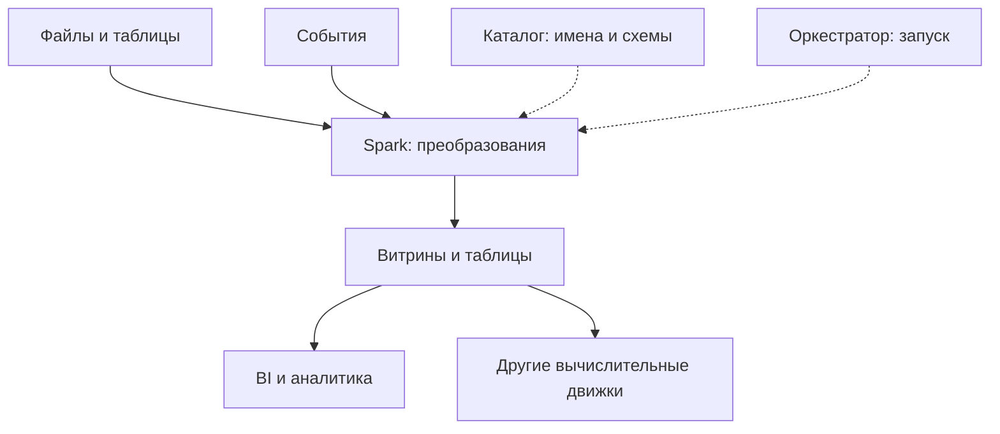
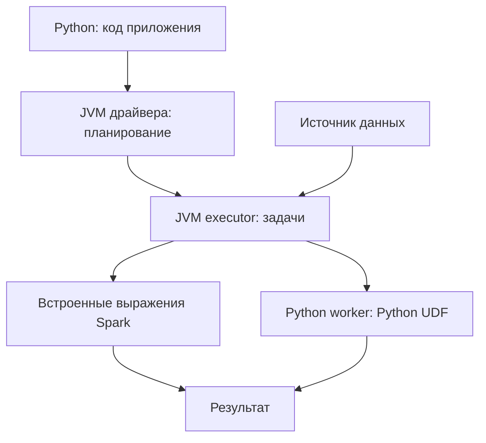
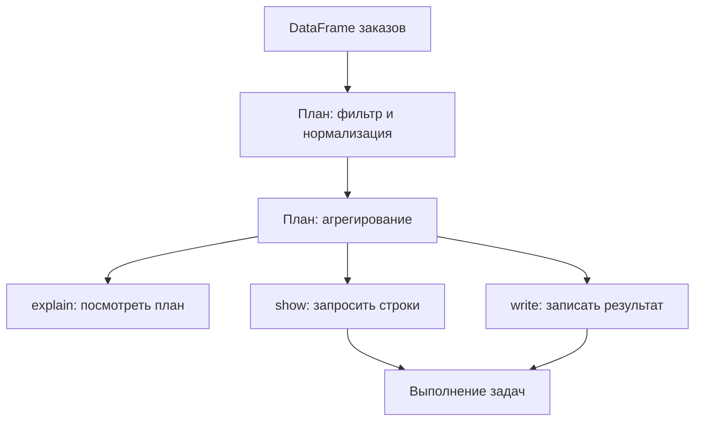

# 1. Фундамент Apache Spark

Эта глава знакомит со Spark с нуля: зачем нужен распределённый движок, как устроены его API, какое окружение подготовить и как запустить первое приложение. Весь материал раздела собран на одной странице.

Основной язык примеров — **Python / PySpark**. Учебное окружение: **Apache Spark 4.2.0, Python 3.12, JDK 17, Spark Classic**. Версии зафиксированы для воспроизводимости; требования другой версии нужно проверять в её документации. Для начала достаточно одного компьютера и режима `local[2]`.

Фрагменты с переменными `spark`, `orders` и `summary` предполагают действующую сессию и DataFrame из соответствующего примера. Полное самостоятельное приложение и команды его запуска приведены в теме «Первое приложение». Примеры Scala, Java, Docker и Spark Connect обозначены отдельно.

**Содержание**

1. [Введение в Apache Spark](#introduction)
2. [Предварительные знания](#prerequisites)
3. [Компоненты и API Spark](#components)
4. [Версии и совместимость окружения](#compatibility)
5. [Установка и настройка окружения](#installation)
6. [Первое приложение](#first-application)
7. [Способы запуска](#launching)
8. [Базовые правила работы со Spark](#basic-rules)

<a id="introduction"></a>

## Введение в Apache Spark

### Что такое Apache Spark и какие задачи он решает

**Apache Spark — движок обработки данных**, который выполняет вычисления параллельно. Он может работать на одном компьютере или распределять работу между машинами кластера. Пользователь описывает преобразования, а Spark планирует их выполнение, разбивает работу на задачи и обрабатывает отказы.

Представим таблицу заказов: нужно оставить завершённые заказы, сгруппировать их по городам и посчитать выручку. На одном компьютере это можно сделать SQL-запросом или библиотекой DataFrame. Когда объём, время выполнения или требования платформы требуют распределения работы, ту же задачу можно выполнить в Spark.

```python
from pyspark.sql import SparkSession, functions as F

spark = (
    SparkSession.builder
    .appName("spark-foundation-demo")
    .master("local[2]")
    .getOrCreate()
)

demo = spark.createDataFrame(
    [("Moscow", "completed", 12000),
     ("Moscow", "completed", 8000),
     ("Kazan", "cancelled", 7000)],
    ["city", "status", "amount_cents"],
)

result = (
    demo.filter(F.col("status") == "completed")
    .groupBy("city")
    .agg(F.sum("amount_cents").alias("revenue_cents"))
)
result.show()
# Moscow: 20000
```

В примере суммы хранятся в целых минимальных денежных единицах. Для денег также подходит `DecimalType`; двоичная арифметика `float` может давать нежелательные ошибки округления.

Spark не требует загрузить весь набор данных в RAM. Он читает данные из источников, обрабатывает части набора, при необходимости использует диск и позволяет явно сохранять промежуточные результаты. Выражение «in-memory engine» не означает «всё всегда находится в памяти».

**Что нужно запомнить:** Spark помогает организовать вычисления над данными; место хранения, бизнес-правила и требования к результату определяешь ты.

[Официальный обзор Spark](https://spark.apache.org/docs/4.2.0/).

### История Spark и развитие проекта Apache

Spark появился как исследовательский проект в AMPLab Калифорнийского университета в Беркли в 2009 году. В начале 2010 года код стал открытым; в 2013 году проект перешёл в Apache, а в феврале 2014 года получил статус проекта верхнего уровня Apache Software Foundation.

Главная идея раннего Spark — удобнее выполнять цепочки распределённых вычислений и повторно использовать промежуточные данные. Это особенно важно для итеративных алгоритмов, которым приходится многократно обращаться к одному набору.

| Этап | Почему он важен для изучения |
| --- | --- |
| Ранний Spark и RDD | Распределённые коллекции, зависимости вычислений и восстановление потерянных частей |
| Spark 2.0 | `SparkSession`, развитие структурированных API, начало Structured Streaming |
| Spark 3.0 | AQE, dynamic partition pruning, развитие pandas UDF и SQL |
| Spark 4.x | Новые требования к окружению, развитие SQL и удалённых API; необходимость учитывать миграции |

Статус проекта Apache означает развитие открытым сообществом по правилам ASF. Из этого не следует, что любой сервис с названием Spark предоставляет только стандартные возможности Apache Spark: поставщики добавляют свои компоненты.

В старых материалах встречаются `SQLContext`, `HiveContext`, DStreams и окружения со старыми версиями Java. Они полезны для понимания существующих систем, но для нового учебного приложения удобно начинать со `SparkSession`, DataFrame и SQL.

Источники: [история проекта](https://spark.apache.org/history), [переход в Apache TLP](https://spark.apache.org/news/spark-becomes-tlp.html), [Spark 2.0](https://spark.apache.org/releases/spark-release-2-0-0.html), [Spark 3.0](https://spark.apache.org/releases/spark-release-3-0-0.html), [Spark 4.0](https://spark.apache.org/releases/spark-release-4-0-0.html).

### Пакетная, потоковая и интерактивная обработка данных

**Пакетная обработка, batch:** приложение читает конечный набор данных и завершает вычисление. Например, каждый день рассчитывает продажи за предыдущий день. Набор может быть огромным, но границы конкретного запуска определены.

**Потоковая обработка, streaming:** новые данные продолжают поступать. Например, события заказов приходят из Kafka, а приложение обновляет агрегаты. Здесь важны время события, задержки, состояние, восстановление и гарантии записи. Structured Streaming предоставляет API для таких задач; обычное выполнение часто организовано как последовательность микропакетов.

**Интерактивная обработка:** человек исследует данные через оболочку, notebook или SQL-сервис. «Интерактивная» описывает способ взаимодействия, а не отдельный формат хранения. Notebook вполне может запустить долгий batch-запрос.

| Задача | Режим | Как выглядит завершение |
| --- | --- | --- |
| Построить витрину за сутки | Batch | Результат записан, приложение завершилось |
| Обновлять статистику входящих событий | Streaming | Запрос работает до остановки либо выбранного условия завершения |
| Проверить распределение заказов по городам | Интерактивный анализ | Пользователь получает ответ и формулирует следующий запрос |

В batch часто используют `spark.read` и `DataFrame.write`. Для streaming — `spark.readStream` и `DataFrame.writeStream`; поток запускается через `start()`. Вызывать обычный `collect()` для бесконечного потока как для конечной таблицы нельзя.

Не стоит воспринимать streaming как обещание мгновенного ответа. Задержка зависит от режима выполнения, источника, преобразований и приёмника.

[Введение в Structured Streaming](https://spark.apache.org/docs/4.2.0/streaming/getting-started.html).

### Spark как вычислительный движок и его место в платформе данных

В платформе данных нужно различать **хранение**, **вычисления**, **метаданные** и **управление запуском**.

Spark выполняет вычисления. CSV, Parquet, таблицы lakehouse или данные базы могут храниться вне него. Каталог помогает находить таблицы и их схемы. Оркестратор определяет, когда запускать приложение и какие зависимости между запусками соблюсти. BI-система показывает результат пользователю.



Стрелки от источников и к витринам обозначают работу с данными; пунктирные — метаданные и управление запуском. Это одна возможная архитектура, а не обязательный состав любой Spark-системы.

**Практическое следствие:** закрытие Spark-приложения не должно удалять уже записанную витрину. Но временное представление сессии и неперсистентные промежуточные вычисления не становятся долговременным хранилищем сами по себе.

Spark SQL похож на работу с базой по синтаксису запросов, однако установка Spark сама по себе не превращает файловое хранилище в транзакционную OLTP-базу.

### Области применения: ETL/ELT, аналитика, машинное обучение и графы

**ETL — Extract, Transform, Load:** извлечь данные, преобразовать и загрузить результат. Например, прочитать заказы из файлов, привести типы, применить правила качества и записать очищенную таблицу.

**ELT — Extract, Load, Transform:** сначала загрузить данные в целевую платформу, затем преобразовать. Spark может выполнять стадию преобразования над уже загруженными таблицами. Отличие ETL от ELT связано с порядком шагов, а не с использованием конкретного API.

**Аналитика:** соединения, агрегаты, оконные расчёты, подготовка витрин и исследование больших наборов. Например, выручка по городам или доля повторных покупок.

**Машинное обучение:** распределённая подготовка признаков и алгоритмы MLlib. Spark не заменяет автоматически все инструменты обучения нейросетей: иногда он готовит данные, а модель обучается другой системой.

**Графы:** связи между объектами — например, вершины-клиенты и рёбра-переводы. Для таких задач существуют GraphX и внешние библиотеки. Их языковая доступность и совместимость различаются.

| Исходные данные | Операции | Результат |
| --- | --- | --- |
| Заказы и справочник клиентов | Проверки, join, агрегаты | Витрина продаж |
| Журналы событий | Разбор, фильтрация, группировка | Метрики поведения |
| История взаимодействий | Признаки, обучение, оценка | Модель или прогнозы |
| Таблица связей | Построение графа, графовый алгоритм | Компоненты связности или ранги |

Начать лучше с первой строки: она позволяет понять чтение, схемы, преобразования и запись без дополнительных библиотек.

### Преимущества, ограничения и стоимость распределённых вычислений

Распределение даёт возможность обрабатывать данные несколькими процессами и машинами, использовать суммарные ресурсы и восстанавливать часть вычислений после отказа. Но появляются накладные расходы: запуск задач, сериализация, передача по сети, запись промежуточных данных и согласование выполнения.

**Пример:** прочитать 100 строк и сложить один столбец на уже запущенном Python-процессе обычно проще, чем поднимать Spark. На большом наборе тот же подход может упереться в память или время одной машины.

Ускорение нельзя считать как «добавили десять машин — стало в десять раз быстрее». Если одна часть задачи последовательная, источник медленный или ключи распределены неравномерно, дополнительные ресурсы могут простаивать.

| Ограничение | Пример | Что важно понять сначала |
| --- | --- | --- |
| CPU | Сложные выражения, распаковка данных | Насколько вычисления параллельны |
| RAM | Большие промежуточные структуры | Где именно расходуется память |
| Диск | Чтение, запись, spill | Скорость и свободное место |
| Сеть | Перераспределение данных | Объём обмена между исполнителями |
| Внешний источник | Медленная база | Не создаёт ли Spark лишнюю нагрузку |

Условная стоимость облачного запуска — сумма стоимости вычислительных ресурсов за время работы, хранения и операций ввода-вывода. Реальный тариф зависит от платформы. Время ожидания и простои тоже могут влиять на счёт.

**Правило:** сначала измерять объём и характер задачи, затем выбирать ресурсы. Увеличение числа executor'ов или памяти без измерений не является универсальной оптимизацией.

### Когда достаточно SQL-базы, pandas, Polars или DuckDB

Выбор начинается с вопроса: **где находятся данные и какой результат нужен?** Если таблица уже в базе и база эффективно выполняет запрос, выгрузка всей таблицы в Spark может лишь добавить работу.

| Инструмент | Типичная подходящая ситуация | Что проверить |
| --- | --- | --- |
| SQL-база | Фильтры и агрегаты над уже хранящимися таблицами; транзакционные операции | План запроса, индексы, нагрузку и доступные ресурсы |
| pandas | Анализ на одной машине, интеграция с Python-библиотеками | Память с учётом промежуточных результатов |
| Локальный Polars | Обработка файлов и DataFrame на одной машине | Возможности lazy/streaming execution и используемых операций |
| DuckDB | Аналитический SQL над локальными файлами и таблицами | Память, диск и профиль запроса |
| Spark | Распределённая обработка или общий стандарт существующей платформы | Кластер, источники, стоимость запуска и эксплуатации |

Polars и DuckDB могут выполнять некоторые задачи с объёмом данных больше доступной RAM, используя соответствующие режимы и диск. Поэтому критерий «файл не помещается в память — нужен Spark» слишком грубый.

Нет универсальной границы в гигабайтах. Текстовый файл после разбора может занять гораздо больше памяти; несколько join и сортировок создают промежуточные данные. На выбор также влияют сроки, повторяемость, совместная работа и уже существующая инфраструктура.

**Пример выбора:** разовый отчёт из одного Parquet-файла на ноутбуке разумно сначала попробовать локальным SQL-движком. Ежедневный расчёт витрин в компании с готовой Spark-платформой может быть удобнее реализовать в Spark, даже если один тестовый набор небольшой.

Документация: [pandas](https://pandas.pydata.org/docs/getting_started/overview.html), [Polars](https://docs.pola.rs/), [DuckDB и обработка данных больше RAM](https://duckdb.org/docs/current/guides/performance/how_to_tune_workloads).

### Сравнение Spark, Hadoop MapReduce, Flink и Trino по типам задач

Это инструменты с пересекающимися возможностями, но разными моделями работы и типичными сценариями. Таблица помогает поставить вопрос о выборе; она не является рейтингом производительности.

| Движок | Основная модель | Частый сценарий | Особенность выбора |
| --- | --- | --- | --- |
| Spark | Граф распределённых вычислений, SQL/DataFrame, batch и streaming | ETL, витрины, подготовка признаков | Удобен для цепочек преобразований и единого программного API |
| Hadoop MapReduce | Map и reduce, связанные отдельными заданиями | Существующие Hadoop-пайплайны, крупные batch-задачи | Длинные и итеративные цепочки требуют организации нескольких заданий |
| Flink | Обработка ограниченных и неограниченных потоков, состояние | Потоковые приложения с event time и состоянием | Нужно оценивать потоковую семантику, задержки и восстановление |
| Trino | Распределённый SQL-запрос к подключённым источникам | Интерактивная аналитика и SQL над несколькими системами | Важны возможности коннекторов и поведение источников |

Spark не требует MapReduce для выполнения своего кода. При этом Spark может работать с HDFS и использовать YARN: **Hadoop как экосистема** и **MapReduce как движок** — разные понятия.

Flink умеет batch, Spark умеет streaming, Trino может выполнять запись через поддерживающие её коннекторы. Формулировки «этот инструмент умеет только один тип обработки» обычно неверны.

Сравнивать нужно на одинаковых данных, с одинаковым ожидаемым результатом и приемлемыми гарантиями. Быстрый запрос без нужной корректности или надёжности не решает задачу.

Источники: [Hadoop MapReduce](https://hadoop.apache.org/docs/stable/hadoop-mapreduce-client/hadoop-mapreduce-client-core/MapReduceTutorial.html), [Flink](https://nightlies.apache.org/flink/flink-docs-stable/docs/concepts/overview/), [Trino](https://trino.io/docs/current/overview.html).

**Самопроверка:** объясни, почему Spark не является базой данных, почему кластер может проиграть одной машине и почему наличие Hadoop не означает выполнение через MapReduce.

<a id="prerequisites"></a>

## Предварительные знания

### Основы Python либо Scala/Java для выбранного API

Для PySpark нужны переменные, базовые типы, коллекции, функции, модули, исключения и работа с окружением. На старте не требуется знать весь Python, но нужно понимать различие обычной Python-функции и выражения Spark.

```python
def add_fee_locally(amount_cents):
    return amount_cents + 100

print(add_fee_locally(1000))  # 1100: Python вычисляет одно значение

from pyspark.sql import functions as F

fee_expression = F.col("amount_cents") + F.lit(100)
# Это описание выражения над колонкой, а не готовый список сумм.
```

`F.col("amount_cents")` возвращает `Column`. Такой объект описывает вычисление для Spark. Подставлять его в обычный `if`, ожидающий Python `bool`, нельзя.

```python
# Правильно: условие над колонками.
condition = (
    (F.col("status") == "completed")
    & (F.col("amount_cents") >= 0)
)

# Скобки нужны из-за приоритетов операторов Python.
# Для Column используют &, | и ~, а не and, or и not.
```

Scala/Java потребуют дополнительно понимания JVM, коллекций, типов и сборки проекта. Scala удобна для чтения реализации Spark; Java позволяет использовать JVM API в знакомом корпоративном стеке. Выбирать язык лучше по задаче и окружению команды.

**Минимальная готовность:** ты можешь написать функцию, импортировать модуль, обработать исключение и объяснить, что функция возвращает.

### SQL, реляционная модель и операции над таблицами

Нужно понимать строки, колонки, типы, фильтрацию, проекцию, join, группировку и агрегаты. SQL описывает требуемый результат декларативно: движок выбирает способ его получения.

```sql
SELECT city, SUM(amount_cents) AS revenue_cents
FROM orders
WHERE status = 'completed' AND amount_cents IS NOT NULL
GROUP BY city;
```

Проекция — выбор колонок (`SELECT`), фильтрация — выбор строк (`WHERE`), группировка — объединение строк по ключу (`GROUP BY`). Агрегат сводит несколько значений к результату, например `SUM` или `COUNT`.

Важно знать три особенности:

- `NULL` означает отсутствие значения. Проверка `amount_cents = NULL` не заменяет `IS NULL`.
- Без `ORDER BY` порядок результата не гарантирован.
- Join может увеличить число строк. Если одному ключу слева соответствуют три строки справа, результат содержит три соответствия, а не одно.

Spark DataFrame не обеспечивает уникальность ключа автоматически. Наличие колонки `order_id` ещё не означает отсутствие дубликатов. Ограничения, которые база проверяет при записи, в файловом пайплайне часто приходится проверять отдельно.

**Упражнение:** для заказа с двумя совпадающими строками справочника предскажи число строк после inner join. Ответ: две. Если затем суммировать стоимость заказа, она может оказаться учтённой дважды.

### Файлы, процессы, переменные окружения и работа в терминале

**Файл** — объект хранения. **Каталог** объединяет файлы. **Процесс** — запущенная программа. **Текущий рабочий каталог** влияет на относительные пути. **Переменная окружения** передаёт настройку процессу, например путь к Java.

```bash
pwd
python --version
java -version
python -c "import sys; print(sys.executable)"
```

Последняя команда особенно полезна, когда пакет установлен в одном Python, а IDE запускает другой.

`data/orders.csv` — относительный путь. Если приложение запускается из другой директории, оно может искать другой файл. Абсолютный путь однозначен внутри одной файловой системы, но не гарантирует доступ на других машинах.

**Пример:** `/home/me/orders.csv` на ноутбуке не появляется автоматически на executor'ах кластера. Для распределённого запуска нужен доступный исполнителям источник: HDFS, объектное хранилище, база или общая файловая система.

Обычно переменные окружения наследуются дочерними процессами. Изменение `JAVA_HOME` в одном терминале не обязано влиять на уже запущенную IDE. После изменения окружения иногда нужно перезапустить терминал или IDE.

Также различай текстовый исходник `first_app.py`, установленный пакет `pyspark` и работающий процесс приложения: это разные объекты.

### Основы JVM и различие JVM-процесса и Python-процесса

Основная реализация Spark работает на JVM — виртуальной машине Java. JVM исполняет байткод, управляет своей памятью и использует сборщик мусора. **JDK** включает средства разработки и среду выполнения Java.

В Spark Classic код PySpark создаёт Python-объекты API и взаимодействует с JVM. Выражения стандартного DataFrame API обычно выполняются движком Spark, а не построчным циклом в Python. Для Python UDF и Python-операций над RDD могут запускаться Python worker-процессы на исполнителях.



Схема показывает Spark Classic на кластере. В локальном режиме драйвер и локальный исполнитель работают в одной JVM; это не несколько независимых машин.

У Python и JVM разные области памяти. Рост памяти Python worker нельзя объяснить только размером JVM heap. Поэтому слово «OOM» само по себе ещё не говорит, какой процесс превысил лимит.

Не нужно заранее писать на Java, чтобы использовать PySpark. Но необходимо уметь проверить Java и понимать, почему сообщение об ошибке содержит Java/Scala stack trace.

### CPU, RAM, диски и сеть как ресурсы обработки данных

**CPU** выполняет расчёты и обработку кодировок. **RAM** хранит рабочие структуры и буферы. **Диски** участвуют в чтении, записи и сохранении промежуточных данных. **Сеть** передаёт данные между процессами и к внешним системам.

Пример группировки по городу: сначала задачи читают свои части заказов, затем данные для одинаковых городов должны попасть в подходящие группы обработки. Такой обмен называют **shuffle**. Он может потребовать сети, сериализации и диска, а не только CPU.

| Наблюдение | Возможное объяснение | Почему вывод не окончательный |
| --- | --- | --- |
| CPU низкий, запрос долгий | Ожидание источника, диска или сети | Нужны метрики и план |
| Одна задача намного дольше остальных | Неравномерные данные или медленное чтение | Причины различаются |
| Много сборки мусора | Давление на JVM heap | Может быть следствием неудачного алгоритма |
| Диск заполнен | Промежуточные файлы, spill, логи | Увеличение heap не всегда решает проблему |

**Партиция** — часть распределённого набора; **задача, task** — единица работы над частью данных в конкретной стадии. Обычно число одновременно исполняемых задач ограничивается доступными слотами, а не общим количеством партиций.

100 партиций при двух вычислительных слотах не означают 100 одновременно работающих задач. Слишком мелкие партиции добавляют накладные расходы; слишком крупные могут уменьшить параллелизм и увеличить потребность в памяти.

### Основы распределённых систем: задержки, частичные отказы и повторные попытки

В распределённой системе один исполнитель может потерять связь или завершиться, пока остальные продолжают работать. Отсутствие ответа не всегда позволяет немедленно понять, произошёл отказ или задержка.

Spark может повторять задачи и восстанавливать потерянные части вычислений по зависимостям. Это помогает пережить некоторые отказы, но не исправляет ошибки бизнес-логики и не делает любой внешний эффект безопасным.

**Пример:** задача обрабатывает партицию и отправляет HTTP-запрос о начислении бонуса. Сервер принял запрос, но задача завершилась с ошибкой до подтверждения. При повторном запуске начисление может повториться.

Отсюда два понятия:

- **Детерминированность:** одинаковые входные данные и параметры дают одинаковый результат. Текущее время, случайность без управления и изменяющийся внешний справочник могут нарушить это свойство.
- **Идемпотентность:** повтор операции не меняет результат после первого успешного применения. Например, запись по стабильному ключу с подходящей семантикой может быть идемпотентной; безусловное добавление строки — не обязательно.

Python-словарь на драйвере не становится общей памятью для кластера. Переданная исполнителю копия объекта не обеспечивает согласованное обновление счётчика на всех машинах. Broadcast предназначен для распространения данных для чтения, а не для общего изменяемого состояния.

**Правило для начала:** описывать преобразования данных и записывать результат через поддерживаемый приёмник. Внешние побочные эффекты требуют отдельной модели повторов и гарантий.

<a id="components"></a>

## Компоненты и API Spark

### Spark Core и Spark SQL

**Spark Core** предоставляет основы распределённого выполнения: задачи, планирование, работу с RDD и восстановление вычислений. **Spark SQL** добавляет структурированные данные, выражения, анализ типов и оптимизацию запросов.

Название Spark SQL не означает «работает только с SQL-строками». DataFrame API тоже использует структурированный движок. Например, `df.filter(...).groupBy(...).agg(...)` описывает запрос, который может быть проанализирован и оптимизирован.

В структурированном запросе Spark знает имена колонок, их типы и смысл встроенных операций. Произвольную пользовательскую функцию он обычно не может анализировать так же подробно. Поэтому стандартные выражения — хороший первый выбор.

```python
small = spark.range(5)  # Колонка id: 0, 1, 2, 3, 4.
small.select((F.col("id") + 1).alias("next_id")).show()

small.createOrReplaceTempView("small_numbers")
spark.sql("SELECT id + 1 AS next_id FROM small_numbers").show()
```

Оба варианта описывают один результат. SQL и DataFrame не являются отдельными конкурирующими движками внутри такого примера.

[Spark SQL](https://spark.apache.org/docs/4.2.0/sql-programming-guide.html).

### DataFrame, Dataset и RDD: назначение и доступность в языках

| API | Что описывает | Типы и структура | Языки |
| --- | --- | --- | --- |
| RDD | Распределённую коллекцию элементов | Смысл элементов задаёт код пользователя | Scala, Java, Python в Spark Classic |
| DataFrame | Структурированный распределённый запрос | Схема колонок и SQL-типы | Python, Scala, Java |
| Типизированный Dataset | Структурированный набор с типом JVM-объекта | Encoders и типизированные операции | Scala и Java |

DataFrame в PySpark — не pandas DataFrame. Он описывает распределённые данные и вычисления, а не обязательно готовую таблицу в памяти Python.

В Scala DataFrame соответствует `Dataset[Row]`, в Java — `Dataset<Row>`. В PySpark нет эквивалента типизированного JVM API `Dataset[T]`. Python-аннотация `orders: DataFrame` этого не меняет.

**Пример RDD для понимания модели — только Spark Classic:**

```python
numbers = spark.sparkContext.parallelize([1, 2, 3, 4], 2)
squares = numbers.map(lambda value: value * value)
print(squares.sum())  # 30
```

Для табличных ETL и аналитики лучше начинать с DataFrame/SQL: схема и встроенные операции дают движку больше возможностей для оптимизации. RDD нужен для понимания основ и некоторых специальных сценариев; переход в RDD не является универсальным ускорением.

В Spark Connect прямое использование RDD и `SparkContext` не поддерживается.

Источники: [структурированные API](https://spark.apache.org/docs/4.2.0/sql-programming-guide.html), [RDD](https://spark.apache.org/docs/4.2.0/rdd-programming-guide.html), [Connect](https://spark.apache.org/docs/4.2.0/app-dev-spark-connect.html).

### Structured Streaming и его связь со Spark SQL

Structured Streaming использует модель структурированного запроса: входная таблица дополняется событиями, а результат обновляется по правилам запроса. Многие выражения знакомы по batch DataFrame, но допустимость операции и режим вывода зависят от потоковой семантики.

**Самостоятельный локальный пример в существующей сессии:**

```python
stream = (
    spark.readStream
    .format("rate")
    .option("rowsPerSecond", 2)
    .load()
)

query = (
    stream.select("timestamp", "value")
    .writeStream
    .format("console")
    .option("truncate", "false")
    .outputMode("append")
    .start()
)

try:
    query.awaitTermination(10)
finally:
    query.stop()
```

`rate` генерирует тестовые строки с временем и возрастающим значением. Console sink нужен для демонстрации; он не является надёжным хранилищем результата. Реальное число увиденных строк зависит от запуска и длительности микропакетов.

`start()` запускает потоковый запрос; `awaitTermination(10)` ждёт его завершения либо истечения 10 секунд. Это не команда «обработать ровно десять секунд событий».

Для прикладного потока нужно отдельно спроектировать checkpoint, источник, приёмник, состояние, время события и обработку повторов. Нельзя переносить обещание exactly-once на любую произвольную запись из пользовательского кода.

[Streaming DataFrame API](https://spark.apache.org/docs/4.2.0/streaming/apis-on-dataframes-and-datasets.html).

### MLlib, GraphX и внешние библиотеки экосистемы

**MLlib** — библиотека машинного обучения Spark. Современный основной API находится в `pyspark.ml` и работает с DataFrame. `pyspark.mllib` содержит старый RDD API, находящийся в режиме сопровождения.

В ML-пайплайне обычно различают:

- **Transformer:** преобразует DataFrame, например собирает несколько колонок в вектор признаков.
- **Estimator:** обучается на данных и возвращает модель.
- **Pipeline:** связывает стадии подготовки и обучения.

```python
from pyspark.ml.feature import VectorAssembler

features_input = spark.createDataFrame(
    [(2.0, 120.0), (1.0, 50.0)],
    ["orders_count", "revenue"],
)
assembler = VectorAssembler(
    inputCols=["orders_count", "revenue"],
    outputCol="features",
)
# Для ML-примера нужны дополнительные зависимости окружения ML.
features = assembler.transform(features_input)
features.select("features").show(truncate=False)
```

**GraphX** предоставляет графовые структуры и алгоритмы через Scala API. Это не встроенный графовый Python API. **GraphFrames** — отдельный проект с собственными зависимостями и требованиями совместимости.

Другие внешние компоненты могут добавлять табличные форматы, геообработку, коннекторы или ускорение вычислений. Наличие статьи про библиотеку не означает, что она входит в установленный пакет Spark или совместима с выбранной версией.

Источники: [MLlib](https://spark.apache.org/docs/4.2.0/ml-guide.html), [GraphX](https://spark.apache.org/docs/4.2.0/graphx-programming-guide.html), [GraphFrames](https://graphframes.io/).

### PySpark, Scala API, Java API и SQL

Для обычного структурированного запроса язык прежде всего определяет способ описания плана. Если используются эквивалентные встроенные выражения, выбор Python вместо Scala не означает, что каждая строка будет обрабатываться медленным Python-циклом.

**PySpark:**

```python
spark.range(5).filter(F.col("id") >= 2).select("id").show()
```

**Scala — в `spark-shell`, где `spark` уже создан:**

```scala
import org.apache.spark.sql.functions.col
spark.range(5).filter(col("id") >= 2).select("id").show()
```

**Java — фрагмент внутри приложения с созданным `SparkSession spark`:**

```java
import static org.apache.spark.sql.functions.col;
spark.range(5).filter(col("id").geq(2)).select("id").show();
```

**SQL — в сессии Spark SQL:**

```sql
SELECT id FROM range(5) WHERE id >= 2;
```

Во всех примерах результат содержит 2, 3 и 4; без сортировки порядок не нужно считать частью контракта.

Различия становятся существеннее при пользовательском коде, работе с RDD, сериализации, языковых библиотеках и доступе к внутренним API. Поэтому утверждение «Scala всегда быстрее PySpark» слишком общее. Сначала сравнивают реальные планы и место выполнения пользовательской функции.

### Spark Classic и Spark Connect: обзор способов подключения

**Spark Classic:** обычное приложение с драйвером, который управляет SparkContext. В PySpark Python-код взаимодействует с JVM драйвера; приложение может запускаться локально или на кластере.

**Spark Connect:** клиент отправляет описание структурированного запроса серверу Spark Connect. Вычисления выполняются на серверной стороне. Клиент можно отделить от серверного окружения; прямого доступа к JVM драйвера через Py4J, RDD и SparkContext у него нет.

| Вопрос | Classic | Connect |
| --- | --- | --- |
| Кто организует выполнение Spark? | Драйвер приложения | Серверная сторона Spark Connect |
| Можно ли использовать `spark.sparkContext`? | Да | Нет |
| Где должен быть доступен большой файл? | Исполнителям приложения | Серверным исполнителям |
| Нужна ли Java на чистом Python-клиенте? | Нужна для локального Classic | Для `pyspark-client` локальная JVM не требуется |
| Все ли методы API одинаково доступны? | Проверять документацию версии | Дополнительно проверять поддержку Connect |

```python
# Отдельный пример: нужен уже работающий Spark Connect server.
from pyspark.sql import SparkSession

remote_spark = (
    SparkSession.builder
    .remote("sc://localhost:15002")
    .getOrCreate()
)
remote_spark.range(3).show()
remote_spark.stop()
```

URL здесь указывает на локальный сервер для демонстрации. В реальной платформе нужны её адрес и способ аутентификации. Вызов `.remote(...)` не поднимает кластер автоматически.

Для этой главы основной режим — Classic; пример Connect не нужно выполнять в той же сессии.

[Разработка с Spark Connect](https://spark.apache.org/docs/4.2.0/app-dev-spark-connect.html), [установка Python-клиентов](https://spark.apache.org/docs/4.2.0/api/python/getting_started/install.html).

### Встроенные возможности Spark и возможности внешних платформ

Пакет Apache Spark предоставляет движок и API. Управляемые платформы могут добавлять notebooks, управление кластерами, каталоги доступа, секреты, оркестрацию и собственные оптимизации.

| Возможность | Что относится к Spark | Что может зависеть от платформы |
| --- | --- | --- |
| SQL и DataFrame | API и выполнение запросов | Дополнительные функции и настройки |
| Spark UI | Просмотр текущего приложения | Прокси, права доступа, хранение истории |
| Каталоги | Интерфейсы и поддерживаемые реализации | Корпоративный каталог и политики |
| Доступ к источникам | Механизмы подключения | Установленные коннекторы и учётные данные |
| Запуск | `spark-submit`, интеграции с менеджерами кластера | Сервис заданий и интерфейс управления |
| Табличные форматы | Поддержка через соответствующие компоненты | Предустановленные расширения и их версии |

Например, вызов поставщицкой утилиты для секретов может работать в notebook платформы и отсутствовать при `pip install pyspark`. Такой код нужно явно отделять от переносимой логики преобразования.

Не следует считать любую настройку из чужого проекта стандартной настройкой Apache Spark. Сначала найди владельца параметра: сам Spark, коннектор или платформа. Это особенно важно для hints, SQL-синтаксиса и расширений каталогов.

**Практика:** объясни, какие части простого приложения `read → filter → groupBy → write` принадлежат Spark, а какие зависят от конкретного хранилища и способа запуска.

<a id="compatibility"></a>

## Версии и совместимость окружения

### Ветки Spark, release notes и документация конкретной версии

В номере `4.2.0` первая часть — major-версия, вторая — minor, третья — исправляющий релиз. По одному номеру нельзя заключить, что старое приложение будет работать без изменений: обновление может поменять зависимости, значения по умолчанию, обработку типов или исправить поведение, на которое код случайно полагался.

Различай три источника:

- **Документация версии:** какие API и настройки есть в выбранном релизе.
- **Release notes:** что добавлено, изменено или исправлено.
- **Migration guide:** на какие несовместимости обратить внимание при обновлении.

Ссылка `/docs/latest/` со временем начнёт показывать другой релиз. Для учебного проекта удобнее сохранять ссылки вида `/docs/4.2.0/`.

```python
import pyspark

print("Python package:", pyspark.__version__)
print("Spark runtime:", spark.version)
```

В локальном Classic-окружении с согласованной установкой значения должны соответствовать друг другу. У удалённого клиента и серверной платформы версии могут отличаться; допустимость конкретной комбинации проверяется отдельно.

**Правило:** пример из блога сначала сопоставляй со своей версией. Отсутствие метода в старом API — не обязательно ошибка установки.

[Документация Spark 4.2.0](https://spark.apache.org/docs/4.2.0/), [релизы Spark](https://spark.apache.org/releases/).

### Совместимость Spark с Java, Scala, Python и Hadoop

Для выбранного релиза необходимо согласовать несколько компонентов, а не просто установить последние версии всех пакетов.

| Компонент | Требование/свойство Spark 4.2.0 | Выбор в этой главе |
| --- | --- | --- |
| Java | Поддерживаются Java 17, 21 и 25 | JDK 17 |
| Python | Python 3.10 и новее | Python 3.12 |
| Scala | Бинарная линия Scala 2.13 | JVM-зависимости `_2.13`, если нужны |
| Hadoop | Нужные клиентские библиотеки зависят от сборки и источников | Для локального примера хватает поставки PySpark |

Таблица относится именно к **4.2.0**. Например, допустимость Java 8 или Scala 2.12 в старом Spark не переносится автоматически на Spark 4.x.

Установить полноценный HDFS/YARN-кластер для локального обучения не требуется. Hadoop-библиотеки в дистрибутиве могут обеспечивать файловые интерфейсы, но это не означает, что локальное приложение выполняется через MapReduce.

Для Python-кода, исполняемого worker-процессами, драйвер и исполнители должны использовать согласованное окружение, включая одинаковую minor-версию Python. Нельзя считать, что установленный на ноутбуке Python-пакет автоматически установлен на кластере.

**Проверка перед запуском:** версия Java, путь к Python, версия пакета PySpark, версия серверного Spark и способ подключения к источникам.

[Требования Spark 4.2.0](https://spark.apache.org/docs/4.2.0/), [Python и worker-процессы](https://spark.apache.org/docs/4.2.0/rdd-programming-guide.html).

### Совместимость PySpark с pandas, NumPy и PyArrow

Эти библиотеки не нужны во всех сценариях в одинаковой степени.

- **pandas** используется при преобразовании в локальный pandas DataFrame, в pandas UDF и в соответствующих pandas API.
- **PyArrow** участвует в столбцовом обмене данными и Arrow API; также нужен некоторым вариантам клиента.
- **NumPy** используется в ML и научных вычислениях.

Для обычного локального `read → filter → groupBy → write` достаточно основной установки `pyspark`. Не нужно устанавливать ML, pandas API и Spark Connect только потому, что они существуют.

В документации PySpark 4.2.0 указаны, в частности, `pandas >= 2.2.0, < 3.0.0`, `pyarrow >= 18.0.0` для соответствующих возможностей и `numpy >= 1.22` для MLlib. Это ограничения релиза, а не вечные требования Spark.

```bash
# Базовый маршрут этой главы.
python -m pip install "pyspark==4.2.0"

# Дополнительные варианты: выполнять при необходимости.
python -m pip install "pyspark[sql]==4.2.0"
python -m pip install "pyspark[ml]==4.2.0"
python -m pip check
```

Extras помогают установить соответствующие зависимости, но не гарантируют, что весь сторонний стек проекта совместим. После установки зафиксируй реально получившееся окружение.

Arrow может уменьшить накладные расходы передачи данных, но `toPandas()` всё равно создаёт локальный результат в памяти драйвера. Arrow не делает этот результат распределённым и не устраняет ограничения памяти.

[Зависимости и extras PySpark 4.2.0](https://spark.apache.org/docs/4.2.0/api/python/getting_started/install.html).

### Бинарная версия Scala и координаты JVM-зависимостей

JVM-библиотека обычно задаётся координатами `group:artifact:version`. Например:

```text
org.apache.spark:spark-sql_2.13:4.2.0
```

`org.apache.spark` — группа, `spark-sql_2.13` — артефакт, `4.2.0` — его версия. Суффикс `_2.13` указывает бинарную линию Scala, под которую собрана библиотека.

Если подключить артефакт `_2.12` к окружению, рассчитанному на Scala 2.13, возможны ошибки загрузки классов и несовместимые методы. Наличие Java не устраняет эту проблему: библиотека могла быть написана на Scala и зависеть от её бинарных интерфейсов.

При использовании JVM-коннектора нужно проверить:

1. Поддерживаемую версию Spark.
2. Суффикс Scala и версию самого коннектора.
3. Транзитивные зависимости и конфликты с уже установленными JAR.
4. Поддерживаемый API и режим подключения.

Python-пакет коннектора и его JVM-часть могут устанавливаться отдельно. Ошибка `ClassNotFoundException` после успешного `pip install` часто означает отсутствие JVM-компонента или неверный classpath.

Для первого CSV/Parquet-приложения добавлять `spark-sql` вручную через `--packages` не требуется: Spark уже содержит свой SQL-компонент.

### Различия Apache Spark и дистрибутивов управляемых платформ

Управляемая платформа может использовать Spark определённой версии, добавлять патчи, собственные библиотеки и менять конфигурацию. Поэтому «у нас Spark 4.x» — неполное описание окружения.

Для воспроизводимости нужны название и версия runtime платформы, версия Apache Spark, режим доступа, предустановленные расширения и ограничения запуска. Некоторые настройки нельзя менять из notebook, потому что ресурсы задаются при создании кластера или сессии.

**Пример:** код обращается к `spark.table("sales.orders")`. На ноутбуке такой таблицы может не быть: корпоративный каталог, права и хранилище не появились вместе с `pip install pyspark`.

Переносимую часть приложения удобно писать как функцию преобразования DataFrame. Получение секретов, адреса источников и способ запуска задаются окружением.

```python
def completed_orders(frame):
    return frame.filter(F.col("status") == "completed")
```

Функция не знает, прочитали ли вход из локального CSV, корпоративной таблицы или другого поддерживаемого источника. Но одинаковые имена колонок, типы и бизнес-семантику входа нужно обеспечить отдельно.

При разборе учебного материала помечай платформенные команды и функции. Это предотвращает попытки воспроизвести их в чистом Apache Spark.

### Фиксация версий для воспроизводимого обучения

Для этой главы достаточно записать в `requirements.txt`:

```text
pyspark==4.2.0
```

Это фиксирует прямую зависимость. Чтобы воспроизвести все установленные Python-пакеты, можно сохранить снимок отдельного учебного окружения:

```bash
python -m pip freeze > requirements.lock.txt
python -m pip install -r requirements.lock.txt
```

`pip freeze` — снимок, а не универсальный кроссплатформенный lockfile. На другой ОС или архитектуре доступность пакетов может отличаться. Для сложного проекта нужен механизм фиксации зависимостей, подходящий его платформам.

Также сохраняй вне списка Python-пакетов:

- Версии Python и JDK, ОС либо образ контейнера.
- Версию Spark, режим Classic/Connect и параметры запуска.
- Схему и небольшой тестовый вход.
- Команду запуска и ожидаемый результат.
- Версии внешних коннекторов, если они нужны.

Секреты в такой паспорт окружения не включают. Вместо значения пароля указывают способ его получения.

**Практика:** создай отдельное окружение, установи одну зафиксированную версию PySpark и проверь, что `pyspark.__version__` соответствует выбранной.

<a id="installation"></a>

## Установка и настройка окружения

### Установка JDK и проверка JAVA_HOME и PATH

Установи **JDK 17** для своей ОС и архитектуры. Например, можно использовать OpenJDK-дистрибутив Eclipse Temurin. Важно получить поддерживаемую версию, а не конкретную торговую марку JDK.

`JAVA_HOME` указывает на корень установки Java, **не на каталог `bin`**. `PATH` позволяет оболочке найти `java`.

**Linux / WSL на Ubuntu — пример установки через пакетный менеджер:**

```bash
sudo apt update
sudo apt install openjdk-17-jdk python3-venv
java -version
```

Если Java уже установлена, сначала проверь её версию. Установка второй копии без настройки путей может оставить активной старую.

**Linux — определение каталога установленной Java:**

```bash
export JAVA_HOME="$(dirname "$(dirname "$(readlink -f "$(command -v java)")")")"
export PATH="$JAVA_HOME/bin:$PATH"
java -version
```

Команда с `readlink -f` предназначена для Linux. Она определяет каталог текущего `java`, поэтому сначала убедись, что выбран нужный релиз.

**macOS — после установки JDK 17:**

```bash
export JAVA_HOME=$(/usr/libexec/java_home -v 17)
export PATH="$JAVA_HOME/bin:$PATH"
java -version
```

**Windows PowerShell — подставь свой реальный путь:**

```powershell
$env:JAVA_HOME = 'C:\Java\jdk-17'
$env:Path = "$env:JAVA_HOME\bin;$env:Path"
java -version
```

Команды `export` и `$env:` меняют окружение текущего терминала. Постоянную настройку выполняют средствами ОС; после неё открывают новый терминал.

**Частая ошибка:** `JAVA_HOME` указывает на одну Java, а `java` из `PATH` — на другую. Проверять нужно оба пути.

[Установка Temurin](https://adoptium.net/installation/).

### Установка Spark из дистрибутива и PySpark через менеджер пакетов

Есть два основных маршрута. Для Python-обучения проще маршрут с `pip`.

**Маршрут A — PySpark в Python-окружении:**

```bash
python -m pip install "pyspark==4.2.0"
python -c "import pyspark; print(pyspark.__version__)"
spark-submit --version
```

После установки в активное окружение доступны Python API и скрипты запуска. Отдельно скачивать ещё одну копию Spark для этих примеров не нужно. Java устанавливается отдельно.

Использование `python -m pip` связывает установку с выбранным интерпретатором и уменьшает вероятность установить пакет в другой Python.

**Маршрут B — готовый дистрибутив Apache Spark:**

1. На официальной странице выбери нужный релиз и сборку для своего окружения.
2. Скачай архив и проверь опубликованную контрольную сумму/подпись.
3. Распакуй его в выбранный каталог.
4. Задай `SPARK_HOME` и добавь его `bin` в `PATH`.

```bash
# Пример: архив уже распакован в этот каталог.
export SPARK_HOME="$HOME/tools/spark-4.2.0"
export PATH="$SPARK_HOME/bin:$PATH"
spark-submit --version
```

`SPARK_HOME` — корень дистрибутива, содержащий `bin`, `jars` и другие каталоги. Реальное имя распакованной директории может отличаться от примера.

Не смешивай случайно PySpark одного релиза и `SPARK_HOME` другого. При маршруте A переменная `SPARK_HOME` обычно не нужна; старое значение может направить запуск на неподходящую установку.

[Загрузка Spark](https://spark.apache.org/downloads.html), [установка PySpark](https://spark.apache.org/docs/4.2.0/api/python/getting_started/install.html).

### Виртуальное окружение Python и изоляция зависимостей

Виртуальное окружение отделяет пакеты учебного проекта от других Python-проектов. Оно не создаёт отдельную Java и не является контейнером.

**Linux / macOS / WSL:**

```bash
mkdir spark-foundation
cd spark-foundation
python3.12 -m venv .venv
source .venv/bin/activate
python -m pip install "pyspark==4.2.0"
python -c "import sys; print(sys.executable)"
```

Если интерпретатор называется `python3`, сначала проверь его версию и используй это имя вместо `python3.12`.

**Windows PowerShell — вариант без активации:**

```powershell
mkdir spark-foundation
cd spark-foundation
py -3.12 -m venv .venv
.\.venv\Scripts\python.exe -m pip install "pyspark==4.2.0"
.\.venv\Scripts\python.exe -c "import sys; print(sys.executable)"
```

Активация удобна, но не обязательна: можно всегда вызывать Python и `spark-submit` из каталога окружения напрямую.

В Git сохраняют исходники и список зависимостей. Сам каталог `.venv` обычно исключают. Виртуальное окружение создаётся заново, а не копируется между ОС.

```gitignore
.venv/
__pycache__/
.ipynb_checkpoints/
output/
```

Каталог `data` здесь не исключён: маленький учебный CSV можно хранить вместе с кодом. Большие и чувствительные входные данные в репозиторий не добавляют.

[Python venv](https://docs.python.org/3.12/tutorial/venv.html).

### Локальная установка в Linux, macOS, Windows и WSL

Логический порядок одинаков: **Java → Python → отдельное окружение → PySpark → smoke test**. Отличаются команды ОС, пути и правила работы с процессами.

| Среда | Что учитывать |
| --- | --- |
| Linux | Установить поддерживаемые Java/Python; проверить права на каталоги |
| macOS | Выбрать JDK под архитектуру Intel или Apple Silicon; корректно задать `JAVA_HOME` |
| Windows | Использовать Windows-пути и интерпретатор выбранного окружения; учитывать особенности Hadoop-библиотек |
| WSL | Java, Python и PySpark устанавливать внутри Linux; Windows-установка не заменяет Linux-окружение |

Для Windows удобно выбрать WSL и дальше следовать Linux-командам. Это рекомендация для удобства воспроизведения примеров, а не утверждение, что Spark принципиально не работает в Windows.

```powershell
# Windows: установка WSL, если он ещё не установлен.
wsl --install
```

После установки и необходимого перезапуска открывают Linux-дистрибутив и готовят окружение уже в нём. Для учебного проекта внутри WSL удобно использовать каталог в Linux-файловой системе.

Не нужно скачивать случайный `winutils.exe` «на всякий случай». Некоторые Windows-сценарии с Hadoop-зависимостями требуют дополнительной настройки, но она должна следовать из конкретной ошибки и выбранной сборки.

В путях с пробелами используй кавычки. Один и тот же файл может иметь разные пути в Windows и WSL; не переносить их в код без проверки.

[Установка WSL](https://learn.microsoft.com/en-us/windows/wsl/install).

### Окружение в Docker и доступ к каталогам данных

Контейнер помогает описать среду запуска, но не делает локальный пример кластером. Для начала достаточно одного контейнера с Java и PySpark.

Следующий `Dockerfile` рассчитан на полный `first_app.py` из этой главы. Java-каталог определяется при сборке, чтобы не привязывать его имя к одной архитектуре.

```dockerfile
FROM python:3.12-slim-bookworm

RUN apt-get update \
    && apt-get install -y --no-install-recommends openjdk-17-jre-headless \
    && ln -s "$(dirname "$(dirname "$(readlink -f "$(command -v java)")")")" /opt/java \
    && python -m pip install --no-cache-dir "pyspark==4.2.0" \
    && rm -rf /var/lib/apt/lists/*

ENV JAVA_HOME=/opt/java
WORKDIR /app
COPY first_app.py /app/first_app.py
ENTRYPOINT ["python", "/app/first_app.py"]
```

Сначала создай `first_app.py` и `data/orders.csv` по примеру ниже, затем сохрани Dockerfile рядом с приложением.

**Linux / macOS — сборка и запуск из каталога проекта:**

```bash
docker build -t spark-foundation:4.2.0 .
docker run --rm \
  --user "$(id -u):$(id -g)" \
  -p 4040:4040 \
  -v "$PWD:/workspace" \
  spark-foundation:4.2.0 \
  --local \
  --input /workspace/data/orders.csv \
  --output /workspace/output/orders_by_city \
  --overwrite
```

`-v` связывает каталог компьютера и каталог контейнера. Путь `/workspace/...` существует внутри контейнера; `$PWD/...` — снаружи. Записанные через этот mount файлы остаются на компьютере после удаления контейнера.

`--user` в данном примере помогает избежать файлов результата, принадлежащих root. Пользователь контейнера должен иметь права на смонтированный каталог.

Для просмотра UI добавь `-it` к `docker run` и `--inspect-ui` к аргументам приложения. Открой `http://localhost:4040` на компьютере, пока приложение ждёт ввода.

Для полной фиксации окружения одного тега базового образа недостаточно: тег может обновляться. Строго воспроизводимые сборки закрепляют digest и зависимости. У Apache также есть [проект официальных Spark-образов](https://github.com/apache/spark-docker); теги и состав нужно проверять отдельно.

### Настройка VS Code, PyCharm и IntelliJ IDEA

В IDE важнее всего выбрать правильный интерпретатор и рабочий каталог. Если в терминале `import pyspark` работает, а в IDE нет, сначала проверь `sys.executable` в обоих местах.

| IDE | Основные действия |
| --- | --- |
| VS Code для PySpark | Открыть каталог проекта; выбрать Python из `.venv`; задать `JAVA_HOME` в среде запуска |
| PyCharm для PySpark | Выбрать existing interpreter из `.venv`; проверить working directory и аргументы конфигурации |
| IntelliJ IDEA для Scala/Java | Выбрать JDK; использовать Maven/sbt/Gradle; согласовать Spark и Scala-зависимости |

Для `first_app.py` настрой аргументы запуска:

```text
--local --input data/orders.csv --output output/orders_by_city
```

Working directory должен быть каталогом, в котором находится `data/orders.csv`. `--local` в этом приложении явно выбирает `local[2]` для запуска через Python.

IDE запускает код на выбранной машине. Она не передаёт большой локальный CSV на кластер автоматически. Удалённый интерпретатор, Spark Connect и `spark-submit` — разные механизмы, и их нужно настраивать осознанно.

**Проверка:** выведи версию Java в терминале IDE, `sys.executable` в программе и `spark.version` после создания сессии. Не начинай с установки пакетов повторно в случайные окружения.

### Jupyter и notebooks для интерактивных экспериментов

Notebook удобен для небольших проверок: можно посмотреть схему, результат и план. Но порядок запуска ячеек становится частью состояния процесса.

**В активном учебном окружении:**

```bash
python -m pip install jupyterlab ipykernel
python -m ipykernel install --user \
  --name spark-foundation \
  --display-name "Python: Spark Foundation"
jupyter lab
```

Выбери kernel `Python: Spark Foundation`. Установка Jupyter в одном окружении и запуск kernel из другого возможны; именно поэтому нужен явный выбор kernel.

**Первая ячейка:**

```python
import sys
import pyspark
from pyspark.sql import SparkSession, functions as F

print(sys.executable)
print(pyspark.__version__)
spark = (
    SparkSession.builder
    .master("local[2]")
    .appName("foundation-notebook")
    .getOrCreate()
)
```

`getOrCreate()` может вернуть существующую сессию. Повторный запуск ячейки не гарантирует новый Spark-процесс и новое распределение ресурсов.

Если notebook работает только после особого порядка ячеек, проверь его запуском **Restart Kernel → Run All**. Значение старой переменной может скрывать ошибку.

Логи JVM иногда появляются в терминале Jupyter, а не только под ячейкой. Для диагностики нужно смотреть оба места. По завершении работы вызови `spark.stop()`; остановка kernel тоже завершает локальный процесс, но явное завершение удобнее для контролируемого примера.

[Регистрация IPython kernel](https://ipython.readthedocs.io/en/stable/install/kernel_install.html).

### Проверка установки и типичные проблемы запуска

Начни с самостоятельного smoke test, который не требует файлов и внешних источников:

```python
# smoke_test.py
from pyspark.sql import SparkSession

spark = (
    SparkSession.builder
    .master("local[2]")
    .appName("foundation-smoke-test")
    .getOrCreate()
)
try:
    print("Spark:", spark.version)
    print("Master:", spark.sparkContext.master)
    assert spark.range(10).count() == 10
    print("OK")
finally:
    spark.stop()
```

```bash
python smoke_test.py
```

Успех проверяет локальное создание сессии и простое выполнение. Он не проверяет доступ к S3, Kafka, корпоративному каталогу или кластеру.

| Симптом | Что проверить первым |
| --- | --- |
| `ModuleNotFoundError: pyspark` | Интерпретатор и окружение, в котором установлен пакет |
| `JAVA_GATEWAY_EXITED` | Сообщение Java выше по логу, `JAVA_HOME`, версию и права запуска |
| `UnsupportedClassVersionError` | Совместимость Java с загружаемыми классами |
| Ошибка Python worker | Путь к worker Python, minor-версию и зависимости |
| `PATH_NOT_FOUND` | Путь и его доступность в месте выполнения |
| Невозможно записать результат | Права и существование/режим выходного каталога |
| Ошибка hostname / bind | Сетевую конфигурацию машины, контейнера или окружения |
| UI не открывается после окончания | Жив ли SparkContext; доступность порта |

Предупреждение о невозможности загрузить native Hadoop library не обязательно означает провал локального примера. Решение принимают по реальной ошибке и результату smoke test.

При проблемах с локальным hostname можно проверить разрешение имени и при необходимости задать `SPARK_LOCAL_IP=127.0.0.1` **только для локального режима**. Для кластера loopback-адрес драйвера непригоден: исполнители должны связаться с ним по сети.

**Практика:** добейся `OK`, затем запусти smoke test из IDE и notebook с тем же окружением. Не переходи к внешним источникам, пока базовый локальный запуск не работает.

<a id="first-application"></a>

## Первое приложение

### Создание SparkSession и указание имени приложения

`SparkSession` — основная точка входа для DataFrame и SQL. Builder позволяет задать имя приложения и параметры до создания сессии.

```python
from pyspark.sql import SparkSession, functions as F

spark = (
    SparkSession.builder
    .appName("foundation-orders")
    .master("local[2]")
    .getOrCreate()
)
```

`appName` помогает найти приложение в UI и логах. Оно не задаёт число машин, не меняет источник данных и не является идентификатором таблицы.

`getOrCreate()` создаёт сессию либо использует существующую. Если ты уже выполнил предыдущие примеры в notebook, имя работающего SparkContext может остаться прежним. Для проверки запуска нового приложения используй новый процесс.

В Classic сессия связана со `SparkContext`, который управляет выполнением. Обычно в приложении используют один активный контекст. Не нужно создавать новую сессию для каждой таблицы.

Здесь `.master("local[2]")` задан для понятного локального примера. В полном приложении ниже локальный режим включается флагом `--local`, а при `spark-submit` master можно передать снаружи. Это позволяет не зашивать локальный запуск в кластерное приложение.

[SparkSession builder](https://spark.apache.org/docs/4.2.0/api/python/reference/pyspark.sql/api/pyspark.sql.SparkSession.builder.getOrCreate.html).

### Локальные режимы local, local[N] и local[*]

| Master | Что означает |
| --- | --- |
| `local` | Локальная работа с одним рабочим потоком для задач |
| `local[2]` | Локальная работа с двумя рабочими потоками |
| `local[N]` | До N рабочих потоков для выполнения задач |
| `local[*]` | Использование доступных логических ядер локальной машины |

`local[2]` **не означает два executor'а или два компьютера**. В локальном режиме выполнение организовано в одной JVM; при Python-операциях могут дополнительно появляться Python worker-процессы.

Количество потоков и количество партиций — разные параметры. Например:

```python
numbers = spark.range(0, 100, 1, numPartitions=4)
print(numbers.count())  # 100
```

У исходного диапазона четыре партиции. При `local[2]` задачи над ними не обязаны выполняться все одновременно. Локальный режим позволяет наблюдать стадии и часть распределённой модели, но не проверяет сетевые отказы и доступность данных на нескольких машинах.

Для начала `local[2]` удобен: остаются ресурсы для IDE и браузера. `local[*]` может занять все доступные ядра и не всегда ускоряет маленький пример.

**Практика:** запусти smoke test с `local`, затем с `local[2]`. Не делай вывод о производительности большого кластера по времени обработки десяти строк.

### Создание DataFrame и чтение небольшого файла

В сквозном примере есть четыре колонки: идентификатор заказа, город, статус и сумма. Обработку пропусков задаём явно.

```python
from pyspark.sql.types import StructType, StructField, LongType, StringType

order_schema = StructType([
    StructField("order_id", LongType(), True),
    StructField("city", StringType(), True),
    StructField("status", StringType(), True),
    StructField("amount_cents", LongType(), True),
])

orders = spark.createDataFrame([
    (1, "Moscow", "completed", 12000),
    (2, "Moscow", "completed", 8000),
    (3, "Kazan", "completed", 5000),
    (4, "Kazan", "cancelled", 7000),
    (5, None, "completed", 3000),
    (6, "Moscow", "completed", None),
], schema=order_schema)

orders.printSchema()
orders.orderBy("order_id").show(truncate=False)
```

Создание из Python-списка подходит для маленького учебного набора: сами элементы исходного списка находятся на драйвере. Большую таблицу сначала целиком собирать в Python-список не нужно.

**Тот же вход в CSV:** создай `data/orders.csv` со следующим содержимым.

```csv
order_id,city,status,amount_cents
1,Moscow,completed,12000
2,Moscow,completed,8000
3,Kazan,completed,5000
4,Kazan,cancelled,7000
5,,completed,3000
6,Moscow,completed,
```

```python
orders = (
    spark.read
    .schema(order_schema)
    .option("header", True)
    .option("mode", "FAILFAST")
    .csv("data/orders.csv")
)
```

В этой схеме пустые поля города и суммы читаются как `NULL`. Явная схема задаёт типы, `header` указывает наличие заголовка, `FAILFAST` позволяет завершить чтение ошибкой при обнаружении некорректной записи. Поведение парсера определяется форматом и настройками; `FAILFAST` не проверяет все бизнес-правила.

Spark может просматривать файловые метаданные при построении DataFrame. Если использовать `inferSchema`, могут потребоваться дополнительные чтения данных ещё до твоего первого явного action. Поэтому «после `read` вообще ничего не происходит» — неверная модель.

При распределённом чтении доступ к источнику нужен исполнителям. Для первого примера локального файла достаточно.

[CSV-источник](https://spark.apache.org/docs/4.2.0/sql-data-sources-csv.html), [API чтения CSV](https://spark.apache.org/docs/4.2.0/api/python/reference/pyspark.sql/api/pyspark.sql.DataFrameReader.csv.html).

### Первая трансформация и первое действие

**Transformation** создаёт описание нового набора/запроса. **Action** запрашивает выполнение и результат либо внешний эффект вроде записи.

```python
valid_orders = (
    orders
    .filter(
        (F.col("status") == "completed")
        & F.col("order_id").isNotNull()
        & F.col("amount_cents").isNotNull()
        & (F.col("amount_cents") >= 0)
    )
    .withColumn("city", F.coalesce(F.col("city"), F.lit("UNKNOWN")))
)

summary = (
    valid_orders
    .groupBy("city")
    .agg(
        F.count("*").alias("orders_count"),
        F.sum("amount_cents").alias("revenue_cents"),
    )
)

summary.explain(mode="formatted")  # План, а не выгрузка всех строк.
summary.orderBy("city").show(truncate=False)  # Выполнение для показа.
```

**Ожидаемый результат:**

| city | orders_count | revenue_cents |
| --- | ---: | ---: |
| Kazan | 1 | 5000 |
| Moscow | 2 | 20000 |
| UNKNOWN | 1 | 3000 |

Заказ 4 исключён по статусу, заказ 6 — из-за отсутствующей суммы. Заказ 5 сохранён, а его город обозначен как `UNKNOWN`. Это выбранные правила примера; в другом приложении отсутствующий город может требовать отклонения записи.



Схема различает построение запроса, просмотр плана и запуск вычислений. Анализ, работа с метаданными и некоторые подготовительные действия могут происходить раньше выполнения основной обработки строк.

`show()` не запускает Python-функцию для каждой строки: исполняется подготовленный Spark-план. Один action может породить несколько jobs; правило «один action = ровно один job» не универсально.

Повторные `show()`, `count()` и `write()` могут повторно вычислять общий вход и преобразования. Кэширование рассматривают по измерениям, а не добавляют после каждого шага.

[Просмотр плана](https://spark.apache.org/docs/4.2.0/api/python/reference/pyspark.sql/api/pyspark.sql.DataFrame.explain.html).

### Первый SQL-запрос и запись результата

DataFrame можно зарегистрировать как временное представление и обратиться к нему через SQL.

```python
valid_orders.createOrReplaceTempView("valid_orders")

sql_summary = spark.sql("""
    SELECT
        city,
        COUNT(*) AS orders_count,
        SUM(amount_cents) AS revenue_cents
    FROM valid_orders
    GROUP BY city
""")

sql_summary.orderBy("city").show(truncate=False)
```

Здесь ожидается тот же результат, что у DataFrame-агрегации. Создание временного представления не копирует всю таблицу в базу и не делает его постоянным. Представление доступно в соответствующей сессии.

**Запись и повторное чтение:**

```python
sql_summary.write.mode("errorifexists").parquet("output/orders_by_city")
saved = spark.read.parquet("output/orders_by_city")
saved.orderBy("city").show(truncate=False)
```

`output/orders_by_city` — **каталог набора данных**, а не имя единственного файла. Внутри обычно несколько файлов `part-...` и служебные объекты. Число файлов зависит от выполнения и записи. Не нужно добавлять `coalesce(1)` только ради привычки видеть один CSV.

| Режим записи | Поведение |
| --- | --- |
| `errorifexists` | Завершиться ошибкой, если назначение уже существует |
| `overwrite` | Заменить данные назначения в соответствии с семантикой источника |
| `append` | Добавить данные; повтор запуска может добавить дубликаты |
| `ignore` | Не выполнять запись при уже существующем назначении |

Для повторного учебного запуска можно осознанно выбрать `overwrite` именно для каталога результата. Возможности атомарной записи, транзакций и обновления таблиц зависят от хранилища и табличного формата, а не только от слова `write`.

Parquet сохраняет типизированные данные и подходит для следующего этапа обработки. После чтения порядок строк всё равно задают через `orderBy`, если он нужен.

[Запись Parquet](https://spark.apache.org/docs/4.2.0/api/python/reference/pyspark.sql/api/pyspark.sql.DataFrameWriter.parquet.html).

### Открытие Spark UI и просмотр выполненного задания

В локальном Classic-режиме UI обычно доступен на `http://localhost:4040`, пока работает SparkContext. Если порт занят другим приложением, Spark может выбрать следующий.

```python
print("Application:", spark.sparkContext.applicationId)
print("UI:", spark.sparkContext.uiWebUrl)
```

У приложения на кластере UI может быть доступен через прокси платформы. Локальный адрес ноутбука и адрес драйвера кластера — разные вещи.

| Вкладка | Что посмотреть в первом приложении |
| --- | --- |
| Jobs | Какие вычисления появились после actions |
| Stages | На какие стадии разделилась работа и сколько было задач |
| SQL / DataFrame | План агрегирования и связанные метрики |
| Executors | Где выполнялись задачи и использовались ресурсы |
| Environment | Какие параметры применены в приложении |

Для агрегирования могут появиться обмен данными и несколько стадий. Не привязывайся к точному числу jobs/stages из чужого скриншота: оно зависит от версии, плана, AQE, источника и actions.

В маленьком примере скорее видно устройство выполнения, чем реальную нагрузку. Зафиксируй связь: вызвал `count` или `show` → появились jobs → увидел связанные стадии и задачи.

После `spark.stop()` живой UI исчезнет. Для истории завершённых приложений нужны event logs и History Server либо соответствующая функция платформы. Одного закрытого URL `4040` недостаточно.

[Мониторинг и UI](https://spark.apache.org/docs/4.2.0/monitoring.html).

### Завершение SparkSession и освобождение ресурсов

Сессию завершают вызовом `spark.stop()`. Для самостоятельного приложения удобно использовать `try/finally`, чтобы завершение произошло и после ошибки обработки.

```python
# Фрагмент: spark уже создан.
try:
    spark.range(10).show()
finally:
    spark.stop()
```

Остановка прекращает работу соответствующего Spark-приложения/контекста и освобождает связанные ресурсы. Уже записанный результат остаётся в хранилище. Объекты DataFrame из остановленной сессии нельзя считать готовыми локальными таблицами для дальнейших actions.

В общей notebook-сессии остановка может повлиять на другие ячейки. Выполняй её после завершения работы, а не внутри каждой функции преобразования.

**Полное приложение `first_app.py`**

Этот вариант читает CSV, проверяет выбранные условия, строит агрегат и пишет Parquet. Пути передаются аргументами. По умолчанию существующий результат не заменяется; для повторной учебной записи есть `--overwrite`.

```python
# first_app.py
import argparse

from pyspark.sql import DataFrame, SparkSession, functions as F
from pyspark.sql.types import LongType, StringType, StructField, StructType


ORDER_SCHEMA = StructType([
    StructField("order_id", LongType(), True),
    StructField("city", StringType(), True),
    StructField("status", StringType(), True),
    StructField("amount_cents", LongType(), True),
])


def prepare_orders(frame: DataFrame) -> DataFrame:
    return (
        frame.filter(
            (F.col("status") == "completed")
            & F.col("order_id").isNotNull()
            & F.col("amount_cents").isNotNull()
            & (F.col("amount_cents") >= 0)
        )
        .withColumn("city", F.coalesce(F.col("city"), F.lit("UNKNOWN")))
    )


def summarize_orders(frame: DataFrame) -> DataFrame:
    return frame.groupBy("city").agg(
        F.count("*").alias("orders_count"),
        F.sum("amount_cents").alias("revenue_cents"),
    )


def parse_args():
    parser = argparse.ArgumentParser(description="First Spark orders application")
    parser.add_argument("--input", required=True, help="Input CSV path")
    parser.add_argument("--output", required=True, help="Output Parquet directory")
    parser.add_argument("--local", action="store_true", help="Use local[2]")
    parser.add_argument("--overwrite", action="store_true", help="Replace output")
    parser.add_argument("--inspect-ui", action="store_true", help="Wait before stopping")
    return parser.parse_args()


def main():
    args = parse_args()
    builder = SparkSession.builder.appName("foundation-orders")
    if args.local:
        builder = builder.master("local[2]")
    spark = builder.getOrCreate()

    try:
        orders = (
            spark.read.schema(ORDER_SCHEMA)
            .option("header", True)
            .option("mode", "FAILFAST")
            .csv(args.input)
        )
        valid_orders = prepare_orders(orders)
        summary = summarize_orders(valid_orders)

        # Несколько actions оставлены для обучения и наблюдения в UI.
        print("INPUT_ROWS:", orders.count())
        print("VALID_COMPLETED_ROWS:", valid_orders.count())
        summary.orderBy("city").show(truncate=False)

        mode = "overwrite" if args.overwrite else "errorifexists"
        summary.write.mode(mode).parquet(args.output)
        print("OUTPUT:", args.output)
        print("UI:", spark.sparkContext.uiWebUrl)

        if args.inspect_ui:
            input("Inspect Spark UI, then press Enter to finish... ")
    finally:
        spark.stop()


if __name__ == "__main__":
    main()
```

**Запуск из каталога проекта с подготовленным CSV:**

```bash
python first_app.py \
  --local \
  --input data/orders.csv \
  --output output/orders_by_city \
  --overwrite \
  --inspect-ui
```

Ожидается `INPUT_ROWS: 6`, `VALID_COMPLETED_ROWS: 4` и таблица из трёх городов с общей выручкой `28000`. Пока программа ожидает Enter, можно открыть UI. Для неинтерактивного запуска убери `--inspect-ui`.

Повторная запись в тот же учебный каталог требует флага `--overwrite`. Флаг `--local` используй только для локального режима; при кластерном `spark-submit` master задаётся снаружи.

Программа не выполняет дедупликацию заказов. Если вход содержит одинаковый заказ дважды, оба попадут в расчёт. Правило уникальности и способ обработки дубликатов должны определяться отдельно.

[SparkSession.stop](https://spark.apache.org/docs/4.2.0/api/python/reference/pyspark.sql/api/pyspark.sql.SparkSession.stop.html).

<a id="launching"></a>

## Способы запуска

### Интерактивные оболочки pyspark, spark-shell и spark-sql

| Оболочка | Для чего использовать |
| --- | --- |
| `pyspark` | Интерактивные Python / DataFrame-примеры |
| `spark-shell` | Scala-примеры и JVM API |
| `spark-sql` | SQL-запросы через CLI |

**Python:**

```bash
pyspark --master "local[2]"
```

В стандартной PySpark-оболочке `spark` уже создан. Можно выполнить:

```python
spark.range(5).show()
```

**Scala — если используется дистрибутив с `spark-shell`:**

```bash
spark-shell --master "local[2]"
```

**SQL — если доступен скрипт `spark-sql`:**

```bash
spark-sql --master "local[2]" -e "SELECT COUNT(*) AS n FROM range(10)"
```

Результат SQL-примера — 10. Поставка через Python-пакет и полный дистрибутив могут различаться составом пользовательских скриптов; для Scala/SQL CLI удобно использовать полный дистрибутив.

Оболочки помогают исследовать API, но история команд не заменяет воспроизводимое приложение. После проверки перенеси полезную логику в функцию или исходный файл.

### Запуск приложения через spark-submit

`spark-submit` — штатный инструмент запуска Spark-приложения. Он принимает параметры Spark, затем путь к приложению, затем аргументы самого приложения.

```bash
spark-submit \
  --master "local[2]" \
  --name foundation-orders \
  first_app.py \
  --input data/orders.csv \
  --output output/orders_by_city \
  --overwrite
```

Здесь `--master` и `--name` относятся к Spark. `--input`, `--output` и `--overwrite` разбираются нашим `argparse`. Их размещение после `first_app.py` принципиально.

Флаг `--local` приложению здесь не нужен: master передан через `spark-submit`. Это позволяет использовать тот же исходник при другом менеджере кластера.

**Общий шаблон, где значения нужно подставить для своего окружения:**

```text
spark-submit [параметры Spark] application.py [аргументы приложения]
```

Дополнительные JVM-библиотеки подключаются через подходящие механизмы `--jars`/`--packages`, Python-модули — в том числе через `--py-files`. Доставка wheel и полноценного Python-окружения требует отдельного решения: `--py-files` не устанавливает произвольные зависимости из PyPI на исполнителях.

В Scala/Java передают JAR и при необходимости имя main-класса. Наличие локального успешного запуска ещё не означает, что зависимости доставлены на кластер.

[Документация spark-submit](https://spark.apache.org/docs/4.2.0/submitting-applications.html).

### Запуск локального PySpark-кода из Python и IDE

Для локальной разработки можно запускать приложение обычным Python, если установлены Java и PySpark и явно выбран local master.

```bash
python first_app.py \
  --local \
  --input data/orders.csv \
  --output output/orders_by_city \
  --overwrite
```

В этом приложении `--local` включает `.master("local[2]")`. Без него при обычном Python-запуске результат зависит от внешней конфигурации master; лучше не полагаться на неявное окружение.

При запуске через IDE происходят те же действия, что при вызове выбранного Python из терминала. IDE не меняет распределённую семантику и не оптимизирует Spark-запрос автоматически.

Для диагностики сравни три значения: Python executable, рабочий каталог и аргументы. Если IDE читает другой файл или использует другой пакет PySpark, первым делом исправь конфигурацию запуска.

Когда приложение нужно перенести на кластер, параметры ресурсов и master выносят в конфигурацию запуска. Не оставляй `.master("local[*]")` безусловно в коде: это может заставить приложение выполнять вычисления локально независимо от твоего намерения.

### Notebooks, удалённые сессии и подключение через Spark Connect

Слово notebook не указывает, где выполняется Spark. Возможны несколько схем:

| Сценарий | Где исполняется клиентский код | Где выполняются Spark-задачи |
| --- | --- | --- |
| Jupyter и локальный Classic | На твоём компьютере | Локально |
| Notebook на платформе | В среде платформы | На связанных исполнителях |
| Локальный клиент Spark Connect | На твоём компьютере | На серверной стороне |
| Notebook через промежуточный сервис сессий | Зависит от сервиса | В выделенной им Spark-сессии |

При Connect можно установить клиентские зависимости:

```bash
# Отдельное окружение клиента, если нужен Connect.
python -m pip install "pyspark[connect]==4.2.0"
```

Python-пример подключения находится выше в теме «Spark Classic и Spark Connect». Запуск требует готового сервера. Серверный адрес и аутентификацию берут из документации своей платформы.

Существует и отдельный чистый Python-пакет `pyspark-client`, которому локальная JVM не нужна. Для учебного Classic-маршрута он не заменяет `pyspark`.

Перед запуском удалённого чтения выясни, к чьей файловой системе относится путь. `spark.read.csv("/tmp/orders.csv")` у удалённого клиента не является командой загрузки файла ноутбука на сервер.

В этой главе `--inspect-ui` использует `SparkContext` и рассчитан на Classic. При переносе полного приложения на Connect соответствующую диагностику нужно адаптировать; не все Classic API доступны клиенту.

### Аргументы приложения и параметры Spark

**Аргументы приложения** определяют его бизнес-вход: путь, дату расчёта, режим записи. **Параметры Spark** определяют поведение движка: ресурсы, количество shuffle-партиций и другие настройки.

```bash
spark-submit \
  --master "local[2]" \
  --conf spark.sql.shuffle.partitions=4 \
  first_app.py \
  --input data/orders.csv \
  --output output/orders_by_city \
  --overwrite
```

Число 4 здесь выбрано только для маленького локального опыта. Это не рекомендуемое значение для всех приложений. `spark.sql.shuffle.partitions` влияет на shuffle в SQL-операциях; AQE может адаптировать итоговое число партиций в поддерживаемых ситуациях.

Некоторые runtime-настройки можно менять через сессию:

```python
spark.conf.set("spark.sql.shuffle.partitions", "4")
print(spark.conf.get("spark.sql.shuffle.partitions"))
```

Но `.config("spark.driver.memory", ...)` после старта JVM не увеличивает её уже выделенный heap. Ресурсы драйвера и исполнителей нужно задавать подходящим для режима способом до запуска соответствующих процессов.

Параметры могут приходить из конфигурационных файлов, `spark-submit` и кода; окончательное значение нужно проверять в работающем приложении. Не предполагается, что параметр применён только потому, что он написан в notebook-ячейке.

Не передавай пароли как обычные аргументы командной строки: они могут появиться в истории и списке процессов. Для секретов используют предусмотренный платформой механизм.

[Конфигурация Spark](https://spark.apache.org/docs/4.2.0/configuration.html).

### Различие локального запуска и запуска на кластере

В локальном режиме источник, процесс и результат находятся в окружении одной машины. На кластере нужно учитывать размещение драйвера, доступ исполнителей к данным и доставку зависимостей.

| Вопрос | Локальный режим | Кластер |
| --- | --- | --- |
| Где драйвер? | В локальном приложении | В клиенте либо внутри инфраструктуры кластера |
| Кто предоставляет ресурсы? | Твоя машина | Менеджер кластера или платформа |
| Доступ к входу | Часто локальный путь | Общий источник с нужными правами |
| Python-зависимости | Одно окружение | Согласованные окружения на местах выполнения |
| Отказы | Часто общий отказ процесса/машины | Возможны частичные отказы |
| Наблюдаемость | Локальные логи и UI | Логи разных процессов, UI/History платформы |

**Client deploy mode:** драйвер работает в процессе на стороне запуска. **Cluster deploy mode:** драйвер запускается в инфраструктуре кластера. Это не названия master и не синонимы `local`/«много машин».

**Driver** планирует вычисления; **executor'ы** выполняют задачи. **Cluster manager** выделяет ресурсы. Driver не нужно называть «master-нода»: в Spark Standalone существует отдельный master менеджера кластера.

На драйвере могут находиться исходные маленькие данные, метаданные, результаты `collect()` и другие локальные объекты. Формулировка «на драйвере данных никогда нет» неверна. Именно поэтому неконтролируемый `collect()` опасен для его памяти.

Не каждый менеджер поддерживает одинаковые режимы для каждого языка. Например, ограничения Python cluster mode в Standalone нужно сверять с документацией релиза, а не переносить команды YARN/Kubernetes без изменений.

Реальные адреса, параметры и учётные данные кластера здесь не нужны для освоения локального примера. Когда они появятся, первым шагом будет проверка среды и доступности источника, затем перенос того же преобразования.

[Обзор кластера](https://spark.apache.org/docs/4.2.0/cluster-overview.html).

<a id="basic-rules"></a>

## Базовые правила работы со Spark

### Преобразования данных вместо построчных циклов на драйвере

Опиши операцию через выражения и преобразования DataFrame. Так движок видит её структуру и распределяет вычисление.

```python
# Распределённое выражение.
with_flag = orders.withColumn(
    "is_completed",
    F.col("status") == F.lit("completed"),
)
```

**Антипример — не выполнять на большом наборе:**

```python
# Все строки переносятся на драйвер, затем обрабатываются обычным Python.
local_rows = orders.collect()
local_flags = [row.status == "completed" for row in local_rows]
```

`collect()` здесь меняет место обработки. Даже если кластер большой, дальнейший Python-цикл использует ресурсы драйвера.

Цикл по небольшому списку имён колонок или параметров не равен циклу по всем строкам набора. Например, программно построить десять выражений для колонок допустимо. Проблема — перенести миллионы записей на драйвер для обработки, которую можно выразить распределённо.

Для нестандартной функции сначала ищи встроенные функции. Затем оценивай UDF, pandas UDF или операции над партициями. Наличие UDF не означает ошибку, но её тип, сериализация и место выполнения должны быть понятны.

### Ограниченный просмотр данных вместо выгрузки всего набора

Для знакомства с данными достаточно схемы и небольшого результата:

```python
orders.printSchema()                       # Схема.
orders.select("city", "status").show(5)    # Несколько строк.
sample_rows = orders.limit(5).collect()     # До пяти строк на драйвере.
```

`show(5)` ограничивает число показанных строк, а `limit(5).collect()` — размер локального результата по числу строк. Но это не гарантия, что будет прочитано ровно пять входных строк: предшествующие join, агрегаты, фильтры и сортировки могут потребовать значительной работы.

Даже пять строк могут содержать очень большие бинарные или вложенные значения. Ограничивай также набор колонок и понимай их размер.

| Операция | Какой результат получает драйвер | Основной вопрос |
| --- | --- | --- |
| `count()` | Одно число | Сколько работы нужно для подсчёта? |
| `show(n)` | Ограниченное отображение | Насколько дорог предшествующий план? |
| `collect()` | Все строки результата | Поместятся ли они в памяти? |
| `toPandas()` | Локальный pandas DataFrame | Допустим ли локальный размер? |
| `write...` | Статус выполнения; данные пишет движок | Каковы гарантии и режим приёмника? |

Подсчёт обычно требует выполнения запроса над данными, хотя конкретный источник и оптимизация могут позволить использовать метаданные. Нельзя считать `count()` бесплатной диагностикой.

Источники: [collect](https://spark.apache.org/docs/4.2.0/api/python/reference/pyspark.sql/api/pyspark.sql.DataFrame.collect.html), [show](https://spark.apache.org/docs/4.2.0/api/python/reference/pyspark.sql/api/pyspark.sql.DataFrame.show.html), [limit](https://spark.apache.org/docs/4.2.0/api/python/reference/pyspark.sql/api/pyspark.sql.DataFrame.limit.html).

### Явная схема и контроль типов с первого дня

Схема — договорённость о структуре данных: имена, типы и допустимость отсутствующих значений. Она делает поведение приложения понятнее, но не заменяет проверки бизнес-корректности.

```python
orders.printSchema()

missing_amount = orders.filter(F.col("amount_cents").isNull())
negative_amount = orders.filter(F.col("amount_cents") < 0)

missing_amount.select("order_id", "amount_cents").show()
negative_amount.select("order_id", "amount_cents").show()
```

В сквозном наборе первая проверка найдёт заказ 6; вторая не найдёт строк. Пустая сумма и отрицательная сумма — разные нарушения.

`nullable=False` в описании поля не следует воспринимать как универсальное ограничение базы данных для любого источника и способа чтения. CSV-парсер и преобразования имеют собственную семантику; обязательность значений проверяй явно там, где этого требует контракт.

Автоматический вывод схемы удобен для исследования, но может дать другой результат на другом файле. Колонка, состоящая сегодня из цифр, завтра может содержать буквенный код. Идентификатор с ведущими нулями часто нужно хранить строкой.

Приведение типа тоже требует проверки. В зависимости от версии, ANSI-режима и функции некорректный cast может вызвать ошибку или дать `NULL`. Не строй логику на предположении, что любые строки тихо преобразуются.

**Для этого примера:** сумма — `LongType`, пропуски допускаются во входной схеме и обрабатываются правилом фильтрации. Это явное решение, которое можно проверить.

### Чистые преобразования и отделение чтения от записи

Хорошая функция преобразования принимает DataFrame и возвращает DataFrame. Ей не нужно знать пароль источника, путь результата или способ запуска.

```python
def prepare_orders(frame):
    return (
        frame.filter(
            (F.col("status") == "completed")
            & F.col("order_id").isNotNull()
            & F.col("amount_cents").isNotNull()
            & (F.col("amount_cents") >= 0)
        )
        .withColumn("city", F.coalesce(F.col("city"), F.lit("UNKNOWN")))
    )


def summarize_orders(frame):
    return frame.groupBy("city").agg(
        F.count("*").alias("orders_count"),
        F.sum("amount_cents").alias("revenue_cents"),
    )


result = orders.transform(prepare_orders).transform(summarize_orders)
```

Здесь `DataFrame.transform` — удобный способ применить твою функцию. Он сам по себе не превращает функцию в UDF и не запускает обработку каждой строки Python-кодом.

Чтение, преобразования и запись разделены логически, но могут находиться **в одном файле**. Для небольшого приложения это удобно: `main()` содержит ввод-вывод, а функции выше — правила обработки.

Внутри такой функции не стоит прятать `collect()`, запись или изменение внешней базы. Иначе по сигнатуре «DataFrame → DataFrame» нельзя будет понять побочные эффекты.

Новый DataFrame не меняет исходный объект на месте: `orders.filter(...)` возвращает новый запрос. Однако это не обязательно копия всех физических данных; он может ссылаться на общий вход и зависимости.

[DataFrame.transform](https://spark.apache.org/docs/4.2.0/api/python/reference/pyspark.sql/api/pyspark.sql.DataFrame.transform.html).

### Проверка результата на небольшом наборе данных

Маленький набор должен включать случаи, на которых можно ошибиться: пропуск, неподходящий статус, дубликат, пустой вход и граничное значение. Это полезнее, чем просто десять одинаковых корректных строк.

**Проверка сквозного примера в существующей сессии:**

```python
actual_rows = (
    orders.transform(prepare_orders)
    .transform(summarize_orders)
    .orderBy("city")
    .collect()
)
actual = [tuple(row) for row in actual_rows]
expected = [
    ("Kazan", 1, 5000),
    ("Moscow", 2, 20000),
    ("UNKNOWN", 1, 3000),
]
assert actual == expected
```

`collect()` здесь осознанный: результат теста содержит только три строки. То же действие над производственной таблицей без ограничения размера было бы другой операцией по риску памяти.

**Пустой вход:**

```python
empty_orders = spark.createDataFrame([], schema=order_schema)
empty_result = empty_orders.transform(prepare_orders).transform(summarize_orders)
assert empty_result.count() == 0
```

Пустому набору нужна схема: по отсутствующим строкам нельзя вывести типы. У группировки по `city` пустой вход даёт ноль групп; это отличается от некоторых агрегатов без `GROUP BY`, которые могут вернуть одну строку.

**Что проверить дополнительно:**

| Вход | Ожидание по правилам приложения |
| --- | --- |
| `completed`, сумма 0 | Заказ учитывается, выручка не увеличивается |
| `completed`, сумма -1 | Заказ исключается |
| Отсутствующий `order_id` | Заказ исключается |
| Две одинаковые строки | Обе учитываются: дедупликации нет |
| Сумма `abc` в CSV | Ошибка чтения при обнаружении записи в `FAILFAST` |

Также прочитай записанный Parquet и сравни значения. Это проверяет не только вычисление, но и фактический результат ввода-вывода. Если порядок нужен для сравнения, задай его явно.

**Упражнение:** поменяй правило так, чтобы записи без города отклонялись. Предскажи результат до запуска: останутся Kazan и Moscow, общая выручка станет `25000`.

### Чтение сообщений об ошибках и документации API

Сообщение Python часто оборачивает исключение JVM. Последняя строка traceback не всегда объясняет первопричину. Просмотри сообщение ошибки, параметры операции и блоки `Caused by` в логах.

Удобный порядок диагностики:

1. Определи, на каком шаге ошибка: создание сессии, анализ запроса, выполнение задачи или запись.
2. Найди конкретный класс/код ошибки и текст о первопричине.
3. Проверь окружение, схему, пути и права, которые относятся к этому шагу.
4. Уменьши вход и получи минимальный воспроизводимый пример.
5. Проверь документацию метода для своей версии и режима Classic/Connect.

| Ошибка/симптом | Пример причины |
| --- | --- |
| Неразрешённая колонка | Опечатка, другое имя после `select` или отсутствующая колонка |
| Неоднозначная колонка после join | Одинаковое имя с обеих сторон без явной ссылки |
| Ошибка типа/преобразования | Строка не соответствует целевому типу |
| Ошибка чтения CSV | Некорректная запись или несоответствие схемы |
| OOM | Память драйвера, JVM executor, Python worker или лимит контейнера |
| Ошибка записи | Права, существующее назначение, недоступный источник |

Из ошибки OOM нельзя сразу сделать вывод «нужно больше памяти executor». Например, если приложение выполнило `collect()` большого результата, проблема может находиться на драйвере.

В документации API смотри сигнатуру, тип результата, примечания, поддержку Connect и отметки изменений версий. Пример использования полезен, но не заменяет семантику метода.

Основные страницы для этой главы: [SparkSession](https://spark.apache.org/docs/4.2.0/api/python/reference/pyspark.sql/api/pyspark.sql.SparkSession.html), [DataFrame](https://spark.apache.org/docs/4.2.0/api/python/reference/pyspark.sql/api/pyspark.sql.DataFrame.html), [Quick Start](https://spark.apache.org/docs/4.2.0/quick-start.html).

**Проверка примеров главы:** полное приложение выполнено в Linux на Spark 4.2.0, Python 3.12 и JDK 17 через Python и `spark-submit`. Проверены CSV, совпадение DataFrame- и SQL-агрегатов, чтение записанного Parquet, пропуски, отрицательные и нулевые суммы, дубликаты, пустой вход и ошибка некорректного CSV. Проверены синтаксис Python- и Bash-фрагментов. Команды других ОС, сборка Docker и удалённый Connect требуют соответствующей среды и здесь не выполнялись.

**Проверка готовности к следующему разделу**

Раздел освоен, если ты можешь:

- Объяснить назначение Spark и выбрать случай, когда достаточно локального инструмента.
- Различить драйвер, executor и менеджер кластера.
- Объяснить DataFrame, transformation, action, партицию и shuffle на базовом уровне.
- Создать отдельное окружение и проверить его версии.
- Запустить `first_app.py` через Python и `spark-submit`.
- Получить ожидаемые три строки, записать Parquet и прочитать его обратно.
- Найти выполненный запрос в UI и корректно остановить сессию.
- Объяснить, почему данные могут находиться на драйвере и когда это создаёт проблему.
- Найти первопричину простой ошибки пути, типа или имени колонки.
