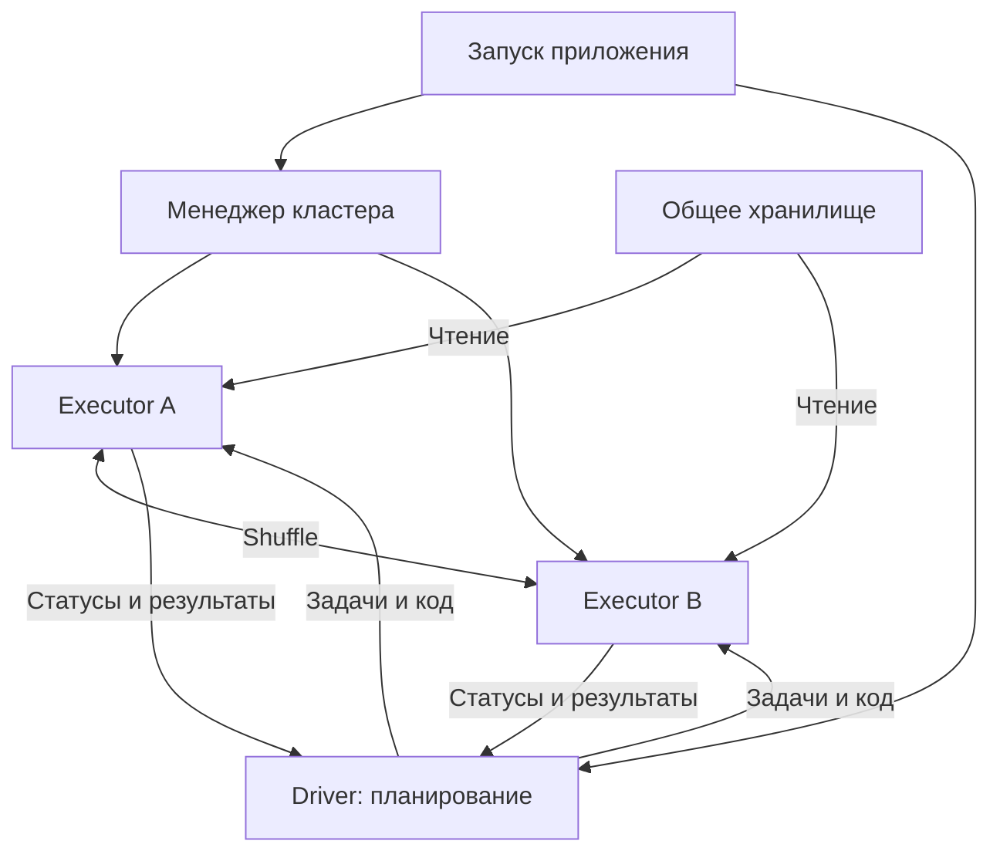
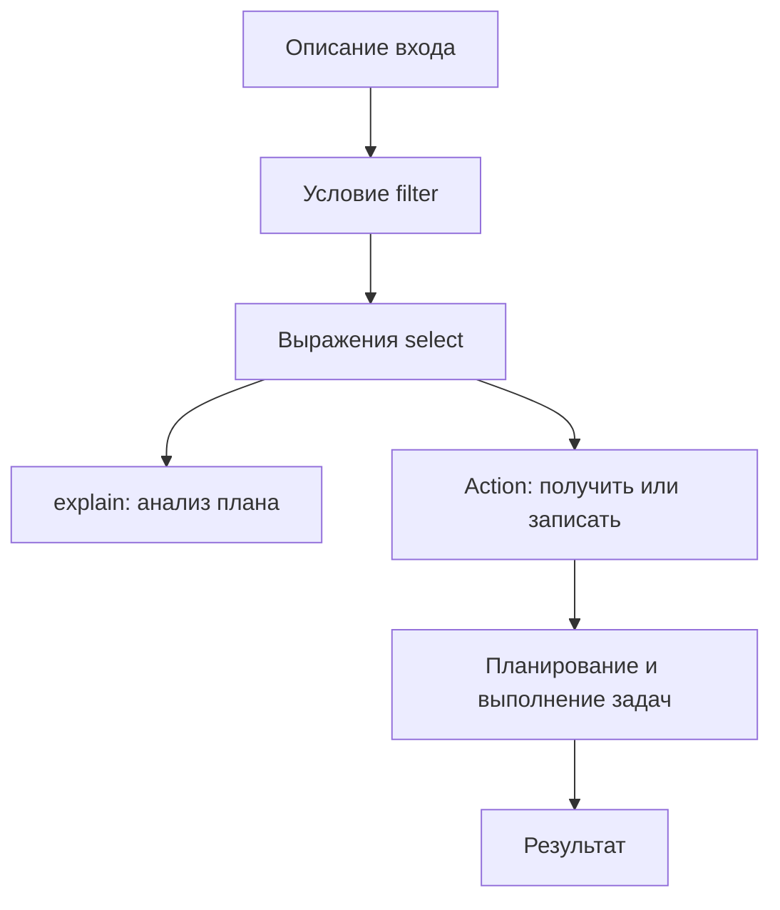
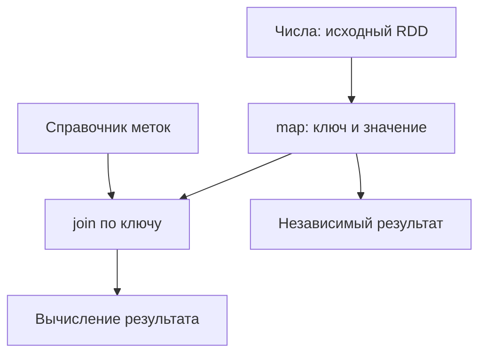
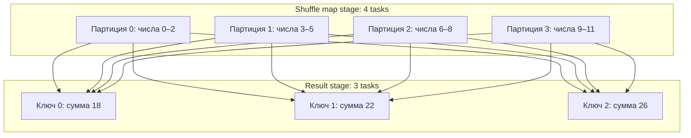
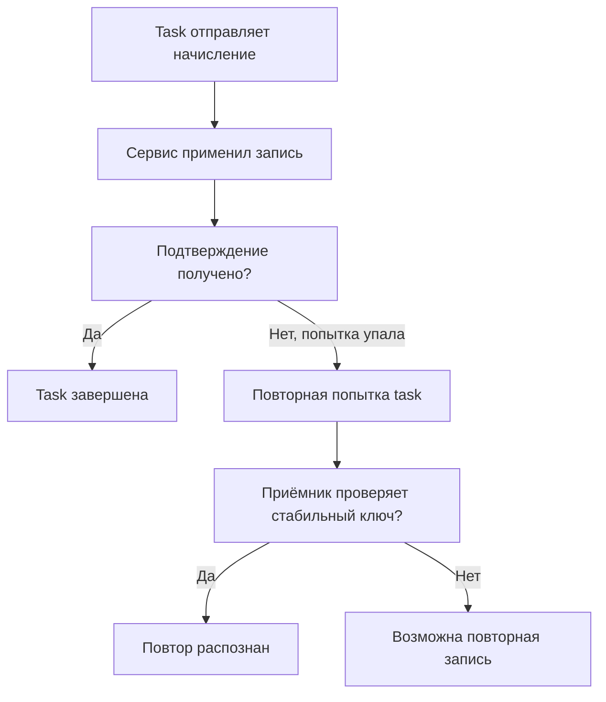

# 2. Архитектура и модель распределённого выполнения

Эта глава объясняет, как описание вычисления превращается в работающие задачи: кто строит план, где исполняется код, как данные распределяются по партициям и что происходит при повторном выполнении или отказе.

Все **8 тем и 50 пунктов** раздела собраны на одной странице: от компонентов приложения до отказоустойчивости и ограничений масштабирования.

Основное окружение — **Spark Classic 4.2.0, Python 3.12 и JDK 17**. Для большинства опытов достаточно `local[2]`. Примеры Spark Connect и кластерного размещения обозначены отдельно: локальный процесс не воспроизводит все свойства настоящего кластера.

Короткие фрагменты используют действующую сессию. В конце страницы есть полное приложение `architecture_lab.py`: оно создаёт тестовые данные, показывает партиции, замыкания, кэш, отдельные SQL-сессии, jobs/stages/tasks и управляемую повторную попытку.

**Содержание**

1. [Архитектура приложения](#application-architecture)
2. [Распределённые коллекции](#distributed-collections)
3. [Ленивые вычисления](#lazy-evaluation)
4. [Jobs, Stages и Tasks](#jobs-stages-tasks)
5. [Драйвер и передача пользовательского кода](#driver-and-closures)
6. [Локальность данных и сетевой обмен](#locality-and-network)
7. [Отказоустойчивость вычислений](#fault-tolerance)
8. [Параллелизм и ограничения масштабирования](#parallelism-and-scaling)

**Окружение для коротких примеров**

Установка Java/PySpark разобрана в `fundamental.md`. После её проверки можно создать учебную сессию:

```python
from pyspark import TaskContext
from pyspark.sql import SparkSession, functions as F

spark = (
    SparkSession.builder
    .master("local[2]")
    .appName("architecture-experiments")
    .config("spark.sql.shuffle.partitions", "3")
    .config("spark.sql.adaptive.enabled", "false")
    .getOrCreate()
)
sc = spark.sparkContext

base = sc.parallelize(range(12), 4)
numbers = spark.range(0, 12, 1, numPartitions=4)
```

AQE отключён в учебной сессии, чтобы проще сопоставлять исходный физический план и количество shuffle-партиций. Это условие опыта; настройки рабочего приложения выбирают по его поведению и измерениям.

`base` — RDD чисел 0–11 с четырьмя исходными партициями. `numbers` — DataFrame с колонкой `id` и тем же диапазоном. Маленький вход выбран для проверки результата вручную.

<a id="application-architecture"></a>

## Архитектура приложения

### Driver, Executors и Cluster Manager

**Driver, драйвер** — управляющая часть Spark-приложения. Он выполняет управляющий код, хранит сведения о вычислениях, организует планирование и получает статусы задач. В PySpark Classic участвуют Python-процесс приложения и JVM драйвера.

**Executor, исполнитель** — процесс приложения, который запускает задачи, хранит рабочие данные и может держать закэшированные партиции. Обычно executor исполняет несколько задач параллельно. Для пользовательского Python-кода могут создаваться дополнительные Python worker-процессы.

**Cluster Manager, менеджер кластера** — система, выделяющая ресурсы. Это может быть Spark Standalone, YARN, Kubernetes или соответствующая инфраструктура платформы. Менеджер не заменяет драйвер в планировании операций твоего запроса.



Схема показывает роли и обмен в одном приложении. Место размещения драйвера зависит от deploy mode. Большие данные обычно читаются исполнителями из источника; драйвер не обязан сначала скачать все файлы и раздать их строка за строкой.

У разных приложений обычно разные executor-процессы. Поэтому «данные лежат на этом узле» ещё не означает, что другое приложение автоматически видит кэш первого.

**Проверка:** кто решает, какая операция следующая? Драйвер и его планировщики. Кто предоставляет вычислительные ресурсы? Менеджер кластера. Кто исполняет назначенную task? Executor.

[Обзор компонентов Spark](https://spark.apache.org/docs/4.2.0/cluster-overview.html).

### Рабочие узлы, процессы и доступные вычислительные ресурсы

**Узел, node** — машина либо соответствующий элемент инфраструктуры. **Процесс** — экземпляр запущенной программы. **Поток** — единица исполнения внутри процесса. Эти понятия нельзя использовать как взаимозаменяемые.

На одном узле могут работать несколько executor-процессов, в том числе разных приложений. Каждый executor имеет собственную JVM и выделенные ресурсы; Python workers могут быть отдельными процессами рядом с ней.

| Уровень | Пример | Что нельзя заключить автоматически |
| --- | --- | --- |
| Узел | Машина с 16 CPU и 64 ГБ RAM | Все ресурсы доступны одному приложению |
| Executor | JVM с 4 CPU и своим лимитом памяти | Это отдельная физическая машина |
| Task | Обработка партиции в стадии | Каждая task запускает новый executor |
| Python worker | Процесс для Python-функции | Его память находится внутри JVM heap |

Часть памяти нужна ОС, JVM, служебным структурам и внешним процессам. Кроме heap существует memory overhead; точный учёт зависит от менеджера кластера и конфигурации.

В обычной CPU-модели executor с четырьмя доступными ядрами и `spark.task.cpus=1` имеет примерно четыре слота для одновременных задач. Если задача требует два CPU, расчёт меняется. Для GPU и Resource Profiles действуют дополнительные ограничения.

В `local[2]` Spark использует локальное выполнение с двумя рабочими потоками в одной JVM. Два потока не означают два узла; локальный пример полезен для наблюдения задач, но не для проверки отказа отдельной машины кластера.

### SparkContext, SparkSession и SparkConf

**SparkConf** описывает конфигурацию Spark-приложения при запуске: например, имя, master и параметры движка. **SparkContext** связывает приложение с распределённым выполнением, планированием и RDD API. **SparkSession** предоставляет структурированные API: DataFrame, SQL, каталоги и соответствующее состояние сессии.

| Объект | Типичная задача |
| --- | --- |
| `SparkConf` | Задать стартовую конфигурацию |
| `SparkContext` | Создать RDD, broadcast, accumulator; управлять заданиями |
| `SparkSession` | Читать DataFrame, запускать SQL, регистрировать представления |
| `spark.conf` | Читать и менять поддерживаемые runtime SQL-настройки сессии |

```python
print("Application:", sc.applicationId)
print("Master:", sc.master)
print("App name:", sc.appName)
print("SQL shuffle partitions:", spark.conf.get("spark.sql.shuffle.partitions"))
```

Эти объекты находятся на управляющей стороне приложения. Создание `SparkSession` для каждой строки или внутри executor-функции не является способом распределить обработку.

Стартовые ресурсы и runtime SQL-настройки различаются. Изменение `spark.conf` не расширяет уже запущенную JVM драйвера и не создаёт независимый кластер.

Для обычного PySpark-приложения удобно создавать `SparkSession` и получать её `sparkContext`, а не отдельно заводить несколько активных SparkContext в одном процессе. Spark Connect использует другую клиентскую модель и не предоставляет прямой `SparkContext`.

[SparkContext API](https://spark.apache.org/docs/4.2.0/api/python/reference/api/pyspark.SparkContext.html), [SparkSession API](https://spark.apache.org/docs/4.2.0/api/python/reference/pyspark.sql/api/pyspark.sql.SparkSession.html).

### getOrCreate() и newSession(): повторное использование и создание отдельной SQL-сессии

`SparkSession.builder.getOrCreate()` получает доступную существующую сессию либо создаёт новую. В стандартном однопоточном локальном примере повторный вызов обычно возвращает ту же Python-сессию.

```python
same = SparkSession.builder.getOrCreate()
print(same is spark)  # В данном простом сценарии: True.
```

Но вызов builder с параметрами не стоит воспринимать как безвредное получение ссылки: поддерживаемые настройки могут примениться к существующей сессии. В общей notebook-среде это может повлиять на последующие запросы.

`spark.newSession()` создаёт отдельную SQL-сессию, связанную с тем же SparkContext в Spark Classic.

```python
second = spark.newSession()

print(second is spark)                         # False.
print(second.sparkContext is spark.sparkContext)  # True.
print(second.sparkContext.applicationId == sc.applicationId)  # True.
```

Новая SQL-сессия не означает новый драйвер, новую группу executor'ов или отдельный лимит ресурсов. Это другое SQL-состояние внутри того же приложения.

Начальные значения конфигурации зависят от стартового окружения и реализации релиза. Надёжнее явно установить нужные изменяемые SQL-параметры в новой сессии, чем предполагать копирование всех текущих настроек родителя.

**Важное следствие:** в Classic `second.stop()` останавливает общий SparkContext. Для «закрытия одного логического пользователя» внутри общего приложения нельзя бездумно вызывать `stop()` его сессии.

[getOrCreate](https://spark.apache.org/docs/4.2.0/api/python/reference/pyspark.sql/api/pyspark.sql.SparkSession.builder.getOrCreate.html), [newSession](https://spark.apache.org/docs/4.2.0/api/python/reference/pyspark.sql/api/pyspark.sql.SparkSession.newSession.html).

### Отдельные SQLConf, временные представления и UDF при общем SparkContext и общем кэше таблиц в Spark Classic

В новой сессии отдельно живут runtime SQL-конфигурация, локальные временные представления и зарегистрированные сессионные SQL-функции. При этом SparkContext, ресурсы приложения и менеджер кэша остаются общими.

```python
second = spark.newSession()
spark.conf.set("spark.sql.shuffle.partitions", "3")
second.conf.set("spark.sql.shuffle.partitions", "7")

spark.range(5).createOrReplaceTempView("private_numbers")
spark.udf.register("session_plus_one", lambda value: value + 1, "long")

print(spark.conf.get("spark.sql.shuffle.partitions"))   # 3
print(second.conf.get("spark.sql.shuffle.partitions"))  # 7
print(spark.catalog.tableExists("private_numbers"))    # True
print(second.catalog.tableExists("private_numbers"))   # False
print(second.catalog.functionExists("session_plus_one"))  # False
```

Чтобы намеренно предоставить представление сессиям одного приложения, существует global temporary view:

```python
spark.range(5).createOrReplaceGlobalTempView("shared_numbers")
print(second.table("global_temp.shared_numbers").count())  # 5
spark.catalog.dropGlobalTempView("shared_numbers")
```

`global_temp` — стандартное имя соответствующей базы в этом примере. Такое представление живёт в пределах приложения; это не постоянная таблица, доступная любому Spark-приложению.

**Общий кэш не делает локальное представление общим.** Он хранит результаты подходящих логических планов. Другая сессия может использовать закэшированный результат эквивалентного запроса, не получая доступ к имени чужого temp view.

```python
cached = spark.range(0, 12, 1, numPartitions=4).cache()
cached.count()  # Материализуем маленький учебный кэш.
second.range(0, 12, 1, numPartitions=4).explain()
# В этом опыте план второй сессии содержит InMemoryTableScan.
cached.unpersist()
```

Использование кэша зависит от сопоставления планов. Не нужно ожидать попадание в кэш для любого похожего текста SQL или изменённого запроса.

### Проектирование нескольких сессий внутри одного приложения: какие настройки и объекты действительно изолированы

При проектировании сервиса с несколькими SQL-сессиями сначала составь карту общего состояния. Разные объекты `SparkSession` дают ограниченную изоляцию SQL-контекста, но используют одну вычислительную инфраструктуру приложения.

| Объект/свойство в Spark Classic | Между `spark` и `spark.newSession()` |
| --- | --- |
| Изменяемые сессионные SQL-настройки | Отдельные |
| Локальные temporary views | Отдельные |
| Сессионно зарегистрированные SQL UDF | Отдельные |
| SparkContext и application ID | Общие |
| Driver и executor-ресурсы | Общие |
| Менеджер кэша SQL-данных | Общий |
| Global temporary views | Общие в пределах приложения |
| Постоянные таблицы во внешнем каталоге | Зависит от каталога и доступа; новая сессия не создаёт копию таблиц |
| Python-словари и глобальные переменные приложения | Не становятся изолированными из-за `newSession()` |

DataFrame связан с сессией, которая его создала. Передача переменной другой функции не перепривязывает его автоматически:

```python
created_in_first = spark.range(3)
print(created_in_first.sparkSession is spark)  # True.

created_in_second = second.range(3)
print(created_in_second.sparkSession is second)  # True.
```

Поэтому функция сервиса должна явно получать нужную сессию и создавать запрос через неё. Использование глобальной `spark` внутри функции, обслуживающей другую сессию, легко приводит к неправильным настройкам или области видимости.

Сессии могут конкурировать за CPU, память и кэш. `newSession()` сама по себе не задаёт квоты, очередь, независимые executor'ы или надёжную границу безопасности между пользователями.

Управляй созданием и остановкой общего SparkContext на уровне приложения. Сессионные представления и настройки обслуживай отдельно; очистку общего кэша выполняй осознанно, поскольку она может затронуть другие запросы.

### Жизненный цикл приложения, драйвера и исполнителей

Для batch-приложения типичная последовательность выглядит так:

1. Запускается программа драйвера и создаётся SparkContext.
2. Приложение получает ресурсы и executor'ы; конкретная механика зависит от менеджера.
3. Драйвер строит планы, а actions инициируют выполнение.
4. Исполнители читают данные, выполняют задачи и сообщают результат.
5. Приложение записывает выход и завершает контекст.

Это модель жизненного цикла, а не строгая гарантия последовательного запуска всех процессов. Ресурсы могут выделяться постепенно; при dynamic allocation число executor'ов способно меняться во время работы.

**Application** может выполнить множество jobs и SQL-запросов за время своей жизни. Завершение одного job не завершает автоматически Spark-приложение. Notebook или долгоживущий сервис может обслуживать новые запросы на уже работающем контексте.

Executor может исчезнуть или быть добавлен; объект DataFrame на драйвере при этом не обязательно исчезает. Но конкретные закэшированные блоки и shuffle-данные требуют учёта отказа.

```python
# В самостоятельном приложении SparkSession создаётся перед try.
try:
    print(spark.range(10).count())
finally:
    spark.stop()
```

Фрагмент остановки не нужно выполнять посередине интерактивных опытов. По завершении контекста живой UI закрывается; записанные данные сохраняются в своём хранилище. История выполнения доступна, если заранее сохранялись event logs.

### Client mode и cluster mode

Deploy mode отвечает на вопрос **где запускается драйвер**. Это отдельный вопрос от того, где выполняются распределённые задачи.

| Режим | Размещение драйвера | Практическое следствие |
| --- | --- | --- |
| Client | На стороне запуска приложения | Кластер должен иметь сетевой доступ к драйверу; его процесс должен продолжать работу |
| Cluster | В инфраструктуре менеджера кластера | Управление драйвером и его логами связано с возможностями платформы |

В client mode executor'ы могут работать на настоящем кластере. Поэтому client mode не означает local mode. Cluster mode тоже не гарантирует, что выделено много машин.

```text
spark-submit --master <адрес-или-тип-менеджера> --deploy-mode client ...
spark-submit --master <адрес-или-тип-менеджера> --deploy-mode cluster ...
```

Это шаблоны, а не готовые команды: master, язык приложения и доступность deploy mode проверяют для конкретного менеджера. Например, Python cluster mode не поддерживается Spark Standalone так же, как в YARN/Kubernetes.

Смена client на cluster mode меняет размещение драйвера. Она не загружает автоматически локальные файлы, не устанавливает все Python-пакеты и не исправляет права на источник.

**Пример:** при локальном client-драйвере путь `/home/me/config.json` может существовать, а при cluster-драйвере — отсутствовать. Если этот файл требуется управляющей части, его нужно доставить подходящим способом.

[Запуск и ограничения deploy mode](https://spark.apache.org/docs/4.2.0/submitting-applications.html).

### Где исполняется пользовательский код и где находятся данные

Различай **код, который описывает вычисление**, и **код, который обрабатывает элементы на исполнителях**.

```python
factor = 10                             # Управляющий Python-код.
transformed = base.map(lambda x: x * factor)  # Описание RDD-преобразования.
answer = transformed.sum()               # Action; обработка распределяется.
```

Драйвер создаёт функцию и запрос. Когда запускается action, функция `lambda` применяется к элементам в Python workers на исполнителях. Значение `answer` возвращается на драйвер.

| Операция | Типичное место работы |
| --- | --- |
| Python `for` по локальному списку | Python-процесс управляющего кода |
| Построение `select`, `filter`, SQL-запроса | Управляющая сторона; структурированный план |
| Встроенное выражение над строками DataFrame | Движок Spark на стороне исполнения |
| Python RDD `map` / Python UDF | Python workers на исполнителях |
| `collect()` | Вычисление на исполнителях, весь результат — на драйвере |
| `write.parquet(...)` | Распределённая запись через приёмник; координация включает драйвер |

На драйвере могут находиться маленький исходный список, метаданные, схемы, замыкания и собранный результат. Утверждение «на драйвере никогда нет данных» неверно.

Но драйверу не нужно хранить весь входной файл ради выполнения распределённого `filter`. Из-за этой разницы одинаковые слова «данные в приложении» могут обозначать совершенно разные объекты.

В Spark Connect клиент строит и отправляет план серверу; прямые Classic-операции с RDD/SparkContext из приведённых опытов ему недоступны.

**Самопроверка:** объясни, почему `second = spark.newSession()` не создаёт второй кластер и почему `collect()` большого результата может исчерпать память драйвера при свободной памяти executor'ов.

<a id="distributed-collections"></a>

## Распределённые коллекции

### Партиция как единица распределения данных

**Партиция, partition** — часть распределённого набора, с которой Spark может организовать отдельную работу. RDD и физическое выполнение DataFrame используют партиции; наличие одной Python-переменной `df` не означает наличие одного монолитного массива строк.

```python
base = sc.parallelize(range(12), 4)
print(base.getNumPartitions())  # 4
print(base.glom().collect())
# Для данного parallelize: [[0, 1, 2], [3, 4, 5], [6, 7, 8], [9, 10, 11]]
```

`glom()` собирает элементы каждой партиции в список. Здесь это допустимо для двенадцати чисел; на большом наборе создание огромного списка внутри задачи само может вызвать нехватку памяти.

Партиции позволяют распределять работу и восстанавливать потерянные части. Их количество меняется при некоторых преобразованиях. После `filter` число партиций обычно сохраняется, хотя количество строк в них может значительно уменьшиться; пустые партиции возможны.

Партиция не обязана навсегда принадлежать одному executor. При разных actions, планировании или отказе обработка может выполняться в другом процессе. Её номер также не является постоянным бизнес-идентификатором строки.

Для DataFrame основной вопрос — какое разбиение требуется физическим операторам. В Classic для некоторых учебных наблюдений доступно `df.rdd.getNumPartitions()`, но переход к RDD имеет собственные ограничения и не является способом ускорить запрос.

[parallelize](https://spark.apache.org/docs/4.2.0/api/python/reference/api/pyspark.SparkContext.parallelize.html).

### Партиция, файл, блок хранения и task: различие понятий

| Понятие | Что это | Пример |
| --- | --- | --- |
| Файл | Объект хранения | Один Parquet-файл |
| Блок хранения | Единица размещения в конкретной системе | Блок HDFS |
| Вычислительная партиция | Часть распределённого входа/выхода операции | Партиция scan или shuffle |
| Task | Конкретная работа в стадии над её партицией | Чтение и фильтрация назначенной части |
| Каталожная/дисковая partition | Организация сохранённого набора по значениям | Каталог `date=2026-10-08` |

Между этими объектами нет универсального соответствия один к одному. Spark может объединить несколько маленьких файлов в одну scan-партицию либо читать части большого разделяемого файла разными задачами. Возможность разбиения зависит от формата и сжатия.

HDFS-блоки помогают организовать размещение и чтение, но не определяют все вычислительные партиции любого SQL-плана. У объектного хранилища другая модель размещения; считать каждый объект аналогом локального HDFS-блока неправильно.

После shuffle исходные файлы уже не задают напрямую разбиение результата. Запись `partitionBy("date")` организует каталоги/разделы по значению даты; это не обещание «одна дата — одна task — один файл».

**Пример:** вход из 100 файлов может дать другое число scan-задач, а агрегация — ещё другое число shuffle-задач. Проверять нужно фактический план и UI.

[Планирование файлового ввода](https://spark.apache.org/docs/4.2.0/sql-performance-tuning.html).

### Неизменяемость DataFrame, Dataset и RDD

Трансформации возвращают новый объект запроса/коллекции. Они не изменяют исходный распределённый набор на месте.

```python
original = spark.range(5)
filtered = original.filter(F.col("id") >= 3)

print(original.count())  # 5
print(filtered.count())  # 2
```

Вызов `filter` не удалил строки из `original`. Два DataFrame могут ссылаться на один источник и общие зависимости, поэтому «новый объект» не означает немедленное копирование всех данных.

Присваивание `original = original.filter(...)` меняет ссылку Python-переменной. Оно не делает сам Spark DataFrame изменяемой таблицей.

Неизменяемость модели не означает, что всё окружение неизменно. Файл в источнике может быть заменён, внешняя база — обновлена, сессионные настройки — поменяны. При повторном чтении результат зависит от гарантий источника и выбранного снимка.

Также изменяемые Python-объекты внутри пользовательского кода не приобретают автоматически безопасную распределённую семантику. Лучше возвращать новые значения, чем пытаться координировать изменения общего словаря через функции RDD.

### Распределённый набор данных и локальная коллекция

Локальная коллекция находится в памяти конкретного процесса. Распределённый набор описывает данные и вычисления, которые могут исполняться в нескольких процессах и на нескольких машинах.

```python
local_numbers = list(range(12))            # Python list на драйвере.
distributed = sc.parallelize(local_numbers, 4)  # RDD.
small_result = distributed.map(lambda x: x + 1).take(3)
# small_result снова является локальным списком.
```

`parallelize` полезен для тестовых данных. Он не является эффективным способом сначала прочитать огромную таблицу в память драйвера, а затем «сделать её распределённой».

`collect()` возвращает все строки результата локально. `take(n)`/`limit(n).collect()` ограничивают локальный результат, но предшествующий план всё равно может требовать значительной распределённой работы.

| Объект | Можно ли обычным Python-циклом пройти все значения прямо сейчас? |
| --- | --- |
| Python list | Да, значения уже локальны |
| RDD | Сначала потребуется выполнение/получение результатов либо специальная распределённая операция |
| DataFrame | Нужно использовать его API или получить локальные строки |
| `Row` после `first()` | Да, это локальная строка результата |

Большой кластер не увеличивает автоматически память Python-процесса, получившего `collect()`. Поэтому маленький итоговый отчёт можно собрать, а миллиарды входных строк обычно сохраняют или обрабатывают распределённо.

### Логическое представление данных и физическое размещение

Логический запрос отвечает на вопрос **что получить**. Физическое выполнение — **какими операторами, партициями и задачами это сделать**. Размещение конкретных блоков на исполнителях — ещё один уровень.

```python
grouped = (
    numbers.withColumn("bucket", F.col("id") % 3)
    .groupBy("bucket")
    .agg(F.sum("id").alias("total"))
)
grouped.explain(mode="extended")
```

В плане видны структурированные выражения и выбранные физические операторы. При отключённом AQE для данного опыта ожидается hash-обмен по `bucket`, поскольку одинаковые ключи должны оказаться в подходящих группах обработки.

Объект `grouped` не хранит список адресов «город A всегда на executor 2». Scheduler назначает задачи доступным исполнителям; кэш и shuffle формируют дополнительное физическое состояние во время работы.

AQE может адаптировать физический план и разбиение по статистике выполнения. Поэтому исходный план, окончательный адаптивный план и фактические задачи могут отличаться.

Различай также **число строк**, **число партиций** и **размер данных в байтах**. Три группы результата не обязаны означать три одинаково загруженных executor'а.

[Просмотр планов](https://spark.apache.org/docs/4.2.0/api/python/reference/pyspark.sql/api/pyspark.sql.DataFrame.explain.html).

### Отсутствие общего порядка строк без явной сортировки

Распределённый набор не имеет гарантированного общего порядка строк, если запрос его не задаёт. Разбиение, обмен данными и порядок завершения задач могут меняться.

```python
some_rows = numbers.limit(3).collect()
ordered_rows = numbers.orderBy(F.col("id").asc()).limit(3).collect()
# Для ordered_rows ожидаются id = 0, 1, 2.
```

Если `orderBy` использует неуникальный ключ, порядок строк с одинаковым ключом может оставаться неопределённым. Для стабильного top-N обычно нужен полный критерий, например время события и уникальный идентификатор.

`sortWithinPartitions` сортирует внутри каждой физической партиции. Это не эквивалент общего `orderBy`, объединяющего результат в заданном порядке.

Записанный набор из нескольких файлов тоже не становится упорядоченной таблицей только потому, что перед записью был вызван `orderBy`. Последующее чтение должно заново задавать порядок, если он является частью результата.

**Проверка:** для сравнения маленьких результатов используй явную сортировку либо сравнение мультимножеств, если порядок не входит в контракт. Не делай тест хрупким из-за случайного порядка `collect()`.

**Упражнение:** объясни, почему шесть одинаковых по размеру входных файлов не гарантируют шесть одинаковых по времени задач и почему одна дисковая партиция по дате может содержать много файлов.

<a id="lazy-evaluation"></a>

## Ленивые вычисления

### Трансформации и действия

**Transformation** описывает новый набор: `map`, `filter`, `select`, `join`, `groupBy(...).agg(...)`. **Action** требует вычислить результат или выполнить запись: `collect`, `count`, `show`, `write` и соответствующие RDD-методы.

```python
transformed = base.map(lambda x: x + 1).filter(lambda x: x % 2 == 0)
# Здесь описана обработка, но все элементы ещё не обязаны быть обработаны.

print(transformed.sum())  # Action. Сумма 2 + 4 + ... + 12 = 42.
```

Название метода само по себе не заменяет чтение документации. Например, `groupBy` возвращает объект группировки, `agg` создаёт запрос, а `explain` показывает план и может выполнять анализ без обычного получения всех строк.

Модель DataFrame позволяет оптимизировать цепочку: убирать ненужные колонки, упрощать выражения, перемещать допустимые фильтры. RDD с произвольной Python-функцией не предоставляет SQL-оптимизатору тот же объём сведений о смысле вычисления.

Действие не обязательно возвращает сами данные в Python. `count()` возвращает число, запись оставляет данные в хранилище. Действие может породить несколько jobs, а некоторые actions вычисляют лишь необходимую часть результата.

### Построение плана без немедленной обработки данных

При цепочке преобразований Spark сохраняет структуру вычисления и зависимости. Для RDD это цепочка распределённых операций; для SQL/DataFrame есть логические и физические планы.

```python
planned = (
    numbers.filter(F.col("id") >= 3)
    .select((F.col("id") * 10).alias("scaled_id"))
)
planned.explain(mode="formatted")
```

В твоём коде нет явного цикла по двенадцати строкам. Ты описал, что требуется получить, и передал движку выражения, которые он понимает.



Здесь действие инициирует основную обработку. Однако построение API-объектов, разрешение имён и типов, чтение метаданных или подготовительные запросы могут происходить раньше. Ленивость не означает отсутствие любой работы до action.

Не нужно «заставлять Spark выполнить каждую строку кода» после каждой трансформации. Промежуточный `count()` часто добавляет отдельное вычисление и не помогает получить конечный результат быстрее.

### Что запускает вычисления и какие операции выполняют предварительную работу

Нужно различать обработку записей, анализ плана и работу с источником. Для одного источника схема известна из метаданных; для другого её приходится выводить по данным.

| Операция | Возможная работа до твоего следующего action |
| --- | --- |
| `select` / `filter` | Построение выражений и анализ; не обязательное чтение всех строк |
| `read.csv(..., inferSchema=True)` | Перечисление файлов, чтение для вывода схемы |
| `read` с явной схемой | Метаданные и подготовка источника; не обещание нулевого I/O |
| `explain` / доступ к схеме | Анализ и планирование запроса |
| `pivot` без списка значений | Получение возможных значений для структуры результата |
| `cache()` | Объявление намерения кэшировать; основная материализация обычно через action |
| `collect`, `count`, `write` | Выполнение требуемого вычисления |

Перечисление файлов, права на источник и вывод схемы могут завершиться ошибкой раньше, чем ты написал `show()`. Нельзя диагностировать такое поведение как «Spark перестал быть ленивым».

Входное чтение не обязано быть одним job; SQL-план может включать подготовительные вычисления и дополнительные стадии. Способ измерения — смотреть UI/event logs, а не считать только число вызовов actions в исходнике.

Укажи явную схему, когда контракт известен. Для `pivot` при известном наборе значений передавай его явно. Это делает структуру запроса предсказуемее, но не отменяет остальные требования источника.

[CSV и вывод схемы](https://spark.apache.org/docs/4.2.0/sql-data-sources-csv.html), [pivot](https://spark.apache.org/docs/4.2.0/api/python/reference/pyspark.sql/api/pyspark.sql.GroupedData.pivot.html).

### Повторное вычисление при нескольких действиях

Без сохранённого подходящего промежуточного результата несколько действий могут заново выполнить общую обработку.

```python
processed = base.map(lambda x: x * 2)
print(processed.sum())    # 132.
print(processed.count())  # 12; map может выполниться повторно.
```

Не стоит ожидать, что Spark автоматически запомнил все строки только потому, что уже посчитал их сумму. Автоматическое повторное использование некоторых операторов/обменов не заменяет общего понимания жизненного цикла результата.

Для выбранного повторно используемого набора можно задать persistence:

```python
processed.persist()
try:
    print(processed.sum())    # Материализация и суммирование.
    print(processed.count())  # Использование сохранившихся блоков.
finally:
    processed.unpersist()
```

Persistence — средство хранения частей результата, а не гарантия их вечной доступности. Блок может не поместиться, быть удалён либо потерян вместе с executor. Тогда нужная часть может вычисляться заново, если это допустимо по зависимостям.

Кэш полезен, когда повторное использование оправдывает затраты на материализацию и память/диск. В этой главе он нужен для наблюдения повторов; уровни хранения и расчёт памяти подробно относятся к соответствующему разделу.

В полном лабораторном приложении повторное исполнение наблюдается через accumulator. Это диагностический опыт на маленьком входе, а не надёжный способ считать бизнес-события.

### Ошибки построения плана и ошибки во время выполнения

Некоторые проблемы можно обнаружить по структуре запроса: нет колонки, несовместимы типы, неразрешено имя таблицы. Другие зависят от конкретных записей, сетевого состояния или ресурсов и проявляются при выполнении задач.

```python
# Ошибка анализа: в numbers есть только колонка id.
# bad_plan = numbers.select("missing_column")

def divide_by_value(value):
    return 10 / value

will_fail = sc.parallelize([0, 1], 2).map(divide_by_value)
# will_fail.collect() проявит ZeroDivisionError в Python worker.
```

Закомментированные действия с ошибкой выполняй отдельно от успешного лабораторного запуска. У каждого должна быть понятная ожидаемая причина.

Точная точка появления ошибки анализа зависит от API, версии и Classic/Connect. Она может возникнуть при построении операции, доступе к схеме или последующем action. Полагаться на «все ошибки только в action» неправильно.

Повторные попытки не исправят `10 / 0` на той же записи: это детерминированная ошибка пользовательской функции. Отказ временного сетевого соединения и неверная формула требуют разных действий.

**Практика:** по traceback отдели ошибку Python-кода в task от сообщения Java, которое передаёт её драйверу. Найди исходное исключение, а не только факт прерывания job.

### Побочные эффекты в ленивом и повторяемом вычислении

Побочный эффект — действие вне возвращаемого результата: изменение локального объекта, запись в файл, HTTP-запрос, обновление внешней базы. В Spark его количество и порядок не обязаны совпадать с твоим представлением о «одном проходе».

```python
def noisy_double(value):
    print("processing", value)
    return value * 2

lazy_values = base.map(noisy_double)
# Сообщения возникают при фактическом исполнении Python worker.
# Несколько actions или retries могут повторить сообщения.
```

Логи worker'ов могут оказаться в логах executor, а не рядом с Python-выводом драйвера. Порядок сообщений разных задач не является порядком строк набора.

Внешняя запись из `map` опаснее диагностического `print`: задача могла выполнить запись и упасть до подтверждения успеха. Повтор создаст второй эффект. Другое действие над тем же RDD тоже может повторить функцию.

Стандартное правило проектирования: преобразование возвращает данные, а взаимодействие с внешним миром организуется через продуманный приёмник и его гарантии. Когда произвольный внешний эффект необходим, нужны ключ идемпотентности, правила повторов и наблюдаемость результата.

**Самопроверка:** после создания `lazy_values` был ли гарантирован один print на каждую строку? Нет. После двух успешных actions гарантирован ли ровно один внешний вызов на строку? Тоже нет.

<a id="jobs-stages-tasks"></a>

## Jobs, Stages и Tasks

### DAG вычислений и зависимости операций

**DAG, directed acyclic graph** — ориентированный граф без циклов. Узлы описывают вычисления/их результаты, рёбра — зависимости: что требуется получить, прежде чем можно выполнить следующий шаг.

```python
left = base.map(lambda value: (value % 3, value))
right = sc.parallelize([(0, "A"), (1, "B"), (2, "C")], 2)
joined = left.join(right)
```

У `joined` есть два родительских набора. Это уже граф с ветвлением, а не только список команд сверху вниз.



Для конкретного action Spark рассматривает необходимые зависимости. Неиспользованная ветка `Other` сама по себе не обязана выполняться, а общий предок может понадобиться нескольким actions.

Программный `for` на драйвере может несколько раз строить и запускать ациклические графы. Поэтому слово «acyclic» не запрещает итеративные алгоритмы на уровне приложения.

Не смешивай граф логических SQL-операций, дерево физического плана и граф стадий планировщика. Они связаны, но имеют разные узлы и границы. Оптимизация может изменить структуру между уровнями.

### Job как задание, Stage как стадия и Task как задача

**Job** — выполнение, организованное для получения требуемого результата. **Stage** — группа задач с соответствующими зависимостями и границами обмена. **Task** — единица работы над партицией конкретной стадии.

| Уровень | Что объединяет | Важная особенность |
| --- | --- | --- |
| Application | Весь жизненный цикл SparkContext | Содержит много jobs |
| SQL execution | Одно выполнение структурированного запроса | Может содержать несколько jobs |
| Job | Необходимые стадии для конкретной работы | Может использовать уже вычисленные данные |
| Stage | Задачи соответствующего этапа | Может иметь повторные попытки |
| Task | Обработку партиции стадии | Может иметь несколько task attempts |

В обычной модели одна task обрабатывает одну выходную партицию своей стадии. При этом она может читать несколько родительских партиций либо много shuffle-блоков. «Одна task = одна строка» и «одна task = один исходный файл» неверны.

**Контролируемый RDD-пример:**

```python
answer = (
    sc.parallelize(range(12), 4)
    .map(lambda value: value + 1)
    .filter(lambda value: value % 2 == 0)
    .sum()
)
print(answer)  # 42
```

Для этого холодного локального RDD-опыта ожидается один job с одной стадией и четырьмя логическими tasks. `sum()` получает частичные результаты и сводит их; между указанными `map` и `filter` shuffle не требуется.

Это свойство данного опыта, а не правило для любых `sum`, SQL-агрегатов или действий. В полном приложении количество jobs и стадий выводится через status tracker и сохраняется в event logs.

### Узкие и широкие зависимости

**Узкая зависимость, narrow dependency:** вычисление партиции опирается на определённые родительские партиции без обязательного shuffle-обмена записей по всему набору. Для обычного `map`/`filter` обработка может идти конвейером над той же входной партицией.

**Широкая зависимость, shuffle dependency:** данные перераспределяются между выходными партициями, например по ключу. Для одной выходной группы могут потребоваться записи из многих входных партиций.

```python
mapped = base.map(lambda value: value * 2)  # Узкое преобразование.

by_key = (
    base.map(lambda value: (value % 3, value))
    .reduceByKey(lambda left, right: left + right, numPartitions=3)
)
print(sorted(by_key.collect()))  # [(0, 18), (1, 22), (2, 26)]
```

У результата `reduceByKey` три партиции; исходно было четыре. Для одинаковых ключей нужно собрать и объединить вклад разных частей входа.

| Операция | Типичное поведение | Уточнение |
| --- | --- | --- |
| RDD `map`, `filter` | Узкое | Сохраняют структуру партиций в обычном случае |
| `coalesce` без shuffle | Узкое объединение | Может уменьшить параллелизм |
| `repartition` | Shuffle | Перераспределяет данные |
| Агрегация по ключу | Обычно shuffle | Уже подходящее разбиение может изменить физическую необходимость обмена |
| Join | Зависит от стратегии | Broadcast и shuffle-стратегии различаются |

Определять сетевой обмен только по названию высокоуровневого метода нельзя. Для DataFrame важны фактические физические операторы и уже известное разбиение входов.

[RDD API и зависимости вычислений](https://spark.apache.org/docs/4.2.0/rdd-programming-guide.html).

### Границы стадий и обмен данными между ними

Shuffle — типичная граница стадий: сначала нужно подготовить данные для нового разбиения, затем задачи следующего этапа читают свои части результата обмена.

Для предыдущего `reduceByKey` удобная модель такая:



**Shuffle map stage** подготавливает выходные блоки для следующего разбиения. **Result stage** выполняет конечную часть job и возвращает требуемые результаты. В более сложном графе shuffle-стадий может быть несколько.

Задачи следующей стадии читают данные из многих источников предыдущей. Это не обещает постоянной связи «executor A передаёт только executor B»: назначение reduce-задач меняется, а блоки имеют своё расположение.

Нельзя считать каждую трансформацию отдельной стадией. Несколько совместимых операций могут выполняться в одной task без промежуточного полного сохранения результата.

Также слово `Exchange` в SQL-плане нужно интерпретировать по типу. Shuffle exchange и broadcast exchange организуют разные способы доставки данных; broadcast может требовать дополнительного job. При адаптации и повторном использовании обменов связь с границами будет сложнее учебной схемы.

### Попытки задачи и попытки стадии

Логическая task и **task attempt** — разные вещи. Партиция может быть обработана повторно после ошибки. При speculative execution могут одновременно существовать несколько попыток одного логического задания, если режим включён и применим.

```python
def inspect_partition(iterator):
    context = TaskContext.get()
    values = list(iterator)  # Только для маленького учебного набора.
    yield (
        context.stageId(),
        context.partitionId(),
        context.attemptNumber(),
        context.taskAttemptId(),
        len(values),
    )

print(base.mapPartitions(inspect_partition).collect())
```

`attemptNumber()` начинается с 0. `taskAttemptId()` идентифицирует конкретную попытку внутри приложения. `partitionId()` без контекста стадии не описывает уникальную задачу всего приложения.

**Stage attempt** возникает при повторном запуске стадии. Например, потеря нужных shuffle-данных может потребовать повторной подготовки части обмена и нового выполнения следующего этапа. Обычная повторная task внутри стадии не означает обязательное увеличение номера stage attempt.

| Ситуация | Что может повториться |
| --- | --- |
| Временный сбой одной task | Попытка task для её партиции |
| Невозможность получить нужные shuffle-блоки | Производящая часть графа и попытка зависимой стадии |
| Новое действие над неперсистентным набором | Новое выполнение, а не только исправление старой попытки |
| Speculation | Дополнительная попытка медленной task |

Реальные номера стадий и попыток смотри в UI/event logs. В полном приложении есть retry-опыт, рассчитанный на `local[2,2]`: первая попытка одной партиции намеренно падает, а следующая проходит.

[TaskContext](https://spark.apache.org/docs/4.2.0/api/python/reference/api/pyspark.TaskContext.html), [attemptNumber](https://spark.apache.org/docs/4.2.0/api/python/reference/api/pyspark.TaskContext.attemptNumber.html).

### Связь SQL execution, jobs и физических операторов

SQL execution описывает выполнение структурированного запроса. Внутри него могут быть scan, filter, partial aggregate, exchange, final aggregate и другие операторы. Они не обязаны соответствовать jobs один к одному.

```python
sql_result = (
    numbers.withColumn("bucket", F.col("id") % 3)
    .groupBy("bucket")
    .agg(F.sum("id").alias("total"))
)
sql_result.explain(mode="formatted")
print(sorted(tuple(row) for row in sql_result.collect()))
# [(0, 18), (1, 22), (2, 26)]
```

В плане ищи смысл: где источник, какие выражения вычисляются, где обмен и какие агрегаты частичные/итоговые. Не требуется запоминать весь текст плана наизусть.

Несколько операторов могут объединяться в один конвейер обработки; в Spark это связано в том числе с генерацией кода. **Whole-stage codegen stage** не тождественна scheduler stage из вкладки Stages: одинаковое слово обозначает разные уровни.

В UI сначала найди SQL execution, затем связанные jobs и stages. Наличие трёх физических операторов не позволяет сделать вывод «было три job».

Для одного action дополнительные jobs могут понадобиться из-за подготовки broadcast, адаптивного планирования, чтения/метаданных или особенностей операции. Некоторые данные также могут быть повторно использованы из кэша либо предыдущих exchange.

**Метод наблюдения:** задавай понятное имя job group, запускай отдельный опыт и сопоставляй его исходник, план и UI. Точное количество задач для конкретного релиза узнаётся измерением контролируемого случая.

[UI, jobs и SQL-метрики](https://spark.apache.org/docs/4.2.0/monitoring.html), [SparkStatusTracker](https://spark.apache.org/docs/4.2.0/api/python/reference/api/pyspark.SparkStatusTracker.html).

<a id="driver-and-closures"></a>

## Драйвер и передача пользовательского кода

### Построение планов и планирование задач на драйвере

Драйвер принимает пользовательские команды, строит и анализирует планы, учитывает зависимости и координирует выполнение. В Spark Classic эта работа связана с SparkContext и JVM-компонентами планирования.

Упрощённо **DAGScheduler** организует jobs/stages с учётом зависимостей, а **TaskScheduler** размещает готовые tasks на доступных ресурсах. Менеджер кластера предоставляет ресурсы, но не выбирает SQL-формулу агрегации.

```python
sc.setJobGroup("architecture-narrow", "map/filter без shuffle")
try:
    print(base.map(lambda x: x + 1).filter(lambda x: x % 2 == 0).sum())
finally:
    sc.setLocalProperty("spark.jobGroup.id", None)
    sc.setLocalProperty("spark.job.description", None)
```

Job group помогает сопоставить запуск с UI и при необходимости управлять группой. Она не превращает каждый метод внутри блока в отдельное приложение и не обеспечивает отдельные ресурсы.

Драйвер получает сообщения о завершении задач и доступности данных, принимает решения о повторах и завершении jobs. Если ему не хватает CPU или памяти, исполнители могут ждать при наличии свободных ресурсов.

Управляющий Python-код тоже может быть последовательным: два подряд написанных `count()` обычно означают, что второй вызов начнётся после возврата первого. Распределённость одного action не делает весь исходник автоматически конкурентным.

### Замыкания и сериализация захваченных переменных

**Замыкание, closure** — функция вместе с данными, к которым она обращается из окружающей области. Для удалённого выполнения Spark должен передать сериализуемое описание функции и нужных значений.

```python
factor = 10
scaled = base.map(lambda value: value * factor)
print(scaled.take(3))  # [0, 10, 20] для этого RDD.
```

На исполнителе `factor` не является живой ссылкой на переменную драйвера. Функция и захваченные данные передаются при подготовке исполнения. В PySpark для этого используется соответствующая Python-сериализация; JVM-часть имеет свои механизмы.

Не определяй момент снимка только по строке `map`: ленивый запрос и сериализация могут подготавливаться позднее. Надёжнее не менять захваченные параметры между построением и исполнением и явно передавать стабильные значения.

**Типичная проблема:** передача bound method `service.process` может захватить весь `self`, включая большой словарь, сетевое соединение или SparkSession. Даже если функция использует только одно поле, объект может оказаться неподходящим для сериализации.

Для distributed-функций полезны небольшие явные параметры и функции без лишнего состояния. Крупные справочники для чтения иногда распространяют через broadcast, но broadcast не превращает их в общий изменяемый объект.

### Отправка функций и зависимостей исполнителям

Передача функции и наличие импортируемого пакета на executor — разные условия. Функция может сериализоваться, но при запуске worker не сможет импортировать её зависимость.

```python
import os
import socket

def partition_location(iterator):
    context = TaskContext.get()
    count = sum(1 for _ in iterator)
    yield {
        "partition": context.partitionId(),
        "python_pid": os.getpid(),
        "host": socket.gethostname(),
        "rows": count,
    }

print(base.mapPartitions(partition_location).collect())
```

Это маленький диагностический пример со стандартной библиотекой Python. PID показывает Python worker, а не обязательно PID JVM executor. Одинаковый host в local mode ожидаем и не доказывает наличие нескольких машин.

В прикладном коде зависимости доставляют подходящим способом:

- Собственные Python-модули: например, поддерживаемыми механизмами `--py-files` для `.py`/`.zip`/`.egg`.
- Python-окружение и сторонние библиотеки: через образ, архив окружения или инструменты платформы.
- JVM-коннекторы: через совместимые JAR и соответствующий classpath/`--packages`.
- Учётные данные и настройки доступа: через предусмотренный механизм окружения.

Установка пакета только в Python драйвера не гарантирует его доступность worker'ам. Также `--py-files` не является командой установки любого wheel из PyPI.

[Доставка приложений и зависимостей](https://spark.apache.org/docs/4.2.0/submitting-applications.html).

### Почему локальные изменения объектов не изменяют состояние драйвера

Исполнитель работает со своей копией захваченного состояния. Изменение списка или словаря внутри функции не является удалённой записью в объект Python-драйвера.

```python
seen = []

def remember(value):
    seen.append(value)
    return value

returned = base.map(remember).collect()
print(len(returned))  # 12: возвращённые данные получены через action.
print(seen)          # []: список драйвера не заполнен worker'ами.
```

В local mode Python workers тоже отделены от управляющего Python-процесса, поэтому этот опыт полезен даже без кластера. Не переносить семантику обычного цикла по локальному списку на RDD `map`.

Вернуть значения можно через распределённый результат и подходящий action. Для некоторых диагностических сводок существуют accumulators, но их обновления требуют понимания retries и повторных actions.

Broadcast нужен для распространения данных для чтения. Изменить `broadcast.value` у worker и ожидать синхронизацию со всеми другими worker'ами и драйвером нельзя.

**Практика:** предскажи `seen` до запуска, затем проверь. Объясни, почему `returned` получен корректно, а побочное изменение исходного списка не вернулось.

### Почему SparkSession и SparkContext нельзя использовать внутри executor-функций

SparkSession и SparkContext предназначены для управляющей стороны. Distributed-функция получает данные партиции; она не должна запускать новый Spark job через захваченный контекст драйвера.

```python
# Антипример: функция захватывает SparkSession.
# Не выполнять в основном успешном опыте.
# broken = base.map(lambda value: spark.range(value).count())
# broken.collect()
```

Такая попытка может завершиться ошибкой сериализации или сообщением `CONTEXT_ONLY_VALID_ON_DRIVER`. Точная форма зависит от пути вызова. Это не проблема, которую следует решать установкой SparkContext на каждом worker.

Если нужна таблица соответствий, сначала загрузи её на управляющей стороне и вырази обогащение через join либо передай подходящий небольшой справочник для чтения. Если операция чисто локальна для элемента, используй обычный Python/JVM-код без вложенного Spark action.

Внешний DB-клиент внутри partition-функции — другой сценарий: это не SparkSession. Но ему нужны доступность, корректное управление соединением и модель повторов. Такие операции не становятся безопасными автоматически.

**Правило:** Spark планирует распределённый граф с драйвера; функция task обрабатывает назначенный ей вход и возвращает данные по ожидаемому контракту.

### Драйвер как возможное узкое место приложения

Executor'ы не устраняют ограничения драйвера. Его нагрузка растёт из-за планирования, большого числа задач, размеров планов, файловых метаданных и собираемых результатов.

| Причина | Как проявляется | Что проверять |
| --- | --- | --- |
| Огромный `collect()`/`toPandas()` | Память Python/JVM драйвера | Размер локального результата |
| Очень много мелких tasks | Накладные расходы и очередь событий | Гранулярность работы |
| Много маленьких файлов | Долгое перечисление и подготовка | Организацию входа |
| Очень большой план | Медленный анализ/планирование | Размер генерируемых выражений |
| Последовательный управляющий цикл | Ожидание одного action за другим | Зависимости и способ запуска |
| Крупное захваченное состояние | Сериализация и передача | Замыкания и broadcast |

Например, миллион очень маленьких задач может быть хуже нескольких тысяч разумного размера: работа над данными короткая, а организация выполнения занимает существенное время.

Если UI показывает паузу до запуска tasks, проблема может находиться в подготовке плана, файловых метаданных или драйвере. Если задачи уже работают и медленны, нужно смотреть их метрики и источник, а не автоматически увеличивать driver memory.

Решение выбирают после определения места нагрузки. Больше executor'ов не ускоряют последовательный участок Python-кода на драйвере и не уменьшают размер результата `collect()`.

<a id="locality-and-network"></a>

## Локальность данных и сетевой обмен

### Process-local, node-local, rack-local и другие уровни локальности

**Локальность** описывает, насколько близко нужные данные находятся к месту выполнения задачи. При прочих равных чтение из памяти нужного процесса может быть выгоднее передачи по сети, но на выбор влияет и доступность ресурсов.

| Уровень Spark | Смысл | Пример |
| --- | --- | --- |
| `PROCESS_LOCAL` | Данные находятся в нужном executor-процессе | Подходящий закэшированный блок |
| `NODE_LOCAL` | Данные доступны на том же узле | Локальная реплика блока на машине |
| `NO_PREF` | У задачи нет предпочтительного размещения | Вход без сведений о близком узле |
| `RACK_LOCAL` | Подходящие данные в пределах стойки при известной топологии | Реплика на другом узле той же стойки |
| `ANY` | Подходит удалённое размещение без более близкого ограничения | Чтение с другого доступного узла |

`NO_PREF` не нужно трактовать как физическую ступень между node и rack. Это отсутствие предпочтения. Сам набор уровней не обещает, что все они применимы в любом облаке или источнике.

Scheduler учитывает preferred locations, если они известны. В UI можно видеть локальность задачи и сопоставлять её с задержками/объёмом работы.

Для локального RDD из Python-чисел опыт покажет работу одной машины, а не различия стоек. Проверять rack locality таким примером бессмысленно; нужно окружение с соответствующей топологией и источником.

[Локальность и tuning](https://spark.apache.org/docs/4.2.0/tuning.html).

### Локальность при работе с HDFS и объектными хранилищами

HDFS хранит блоки с репликами на DataNode. Сведения о расположении блоков могут помочь разместить чтение ближе к данным. Это не означает, что все последующие стадии запроса сохраняют то же размещение.

После shuffle нужные данные находятся в других блоках обмена. Если партиция закэширована, локальность её кэша тоже может влиять на планирование независимо от исходного файла.

Объектное хранилище предоставляет объекты через сетевой интерфейс. Для обычного чтения Spark не располагает такой же схемой «эта HDFS-реплика лежит на соседнем DataNode» и не становится владельцем локального блока объекта.

| Источник | Что может влиять на чтение |
| --- | --- |
| HDFS | Реплики, топология, загруженность узлов и сеть |
| Объектное хранилище | Задержка запросов, пропускная способность, число операций, регион и коннектор |
| Локальные файлы | Доступность пути именно на выполняющей машине |
| Кэш executor | Сохранившийся блок и свободный слот на его executor |

Для облачного источника часто важнее согласовать размещение вычислений и данных по региону, избегать чрезмерного числа мелких запросов и оценить сетевой путь. Это другая задача, чем ожидание HDFS node-local task.

При этом «удалённый источник» не означает, что всё чтение обязательно медленнее любой локальной альтернативы. Результат зависит от системы, формата и параллелизма.

[Архитектура HDFS](https://hadoop.apache.org/docs/stable/hadoop-project-dist/hadoop-hdfs/HdfsDesign.html), [Hadoop S3A](https://hadoop.apache.org/docs/stable/hadoop-aws/tools/hadoop-aws/index.html).

### Сетевые затраты чтения, broadcast и shuffle

Сеть участвует не только в shuffle. Приложение может читать удалённые файлы, запрашивать базу, получать зависимости, распространять broadcast и записывать результат.

| Вид обмена | Для чего нужен | На что смотреть |
| --- | --- | --- |
| Чтение источника | Получить вход | Объём, количество запросов, возможности источника |
| Broadcast | Распространить данные для чтения | Размер, число получателей, память после десериализации |
| Shuffle | Перераспределить данные между партициями | Shuffle read/write, ожидание получения блоков, spill |
| Возврат результата | Получить локальный ответ | Размер результата и память драйвера |
| Запись | Сохранить результат | Пропускную способность и семантику приёмника |

Например, распространение набора размером 100 МБ десяти получателям уже предполагает существенный суммарный трафик. В памяти распакованное представление может быть больше исходных байтов. Конкретный механизм передачи может использовать блоки и промежуточную раздачу, поэтому это оценка объёма, а не точная схема всех соединений.

SQL broadcast join и `sc.broadcast()` — разные способы использования broadcast-механизма. Для Python broadcast возможны дополнительные локальные представления в Python workers; не своди всю память к одной копии на физический узел.

Shuffle не всегда пересылает все исходные строки без изменений. Частичные агрегаты могут уменьшить объём до обмена. Фильтрация и выбор нужных колонок также способны уменьшить сетевой вход следующего оператора, если это допустимо по смыслу запроса.

### Ожидание локальности и компромисс с загрузкой ресурсов

Scheduler может некоторое время ждать более подходящего места, прежде чем использовать менее локальное. Это называют **delay scheduling**. Идея — не сразу передавать данные далеко, если близкий слот скоро освободится.

Но слишком долгое ожидание оставляет ресурсы без работы. Если стоимость ожидания превышает выигрыш от локального чтения, удалённый запуск может оказаться выгоднее.

**Условный пример:** локальный слот освободится через 20 секунд, а удалённое чтение добавляет около 2 секунд. Ждать двадцать секунд только ради экономии двух не выглядит полезным. Реальная оценка сложнее: учитываются другие задачи, размеры и доступность данных.

К этому механизму относятся настройки семейства `spark.locality.wait`. Они не задают универсальный таймаут чтения S3 или Kafka. Если у задачи нет полезных preferred locations, увеличение ожидания локальности не создаст их.

Проверяй, есть ли действительно ожидающие локальности задачи, как загружены executor'ы и какой объём приходится читать удалённо. Менять таймаут по одному общему симптому «медленно» недостаточно.

**Практика:** объясни, почему максимальная локальность не обязательно соответствует минимальному времени всего job.

### Пропускная способность и задержка распределённого вычисления

**Latency, задержка** — время получения конкретного результата. **Throughput, пропускная способность** — объём работы за единицу времени. Система может хорошо обрабатывать большой поток, но иметь заметную задержку отдельного маленького запроса.

Упрощённая оценка времени включает запуск/подготовку, передачу данных, CPU-работу и ожидание. Эти части могут перекрываться, поэтому складывать их без учёта конвейера не всегда корректно.

```text
Нижняя оценка только передачи:
640 МБ / 100 МБ в секунду = 6,4 секунды.

Накладные расходы 128 последовательных запросов по 50 мс:
128 × 0,05 секунды = 6,4 секунды.
```

Числа условные. При параллельных запросах задержки могут перекрываться; при общем сетевом ограничении больше запросов не увеличит общую скорость бесконечно. Распаковка и сериализация также расходуют CPU.

Отсюда важны размер файлов/партиций и стоимость каждого обращения. Множество маленьких объектов может создавать нагрузку на метаданные и запросы даже при небольшом общем объёме.

**При диагностике:** измеряй и объём, и число операций, и время ожидания. Один показатель «скорость сети» не объясняет весь Spark pipeline.

<a id="fault-tolerance"></a>

## Отказоустойчивость вычислений

### Lineage и восстановление потерянных партиций

**Lineage** — сведения о происхождении набора и его зависимостях. Если часть вычисленных данных потеряна, Spark может заново получить её по исходному входу и преобразованиям.

```python
derived = base.map(lambda x: x * 2).filter(lambda x: x >= 10)
print(derived.toDebugString().decode("utf-8"))
```

Для RDD строка показывает структуру зависимостей. Это описание вычисления, а не выгрузка всех значений. DataFrame имеет свои планы; доступные способы их просмотра не нужно смешивать с текстом RDD lineage.

**Пример восстановления:** если потеряна закэшированная партиция `derived`, нужны соответствующий вход и операции `map`/`filter`. Не требуется обязательно пересчитывать каждую независимую ветку всего приложения.

Восстановление возможно, если исходные данные доступны и зависимости исполнимы. Lineage не сохраняет удалённый входной файл, пароль с истёкшим сроком или результат произвольного внешнего HTTP-вызова.

Непредсказуемое изменение источника/функции может дать другой результат при пересчёте. Поэтому отказоустойчивость вычисления и воспроизводимость бизнес-результата связаны, но не тождественны.

Checkpoint способен зафиксировать данные и сократить зависимость от длинной истории. Но checkpoint RDD/DataFrame не является полным снимком всех объектов драйвера и не обещает автоматическое восстановление любого приложения после его потери.

[RDD.toDebugString](https://spark.apache.org/docs/4.2.0/api/python/reference/api/pyspark.RDD.toDebugString.html).

### Повторные попытки задач и пересчёт стадий

Временный отказ задачи может привести к новой попытке над той же логической партицией. При потерянных shuffle-блоках потребуется заново получить необходимые промежуточные данные; возможно повторное выполнение части стадий.

```python
def fail_first_attempt(iterator):
    context = TaskContext.get()
    if context.partitionId() == 0 and context.attemptNumber() == 0:
        raise RuntimeError("Controlled failure for architecture experiment")
    yield (
        context.partitionId(),
        context.attemptNumber(),
        sum(1 for _ in iterator),
    )
```

Для локального опыта с повторами используется `local[N,F]`: N — рабочие потоки, F — предел отказов задачи в этой локальной модели. `local[2,2]` позволяет нашему примеру пережить первый отказ и успешно выполнить следующую попытку.

Обычный `local[2]` не следует считать эквивалентом кластерных настроек повторов. В полном приложении команда retry-опыта явно передаёт `local[2,2]` через `spark-submit`.

Для других режимов значимы параметры вроде `spark.task.maxFailures` и ограничения повторов стадий. Их смысл и применение нужно сверять с выбранным менеджером и релизом.

Повтор должен иметь шанс исправить ситуацию. Если каждая попытка читает ту же строку и делит на ноль, изменение лимита повторов лишь дольше откладывает окончательный провал.

**Различие:** обычный task retry остаётся попыткой внутри выполнения; новый запуск приложения после отказа — отдельное решение уровня эксплуатации.

[Параметры повторов](https://spark.apache.org/docs/4.2.0/configuration.html).

### Потеря executor и потеря driver: разные последствия

При потере executor исчезают его процесс и данные, которые существовали только в нём. Драйвер может продолжать работу, повторить задачи и запросить новые ресурсы, если окружение позволяет.

При потере driver исчезает управляющее состояние: планы исполнения, координация jobs и Python/JVM-объекты приложения. Исполнители сами не выбирают нового драйвера и не продолжают произвольный batch-граф автономно.

| Событие | Возможное последствие | Что позволяет продолжить |
| --- | --- | --- |
| Потеря task | Не получен её результат | Допустимая повторная попытка |
| Потеря executor | Потеря tasks, кэша и части промежуточного состояния | Lineage, доступный вход, ресурсы и сохранённые shuffle-данные при наличии |
| Потеря driver | Потеря управляющего процесса | Перезапуск/новая попытка средствами менеджера или оркестратора; приложение должно уметь восстановить нужную работу |
| Потеря источника | Невозможность чтения | Доступность или восстановление самого источника |

Shuffle-файлы иногда переживают завершение executor благодаря внешнему shuffle-сервису, сохранению или переносу данных. Поэтому фраза «потеряли executor — всегда потеряли абсолютно весь его shuffle» слишком категорична.

Менеджер может поддерживать перезапуск драйвера, но это не универсальное продолжение с любой строки Python. Приложению нужен повторяемый вход, корректная запись и способ определить уже завершённые результаты.

Event log помогает изучить историю. Он не заменяет checkpoint состояния потока и не является механизмом восстановления всех объектов приложения.

### Heartbeats и обнаружение недоступности исполнителя

Executor отправляет драйверу **heartbeat** — сообщение о доступности и метриках. Если сообщения долго отсутствуют, драйвер может признать исполнитель недоступным.

Пауза не доказывает мгновенно, что процесс умер: причиной может быть перегруженная сеть, долгий GC, отсутствие CPU или другая задержка. Это типичная проблема частичных отказов распределённой системы.

`spark.executor.heartbeatInterval` задаёт период heartbeat; `spark.network.timeout` используется как общий сетевой таймаут для соответствующих операций. Период heartbeat должен быть существенно меньше применимого таймаута.

```text
Heartbeat слишком редкий относительно таймаута
→ живой, но задержавшийся executor может выглядеть потерянным.

Таймаут чрезмерно большой
→ действительно потерянный executor обнаруживается поздно.
```

Пропуск heartbeat — повод исследовать причину, а не просто бесконечно увеличивать timeout. Посмотри JVM GC, нагрузку CPU, memory pressure, сеть и логи executor.

Heartbeat также не гарантирует, что каждая task делает полезный прогресс. Процесс может отвечать, пока конкретная функция зависла или ждёт внешний сервис.

Локальное управление процессом в `local` не воспроизводит сетевую потерю отдельного executor. Для такой проверки нужны специально организованные кластерные испытания.

### Недетерминированные функции и повторное выполнение

Функция детерминирована, если одинаковый вход и параметры приводят к одинаковому результату. У распределённого пересчёта это важное свойство.

```python
from datetime import datetime, timezone

def attach_processing_time(value):
    return value, datetime.now(timezone.utc).isoformat()

unstable = base.map(attach_processing_time)
# Разные вычисления этого RDD могут вернуть разные времена.
```

Текущее время обработки — не время бизнес-события. Если нужен стабильный момент запуска, вычисли его один раз на драйвере и явно передай параметром. Если нужно время события, читай его из данных по контракту.

Источники недетерминированности: случайность, внешние изменяемые справочники, генерация UUID, системное время и операции, зависящие от неоговорённого порядка строк.

Даже seed не даёт универсальную гарантию одинакового сопоставления случайного числа каждой бизнес-строке после изменения партиций и плана. Для стабильных решений используют определённые ключи, зафиксированный вход и алгоритм с понятной семантикой.

SQL-функции текущего времени и пользовательский `datetime.now()` имеют собственные правила оценки; нельзя переносить свойства одной на другую без проверки.

**Практика:** объясни, почему повтор расчёта с чтением «сегодняшней цены из API» не обязан дать тот же итог, даже если Spark правильно восстановил все потерянные задачи.

### Почему успешное вычисление не гарантирует однократный внешний эффект

Драйвер может получить успешный результат после повторов, хотя внешняя система уже получила действие от неуспешной попытки. Успешность Spark job не подсчитывает автоматически все такие эффекты.



Для защиты нужны семантика приёмника и ключ операции. Например, внешняя система может отклонять повторный `operation_id`, либо поддерживать подходящий upsert/транзакцию. Простого вызова `foreach` недостаточно.

| Свойство | Что означает |
| --- | --- |
| At-least-once | Возможны повторы; действие должно переживать дубликаты |
| At-most-once | Не более одного эффекта, но возможна потеря |
| Exactly-once | Ровно один логический результат в рамках заявленных условий системы |
| Идемпотентность | Повтор не меняет результат после первого применения |

Не приписывай exactly-once всему приложению только из-за возможности retries или наличия checkpoint. Гарантия требует учёта источника, преобразований, состояния, приёмника и границ отказа.

Стандартные механизмы записи файлов/таблиц тоже имеют конкретные гарантии и ограничения. Выбирать их нужно по документации приёмника, а не ожидать, что произвольный сетевой побочный эффект станет транзакционным.

**Самопроверка:** почему successful job и «ровно одно начисление каждому клиенту» — разные утверждения? Потому что подтверждение выполнения task и состояние внешнего сервиса не являются одной общей транзакцией.

<a id="parallelism-and-scaling"></a>

## Параллелизм и ограничения масштабирования

### Число партиций, task slots и одновременно выполняемых задач

Число tasks стадии задаёт объём доступной параллельной работы. Число task slots ограничивает, сколько задач можно выполнять одновременно на выделенных ресурсах.

Для простой CPU-модели:

$$
\text{slots} \approx \sum_{e \in executors}
\left\lfloor\frac{\text{cores}_e}{\text{spark.task.cpus}}\right\rfloor
$$

$$
\text{running tasks} \leq \min(\text{ready tasks},\text{available slots})
$$

Это упрощение. GPU, Resource Profiles, ограничения менеджера, конкурирующие jobs и доступность executor'ов могут уменьшить реально доступный параллелизм.

| Партиции стадии | Свободные слоты | Что возможно |
| ---: | ---: | --- |
| 4 | 2 | Не больше двух tasks одновременно; оставшиеся ждут |
| 2 | 16 | Всего две tasks; дополнительные слоты не дают новую работу |
| 100 | 8 | Работа идёт несколькими волнами; длительности могут различаться |

В учебном `local[2]` четыре задачи не стартуют как четыре одновременно работающих ядра. При равных коротких задачах удобно думать о двух волнах, но реальные времена запуска и завершения не обязаны совпадать.

Увеличение числа партиций может открыть дополнительную параллельность, но также добавляет задачи и обмен. `repartition(1000)` не создаёт тысячу executor'ов.

### Параллелизм данных и параллелизм независимых заданий

**Параллелизм данных:** разные tasks одного вычисления обрабатывают разные части набора. **Параллелизм заданий:** несколько независимых actions/jobs исполняются конкурентно в одном приложении либо в разных приложениях.

```python
# Последовательный управляющий код.
first_count = spark.range(100).count()
second_count = spark.range(200).count()
```

Второй Python-вызов начинается после возврата первого. При этом первый запрос сам мог работать параллельно по партициям.

Для конкурентных запросов в одном Classic-приложении нужны подходящие потоки на управляющей стороне и политика планирования. Например, `pyspark.InheritableThread` помогает передавать соответствующее состояние потока в режиме pinned threads.

```python
from queue import Queue
from pyspark import InheritableThread

answers = Queue()

def run_count(name, size):
    sc.setJobGroup(name, name)
    try:
        answers.put((name, spark.range(size).count()))
    finally:
        sc.setLocalProperty("spark.jobGroup.id", None)
        sc.setLocalProperty("spark.job.description", None)

threads = [
    InheritableThread(target=run_count, args=("count-100", 100)),
    InheritableThread(target=run_count, args=("count-200", 200)),
]
for thread in threads:
    thread.start()
for thread in threads:
    thread.join()

print(sorted(answers.get_nowait() for _ in range(answers.qsize())))
# [('count-100', 100), ('count-200', 200)] при успешном выполнении.
```

Это маленькая демонстрация. Для сервиса нужно передавать ошибки вызывающей стороне, ограничивать конкурентность и корректно управлять сессиями/параметрами потока.

По умолчанию обычное планирование внутри приложения связано с FIFO; FAIR позволяет справедливее распределять ресурсы между подходящими пулами. Режим задают до запуска контекста, например через `spark.scheduler.mode=FAIR`, а параметры пула — для соответствующего запуска.

FAIR не предоставляет каждому job новый кластер. Несколько jobs по-прежнему делят ресурсы, поэтому конкурентный запуск может уменьшить ожидание одного пользователя, но увеличить длительность отдельных запросов.

[Планирование jobs](https://spark.apache.org/docs/4.2.0/job-scheduling.html), [InheritableThread](https://spark.apache.org/docs/4.2.0/api/python/reference/api/pyspark.InheritableThread.html).

### Накладные расходы запуска задач и слишком маленькие партиции

У каждой task есть стоимость организации: планирование, передача описания, запуск обработки и отправка статуса. Если полезная работа занимает совсем мало времени, накладные расходы становятся заметной долей.

**Условная арифметика:** задача выполняет полезную обработку 2 мс, а организационные затраты составляют 5 мс. Даже без других проблем большая часть времени приходится на организацию. Это иллюстрация, а не измеренный универсальный overhead Spark.

Слишком много маленьких файлов также создаёт работу по перечислению, открытию и чтению метаданных. Увеличение числа executor'ов не отменяет стоимость каждого обращения.

Но чрезмерное укрупнение тоже плохо: становится меньше tasks, растёт рабочая память одной task и риск долгих задач. Оптимум определяется операциями, форматом, ресурсами и распределением.

| Ситуация | Возможное направление проверки |
| --- | --- |
| Много коротких tasks, высокие накладные расходы | Укрупнение работы и организация файлов |
| Мало очень больших tasks | Дополнительный параллелизм и размер партиций |
| Долгая одна task при быстрых остальных | Skew, проблемное чтение или особая строка |
| Ресурсы простаивают | Доступность работы, источник и последовательные участки |

Не выбирай размер только по числу строк: широкие вложенные строки и короткие числовые записи требуют разных ресурсов. Смотри время, объём в байтах, spill, память и сетевой обмен.

### Горячие ключи, медленные задачи и неравномерная нагрузка

**Skew, перекос** — ситуация, когда работа распределена неравномерно. При hash-разбиении один часто встречающийся ключ может направить существенную часть записей в одну выходную партицию.

```python
skewed = spark.createDataFrame(
    [("HOT", value) for value in range(90)]
    + [(f"key-{value}", value) for value in range(10)],
    ["key", "value"],
)

distribution = (
    skewed.repartition(4, "key")
    .withColumn("physical_partition", F.spark_partition_id())
    .groupBy("physical_partition")
    .count()
)
distribution.show()
```

В этом опыте строки `HOT` попадут в одну hash-партицию. Точное распределение остальных ключей и номера партиций не нужно фиксировать как бизнес-контракт. Одна партиция будет содержать не менее 90 исходных строк.

Увеличение `repartition(4, "key")` до `repartition(40, "key")` не разделит один и тот же ключ `HOT` между сорока hash-партициями. Нужна стратегия, соответствующая операции: адаптивная обработка поддерживаемого skew join, изменение алгоритма, предварительная агрегация или осмысленный salting.

Для `sum` частичная агрегация может существенно уменьшить передаваемые данные даже при частом ключе. Для `collect_list` большой группы или many-to-many join нагрузка может быть совсем другой. Частый ключ — повод проверить конкретный оператор, а не автоматически добавлять соль.

**Straggler** — task, сильно отстающая от других. Причина может быть в skew, медленном диске, GC, сети или неоднородных ресурсах. Speculation помогает лишь в некоторых случаях и не исправляет физически огромную партицию: её копия обычно тоже выполняет много работы.

**Практика:** сравни длительности и размеры tasks. Объясни, почему большое число строк в группе не всегда означает большой shuffle при `sum`, но может быть критично для списка всех значений.

### Последовательные участки вычисления и закон Амдала

Если часть работы нельзя распараллелить, ускорение ограничено даже при большом числе ресурсов. Для фиксированного объёма задачи идеализированную оценку даёт закон Амдала:

$$
S(N)=\frac{1}{s+\frac{1-s}{N}}
$$

Здесь `s` — доля последовательной работы в исходном времени, `N` — относительное число параллельных исполнителей, `S` — ускорение. Формула предполагает идеальное разделение параллельной части и не учитывает дополнительный обмен/накладные расходы.

Для `s = 0,2`:

| N | Идеальное ускорение |
| ---: | ---: |
| 1 | 1,00× |
| 2 | 1,67× |
| 4 | 2,50× |
| 8 | 3,33× |
| 16 | 4,00× |
| Очень большое N | Предел 5,00× |

В Spark последовательным ограничением может оказаться управляющий Python-код, участок планирования, внешний источник с лимитом или финальная работа с локальным результатом. Одна гигантская task тоже ограничивает завершение стадии, хотя это не буквально тот же постоянный `s` из простой модели.

Не нужно подставлять число executor'ов и объявлять полученное значение прогнозом времени. Сначала измерь, какие части реально параллельны и какие новые расходы появятся при увеличении ресурсов.

Если при масштабировании увеличивается и размер задачи, рассматривается другой режим анализа. Закон Амдала полезен именно как объяснение ограничения для фиксированной работы.

[Исходная работа Джина Амдала, 1967](https://doi.org/10.1145/1465482.1465560).

### Различие горизонтального и вертикального масштабирования

**Вертикальное масштабирование:** дать процессу/узлу больше CPU, памяти или более быстрый диск. **Горизонтальное:** добавить вычислительные процессы/узлы и распределить работу между ними.

| Подход | Что может помочь | Что остаётся ограничением |
| --- | --- | --- |
| Больше памяти executor | Рабочие структуры, кэш и снижение некоторого spill | Skew, сеть, алгоритм и суммарный размер |
| Больше CPU executor | Дополнительные slots при наличии tasks | Источник, память на task и размер партиций |
| Больше executor'ов | Дополнительные ресурсы для готовой параллельной работы | Драйвер, последовательные шаги и shuffle |
| Больше памяти driver | Допустимое управляющее состояние/результат | Неправильный большой `collect` и медленный локальный алгоритм |

Большая JVM не всегда эффективнее нескольких меньших: меняется число задач на процесс, память на task, GC и влияние потери executor. Точное соотношение определяется приложением и платформой.

Если стадия имеет две задачи, добавление десяти executor'ов не создаст двадцать задач. Если один ключ задаёт огромную группу, добавление узлов без изменения физической работы может оставить одну медленную task.

Стоимость тоже нужно измерять: уменьшение времени не обязательно означает уменьшение общей цены ресурсов. Полезно сравнивать длительность, потребление и достигнутый результат одновременно.

**Порядок решения:** найди ограничение → проверь план и метрики → выбери изменение → повтори измерение на сопоставимом входе. Это позволяет отличить реальное ускорение от случайного прогрева кэша или изменения данных.


**Полное лабораторное приложение `architecture_lab.py`**

Создай Python-файл со следующим кодом. Приложение использует только генерируемые тестовые данные и не требует внешнего хранилища. Каждый опыт получает свою job group; event logs позволяют изучать исполнение после остановки.

Аккумулятор `observed` используется только для демонстрации количества исполнений трансформации. Его значения не являются обещанием exactly-once при произвольных отказах.

```python
import argparse
import contextlib
import io
import json
import os
import socket
from pathlib import Path

from pyspark import TaskContext
from pyspark.sql import SparkSession, functions as F


def describe_partition(iterator):
    context = TaskContext.get()
    values = list(iterator)  # Учебный вход маленький: 3 числа в партиции.
    yield {
        'partition': context.partitionId(),
        'stage': context.stageId(),
        'attempt': context.attemptNumber(),
        'task_attempt_id': context.taskAttemptId(),
        'python_pid': os.getpid(),
        'host': socket.gethostname(),
        'rows': len(values),
        'total': sum(values),
    }


def fail_once(iterator):
    context = TaskContext.get()
    if context.partitionId() == 0 and context.attemptNumber() == 0:
        raise RuntimeError('Intentional failure of partition 0, attempt 0')
    values = list(iterator)
    yield {
        'partition': context.partitionId(),
        'attempt': context.attemptNumber(),
        'rows': len(values),
    }


def run_step(sc, label, action):
    sc.setJobGroup(label, label)
    try:
        result = action()
        tracker = sc.statusTracker()
        snapshot = []
        for job_id in sorted(tracker.getJobIdsForGroup(label)):
            job = tracker.getJobInfo(job_id)
            if job is None:
                continue
            stages = []
            for stage_id in job.stageIds:
                stage = tracker.getStageInfo(stage_id)
                stages.append({
                    'stage_id': int(stage_id),
                    'num_tasks': None if stage is None else stage.numTasks,
                })
            snapshot.append({'job_id': job_id, 'stages': stages})
        print('STEP:', label, json.dumps(snapshot, ensure_ascii=False))
        return result
    finally:
        sc.setLocalProperty('spark.jobGroup.id', None)
        sc.setLocalProperty('spark.job.description', None)


def parse_args():
    parser = argparse.ArgumentParser(description='Spark architecture experiments')
    parser.add_argument('--local', action='store_true', help='Use local[2]')
    parser.add_argument('--retry-demo', action='store_true', help='Needs retry-capable master')
    parser.add_argument('--event-dir', default='output/architecture-events')
    parser.add_argument('--inspect-ui', action='store_true')
    return parser.parse_args()


def main():
    args = parse_args()
    event_dir = Path(args.event_dir).resolve()
    event_dir.mkdir(parents=True, exist_ok=True)
    builder = (
        SparkSession.builder.appName('architecture-lab')
        .config('spark.sql.shuffle.partitions', '3')
        .config('spark.sql.adaptive.enabled', 'false')
        .config('spark.eventLog.enabled', 'true')
        .config('spark.eventLog.compress', 'false')
        .config('spark.eventLog.dir', event_dir.as_uri())
    )
    if args.local:
        builder = builder.master('local[2]')
    spark = builder.getOrCreate()
    sc = spark.sparkContext
    sc.setLogLevel('WARN')
    checks = {}

    try:
        print('SPARK:', spark.version)
        print('MASTER:', sc.master)
        print('APPLICATION:', sc.applicationId)
        print('UI:', sc.uiWebUrl)
        print('EVENT_LOG_DIRECTORY:', event_dir)

        base = sc.parallelize(range(12), 4)
        parts = run_step(sc, 'partitions', lambda: base.mapPartitions(describe_partition).collect())
        parts = sorted(parts, key=lambda item: item['partition'])
        assert [item['rows'] for item in parts] == [3, 3, 3, 3]
        assert sum(item['total'] for item in parts) == 66
        print('PARTITIONS:', json.dumps(parts, ensure_ascii=False))
        checks['partition_rows'] = [item['rows'] for item in parts]

        narrow = base.map(lambda x: x + 1).filter(lambda x: x % 2 == 0)
        checks['narrow_sum'] = run_step(sc, 'narrow', narrow.sum)
        assert checks['narrow_sum'] == 42

        wide = base.map(lambda x: (x % 3, x)).reduceByKey(lambda a, b: a + b, numPartitions=3)
        checks['wide_rows'] = sorted(run_step(sc, 'wide', wide.collect))
        assert checks['wide_rows'] == [(0, 18), (1, 22), (2, 26)]

        grouped = (
            spark.range(0, 12, 1, numPartitions=4)
            .withColumn('bucket', F.col('id') % 3)
            .groupBy('bucket').agg(F.sum('id').alias('total'))
        )
        grouped.explain(mode='formatted')
        sql_rows = run_step(sc, 'sql-aggregate', grouped.collect)
        checks['sql_rows'] = sorted(tuple(row) for row in sql_rows)
        assert checks['sql_rows'] == checks['wide_rows']

        seen = []

        def remember(value):
            seen.append(value)
            return value

        returned = run_step(sc, 'closure', lambda: base.map(remember).collect())
        assert sorted(returned) == list(range(12))
        assert seen == []
        checks['driver_list_after_map'] = seen

        observed = sc.accumulator(0)

        def tracked(value):
            observed.add(1)
            return value * 2

        tracked_rdd = sc.parallelize(range(8), 4).map(tracked)
        assert run_step(sc, 'repeat-sum', tracked_rdd.sum) == 56
        first_count = observed.value
        assert run_step(sc, 'repeat-count', tracked_rdd.count) == 8
        second_count = observed.value

        tracked_rdd.persist()
        try:
            before_cache = observed.value
            assert run_step(sc, 'cache-first', tracked_rdd.sum) == 56
            after_first_cache = observed.value
            assert run_step(sc, 'cache-second', tracked_rdd.count) == 8
            after_second_cache = observed.value
            checks['observed_calls'] = {
                'first_action': first_count,
                'after_second_action': second_count,
                'cache_first_delta': after_first_cache - before_cache,
                'cache_second_delta': after_second_cache - after_first_cache,
            }
        finally:
            tracked_rdd.unpersist()

        second = spark.newSession()
        spark.conf.set('spark.sql.shuffle.partitions', '3')
        second.conf.set('spark.sql.shuffle.partitions', '7')
        spark.range(5).createOrReplaceTempView('architecture_private')
        spark.udf.register('architecture_plus_one', lambda value: value + 1, 'long')
        spark.range(5).createOrReplaceGlobalTempView('architecture_shared')
        try:
            assert second.sparkContext is sc
            assert spark.conf.get('spark.sql.shuffle.partitions') == '3'
            assert second.conf.get('spark.sql.shuffle.partitions') == '7'
            assert not second.catalog.tableExists('architecture_private')
            assert not second.catalog.functionExists('architecture_plus_one')
            assert second.table('global_temp.architecture_shared').count() == 5

            cached = spark.range(0, 12, 1, numPartitions=4).cache()
            try:
                run_step(sc, 'shared-cache-warm', cached.count)
                buffer = io.StringIO()
                with contextlib.redirect_stdout(buffer):
                    second.range(0, 12, 1, numPartitions=4).explain()
                cache_used = 'InMemoryTableScan' in buffer.getvalue()
                assert cache_used
                checks['session_isolation'] = True
                checks['shared_sql_cache'] = cache_used
            finally:
                cached.unpersist()
        finally:
            spark.catalog.dropGlobalTempView('architecture_shared')
            # second.stop() остановил бы общий Classic SparkContext.

        if args.retry_demo:
            retry_rows = run_step(
                sc, 'retry',
                lambda: sc.parallelize(range(8), 4).mapPartitions(fail_once).collect(),
            )
            retry_rows = sorted(retry_rows, key=lambda item: item['partition'])
            assert sum(item['rows'] for item in retry_rows) == 8
            assert retry_rows[0]['attempt'] >= 1
            checks['retry_rows'] = retry_rows

        print('CHECKS:', json.dumps(checks, ensure_ascii=False))
        if args.inspect_ui:
            input('Inspect Spark UI, then press Enter to stop... ')
    finally:
        spark.stop()


if __name__ == '__main__':
    main()
```

**Запуск через Python**

Сохрани приложение в каталоге учебного проекта и запусти из активного окружения:

```bash
python architecture_lab.py \
  --local \
  --event-dir output/architecture-events \
  --inspect-ui
```

Открой URL, напечатанный в `UI`, пока приложение ожидает Enter. Посмотри группы `narrow`, `wide`, `sql-aggregate`, `repeat-sum`, `repeat-count`, `cache-first` и `cache-second`. Затем заверши ожидание: сессия остановится, event logs останутся в указанном каталоге.

Для автоматического запуска убери `--inspect-ui`. Путь event log здесь локален, поскольку опыт работает на одном компьютере. На кластере нужна доступная драйверу и History Server система хранения.

**Запуск через spark-submit**

```bash
spark-submit \
  --master "local[2]" \
  architecture_lab.py \
  --event-dir output/architecture-events
```

**Опыт с повторной попыткой**

```bash
spark-submit \
  --master "local[2,2]" \
  architecture_lab.py \
  --retry-demo \
  --event-dir output/architecture-retry-events \
  --inspect-ui
```

В этом запуске master задаётся через `spark-submit`; флаг `--local` приложению не передаётся, поскольку он выбрал бы обычный `local[2]`. В логах появится намеренная ошибка первой попытки партиции 0, после которой job должен успешно завершиться.

**Ожидаемые результаты для этого кода**

| Опыт | Ожидание |
| --- | --- |
| `partitions` | Четыре записи о партициях, в каждой по 3 исходных числа |
| `narrow` | Сумма 42; в проверенном запуске одна стадия и 4 tasks |
| `wide` | `(0, 18)`, `(1, 22)`, `(2, 26)`; в проверенном запуске две стадии с 4 и 3 tasks |
| `sql-aggregate` | Те же три суммы; физический план включает обмен для группировки |
| `closure` | Возвращаются все 12 чисел, список `seen` драйвера остаётся пустым |
| Повтор без кэша | В обычном успешном опыте диагностический счётчик меняется с 8 до 16 |
| Первый action после `persist()` | Дополнительно обрабатываются 8 чисел при заполнении кэша |
| Следующий action по сохранившемуся кэшу | Дополнительных вызовов `tracked` в проверенном опыте нет |
| Сессии | Отдельные SQLConf, temp view и UDF; общий SparkContext и SQL-кэш |
| `retry` | Партиция 0: attempt 1; остальные: attempt 0; по 2 строки в каждой |

Номера jobs/stages и PID могут отличаться. Status tracker предоставляет текущий снимок и не заменяет полный архив событий. Для анализа попыток после завершения используй event logs и настроенный History Server.

При retry логических tasks остаётся четыре, а фактических попыток в данном опыте пять: неуспешная и успешная для партиции 0 плюс по одной успешной для остальных. Повтор task здесь не потребовал новой попытки всей стадии.

**Если не запускается Python worker**

Сначала проверь выбранный Python, его совместимость и доступность на месте выполнения. Для специфичной ошибки запуска daemon в ограниченной локальной среде можно проверить вариант:

```bash
spark-submit \
  --master "local[2]" \
  --conf spark.python.use.daemon=false \
  architecture_lab.py \
  --event-dir output/architecture-events
```

Параметр меняет способ запуска Python workers. Его применяют по условиям среды, учитывая возможные накладные расходы. В среде проверки этой главы использовались явно выбранный worker Python и отключённый daemon.

**Практические задания**

1. Измени число исходных RDD-партиций с 4 на 8. Проверь неизменность сумм и изменение числа tasks при тех же двух локальных слотах.
2. Измени число партиций `reduceByKey` с 3 на 5. Сравни количество reduce-задач и бизнес-результат: суммы должны сохраниться.
3. Включи AQE для SQL-опыта и сравни исходный/окончательный план. Не требуй неизменного числа tasks; проверь значения результата.
4. Убери `persist()` в кэш-опыте. Предскажи, какие действия снова вызовут `tracked`, затем сравни диагностический счётчик.
5. Добавь одну строку в локальный список `seen` на драйвере перед `map`. Убедись, что worker-изменения всё равно не возвращаются в этот список.
6. Зарегистрируй temp view с тем же именем в `second`, но с другим содержимым. Проверь независимость локальных имён.
7. Запусти retry-опыт, найди неуспешную task attempt и сравни её с успешной попыткой той же партиции.
8. Создай вход с горячим ключом и сравни размер физических партиций до и после изменения их количества.

**Проверка готовности к следующему разделу**

Раздел освоен, если ты можешь:

- Различить узел, executor-процесс, Python worker, task и task attempt.
- Объяснить обязанности driver и менеджера кластера.
- Описать связь SparkConf, SparkContext и SparkSession.
- Предсказать область видимости temp view/UDF после `newSession()` и влияние остановки общей сессии.
- Отделить файл, блок хранения, вычислительную партицию и дисковую partition.
- Объяснить повторную обработку при нескольких actions и пользу/ограничения кэша.
- Найти узкие зависимости и shuffle, сопоставить граф со stages и tasks.
- Объяснить сериализацию замыкания и отсутствие общей изменяемой памяти с драйвером.
- Различить потерю executor, потерю driver и недоступность источника.
- Показать, почему retry не гарантирует однократный внешний эффект.
- Рассчитать простой предел параллелизма по партициям и слотам.
- Объяснить skew, последовательное ограничение и предел ускорения по Амдалу.
