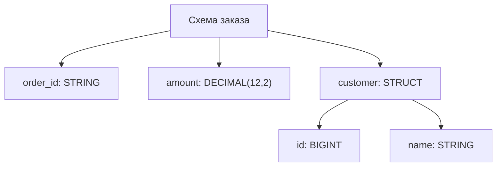
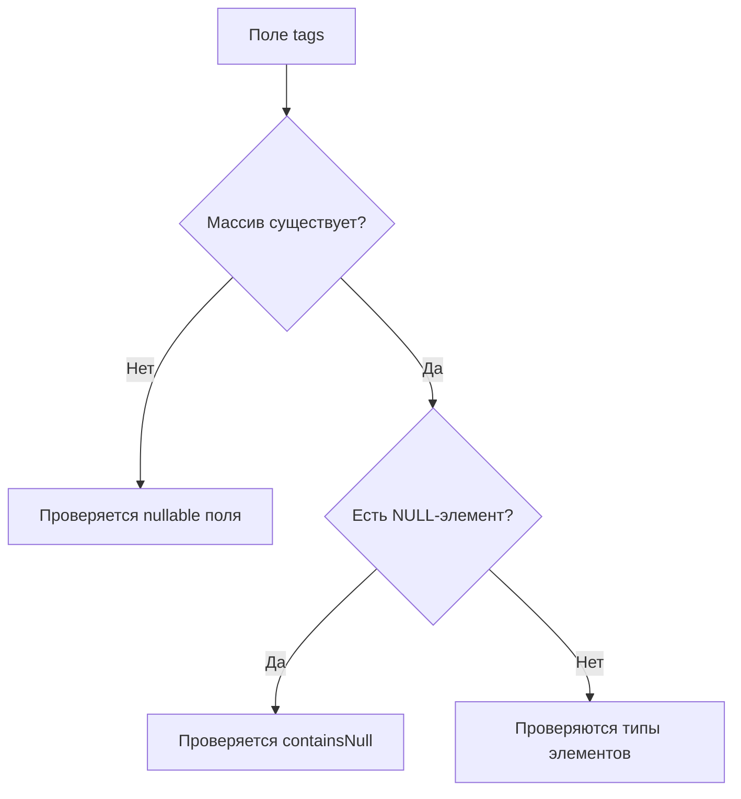
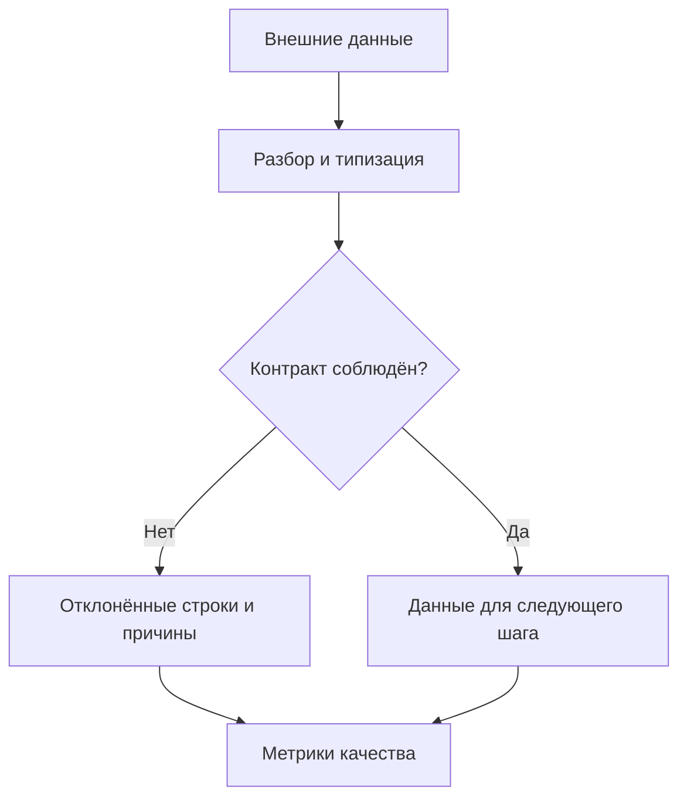
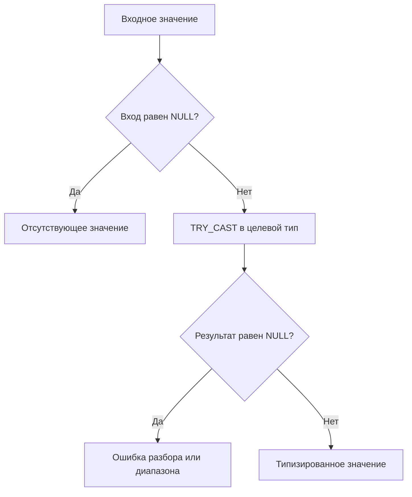
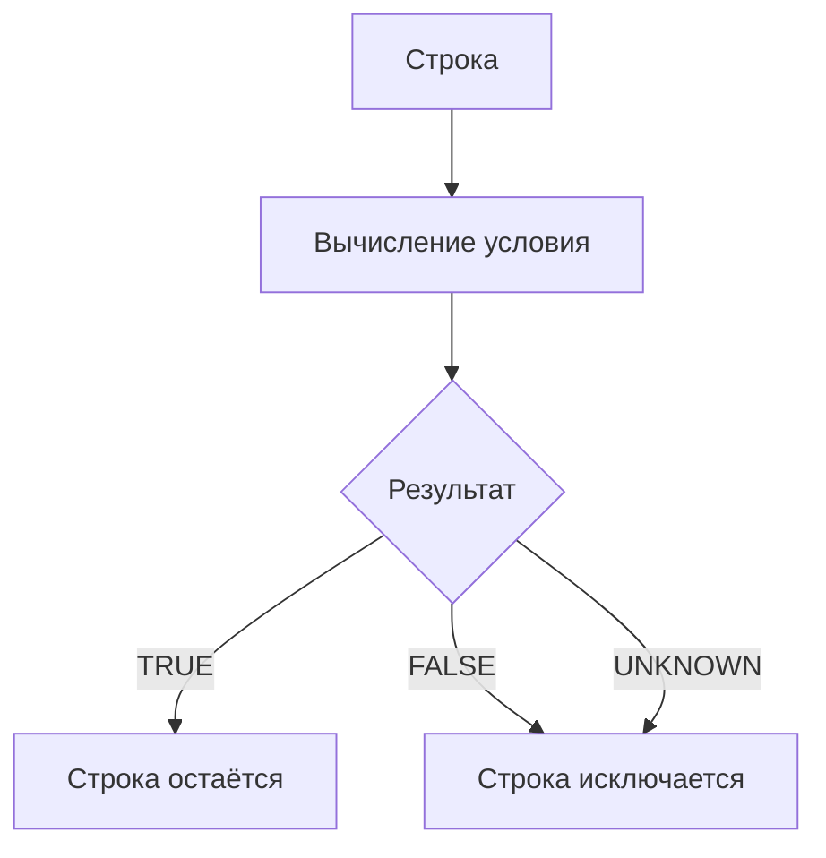

# 3. DataFrame, схемы и типы данных

В предыдущем разделе мы разобрали, как Spark распределяет вычисления. Теперь разберём, **какие данные участвуют в этих вычислениях**: что представляет собой DataFrame, как описать его схему, как Spark выбирает тип выражения и почему `NULL`, неправильный тип и неверный часовой пояс могут изменить результат запроса.

После раздела вы сможете создать DataFrame с явной схемой, прочитать вложенную структуру, выбрать тип для денег и времени, безопасно разобрать внешние значения и привести результат к согласованному контракту.

**Окружение примеров:** Apache Spark / PySpark **4.2.0**, Python **3.12**, Java **17**, Spark Classic. Возможности более новых API и ограничения старых веток отмечены рядом с примерами. Наличие типа в `pyspark.sql.types` само по себе не гарантирует поддержку этого типа в SQL, файловом формате и коннекторе.

Для примеров с `toPandas()` нужен pandas; для Arrow-обмена — PyArrow; для примера векторов ML — NumPy. При проверке использовались pandas **2.2.3**, PyArrow **18.1.0** и NumPy **2.3.5**. Установите совместимые библиотеки в своё виртуальное окружение, если собираетесь выполнять эти примеры.

**Как работать с примерами.** Создайте сессию кодом ниже. Короткие примеры выполняются отдельными ячейками; они могут создавать собственные небольшие DataFrame. В конце страницы есть самостоятельная практическая программа с проверками. `collect()` в учебных примерах используется только для нескольких строк.

```python
from datetime import date, datetime, time, timedelta, timezone
from decimal import Decimal

from pyspark.sql import Row, SparkSession, functions as F, types as T

spark = (
    SparkSession.builder
    .master("local[2]")
    .appName("DataFramesAndTypes")
    .config("spark.sql.session.timeZone", "UTC")
    .config("spark.sql.ansi.enabled", "true")
    .config("spark.sql.shuffle.partitions", "2")
    .getOrCreate()
)

spark.sparkContext.setLogLevel("WARN")

print(spark.version)
print(spark.conf.get("spark.sql.session.timeZone"))
```

`local[2]` и две shuffle-партиции подходят для маленьких учебных данных. На кластере мастер и ресурсы задают через способ запуска приложения. Если сессия уже существует, `getOrCreate()` может вернуть её: проверяйте фактическую конфигурацию.

**Содержание**

1. [Основы DataFrame](#dataframe-basics)
2. [Описание схемы](#schema-definition)
3. [Примитивные типы](#primitive-types)
4. [Сложные и полуструктурированные типы](#complex-types)
5. [Column и система выражений](#column-expressions)
6. [Преобразование типов](#type-conversion)
7. [NULL, NaN и трёхзначная логика](#null-and-nan)
8. [Изменение схемы DataFrame](#schema-changes)

---

<a id="dataframe-basics"></a>

## Основы DataFrame

### Строки, столбцы, схема и объект Row

**DataFrame** — распределённый набор строк с именованными столбцами и схемой. В программе объект DataFrame описывает вычисление: откуда взять данные и какие операции выполнить. Он не означает, что вся таблица уже загружена в память драйвера или executor.

Схема задаёт имя и тип каждого поля, допустимость `NULL` и метаданные. У столбца один тип, хотя внутри него может быть сложная структура: массив, карта или вложенная запись.

```python
people = spark.createDataFrame(
    [(1, "Anna", 29), (2, "Boris", None)],
    "id BIGINT, name STRING, age INT",
)

print(people.columns)
print(people.schema.simpleString())

row = people.orderBy("id").first()
assert row is not None
assert row["name"] == "Anna"
assert row.name == "Anna"
assert row.asDict() == {"id": 1, "name": "Anna", "age": 29}
```

`Row` — объект одной строки в Python. Полученный через `first()` объект уже находится на драйвере. `people["age"]`, напротив, возвращает `Column`: выражение, которое ещё предстоит вычислить для строк DataFrame.

| Объект | Что представляет | Где используется |
| --- | --- | --- |
| `DataFrame` | Набор данных и план его получения | Распределённые преобразования |
| `Column` | Выражение над строкой | `select`, `filter`, вычисление полей |
| `StructType` | Описание схемы | Создание, чтение, проверка контрактов |
| `Row` | Одну материализованную строку | Локальная проверка маленького результата |

DataFrame не имеет pandas-индекса. Порядок строк без `orderBy` не гарантирован; номер элемента в результате `collect()` не служит постоянным идентификатором записи. `Row` рассматривайте как неизменяемую запись: изменение бизнес-данных выполняйте выражениями DataFrame.

### Создание DataFrame из локальных данных, файлов и таблиц

Для нескольких тестовых строк удобно использовать список кортежей и явную схему. Для больших данных обычно читают источник напрямую, чтобы не собирать весь вход на драйвере.

```python
local_data = [
    ("001", Decimal("19.90")),
    ("002", Decimal("5.00")),
]

payments = spark.createDataFrame(
    local_data,
    "payment_id STRING, amount DECIMAL(12,2)",
)

payments.createOrReplaceTempView("payments_demo")
from_table = spark.table("payments_demo")
from_sql = spark.sql("SELECT payment_id, amount FROM payments_demo")

assert from_table.schema == payments.schema
```

Текстовая схема в этом примере — DDL-описание полей. Оно не приводит произвольные Python-объекты к указанным типам. Для `DECIMAL` передавайте `Decimal`, для целочисленного поля — `int`, для даты — `date`.

Самостоятельный пример записи и чтения локального Parquet:

```python
from pathlib import Path
from tempfile import TemporaryDirectory

with TemporaryDirectory(prefix="spark-types-") as directory:
    path = str(Path(directory) / "payments")
    payments.write.mode("errorifexists").parquet(path)
    restored = spark.read.parquet(path)
    assert restored.count() == 2
    assert restored.schema["amount"].dataType == T.DecimalType(12, 2)
```

Временное представление связывает имя с планом DataFrame в сессии. Оно не записывает данные и не превращает их в постоянную таблицу. Для реальной таблицы `spark.table("catalog.schema.table")` получает данные через соответствующий каталог и источник.

**Граница локального примера:** временный каталог виден процессам на одной машине. На распределённом кластере используйте доступное всем executor хранилище. Передача огромного Python-списка в `createDataFrame` сначала требует разместить этот список на драйвере.

Документация: [createDataFrame](https://spark.apache.org/docs/4.2.0/api/python/reference/pyspark.sql/api/pyspark.sql.SparkSession.createDataFrame.html), [временное представление](https://spark.apache.org/docs/4.2.0/api/python/reference/pyspark.sql/api/pyspark.sql.DataFrame.createOrReplaceTempView.html).

### Создание тестовых данных через range

`spark.range()` создаёт распределённый DataFrame с одним столбцом `id` типа `BIGINT`. Его удобно использовать для синтетических данных, не создавая большой список в Python.

```python
ids = spark.range(start=0, end=10, step=2, numPartitions=2)
assert [r.id for r in ids.orderBy("id").collect()] == [0, 2, 4, 6, 8]

synthetic = spark.range(100).select(
    F.col("id").alias("event_id"),
    (F.col("id") % 5).cast("int").alias("category_id"),
    (F.col("id") * 10).cast("decimal(12,2)").alias("amount"),
    (F.col("id") % 2 == 0).alias("is_even"),
)

synthetic.limit(5).show()
```

Правая граница `end` не включается. `numPartitions` определяет начальное распределение генератора, а не количество файлов после произвольного pipeline. Дальнейшие операции могут изменить число партиций.

Генератор остаётся ленивым. `spark.range(10**9)` не создаёт на драйвере миллиард Python-объектов, но действие над таким DataFrame всё равно может потребовать значительных ресурсов. Для проверки схем и функций обычно достаточно десятков строк.

### columns, schema, dtypes и printSchema

Эти инструменты отвечают на разные вопросы о структуре.

| Инструмент | Результат | Когда полезен |
| --- | --- | --- |
| `df.columns` | Список имён верхнего уровня | Выбрать, проверить или упорядочить поля |
| `df.dtypes` | Пары «имя — строковое описание типа» | Быстро посмотреть типы |
| `df.schema` | `StructType` | Программно проверить типы, nullability, metadata |
| `df.printSchema()` | Печать дерева схемы | Исследовать вложенные поля |
| `df.schema.simpleString()` | Компактное описание типов | Краткий вывод для человека |
| `df.schema.json()` | JSON схемы | Сохранить полное описание схемы |

```python
print(people.columns)
print(people.dtypes)
people.printSchema()

for field in people.schema.fields:
    print(field.name, field.dataType, field.nullable, field.metadata)

assert people.schema["age"].dataType == T.IntegerType()
```

Доступ к схеме не равен просмотру всех строк. Однако построение самого DataFrame могло уже потребовать чтения метаданных, вывода схемы или анализа запроса. Поэтому утверждение «любая операция со схемой никогда ничего не читает» слишком сильное.

`dtypes` не заменяет полную схему: в нём нет отдельного описания `nullable`, `containsNull`, `valueContainsNull` и metadata. Для сравнения контрактов используйте `StructType` или его JSON-представление.

### show, head, first, take и limit

Просмотр результата может запустить вычисление. Выберите инструмент по тому, что хотите получить на драйвере.

| Вызов | Что возвращает | Выполняет запрос |
| --- | --- | --- |
| `show(5, truncate=False)` | Печатает строки; возвращает `None` | Да |
| `first()` | `Row` или `None`, если строк нет | Да |
| `head()` | `Row` или `None` | Да |
| `head(5)` | Список максимум из пяти `Row` | Да |
| `take(5)` | Список максимум из пяти `Row` | Да |
| `limit(5)` | Новый DataFrame | Сам по себе — нет |

```python
people.orderBy("id").show(5, truncate=False)

first_person = people.orderBy("id").first()
sample = people.orderBy("id").take(2)
limited = people.limit(2)

assert isinstance(sample, list)
assert limited.columns == people.columns
```

`limit` ограничивает число выходных строк, но не гарантирует дешёвое выполнение входного плана. Если перед ним стоит глобальная сортировка, сложная агрегация или соединение, может потребоваться большая обработка.

Для просмотра достаточно `show`. Для локальной проверки нескольких значений используйте `take`. `collect()` и `toPandas()` получают весь результат на драйвер и требуют, чтобы он помещался в доступную память.

**Типичная ошибка:** `df = df.show()` присваивает переменной `None`. Печатайте результат отдельно от присваивания DataFrame.

### count, isEmpty и стоимость проверки наличия данных

`count()` отвечает «сколько строк», а `isEmpty()` — «существует ли хотя бы одна строка». Эти вопросы имеют разную вычислительную стоимость.

```python
empty = spark.createDataFrame([], "id BIGINT, note STRING")
one_null = spark.createDataFrame([(None,)], "value STRING")

assert empty.count() == 0
assert empty.isEmpty() is True
assert one_null.isEmpty() is False

has_adults = not people.filter(F.col("age") >= 18).isEmpty()
```

Строка, все поля которой равны `NULL`, всё равно является строкой. Пустой DataFrame — это отсутствие строк, а не отсутствие непустых значений.

Обычно `count()` должен обработать все подходящие строки; иногда источник или оптимизатор может получить ответ более коротким путём. `isEmpty()` может закончить поиск после первой строки. Но если нужно доказать, что результат фильтра пуст, может потребоваться проверить весь вход.

В Spark Classic реализация `isEmpty()` использует выполнение плана с поиском ограниченного результата. Оптимизируемый пустой локальный план может обойтись без распределённого job; произвольный план из файлов или соединений — нет. Поэтому **не считайте `isEmpty()` бесплатным обращением к метаданным**.

Альтернатива для API, где `isEmpty` недоступен:

```python
is_empty = len(people.take(1)) == 0
```

Не ставьте `count()` перед каждой записью просто для проверки непустоты: это может запускать дополнительное вычисление pipeline. Для streaming DataFrame способы запуска и проверки результата отличаются; эти примеры относятся к batch.

Документация: [isEmpty](https://spark.apache.org/docs/4.2.0/api/python/reference/pyspark.sql/api/pyspark.sql.DataFrame.isEmpty.html). Проверять фактическую стоимость удобно по Spark UI.

### Почему DataFrame Spark отличается от pandas DataFrame

Сходство имён скрывает разную модель выполнения.

| Вопрос | pandas DataFrame | Spark DataFrame |
| --- | --- | --- |
| Где обычно находятся данные | В памяти одного Python-процесса | Распределены между задачами и источниками |
| Когда выполняется преобразование | Обычно сразу | Обычно при действии |
| Есть ли индекс строк | Есть | Нет pandas-индекса |
| Как выбирать строки | `loc`, `iloc`, маски | Выражения и `filter` |
| Можно ли менять ячейку на месте | Во многих операциях — да | Строят новый DataFrame |
| Что определяет тип | dtype и соглашения pandas | Схема Spark SQL |
| Как работают пропуски | `None`, `NaN`, `pd.NA`, `NaT` и dtype | SQL `NULL`; отдельно — `NaN` у чисел |
| Стоимость локального доступа | Обычно доступ к уже имеющимся данным | Может запускать распределённое вычисление |

```python
# Spark: создаём выражение и новый план.
older = people.withColumn("age_next_year", F.col("age") + 1)

# Только маленький, явно ограниченный результат переводим в pandas.
small_pandas = people.orderBy("id").limit(10).toPandas()
```

`toPandas()` возвращает обычный локальный pandas DataFrame. После этого вычисления pandas больше не распределяются Spark. Pandas API on Spark — отдельный API с собственными правилами; он не делает любой произвольный pandas-код распределённым автоматически.

Не переносите цикл `for` по строкам pandas в Spark через предварительный `collect()`. Начните с выражений `Column`, SQL и встроенных функций. Схема и векторные операции позволяют Spark анализировать вычисление целиком.

**Практика по теме:** создайте пустой DataFrame с тремя полями, DataFrame с одной полностью `NULL`-строкой и DataFrame из `range(20)`. Для каждого предскажите схему, `count()` и `isEmpty()`, затем проверьте предсказание.

---

<a id="schema-definition"></a>

## Описание схемы

### StructType и StructField

Схема DataFrame — `StructType`: упорядоченный список `StructField`. Каждый `StructField` описывает имя, тип, допустимость `NULL` и metadata одного поля.

```python
order_schema = T.StructType([
    T.StructField("order_id", T.StringType(), nullable=False),
    T.StructField("amount", T.DecimalType(12, 2), nullable=True),
    T.StructField("created_on", T.DateType(), nullable=True),
])

orders = spark.createDataFrame([
    ("o-001", Decimal("125.50"), date(2026, 1, 15)),
    ("o-002", None, None),
], schema=order_schema)

assert orders.schema["order_id"].nullable is False
assert orders.schema["amount"].dataType.precision == 12
assert orders.schema["amount"].dataType.scale == 2
```

Порядок полей важен для создания из кортежей: первое значение соответствует первому `StructField`. Вложенные кортежи аналогично сопоставляются с порядком вложенных полей.

Не используйте одинаковые имена полей в контракте. DataFrame после некоторых операций может содержать дубликаты имён, но ссылки на них становятся неоднозначными. Это не два независимых адресуемых поля с одним именем.



Здесь `customer` — одно поле верхнего уровня. У него есть собственный тип и собственная `nullable`, а у `customer.id` и `customer.name` — свои параметры.

### Схема в DDL-формате и JSON-представлении

Для компактных примеров удобна DDL-строка:

```python
ddl = "order_id STRING, amount DECIMAL(12,2), tags ARRAY<STRING>"
from_ddl = spark.createDataFrame(
    [("o-003", Decimal("10.00"), ["new", "web"])],
    ddl,
)

# DataType.fromDDL доступен в PySpark начиная с 4.0.
parsed_schema = T.DataType.fromDDL(ddl)
assert isinstance(parsed_schema, T.StructType)
```

Полная сериализация схемы в JSON сохраняет информацию о nullability и metadata:

```python
import json

schema_json = order_schema.json()
restored_schema = T.StructType.fromJson(json.loads(schema_json))

assert restored_schema == order_schema
```

| Представление | Сильная сторона | Ограничение |
| --- | --- | --- |
| Python `StructType` | Точный контроль каждого поля | Более многословный код |
| DDL-строка | Удобно читать и передавать в API | Не считать любое DDL-представление полным снимком metadata |
| `simpleString()` | Короткий вывод типов | Не сохраняет весь контракт схемы |
| `schema.json()` | Полное машинное представление схемы | Это JSON схемы, а не JSON строк |

`df.toJSON()` сериализует строки данных; `df.schema.json()` сериализует описание этих строк. Эти методы решают разные задачи.

При хранении схемы в репозитории записывайте рядом назначение полей и версию контракта. Не меняйте описание типа, надеясь, что старые файлы автоматически станут соответствовать ему.

### Вывод схемы и его стоимость и ограничения

**Schema inference** пытается вывести типы из данных или метаданных источника. Полученный тип описывает увиденные значения, но не знает их бизнес-смысл.

```python
inferred = spark.createDataFrame([(1, "001"), (2, "002")], ["n", "code"])

assert inferred.schema["n"].dataType == T.LongType()
assert inferred.schema["code"].dataType == T.StringType()
```

В Python-списках `int` обычно выводится как `LongType`. Для CSV вывод схемы может читать данные дополнительным проходом; JSON анализирует наблюдаемые поля и значения. Parquet хранит типы в файловых метаданных, но перечисление файлов и согласование их схем тоже имеют стоимость.

**Где inference ненадёжен:**

- Пустой Python-список не содержит информации о типах.
- Поле, в котором во всех рассматриваемых строках только `None`, не сообщает, должен ли его тип быть `STRING`, `DATE` или `DECIMAL`.
- Выборка может не содержать редкое поле или необычное значение.
- Строковый идентификатор `001` при числовом разборе теряет ведущие нули.
- Смесь несовместимых Python-типов может вызвать ошибку вывода, а не автоматически стать универсальным столбцом.
- Типы, выводимые из JSON/CSV, зависят от формата и настроек чтения.

```python
# Правильно: схема известна даже без строк.
empty_orders = spark.createDataFrame([], order_schema)

# Правильно: тип полностью NULL-поля указан явно.
notes = spark.createDataFrame([(None,)], "note STRING")
```

Для исследовательского чтения inference полезен. Для воспроизводимого pipeline с известным входным контрактом предпочтительнее явная схема и отдельная проверка качества.

### Явная схема и проверка входных данных

Явная схема фиксирует ожидания по структуре, но **способ проверки зависит от входного API**.

При создании DataFrame из обычных Python-строк `verifySchema=True` проверяет соответствие объектов указанным типам и nullability. Это не парсер строковых чисел.

```python
schema = T.StructType([
    T.StructField("id", T.LongType(), False),
    T.StructField("amount", T.DecimalType(10, 2), True),
])

valid = spark.createDataFrame([(1, Decimal("12.30"))], schema)

try:
    spark.createDataFrame([("1", Decimal("12.30"))], schema)
except Exception as error:
    print(type(error).__name__)
```

Строка `"1"` не становится `int` только потому, что поле описано как `LongType`. Если вход приходит текстом, сначала прочитайте его как текст, затем выполните явный разбор.

Для файлов ошибка может обнаружиться только при действии. В `PERMISSIVE`-режиме текстового источника некорректные значения могут превратиться в `NULL` или попасть в поле повреждённой записи согласно настройкам источника. `FAILFAST` прерывает чтение при обнаружении ошибки разбора, но также не проверяет бизнес-правила вроде уникальности ключа или допустимого статуса.

```python
# Пример настройки для собственного существующего CSV-файла.
# csv_orders = (
#     spark.read.schema(order_schema)
#     .option("header", "true")
#     .option("mode", "FAILFAST")
#     .csv("/path/to/orders.csv")
# )
```

Проверка `verifySchema` не действует тем же способом для `pyarrow.Table` и pandas-входа с включённым Arrow; там действуют правила Arrow-конверсии. В Spark Connect этот параметр также не поддерживается как в Classic. Не переносите гарантию одного пути загрузки на другой.

**Правильное разделение проверок:** парсер проверяет разбор значения, схема — структурные ожидания, правила качества — допустимость значения для вашего процесса. Для обязательного денежного поля нужны все три уровня.

### nullable, containsNull и valueContainsNull

У сложных типов есть несколько независимых уровней допустимости `NULL`.

```python
strict_items = T.StructType([
    T.StructField("id", T.LongType(), nullable=False),
    T.StructField(
        "tags",
        T.ArrayType(T.StringType(), containsNull=False),
        nullable=True,
    ),
    T.StructField(
        "attributes",
        T.MapType(T.StringType(), T.StringType(), valueContainsNull=True),
        nullable=False,
    ),
])

items = spark.createDataFrame([
    (1, ["new", "web"], {"source": "site", "campaign": None}),
    (2, None, {}),
], strict_items)
```

| Параметр | К чему относится | Что допускает |
| --- | --- | --- |
| `StructField(..., nullable=True)` | Значение всего поля | Например, `tags = NULL` |
| `ArrayType(..., containsNull=True)` | Элемент массива | Например, `["new", NULL]` |
| `MapType(..., valueContainsNull=True)` | Значение по ключу | Например, `{"source": NULL}` |
| `StructField` внутри `StructType` | Поле вложенной структуры | Например, `customer.name = NULL` |

Для `strict_items` допустим `tags=None`, но недопустим `tags=[None]`. Карта `attributes` должна существовать, однако отдельное значение в ней может быть `None`. Ключи карты не могут быть `NULL` независимо от `valueContainsNull`.



Флаги схемы используются анализатором и оптимизатором, поэтому ложная отметка `nullable=False` опасна. Не отключайте проверку входа, чтобы искусственно объявить неизвестные данные обязательными.

### Metadata полей и сохранение метаданных при преобразованиях

Metadata — словарь дополнительных сведений о поле. В нём можно хранить единицу измерения, описание, источник и другие JSON-совместимые атрибуты.

```python
distance_schema = T.StructType([
    T.StructField(
        "distance", T.DoubleType(), True,
        {"unit": "km", "description": "Trip distance"},
    ),
])

distances = spark.createDataFrame([(12.5,)], distance_schema)
assert distances.schema["distance"].metadata["unit"] == "km"

meters = distances.select(
    (F.col("distance") * 1000).alias(
        "distance_m", metadata={"unit": "m", "source": "distance"}
    )
)

with_description = meters.withMetadata(
    "distance_m", {"unit": "m", "description": "Trip distance in metres"}
)
```

При простом выборе существующего поля metadata обычно сохраняется. Создание нового выражения, cast, преобразование через другой API или запись в внешний формат могут сохранить её иначе либо потерять.

В проверенном примере Spark 4.2 простой `select("distance")` сохраняет metadata, а новый арифметический результат без явно заданной metadata получает пустой словарь. Поэтому после изменения единицы измерения назначайте metadata результата явно и проверяйте её после чтения из целевого источника.

Metadata не исполняет бизнес-правило. Запись `{"unit": "m"}` не переводит километры в метры, а запись `{"required": true}` не создаёт ограничение `NOT NULL` в хранилище.

### Соответствие схемы внешнему контракту данных

**Контракт данных** шире схемы. Он определяет обязательные поля, типы, смысл значений, единицы, допустимые диапазоны, ключи, правила времени и совместимость изменений.

Пример контракта заказа:

| Поле | Тип | Правило |
| --- | --- | --- |
| `order_id` | `STRING` | Обязательное, непустое, уникальное |
| `amount` | `DECIMAL(12,2)` | Неотрицательная сумма в согласованной валюте |
| `currency` | `STRING` | Разрешённый код валюты |
| `created_at` | `TIMESTAMP_LTZ` | Момент события; согласованные правила входного часового пояса |

```python
contract_data = spark.createDataFrame([
    ("o-001", Decimal("12.30"), "EUR"),
    ("", Decimal("-1.00"), "???"),
    (None, None, "EUR"),
], "order_id STRING, amount DECIMAL(12,2), currency STRING")

invalid_condition = (
    F.col("order_id").isNull()
    | (F.trim(F.col("order_id")) == "")
    | F.col("amount").isNull()
    | (F.col("amount") < F.lit(Decimal("0.00")))
    | F.col("currency").isNull()
    | ~F.col("currency").isin("EUR", "USD")
)

invalid_orders = contract_data.filter(invalid_condition)
assert invalid_orders.count() == 2
```

Наличие `isNull` в проверке принципиально: сравнение `NULL < 0` не даёт `TRUE`. Только `amount < 0` пропустило бы отсутствие обязательной суммы.



Не удаляйте некорректные строки молча. Сохраняйте исходное значение и причину отклонения. Схему удобно сравнивать программно, а семантические правила — выражениями Spark. Уникальность ключа требует отдельной проверки данных и не следует из `StructType`.

**Практика по теме:** опишите товар с обязательным строковым идентификатором, необязательным массивом непустых элементов и картой атрибутов. Проверьте отдельно `NULL` всего массива, `NULL` внутри массива и `NULL` значения карты.

---

<a id="primitive-types"></a>

## Примитивные типы

### BooleanType и целочисленные типы

`BooleanType` хранит логические значения `TRUE` и `FALSE`. При разрешённом `NULL` поле также может иметь неизвестное значение. Целочисленные типы различаются диапазоном, а не количеством знаков после запятой.

| PySpark | SQL | Разрядность | Диапазон |
| --- | --- | --- | --- |
| `ByteType()` | `TINYINT` | 8 бит | −128 … 127 |
| `ShortType()` | `SMALLINT` | 16 бит | −32 768 … 32 767 |
| `IntegerType()` | `INT` | 32 бита | −2³¹ … 2³¹−1 |
| `LongType()` | `BIGINT` | 64 бита | −2⁶³ … 2⁶³−1 |
| `BooleanType()` | `BOOLEAN` | Логический тип | `TRUE`, `FALSE`; при nullable — `NULL` |

```python
flags = spark.createDataFrame(
    [(1, True), (2, False), (3, None)],
    "id BIGINT, is_active BOOLEAN",
)

assert flags.filter(F.col("is_active")).count() == 1
assert flags.filter(F.col("is_active").isNull()).count() == 1
```

Spark не имеет стандартного SQL-типа «беззнаковый 64-битный integer», эквивалентного всем значениям `uint64`. Если источник содержит числа больше максимума `BIGINT`, выберите подходящий `DECIMAL` или строковое представление согласно смыслу данных.

Python `int` может быть значительно больше 64-битного значения, поэтому успешное вычисление в Python ещё не гарантирует возможность создать `LongType`-поле. Для идентификаторов вроде номера карты, почтового индекса и кода `000123` обычно выбирают `STRING`: над ними не выполняют числовую арифметику.

`nullable=False` для boolean не означает `TRUE`: оба логических значения допустимы. Строки `"true"` и `"false"` следует отдельно разобрать, а не передавать в Python-вход как уже готовые `bool`.

### FloatType и DoubleType

`FLOAT` и `DOUBLE` представляют числа с плавающей точкой. Они подходят для измерений, вероятностей и приближённых вычислений, но многие десятичные дроби представляют приблизительно.

```python
measurements = spark.createDataFrame(
    [(0.1, 0.2), (1.0, 2.0)],
    "x DOUBLE, y DOUBLE",
)

result = measurements.select((F.col("x") + F.col("y")).alias("total"))
assert abs(result.first().total - 0.3) < 1e-12
```

| Тип | Размер | Типичная точность | Назначение |
| --- | --- | --- | --- |
| `FloatType` | 32 бита | Около 6–7 значащих десятичных цифр | Измерения с ограниченной точностью |
| `DoubleType` | 64 бита | Около 15–16 значащих десятичных цифр | Большинство приближённых численных вычислений |

Значащие цифры — не фиксированное число цифр после десятичной точки. На больших числах расстояние между соседними представимыми значениями увеличивается. Перевод большого `BIGINT` в `DOUBLE` может потерять младшие разряды; это особенно опасно для ключей.

Оба типа допускают `NaN`, положительную и отрицательную бесконечность. Они не равны отсутствию значения. Семантику `NaN` в Spark разберём отдельно ниже.

Для сравнения результатов измерений используйте допустимую абсолютную или относительную погрешность, определённую задачей. Для точных сумм в валюте выбирайте `DECIMAL` либо целые минимальные денежные единицы с явным масштабом.

### DecimalType: precision, scale и денежные вычисления

`DECIMAL(p,s)` хранит десятичное число с общей точностью `p` и масштабом `s`.

- `precision` — максимальное общее количество десятичных цифр.
- `scale` — количество цифр справа от десятичной точки.
- На целую часть остаётся `p - s` цифр; знак не занимает разряд точности.

Например, `DECIMAL(5,2)` позволяет хранить `999.99`, но не `1000.00`. В Spark максимальная обычная precision — **38**.

```python
prices = spark.createDataFrame([
    ("p-1", Decimal("19.90"), 3),
    ("p-2", Decimal("5.00"), 2),
], "product_id STRING, unit_price DECIMAL(12,2), quantity INT")

totals = prices.select(
    "product_id",
    (F.col("unit_price") * F.col("quantity"))
    .cast("decimal(18,2)").alias("line_total"),
)

actual = {r.product_id: r.line_total for r in totals.collect()}
assert actual == {"p-1": Decimal("59.70"), "p-2": Decimal("10.00")}
```

Создавайте Python `Decimal` из строки: `Decimal("0.1")`. `Decimal(0.1)` уже получает приблизительное бинарное значение Python `float` и может зафиксировать эту погрешность как десятичную дробь.

**Тип результата арифметики может отличаться от типа входа.** Spark рассчитывает precision и scale выражения, а при достижении максимальной точности поведение зависит от операции и конфигурации. После умножения, деления и агрегирования проверяйте `result.schema`, а не предполагайте сохранение `DECIMAL(12,2)`.

```python
rounding = spark.sql("""
    SELECT
        CAST('1.235' AS DECIMAL(5,2)) AS rounded,
        TRY_CAST('1000.00' AS DECIMAL(5,2)) AS overflow
""")

row = rounding.first()
assert row.rounded == Decimal("1.24")
assert row.overflow is None
```

Сокращение scale может округлить значение, даже если операция успешно завершилась. Успех `try_cast` не означает, что значение сохранилось без изменения. Правило округления для денег должно быть частью контракта: например, `round` и `bround` используют разные правила обработки середины.

**Выбор денежного типа:** определите максимальную сумму, необходимую точность промежуточных вычислений и масштаб результата. Валюту храните отдельно. `DECIMAL` не запрещает складывать EUR и USD без курса конвертации.

Документация: [DecimalType](https://spark.apache.org/docs/4.2.0/api/python/reference/pyspark.sql/api/pyspark.sql.types.DecimalType.html).

### StringType и BinaryType

`StringType` предназначен для текста. `BinaryType` — для последовательности байтов: например, бинарного содержимого, закодированного сообщения или результата бинарной сериализации.

```python
text_and_bytes = spark.createDataFrame([
    ("001", "Привет", "Привет".encode("utf-8")),
], "code STRING, message STRING, payload BINARY")

decoded = text_and_bytes.select(
    "code",
    F.decode("payload", "UTF-8").alias("decoded_message"),
    F.hex("payload").alias("hex_payload"),
)

assert decoded.first().decoded_message == "Привет"
```

Байты сами по себе не содержат указания кодировки. Перевод бинарного поля в текст требует знания формата: UTF-8, Base64, Avro и другие представления имеют разные правила.

| Значение | Тип | Смысл |
| --- | --- | --- |
| `"001"` | `STRING` | Текстовый код с ведущими нулями |
| `b"001"` | `BINARY` | Три байта |
| `""` | `STRING` | Известная пустая строка |
| `b""` | `BINARY` | Известная пустая последовательность байтов |
| `None` | Заданный nullable-тип | Отсутствие значения |

Длина строки в символах и длина её UTF-8-представления в байтах могут различаться. `STRING` не следует использовать как универсальную замену всем типам: арифметика и сравнение дат над строками могут дать иной смысл, а необходимость постоянно разбирать значения усложняет проверку качества.

Сравнение строк также может зависеть от collation в поддерживающих её версиях Spark. Настройка регистра имён столбцов — другой механизм: она не определяет равенство текстовых значений.

### CHAR и VARCHAR: ограничения длины, дополнение CHAR пробелами и особенности использования в схемах таблиц

`VARCHAR(n)` ограничивает длину строки. `CHAR(n)` дополнительно имеет семантику фиксированной длины и дополнения коротких строк пробелами. Эти типы прежде всего изучают **на схемах таблиц**, а не как замену `StringType` в произвольном Python-входе.

Самостоятельный пример создаёт таблицу с уникальным учебным именем и удаляет её после проверки:

```python
from uuid import uuid4

table_name = "types_char_" + uuid4().hex

try:
    spark.sql(f"""
        CREATE TABLE {table_name} (
            fixed_code CHAR(4),
            variable_code VARCHAR(4)
        ) USING parquet
    """)
    spark.sql(f"INSERT INTO {table_name} VALUES ('ab', 'ab')")

    row = spark.sql(f"""
        SELECT fixed_code, variable_code,
               length(fixed_code) AS fixed_length,
               length(variable_code) AS variable_length
        FROM {table_name}
    """).first()

    assert row.fixed_code == "ab  "
    assert row.variable_code == "ab"
    assert (row.fixed_length, row.variable_length) == (4, 2)
finally:
    spark.sql(f"DROP TABLE IF EXISTS {table_name}")
```

При записи слишком длинного обычного значения, например `abcde` в `VARCHAR(4)`, ожидается ошибка ограничения длины. Обработка завершающих пробелов имеет собственные SQL-правила, поэтому не заменяйте контракт длины одним случайным тестом.

**Ловушка:** `CAST('abcde' AS CHAR(4))` в стандартной конфигурации Spark 4.2 не является надёжной проверкой длины. В проверенном примере такой cast работает как приведение к строке и возвращает `abcde`; табличное ограничение при записи ведёт себя иначе.

В DataFrame, прочитанном из таблицы, эти поля при стандартных настройках могут отображаться как `STRING`, а сведения о `CHAR/VARCHAR` храниться в metadata. На поведение влияют настройки совместимости, включая `spark.sql.preserveCharVarcharTypeInfo`. Не включайте их ради обхода проверки без изучения версии и контракта.

Для обычного DataFrame используйте `STRING` и явные проверки длины. Для записи в таблицу с `CHAR/VARCHAR` проверяйте результат через её реальный writer и catalog.

### DateType, TimestampType и TimestampNTZType

Различайте календарную дату, момент на временной шкале и локальные показания часов.

| Тип | SQL | Смысл | Пример задачи |
| --- | --- | --- | --- |
| `DateType` | `DATE` | Год, месяц, день | Дата рождения |
| `TimestampType` | `TIMESTAMP_LTZ` | Момент времени; отображение связано с зоной сессии | Время события из разных стран |
| `TimestampNTZType` | `TIMESTAMP_NTZ` | Дата и время без часового пояса | Локальное расписание магазина |

```python
moments = spark.sql("""
    SELECT
        DATE '2026-01-15' AS event_date,
        CAST('2026-01-15T10:00:00+03:00' AS TIMESTAMP_LTZ) AS instant,
        CAST('2026-01-15 10:00:00' AS TIMESTAMP_NTZ) AS local_time
""")

moments.select(
    "event_date",
    F.date_format("instant", "yyyy-MM-dd HH:mm:ss").alias("instant_in_session"),
    F.col("local_time").cast("string").alias("local_time_text"),
).show(truncate=False)
```

При `spark.sql.session.timeZone = UTC` текстовое представление `instant` здесь — `2026-01-15 07:00:00`, а `local_time` — `2026-01-15 10:00:00`.

`TimestampType` не хранит исходную строку часового пояса каждой записи. Если важно сохранить `Europe/Berlin` или исходное смещение, храните его в отдельном поле. Один и тот же момент может отображаться разными часами в разных зонах.

При создании из Python передавайте aware `datetime` для абсолютного момента и naive `datetime` для намеренно локального `TIMESTAMP_NTZ`:

```python
time_schema = T.StructType([
    T.StructField("instant", T.TimestampType(), False),
    T.StructField("local_time", T.TimestampNTZType(), False),
])

python_moments = spark.createDataFrame([
    (
        datetime(2026, 1, 15, 7, 0, tzinfo=timezone.utc),
        datetime(2026, 1, 15, 10, 0),
    ),
], time_schema)
```

**Два часовых пояса:** зона сессии Spark и зона Python-процесса — не одно и то же. В Spark Classic получение `TimestampType` в Python через `collect()` может вернуть naive `datetime`, связанный с локальной зоной процесса. Для воспроизводимой проверки сравнивайте epoch-значения или форматируйте timestamp внутри Spark с явно заданной зоной. Установка только `spark.sql.session.timeZone` не меняет автоматически `TZ` Python.

`spark.sql.timestampType` задаёт, какой вариант использует неопределённое слово `TIMESTAMP`; в базовой конфигурации это `TIMESTAMP_LTZ`. Если различие существенно, указывайте `TIMESTAMP_LTZ` или `TIMESTAMP_NTZ` явно. Точность стандартных timestamp Spark — микросекунды; преобразование из источника с наносекундами может потерять младшую часть.

### TIME / TimeType: время суток без даты и часового пояса, точность дробной части секунды

`TIME` описывает время суток без календарной даты и часового пояса: например, начало работы в `09:30:00`. Это не длительность и не момент события.

В PySpark `TimeType` появился в **4.1.0**. Тип имеет параметр precision от 0 до 6; значение Python представляется `datetime.time`.

**Существенное ограничение Spark 4.2:** поддержка `TIME` в SQL отключена по умолчанию внутренней настройкой `spark.sql.timeType.enabled`. В обычной сессии SQL-запрос с `TIME` может завершиться `UNSUPPORTED_TIME_TYPE`, хотя класс `T.TimeType` успешно импортируется. Это подтверждается и исходным кодом конфигурации, и локальным выполнением.

Следующий эксперимент использует отдельную учебную сессию и включает внутреннюю возможность только в ней:

```python
time_session = spark.newSession()
time_session.conf.set("spark.sql.timeType.enabled", "true")

opening_hours = time_session.createDataFrame([
    ("shop-1", time(9, 30, 0, 123456)),
], T.StructType([
    T.StructField("shop_id", T.StringType(), False),
    T.StructField("opens_at", T.TimeType(6), False),
]))

assert opening_hours.first().opens_at == time(9, 30, 0, 123456)

invalid_clock = time_session.sql(
    "SELECT TRY_CAST('24:00:00' AS TIME(6)) AS t"
).first()
assert invalid_clock.t is None
```

Не вызывайте `time_session.stop()` в середине этих примеров: в Classic она использует общий SparkContext с `spark`.

| Значение | Подходит для `TIME` | Почему |
| --- | --- | --- |
| `09:30:00` | Да | Время суток |
| `09:30:00.123456` | Да при соответствующей точности | Дробная часть секунды |
| `2026-01-15 09:30:00` | Нет как полное значение | Содержит дату |
| `09:30:00+03:00` | Не полноценный контракт для `TIME` | Требует смысла часового пояса |
| `36:00:00` | Нет | Длительность больше суток следует хранить иначе |

Precision в описании типа не следует воспринимать как доказательство округления во всех путях конверсии. В локальной проверке Spark 4.2 значение с шестью цифрами дробной части сохранялось при получении в Python даже для `TIME(3)`, в том числе после cast. Если контракт требует строго миллисекунды, проверяйте и нормализуйте значения отдельно, а затем проверяйте round-trip целевого формата.

Для промышленного контракта сначала подтвердите поддержку `TIME` вашей платформой. Внутренняя настройка не является обещанием полной совместимости. Если приходится использовать строку `HH:mm:ss` или число микросекунд от начала суток, явно зафиксируйте формат, допустимый диапазон и единицу измерения.

Документация: [TimeType](https://spark.apache.org/docs/4.2.0/api/python/reference/pyspark.sql/api/pyspark.sql.types.TimeType.html), [определение флага в исходном коде Spark 4.2](https://github.com/apache/spark/blob/v4.2.0/sql/catalyst/src/main/scala/org/apache/spark/sql/internal/SQLConf.scala).

### Проверка поддержки TIME при чтении, записи и обмене данными в выбранной версии Spark

Поддержку нового типа проверяют по **всей цепочке**, а не по одному успешному `printSchema()`.

1. Создать значение и выполнить действие.
2. Проверить тип и значение после выражений SQL.
3. Записать выбранным writer.
4. Прочитать тем reader, которым будет пользоваться потребитель.
5. Сравнить значение, точность и схему после обмена.

Проверенный локальный пример после включения внутреннего флага:

```python
from pathlib import Path
from tempfile import TemporaryDirectory

time_df = time_session.sql(
    "SELECT CAST('12:34:56.123456' AS TIME(6)) AS t"
)

with TemporaryDirectory(prefix="spark-time-") as directory:
    path = str(Path(directory) / "time_data")
    time_df.write.parquet(path)

    restored_time = time_session.read.schema(time_df.schema).parquet(path)
    assert restored_time.first().t == time(12, 34, 56, 123456)
```

**Результаты проверки одного маленького значения в Spark 4.2.0:**

| Путь | Результат в проверенном окружении |
| --- | --- |
| SQL с настройками по умолчанию | Ошибка `UNSUPPORTED_TIME_TYPE` |
| SQL с внутренним флагом `true` | Значение создаётся и выполняется |
| Parquet / JSON / CSV / ORC, запись и чтение с явной схемой | Значение `TIME(6)` сохранилось |
| `toArrow()` с PyArrow 18.1.0 | Поле Arrow `time64[ns]`; значение сохранилось |
| Arrow `time64[us]` → `createDataFrame` | Значение создалось |
| Получение в pandas 2.2.3 | Получено Python-значение времени суток |

Это результаты конкретного эксперимента, а не гарантия всех вариантов формата. JSON и CSV не имеют встроенной схемы типов Spark: без явной схемы прочитанное время может стать строкой. Показанное обозначение Arrow `ns` также не означает, что исходное Python-время имело наносекундную точность.

Отдельно проверяйте `NULL`, крайние часы, дробную точность, используемый JDBC-драйвер и чтение другой системой. База может отдавать SQL `TIME` как timestamp или строку; одинаковое имя SQL-типа в двух системах не обеспечивает одинаковую конверсию.

### Интервальные типы

Интервал — количество времени или календарных единиц, а не дата и не показания часов.

| Тип | Пример | Смысл |
| --- | --- | --- |
| `YearMonthIntervalType` | `INTERVAL '1-2' YEAR TO MONTH` | 1 год и 2 месяца |
| `DayTimeIntervalType` | `INTERVAL '1 02:03:04' DAY TO SECOND` | 1 день, 2 часа, 3 минуты и 4 секунды |
| `CalendarIntervalType` | Старое представление календарного интервала | Особый API; не универсальный Python `timedelta` |

```python
durations = spark.sql("""
    SELECT
        INTERVAL '1 02:03:04.000005' DAY TO SECOND AS elapsed,
        CAST(INTERVAL '1-2' YEAR TO MONTH AS INT) AS months,
        CAST(INTERVAL '1-2' YEAR TO MONTH AS STRING) AS calendar_text
""")

row = durations.first()
assert row.elapsed == timedelta(days=1, hours=2, minutes=3, seconds=4, microseconds=5)
assert row.months == 14
```

Месяц нельзя в общем случае заменить 30 сутками. Добавление календарного месяца к дате зависит от календаря, а длительность в секундах имеет другой смысл. Дополнительные особенности появляются при расчётах с часовыми поясами и переходами DST.

**Ограничение Python API:** в стандартном PySpark 4.2 прямой `collect()` столбца `YearMonthIntervalType` не реализован и может дать `NOT_IMPLEMENTED`. Само SQL-выражение при этом существует. В примере выше интервал заранее переводится в количество месяцев и строку внутри Spark. Не утверждайте, что любой интервал возвращается как `datetime.timedelta`.

Для обмена длительностями иногда удобнее явное число миллисекунд или микросекунд, а для календарного периода — число месяцев. Название поля должно отражать единицу: `duration_ms`, `billing_period_months`.

Документация: [интервальные типы Spark SQL](https://spark.apache.org/docs/4.2.0/sql-ref-datatypes.html).

### NullType и пустые или полностью NULL-столбцы

`NullType` означает тип значения, для которого известен только `NULL`. В схемах и SQL он может отображаться как `void`. Это не то же самое, что nullable-поле с определённым полезным типом.

```python
untyped = spark.range(1).select(F.lit(None).alias("comment"))
typed = spark.range(1).select(F.lit(None).cast("string").alias("comment"))

assert isinstance(untyped.schema["comment"].dataType, T.NullType)
assert typed.schema["comment"].dataType == T.StringType()
assert typed.first().comment is None
```

| Состояние | Тип поля | Есть строки |
| --- | --- | --- |
| Пустой DataFrame с полем `comment STRING` | `StringType` | Нет |
| DataFrame с `comment = NULL`, явно `STRING` | `StringType` | Да |
| DataFrame с `lit(None)` без cast | `NullType` | Да |

Чтобы подготовить отсутствующее поле к дальнейшему объединению или записи, задавайте ожидаемый тип сразу:

```python
prepared = spark.range(3).select(
    "id",
    F.lit(None).cast("decimal(12,2)").alias("amount"),
)
```

Не переносите старое правило «Parquet в Spark всегда отвергает `NullType`» на все версии. В локальном Spark 4.2 запись и чтение `void` через Parquet прошли успешно. Однако поддержка другим reader, коннектором или старой веткой может отличаться. Для стабильного внешнего контракта всё равно полезнее конкретный ожидаемый тип, чем `void`.

Создание из полностью `None`-входа без явной схемы может закончиться `CANNOT_DETERMINE_TYPE`. Это ошибка inference, а не запрет хранить `NULL` в типизированном столбце.

### Типы и возможности, зависящие от версии Spark

Типовая система развивается. Обновление Spark может добавить тип, изменить правила конверсии или сделать ранее разрешённую неявную операцию ошибкой.

| Возможность | Ориентир для PySpark | Что проверить |
| --- | --- | --- |
| `TimestampNTZType` | 3.4+ | Чтение, запись и интерпретацию локального времени |
| `DataFrame.to(schema)` | 3.4+ | Совместимость типов и nullability |
| `VariantType`, `parse_json` | 4.0+ | Форматы, функции и ограничения операций |
| `Column.try_cast` | 4.0+ | Доступность Python-метода, не только SQL-синтаксиса |
| `DataType.fromDDL` | 4.0+ | Доступность публичного парсера DDL |
| ANSI включён по умолчанию | Ветка 4.0+ | Ошибки malformed-значений и переполнений |
| `TimeType` | 4.1+ | Внутренний флаг и поддержку всей цепочки |
| `GeometryType`, `GeographyType` | 4.1+ | SRID, функции и совместимость форматов |

`GeometryType` и `GeographyType` — специализированные пространственные типы. Для них существенно, в какой системе координат задано значение и какие операции поддерживает установленная версия; обычная строка с координатами не превращается автоматически в такой тип.

```python
import pyspark

print("Python package:", pyspark.__version__)
print("Spark runtime:", spark.version)
print("TimeType available:", hasattr(T, "TimeType"))
print("VariantType available:", hasattr(T, "VariantType"))
```

Проверка наличия класса — только первый шаг. Воспроизводимый проект фиксирует совместимые версии Spark, Python, JVM и библиотек обмена, а перед обновлением проверяет значения и схемы на небольших репрезентативных данных.

Основные справочники: [типы Spark SQL](https://spark.apache.org/docs/4.2.0/sql-ref-datatypes.html), [руководство по миграции](https://spark.apache.org/docs/4.2.0/sql-migration-guide.html), [GeometryType](https://spark.apache.org/docs/4.2.0/api/python/reference/pyspark.sql/api/pyspark.sql.types.GeometryType.html).

**Практика по теме:** выберите типы для строкового кода `001`, счётчика событий, цены, календарного дня, абсолютного момента события, локального расписания и длительности в 36 часов. Для каждого объясните, какое значение потерялось бы при неправильном выборе типа.

---

<a id="complex-types"></a>

## Сложные и полуструктурированные типы

### StructType и вложенные структуры

`STRUCT` объединяет несколько именованных полей в одно значение. Он подходит для объекта с известной структурой: адреса, клиента, координат, параметров события.

```python
customer_schema = T.StructType([
    T.StructField("id", T.LongType(), False),
    T.StructField("name", T.StringType(), True),
])

nested_schema = T.StructType([
    T.StructField("order_id", T.StringType(), False),
    T.StructField("customer", customer_schema, True),
])

nested_orders = spark.createDataFrame([
    ("o-1", (101, "Anna")),
    ("o-2", (102, None)),
    ("o-3", None),
], nested_schema)

names = nested_orders.select("order_id", "customer.name")
assert names.count() == 3
```

Вторая строка содержит клиента с неизвестным именем. Третья — вообще не содержит объект клиента. При выборе только `customer.name` обе ситуации дадут `NULL`; чтобы различить их, проверяйте сам `customer`.

Структуру также можно построить выражением:

```python
packed = people.select(
    "id",
    F.struct("name", "age").alias("profile"),
)
```

`struct(name, age)` создаёт существующую структуру даже тогда, когда все её поля равны `NULL`. Это отличается от `lit(None).cast("struct<name:string,age:int>")`, которое создаёт `NULL` всей структуры.

Преимущество `STRUCT` перед десятками плоских колонок — группировка связанных полей. Но вложенность должна отражать смысл данных: слишком глубокая структура усложняет контракты, ссылки и поддержку потребителей.

### ArrayType и массивы вложенных объектов

`ARRAY<T>` хранит последовательность элементов одного типа. Элементом может быть примитивный тип, структура или другой сложный тип.

```python
line_schema = T.StructType([
    T.StructField("sku", T.StringType(), False),
    T.StructField("quantity", T.IntegerType(), False),
])

basket_schema = T.StructType([
    T.StructField("basket_id", T.StringType(), False),
    T.StructField("items", T.ArrayType(line_schema, containsNull=True), True),
])

baskets = spark.createDataFrame([
    ("b-1", [("sku-1", 2), ("sku-2", 1)]),
    ("b-2", []),
    ("b-3", None),
    ("b-4", [None]),
], basket_schema)
```

| Значение `items` | Смысл |
| --- | --- |
| `[{...}, {...}]` | Есть два элемента |
| `[]` | Массив известен и пуст |
| `NULL` | Значение массива отсутствует |
| `[NULL]` | Есть один элемент, который отсутствует |

Порядок элементов является частью значения массива. Однако массив, собранный агрегированием после shuffle, не получает автоматически стабильный порядок: его нужно задавать отдельно, если он важен.

Массив внутри одной строки всё равно должен поместиться в ресурсы одной обрабатывающей задачи. Упаковка миллионов объектов в одно поле не распределяет эту строку между executor автоматически.

### MapType, ограничения ключей и значения

`MAP<K,V>` хранит набор пар «ключ — значение». Он подходит для атрибутов с меняющимся набором ключей при согласованных типах ключа и значения.

```python
attributes_schema = T.StructType([
    T.StructField("id", T.LongType(), False),
    T.StructField(
        "attributes",
        T.MapType(T.StringType(), T.StringType(), valueContainsNull=True),
        True,
    ),
])

attributes = spark.createDataFrame([
    (1, {"source": "web", "campaign": None}),
    (2, {}),
    (3, None),
], attributes_schema)
```

**Правила:** ключ не может быть `NULL`; значения могут быть `NULL`, если разрешает тип. Тип значения один для всей карты: `MAP<STRING,STRING>` не является контейнером для произвольных Python-объектов.

Дубликат ключа не означает две независимые записи. SQL-конструкторы карт при дубликатах могут выдать ошибку; настройка `spark.sql.mapKeyDedupPolicy` управляет отдельными сценариями удаления дубликатов, но это не замена согласованной модели данных.

Карта не гарантирует бизнес-порядок перечисления ключей. Если нужен порядок, храните массив структур с явным полем позиции.

Когда набор ключей заранее известен и для каждого нужен собственный тип, выбирайте `STRUCT`. Когда структура произвольна и значения имеют разные виды, рассмотрите `VARIANT` или исходный JSON вместе с отдельными типизированными полями.

### Доступ к полям структур, элементам массивов и карт

Метод доступа зависит от типа контейнера. Особенно внимательно проверяйте начало отсчёта индекса массива.

```python
customer_names = nested_orders.select(
    "order_id",
    F.col("customer").getField("name").alias("customer_name"),
)

first_items = baskets.select(
    "basket_id",
    F.get(F.col("items"), F.lit(0)).alias("first_item"),
)

sources = attributes.select(
    "id",
    F.col("attributes").getItem("source").alias("source"),
)
```

`F.get` возвращает `NULL`, если индекс вне диапазона. Это удобно для массивов, которые могут быть пустыми.

| Выражение | Индексация / ключ | Что учитывать |
| --- | --- | --- |
| `col("s").getField("name")` | Имя поля структуры | Поле должно существовать в схеме |
| `col("s.name")` | Путь к вложенному полю | Точка интерпретируется как часть пути |
| `col("a").getItem(0)` | Индекс массива от 0 | Выход за границы может дать ошибку при ANSI |
| `get(col("a"), lit(0))` | Индекс от 0 | Вне диапазона — `NULL` |
| `element_at(col("a"), 1)` | Индекс от 1; отрицательный — с конца | 0 недопустим; за границами поведение зависит от ANSI |
| `try_element_at(col("a"), lit(1))` | Индекс от 1 | Вне диапазона — `NULL`, но индекс 0 всё равно ошибочен |
| `col("m").getItem("key")` | Ключ карты | Отсутствующий ключ обычно даёт `NULL` |

Отсутствующий ключ карты и существующий ключ со значением `NULL` при простом извлечении выглядят одинаково. Если различие важно, отдельно проверяйте наличие ключа, например через `map_keys` и `array_contains`.

Не путайте строковый литерал и имя столбца в API функций: в `try_element_at` для буквального ключа используйте `F.lit("key")`. Подробные функции работы с контейнерами разберём в следующем разделе.

### Вложенная nullability и отсутствующие поля

У поля структуры есть два разных вопроса: **существует ли поле в схеме** и **существует ли значение этого поля в строке**.

```python
inspection = nested_orders.select(
    "order_id",
    F.col("customer").isNull().alias("customer_missing"),
    F.col("customer.name").isNull().alias("name_missing"),
)

observed = {r.order_id: (r.customer_missing, r.name_missing) for r in inspection.collect()}
assert observed == {
    "o-1": (False, False),
    "o-2": (False, True),
    "o-3": (True, True),
}
```

`customer.id` в `customer_schema` задан как обязательный, но поле `customer` целиком может быть `NULL`. Поэтому извлечение `customer.id` из всех строк всё равно может возвращать `NULL` для отсутствующего родителя.

Если поля `customer.email` вообще нет в схеме, ссылка на него — ошибка анализа, а не автоматический `NULL`. При разборе JSON по явной схеме отсутствующее входное свойство обычно становится `NULL` известного поля. Эти ситуации похожи по бизнес-смыслу, но возникают на разных уровнях.

Для критичных событий сохраняйте исходный JSON либо отдельные признаки присутствия полей. После преобразования в обычный `STRUCT` различие между «ключ отсутствовал» и «ключ был записан как JSON null» может исчезнуть.

### VariantType и отличие VARIANT от строки с JSON

`VARIANT` — тип для полуструктурированных значений. В PySpark он появился в 4.0. Он может хранить объект, массив, число, строку и другие поддерживаемые значения без единой фиксированной `StructType`-схемы для всех внутренних полей.

```python
json_events = spark.createDataFrame([
    ('{"user":{"id":7},"tags":["new"]}',),
    ('{"user":{"id":"8"},"extra":true}',),
    ('null',),
    (None,),
    ('broken json',),
], "raw_json STRING")

variants = json_events.select(
    "raw_json",
    F.try_parse_json("raw_json").alias("payload"),
)

extracted = variants.select(
    "raw_json",
    F.try_variant_get("payload", "$.user.id", "bigint").alias("user_id"),
    F.col("payload").isNull().alias("sql_null"),
    F.is_variant_null("payload").alias("variant_null"),
)

extracted.show(truncate=False)
```

| Представление | Что хранится | Как получить поле |
| --- | --- | --- |
| `STRING` с JSON | Исходный текст | Нужно разобрать или извлечь из текста |
| `STRUCT` после `from_json` | Значения по заранее заданной схеме | По типизированному пути поля |
| `VARIANT` после `parse_json` | Разобранное полуструктурированное значение | Функциями VARIANT с путём и целевым типом |

**SQL `NULL` и variant null различаются.** `parse_json('null')` создаёт существующее значение VARIANT, представляющее JSON null. Проверка `IS NULL` для него даёт `FALSE`, а `is_variant_null` — `TRUE`. Некорректный JSON в `try_parse_json` даёт SQL `NULL`. Обычный `parse_json` при malformed-тексте выдаёт ошибку.

Не используйте `VARIANT` как способ отказаться от контрактов вообще. Для ключей соединения, фильтров и денежных расчётов выделяйте типизированные поля и проверяйте ошибки конверсии. Операции сравнения, группировки, сортировки и обмена для VARIANT не обязаны повторять возможности простого `STRING` или `STRUCT`; проверяйте документацию конкретной версии.

Полученное в Python значение представляется `VariantVal`, а не обычным словарём автоматически. Для локального просмотра нескольких записей можно использовать его API, но основную обработку оставляйте внутри Spark.

Документация: [VariantType](https://spark.apache.org/docs/4.2.0/api/python/reference/pyspark.sql/api/pyspark.sql.types.VariantType.html), [variant_get](https://spark.apache.org/docs/4.2.0/api/python/reference/pyspark.sql/api/pyspark.sql.functions.variant_get.html).

### Пользовательские типы UDT и совместимость API

**UDT — UserDefinedType** — пользовательский тип, который определяет представление объекта через поддерживаемые SQL-типы и правила сериализации / десериализации. Он не равен UDF: UDT описывает данные, UDF — вычисление.

Наиболее знакомый пример — векторы Spark ML:

```python
from pyspark.ml.linalg import VectorUDT, Vectors

vectors = spark.createDataFrame([
    (1, Vectors.dense([1.0, 2.0])),
    (2, Vectors.sparse(2, {1: 3.0})),
], T.StructType([
    T.StructField("id", T.LongType(), False),
    T.StructField("features", VectorUDT(), False),
]))

assert isinstance(vectors.schema["features"].dataType, VectorUDT)
```

Пользовательский UDT должен согласовать SQL-представление, Python-класс, сериализацию и доступность соответствующих классов в окружении исполнения. Для взаимодействия с JVM и отдельными API могут понадобиться дополнительные регистрации или поддержка библиотек.

| Решение | Когда подходит |
| --- | --- |
| `STRUCT` / `ARRAY` / `MAP` | Обычные бизнес-данные и широкий обмен между системами |
| Готовый UDT библиотеки | Например, `VectorUDT` в Spark ML |
| Собственный UDT | Есть конкретная необходимость и контролируемая среда потребителей |

Обычный Python-класс нельзя просто положить в DataFrame как произвольный объект и ожидать понимания со стороны Spark SQL. Собственный UDT повышает связанность с библиотекой: reader должен знать его представление. Для внешнего контракта сначала рассмотрите стандартные сложные типы.

Совместимость Spark Connect, Arrow, файловых форматов и JVM-потребителей проверяют отдельно. Успешная локальная сериализация UDT не доказывает поддержку всех этих путей.

**Практика по теме:** создайте три заказа: с клиентом, с клиентом без имени и без клиента. Добавьте массив позиций и карту атрибутов. Напишите выражения, которые различают отсутствие структуры, пустой массив, `NULL`-элемент и отсутствующий ключ карты.

---

<a id="column-expressions"></a>

## Column и система выражений

### Column как выражение, а не локальное значение

`Column` описывает вычисление над строками. Он не содержит готовый Python-список значений и не позволяет получить ячейку без выполнения запроса.

```python
next_age = F.col("age") + 1
assert type(next_age).__name__ == "Column"

with_next_age = people.select("id", "name", next_age.alias("age_next_year"))
```

На этой стадии выражение построено. Его значение для Anna получится при выполнении DataFrame, например `show()` или `take(1)`.

| Выражение | Тип объекта в Python | Смысл |
| --- | --- | --- |
| `29` | `int` | Локальное число |
| `F.lit(29)` | `Column` | Литерал 29 для каждой строки |
| `people["age"]` | `Column` | Ссылка на поле DataFrame |
| `people.first()["age"]` | `int` либо `None` | Значение одной полученной строки |

Не применяйте произвольную Python-функцию к `Column`, если она ожидает локальное число или строку. Например, Python `len(F.col("name"))` не вычисляет длину значения для каждой строки. Для этого используется `F.length("name")`.

Столбец, привязанный к одному DataFrame, нельзя произвольно использовать в плане другого несвязанного DataFrame. Ошибка здесь относится к разрешению выражений, а не к передаче локального массива значений.

### col, lit, expr и ссылки на столбцы

Есть несколько способов построить выражение.

```python
expressions = people.select(
    F.col("name"),
    F.lit("student").alias("role"),
    F.lit(Decimal("1.00")).alias("coefficient"),
    F.expr("age + 1").alias("age_next_year"),
)
```

| Способ | Пример | Что означает |
| --- | --- | --- |
| `F.col("age")` | Ссылка по имени | Поле, разрешаемое в текущем плане |
| `df["age"]` | Ссылка через DataFrame | Поле данного DataFrame |
| `F.lit(18)` | Литерал | Одно и то же значение для каждой строки |
| `F.expr("age >= 18")` | SQL-выражение | Разбирается SQL-парсером Spark |
| `selectExpr("age + 1 AS next_age")` | Выбор SQL-выражений | Краткий SQL-вариант `select` |

Строковые аргументы многих функций обозначают **имя столбца**, а не строковую константу:

```python
greetings = people.select(
    F.concat(F.lit("Hello, "), F.col("name")).alias("greeting")
)
```

Здесь `F.lit("Hello, ")` необходим для текста. Если передать этот текст как обычную строку в позицию ссылки на столбец, Spark попытается найти столбец с таким именем.

`expr` удобен для сложных SQL-конструкций, но не собирайте его через подстановку произвольного пользовательского текста. Для значений используйте `lit`, для идентификаторов — контролируемое имя с правильным экранированием.

### alias и разрешение имён

`Column.alias()` задаёт имя поля результата. `DataFrame.alias()` задаёт имя отношения, которое помогает различать источники в запросе.

```python
renamed_expression = people.select(
    F.col("id").alias("person_id"),
    (F.col("age") + 1).alias("next_age"),
)

left = people.alias("p")
right = spark.createDataFrame([(1, "engineering")], "id BIGINT, department STRING").alias("d")

joined = left.join(right, F.col("p.id") == F.col("d.id"), "left").select(
    F.col("p.id").alias("person_id"),
    F.col("p.name"),
    F.col("d.department"),
)
```

После соединения оба источника могут иметь поле `id`. Без указания источника `select("id")` становится неоднозначным. Дайте источникам alias и выберите конечные имена результата явно.

Имя выражения не обязательно можно использовать в любом месте того же запроса: правила разрешения alias зависят от SQL-конструкции и версии. Для понятного переносимого кода сложное промежуточное выражение можно сначала выделить в отдельный `select`, а затем ссылаться на его имя в следующем шаге.

Не оставляйте важные поля с автоматически сформированными именами вроде `(amount * rate)`. Явные имена удобнее для контрактов, SQL-потребителей и диагностики.

### Арифметические, логические и сравнительные выражения

Выражение имеет собственный результирующий тип. Арифметика не обязательно сохраняет тип исходного поля; сравнение обычно создаёт boolean-поле, которое может быть nullable.

```python
numbers = spark.createDataFrame([(10, 3), (None, 2)], "a INT, b INT")

calculated = numbers.select(
    (F.col("a") + F.col("b")).alias("sum"),
    (F.col("a") / F.col("b")).alias("ratio"),
    (F.col("a") % F.col("b")).alias("remainder"),
    (F.col("a") > F.col("b")).alias("greater"),
)

calculated.printSchema()
```

| Группа | Операторы |
| --- | --- |
| Арифметика | `+`, `-`, `*`, `/`, `%` |
| Сравнение | `==`, `!=`, `<`, `<=`, `>`, `>=` |
| Логика над `Column` | `&`, `|`, `~` |
| Проверка отсутствия | `.isNull()`, `.isNotNull()` |
| Равенство с обработкой `NULL` | `.eqNullSafe()` |

`/` не означает Python floor division: деление целых столбцов не обязано возвращать целое. Деление на ноль в ANSI-режиме вызывает ошибку; `try_divide` позволяет получить `NULL` в предусмотренном безопасном сценарии.

Если `a = NULL`, то `a + b` обычно равно `NULL`, а `a > b` имеет неизвестный результат. Формируйте пропуски и значения по умолчанию осознанно: замена отсутствующей цены нулём меняет смысл расчёта.

### Скобки, приоритет операторов и условия в PySpark

Для условий над столбцами используйте побитовые операторы Python, перегруженные для `Column`, и **скобки вокруг каждого сравнения**.

```python
selected = people.filter(
    (F.col("age") >= 18)
    & (F.col("age") < 65)
    & F.col("name").isNotNull()
)

different_name = people.filter(
    (F.col("name") == "Anna") | (F.col("name") == "Boris")
)

not_anna = people.filter(~(F.col("name") == "Anna"))
```

Операторы `and`, `or`, `not` пытаются получить локальную truth value Python-объекта. `Column` такой truth value не имеет.

```python
# Ошибка: Python пытается оценить Column как bool.
# bad = people.filter((F.col("age") >= 18) and (F.col("age") < 65))

# Ошибка: цепочка сравнений не создаёт нужное SQL-условие.
# bad = people.filter(18 <= F.col("age") < 65)
```

То же касается `if F.col("age") > 18`: Python-ветвление выполняется при построении программы, а значения столбца вычисляются позже. Для выбора значения по каждой строке используйте `when(...).otherwise(...)`.

```python
classified = people.withColumn(
    "age_status",
    F.when(F.col("age").isNull(), F.lit("unknown"))
    .when(F.col("age") >= 18, F.lit("adult"))
    .otherwise(F.lit("minor")),
)
```

Не полагайтесь на Python-подобное короткое замыкание SQL-условия как на защиту опасного выражения или UDF. Для некорректных входов безопаснее применять функции разбора семейства `try_*`.

### Имена с точками, пробелами и экранирование идентификаторов

Точка в ссылке обычно разделяет части пути. Поле с буквальным именем `a.b` нужно отличать от поля `b` внутри структуры `a`.

```python
unusual = spark.createDataFrame(
    [(7, "ready", 9)],
    ["a.b", "order status", "tick`name"],
)

safe_selection = unusual.select(
    F.col("`a.b`").alias("a_b"),
    F.col("`order status`").alias("order_status"),
    F.col("`tick``name`").alias("tick_name"),
)

assert safe_selection.first().a_b == 7
```

Для Spark SQL идентификатор экранируют обратными кавычками. Обратную кавычку внутри имени удваивают.

```python
def quote_identifier(name: str) -> str:
    return "`" + name.replace("`", "``") + "`"

all_columns = unusual.select(*[
    F.col(quote_identifier(name)) for name in unusual.columns
])
```

Не экранируйте весь квалифицированный путь, если хотите разделить имя источника и имя поля: `` `p`.`a.b` `` и `` `p.a.b` `` имеют разный смысл.

Для новых контрактов выбирайте простые понятные имена вроде `order_status`, но при работе с внешними схемами поддерживайте корректное экранирование. Простая замена точек подчёркиваниями может создать коллизии, если в источнике уже есть оба имени.

Документация: [идентификаторы Spark SQL](https://spark.apache.org/docs/4.2.0/sql-ref-identifier.html).

### Регистр имён и spark.sql.caseSensitive

`spark.sql.caseSensitive` управляет разрешением **имён** столбцов и полей. При стандартном значении `false` ссылка `name` может разрешиться в столбец `Name`.

```python
case_session = spark.newSession()
case_session.conf.set("spark.sql.caseSensitive", "false")

mixed_case = case_session.createDataFrame([(1,)], "UserID BIGINT")
assert mixed_case.select("userid").first()[0] == 1

case_session.conf.set("spark.sql.caseSensitive", "true")
assert mixed_case.select("UserID").first()[0] == 1
```

При `true` ссылка `userid` к `UserID` будет ошибкой анализа. Настройка не превращает строковые значения `"Anna"` и `"anna"` в одинаковые и не меняет автоматически collation.

Поля `ID` и `id` в одном контракте неудобны: в режиме без учёта регистра они неоднозначны. Кроме того, файловые источники и внешние каталоги могут иметь собственные ограничения на такие схемы.

Не переключайте эту настройку случайно в середине общего notebook. Для эксперимента используйте отдельную сессию, для приложения — фиксированную настройку и единый стиль имён.

**Практика по теме:** создайте DataFrame с полями `UserID`, `a.b` и `order status`. Выберите их, переименуйте в простые имена и постройте условие с двумя сравнениями. Объясните, где нужны `lit`, скобки и обратные кавычки.

---

<a id="type-conversion"></a>

## Преобразование типов

### cast, try_cast и явное приведение типов

`cast` создаёт выражение преобразования в заданный тип. Проверка значений обычно происходит при выполнении плана; часть ошибок может обнаружиться раньше, при анализе или оптимизации констант.

```python
raw_numbers = spark.createDataFrame(
    [("12",), ("bad",), (None,), ("128",)],
    "raw STRING",
)

parsed = raw_numbers.select(
    "raw",
    F.col("raw").try_cast("int").alias("as_int"),
    F.col("raw").try_cast("tinyint").alias("as_tinyint"),
)

parsed.show()
```

| raw | as_int | as_tinyint |
| --- | --- | --- |
| `12` | 12 | 12 |
| `bad` | `NULL` | `NULL` |
| `NULL` | `NULL` | `NULL` |
| `128` | 128 | `NULL` |

`Column.try_cast` доступен с PySpark 4.0. SQL-форма выглядит как `TRY_CAST(raw AS INT)`. В отличие от обычного ANSI-cast, при допустимой паре типов malformed-значение или переполнение дают `NULL`.

**Ограничение:** `try_cast` не делает любое преобразование допустимым. Несовместимая пара типов может вызвать ошибку анализа. Ограничения обязательных полей структур и ключей карт также не следует считать автоматически отключёнными.

```python
strict_result = spark.createDataFrame([("12",)], "raw STRING").select(
    F.col("raw").cast(T.IntegerType()).alias("value")
)
assert strict_result.first().value == 12
```

Не теряйте исходное поле после безопасного разбора: `NULL` результата может означать и отсутствующий вход, и ошибку конверсии. Различить их можно по `raw IS NULL` и `parsed IS NULL`.



Документация: [Column.try_cast](https://spark.apache.org/docs/4.2.0/api/python/reference/pyspark.sql/api/pyspark.sql.Column.try_cast.html).

### Неявные преобразования и поиск общего типа

Spark может сам подобрать общий тип для операндов сравнения, арифметики, веток `CASE`, аргументов `coalesce` и элементов контейнера. Это называется type coercion.

```python
coercion = spark.sql("""
    SELECT
        CASE WHEN id = 0 THEN 1 ELSE '2' END AS mixed_case,
        CAST(id AS INT) + CAST(0.5 AS DOUBLE) AS mixed_sum
    FROM range(2)
""")

coercion.printSchema()
assert coercion.schema["mixed_case"].dataType == T.LongType()
assert coercion.schema["mixed_sum"].dataType == T.DoubleType()
```

В проверенной ANSI-конфигурации Spark 4.2 целое значение и строка `"2"` в `CASE` согласуются в `BIGINT`. Замена строки на `"unknown"` не заставит все ветки автоматически стать текстом: Spark может попытаться разобрать её как число и выдать ошибку.

Общий тип зависит от правил конкретной операции, версии и ANSI-настроек. Сложные типы согласуются рекурсивно: общий тип может понадобиться элементам массива или вложенным полям структуры.

**Практическое правило:** если смысл результата известен, приведите ветки явно.

```python
labels = spark.range(2).select(
    F.when(F.col("id") == 0, F.lit("1"))
    .otherwise(F.lit("unknown"))
    .alias("label")
)

assert labels.schema["label"].dataType == T.StringType()
```

Проверяйте схему после `union`, `when`, `coalesce` и арифметики. Иначе изменение одного источника может незаметно расширить числовой тип или заставить разбирать текст там, где вы ожидали строку.

### Переполнение, потеря точности и несовместимые значения

Есть несколько разных классов проблем, и их нельзя свести к одному «ошибочному cast».

| Проблема | Пример | Возможный результат |
| --- | --- | --- |
| Malformed-вход | `"abc"` → `INT` | Ошибка либо `NULL` при безопасном разборе |
| Выход за диапазон | 128 → `TINYINT` | Ошибка ANSI; legacy может изменить значение |
| Сокращение scale | `1.235` → `DECIMAL(5,2)` | Успешное округление |
| Приближённое представление | Большой `BIGINT` → `DOUBLE` | Потеря младших разрядов |
| Несовместимая структура | Структура → целое | Ошибка анализа |
| Потеря семантики | `"001"` → `INT` | Значение 1; исходный код не восстановить |

```python
overflow_safe = spark.sql("""
    SELECT
        TRY_CAST(128 AS TINYINT) AS narrow,
        TRY_ADD(CAST(2147483647 AS INT), 1) AS integer_sum,
        TRY_CAST('1000' AS DECIMAL(5,2)) AS decimal_value
""")

row = overflow_safe.first()
assert row.narrow is None
assert row.integer_sum is None
assert row.decimal_value is None
```

В legacy-режиме `CAST(128 AS TINYINT)` в проверенном Spark 4.2 возвращает `-128`, а не обязательно `NULL`. Поэтому выключение ANSI не является безопасным способом «игнорировать плохие значения».

Безопасные функции тоже не обнаруживают все смысловые потери. `TRY_CAST('001' AS INT)` успешно даст 1. Если это код продукта, операция была неправильной по контракту, даже без технической ошибки.

Для ответственных данных проверяйте допустимость диапазона, точность и смысл **до** приведения, а после него сравнивайте требуемые свойства результата. Сохранение исходного поля позволяет расследовать потери.

### ANSI mode и политика присваивания типов

Две настройки отвечают за разные аспекты поведения.

| Настройка | Назначение | Базовое значение в Spark 4.2 |
| --- | --- | --- |
| `spark.sql.ansi.enabled` | Поведение выражений при неправильных значениях, переполнениях и согласовании типов | `true` |
| `spark.sql.storeAssignmentPolicy` | Допустимые преобразования при присваивании полям таблицы | `ANSI` |

`storeAssignmentPolicy` имеет политики `ANSI`, `LEGACY`, `STRICT`. Они управляют преобразованиями при записи в таблицу, а не являются синонимами настройки выполнения обычного `cast`.

- `ANSI` допускает определённые присваивания типов и проверяет проблемные преобразования.
- `LEGACY` разрешает больше исторических неявных преобразований.
- `STRICT` ограничивает присваивания, при которых возможна потеря точности или усечение.

Для сравнения режимов используйте отдельную сессию:

```python
legacy_session = spark.newSession()
legacy_session.conf.set("spark.sql.ansi.enabled", "false")

legacy_byte = legacy_session.sql("SELECT CAST(128 AS TINYINT) AS value").first()
assert legacy_byte.value == -128

assert spark.conf.get("spark.sql.ansi.enabled") == "true"
```

Если приложение обновляется со Spark 3.x на 4.x, старые malformed-значения и переполнения могут теперь прерывать запрос. Найдите места неявного приведения и замените их осмысленной типизацией, контролируемым безопасным разбором и метриками ошибок.

**Важное различие:** успешно выполненный `select(cast(...))` не доказывает, что writer позволит присвоить исходное поле столбцу таблицы. Проверяйте именно используемый способ записи и схему назначения.

Не выключайте ANSI глобально ради одного грязного столбца. Для конкретного допускающего ошибки входа обычно понятнее `try_cast` плюс проверка результата.

Документация: [ANSI compliance](https://spark.apache.org/docs/4.2.0/sql-ref-ansi-compliance.html).

### Безопасный разбор чисел, дат и логических значений

Разбор внешнего текста должен сохранять исходное значение, нормализовать только согласованные особенности формата и отличать отсутствие от ошибки.

```python
raw_input = spark.createDataFrame([
    (" 12.30 ", "2026-01-15", "yes"),
    ("bad", "2026-02-30", "maybe"),
    (None, None, None),
], "amount_raw STRING, date_raw STRING, active_raw STRING")

clean = raw_input.select(
    "*",
    F.trim("amount_raw").alias("amount_text"),
    F.lower(F.trim("active_raw")).alias("active_text"),
)

typed_input = clean.select(
    "*",
    F.col("amount_text").try_cast("decimal(12,2)").alias("amount"),
    F.col("date_raw").try_cast("date").alias("event_date"),
    F.when(F.col("active_text").isin("true", "yes", "1"), F.lit(True))
    .when(F.col("active_text").isin("false", "no", "0"), F.lit(False))
    .otherwise(F.lit(None).cast("boolean"))
    .alias("active"),
)

audited = typed_input.withColumn(
    "amount_invalid",
    F.col("amount_raw").isNotNull() & F.col("amount").isNull(),
)
```

Здесь список логических значений задан вашим контрактом. Не полагайтесь на все варианты строк, которые конкретная версия умеет принимать при boolean-cast: внешнему API нужен стабильный согласованный словарь.

Для нестандартного timestamp задайте шаблон:

```python
raw_times = spark.createDataFrame(
    [("15.01.2026 10:30:00",), ("bad",)],
    "timestamp_raw STRING",
)

parsed_times = raw_times.select(
    "timestamp_raw",
    F.try_to_timestamp(
        "timestamp_raw", F.lit("dd.MM.yyyy HH:mm:ss")
    ).alias("timestamp_value"),
)
```

Дата `2026-02-30` не существует. Запятая в сумме может означать десятичный разделитель или разделитель тысяч. Не заменяйте все запятые точками автоматически: сначала определите локаль входа.

Если принимается только конкретный формат, проверьте его отдельно от допустимости cast. Парсер может принимать больше вариантов, чем разрешено вашим контрактом. После разбора проверьте диапазон дат, допустимую сумму и точность дробной части.

**Набор граничных случаев:** пустая строка, пробелы, `NULL`, неверный формат, несуществующая дата, переполнение, слишком длинная дробная часть, неожиданный boolean-код. Для каждой ситуации заранее определите действие: отклонить, сохранить как пропуск или применить согласованное значение по умолчанию.

### Различия типов Spark, Python, pandas, Arrow и JVM

Типы разных систем похожи по названию, но отличаются диапазоном, точностью, nullability и правилами времени.

| Spark | Обычный Python | Типичный Arrow | Что проверить |
| --- | --- | --- | --- |
| `BOOLEAN` | `bool` / `None` | `bool` + validity bitmap | Пропуски и boolean-строки |
| `BIGINT` | `int` | `int64` | Python-значение должно помещаться в 64 бита |
| `DOUBLE` | `float` | `float64` | Различие `NaN` и отсутствия |
| `DECIMAL(p,s)` | `Decimal` | `decimal128(p,s)` | Совпадение precision и scale |
| `STRING` | `str` | `string` | Кодировка и правила сравнения |
| `BINARY` | `bytes` / `bytearray` | `binary` | Не потерять бинарное представление |
| `DATE` | `date` | Обычно `date32` | Дата не является timestamp |
| `TIMESTAMP_LTZ` | `datetime` | Timestamp с единицей и возможной зоной | Epoch, зона и точность |
| `TIMESTAMP_NTZ` | Naive `datetime` | Timestamp без зоны | Не добавить автоматически временную зону |
| `TIME` | `time` | `time32` / `time64` | Версию, флаг, единицу и точность |
| `ARRAY` / `STRUCT` / `MAP` | `list` / `Row` / `dict` | `list` / `struct` / `map` | Вложенную nullability |

В JVM `INT` и `BIGINT` имеют фиксированный диапазон, decimal использует десятичное представление, а типы времени имеют собственные Java/Scala-классы. Не передавайте сведения о типе только строкой «число» или «дата»: для контракта этого мало.

В pandas целочисленный столбец с пропусками может стать `float64`, если не выбран nullable-dtype вроде `Int64`. Объектный dtype не сообщает однозначную схему Spark. Наносекундный timestamp pandas может потерять дробную часть при переводе в микросекундный Spark timestamp.

Пример явного Arrow-входа требует установленного PyArrow:

```python
import pyarrow as pa

arrow_input = pa.table({
    "id": pa.array([1, None], type=pa.int64()),
    "amount": pa.array(
        [Decimal("12.30"), None], type=pa.decimal128(12, 2)
    ),
})

from_arrow = spark.createDataFrame(arrow_input)
assert from_arrow.schema["id"].dataType == T.LongType()
assert from_arrow.schema["amount"].dataType == T.DecimalType(12, 2)
```

На Arrow-пути `verifySchema` не является обычной построчной Python-проверкой. Arrow имеет свои правила преобразования, включая обработку pandas-пропусков; один и тот же pandas-вход может конвертироваться иначе при изменении настроек пути загрузки.

Проверяйте круговой обмен: исходное значение → Spark → целевой формат → значение потребителя. Особенно нужны проверки для decimals, timestamps, вложенных контейнеров и новых типов. Arrow ускоряет обмен, но `toPandas()` и `toArrow()` всё равно возвращают локальный результат на драйвер.

**Практика по теме:** подготовьте текстовые суммы `12.30`, `bad`, `1000000000000000`, пустую строку и `NULL`. Получите типизированное значение и признак ошибки. Объясните, почему `try_cast` не проверяет ведущие нули, валюту и все случаи округления.

---

<a id="null-and-nan"></a>

## NULL, NaN и трёхзначная логика

### NULL, None, NaN и пустая строка

Эти значения имеют разный смысл и не должны автоматически заменять друг друга.

| Значение | Где возникает | Смысл |
| --- | --- | --- |
| SQL `NULL` | Spark SQL / DataFrame | Значение отсутствует или неизвестно |
| Python `None` | Python-вход и полученные строки | Обычное представление SQL `NULL` на Python-пути |
| `NaN` | `FLOAT` / `DOUBLE` | Специальное числовое значение «не число» |
| `""` | `STRING` | Существующая строка нулевой длины |
| `"NULL"` | `STRING` | Четыре буквы; специальный смысл появляется только по договорённости |
| `[]` / `{}` | Массив / карта | Существующий пустой контейнер |

```python
missing_demo = spark.createDataFrame([
    (1, None, None),
    (2, float("nan"), ""),
    (3, 0.0, "NULL"),
], "id INT, value DOUBLE, text STRING")

checked = missing_demo.select(
    "id",
    F.col("value").isNull().alias("value_is_null"),
    F.isnan("value").alias("value_is_nan"),
    F.col("text").isNull().alias("text_is_null"),
    (F.col("text") == "").alias("text_is_empty"),
)

checked.show()
```

`isNull` не обнаруживает `NaN`. Сравнение с пустой строкой не обнаруживает SQL `NULL`. Строковое обозначение пропуска нужно нормализовать по правилам конкретного источника; оно может быть настоящим допустимым текстом.

Не используйте Python `math.isnan` над `Column`. Для распределённого числового столбца нужна `F.isnan`. Для локального полученного числа — Python-функция.

### TRUE, FALSE и UNKNOWN в SQL-условиях

SQL-условие имеет три результата: `TRUE`, `FALSE` и `UNKNOWN`. Неизвестный результат в boolean-столбце обычно представляется `NULL`.

| A | B | A AND B | A OR B |
| --- | --- | --- | --- |
| TRUE | TRUE | TRUE | TRUE |
| TRUE | FALSE | FALSE | TRUE |
| TRUE | UNKNOWN | UNKNOWN | TRUE |
| FALSE | TRUE | FALSE | TRUE |
| FALSE | FALSE | FALSE | FALSE |
| FALSE | UNKNOWN | FALSE | UNKNOWN |
| UNKNOWN | TRUE | UNKNOWN | TRUE |
| UNKNOWN | FALSE | FALSE | UNKNOWN |
| UNKNOWN | UNKNOWN | UNKNOWN | UNKNOWN |

| A | NOT A |
| --- | --- |
| TRUE | FALSE |
| FALSE | TRUE |
| UNKNOWN | UNKNOWN |

```python
logic = spark.sql("""
    SELECT
        TRUE AND CAST(NULL AS BOOLEAN) AS true_and_null,
        FALSE AND CAST(NULL AS BOOLEAN) AS false_and_null,
        TRUE OR CAST(NULL AS BOOLEAN) AS true_or_null,
        NOT CAST(NULL AS BOOLEAN) AS not_null
""").first()

assert logic.true_and_null is None
assert logic.false_and_null is False
assert logic.true_or_null is True
assert logic.not_null is None
```

`filter`, `WHERE` и `HAVING` оставляют только строки, для которых условие равно `TRUE`. Строка с результатом `UNKNOWN` отбрасывается, как и строка с `FALSE`.



Если нужны несовершеннолетние **или люди с неизвестным возрастом**, пишите это явно:

```python
young_or_unknown = people.filter(
    (F.col("age") < 18) | F.col("age").isNull()
)
```

Особенно опасен `NOT IN`, если справа есть `NULL`:

```python
not_in_result = spark.sql("""
    SELECT id FROM range(3)
    WHERE id NOT IN (1, NULL)
""")
assert not_in_result.count() == 0
```

Это не означает «убрать только 1 и пропуски». Для остальных значений сравнение с неизвестным элементом не даёт окончательного `TRUE` у отрицательного условия. Обработка `NULL` должна быть частью условия исключения.

Документация: [NULL semantics](https://spark.apache.org/docs/4.2.0/sql-ref-null-semantics.html).

### isNull, isNotNull и null-safe equality

Для поиска отсутствующих значений используйте специальные проверки.

```python
without_age = people.filter(F.col("age").isNull())
with_age = people.filter(F.col("age").isNotNull())

assert without_age.count() == 1
assert with_age.count() == 1
```

`col("age") == None` строит обычное SQL-сравнение с `NULL`; оно не является Python-проверкой отсутствия. `col("age") is None` вообще выполняется в Python над объектом `Column` и не проверяет строки.

**Null-safe equality** возвращает `TRUE`, если оба значения отсутствуют, и `FALSE`, если отсутствует только одно. В SQL это оператор `<=>`, в PySpark — `eqNullSafe`.

```python
pairs = spark.createDataFrame([
    (1, 1),
    (1, 2),
    (None, None),
    (1, None),
], "left_value INT, right_value INT")

comparison = pairs.select(
    "*",
    (F.col("left_value") == F.col("right_value")).alias("ordinary"),
    F.col("left_value").eqNullSafe(F.col("right_value")).alias("safe"),
)
```

| left_value | right_value | ordinary | safe |
| --- | --- | --- | --- |
| 1 | 1 | TRUE | TRUE |
| 1 | 2 | FALSE | FALSE |
| `NULL` | `NULL` | `NULL` | TRUE |
| 1 | `NULL` | `NULL` | FALSE |

Null-safe equality полезна для сравнения снимков данных и отдельных согласованных правил соединения. Она не делает отсутствие ключа корректным ключом автоматически: такое решение принимает контракт.

### Сравнение, сортировка, группировка и соединение NULL-значений

Разные операции имеют собственные правила обработки `NULL`.

| Операция | Типичное правило Spark SQL |
| --- | --- |
| `NULL = NULL` | `UNKNOWN` |
| `NULL <=> NULL` | `TRUE` |
| `GROUP BY key` | Строки с `NULL`-ключом образуют одну группу |
| `DISTINCT` | `NULL` участвует в удалении дубликатов |
| Обычный equi-join | `NULL`-ключи не совпадают друг с другом |
| Null-safe join | `NULL` может совпасть с `NULL` |
| Сортировка | Положение пропусков задаётся правилом null ordering |

```python
keys = spark.createDataFrame([(1,), (None,), (None,)], "key INT")

assert keys.groupBy("key").count().count() == 2
assert keys.select("key").distinct().count() == 2

nulls_last = keys.orderBy(F.col("key").asc_nulls_last())
assert [r.key for r in nulls_last.collect()] == [1, None, None]
```

Чтобы порядок был понятен независимо от привычных defaults, используйте `asc_nulls_first`, `asc_nulls_last`, `desc_nulls_first`, `desc_nulls_last`.

```python
left_keys = spark.createDataFrame([(1,), (None,)], "key INT").alias("l")
right_keys = spark.createDataFrame([(1,), (None,)], "key INT").alias("r")

ordinary_join = left_keys.join(
    right_keys, F.col("l.key") == F.col("r.key"), "inner"
)
safe_join = left_keys.join(
    right_keys, F.col("l.key").eqNullSafe(F.col("r.key")), "inner"
)

assert ordinary_join.count() == 1
assert safe_join.count() == 2
```

Если слева и справа много строк с `NULL`-ключом, null-safe join может соединить каждую подходящую левую строку с каждой правой. Например, 100 отсутствующих ключей с каждой стороны могут дать 10 000 пар. Это изменение смысла и объёма результата, а не просто исправление синтаксиса.

### isnan и особенности NaN в Spark SQL

`NaN` — специальное значение `FLOAT/DOUBLE`. Spark SQL намеренно обрабатывает его иначе, чем обычное сравнение Python-чисел.

```python
nan_rules = spark.sql("""
    SELECT
        CAST('NaN' AS DOUBLE) = CAST('NaN' AS DOUBLE) AS equal_nan,
        CAST('NaN' AS DOUBLE) > CAST('Infinity' AS DOUBLE) AS greater_than_inf,
        isnan(CAST(NULL AS DOUBLE)) AS null_is_nan
""").first()

assert nan_rules.equal_nan is True
assert nan_rules.greater_than_inf is True
assert nan_rules.null_is_nan is False
assert float("nan") != float("nan")  # Обычное сравнение Python.
```

В Spark значения `NaN` группируются в одну группу, могут совпадать в ключах join и считаются больше остальных числовых значений, включая положительную бесконечность. `NULL` остаётся отдельным состоянием.

```python
readings = spark.createDataFrame([
    (None,), (float("nan"),), (1.0,), (float("inf"),),
], "value DOUBLE")

unusable = readings.filter(F.col("value").isNull() | F.isnan("value"))
assert unusable.count() == 2
```

Бесконечность не обнаруживается `isnan`. Если измерение должно быть конечным, задайте дополнительную проверку допустимого диапазона или явное исключение бесконечностей.

`coalesce` выбирает первое не-`NULL` значение и не заменяет `NaN` как пропуск. Для специальной обработки `NaN` существует `nanvl`, а для полной политики качества — явное условие. Некоторые функции очистки, например `na.fill` для числовых полей, могут обрабатывать и `NULL`, и `NaN`; читайте семантику конкретного метода.

В локальных проверках полученных `NaN` не сравнивайте Python-списки обычным `==`, ожидая SQL-семантику. Проверяйте такие значения через `math.isnan` или нормализуйте их в тестовом представлении.

### Nullable-схема и фактическое наличие пропусков

`nullable=True` означает, что поле **может** содержать `NULL`. Это не утверждение, что пропуски уже есть.

```python
complete = spark.createDataFrame([(1,), (2,)], "id INT")

assert complete.schema["id"].nullable is True
assert complete.filter(F.col("id").isNull()).count() == 0
```

`nullable=False` — свойство схемы, используемое Spark. Оно не заменяет проверку неизвестного внешнего источника и не автоматически создаёт аналогичный constraint в базе назначения.

Reader, outer join, безопасный cast и добавление отсутствующих полей могут сделать выход nullable. Например, `try_cast` допускает `NULL` при ошибке, даже если исходный текст был обязательным.

Для фактического профилирования проверяйте данные:

```python
null_profile = missing_demo.agg(
    F.count(F.lit(1)).alias("rows"),
    F.sum(F.when(F.col("value").isNull(), 1).otherwise(0)).alias("null_values"),
    F.sum(F.when(F.isnan("value"), 1).otherwise(0)).alias("nan_values"),
)

row = null_profile.first()
assert (row.rows, row.null_values, row.nan_values) == (3, 1, 1)
```

При пустом входе `sum` может вернуть `NULL`. Если метрика по контракту должна равняться нулю, задайте `coalesce(sum(...), lit(0))`. В pipeline желательно собирать несколько метрик одним агрегированием, а не отдельным `count()` для каждого поля.

После фильтрации фактических `NULL` nullable-флаг не обязан автоматически стать `False`. Не «исправляйте» его пересозданием DataFrame из большого RDD только ради красивого `printSchema`.

### NULL в агрегатах, массивах и условных выражениях

`NULL` влияет не только на фильтры.

```python
aggregate_input = spark.createDataFrame([(1,), (None,), (3,)], "x INT")

aggregate_result = aggregate_input.agg(
    F.count("*").alias("rows"),
    F.count("x").alias("values"),
    F.sum("x").alias("total"),
    F.avg("x").alias("average"),
).first()

assert (aggregate_result.rows, aggregate_result.values) == (3, 2)
assert aggregate_result.total == 4
assert aggregate_result.average == 2.0
```

| Выражение | Что делает с `NULL` |
| --- | --- |
| `count(*)` | Считает строки |
| `count(x)` | Считает не-`NULL` значения `x` |
| `sum(x)`, `avg(x)`, `min(x)`, `max(x)` | Обычно игнорируют `NULL`; если нет значений, дают `NULL` |
| `coalesce(x, default)` | Выбирает первое не-`NULL` значение |
| `CASE WHEN condition ...` | Ветка выбирается, только когда условие `TRUE` |
| `array_contains([1, NULL], 2)` | Может дать `UNKNOWN`, а не `FALSE` |
| `size(NULL)` | В показанной ANSI-конфигурации — `NULL` |

```python
container_rules = spark.sql("""
    SELECT
        array_contains(array(1, CAST(NULL AS INT)), 2) AS contains_two,
        size(CAST(NULL AS ARRAY<INT>)) AS null_array_size,
        size(array()) AS empty_array_size
""").first()

assert container_rules.contains_two is None
assert container_rules.null_array_size is None
assert container_rules.empty_array_size == 0
```

`NaN` не является SQL `NULL` и не игнорируется агрегатами как обычный пропуск. Он может повлиять на итоговое числовое значение. Отдельно определите, какие измерения считаются пригодными для суммы и среднего.

`when(condition, value)` без `otherwise` даёт `NULL`, если условие не равно `TRUE`. Если отсутствие результата недопустимо, добавьте явную ветку и проверьте, что её смысл соответствует задаче.

**Практика по теме:** для значений `1`, `NULL`, `NaN` и пустой строки объясните результаты `isNull`, `isnan`, сравнения с собой, `count`, сортировки и фильтра. Не пытайтесь описать все эти случаи одной операцией «проверить пустоту».

---

<a id="schema-changes"></a>

## Изменение схемы DataFrame

### Добавление, переименование и удаление столбцов

Преобразование создаёт новый DataFrame. Исходный объект не изменяется на месте.

```python
original = spark.createDataFrame([(1, "Anna")], "id BIGINT, name STRING")

changed = (
    original
    .withColumn("source", F.lit("training"))
    .withColumnRenamed("name", "person_name")
    .drop("source")
)

assert original.columns == ["id", "name"]
assert changed.columns == ["id", "person_name"]
```

| Операция | Результат |
| --- | --- |
| `withColumn("x", expression)` | Добавляет `x` либо заменяет существующий столбец |
| `withColumns({...})` | Добавляет / заменяет несколько столбцов |
| `withColumnRenamed("old", "new")` | Переименовывает поле |
| `drop("x")` | Удаляет поле |
| `select(...)` | Явно задаёт состав, порядок и выражения результата |
| `toDF(*names)` | Задаёт имена по текущему порядку всех колонок |

`withColumn` с именем существующего поля заменяет его, поэтому случайная коллизия имён может удалить исходное значение. `withColumnRenamed` для отсутствующего имени может оставить план без изменения — это не надёжный способ обнаружить ошибку в названии.

Для обязательного поля перед изменением проверьте наличие имени:

```python
required = {"id", "name"}
missing = required - set(original.columns)
if missing:
    raise ValueError(f"Missing columns: {sorted(missing)}")
```

Изменение типа делайте выражением с явным cast. Простое переименование не преобразует значение и не меняет его смысл.

### Порядок полей и приведение к целевой схеме

В некоторых операциях поля сопоставляются по позиции, в других — по имени. Выходной порядок тоже может входить в контракт экспорта.

```python
source_schema = T.StructType([
    T.StructField("name", T.StringType(), True),
    T.StructField("id", T.IntegerType(), False),
    T.StructField("unused", T.StringType(), True),
])

source = spark.createDataFrame([("Anna", 1, "temporary")], source_schema)

target_schema = T.StructType([
    T.StructField("id", T.LongType(), False),
    T.StructField("name", T.StringType(), True),
])

reconciled = source.to(target_schema)
assert reconciled.columns == ["id", "name"]
assert reconciled.schema == target_schema
```

`DataFrame.to(schema)` доступен с 3.4. Он согласует поля по имени, переставляет их, удаляет лишние, применяет поддерживаемые приведения и согласует metadata. Вложенные структуры также могут быть приведены по именам полей.

**Чего он не обещает:**

- Не создаёт автоматически отсутствующее обязательное поле.
- Не является универсальным парсером строк: `STRING` → `INT` не поддерживается как обычная совместимая реконцилиация.
- Не превращает nullable-поле в обязательное только потому, что в текущих строках не найден `NULL`.
- Не проверяет бизнес-диапазоны, валюту и уникальность.

Если вход требует разбора, сначала выполните `try_cast`, оцените ошибки и сформируйте поля результата. После этого проверяйте соответствие целевой схеме.

```python
output = source.select(
    F.col("id").cast("bigint").alias("id"),
    F.col("name").alias("name"),
)
```

Для сравнения строгого контракта `df.schema == expected_schema` включает больше, чем просто типы и имена. Если нужно сравнивать только конкретные свойства, задайте это явно и не называйте такую проверку полной эквивалентностью схем.

Документация: [DataFrame.to](https://spark.apache.org/docs/4.2.0/api/python/reference/pyspark.sql/api/pyspark.sql.DataFrame.to.html).

### Обновление вложенных полей через withField и dropFields

Для изменения структуры не нужно вручную перечислять все её поля, если подходит API `Column.withField` и `Column.dropFields`.

```python
updated_customer = nested_orders.withColumn(
    "customer",
    F.col("customer")
    .withField("name", F.upper(F.col("customer.name")))
    .withField("country", F.lit("DE")),
)

without_name = updated_customer.withColumn(
    "customer", F.col("customer").dropFields("name")
)

assert "country" in updated_customer.schema["customer"].dataType.fieldNames()
assert "name" not in without_name.schema["customer"].dataType.fieldNames()
```

`withField` добавляет поле либо заменяет существующее поле структуры. Если сама структура равна `NULL`, операция сохраняет `NULL` родителя: она не создаёт объект клиента из ничего.

```python
missing_customer = updated_customer.filter(F.col("order_id") == "o-3").first()
assert missing_customer.customer is None
```

Если нужен новый объект вместо отсутствующего, сформируйте его явно через `when` и `struct` с согласованными типами. Это бизнес-решение: придуманное значение клиента не должно появляться случайно вследствие изменения схемы.

Удалить все поля структуры и получить произвольный пустой SQL-объект через `dropFields` нельзя: проверяйте итоговый состав. Для массивов структур обновление каждого элемента выполняют через функции высшего порядка, например `transform`; это другой уровень преобразования.

Оба метода доступны начиная с PySpark 3.1. Экранирование вложенных имён по-прежнему важно, особенно если имя поля само содержит точку.

### Совместимость схем при объединении наборов данных

`union` сопоставляет поля **по позиции**. `unionByName` сопоставляет их **по имени**. Ни одна операция не удаляет дубликаты строк автоматически.

```python
left_data = spark.createDataFrame([(1, 100)], "id INT, amount INT")
right_data = spark.createDataFrame([(200, 2)], "amount INT, id INT")

by_position = left_data.union(right_data)
by_name = left_data.unionByName(right_data)

assert [tuple(r) for r in by_position.orderBy("id").collect()] == [(1, 100), (200, 2)]
assert [tuple(r) for r in by_name.orderBy("id").collect()] == [(1, 100), (2, 200)]
```

С одинаковыми числовыми типами ошибочное позиционное объединение может пройти без технической ошибки и перепутать смысл полей.

```python
old_batch = spark.createDataFrame([(1, "old")], "id INT, label STRING")
new_batch = spark.createDataFrame([(2, "new", "web")], "id INT, label STRING, source STRING")

combined = old_batch.unionByName(new_batch, allowMissingColumns=True)
assert combined.filter(F.col("id") == 1).first().source is None
```

`allowMissingColumns=True` добавляет отсутствующие поля как `NULL`. Это полезно для согласованного расширения схемы, но может скрыть неожиданную потерю обязательного поля.

Spark может искать общий тип соответствующих столбцов. Проверяйте конечную схему, чтобы объединение не поменяло точность или не запустило неожиданный разбор текста. Поддержка согласования вложенных структур и контейнеров имеет ограничения по версии и виду вложенности; не считайте любую комбинацию карт и массивов автоматически совместимой.

Для ответственных данных сначала проверьте ожидаемые имена и типы обоих входов, явно приведите их к канонической структуре и затем объединяйте по имени.

### Схема DataFrame и эволюция схемы сохранённой таблицы

Новая схема DataFrame — это схема результата вычисления. Эволюция таблицы — изменение хранимого контракта, метаданных и совместимости существующих данных.

```python
v1 = spark.createDataFrame([(1, "Anna")], "id BIGINT, name STRING")
v2 = v1.withColumn("country", F.lit("DE"))

assert v1.columns == ["id", "name"]
assert v2.columns == ["id", "name", "country"]
```

Создание `v2` не изменяет автоматически ранее записанную таблицу `v1` и её старые файлы.

| Уровень | Что меняется | Что проверить |
| --- | --- | --- |
| DataFrame | План и схема результата | Типы, значения, nullability |
| Файловый набор | Схемы отдельных файлов | Совместимость readers и правила merge |
| Каталог / таблица | Метаданные и доступный контракт | Writer, DDL и ограничения |
| Табличный формат | Правила эволюции и идентификации полей | Поддерживаемые операции конкретного формата |
| Потребители | Ожидаемая структура | Совместимость запросов и обмена |

`mergeSchema` при чтении Parquet позволяет согласовать некоторые различия файлов, но не превращает произвольное изменение типа в безопасную миграцию. Переименование поля в DataFrame не объясняет reader, что старое физическое имя файла — то же самое поле.

Delta Lake, Iceberg, JDBC-таблица и простой каталог Parquet имеют разные правила изменения схем. Проверяйте реальный способ записи, поддержку DDL, ограничения и чтение старых данных. Подробные операции форматов будут в соответствующих разделах курса.

Прежде чем менять таблицу, подготовьте новую схему, проверку старых и новых данных, ожидания потребителей и план перехода. Успех `withColumn` не заменяет эту работу.

### Новые, удалённые и изменившие тип поля

Совместимость изменения оценивают с двух сторон: может ли новый reader прочитать старые данные и сможет ли старый потребитель обработать новые.

| Изменение | Возможная проблема | Как подготовить переход |
| --- | --- | --- |
| Добавить nullable-поле | Старые строки не имеют значения | Согласовать смысл `NULL` и default |
| Добавить обязательное поле | Старые данные нарушают требование | Заполнить историю и подтвердить источник значений |
| Удалить поле | Запросы потребителей перестают работать | Найти использования и объявить период перехода |
| Переименовать поле | Может выглядеть как удаление и добавление | Проверить поддержку формата и совместимость readers |
| `INT` → `BIGINT` | Spark-приведение допустимо, но внешний consumer может ожидать `int32` | Проверить всю цепочку обмена |
| `STRING` → число | Не все строки разбираются; возможны ведущие нули | Типизировать и проверить данные до миграции |
| Изменить `DECIMAL(p,s)` | Возможны округление и уменьшение целой части | Проверить `p-s` и требуемый scale |
| `TIMESTAMP_NTZ` → `TIMESTAMP_LTZ` | Меняется смысл времени | Задать исходную зону и проверить неоднозначные часы |

Увеличение precision не всегда означает расширение диапазона: `DECIMAL(10,2)` допускает восемь цифр целой части, а `DECIMAL(12,6)` — только шесть. Оценивайте и precision, и scale.

Пример подготовки новой nullable-колонки с известным типом:

```python
migrated = old_batch.select(
    "id",
    "label",
    F.lit(None).cast("string").alias("source"),
)

assert migrated.columns == new_batch.columns
assert migrated.schema["source"].dataType == T.StringType()
```

Для преобразования типа создайте временное новое поле, проверьте ошибки и сравните значения, затем переключайте потребителей. Так исходное поле сохраняется до завершения проверки.

**Практика по теме:** объедините старую и новую версию заказов. Новая версия содержит `source` и более широкий числовой тип. Подготовьте общий порядок полей, объясните допустимость `NULL` в старых строках и отдельно опишите, что потребуется для изменения сохранённой таблицы.

---

**Итоговая практика: типизированный входной контракт**

Задача: получить текстовые записи заказов, разобрать идентификатор и сумму, проверить обязательные значения, сохранить корректные и отклонённые записи и подтвердить, что после чтения сохранились нужные типы.

Дополнительные проверки в программе показывают разницу между пустым набором и `NULL`-строкой, вложенную nullability, metadata, безопасный доступ к массиву, правила `NULL/NaN`, согласование схем, `CHAR/VARCHAR` и интервалы.

Сохраните следующий блок как `dataframes_types_lab.py`. Он рассчитан на **Spark 4.2.0**. Основная практика не включает внутреннюю поддержку `TIME`; её можно отдельно включить флагом `--time-experiment`. Arrow-пример запускается только с `--arrow` и установленным PyArrow.

**Запуск на одной машине:**

```bash
python dataframes_types_lab.py --local

# Мастер можно передать через spark-submit.
spark-submit --master 'local[2]' dataframes_types_lab.py

# Необязательные эксперименты с TIME и Arrow.
python dataframes_types_lab.py --local --time-experiment --arrow
```

Практика использует локальный временный каталог, поэтому эти команды предназначены для локального запуска. Для кластера замените пути на общее хранилище. Уникальная учебная таблица удаляется в `finally`; остальные файлы удаляются вместе с временным каталогом.

<!-- types-lab-start -->
```python
import argparse
import json
import math
from datetime import date, time, timedelta
from decimal import Decimal
from pathlib import Path
from tempfile import TemporaryDirectory
from uuid import uuid4

from pyspark.sql import SparkSession, functions as F, types as T


def expect_error(action, condition):
    try:
        action()
    except Exception as error:
        actual = error.getCondition() if hasattr(error, "getCondition") else None
        if actual != condition:
            raise AssertionError(f"Expected {condition}, got {actual}") from error
        return
    raise AssertionError(f"Expected error: {condition}")


def run_checks(spark, root, time_experiment=False, arrow=False):
    passed = []

    def passed_check(name):
        passed.append(name)
        print("PASS:", name)

    empty = spark.createDataFrame([], "id BIGINT, note STRING")
    one_null = spark.createDataFrame([(None,)], "note STRING")
    assert empty.isEmpty() and not one_null.isEmpty()
    assert empty.count() == 0 and one_null.count() == 1
    passed_check("empty versus NULL row")

    values = spark.range(0, 10, 2, numPartitions=2)
    assert [r.id for r in values.orderBy("id").collect()] == [0, 2, 4, 6, 8]
    assert values.schema["id"].dataType == T.LongType()
    passed_check("range and BIGINT")

    contract = T.StructType([
        T.StructField("id", T.LongType(), False, {"description": "Order key"}),
        T.StructField("amount", T.DecimalType(12, 2), True),
    ])
    assert T.StructType.fromJson(json.loads(contract.json())) == contract
    assert T.DataType.fromDDL("id BIGINT, amount DECIMAL(12,2)")["amount"].dataType == T.DecimalType(12, 2)
    passed_check("schema JSON and DDL")

    correct = spark.createDataFrame([(1, Decimal("12.30"))], contract)
    expect_error(
        lambda: spark.createDataFrame([("1", Decimal("12.30"))], contract),
        "FIELD_DATA_TYPE_UNACCEPTABLE_WITH_NAME",
    )
    expect_error(
        lambda: spark.createDataFrame([(None, Decimal("12.30"))], contract),
        "FIELD_NOT_NULLABLE_WITH_NAME",
    )
    passed_check("Python schema verification")

    copied = correct.select("id")
    derived = correct.select((F.col("id") + 1).alias("id"))
    assert copied.schema["id"].metadata == {"description": "Order key"}
    assert derived.schema["id"].metadata == {}
    described = derived.withMetadata("id", {"unit": "count"})
    assert described.schema["id"].metadata == {"unit": "count"}
    passed_check("metadata on new expressions")

    child = T.StructType([
        T.StructField("id", T.LongType(), False),
        T.StructField("name", T.StringType(), True),
    ])
    nested_schema = T.StructType([
        T.StructField("id", T.LongType(), False),
        T.StructField("customer", child, True),
        T.StructField("tags", T.ArrayType(T.StringType(), False), True),
        T.StructField("attributes", T.MapType(T.StringType(), T.StringType(), True), False),
    ])
    nested = spark.createDataFrame([
        (1, (10, "Anna"), ["new"], {"campaign": None}),
        (2, (20, None), [], {}),
        (3, None, None, {}),
    ], nested_schema)
    observed = nested.orderBy("id").select(
        F.col("customer").isNull().alias("parent_null"),
        F.col("customer.name").isNull().alias("name_null"),
        F.get("tags", F.lit(0)).alias("first_tag"),
    ).collect()
    assert [tuple(r) for r in observed] == [(False, False, "new"), (False, True, None), (True, True, None)]
    passed_check("nested nullability and safe array access")

    updated = nested.withColumn("customer", F.col("customer").withField("country", F.lit("DE")))
    trimmed = updated.withColumn("customer", F.col("customer").dropFields("name"))
    assert "country" in trimmed.schema["customer"].dataType.fieldNames()
    assert "name" not in trimmed.schema["customer"].dataType.fieldNames()
    assert trimmed.filter(F.col("id") == 3).first().customer is None
    passed_check("withField and dropFields")

    identifiers = spark.createDataFrame([(7, "ready", 9)], ["a.b", "order status", "tick`name"])
    escaped = identifiers.select(F.col("`a.b`"), F.col("`order status`"), F.col("`tick``name`"))
    assert tuple(escaped.first()) == (7, "ready", 9)
    passed_check("escaped identifiers")

    truth = spark.sql("""
        SELECT TRUE AND CAST(NULL AS BOOLEAN) AS a,
               FALSE AND CAST(NULL AS BOOLEAN) AS b,
               TRUE OR CAST(NULL AS BOOLEAN) AS c,
               NOT CAST(NULL AS BOOLEAN) AS d
    """).first()
    assert tuple(truth) == (None, False, True, None)
    assert spark.sql("SELECT id FROM range(3) WHERE id NOT IN (1, NULL)").count() == 0
    passed_check("three-valued logic")

    pairs = spark.createDataFrame([(None, None), (1, None), (1, 1)], "a INT, b INT")
    assert [r.safe for r in pairs.select(F.col("a").eqNullSafe(F.col("b")).alias("safe")).collect()] == [True, False, True]
    left = spark.createDataFrame([(1,), (None,)], "key INT").alias("l")
    right = spark.createDataFrame([(1,), (None,)], "key INT").alias("r")
    assert left.join(right, F.col("l.key") == F.col("r.key")).count() == 1
    assert left.join(right, F.col("l.key").eqNullSafe(F.col("r.key"))).count() == 2
    passed_check("null-safe equality and joins")

    nan_row = spark.sql("""
        SELECT CAST('NaN' AS DOUBLE) = CAST('NaN' AS DOUBLE) AS equal,
               isnan(CAST(NULL AS DOUBLE)) AS null_is_nan
    """).first()
    assert tuple(nan_row) == (True, False)
    floating = spark.createDataFrame([(None,), (float("nan"),), (1.0,)], "x DOUBLE")
    assert floating.filter(F.col("x").isNull() | F.isnan("x")).count() == 2
    assert math.isnan(floating.filter(F.isnan("x")).first().x)
    passed_check("NULL and NaN")

    amounts = spark.createDataFrame([(Decimal("19.90"), 3)], "price DECIMAL(12,2), quantity INT")
    assert amounts.select((F.col("price") * F.col("quantity")).cast("decimal(18,2)").alias("total")).first().total == Decimal("59.70")
    rounded = spark.sql("SELECT CAST('1.235' AS DECIMAL(5,2)) AS x, TRY_CAST('1000' AS DECIMAL(5,2)) AS y").first()
    assert tuple(rounded) == (Decimal("1.24"), None)
    passed_check("decimal arithmetic and rounding")

    expect_error(lambda: spark.sql("SELECT CAST(128 AS TINYINT)").collect(), "CAST_OVERFLOW")
    assert spark.sql("SELECT TRY_CAST(128 AS TINYINT)").first()[0] is None
    legacy = spark.newSession()
    legacy.conf.set("spark.sql.ansi.enabled", "false")
    assert legacy.sql("SELECT CAST(128 AS TINYINT)").first()[0] == -128
    assert spark.conf.get("spark.sql.ansi.enabled") == "true"
    passed_check("ANSI versus legacy cast")

    temporal = spark.sql("""
        SELECT DATE '2026-01-15' AS d,
               date_format(CAST('2026-01-15T10:00:00+03:00' AS TIMESTAMP_LTZ), 'yyyy-MM-dd HH:mm:ss') AS instant,
               CAST(CAST('2026-01-15 10:00:00' AS TIMESTAMP_NTZ) AS STRING) AS local_time
    """).first()
    assert tuple(temporal) == (date(2026, 1, 15), "2026-01-15 07:00:00", "2026-01-15 10:00:00")
    interval = spark.sql("""
        SELECT INTERVAL '1 02:03:04.000005' DAY TO SECOND AS elapsed,
               CAST(INTERVAL '1-2' YEAR TO MONTH AS INT) AS months
    """).first()
    assert interval.elapsed == timedelta(days=1, hours=2, minutes=3, seconds=4, microseconds=5)
    assert interval.months == 14
    passed_check("date, timestamps and intervals")

    variant = spark.sql("""
        SELECT variant_get(parse_json('{"id":7}'), '$.id', 'BIGINT') AS id,
               is_variant_null(parse_json('null')) AS variant_null,
               parse_json('null') IS NULL AS sql_null,
               try_parse_json('bad') IS NULL AS malformed
    """).first()
    assert tuple(variant) == (7, True, False, True)
    passed_check("VARIANT null semantics")

    target = T.StructType([
        T.StructField("amount", T.DecimalType(12, 2), True),
        T.StructField("id", T.LongType(), False, {"description": "Order key"}),
    ])
    assert correct.to(target).schema == target
    expect_error(
        lambda: spark.createDataFrame([("1",)], "id STRING").to(T.StructType([T.StructField("id", T.IntegerType())])),
        "INVALID_COLUMN_OR_FIELD_DATA_TYPE",
    )
    passed_check("reconciliation to target schema")

    a = spark.createDataFrame([(1, 100)], "id INT, amount INT")
    b = spark.createDataFrame([(200, 2)], "amount INT, id INT")
    assert [tuple(r) for r in a.union(b).orderBy("id").collect()] == [(1, 100), (200, 2)]
    assert [tuple(r) for r in a.unionByName(b).orderBy("id").collect()] == [(1, 100), (2, 200)]
    c = spark.createDataFrame([(3,)], "id INT")
    assert a.unionByName(c, allowMissingColumns=True).filter(F.col("id") == 3).first().amount is None
    passed_check("union by position and by name")

    table = "types_lab_" + uuid4().hex
    try:
        spark.sql(f"CREATE TABLE {table} (c CHAR(4), v VARCHAR(4)) USING parquet")
        spark.sql(f"INSERT INTO {table} VALUES ('ab', 'ab')")
        assert tuple(spark.sql(f"SELECT c, v, length(c), length(v) FROM {table}").first()) == ("ab  ", "ab", 4, 2)
        expect_error(lambda: spark.sql(f"INSERT INTO {table} VALUES ('abcde', 'ab')").collect(), "EXCEED_LIMIT_LENGTH")
    finally:
        spark.sql(f"DROP TABLE IF EXISTS {table}")
    passed_check("CHAR and VARCHAR table constraints")

    raw = spark.createDataFrame([
        ("001", "12.30"),
        ("002", "bad"),
        ("003", "-1.00"),
        (None, "5.00"),
        ("004", None),
    ], "order_id STRING, amount_raw STRING")
    parsed = raw.withColumn("amount", F.trim("amount_raw").try_cast("decimal(12,2)"))
    audited = parsed.withColumn(
        "error_reason",
        F.when(F.col("order_id").isNull() | (F.trim("order_id") == ""), "missing_order_id")
        .when(F.col("amount_raw").isNull(), "missing_amount")
        .when(F.col("amount").isNull(), "invalid_amount")
        .when(F.col("amount") < F.lit(Decimal("0.00")), "negative_amount")
        .otherwise(F.lit(None).cast("string")),
    )
    accepted = audited.filter(F.col("error_reason").isNull()).select("order_id", "amount")
    rejected = audited.filter(F.col("error_reason").isNotNull())
    assert accepted.count() == 1 and rejected.count() == 4
    assert accepted.first().order_id == "001"
    assert {r.error_reason for r in rejected.collect()} == {
        "missing_order_id", "missing_amount", "invalid_amount", "negative_amount"
    }
    passed_check("input contract and rejection reasons")

    accepted_path = str(root / "accepted")
    rejected_path = str(root / "rejected")
    accepted.write.parquet(accepted_path)
    rejected.write.json(rejected_path)
    restored = spark.read.parquet(accepted_path)
    assert restored.schema["amount"].dataType == T.DecimalType(12, 2)
    assert tuple(restored.first()) == ("001", Decimal("12.30"))
    passed_check("typed Parquet round-trip")

    if time_experiment:
        time_session = spark.newSession()
        time_session.conf.set("spark.sql.timeType.enabled", "true")
        time_df = time_session.sql("SELECT CAST('12:34:56.123456' AS TIME(6)) AS t")
        assert time_df.first().t == time(12, 34, 56, 123456)
        time_path = str(root / "time")
        time_df.write.parquet(time_path)
        assert time_session.read.schema(time_df.schema).parquet(time_path).first().t == time(12, 34, 56, 123456)
        passed_check("experimental TIME round-trip")

    if arrow:
        import pyarrow as pa
        arrow_input = pa.table({
            "id": pa.array([1, None], type=pa.int64()),
            "amount": pa.array([Decimal("12.30"), None], type=pa.decimal128(12, 2)),
        })
        arrow_df = spark.createDataFrame(arrow_input)
        assert arrow_df.schema["id"].dataType == T.LongType()
        assert arrow_df.schema["amount"].dataType == T.DecimalType(12, 2)
        assert [tuple(r) for r in arrow_df.collect()] == [(1, Decimal("12.30")), (None, None)]
        passed_check("Arrow decimal and nullable integer")

    print(f"SUCCESS: {len(passed)} checks passed")


def main():
    parser = argparse.ArgumentParser()
    parser.add_argument("--local", action="store_true")
    parser.add_argument("--time-experiment", action="store_true")
    parser.add_argument("--arrow", action="store_true")
    args = parser.parse_args()

    with TemporaryDirectory(prefix="dataframes-types-lab-") as directory:
        root = Path(directory)
        builder = (
            SparkSession.builder.appName("DataFramesTypesLab")
            .config("spark.sql.session.timeZone", "UTC")
            .config("spark.sql.ansi.enabled", "true")
            .config("spark.sql.shuffle.partitions", "2")
            .config("spark.sql.warehouse.dir", str(root / "warehouse"))
        )
        if args.local:
            builder = builder.master("local[2]")
        spark = builder.getOrCreate()
        spark.sparkContext.setLogLevel("WARN")
        try:
            run_checks(spark, root, args.time_experiment, args.arrow)
        finally:
            spark.stop()


if __name__ == "__main__":
    main()
```
<!-- types-lab-end -->

**Что должно получиться:** основная программа завершится строкой `SUCCESS: 20 checks passed`. С обоими необязательными экспериментами — `SUCCESS: 22 checks passed`. Ожидаемые ошибки в отдельных проверках ловятся программой; их сообщения могут дополнительно появляться в логах Spark.

Проверка качества здесь намеренно небольшая: она не проверяет уникальность заказа, валюту и бизнес-лимит суммы. Добавьте эти правила как упражнение, сохранив исходные значения и отдельные причины отклонения.

**Вопросы для самопроверки**

1. Чем объект `Column` отличается от значения в `Row`?
2. Почему полностью `NULL`-поле лучше создавать с конкретным типом?
3. Чем `nullable` массива отличается от `containsNull`?
4. Почему `DECIMAL(12,6)` не обязательно шире `DECIMAL(10,2)`?
5. Когда `TIMESTAMP_NTZ` нельзя бездумно заменить на `TIMESTAMP_LTZ`?
6. Почему импорт `TimeType` не доказывает возможность записать SQL `TIME`?
7. Чем SQL `NULL` отличается от variant null?
8. Почему `WHERE x != 1` исключает строку с `x = NULL`?
9. Почему Spark SQL `NaN = NaN` и Python `nan == nan` дают разные результаты?
10. Какие ошибки может скрыть `union` по позиции?
11. Почему `try_cast` не является полной проверкой внешнего контракта?
12. Что изменяется в DataFrame после `withColumn`, а что не происходит автоматически с сохранённой таблицей?
