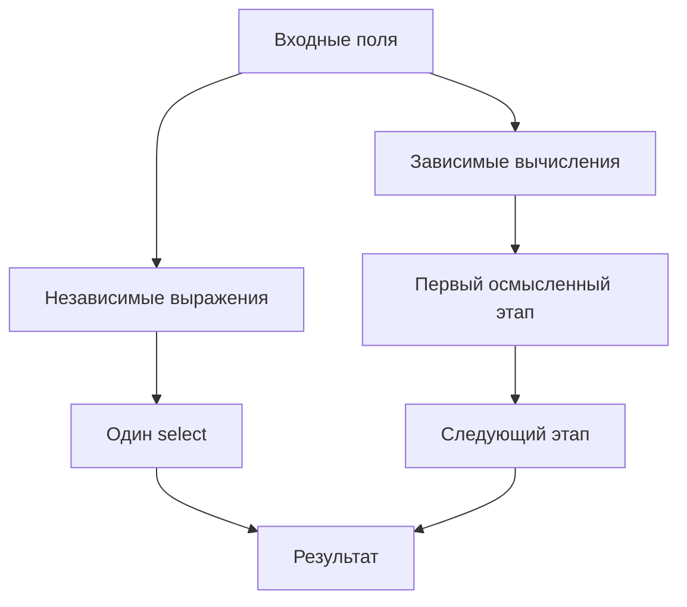
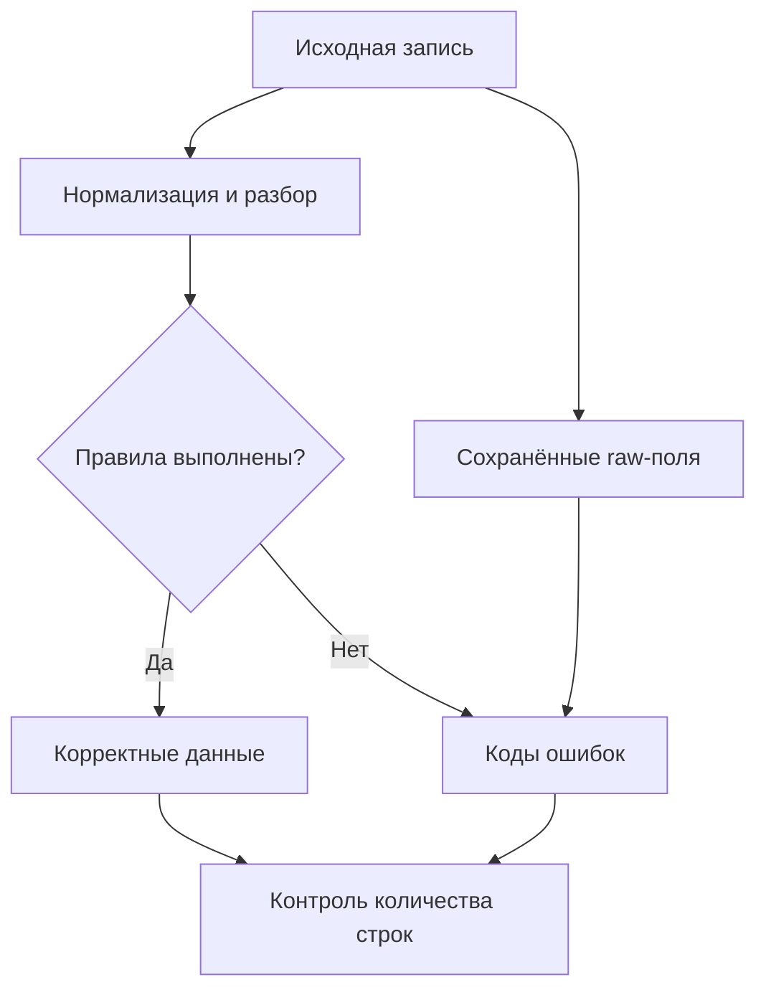
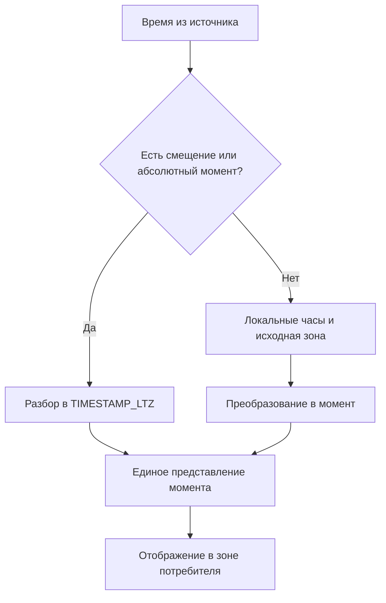
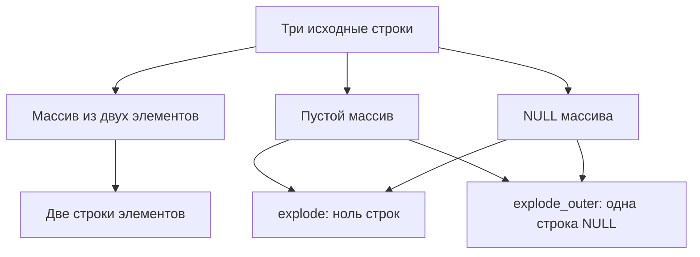
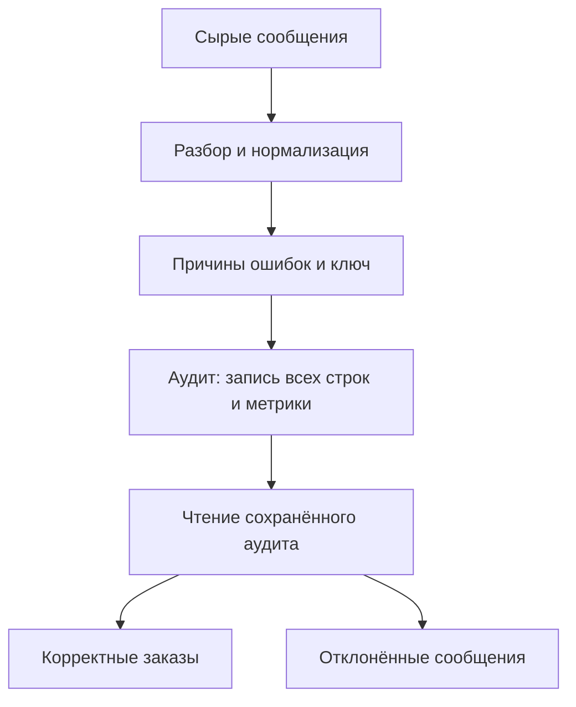

# 4. Преобразования DataFrame и встроенные функции

В этом разделе разберём, как из входного DataFrame получить нужные значения и форму данных: выбрать поля, отфильтровать строки, очистить текст, вычислить суммы и даты, обработать контейнеры, разобрать сообщения и проверить результат.

Основа работы — **выражения Spark SQL**. Они описывают вычисление над распределёнными данными, позволяют Spark анализировать план и обычно удобнее для типовых задач, чем построчная обработка в Python. У каждой операции нужно учитывать тип результата, поведение `NULL`, возможное изменение количества строк и стоимость выполнения.

**Окружение примеров:** Apache Spark / PySpark **4.2.0**, Python **3.12**, Java **17**, Spark Classic. ANSI-режим включён, часовой пояс сессии — UTC. Для возможностей новых версий указаны ограничения. Примеры Avro и Protobuf требуют дополнительных JVM-модулей; инструкция будет рядом с ними.

Выполняйте короткие примеры последовательно или создавайте показанные в них небольшие входы отдельно. В конце страницы есть самостоятельная практика с проверками. Все вызовы `collect()` здесь рассчитаны на несколько учебных строк.

**Проверка примеров:** выполнены 90 коротких примеров и итоговая практика с 26 проверками, включая Avro и Protobuf. Базовая практика без дополнительных бинарных модулей содержит 24 проверки.

```python
from datetime import date, datetime, timedelta, timezone
from decimal import Decimal

from pyspark.sql import DataFrame, Observation, SparkSession, functions as F, types as T

spark = (
    SparkSession.builder
    .master("local[2]")
    .appName("DataFrameTransformations")
    .config("spark.sql.session.timeZone", "UTC")
    .config("spark.sql.ansi.enabled", "true")
    .config("spark.sql.shuffle.partitions", "2")
    .getOrCreate()
)
spark.sparkContext.setLogLevel("WARN")

orders = spark.createDataFrame([
    (1, " Anna ", "paid", Decimal("19.90"), 2, "web"),
    (2, "BORIS", "new", Decimal("5.00"), 3, "mobile"),
    (3, None, None, None, 1, None),
], "order_id BIGINT, name STRING, status STRING, price DECIMAL(12,2), quantity INT, source STRING")


def quoted_col(name: str):
    return F.col("`" + name.replace("`", "``") + "`")
```

`local[2]` и две shuffle-партиции подходят для маленькой практики. На кластере настройки запуска и ресурсов определяют отдельно. `getOrCreate()` может вернуть существующую сессию, поэтому проверяйте фактическую конфигурацию.

**Содержание**

1. [Выбор и изменение столбцов](#column-selection)
2. [Фильтрация и условные выражения](#filtering)
3. [Очистка и нормализация](#cleaning)
4. [Строковые функции и регулярные выражения](#strings)
5. [Числовые, математические и логические функции](#numbers)
6. [Дата, время и часовые пояса](#datetime)
7. [Массивы, карты и структуры](#containers)
8. [Разворачивание и перестройка данных](#reshaping)
9. [JSON, VARIANT и бинарные функции](#serialization)
10. [Сортировка, выборки и идентификаторы](#ordering)
11. [Статистика и исследование данных](#statistics)

---

<a id="column-selection"></a>

## Выбор и изменение столбцов

### select, selectExpr и выбор вложенных полей

`select` задаёт выходные поля, их порядок и выражения. Его результат — новый DataFrame; исходный набор полей остаётся прежним.

```python
selected = orders.select(
    "order_id",
    F.lower(F.trim("name")).alias("customer_name"),
    (F.col("price") * F.col("quantity")).alias("total"),
)

selected_sql = orders.selectExpr(
    "order_id",
    "lower(trim(name)) AS customer_name",
    "price * quantity AS total",
)

assert selected.columns == ["order_id", "customer_name", "total"]
assert orders.columns[1] == "name"
```

`selectExpr` разбирает SQL-выражения. `select` принимает ссылки на поля и `Column`. Выбирайте форму, в которой вычисление легче прочитать и проверить; они работают с одним движком выражений Spark.

`Column` описывает вычисление, а не хранит локальную Python-коллекцию значений. Различайте ссылку на поле, константу и SQL-текст:

| Запись | Что она означает |
|---|---|
| `select("price")` | Выбор существующего поля по имени |
| `F.col("price")` | Ссылка на поле как выражение |
| `F.lit("price")` | Одна и та же строковая константа для каждой строки |
| `F.lit(10)` | Числовая константа |
| `F.expr("price * quantity")` | Разбор SQL-выражения |
| `expression.alias("total")` | Имя выходного выражения, не отдельное вычисление |

Не все строковые параметры функций имеют одинаковый смысл. Имя столбца, шаблон регулярного выражения и формат даты могут приниматься по разным правилам конкретной сигнатуры. Ниже примеры специально показывают, где нужен `F.lit`, а где обычная строка.

Вложенные поля выбирают по пути или через `getField`:

```python
nested = spark.createDataFrame(
    [(1, ("Anna", "DE"))],
    "id BIGINT, customer STRUCT<name:STRING,country:STRING>",
)

flat = nested.select("id", F.col("customer.name").alias("name"))
expanded = nested.select("id", "customer.*")

assert flat.first().name == "Anna"
assert expanded.columns == ["id", "name", "country"]
```

`customer.*` разворачивает поля структуры, но не элементы массива. После разворачивания возможны коллизии имён. Для внешнего контракта лучше явно выбирать и называть поля, чем полагаться на постоянно меняющийся `*`.

**Стоимость:** ранний выбор необходимых полей уменьшает ширину последующих данных и может позволить reader не читать лишние столбцы. Это не гарантирует, что источник поддерживает pruning; проверяйте физический план.

### withColumn, withColumns и построение нескольких выражений

`withColumn` добавляет поле или заменяет поле с тем же именем. `withColumns` задаёт несколько выходных выражений словарём; API доступен с 3.3.

```python
enriched = orders.withColumns({
    "normalized_name": F.lower(F.trim("name")),
    "total": (F.col("price") * F.col("quantity")).cast("decimal(18,2)"),
    "is_paid": F.col("status") == "paid",
})

assert "total" in enriched.columns
assert "total" not in orders.columns
```

Все выражения должны относиться к входному DataFrame. Для зависимых вычислений понятнее разделить шаги: сначала построить `total`, затем вычислить категорию по `total`.

```python
with_total = orders.withColumn(
    "total", (F.col("price") * F.col("quantity")).cast("decimal(18,2)")
)
with_category = with_total.withColumn(
    "size", F.when(F.col("total") >= 30, "large").otherwise("small")
)
```

Не используйте неизвестный порядок разрешения соседних alias как обязательную часть pipeline. Если выражение зависит от нового поля, отдельный шаг делает зависимость явной.

`withColumn("price", ...)` заменит исходную цену. При очистке внешних данных сохраняйте `price_raw` или отдельное поле результата, чтобы проверить, что именно изменилось.

### withColumnRenamed, withColumnsRenamed, toDF и drop

Переименование меняет имя, а не значение и не тип.

```python
renamed = orders.withColumnsRenamed({
    "name": "customer_name",
    "source": "channel",
})

shortened = renamed.drop("status", "channel")
assert shortened.columns == ["order_id", "customer_name", "price", "quantity"]

new_names = ["id", "customer", "state", "unit_price", "units", "origin"]
all_renamed = orders.toDF(*new_names)
assert all_renamed.columns == new_names
```

| Метод | Сопоставление | Что проверить |
| --- | --- | --- |
| `withColumnRenamed` | Одно старое имя → новое имя | Наличие исходного имени |
| `withColumnsRenamed` | Словарь имён; 3.4+ | Коллизии конечных имён |
| `toDF` | По позиции всех столбцов | Число имён и текущий порядок |
| `drop` | Удаляемые поля | Не удалено ли обязательное поле |

Переименование отсутствующего поля может ничего не изменить. Для обязательного изменения проверяйте наличие имени заранее.

`drop("a.b")` и `drop(F.col("a.b"))` не стоит считать полностью взаимозаменяемыми: строковый аргумент и выражение могут интерпретироваться по разным правилам. При сложных именах проще сформировать желаемый выход через `select` и `quoted_col`.

Если после join есть дубликаты имён, сначала выберите конкретные поля с alias источников. Глобальное переименование неоднозначной схемы не исправляет выбор неправильного значения.

### Выбор столбцов по схеме, типу и правилу именования

Выбирать поля можно программно, используя метаданные схемы. Это локальная работа со списком полей, а не цикл по строкам данных.

```python
numeric_types = (
    T.ByteType, T.ShortType, T.IntegerType, T.LongType,
    T.FloatType, T.DoubleType, T.DecimalType,
)

numeric_names = [
    field.name for field in orders.schema.fields
    if isinstance(field.dataType, numeric_types)
]

numeric_df = orders.select(*[quoted_col(name) for name in numeric_names])
assert numeric_names == ["order_id", "price", "quantity"]

id_names = [name for name in orders.columns if name.endswith("_id")]
id_fields = orders.select(*[quoted_col(name) for name in id_names])
```

При выборе по `nullable` или metadata используйте `StructField`, а не строковое описание `dtypes`. Например, можно выбрать все поля с `metadata.get("sensitive") == True`, если такой атрибут действительно является частью вашего контракта.

Список `df.columns` содержит имена верхнего уровня. Для рекурсивного обхода вложенных структур нужен отдельный обход `StructType` с корректным экранированием каждой части пути.

Правило «все числовые поля» может захватить идентификатор, который нельзя суммировать или нормализовать. Структурный выбор следует дополнять семантическими правилами: ключи, измерения и денежные поля имеют разные назначения.

### Почему длинные цепочки withColumn увеличивают план

Каждый `withColumn` формирует проекцию в логическом плане. Сотни последовательных вызовов могут создать большое вложенное дерево, которое требуется построить и проанализировать ещё до распределённого выполнения.

```python
base = spark.range(3)

# Небольшой пример формы вложенного плана.
chained = base
for number in range(3):
    chained = chained.withColumn(f"value_{number}", F.col("id") + number)

# Независимые выражения задаются одной проекцией.
projected = base.select(
    "id",
    *[(F.col("id") + number).alias(f"value_{number}") for number in range(3)],
)

projected.explain(mode="extended")
```

Оптимизатор может свернуть совместимые проекции. Но это не отменяет стоимости создания исходного плана и не гарантирует безопасной обработки произвольной глубины.



Объединяйте независимые изменения через `select` или `withColumns`, а зависимые — в несколько понятных этапов. Не измеряйте качество pipeline только числом строк Python-кода: важны структура плана и фактическое выполнение.

Документация: [withColumn и предупреждение о размере плана](https://spark.apache.org/docs/4.2.0/api/python/reference/pyspark.sql/api/pyspark.sql.DataFrame.withColumn.html).

### DataFrame.transform для композиции преобразований

`DataFrame.transform` передаёт DataFrame вашей Python-функции, которая возвращает новый DataFrame. Это способ организовать построение плана, а не Python UDF для каждой строки.

```python
def normalize_customer(df: DataFrame) -> DataFrame:
    return df.withColumn("normalized_name", F.lower(F.trim("name")))


def add_total(df: DataFrame) -> DataFrame:
    return df.withColumn(
        "total", (F.col("price") * F.col("quantity")).cast("decimal(18,2)")
    )


prepared_orders = orders.transform(normalize_customer).transform(add_total)
assert prepared_orders.columns[-2:] == ["normalized_name", "total"]
```

Хорошая функция преобразования имеет понятные входные требования и выходную схему. Например, `add_total` требует `price` и `quantity`, а возвращает дополнительный `DECIMAL(18,2)`.

Не вызывайте внутри таких функций `collect`, чтение другого источника или запись результата без необходимости. Тогда функция остаётся удобной для композиции и проверки на маленьком наборе.

Python-функция в `DataFrame.transform` выполняется на драйвере при построении плана. Её Spark-выражения выполняются распределённо при действии. Функция `F.transform` для массива — другое API; разберём её ниже.

**Практика:** напишите преобразование, которое выбирает канонический порядок полей, нормализует имя и вычисляет сумму заказа. Проверьте отдельно выходные имена, тип суммы и поведение исходного `NULL`.

---

<a id="filtering"></a>

## Фильтрация и условные выражения

### filter и where с Column и SQL-выражением

`filter` и `where` — синонимы фильтрации. Они оставляют строки, для которых условие вычисляется в `TRUE`.

```python
paid = orders.filter(F.col("status") == "paid")
paid_sql = orders.where("status = 'paid'")

assert paid.count() == paid_sql.count() == 1

large_paid = orders.where(
    (F.col("status") == "paid") & (F.col("quantity") >= 2)
)
```

Python-форма удобна для переиспользования выражений и литералов. SQL-форма удобна для известной SQL-логики. В обеих формах действуют типы и трёхзначная логика Spark SQL.

Фильтр может быть перемещён оптимизатором или передан источнику, если это допустимо. Положение вызова в Python не является гарантией физического порядка выполнения всех выражений.

Для параметра из программы используйте `F.lit(value)` или сравнение `Column` с обычным значением. Не составляйте SQL-условие подстановкой произвольного текста, содержащего кавычки и синтаксис SQL.

### when, otherwise, CASE и условное присваивание

`when` и SQL `CASE` создают значение для каждой строки. Они не выполняют локальное Python-ветвление по всем данным сразу.

```python
classified_orders = orders.withColumn(
    "status_group",
    F.when(F.col("status").isNull(), F.lit("unknown"))
    .when(F.col("status") == "paid", F.lit("completed"))
    .when(F.col("status") == "new", F.lit("pending"))
    .otherwise(F.lit("other")),
)

classified_sql = orders.selectExpr(
    "order_id",
    "CASE WHEN status IS NULL THEN 'unknown' WHEN status = 'paid' THEN 'completed' ELSE 'pending' END AS category",
)
```

Ветви рассматриваются по порядку; выбирается первая с условием `TRUE`. `UNKNOWN` не выбирает ветку. Если `otherwise` отсутствует и ни одно условие не сработало, результат — `NULL`.

Все ветви должны согласоваться в общий тип результата. Не смешивайте случайно число и строковый статус: Spark может начать числовое приведение строки, которое завершится ошибкой в ANSI-режиме.

```python
discount = orders.withColumn(
    "discount_rate",
    F.when(F.col("quantity") >= 3, F.lit(Decimal("0.10")))
    .otherwise(F.lit(Decimal("0.00")))
    .cast("decimal(4,2)"),
)
```

Для денежных правил явно задавайте тип и смысл коэффициента. Ставка `0.10` и сумма скидки `0.10` — разные величины.

### isin, between, like, ilike и rlike

Эти методы покрывают частые виды условий.

```python
from_known_source = orders.filter(F.col("source").isin("web", "mobile"))
reasonable_quantity = orders.filter(F.col("quantity").between(1, 3))
names_with_a = orders.filter(F.col("name").ilike("%anna%"))
valid_name_shape = orders.filter(F.trim("name").rlike(r"^[A-Za-z]+$"))
```

| Метод | Смысл | Пример |
| --- | --- | --- |
| `isin` | Принадлежность списку значений | `source IN ('web','mobile')` |
| `between` | Обе границы включены | `1 <= quantity <= 3` |
| `like` | SQL-шаблон | `%` — любая последовательность, `_` — один символ |
| `ilike` | LIKE с правилами нечувствительности к регистру | Поиск `anna` и `ANNA` |
| `rlike` | Регулярное выражение JVM | `^[0-9]{6}$` — ровно шесть цифр |

`rlike` без якорей может искать совпадение внутри строки, а не проверять всю строку. Для целого идентификатора используйте `^...$`, если это соответствует требованиям.

`between` над датами и timestamps учитывает тип границ. Для полуоткрытого периода удобнее явно писать `>= start` и `< end`, чтобы не включить начало следующего периода дважды.

Очень большой Python-список в `isin` увеличивает выражение и передаваемый план. Для большого справочника обычно удобнее табличная операция; стратегии соединений будут разобраны отдельно.

### Сочетание условий и обработка UNKNOWN

Используйте `&`, `|`, `~` и скобки вокруг сравнений. Операторы Python `and`, `or`, `not` не строят нужные SQL-условия для `Column`.

```python
accepted_condition = (
    F.col("price").isNotNull()
    & (F.col("price") >= F.lit(Decimal("0.00")))
    & F.col("quantity").between(1, 100)
)

accepted_rows = orders.filter(accepted_condition)

not_paid_including_unknown = orders.filter(
    (F.col("status") != "paid") | F.col("status").isNull()
)
assert not_paid_including_unknown.count() == 2
```

`status != 'paid'` для отсутствующего статуса даёт `UNKNOWN`, поэтому простая отрицательная проверка исключит такую строку. Если пропуск должен остаться, включите это в условие явно.

| Условие при `x = NULL` | Результат |
| --- | --- |
| `x = 1` | `UNKNOWN` |
| `x != 1` | `UNKNOWN` |
| `x IS NULL` | `TRUE` |
| `x <=> NULL` | `TRUE` |
| `coalesce(x > 0, FALSE)` | `FALSE` |

Последний вариант превращает отсутствие результата в конкретное boolean-значение. Применяйте его только когда такая трактовка согласована: иначе информация об неизвестности исчезнет.

### Проверка нескольких правил в одном проходе

Сформируйте признаки правил в одном плане и агрегируйте метрики вместе. Это уменьшает число повторных действий над исходным набором.

```python
rule_checked = orders.select(
    "*",
    F.col("order_id").isNull().alias("bad_id"),
    (F.col("price").isNull() | (F.col("price") < 0)).alias("bad_price"),
    (F.col("quantity").isNull() | (F.col("quantity") <= 0)).alias("bad_quantity"),
)

quality_metrics = rule_checked.agg(
    F.count(F.lit(1)).alias("rows"),
    F.sum(F.when(F.col("bad_id"), 1).otherwise(0)).alias("bad_ids"),
    F.sum(F.when(F.col("bad_price"), 1).otherwise(0)).alias("bad_prices"),
    F.sum(F.when(F.col("bad_quantity"), 1).otherwise(0)).alias("bad_quantities"),
).first()

assert (quality_metrics.rows, quality_metrics.bad_prices) == (3, 1)
```

Это одно действие с несколькими агрегатами. Оно не гарантирует один физический stage и не делает бесплатно все сложные проверки: например, уникальность ключа требует другой формы вычисления.

Одна строка может нарушить несколько правил. Сумма счётчиков нарушений может быть больше числа ошибочных строк. Для доли отклонённых строк отдельно вычисляйте объединённое условие.

На пустом входе `sum` может дать `NULL`; для метрики с контрактом «ноль нарушений» применяйте `coalesce(sum(...), lit(0))`.

### Отсутствие гарантии короткого замыкания для пользовательских функций

Не рассчитывайте, что фильтр перед Python UDF или условие вида `isNotNull & udf(...)` предотвратит вызов UDF на всех нежелательных значениях. Планировщик может перестроить вычисление, а UDF может исполняться вне ожидаемого вами ветвления.

Для разбора числа используйте встроенный безопасный парсер:

```python
raw_divisors = spark.createDataFrame(
    [("2",), ("0",), ("bad",), (None,)], "raw STRING"
)

safe_ratios = raw_divisors.select(
    "raw",
    F.try_divide(F.lit(10), F.col("raw").try_cast("double")).alias("ratio"),
)

assert [r.ratio for r in safe_ratios.collect()] == [5.0, None, None, None]
```

Если UDF действительно нужна, обработку допустимых пропусков и неправильных значений проектируйте внутри самой функции. Условие снаружи не служит контрактом безопасности её исполнения.

Отдельный материальный этап может зафиксировать подготовленный набор, если этого требует задача, но он добавляет стоимость и не оправдывает небезопасную функцию. Подробности UDF будут в отдельном разделе; здесь сначала выбирайте встроенные выражения.

**Практика:** задайте правила наличия ключа, неотрицательной цены и положительного количества. Постройте признаки ошибок, число ошибочных строк и число нарушений каждого правила одним агрегированием. Объясните различие двух последних метрик.

---

<a id="cleaning"></a>

## Очистка и нормализация

### na.fill, na.drop и na.replace

Эти методы решают три разные задачи: заполнить пропуски, удалить строки с недостатком значений или заменить определённые значения.

```python
dirty = spark.createDataFrame([
    (1, None, None),
    (2, float("nan"), ""),
    (3, 2.0, "ready"),
], "id INT, score DOUBLE, note STRING")

filled = dirty.na.fill({"score": 0.0, "note": "unknown"})
only_measured = dirty.na.drop(subset=["score"])
empty_as_null = dirty.na.replace({"": None}, subset=["note"])

assert [r.score for r in filled.orderBy("id").collect()] == [0.0, 0.0, 2.0]
assert only_measured.count() == 1
assert empty_as_null.filter(F.col("note").isNull()).count() == 2
```

| Метод | Существенное правило |
| --- | --- |
| `na.fill` | Заполняет `NULL`; для float/double также может заполнять `NaN` |
| `na.drop(how="any")` | Удаляет строку при наличии пропуска в рассматриваемых полях |
| `na.drop(how="all")` | Удаляет строку, если все рассматриваемые поля отсутствуют |
| `na.drop(thresh=n)` | Требует не меньше `n` непустых значений; `thresh` имеет приоритет над `how` |
| `na.replace` | Заменяет заданные значения; не является общим парсером |

`subset` ограничивает рассматриваемые поля. Без него `drop` может удалить заказ только из-за необязательного комментария. При заполнении тип значения должен подходить столбцу; несовместимые поля могут быть пропущены, поэтому проверяйте результат.

Пустая строка не является SQL `NULL`. `fill("unknown")` не обязан менять `""`. Сложные вложенные пропуски в массивах и структурах обычно обрабатывают явными выражениями.

**Бизнес-смысл:** нулевая оценка и отсутствующая оценка различаются. Не заполняйте всё нулями ради удобства агрегирования, если так выдумывается измерение.

Документация: [na.fill](https://spark.apache.org/docs/4.2.0/api/python/reference/pyspark.sql/api/pyspark.sql.DataFrameNaFunctions.fill.html).

### coalesce как SQL-функция выбора ненулевого значения

`F.coalesce` выбирает первое не-`NULL` значение среди аргументов. Это удобно для приоритетного выбора источника или согласованного default.

```python
contacts = spark.createDataFrame([
    (1, None, "backup@example.test"),
    (2, "", "backup@example.test"),
    (3, "main@example.test", None),
], "id INT, primary_email STRING, backup_email STRING")

chosen = contacts.select(
    "id",
    F.coalesce("primary_email", "backup_email", F.lit("unknown")).alias("email"),
)

assert chosen.orderBy("id").collect()[1].email == ""
```

Пустая строка во второй записи выбирается раньше резервного адреса, потому что она существует. Если по контракту пустой текст считается пропуском, сначала нормализуйте его в `NULL`.

Все аргументы должны согласоваться в общий тип. Для денежного default задайте decimal, например `F.lit(Decimal("0.00"))`, и проверьте выходную схему.

`F.coalesce(...)` и `df.coalesce(n)` — разные операции. Первая выбирает значение в строке, вторая относится к партициям DataFrame. Одинаковое имя не означает одинаковый смысл.

`NaN` является не-`NULL` числом и обычно сохраняется при `coalesce`. Если нужно исключить его, задайте отдельное правило.

### nullif, ifnull, nvl, nvl2 и nanvl

Эти функции позволяют кратко выразить частые условия, но их различия существенны.

| Функция | Смысл |
| --- | --- |
| `nullif(a, b)` | Возвращает `NULL`, если `a = b`, иначе `a` |
| `ifnull(a, b)` | Возвращает `b`, если `a` равно `NULL` |
| `nvl(a, b)` | Аналог выбора первого не-`NULL` из двух |
| `nvl2(a, b, c)` | Если `a` существует — `b`, иначе `c` |
| `nanvl(a, b)` | Заменяет `NaN` у `a` на `b`; SQL `NULL` имеет отдельную семантику |

```python
null_helpers = contacts.select(
    "id",
    F.nullif(F.trim("primary_email"), F.lit("")).alias("primary_normalized"),
    F.ifnull("primary_email", F.lit("missing")).alias("ifnull_value"),
    F.nvl("primary_email", "backup_email").alias("nvl_value"),
    F.nvl2("primary_email", F.lit("present"), F.lit("absent")).alias("presence"),
)

nan_helpers = dirty.select(
    "id", F.nanvl("score", F.lit(0.0)).alias("score_without_nan")
)

assert nan_helpers.orderBy("id").collect()[0].score_without_nan is None
assert nan_helpers.orderBy("id").collect()[1].score_without_nan == 0.0
```

`nvl2` проверяет наличие исходного значения, а не truth value. Для `a=False`, `a=0` и `a=""` выбирается ветка «present».

В Python API строка в позиции `ColumnOrName` может означать имя столбца. Для текста по умолчанию применяйте `lit("missing")`, чтобы Spark не искал поле `missing`.

### Нормализация пробелов, регистра и специальных значений

Нормализация должна опираться на договорённость источника: какие пробелы удаляются, какие обозначения означают пропуск и какие изменения сохраняют смысл.

```python
raw_labels = spark.createDataFrame([
    ("  New   Customer  ",),
    ("N/A",),
    ("",),
    (None,),
], "label_raw STRING")

normalized_labels = raw_labels.withColumn(
    "label_text",
    F.lower(F.regexp_replace(F.trim("label_raw"), r"\s+", " ")),
).withColumn(
    "label",
    F.when(F.col("label_text").isin("", "n/a", "null"), F.lit(None).cast("string"))
    .otherwise(F.col("label_text")),
)

assert normalized_labels.first().label == "new customer"
```

`trim` по умолчанию обрабатывает обычные граничные пробелы, а не автоматически все Unicode-разделители. Регулярное выражение `\s` в JVM тоже не следует считать универсальной политикой Unicode без проверки флагов и символов.

Если в источнике встречается неразрывный пробел U+00A0, добавьте его в согласованное правило явно. Например, можно заменить этот символ перед обычным `trim`. Невидимые символы и комбинации Unicode требуют отдельных тестов.

Не переводите идентификатор в нижний регистр без согласования: `AbC` и `abc` могут быть разными ключами. Не удаляйте дефисы или ведущие нули только потому, что так строка становится короче.

Сохраняйте нормализованное поле отдельно от исходного. Это позволяет пересмотреть правило и восстановить объяснение изменения.

### Сохранение исходного значения и причины ошибки

Безопасный парсер возвращает `NULL` при некоторых ошибках, поэтому рядом нужна диагностика.

```python
raw_amounts = spark.createDataFrame([
    ("12.30",), ("bad",), (None,), ("-1.00",),
], "amount_raw STRING")

audited_amounts = raw_amounts.withColumn(
    "amount", F.trim("amount_raw").try_cast("decimal(12,2)")
).withColumn(
    "error_reason",
    F.when(F.col("amount_raw").isNull(), "missing_amount")
    .when(F.col("amount").isNull(), "invalid_amount")
    .when(F.col("amount") < 0, "negative_amount")
    .otherwise(F.lit(None).cast("string")),
)

assert {r.error_reason for r in audited_amounts.collect()} == {
    None, "missing_amount", "invalid_amount", "negative_amount"
}
```

Порядок условий задаёт приоритет причины. Если нужно видеть все нарушения строки, собирайте массив кодов, а не одно поле с первой причиной.



Причина должна быть машинно читаемой и стабильной: `invalid_amount` удобнее произвольного текста исключения. Человеческое описание можно хранить отдельно.

### Очистка без скрытой потери строк и точности

Pipeline очистки меняет данные, поэтому его результат проверяют по нескольким независимым свойствам.

```python
accepted_amounts = audited_amounts.filter(F.col("error_reason").isNull())
rejected_amounts = audited_amounts.filter(F.col("error_reason").isNotNull())

assert accepted_amounts.count() + rejected_amounts.count() == audited_amounts.count()
assert accepted_amounts.first().amount == Decimal("12.30")
```

В маленькой практике отдельные `count()` удобны для проверки. В рабочем pipeline такие метрики лучше собирать вместе или во время записи, чтобы не пересчитывать вход многократно.

| Что контролировать | Почему |
| --- | --- |
| Вход = принятые + отклонённые | Обнаружить потерю или размножение строк |
| Исходный ключ сохранён | Сопоставить результат и вход |
| Типы и scale | Обнаружить изменение точности |
| Причины отклонения | Понять качество источника |
| Defaults и нормализация | Не выдумать бизнес-значение |

Приведение `1.235` к `DECIMAL(...,2)` может успешно округлить сумму. Перевод `"001"` в integer успешно уберёт ведущие нули. Успешный cast ещё не подтверждает сохранение смысла.

Проверяйте идемпотентность нормализации, если она нужна: повторная обработка уже подготовленного поля должна давать тот же результат. Например, повторное добавление префикса без проверки может испортить данные.

**Практика:** сохраните исходную сумму, типизированную сумму и код ошибки. Добавьте отдельное правило допустимого scale входа, чтобы лишние дробные разряды не исчезали вследствие округления молча.

---

<a id="strings"></a>

## Строковые функции и регулярные выражения

### concat, concat_ws, substring и split

Эти функции собирают текст, извлекают фрагменты и разбивают строку.

```python
text_parts = spark.createDataFrame([
    ("Anna", "Berlin", "a,b,c"),
    ("Boris", None, "x"),
], "name STRING, city STRING, tags_text STRING")

text_result = text_parts.select(
    F.concat("name", F.lit(" / "), "city").alias("strict_label"),
    F.concat_ws(" / ", "name", "city").alias("skipping_null_label"),
    F.substring("name", 1, 2).alias("prefix"),
    F.split("tags_text", ",").alias("tags"),
)

rows = text_result.collect()
assert rows[1].strict_label is None
assert rows[1].skipping_null_label == "Boris"
assert rows[0].prefix == "An"
assert rows[0].tags == ["a", "b", "c"]
```

`concat` для строк распространяет `NULL`; `concat_ws` пропускает отсутствующие элементы при сборке с разделителем. Такое пропускание может сделать итог неоднозначным, поэтому не используйте его бездумно для составного ключа.

`substring` использует позиции от 1; отрицательные позиции позволяют обращаться с конца. Это отличается от Python-срезов. При Unicode учитывайте, что «пользовательский символ» может состоять из нескольких кодовых точек.

Шаблон `split` — регулярное выражение JVM. Чтобы разбить по буквальной точке, нужен экранированный шаблон `r"\."`, а не `"."`. Параметр limit управляет числом частей и обработкой хвоста; проверьте крайние случаи с завершающим разделителем.

### length, trim, lpad, rpad, upper и lower

```python
formatted = spark.createDataFrame(
    [("  Anna  ", "7"),], "name_raw STRING, code_raw STRING"
).select(
    F.length("name_raw").alias("raw_length"),
    F.trim("name_raw").alias("name"),
    F.upper(F.trim("name_raw")).alias("upper_name"),
    F.lower(F.trim("name_raw")).alias("lower_name"),
    F.lpad("code_raw", 4, "0").alias("code"),
    F.rpad(F.trim("name_raw"), 6, " ").alias("fixed_label"),
)

assert formatted.first().code == "0007"
assert formatted.first().fixed_label == "Anna  "
```

`length` учитывает пробелы, находящиеся в строке. Длина строки и число байтов после кодирования различаются; для бинарного представления проверяйте соответствующую длину отдельно.

**Ловушка padding:** `lpad` и `rpad` могут усечь строку, если целевая длина меньше исходной. Они не являются только операциями добавления символов. Перед форматированием идентификатора проверьте максимально допустимую длину.

`upper` и `lower` не обеспечивают полную Unicode-нормализацию и не автоматически удаляют акценты. Для международных имён, адресов и ключей согласуйте правила, а не выбирайте их по одному англоязычному примеру.

### replace, translate, regexp_replace и regexp_extract

Выбирайте функцию по требуемому виду замены.

```python
phones = spark.createDataFrame([
    ("+7 (999) 123-45-67", "order-42"),
    ("unknown", "missing"),
], "phone_raw STRING, reference STRING")

phone_result = phones.select(
    F.replace("phone_raw", F.lit("-"), F.lit("")).alias("without_dashes"),
    F.translate("phone_raw", "()+ -", "").alias("without_selected_characters"),
    F.regexp_replace("phone_raw", r"[^0-9]", "").alias("digits"),
    F.regexp_extract("reference", r"order-([0-9]+)", 1).alias("order_number"),
)

assert phone_result.first().digits == "79991234567"
assert phone_result.collect()[1].order_number == ""
```

| Функция | Назначение |
| --- | --- |
| `replace` | Буквальная замена подстроки |
| `translate` | Посимвольное сопоставление наборов символов |
| `regexp_replace` | Замена по регулярному выражению |
| `regexp_extract` | Первое совпадение выбранной группы |

У `regexp_extract` группа 0 означает всё совпадение, 1 — первую захватывающую группу. При отсутствии совпадения получается пустая строка, а не автоматически SQL `NULL`.

`translate` не выполняет замену многосимвольных слов: это карта символов. Если набор замены короче набора поиска, лишние искомые символы удаляются.

Нормализация телефона до цифр ещё не проверяет страну, длину и допустимость номера. Для бизнес-валидатора нужны дополнительные правила и сохранение исходного представления.

### Поиск позиций, шаблонов и извлечение нескольких совпадений

```python
messages = spark.createDataFrame(
    [("item-12 item-34",)], "text STRING"
)

matches = messages.select(
    F.instr("text", "item").alias("first_position"),
    F.locate("item", "text", 2).alias("next_position"),
    F.regexp_instr("text", F.lit(r"[0-9]+"), 0).alias("number_position"),
    F.regexp_extract_all("text", F.lit(r"item-([0-9]+)"), 1).alias("all_numbers"),
)

assert matches.first().first_position == 1
assert matches.first().all_numbers == ["12", "34"]
```

`instr` и `locate` возвращают позиции от 1; отсутствие буквального совпадения обычно даёт 0. `locate` позволяет задать начальную позицию поиска.

`regexp_extract_all` возвращает массив совпадений; в PySpark он доступен с 3.5. Для буквального шаблона этому API нужен `F.lit(pattern)`, потому что строковый аргумент может трактоваться как имя столбца.

Для разбора ограниченного формата чаще удобнее один устойчивый шаблон, чем последовательность случайных замен. Для нескольких элементов проверяйте пустой массив, очень длинный вход и максимальное ожидаемое число совпадений.

Документация: [regexp_extract_all](https://spark.apache.org/docs/4.2.0/api/python/reference/pyspark.sql/api/pyspark.sql.functions.regexp_extract_all.html).

### Регулярные выражения JVM и отличие от Python re

Регулярные выражения встроенных функций исполняются движком JVM. Переданный Python raw string облегчает экранирование, но не переключает движок на Python `re`.

```python
reordered = spark.createDataFrame(
    [("2026-01-15",)], "date_text STRING"
).select(
    F.regexp_replace(
        "date_text", r"^([0-9]{4})-([0-9]{2})-([0-9]{2})$", "$3.$2.$1"
    ).alias("display_date")
)

assert reordered.first().display_date == "15.01.2026"
```

В строке замены Java-группы адресуются формой `$1`, `$2`, а не автоматически Python-вариантом `\1`. Если выражение записано внутри SQL-строки, добавляется ещё один уровень экранирования.

| Что учитывать | Практический вывод |
| --- | --- |
| Синтаксис движка JVM | Проверять конструкции по Java regex |
| Python-строка и SQL-строка | Не путать уровни экранирования |
| Захватывающие группы | Явно выбирать номер группы |
| Unicode-классы | Проверять флаги и конкретные символы |
| Жадность и сложные повторения | Ограничивать вход и избегать избыточного backtracking |

Сначала проверьте шаблон на нормальном значении, пустой строке, `NULL`, почти подходящем значении и длинной строке. Регулярное выражение, меняющее порядок частей даты, не проверяет существование календарной даты: для этого нужен парсер даты.

### Unicode, кодировки и бинарно-текстовые преобразования

Текст — последовательность символов, бинарное поле — последовательность байтов. Кодировка задаёт связь между ними.

```python
unicode_text = spark.createDataFrame([("Привет",)], "text STRING")

unicode_result = unicode_text.select(
    F.length("text").alias("characters"),
    F.length(F.encode("text", "UTF-8")).alias("bytes"),
    F.decode(F.encode("text", "UTF-8"), "UTF-8").alias("round_trip"),
)

assert tuple(unicode_result.first()) == (6, 12, "Привет")
```

Визуально одинаковые строки могут иметь разные Unicode-представления: например, буква с акцентом может быть одним кодовым пунктом или сочетанием базовой буквы и комбинирующего знака. `lower` и `trim` не приводят их автоматически к одной нормальной форме.

Не всякая последовательность байтов является корректным UTF-8. Ошибка декодирования в современных версиях может прервать выражение; при необходимости используйте поддерживаемые проверки вроде `is_valid_utf8` и явно согласуйте политику исправления.

Замена повреждённых символов на знак подстановки меняет данные. Сохраняйте исходные байты, если важно расследовать повреждение. Декодировать Avro или Protobuf как UTF-8 нельзя только потому, что внутри сообщения есть строковые поля.

### Collations и сравнение строк с учётом версии Spark

Collation определяет правила сравнения и сортировки текстовых значений. Это отдельный механизм от `spark.sql.caseSensitive`, который относится к разрешению имён полей.

```python
collation_demo = spark.range(1).select(
    (F.lit("Anna") == F.lit("anna")).alias("binary_equal"),
    (
        F.collate(F.lit("Anna"), "UTF8_LCASE")
        == F.collate(F.lit("anna"), "UTF8_LCASE")
    ).alias("case_insensitive_equal"),
    F.collation(F.collate(F.lit("Anna"), "UTF8_LCASE")).alias("collation_name"),
).first()

assert collation_demo.binary_equal is False
assert collation_demo.case_insensitive_equal is True
```

В примере обычное бинарное сравнение различает регистр, а `UTF8_LCASE` применяет другой контракт сравнения. В Spark 4.2 функция `collation` возвращает квалифицированное имя, например `SYSTEM.BUILTIN.UTF8_LCASE`.

Python-функция `collate` доступна с 4.0. Поддерживаемые collations, правила сочетания значений с разными collations и совместимость операторов уточняйте для выбранной версии.

Изменение collation может изменить группы, совпадения join и представление уникальности ключа. Не применяйте нечувствительность к регистру к внешнему ключу, если его источник считает регистр значимым.

Локаль, акценты и Unicode-нормализация — отдельные вопросы. Один пример с `Anna` не доказывает все правила для международного текста.

Документация: [collate](https://spark.apache.org/docs/4.2.0/api/python/reference/pyspark.sql/api/pyspark.sql.functions.collate.html).

**Практика:** очистите имена и коды, сохраните исходный текст, извлеките все номера из сообщения и проверьте пустой результат. Отдельно объясните, когда перевод в нижний регистр допустим для имени, но опасен для ключа.

---

<a id="numbers"></a>

## Числовые, математические и логические функции

### abs, sign, ceil, floor, round и bround

```python
rounding_input = spark.createDataFrame([
    (Decimal("2.5"),), (Decimal("-2.5"),),
], "x DECIMAL(4,1)")

rounding_result = rounding_input.select(
    "x",
    F.abs("x").alias("absolute"),
    F.sign("x").alias("sign"),
    F.ceil("x").alias("ceiling"),
    F.floor("x").alias("flooring"),
    F.round("x", 0).alias("half_up"),
    F.bround("x", 0).alias("half_even"),
)

positive = rounding_result.filter(F.col("x") > 0).first()
assert positive.half_up == Decimal("3")
assert positive.half_even == Decimal("2")
```

| Функция | Правило |
| --- | --- |
| `abs` | Абсолютное значение |
| `sign` | Знак числа |
| `ceil` | Округление вверх к целой границе |
| `floor` | Округление вниз к целой границе |
| `round` | HALF_UP: середина округляется по правилу half up |
| `bround` | HALF_EVEN: середина округляется к чётной цифре |

Для отрицательного значения `floor(-2.5)` даёт −3, а `ceil(-2.5)` — −2. Это не Python-приведение к integer, которое имеет другую логику усечения.

Параметр scale определяет разряд округления: 2 — до сотых, 0 — до целых, отрицательный — до десятков, сотен и далее. Например, `round(125, -1)` округляет до десятков.

Сравнивайте правила на `DECIMAL`, когда проверяете точную десятичную середину. Вход `DOUBLE` может уже содержать двоичную погрешность. Выбранное правило округления должно быть частью финансового контракта.

### Степени, логарифмы, корни и тригонометрические функции

```python
math_input = spark.createDataFrame([(4.0,)], "x DOUBLE")

math_values = math_input.select(
    F.pow("x", F.lit(2.0)).alias("squared"),
    F.sqrt("x").alias("root"),
    F.log("x").alias("natural_log"),
    F.log10("x").alias("decimal_log"),
    F.exp(F.lit(0.0)).alias("exp_zero"),
    F.sin(F.lit(0.0)).alias("sin_zero"),
    F.cos(F.lit(0.0)).alias("cos_zero"),
    F.degrees(F.lit(3.141592653589793)).alias("angle_degrees"),
)

assert math_values.first().squared == 16.0
assert math_values.first().root == 2.0
```

Основные группы: `pow` и `exp`; `log`, `log2`, `log10`; `sqrt` и `cbrt`; `sin`, `cos`, `tan` и обратные функции; `radians` и `degrees`.

Аргументы тригонометрических функций задаются в радианах. Умножение координаты «в градусах» на число без проверки единицы может технически выполниться и дать бессмысленный результат.

Проверяйте область определения: положительность аргумента логарифма, допустимость корня, диапазон обратной тригонометрической функции. Для неподходящих значений возможны `NULL`, `NaN`, бесконечность или ошибка в зависимости от функции и режима. Не объявляйте единое правило для всей математической библиотеки.

Результат таких функций обычно приближённый. Для проверок используйте допуск, согласованный с задачей, а не точное равенство десятичных строк.

### greatest, least и работа с несколькими значениями

`greatest` и `least` выбирают максимум и минимум **внутри одной строки**. Это отличается от агрегатных `max` и `min` по нескольким строкам.

```python
offers = spark.createDataFrame([
    (1, 10.0, None, 12.0),
    (2, None, None, None),
], "id INT, a DOUBLE, b DOUBLE, c DOUBLE")

chosen_offers = offers.select(
    "id",
    F.greatest("a", "b", "c").alias("highest"),
    F.least("a", "b", "c").alias("lowest"),
)

assert chosen_offers.orderBy("id").collect()[0].highest == 12.0
assert chosen_offers.orderBy("id").collect()[1].highest is None
```

Эти функции пропускают SQL `NULL`; если все аргументы отсутствуют, результат — `NULL`. `NaN` остаётся специальным числовым значением со своей семантикой сравнения Spark.

Аргументы должны иметь совместимый смысл и общий тип. Сравнить три цены в одной валюте допустимо; сравнить цену, количество и длительность только потому, что все числовые, — ошибка модели.

Для массива используйте функции обработки массива вроде `array_max`; для всех строк набора — агрегирование. Выбирайте нужный уровень вычисления.

### Decimal-арифметика, округление и переполнение

Spark выводит тип decimal-выражения по типам аргументов и операции. Сумма, произведение, деление и агрегат не обязаны сохранять исходную precision и scale.

```python
money = spark.createDataFrame([
    (Decimal("19.90"), 3, Decimal("0.10")),
], "price DECIMAL(12,2), quantity INT, discount DECIMAL(4,2)")

money_result = money.select(
    (F.col("price") * F.col("quantity")).alias("gross"),
    (
        F.col("price") * F.col("quantity")
        * (F.lit(Decimal("1.00")) - F.col("discount"))
    ).alias("net_before_rounding"),
).select(
    "gross",
    F.bround("net_before_rounding", 2).cast("decimal(18,2)").alias("net"),
)

assert money_result.first().net == Decimal("53.73")
money_result.printSchema()
```

В примере округление явно выполняется в конце расчёта строки. В реальном процессе может требоваться округлять каждую позицию, налог или итог отдельно; эти варианты могут дать разные суммы.

Максимальная обычная precision Spark — 38. При нехватке места для результата возможно изменение scale или переполнение; на поведение влияет `spark.sql.decimalOperations.allowPrecisionLoss` и конкретное выражение.

Проверяйте максимальные значения и промежуточные результаты. Расширение финального типа после уже переполнившегося умножения не восстанавливает потерянные данные.

Для ключей не переводите большие целые значения в `DOUBLE`: точное сопоставление может нарушиться. Для денег передавайте `Decimal` из строки и храните валюту отдельно.

### Безопасные функции семейства try_*

Семейство `try_*` предоставляет контролируемый способ получить `NULL` вместо некоторых ошибок. Граница безопасности определяется конкретной функцией.

```python
safe_math = spark.sql("""
    SELECT
        try_add(CAST(2147483647 AS INT), 1) AS sum_overflow,
        try_multiply(CAST(2147483647 AS INT), 2) AS product_overflow,
        try_subtract(CAST(-2147483648 AS INT), 1) AS subtraction_overflow,
        try_divide(10, 0) AS zero_division,
        try_cast('bad' AS DECIMAL(12,2)) AS invalid_decimal
""").first()

assert all(value is None for value in safe_math)
```

| Функция | Типичная задача |
| --- | --- |
| `try_cast` | Разбор и приведение с контролем неправильного значения |
| `try_add`, `try_subtract`, `try_multiply` | Контроль арифметического переполнения |
| `try_divide` | Деление с обработкой нулевого делителя |
| `try_to_date`, `try_to_timestamp` | Безопасный разбор даты и времени |
| `try_to_number` | Разбор числа по поддерживаемому числовому шаблону |
| `try_element_at` | Безопасный доступ по допустимому индексу массива |
| `try_parse_json`, `try_variant_get` | Контролируемая обработка полуструктурированных данных |

Эти функции не гарантируют исправление ошибки структуры запроса, недопустимого имени поля или любого несовместимого типа. Например, нулевой индекс в `try_element_at` всё равно недопустим.

Безопасный результат тоже нужно проверить: `NULL` может означать отсутствие входа или ошибку. Для обязательного поля такой результат должен попасть в диагностику, а не просто исчезнуть из последующего агрегата.

Доступность семейства зависит от версии. В частности, `try_to_timestamp` появился в PySpark 3.5, а `try_to_date` — в 4.0.

### Побитовые операции и логические преобразования

Побитовые операции работают с целочисленным представлением. Они полезны для флагов и масок, когда формат маски определён контрактом.

```python
permissions = spark.createDataFrame([(1, 5), (2, 2)], "id INT, mask INT")

permission_flags = permissions.select(
    "id",
    F.col("mask").bitwiseAND(F.lit(1)).alias("read_bit"),
    F.col("mask").bitwiseOR(F.lit(2)).alias("with_write_bit"),
    F.col("mask").bitwiseXOR(F.lit(1)).alias("toggled_read_bit"),
    F.shiftleft("mask", 1).alias("shifted"),
    (F.col("mask").bitwiseAND(F.lit(1)) != 0).alias("can_read"),
)

assert permission_flags.orderBy("id").first().can_read is True
```

Маска 5 — двоичное `101`: в ней установлены биты 0 и 2. Проверка конкретного флага должна выделить бит и сравнить результат с нулём.

`&` между boolean-выражениями означает логическое AND. Для целочисленных масок явно используйте `bitwiseAND`, `bitwiseOR`, `bitwiseXOR`, чтобы не смешивать два вида операций.

Сдвиги зависят от разрядности и знакового представления. Проверьте переполнение и значения отрицательных масок, если они допускаются источником. Приведение integer к boolean не заменяет проверку конкретного бита.

### rand, randn и воспроизводимость случайных значений

`rand` создаёт псевдослучайные значения с равномерным распределением, `randn` — с нормальным. Seed помогает повторить результат при сопоставимом плане и распределении данных.

```python
random_values = spark.range(10).select(
    "id",
    F.rand(seed=42).alias("uniform"),
    F.randn(seed=42).alias("normal"),
)

assert random_values.filter(
    (F.col("uniform") < 0) | (F.col("uniform") >= 1)
).count() == 0
```

Случайное значение не является постоянным атрибутом бизнес-ключа. Изменение порядка строк, числа партиций, входных файлов или плана может изменить соответствие «ключ → случайное число», даже при том же seed.

Для стабильного распределения по ключу можно использовать детерминированную хэш-корзину:

```python
stable_buckets = spark.range(20).select(
    "id",
    F.pmod(F.xxhash64("id"), F.lit(100)).alias("bucket"),
)
stable_subset = stable_buckets.filter(F.col("bucket") < 10)
```

Такое правило подходит для воспроизводимого отбора или назначения группы, если зафиксированы тип ключа и версия алгоритма. Оно не является криптографической случайностью и не гарантирует ровно 10% строк на небольшом наборе.

Не используйте случайные значения как уникальные идентификаторы без отдельного контракта. Seed и уникальность — разные свойства.

**Практика:** вычислите сумму со скидкой в decimal, сравните `round` и `bround` на серединах и обработайте деление на ноль. Затем создайте случайную выборку и стабильную хэш-выборку и объясните различие гарантий.

---

<a id="datetime"></a>

## Дата, время и часовые пояса

### to_date, to_timestamp и безопасный парсинг

Строка с датой становится датой только после разбора по согласованным правилам.

```python
raw_dates = spark.createDataFrame([
    ("15.01.2026", "15.01.2026 10:30:00"),
    ("30.02.2026", "bad"),
    (None, None),
], "date_raw STRING, timestamp_raw STRING")

parsed_dates = raw_dates.select(
    "*",
    F.try_to_date("date_raw", "dd.MM.yyyy").alias("event_date"),
    F.try_to_timestamp(
        "timestamp_raw", F.lit("dd.MM.yyyy HH:mm:ss")
    ).alias("event_timestamp"),
)

assert parsed_dates.first().event_date == date(2026, 1, 15)
assert parsed_dates.collect()[1].event_date is None
```

`to_date` и `to_timestamp` подходят для проверенного входа; в ANSI-режиме неправильное значение может дать ошибку. `try_to_date` и `try_to_timestamp` возвращают `NULL` для предусмотренных ошибок разбора.

Обратите внимание на Python-сигнатуры: у `try_to_date` формат передаётся обычной строкой, а у `try_to_timestamp` в этом примере — `F.lit(format)`. Не считайте формы аргументов всех парсеров одинаковыми.

Дата не содержит время и часовой пояс. Преобразование timestamp к date использует контекст временного значения и сессии; событие рядом с полуночью может попасть в разные календарные даты в разных зонах.

### Шаблоны даты и времени и политика разбора

Шаблоны Spark относятся к Java-правилам даты и времени, а не к форматам Python `strftime`.

| Символ | Значение | Пример |
| --- | --- | --- |
| `yyyy` | Год | `2026` |
| `MM` | Месяц | `01` |
| `dd` | День месяца | `15` |
| `HH` | Час в формате 0–23 | `18` |
| `mm` | Минуты | `30` |
| `ss` | Секунды | `05` |
| `SSSSSS` | Дробная часть секунды | `123456` |
| `XXX` | Смещение часового пояса | `+03:00` или `Z` |

```python
offset_text = spark.createDataFrame([
    ("2026-01-15T10:30:00.123456+03:00",),
], "raw STRING")

offset_parsed = offset_text.select(
    F.try_to_timestamp(
        "raw", F.lit("yyyy-MM-dd'T'HH:mm:ss.SSSSSSXXX")
    ).alias("ts")
)

assert offset_parsed.first().ts is not None
```

`MM` и `mm` — разные части. Ошибка в регистре может не выглядеть как синтаксическая ошибка, но изменить смысл разбора.

`spark.sql.legacy.timeParserPolicy` управляет отдельными правилами совместимости. При миграции фиксируйте ожидаемый формат и проверяйте старые значения, а не восстанавливайте legacy-поведение без анализа.

Spark timestamp имеет микросекундную точность. Парсер может принимать более длинную дробную часть, но дополнительные наносекундные разряды не обязательно сохранятся. Для точного внешнего контракта проверяйте precision всей цепочки.

Документация: [datetime patterns](https://spark.apache.org/docs/4.2.0/sql-ref-datetime-pattern.html).

### year, month, day, hour и другие компоненты

```python
calendar_input = spark.sql("""
    SELECT DATE '2026-01-15' AS d,
           TIMESTAMP '2026-01-15 10:30:45' AS ts
""")

components = calendar_input.select(
    F.year("d").alias("year"),
    F.month("d").alias("month"),
    F.dayofmonth("d").alias("day"),
    F.dayofyear("d").alias("ordinal_day"),
    F.dayofweek("d").alias("weekday"),
    F.hour("ts").alias("hour"),
    F.minute("ts").alias("minute"),
    F.second("ts").alias("second"),
)

assert components.first().ordinal_day == 15
assert components.first().hour == 10
```

Для `dayofweek` в Spark 1 соответствует воскресенью, 7 — субботе. Не переносите автоматически нумерацию Python `weekday()`.

Извлечение компонентов абсолютного timestamp зависит от зоны сессии. Если отчёт нужен по местному дню бизнеса, сначала задайте правильную временную интерпретацию.

`weekofyear` использует правила недель, которые могут отличаться от простого деления дня года на семь. Начало календарного года и первая неделя отчётного года не всегда совпадают.

Для нескольких компонентов одного значения используйте одну проекцию. Строковое вырезание первых десяти символов из timestamp не заменяет корректный календарный разбор.

### date_add, date_sub, add_months, datediff и months_between

```python
date_arithmetic = spark.sql("""
    SELECT
        date_add(DATE '2026-01-31', 1) AS tomorrow,
        date_sub(DATE '2026-01-31', 1) AS yesterday,
        add_months(DATE '2026-01-31', 1) AS next_month,
        datediff(DATE '2026-02-02', DATE '2026-01-31') AS days,
        months_between(DATE '2026-02-28', DATE '2026-01-31') AS months
""").first()

assert date_arithmetic.tomorrow == date(2026, 2, 1)
assert date_arithmetic.next_month == date(2026, 2, 28)
assert date_arithmetic.days == 2
assert date_arithmetic.months == 1.0
```

`datediff(end, start)` считает разность календарных дат в днях. Порядок аргументов определяет знак. Он не является универсальным измерением прошедших секунд между timestamps.

`add_months` работает с календарными месяцами: если в целевом месяце нет нужного дня, используется соответствующая граница месяца. Месяц не следует заменять 30 сутками.

`months_between` может возвращать дробное число. Для некоторых случаев одинакового дня месяца и двух последних дней месяца результат целый; иначе применяется специальное правило расчёта дробной части. Если нужен номер платёжного периода, не округляйте это значение случайным способом.

Проверьте конец месяца, високосный день и отрицательные интервалы. Календарное прибавление дня и прибавление 24 часов к абсолютному моменту могут различаться на переходах DST.

### date_trunc, trunc и календарные границы

`date_trunc` работает с timestamp и возвращает timestamp-границу. `trunc` работает с date и возвращает календарную дату.

```python
boundaries = calendar_input.select(
    F.trunc("d", "month").alias("month_date"),
    F.date_trunc("day", "ts").alias("day_timestamp"),
    F.date_trunc("month", "ts").alias("month_timestamp"),
    F.last_day("d").alias("last_day"),
)

assert boundaries.first().month_date == date(2026, 1, 1)
assert boundaries.first().last_day == date(2026, 1, 31)
```

Для обработки периода часто нужен полуоткрытый интервал `[start, end)`:

```python
period_events = calendar_input.filter(
    (F.col("ts") >= F.lit("2026-01-01 00:00:00").cast("timestamp"))
    & (F.col("ts") < F.lit("2026-02-01 00:00:00").cast("timestamp"))
)
```

Так начало следующего месяца относится только к следующему периоду. Условие «до 23:59:59 включительно» может потерять события с дробной частью секунды.

Границы бизнес-дня зависят от зоны и календаря. `date_trunc("day", ts)` в UTC и начало локального дня — не всегда один и тот же момент.

### Unix time, единицы измерения и точность timestamp

Unix timestamp — числовое представление момента относительно эпохи. Само число должно сопровождаться единицей измерения.

```python
epoch_values = spark.createDataFrame(
    [(1_000_001,)], "epoch_us BIGINT"
).select(
    "epoch_us",
    F.timestamp_micros("epoch_us").alias("ts"),
).select(
    "epoch_us", "ts",
    F.unix_micros("ts").alias("restored_us"),
    F.unix_millis("ts").alias("epoch_ms"),
    F.unix_seconds("ts").alias("epoch_s"),
)

row = epoch_values.first()
assert (row.restored_us, row.epoch_ms, row.epoch_s) == (1_000_001, 1000, 1)
```

| Пара функций | Единица |
| --- | --- |
| `timestamp_seconds`, `unix_seconds` | Секунды |
| `timestamp_millis`, `unix_millis` | Миллисекунды |
| `timestamp_micros`, `unix_micros` | Микросекунды |

Преобразование в секунды или миллисекунды теряет младшую дробную часть. Не восстанавливайте точное событие из уже усечённого числа.

`from_unixtime` формирует строку с учётом контекста форматирования; это не то же самое, что создание типизированного timestamp. Для вычисления длительности абсолютных событий часто удобнее разность `unix_micros` с явным делением на нужную единицу.

В Python при получении `TimestampType` через Classic может использоваться локальная зона процесса. Проверяйте epoch или форматирование внутри Spark, если хотите избежать зависимости результата теста от `TZ` Python.

### spark.sql.session.timeZone и интерпретация входных значений

Зона сессии влияет на разбор текста без явного смещения, отображение абсолютного timestamp и извлечение его календарных частей.

```python
moscow_session = spark.newSession()
moscow_session.conf.set("spark.sql.session.timeZone", "Europe/Moscow")

moscow_epoch = moscow_session.sql("""
    SELECT unix_seconds(CAST('2026-01-15 10:00:00' AS TIMESTAMP_LTZ)) AS epoch
""").first().epoch

utc_epoch = spark.sql("""
    SELECT unix_seconds(CAST('2026-01-15 07:00:00' AS TIMESTAMP_LTZ)) AS epoch
""").first().epoch

assert moscow_epoch == utc_epoch
```

Строка `2026-01-15 10:00:00` сама по себе не сообщает, чьи это часы. В московской сессии она интерпретируется иначе, чем в UTC-сессии.

Используйте IANA-имена зон вроде `Europe/Moscow` или `Europe/Berlin`, когда нужны исторические правила. Фиксированное смещение `+03:00` не описывает все будущие и исторические изменения любой географической зоны.

Не меняйте часовой пояс общей сессии посреди обработки, если уже построенные запросы и коллеги рассчитывают на другой контекст. Для эксперимента используйте отдельную сессию; для приложения фиксируйте настройку и входной контракт.

### to_utc_timestamp, from_utc_timestamp и двойное смещение

Эти функции выполняют преобразование с явно заданной временной зоной. Их нужно отличать от разбора текста, который уже содержит смещение.

```python
local_clock = spark.sql("""
    SELECT CAST('2026-01-15 10:00:00' AS TIMESTAMP_NTZ) AS local_time
""")

converted = local_clock.select(
    F.to_utc_timestamp("local_time", "Europe/Moscow").alias("utc_time")
)

displayed = converted.select(
    F.date_format("utc_time", "yyyy-MM-dd HH:mm:ss").alias("utc_text"),
    F.date_format(
        F.from_utc_timestamp("utc_time", "Europe/Moscow"),
        "yyyy-MM-dd HH:mm:ss",
    ).alias("local_text"),
).first()

assert (displayed.utc_text, displayed.local_text) == (
    "2026-01-15 07:00:00", "2026-01-15 10:00:00"
)
```

Если вход `2026-01-15T10:00:00+03:00` уже разобран в `TIMESTAMP_LTZ`, абсолютный момент известен. Повторное применение локального смещения к нему может дать двойное преобразование.



Храните отдельно исходную зону, если она нужна для восстановления локального контекста. Не применяйте `to_utc_timestamp` к каждому полю с названием timestamp только потому, что downstream использует UTC.

Документация: [to_utc_timestamp](https://spark.apache.org/docs/4.2.0/api/python/reference/pyspark.sql/api/pyspark.sql.functions.to_utc_timestamp.html).

### Timestamp с часовым поясом сессии и TimestampNTZ

`TIMESTAMP_LTZ` описывает абсолютный момент, а `TIMESTAMP_NTZ` — календарные показания часов без зоны.

```python
timestamp_kinds = spark.sql("""
    SELECT
        CAST('2026-01-15T10:00:00+03:00' AS TIMESTAMP_LTZ) AS instant,
        CAST('2026-01-15 10:00:00' AS TIMESTAMP_NTZ) AS wall_clock
""")

timestamp_strings = timestamp_kinds.select(
    F.date_format("instant", "yyyy-MM-dd HH:mm:ss").alias("instant_text"),
    F.col("wall_clock").cast("string").alias("wall_clock_text"),
).first()

assert timestamp_strings.instant_text == "2026-01-15 07:00:00"
assert timestamp_strings.wall_clock_text == "2026-01-15 10:00:00"
```

Время события, поступившего из нескольких стран, обычно требует абсолютного момента. Расписание «открытие в 09:00 местного времени» требует локальных часов и отдельного правила зоны.

`TIMESTAMP_LTZ` не хранит исходную IANA-зону каждой строки. `TIMESTAMP_NTZ` не является временем UTC только потому, что в нём нет зоны. Смысл зависит от контракта.

`spark.sql.timestampType` задаёт, какой вариант используется для общего слова `TIMESTAMP`. Для существенных различий указывайте тип явно. Перевод NTZ в LTZ требует интерпретации локального времени, а не просто изменения надписи в схеме.

### DST, неоднозначное локальное время и переход через полночь

На переходах летнего времени локальные часы могут не существовать или повторяться. Это обычная проблема интерпретации времени, а не только особенность Spark.

| Случай для `Europe/Berlin` в 2026 году | Проблема |
| --- | --- |
| 29 марта, `02:30` | Часы попадают в пропущенный промежуток перехода |
| 25 октября, `02:30` | Локальные показания встречаются дважды |
| Момент рядом с полуночью | Дата в UTC и локальная дата могут различаться |

```python
dst_input = spark.sql("""
    SELECT
        CAST('2026-10-25 02:30:00' AS TIMESTAMP_NTZ) AS ambiguous,
        CAST('2026-03-29 02:30:00' AS TIMESTAMP_NTZ) AS nonexistent
""")

dst_resolution = dst_input.select(
    F.date_format(
        F.to_utc_timestamp("ambiguous", "Europe/Berlin"), "yyyy-MM-dd HH:mm:ss"
    ).alias("ambiguous_resolved"),
    F.date_format(
        F.to_utc_timestamp("nonexistent", "Europe/Berlin"), "yyyy-MM-dd HH:mm:ss"
    ).alias("nonexistent_resolved"),
).first()

assert dst_resolution.ambiguous_resolved == "2026-10-25 00:30:00"
assert dst_resolution.nonexistent_resolved == "2026-03-29 01:30:00"
```

Это результаты проверки Spark 4.2 с используемыми Java timezone rules. Они показывают выбранное движком разрешение ситуации, но не доказывают, что именно такой бизнес-смысл имел источник.

Для неоднозначного события предпочтительнее получить исходное смещение или абсолютный момент. Если источник отдаёт только локальные часы, согласуйте правило обработки неоднозначности и пропущенных часов.

Для календарного отчёта проверяйте события около границ дня, месяца, года и DST. Обновление timezone database JVM может изменить исторические или будущие правила зон, поэтому такие тесты полезны при обновлении окружения.

**Практика:** прочитайте один момент со смещением `+03:00` и одни локальные часы с отдельной зоной. Получите одинаковый epoch, затем определите дату события для московского отчёта. Добавьте проверку неоднозначного времени Берлина.

---

<a id="containers"></a>

## Массивы, карты и структуры

### array, struct, named_struct и create_map

Эти конструкторы собирают сложное значение внутри одной строки.

```python
packed_values = orders.select(
    "order_id",
    F.array("status", "source").alias("labels"),
    F.struct("price", "quantity").alias("line"),
    F.named_struct(
        F.lit("customer_name"), F.col("name"),
        F.lit("channel"), F.col("source"),
    ).alias("details"),
    F.create_map(
        F.lit("status"), F.col("status"),
        F.lit("source"), F.col("source"),
    ).alias("attributes"),
)

assert packed_values.first().attributes["source"] == "web"
```

| Конструктор | Результат | Ограничение |
| --- | --- | --- |
| `array` | Последовательность элементов | Элементы согласуются в общий тип |
| `struct` | Именованные поля | Имена обычно берутся из выражений |
| `named_struct` | Структура с явно заданными именами | Имена в Python-форме задавайте литералами |
| `create_map` | Пары ключ → значение | Аргументы идут попарно; ключи не могут быть `NULL` |

`struct` существует даже если все его поля равны `NULL`. Это отличается от `NULL` всей структуры. Аналогично `[NULL]` — существующий массив с одним отсутствующим элементом.

Карты и массивы не являются способом поместить произвольные Python-объекты в одну строку. Они имеют SQL-типы. Большой контейнер в одной записи по-прежнему обрабатывается как часть одной строки и может перегрузить задачу.

### size, element_at, get и безопасный доступ к элементам

```python
collections = spark.createDataFrame([
    (1, [10, 20], {"a": 1}),
    (2, [], {}),
    (3, None, None),
], "id INT, values ARRAY<INT>, attributes MAP<STRING,INT>")

accessed = collections.select(
    "id",
    F.size("values").alias("length"),
    F.get("values", F.lit(0)).alias("first_zero_based"),
    F.try_element_at("values", F.lit(1)).alias("first_one_based"),
    F.element_at("attributes", F.lit("a")).alias("attribute_a"),
)

assert [r.first_zero_based for r in accessed.orderBy("id").collect()] == [10, None, None]
```

| Операция | Правило |
| --- | --- |
| `get(array, index)` | Индекс от 0; за границами — `NULL` |
| `element_at(array, index)` | Индекс от 1; отрицательный — с конца |
| `try_element_at(array, index)` | За границами — `NULL`; индекс 0 всё равно недопустим |
| `element_at(map, key)` | Извлекает значение по ключу |
| `size(array_or_map)` | Число элементов или пар |

В ANSI-конфигурации этой страницы `size(NULL)` даёт `NULL`, а `size([])` — 0. Исторические настройки могут менять отдельные правила, поэтому не переносите старое значение −1 на все окружения.

Отсутствующий ключ и ключ со значением `NULL` при простом извлечении выглядят одинаково. Если важно различие, отдельно проверьте наличие ключа.

Безопасный доступ не исправляет ошибочный тип контейнера или отсутствующее поле схемы. Для `STRUCT` используйте путь поля либо `getField`, а не индекс массива.

### array_contains, array_distinct, array_union и array_intersect

```python
sets_input = spark.createDataFrame([
    ([1, 2, 2, None], [2, 3]),
], "a ARRAY<INT>, b ARRAY<INT>")

sets_result = sets_input.select(
    F.array_contains("a", 2).alias("has_two"),
    F.array_distinct("a").alias("distinct_a"),
    F.array_union("a", "b").alias("union"),
    F.array_intersect("a", "b").alias("intersection"),
)

row = sets_result.first()
assert row.has_two is True
assert set(row.union) == {1, 2, 3, None}
assert row.intersection == [2]
```

`array_distinct` удаляет повторяющиеся элементы. `array_union` и `array_intersect` имеют смысл операций над множествами и не сохраняют кратность элементов.

Порядок результата таких операций не следует использовать как бизнес-приоритет без явного правила. Если он нужен, сортируйте результат или храните позицию отдельно.

`array_contains([1,NULL], 2)` может вернуть `UNKNOWN`: отсутствующий элемент не позволяет окончательно исключить наличие искомого значения. Для `NULL` всего массива результат также отличается от поиска по известному пустому массиву.

Типы массивов должны быть совместимыми. Удаление дубликатов позиций заказа может быть неверным действием, даже если элементы структурно равны: две одинаковые позиции могут быть двумя отдельными событиями.

### array_sort, sort_array, reverse, slice и flatten

```python
array_ordering = spark.sql("""
    SELECT
        sort_array(array(3, CAST(NULL AS INT), 1)) AS sort_array_result,
        array_sort(array(3, CAST(NULL AS INT), 1)) AS array_sort_result,
        reverse(array(1, 2, 3)) AS reversed,
        slice(array(1, 2, 3, 4), 2, 2) AS fragment,
        flatten(array(array(1, 2), array(3))) AS flattened
""").first()

assert array_ordering.sort_array_result == [None, 1, 3]
assert array_ordering.array_sort_result == [1, 3, None]
assert array_ordering.reversed == [3, 2, 1]
assert array_ordering.fragment == [2, 3]
assert array_ordering.flattened == [1, 2, 3]
```

У `sort_array` при сортировке по возрастанию `NULL` располагается в начале. У стандартного `array_sort` — в конце. Это существенное различие двух похожих функций.

`slice` использует позиции от 1, а третий аргумент — длина фрагмента, не конечный индекс Python-среза. Отрицательная начальная позиция отсчитывается с конца; 0 недопустим.

`flatten` снимает один уровень вложенности массива. Если внутри встречается `NULL` вместо вложенного массива, весь результат может быть `NULL`. Пустой вложенный массив не является тем же случаем.

`array_sort` также поддерживает comparator в соответствующих версиях. Он должен строить Spark-выражение с отрицательным, нулевым или положительным результатом и корректно обрабатывать пропуски. Это не произвольный Python comparator над материализованными элементами.

### arrays_zip, sequence и генерация последовательностей

`arrays_zip` объединяет массивы **по позиции**, получая массив структур. Если длины различаются, недостающие элементы становятся `NULL`. Если один из входных массивов целиком `NULL`, результат также `NULL`.

```python
paired = spark.createDataFrame([
    (["sku-1", "sku-2"], [2]),
], "sku ARRAY<STRING>, quantity ARRAY<INT>").select(
    F.arrays_zip("sku", "quantity").alias("items")
)

items = paired.first().items
assert items[0].sku == "sku-1" and items[0].quantity == 2
assert items[1].sku == "sku-2" and items[1].quantity is None
```

Это удобно для параллельных массивов «код товара — количество». Однако функция не подтверждает, что позиции действительно соответствуют друг другу: это требование входного контракта. Несовпадение длин часто следует считать ошибкой данных.

`sequence` создаёт последовательность с включённой правой границей:

```python
sequences = spark.range(1).select(
    F.sequence(F.lit(1), F.lit(5), F.lit(2)).alias("odd"),
    F.sequence(F.lit(3), F.lit(1), F.lit(-1)).alias("descending"),
    F.sequence(
        F.lit("2026-01-30").cast("date"),
        F.lit("2026-02-01").cast("date"),
        F.expr("INTERVAL 1 DAY"),
    ).alias("days"),
).first()

assert sequences.odd == [1, 3, 5]
assert sequences.descending == [3, 2, 1]
assert sequences.days == [date(2026, 1, 30), date(2026, 1, 31), date(2026, 2, 1)]
```

Тип начала и конца должен быть совместимым, а знак шага — соответствовать направлению. Для дат и timestamp используют interval. Шаг в один календарный день и шаг в 24 часа требуют особого внимания при переходе часового пояса.

**Риск:** массив создаётся внутри одной строки. Последовательность на миллионы элементов не превращается автоматически в равномерно распределённый набор. Проверяйте максимальный диапазон до генерации; для независимой большой числовой сетки обычно подходит `spark.range`.

### map_keys, map_values, map_entries и map_from_entries

Map хранит пары ключ–значение. Ключи уникальны и не могут быть `NULL`; значения могут отсутствовать.

```python
map_input = spark.createDataFrame([
    ({"web": 12, "mobile": 7},),
], "counts MAP<STRING,INT>")

map_views = map_input.select(
    F.map_keys("counts").alias("keys"),
    F.map_values("counts").alias("values"),
    F.map_entries("counts").alias("entries"),
    F.map_from_entries(F.map_entries("counts")).alias("restored"),
).first()

assert set(map_views.keys) == {"web", "mobile"}
assert sorted(map_views.values) == [7, 12]
assert map_views.restored == {"web": 12, "mobile": 7}
```

`map_entries` возвращает массив структур `key, value`. Это удобная форма для сортировки, фильтрации и разворачивания. `map_from_entries` строит map обратно.

Порядок обхода map не является бизнес-порядком. Не сопоставляйте отдельно полученные и независимо пересортированные `map_keys` и `map_values`: связь нужно сохранять через структуру пары. Если нужна детерминированная сериализация карты со строковыми ключами, сначала сформируйте и отсортируйте массив `map_entries` по согласованному правилу.

Повторяющиеся ключи при сборке map требуют политики. Настройка `spark.sql.mapKeyDedupPolicy` влияет на поддерживаемые операции создания карт; выбор `LAST_WIN` может скрыть потерю значения. Лучше проверять дубликаты и явно решать, что делать с конфликтом.

### transform, filter, exists, forall, aggregate и zip_with

Эти функции обрабатывают элементы **внутри массива одной строки**. Они не равны одноимённым операциям над DataFrame.

| Функция | Смысл | Меняет количество строк DataFrame |
|---|---|---|
| `transform` | Преобразовать каждый элемент | Нет |
| `filter` | Оставить элементы, для которых условие `TRUE` | Нет |
| `exists` | Есть ли подходящий элемент | Нет |
| `forall` | Подходят ли все элементы | Нет |
| `aggregate` | Свернуть массив в одно значение | Нет |
| `zip_with` | Совместно обработать позиции двух массивов | Нет |

```python
array_input = spark.createDataFrame([
    ([1, None, 3],),
], "values ARRAY<INT>")

array_result = array_input.select(
    F.transform("values", lambda x: x * 10).alias("scaled"),
    F.filter("values", lambda x: x > 1).alias("positive_large"),
    F.exists("values", lambda x: x == 3).alias("has_three"),
    F.forall("values", lambda x: x > 0).alias("all_positive"),
    F.aggregate(
        "values",
        F.lit(0),
        lambda acc, x: acc + F.coalesce(x, F.lit(0)),
    ).alias("sum_known"),
).first()

assert array_result.scaled == [10, None, 30]
assert array_result.positive_large == [3]
assert array_result.has_three is True
assert array_result.all_positive is None
assert array_result.sum_known == 4
```

У `filter` элементы с условием `NULL` исключаются. У `exists` и `forall` действует трёхзначная логика. Например, `forall([1,NULL,3], x > 0)` возвращает `NULL`: положительность неизвестного элемента не доказана. Для пустого массива `exists` возвращает `False`, а `forall` — `True`; для массива, целиком равного `NULL`, результат обычно `NULL`.

В `aggregate` аккумулятор и результат шага должны согласовываться по типу. Для `ARRAY<BIGINT>` задавайте начальный аккумулятор как `F.lit(0).cast("long")`, а для денег — подходящий `decimal`. Наличие начального нуля не означает, что неизвестные элементы можно безусловно считать нулём: выше это **явно выбранная политика** суммирования известных значений.

```python
zipped_sum = spark.createDataFrame([
    ([1, 2], [10]),
], "a ARRAY<INT>, b ARRAY<INT>").select(
    F.zip_with(
        "a", "b",
        lambda x, y: F.coalesce(x, F.lit(0)) + F.coalesce(y, F.lit(0)),
    ).alias("sum"),
).first()

assert zipped_sum.sum == [11, 2]
```

`zip_with` дополняет более короткий массив `NULL`. В примере этот `NULL` заменён на ноль. При работе с измерениями отсутствие значения, возможно, должно давать `NULL`, а не частичную сумму.

### transform_keys, transform_values, map_filter и map_zip_with

Функции для map работают с ключами и значениями, сохраняя привязку пары:

```python
map_functions_input = spark.createDataFrame([
    ({"a": 1, "b": 2}, {"b": 10, "c": 30}),
], "left_map MAP<STRING,INT>, right_map MAP<STRING,INT>")

map_functions_result = map_functions_input.select(
    F.transform_keys("left_map", lambda k, v: F.upper(k)).alias("upper_keys"),
    F.transform_values("left_map", lambda k, v: v * 10).alias("scaled"),
    F.map_filter("left_map", lambda k, v: v > 1).alias("large"),
    F.map_zip_with(
        "left_map", "right_map",
        lambda k, left, right: (
            F.coalesce(left, F.lit(0)) + F.coalesce(right, F.lit(0))
        ),
    ).alias("combined"),
).first()

assert map_functions_result.upper_keys == {"A": 1, "B": 2}
assert map_functions_result.scaled == {"a": 10, "b": 20}
assert map_functions_result.large == {"b": 2}
assert map_functions_result.combined == {"a": 1, "b": 12, "c": 30}
```

`map_zip_with` обрабатывает объединение ключей двух карт. Если ключ отсутствует на одной стороне, соответствующий аргумент значения — `NULL`. Отличить такую ситуацию от присутствующего ключа с `NULL`-значением только по этому аргументу нельзя; при необходимости проверяйте наличие ключа отдельно.

`transform_keys` может создать коллизию: ключи `a` и `A` после приведения к верхнему регистру становятся одинаковыми. Нормализация ключей требует проверки уникальности.

`map_filter` оставляет пары только при `TRUE`. Предикат `NULL` не сохраняет пару. Большая map остаётся одним значением одной строки; увеличение executor-ов само по себе не разделит обработку этой map между ними.

### SQL-лямбды высшего порядка и их отличие от Python UDF

В SQL лямбда записывается как `x -> выражение`, а для нескольких аргументов — `(x, i) -> выражение`:

```python
sql_arrays = array_input.selectExpr(
    "transform(values, x -> x * 10) AS scaled",
    "filter(values, x -> x IS NOT NULL) AS known",
    "aggregate(values, 0, (acc, x) -> acc + coalesce(x, 0)) AS total",
)

assert sql_arrays.first().known == [1, 3]
```

В PySpark `lambda x: x * 10` здесь **строит Column-выражение**. Python не вызывается отдельно для каждого фактического элемента массива. Вычисление встроенной функции происходит в движке Spark, а Catalyst видит выражения внутри неё.

Из этого следуют ограничения:

- Python-операторы должны строить Spark-выражения; `if x > 0` нельзя использовать как ветвление над `Column`. Для ветвления нужен `F.when`.
- Функции `math`, обычные словари с обращением по `Column` и произвольные внешние Python-библиотеки не превращаются автоматически в выражения Spark.
- Python UDF внутри лямбд `F.transform` и других соответствующих higher-order функций не поддерживаются как обычное вложенное вычисление. Проверяйте ограничения конкретного API.
- Индекс во второй форме `transform(array, (x, i) -> ...)` начинается с 0.

Обычная Python-функция может быть удобным **конструктором выражения**:

```python
def nonnegative_value(x):
    return F.when(x < 0, F.lit(0)).otherwise(x)

clipped = spark.createDataFrame([
    ([-2, 1, None],),
], "values ARRAY<INT>").select(
    F.transform("values", nonnegative_value).alias("values")
)

assert clipped.first().values == [0, 1, None]
```

Различайте `df.transform(fn)` — композицию преобразований всего DataFrame, `F.transform(array, fn)` — преобразование массива и `df.filter(condition)` — фильтрацию строк. Похожие названия не означают одинаковой гранулярности.

**Практика:** обработайте массив позиций заказа без его разворачивания: нормализуйте код товара, отметьте некорректное количество, посчитайте стоимость известных позиций и определите наличие ошибок через `exists`. Проверьте отдельно `NULL` массива, пустой массив и массив с `NULL`-элементом.

---

<a id="reshaping"></a>

## Разворачивание и перестройка данных

### explode, explode_outer, posexplode и posexplode_outer

Генераторы превращают элементы контейнера в строки. Это меняет **кардинальность**, поэтому влияет на суммы, количество событий и размер следующего shuffle.

```python
explode_input = spark.createDataFrame([
    (1, ["a", "b"]),
    (2, []),
    (3, None),
], "id INT, values ARRAY<STRING>")

exploded = explode_input.select("id", F.explode("values").alias("value"))
exploded_outer = explode_input.select(
    "id", F.explode_outer("values").alias("value")
)
positioned = explode_input.select(
    "id", F.posexplode_outer("values").alias("position", "value")
)

assert exploded.count() == 2
assert exploded_outer.count() == 4
assert positioned.where("id = 1").orderBy("position").first().position == 0
```

| Функция | Позиция элемента | Строка для пустого/`NULL` массива |
|---|---|---|
| `explode` | Не возвращает | Не создаётся |
| `explode_outer` | Не возвращает | Создаётся, значение `NULL` |
| `posexplode` | От 0 | Не создаётся |
| `posexplode_outer` | От 0 | Создаётся, позиция и значение `NULL` |

При разворачивании map `explode` возвращает `key, value`, а `posexplode` — `pos, key, value`. Позиция пары в карте не должна использоваться как стабильный приоритет.

### inline и разворачивание массива структур

`explode` массива структур создаёт одно поле со структурой. `inline` сразу создаёт её поля как столбцы результата:

```python
structured_items = spark.createDataFrame([
    (1, [("sku-1", 2), ("sku-2", 1)]),
], "id INT, items ARRAY<STRUCT<sku:STRING,quantity:INT>>")

inline_items = structured_items.select(
    "id", F.inline("items").alias("sku", "quantity")
)

assert inline_items.columns == ["id", "sku", "quantity"]
assert inline_items.count() == 2
```

`inline_outer` сохраняет строку для пустого или `NULL` массива, заполняя поля `NULL`. Для структуры с большим количеством полей явные aliases помогают избежать конфликтов с полями родительской строки.

Если нужна позиция элемента, используйте `posexplode`, а затем выбирайте поля полученной структуры. По одному значению товара восстановить исходный порядок нельзя, особенно при дубликатах.

### Потеря строк с NULL и пустыми массивами

После обычного `explode` родительская запись без элементов исчезает. Это может быть допустимо для таблицы позиций, но неверно для отчёта «все заказы, включая пустые».



Сохраните признак исходного контейнера **до** разворачивания:

```python
tracked_explode = (
    explode_input
    .withColumn("array_was_null", F.col("values").isNull())
    .withColumn(
        "array_was_empty",
        F.coalesce(F.size("values") == 0, F.lit(False)),
    )
    .select(
        "id", "array_was_null", "array_was_empty",
        F.posexplode_outer("values").alias("position", "value"),
    )
)

assert tracked_explode.where("id = 2").first().array_was_empty is True
assert tracked_explode.where("id = 3").first().array_was_null is True
```

Так можно отличить пустой контейнер, отсутствующий контейнер и настоящий `NULL`-элемент непустого массива. После outer-разворачивания `count(*)` считает также строки-заполнители; `count(value)` считает только ненулевые значения. Ни одно из этих чисел автоматически не равно количеству исходных родителей.

### Несколько explode и декартово увеличение числа строк

Независимое разворачивание массивов длиной `m` и `n` даёт `m × n` комбинаций для родителя:

```python
two_arrays = spark.createDataFrame([
    (1, ["a", "b"], [10, 20, 30]),
], "id INT, names ARRAY<STRING>, scores ARRAY<INT>")

cartesian_items = (
    two_arrays.select("id", "scores", F.explode("names").alias("name"))
    .select("id", "name", F.explode("scores").alias("score"))
)
assert cartesian_items.count() == 6

positional_items = two_arrays.select(
    "id", F.inline(F.arrays_zip("names", "scores")).alias("name", "score")
)
assert positional_items.count() == 3
```

Если оба массива описывают одни и те же позиции, сначала используйте `arrays_zip`, затем разворачивайте один полученный массив. Дополнение `NULL` при разной длине не является исправлением рассогласованных данных; сохраняйте проверку длины.

После размножения строк поля родителя повторяются. Суммирование `order_total` по строкам позиций завысит итог. Определяйте гранулярность таблицы и метрик: один заказ, одна позиция или одна комбинация.

**Контроль размера:** до генераторов вычислите распределение длин и максимальный возможный множитель. Один родитель с очень длинным массивом может создать перекос, даже если общий объём входа невелик.

### stack, unpivot и melt с учётом доступности API

Широкую таблицу часто нужно привести к форме «идентификатор — название метрики — значение».

```python
wide_metrics = spark.createDataFrame([
    ("a", 10, 20),
    ("b", 30, None),
], "entity STRING, sales INT, returns INT")

long_metrics = wide_metrics.unpivot(
    ids=["entity"],
    values=["sales", "returns"],
    variableColumnName="metric",
    valueColumnName="value",
)

assert long_metrics.columns == ["entity", "metric", "value"]
assert long_metrics.count() == 4
assert long_metrics.where("entity = 'b' AND metric = 'returns'").first().value is None
```

`DataFrame.unpivot` и `melt` доступны с 3.4; `melt` является вариантом того же API. Поля значений должны иметь общий тип. Если смешать несовместимые строки и числа, потребуется явная политика приведения. Перевод всего в `STRING` облегчает перестройку, но теряет исходный тип метрики.

**Важное различие:** в примере DataFrame API сохраняет строку с `NULL`-значением. SQL `UNPIVOT` по умолчанию использует `EXCLUDE NULLS`; для сохранения пропусков укажите `INCLUDE NULLS`. Проверяйте семантику выбранного интерфейса.

Для фиксированного небольшого набора полей можно использовать `stack`:

```python
stacked_metrics = wide_metrics.select(
    "entity",
    F.stack(
        F.lit(2),
        F.lit("sales"), F.col("sales"),
        F.lit("returns"), F.col("returns"),
    ).alias("metric", "value"),
)
assert stacked_metrics.count() == 4
```

PySpark-обёртка `F.stack` доступна с 3.5; для более ранних версий можно использовать SQL-выражение через `selectExpr`, если SQL-функция поддерживается. Первый аргумент задаёт число создаваемых строк. Типы выражений, попадающих в одну выходную колонку, должны согласовываться.

### Транспонирование и изменение формы набора данных

Транспонирование меняет местами роль строк и столбцов. `DataFrame.transpose` доступен с 4.0:

```python
transpose_input = spark.createDataFrame([
    ("A", 1, 2),
    ("B", 3, 4),
], "entity STRING, x INT, y INT")

transposed = transpose_input.transpose("entity")
transpose_rows = {r["key"]: r.asDict() for r in transposed.collect()}

assert transposed.columns == ["key", "A", "B"]
assert transpose_rows["x"]["A"] == 1
assert transpose_rows["x"]["B"] == 3
assert transpose_rows["y"]["A"] == 2
```

Значения индексного поля становятся именами столбцов, а прежние имена полей — значениями столбца `key`. Индекс должен быть пригоден для уникальных имён; проверьте уникальность явно. Строки с `NULL` индексом исключаются. Неиндексные поля приводятся к общему типу; несовместимые типы требуют предварительной обработки.

| Операция | Что становится строками | Что определяет выходные столбцы |
|---|---|---|
| `unpivot` / `melt` | Выбранные поля исходной строки | Фиксированные идентификаторы, имя и значение |
| `explode` / `inline` | Элементы контейнера | Поля родителя и элемента |
| `transpose` | Прежние столбцы | Значения индексного поля |
| `pivot` с агрегированием | Группы | Категории выбранного поля |

`pivot` будет подробно разобран вместе с группировками. Он агрегирует данные и не является простым переименованием осей.

**Стоимость:** большое число разных индексных значений создаёт очень широкую схему. Для определения выходных имён может потребоваться вычисление ещё при построении результата. Используйте транспонирование для контролируемых небольших наборов, а не для превращения миллионов пользователей в миллионы колонок. Перенос большого DataFrame в pandas для транспонирования переносит данные в память драйвера.

**Практика:** подготовьте отдельную таблицу позиций заказа и отдельную таблицу метрик заказа. Убедитесь, что пустой заказ не потерялся из родительской таблицы, сумма заказа не умножилась на число позиций и разворачивание параллельных массивов не создало лишние комбинации.

---

<a id="serialization"></a>

## JSON, VARIANT и бинарные функции

### from_json, to_json и schema_of_json

`from_json` превращает строку JSON в типизированную структуру, массив или map. `to_json` выполняет обратное преобразование поддерживаемых контейнеров.

```python
json_input = spark.createDataFrame([
    ('{"id":1,"name":"Anna","tags":["web","new"]}',),
], "raw STRING")

json_schema = "id BIGINT, name STRING, tags ARRAY<STRING>"
parsed_json = json_input.withColumn("document", F.from_json("raw", json_schema))

json_row = parsed_json.first().document
assert json_row.id == 1
assert json_row.tags == ["web", "new"]

serialized_json = parsed_json.select(F.to_json("document").alias("raw"))
assert serialized_json.select(F.from_json("raw", json_schema).alias("doc")).first().doc.id == 1

schema_sample = spark.range(1).select(
    F.schema_of_json(F.lit('{"id":1,"tags":["web"]}')).alias("ddl")
).first().ddl
assert "STRUCT" in schema_sample and "ARRAY<STRING>" in schema_sample
```

`schema_of_json` удобен для исследования известного JSON-примера. Он не доказывает, что эта схема подходит ко всем сообщениям. Один пример с целым числом не определяет бизнес-точность денег, а массив без элементов не раскрывает желаемый тип элемента.

По умолчанию `to_json` может пропускать поля структуры с `NULL`:

```python
null_json = spark.range(1).select(
    F.to_json(F.struct(F.lit(None).cast("string").alias("name"))).alias("default"),
    F.to_json(
        F.struct(F.lit(None).cast("string").alias("name")),
        options={"ignoreNullFields": "false"},
    ).alias("explicit_null"),
).first()

assert null_json.default == "{}"
assert null_json.explicit_null == '{"name":null}'
```

Отсутствующее поле и поле с JSON `null` могут иметь разный смысл для получателя. Выбирайте эту политику явно. Для дат и времени согласуйте `dateFormat`, `timestampFormat` и `timeZone` в options с контрактом обмена.

### get_json_object и json_tuple

Эти функции позволяют извлечь фрагменты JSON без описания полной схемы:

```python
json_fragments = json_input.select(
    F.get_json_object("raw", "$.id").alias("id_text"),
    F.get_json_object("raw", "$.tags[0]").alias("first_tag"),
).first()

assert json_fragments.id_text == "1"
assert json_fragments.first_tag == "web"

json_top_fields = json_input.select(
    F.json_tuple("raw", "id", "name").alias("id_text", "name_text")
).first()
assert json_top_fields.id_text == "1" and json_top_fields.name_text == "Anna"
```

`get_json_object` возвращает строку, даже если извлечено JSON-число. `json_tuple` получает несколько полей верхнего уровня и тоже возвращает строки. Для вложенных структур и дальнейшей арифметики обычно понятнее один раз разобрать документ по явной схеме.

`NULL` результата извлечения может означать отсутствующий путь, JSON `null` или непригодный вход. Не назначайте одну бизнес-причину ошибки только по этому результату. Многократное извлечение отдельных полей также не гарантирует единственного разбора документа; проверяйте план и стоимость.

### Разбор вложенного JSON по явной схеме

Опишите структуру, сохраните исходное сообщение и выделите техническую ошибку разбора отдельно от ошибок значений:

```python
nested_json_schema = T.StructType([
    T.StructField("event_id", T.StringType()),
    T.StructField("customer", T.StructType([
        T.StructField("name", T.StringType()),
        T.StructField("country", T.StringType()),
    ])),
    T.StructField("items", T.ArrayType(T.StructType([
        T.StructField("sku", T.StringType()),
        T.StructField("quantity", T.IntegerType()),
    ]))),
    T.StructField("_corrupt_record", T.StringType()),
])

nested_json_input = spark.createDataFrame([
    ('{"event_id":"e-1","customer":{"name":"Anna","country":"DE"},'
     '"items":[{"sku":"sku-1","quantity":2}]}',),
    ('not-json',),
], "raw STRING")

nested_json_parsed = nested_json_input.withColumn(
    "document",
    F.from_json("raw", nested_json_schema, options={
        "mode": "PERMISSIVE",
        "columnNameOfCorruptRecord": "_corrupt_record",
    }),
)

valid_json_event = nested_json_parsed.where(
    "document._corrupt_record IS NULL AND document.event_id IS NOT NULL"
).first()
assert valid_json_event.document.customer.country == "DE"
assert valid_json_event.document.items[0].quantity == 2
assert nested_json_parsed.where("document._corrupt_record IS NOT NULL").count() == 1
```

При `PERMISSIVE` некорректный документ может превратиться в структуру с `NULL`-полями и полем повреждённой записи. Проверка только `document IS NULL` недостаточна. `FAILFAST` подходит, если любая такая ошибка должна остановить задание; режим `DROPMALFORMED` не поддерживается как обычный режим `from_json`.

`nullable=False` в описании поля не заменяет проверку обязательности значения после внешнего разбора. Отдельно проверяйте идентификатор события, допустимые страны, количество, типы и диапазоны. Не смешивайте «документ повреждён», «поле отсутствует» и «поле имеет запрещённое значение».

После типизированного разбора отсутствие поля и явный JSON `null` часто становятся одинаковым SQL `NULL`. Если различие нужно для patch-событий, сохраняйте сырой документ и используйте представление, которое сохраняет наличие поля.

### parse_json, try_parse_json и функции VARIANT

Тип `VARIANT` и соответствующие функции появились в Spark 4.0. Он позволяет хранить полуструктурированное значение без немедленного сведения всех документов к одной `StructType`.

```python
variant_input = spark.createDataFrame([
    ('{"price":19.9,"customer":{"name":"Anna"},"optional":null}',),
    ('broken-json',),
], "raw STRING")

variant_parsed = variant_input.withColumn("document", F.try_parse_json("raw"))

variant_result = variant_parsed.select(
    "raw",
    F.try_variant_get("document", "$.price", "decimal(10,2)").alias("price"),
    F.try_variant_get("document", "$.customer.name", "string").alias("name"),
    F.is_variant_null(
        F.variant_get("document", "$.optional", "variant")
    ).alias("optional_is_json_null"),
)

variant_valid = variant_result.where("name = 'Anna'").first()
assert variant_valid.price == Decimal("19.90")
assert variant_valid.optional_is_json_null is True
assert variant_parsed.where("document IS NULL").count() == 1
```

`parse_json` требует корректного JSON и может завершить вычисление ошибкой; `try_parse_json` возвращает SQL `NULL` при ошибке разбора. `variant_get` получает значение по пути с заданным целевым типом; `try_variant_get` полезен при невозможном приведении. Отсутствующий путь также требует обработки.

**Два разных пропуска:** JSON `null` внутри VARIANT и SQL `NULL` всего выражения. Для JSON `null` есть `is_variant_null`; обычный `isNull()` проверяет SQL `NULL`.

Удобство VARIANT не отменяет проверки бизнес-контракта. Извлечённая цена должна иметь нужную точность, идентификатор — допустимый формат, а неизвестные поля — согласованную политику. Для стабильной расчётной таблицы часто полезно вывести типизированные поля, сохранив исходный VARIANT рядом.

При получении VARIANT в Python вы работаете с `VariantVal`, а не автоматически с обычным `dict`. Не выгружайте большой набор документов на драйвер ради Python-разбора.

### base64, unbase64, encode, decode, hex и unhex

Строка и бинарная последовательность — разные типы. Чтобы получить байты текста, нужна кодировка:

```python
binary_text = spark.createDataFrame([("Привет, Spark",)], "text STRING")
binary_encoded = binary_text.select(
    "text",
    F.encode("text", "UTF-8").alias("bytes"),
).withColumns({
    "b64": F.base64("bytes"),
    "hex_text": F.hex("bytes"),
})

binary_restored = binary_encoded.select(
    F.decode(F.unbase64("b64"), "UTF-8").alias("from_base64"),
    F.decode(F.unhex("hex_text"), "UTF-8").alias("from_hex"),
).first()

assert binary_restored.from_base64 == "Привет, Spark"
assert binary_restored.from_hex == "Привет, Spark"
```

| Функция | Преобразование |
|---|---|
| `encode(text, charset)` | Текст → байты выбранной кодировки |
| `decode(binary, charset)` | Байты → текст выбранной кодировки |
| `base64(binary)` | Байты → строка Base64 |
| `unbase64(text)` | Строка Base64 → байты |
| `hex(binary)` | Байты → шестнадцатеричная строка |
| `unhex(text)` | Шестнадцатеричная строка → байты |

Base64 и hex — **кодирование, не шифрование**. Они не скрывают содержимое. Для повреждённых представлений используйте доступные в вашей версии безопасные функции или предварительную проверку, сохраняя причину ошибки.

Бинарное сообщение Avro или Protobuf не становится JSON после `decode(..., "UTF-8")`. У него собственный формат, который разбирается соответствующим модулем и схемой.

### Хэширование: hash, xxhash64, sha2 и ограничения контрольных сумм

`hash` даёт 32-битный результат, `xxhash64` — 64-битный быстрый хэш, `sha2(..., 256)` — строковое представление SHA-256. У них разные назначение и стоимость.

```python
hashed_orders = orders.select(
    "order_id",
    F.hash("order_id", "source").alias("hash32"),
    F.xxhash64("order_id", "source").alias("hash64"),
    F.sha2(
        F.to_json(
            F.struct("order_id", "source"),
            options={"ignoreNullFields": "false"},
        ),
        256,
    ).alias("digest"),
)

assert len(hashed_orders.where("order_id = 1").first().digest) == 64
```

Короткие хэши удобны для распределения, предварительного сравнения и технических задач. **Хэш не гарантирует уникальность**. Для критичного сравнения после совпадения короткого хэша сравнивайте сами значения. SHA-256 значительно снижает риск случайной коллизии, но не заменяет бизнес-ключ и политику дубликатов.

Перед вычислением контрольной суммы нужен канонический вход:

- порядок и набор полей;
- представление `NULL`, отсутствующего поля и пустой строки;
- тип и формат числа, точность decimal;
- часовой пояс и точность времени;
- правила Unicode, регистра и пробелов;
- порядок элементов, если порядок массива значим, и порядок пар map;
- версия схемы сериализации.

`concat_ws("|", ...)` без дополнительного контракта не решает эту задачу: `NULL` пропускается, а разделитель может встретиться в данных. JSON структуры с фиксированными полями и явной политикой `NULL` — удобный вариант для небольшого определённого контракта, но сериализация произвольной map не становится канонической автоматически.

Нехэшируемые в вашей версии контейнеры требуют предварительного представления; поддержка типов различается. Хэширование телефона или e-mail само по себе не обеспечивает надёжной анонимизации: пространство значений может быть перебрано.

### Сериализация Avro и Protobuf через соответствующие модули

Python-импорт функций не загружает соответствующие JVM-модули. Подключите зависимости **при запуске**, до создания SparkSession. Версии модулей должны совпадать с Spark, а бинарный суффикс Scala — с вашей сборкой.

Для окружения этой страницы:

```bash
python -m pip install 'pyspark==4.2.0' 'protobuf==6.32.1'
spark-submit \
  --master 'local[2]' \
  --packages org.apache.spark:spark-avro_2.13:4.2.0,org.apache.spark:spark-protobuf_2.13:4.2.0 \
  dataframe_transformations_practice.py --local --formats
```

`--formats` — аргумент самостоятельной практики в конце страницы. Для notebook настройте packages до запуска kernel/session. При отсутствии доступа к Maven подключите проверенные локальные JAR через `--jars` или используйте предоставленные платформой модули.

**Avro: структура → байты → структура.**

```python
import json

from pyspark.sql.avro.functions import from_avro, to_avro

message_schema = T.StructType([
    T.StructField("id", T.StringType(), False),
    T.StructField("count", T.LongType(), False),
])
messages_for_serialization = spark.createDataFrame([("e-1", 7)], message_schema)

avro_schema = json.dumps({
    "type": "record",
    "name": "Event",
    "fields": [
        {"name": "id", "type": "string"},
        {"name": "count", "type": "long"},
    ],
})

avro_bytes = messages_for_serialization.select(
    to_avro(F.struct("id", "count"), avro_schema).alias("payload")
)
avro_restored = avro_bytes.select(
    from_avro("payload", avro_schema).alias("event")
).first().event

assert avro_restored.id == "e-1" and avro_restored["count"] == 7
```

Схема writer описывает записанные байты; reader может применять согласованную эволюцию схемы. Добавление обязательного поля без подходящего значения по умолчанию и произвольная смена типа нарушают совместимость. Различайте Avro-контейнерный файл, сырые бинарные записи и формат сообщения с заголовком schema registry: это разные оболочки, и пример не снимает заголовок Confluent автоматически.

**Protobuf:** для сообщения нужен descriptor, описывающий номера и типы полей. Например, контракт имеет вид:

```protobuf
syntax = "proto3";
package study;

message Event {
  string id = 1;
  int64 count = 2;
}
```

Обычно descriptor получают из `.proto` через `protoc --descriptor_set_out=... --include_imports`. Чтобы пример был самостоятельным, создадим тот же descriptor через Python-библиотеку protobuf:

```python
from google.protobuf import descriptor_pb2
from pyspark.sql.protobuf.functions import from_protobuf, to_protobuf

proto_file = descriptor_pb2.FileDescriptorProto(
    name="events.proto", package="study", syntax="proto3"
)
proto_message = proto_file.message_type.add(name="Event")
proto_message.field.add(
    name="id", number=1,
    label=descriptor_pb2.FieldDescriptorProto.LABEL_OPTIONAL,
    type=descriptor_pb2.FieldDescriptorProto.TYPE_STRING,
)
proto_message.field.add(
    name="count", number=2,
    label=descriptor_pb2.FieldDescriptorProto.LABEL_OPTIONAL,
    type=descriptor_pb2.FieldDescriptorProto.TYPE_INT64,
)
proto_set = descriptor_pb2.FileDescriptorSet()
proto_set.file.add().CopyFrom(proto_file)
proto_descriptor = proto_set.SerializeToString()

proto_bytes = messages_for_serialization.select(
    to_protobuf(
        F.struct("id", "count"), "study.Event",
        binaryDescriptorSet=proto_descriptor,
    ).alias("payload")
)
proto_restored = proto_bytes.select(
    from_protobuf("payload", "study.Event", binaryDescriptorSet=proto_descriptor)
    .alias("event")
).first().event

assert proto_restored.id == "e-1" and proto_restored["count"] == 7
```

Номера Protobuf-полей — часть wire-контракта; удалённые номера нельзя бездумно использовать для нового смысла. Нулевые значения scalar, присутствие поля и `NULL` Spark требуют отдельного согласования с версией proto и options decoder. Тест с ненулевым `count` не проверяет эту политику.

Бинарные данные не содержат полного бизнес-контракта автоматически. Храните версию схемы, способ получения descriptor, требования совместимости и тесты обмена. Подробности модулей: [Spark Avro](https://spark.apache.org/docs/4.2.0/sql-data-sources-avro.html) и [Spark Protobuf](https://spark.apache.org/docs/4.2.0/sql-data-sources-protobuf.html).

**Практика:** обработайте корректный JSON, документ с отсутствующим полем, документ с явным `null`, повреждённый JSON и документ с неправильным типом цены. Сохраните сырой вход и различные причины ошибок. Проверьте round-trip текста через Base64 и сообщения через подключённый бинарный формат.

---

<a id="ordering"></a>

## Сортировка, выборки и идентификаторы

### orderBy, sort и sortWithinPartitions

`orderBy` и `sort` задают глобальный порядок результата. `sortWithinPartitions` сортирует только строки внутри каждой текущей партиции.

```python
sorting_input = spark.createDataFrame([
    (3, "b", 10),
    (1, "a", 20),
    (2, "a", 10),
], "id INT, group_name STRING, score INT")

sorted_global = sorting_input.orderBy("group_name", F.desc("score"), "id")
assert [r.id for r in sorted_global.collect()] == [1, 2, 3]

sorted_local = sorting_input.repartition(2).sortWithinPartitions("group_name", "id")
sorted_local.explain()
```

При глобальной сортировке Spark может перераспределить данные между партициями, а затем отсортировать их. Локальная сортировка не делает диапазоны разных партиций непересекающимися и не гарантирует глобальный порядок.

**Запись в набор файлов не создаёт универсальный порядок чтения.** Даже если данные отсортированы перед записью, последующее чтение директории или таблицы без `orderBy` не обещает тот же порядок строк. Если порядок нужен потребителю, он должен выполнить сортировку по сохранённым полям.

Сортировка только внутри файла может быть полезна для layout и компрессии, но такое решение относится к организации хранения, а не к обещанию упорядоченного DataFrame после любого чтения.

### ASC/DESC и NULLS FIRST/NULLS LAST

Задавайте положение `NULL`, когда оно имеет значение для результата:

```python
null_sorting = spark.createDataFrame([
    (1, None), (2, 10), (3, 10), (4, 20),
], "id INT, score INT")

nulls_last = null_sorting.orderBy(F.col("score").asc_nulls_last(), "id")
nulls_first_desc = null_sorting.orderBy(F.col("score").desc_nulls_first(), "id")

assert [r.id for r in nulls_last.collect()] == [2, 3, 4, 1]
assert [r.id for r in nulls_first_desc.collect()] == [1, 4, 2, 3]
```

Для стандартной сортировки Spark `ASC` располагает `NULL` в начале, `DESC` — в конце. Явные методы `asc_nulls_first`, `asc_nulls_last`, `desc_nulls_first`, `desc_nulls_last` делают решение видимым.

Равный `score` не определяет порядок между строками 2 и 3. Добавьте уникальный и стабильный tie-breaker, например `id`. Значения NaN имеют свои правила числового сравнения; они не становятся `NULL` автоматически. Для строк учитывайте collation, а для времени — реальный тип timestamp.

### limit, offset и отсутствие стабильности без полного порядка

`limit(n)` возвращает не более `n` строк. Без сортировки это не «первые по дате» и не «самые важные» записи.

```python
ordered_page = sorting_input.orderBy("id").offset(1).limit(1)
assert ordered_page.first().id == 2

latest_two = sorting_input.orderBy(F.desc("score"), "id").limit(2)
assert [r.id for r in latest_two.collect()] == [1, 2]
```

DataFrame `offset` доступен с 3.4. У результата должен быть полный порядок; сортировки только по неуникальной дате недостаточно для устойчивых страниц. Данные между запросами также должны быть одним согласованным snapshot, иначе вставка или удаление строк изменит состав страниц.

Большое смещение не является дешёвым индексным переходом в распределённой таблице. Spark должен определить и пропустить предшествующие строки. Для многократной выдачи страниц полезно рассмотреть фильтрацию по последнему увиденному ключу, например `(event_time, event_id)`, при наличии подходящего layout и контракта snapshot.

`limit` — преобразование, а `show`, `first`, `take` и `collect` — действия. Ограничение выходного количества не всегда ограничивает всю предшествующую работу: перед `limit` могут стоять глобальная агрегация или сортировка.

### sample, sampleBy и randomSplit

Выборки удобны для исследования и обучения моделей, но их параметры не обещают точного количества строк.

```python
sampling_input = spark.range(100).withColumn(
    "stratum", F.when(F.col("id") % 2 == 0, "even").otherwise("odd")
)

random_sample = sampling_input.sample(
    withReplacement=False, fraction=0.2, seed=42
)
stratified_sample = sampling_input.sampleBy(
    "stratum", fractions={"even": 0.2, "odd": 0.5}, seed=42
)
train_sample, test_sample = sampling_input.randomSplit([0.8, 0.2], seed=42)

assert random_sample.where("id < 0 OR id >= 100").count() == 0
assert stratified_sample.select("stratum").distinct().count() <= 2
assert train_sample.count() + test_sample.count() == 100
```

`sample` без возвращения выполняет вероятностный отбор; доля 0.2 не означает ровно 20 строк из 100. С возвращением одна строка может быть выбрана несколько раз. `sampleBy` задаёт доли по стратам; страты, отсутствующие в словаре fractions, получают долю 0.

`randomSplit` нормализует относительные веса и создаёт случайные части. На маленьком наборе фактические размеры заметно отклоняются от пропорций. Сумма частей в примере — 100 для этого стабильного входа; при недетерминированном upstream или изменяющемся источнике отдельные вычисления требуют дополнительных гарантий.

**Seed фиксирует генератор в контексте выполнения**, но не создаёт вечную привязку бизнес-ключа к выборке. Изменение числа и состава партиций, порядка строк и версии алгоритма может изменить отбор.

Если пользователь должен всегда попадать в одну часть, вычисляйте bucket от стабильного пользовательского ключа и версии алгоритма. Это также помогает избежать утечки: события одного пользователя не должны случайно оказаться одновременно в train и test, если оценка требует разделения по пользователям. Для прогнозирования будущего часто нужен временной split, а не случайный.

### monotonically_increasing_id и отсутствие последовательной нумерации

Функция генерирует уникальные возрастающие идентификаторы в рамках конкретного результата, но они **не обязаны идти подряд**:

```python
technical_ids = spark.range(6).repartition(2).withColumn(
    "technical_id", F.monotonically_increasing_id()
)

technical_rows = technical_ids.select("technical_id").collect()
assert len({r.technical_id for r in technical_rows}) == 6
```

Текущая реализация использует старшие 31 бит для идентификатора партиции и младшие 33 бита для номера записи в партиции, при документированных ограничениях числа партиций и записей. Поэтому между партициями встречаются большие разрывы.

Из этого не следует:

- номер строки в глобальной сортировке;
- постоянный идентификатор сущности;
- одинаковое значение после другого `repartition` или пересчёта;
- последовательность 1, 2, 3 для внешней базы.

Для нумерации по порядку нужен `row_number` с окном и полноценным ключом сортировки; окна будут разобраны отдельно. Нумерация всего набора без разделения окна может привести к дорогому глобальному вычислению. Для бизнес-идентичности обычно используют ключ источника или устойчивый составной ключ.

Документация: [monotonically_increasing_id](https://spark.apache.org/docs/4.2.0/api/python/reference/pyspark.sql/api/pyspark.sql.functions.monotonically_increasing_id.html).

### spark_partition_id и зависимость от физического выполнения

`F.spark_partition_id()` показывает партицию, в которой вычисляется выражение:

```python
partition_diagnostics = spark.range(20).repartition(3).withColumn(
    "partition_id", F.spark_partition_id()
)

partition_counts = partition_diagnostics.groupBy("partition_id").count()
assert partition_counts.count() <= 3
```

Это диагностическая информация, полезная для проверки распределения. После следующего shuffle, изменения плана или AQE строки могут попасть в другие партиции. Если поле вычислено и затем перенесено shuffle, сохранённое значение описывает место **предыдущего** вычисления, а не обязательно текущую партицию.

В Spark Connect нельзя рассчитывать на доступ к `df.rdd`; диагностические SQL-функции остаются отдельным способом исследования в пределах поддерживаемого API. Номер партиции не равен номеру executor-а и не означает постоянное закрепление данных за узлом.

Не используйте `spark_partition_id` как ключ клиента, постоянный номер файла или бизнес-категорию. Для расследования перекоса смотрите также Spark UI: количество и размер строк сами по себе не отражают всей стоимости задач.

### Детерминированные ключи и стабильность результата при перераспределении

Устойчивый ключ вычисляется из устойчивых данных по явно заданным правилам. Номер физической партиции в такой контракт не входит.

```python
def with_stable_event_key(df):
    canonical = F.to_json(
        F.struct(
            F.lit("event-key-v1").alias("version"),
            F.col("order_id").cast("long").alias("order_id"),
            F.col("source").cast("string").alias("source"),
        ),
        options={"ignoreNullFields": "false"},
    )
    return df.withColumn("event_key", F.sha2(canonical, 256))

keys_before = {
    r.order_id: r.event_key
    for r in with_stable_event_key(orders).select("order_id", "event_key").collect()
}
keys_after = {
    r.order_id: r.event_key
    for r in with_stable_event_key(orders.repartition(3)).select("order_id", "event_key").collect()
}
assert keys_before == keys_after
```

Здесь `order_id` используется как уникальный идентификатор только учебного набора. В реальной системе определите пространство ключа: идентификатор может быть уникален лишь внутри источника, tenant или дня. Проверьте обязательность частей ключа до его построения.

Одинаковые входные поля дадут одинаковый хэш. Если две строки должны означать разные события, в ключе нужен дополнительный устойчивый идентификатор; случайная техническая нумерация не исправляет отсутствие такого контракта.

**Стабильность значения и порядок строк — отдельные требования.** После перераспределения ключ может остаться прежним, а порядок вывода поменяться. Для воспроизводимого файла согласуйте также сортировку, schema, форматы даты и чисел, политику `NULL` и способ записи.

При миграции Spark или изменении правил канонизации проверяйте совместимость на сохранённых эталонных примерах. Если формат ключа должен жить независимо от Spark, документируйте байтовое представление и вычисляйте те же тесты в других языках.

**Практика:** получите выборку для исследования, устойчивое разделение пользователей на группы по ключу и топ-10 событий с полным порядком. Объясните, почему одинаковый seed не заменяет бизнес-правило, а технический идентификатор не заменяет ключ источника.

---

<a id="statistics"></a>

## Статистика и исследование данных

### describe, summary и интерпретация статистик

`describe` возвращает базовые статистики, а `summary` позволяет получить также приближённые перцентили и выбрать набор показателей.

```python
statistics_input = spark.createDataFrame([
    (1.0, "a"), (2.0, "b"), (3.0, "c"), (None, None),
], "value DOUBLE, category STRING")

description = statistics_input.describe("value", "category")
summary_result = statistics_input.select("value").summary(
    "count", "mean", "stddev", "min", "25%", "50%", "75%", "max"
)

description_rows = {r.summary: r.asDict() for r in description.collect()}
assert description_rows["count"]["value"] == "3"
assert float(description_rows["mean"]["value"]) == 2.0
assert description_rows["min"]["category"] == "a"
```

Выходные статистики представлены строками, чтобы одна таблица могла вместить разные показатели и исходные типы. Для автоматической проверки лучше использовать отдельные типизированные агрегаты.

`count` в описании поля — число **ненулевых значений этого поля**, а не общее количество строк. Минимум строки — результат строкового сравнения, а не «самая редкая категория». Среднее не описывает форму распределения; для выбросов полезны перцентили и диапазоны.

Проверьте, какие исходные поля поддерживаются выбранным методом. Контейнеры, VARIANT и временные типы не превращаются автоматически в содержательное числовое описание. NaN и бесконечности требуют отдельной политики до интерпретации статистик.

### corr, cov и crosstab

`corr` вычисляет корреляцию Пирсона числовых полей. `cov` вычисляет выборочную ковариацию:

```python
paired_measurements = spark.createDataFrame([
    (1.0, 2.0), (2.0, 4.0), (3.0, 6.0),
], "x DOUBLE, y DOUBLE")

correlation = paired_measurements.corr("x", "y")
sample_covariance = paired_measurements.cov("x", "y")
population_covariance = paired_measurements.agg(
    F.covar_pop("x", "y").alias("value")
).first().value

assert abs(correlation - 1.0) < 1e-12
assert abs(sample_covariance - 2.0) < 1e-12
assert abs(population_covariance - 4.0 / 3.0) < 1e-12
```

Корреляция Пирсона описывает линейную связь. Нулевая корреляция не доказывает отсутствие зависимости, а высокая не доказывает причинность. Постоянное поле, слишком мало наблюдений, выбросы, NaN и пропуски могут сделать число непригодным для вывода.

Задайте набор допустимых пар явно: например, оба поля не `NULL`, не NaN и находятся в предметно допустимом диапазоне. Не полагайтесь на неявную замену пропусков статистическими функциями: согласуйте выборку до вычисления.

`crosstab` строит таблицу количества сочетаний двух категорий:

```python
categorical_input = spark.createDataFrame([
    ("web", "paid"), ("web", "paid"), ("mobile", "new"),
], "source STRING, status STRING")

cross_counts = categorical_input.crosstab("source", "status")
assert "paid" in cross_counts.columns and "new" in cross_counts.columns
```

Различные значения второго поля становятся колонками. Для поля с миллионами значений получится непригодная широкая схема. Часто лучше длинная таблица `groupBy("source", "status").count()`, где категории остаются строками.

### approxQuantile и приближённые перцентили

`approxQuantile` возвращает приближённые квантили на драйвер как небольшой список:

```python
quantile_input = spark.range(1, 101).select(F.col("id").cast("double").alias("value"))
quantiles = quantile_input.approxQuantile("value", [0.0, 0.5, 0.9, 1.0], 0.01)

assert quantiles[0] == 1.0 and quantiles[-1] == 100.0
assert 48.0 <= quantiles[1] <= 52.0
assert 88.0 <= quantiles[2] <= 92.0

all_null_measurements = spark.createDataFrame([(None,)], "value DOUBLE")
assert all_null_measurements.approxQuantile("value", [0.5], 0.01) == []
```

`relativeError` ограничивает ошибку **ранга**, а не относительную ошибку числового значения. Для вероятности `p`, числа наблюдений `N` и допуска `err` документированная граница выражается как:

$$
\lfloor (p-err)N \rfloor \le \operatorname{rank}(x) \le \lceil (p+err)N \rceil.
$$

При резком скачке распределения небольшая ошибка ранга может дать большую разницу значений. `relativeError=0` требует точного результата и может быть дорого. Пропуски `NULL` исключаются; если все значения `NULL`, возвращается пустой список.

Для нескольких полей передайте список имён: получите список списков квантилей. Для перцентилей внутри групп используйте агрегат `percentile_approx` с отдельно задаваемой точностью; его параметр `accuracy` не равен напрямую `relativeError` этого API. `summary("50%")` и `approxQuantile` также не следует считать одним вызовом с одной и той же конфигурацией.

Документация: [approxQuantile](https://spark.apache.org/docs/4.2.0/api/python/reference/pyspark.sql/api/pyspark.sql.DataFrame.approxQuantile.html).

### freqItems и частотный анализ

`freqItems` ищет кандидатов в частые значения с заданным support. Результат может содержать **ложноположительные кандидаты** и не содержит точные количества:

```python
frequency_input = spark.createDataFrame(
    [("a",)] * 8 + [("b",)] * 2,
    "category STRING",
)
frequent_candidates = frequency_input.freqItems(["category"], support=0.3)
candidate_values = frequent_candidates.first().category_freqItems
assert "a" in candidate_values

exact_candidate_counts = (
    frequency_input.where(F.col("category").isin(candidate_values))
    .groupBy("category").count()
)
assert exact_candidate_counts.where("category = 'a'").first()["count"] == 8
```

Support 0.3 означает порог доли, а не ровно три самых популярных значения. Чтобы подтвердить кандидатов, посчитайте их частоты и сравните с общим размером согласованной выборки. Проверяйте отдельно обращение с `NULL`, если он должен считаться категорией.

Для точного top-k используйте `groupBy(...).count()` и сортировку по `count DESC`, затем стабильный tie-breaker. Это требует распределённого агрегирования; для исследовательской задачи приближённый поиск может быть дешевле, но его семантика другая.

Не делайте `.collect()` полного списка различных значений высококардинального поля ради Python-словаря частот. Получайте на драйвер только контролируемый небольшой результат.

### Наблюдения через Observation и метрики во время действия

`Observation` позволяет вычислить агрегатные метрики во время действия над потоком строк, например при записи результата:

```python
quality_observation = Observation("orders_quality")
observed_orders = orders.observe(
    quality_observation,
    F.count(F.lit(1)).alias("rows"),
    F.sum(F.when(F.col("price").isNull(), 1).otherwise(0)).alias("missing_price"),
)

observed_orders.count()
quality_metrics = quality_observation.get
assert quality_metrics["rows"] == 3
assert quality_metrics["missing_price"] == 1
```

`observe` добавляет узел в план; метрики вычисляются при действии. `Observation.get` — свойство, не метод; до окончания первого действия оно может блокировать ожидание. Один объект фиксирует показатели первого действия, последующие действия не обновляют этот набор метрик.

Показатели относятся к строкам, прошедшим **через место наблюдения в плане**. Разместите наблюдение после или до фильтра в зависимости от смысла метрики. Не используйте `show` или частичный `limit` как доказательство качества всего входа: они могут обработать ограниченную часть данных.

Агрегат должен оборачивать обращения к полям: `sum(when(...))`, `count(...)`, `max(...)`. Нельзя просто назвать обычный `Column` метрикой без согласованного агрегирования.

Объект `Observation` не поддерживает streaming DataFrame как этот batch-пример. Для потоковых наблюдений есть отдельные интерфейсы и контекст progress событий; они будут разобраны в Structured Streaming. При записи в промышленное хранилище согласуйте метрики с фактом успешного commit, а не только с началом выполнения.

### Стоимость многократного профилирования большого набора данных

Каждое отдельное действие может повторно прочитать источник и пересчитать upstream. Три вызова `count`, отдельная проверка пропусков, отдельный `describe` и отдельный percentile могут стоить гораздо больше, чем кажется по размеру вывода.

Несколько показателей часто можно собрать одним агрегированием:

```python
profile = orders.agg(
    F.count(F.lit(1)).alias("rows"),
    F.count("price").alias("known_price"),
    F.sum(F.when(F.col("price").isNull(), 1).otherwise(0)).alias("missing_price"),
    F.min("price").alias("min_price"),
    F.max("price").alias("max_price"),
).first()

assert profile.rows == 3 and profile.known_price == 2
assert profile.missing_price == 1
```

Это уменьшает число отдельно запускаемых вычислений, но не означает, что любые метрики совместимы в одном дешёвом проходе. Точные distinct, квантили, сортировки и широкие группировки имеют разные планы и затраты.

При обоснованном повторном использовании промежуточного DataFrame возможен `persist` с последующим `unpersist` в `finally`. Кэш ленивый, занимает ресурсы и не гарантирует бесплатного повторного чтения после вытеснения. Не добавляйте его автоматически к каждому шагу.

Для больших данных определите цель профиля: полный контроль обязательных полей, выборочное исследование распределения или регулярная метрика качества. Выборка уменьшает стоимость, но может пропустить редкую критичную ошибку. Используйте `Observation` при подходящем полном действии, если метрики можно встроить в существующий поток.

**Практика:** посчитайте число входных строк, пропусков и ошибок одним набором агрегатов. Добавьте приближённые квантили суммы для исследовательского профиля. Объясните, какие выводы являются точными, какие приближёнными и какие относятся только к выбранной части данных.

---

**Самостоятельная практика: подготовка заказов к аналитике**

Соберите один скрипт, который:

1. Принимает сырые JSON-сообщения и сохраняет их для диагностики.
2. Нормализует строки и безопасно разбирает цену, количество и время.
3. Собирает все причины ошибок, сохраняя количество входных записей.
4. Формирует денежную сумму с заданной точностью и устойчивый ключ события.
5. Записывает аудит с метриками, затем выделяет корректные и отклонённые строки.
6. Проверяет преобразования массивов, сортировку и бинарные round-trip примеры.



В учебной практике пять входных строк: два корректных заказа, заказ с плохой ценой, заказ с несколькими ошибками и повреждённый JSON. Аудит записывается целиком, поэтому метрики относятся ко всем пяти строкам. Далее ветви читают уже сохранённый результат, а не отдельно пересчитывают разбор входа.

Временные каталоги в примере подходят для локального запуска. При запуске на настоящем кластере замените их на доступные executor-ам пути и согласуйте способ публикации результата. Запись трёх директорий не создаёт общей транзакции между тремя таблицами.

Сохраните код как `dataframe_transformations_practice.py`:

<!-- SPARK_TRANSFORMS_PRACTICE_BEGIN -->
```python
import argparse
import json
import tempfile
from decimal import Decimal
from pathlib import Path

from pyspark.sql import Observation, SparkSession, functions as F, types as T


def check(condition, message):
    if not condition:
        raise AssertionError(message)
    checks.append(message)


def prepare_orders(raw):
    input_schema = T.StructType([
        T.StructField("event_id", T.StringType()),
        T.StructField("name", T.StringType()),
        T.StructField("price", T.StringType()),
        T.StructField("quantity", T.StringType()),
        T.StructField("event_time", T.StringType()),
        T.StructField("tags", T.ArrayType(T.StringType())),
        T.StructField("_corrupt_record", T.StringType()),
    ])
    parsed = raw.withColumn(
        "document",
        F.from_json("raw_json", input_schema, options={
            "mode": "PERMISSIVE", "columnNameOfCorruptRecord": "_corrupt_record",
        }),
    ).select("input_id", "raw_json", "document.*")

    normalized = parsed.withColumns({
        "event_id": F.nullif(F.trim("event_id"), F.lit("")),
        "name": F.lower(F.trim("name")),
        "price_value": F.expr("try_cast(price AS DECIMAL(12,2))"),
        "quantity_value": F.expr("try_cast(quantity AS INT)"),
        "timestamp_value": F.try_to_timestamp(
            "event_time", F.lit("yyyy-MM-dd'T'HH:mm:ssXXX")
        ),
        "normalized_tags": F.transform("tags", lambda x: F.lower(F.trim(x))),
    })
    rules = [
        (F.col("_corrupt_record").isNotNull(), "malformed_json"),
        (F.col("event_id").isNull(), "missing_event_id"),
        (F.col("price_value").isNull(), "invalid_price"),
        (F.col("price_value") < 0, "negative_price"),
        (F.col("quantity_value").isNull(), "invalid_quantity"),
        (F.col("quantity_value") <= 0, "nonpositive_quantity"),
        (F.col("timestamp_value").isNull(), "invalid_event_time"),
    ]
    quality = normalized.withColumn(
        "errors",
        F.filter(
            F.array(*[F.when(condition, F.lit(reason)) for condition, reason in rules]),
            lambda reason: reason.isNotNull(),
        ),
    ).withColumns({
        "is_valid": F.size("errors") == 0,
        "total": (F.col("price_value") * F.col("quantity_value")).cast("decimal(18,2)"),
    })
    canonical_key = F.to_json(
        F.struct(
            F.lit("orders-v1").alias("version"),
            F.lit("training-source").alias("source"),
            F.col("event_id").alias("event_id"),
        ),
        options={"ignoreNullFields": "false"},
    )
    return quality.withColumn(
        "event_key",
        F.when(F.col("event_id").isNotNull(), F.sha2(canonical_key, 256)),
    )


def check_formats(spark):
    from google.protobuf import descriptor_pb2
    from pyspark.sql.avro.functions import from_avro, to_avro
    from pyspark.sql.protobuf.functions import from_protobuf, to_protobuf

    schema = T.StructType([
        T.StructField("id", T.StringType(), False),
        T.StructField("count", T.LongType(), False),
    ])
    messages = spark.createDataFrame([("e-1", 7)], schema)
    avro_schema = json.dumps({
        "type": "record", "name": "Event",
        "fields": [{"name": "id", "type": "string"}, {"name": "count", "type": "long"}],
    })
    avro_payload = messages.select(
        to_avro(F.struct("id", "count"), avro_schema).alias("payload")
    )
    avro_event = avro_payload.select(
        from_avro("payload", avro_schema).alias("event")
    ).first().event
    check(avro_event.id == "e-1" and avro_event["count"] == 7, "Avro round-trip")

    file = descriptor_pb2.FileDescriptorProto(
        name="events.proto", package="study", syntax="proto3"
    )
    message = file.message_type.add(name="Event")
    for name, number, field_type in [
        ("id", 1, descriptor_pb2.FieldDescriptorProto.TYPE_STRING),
        ("count", 2, descriptor_pb2.FieldDescriptorProto.TYPE_INT64),
    ]:
        message.field.add(
            name=name, number=number, type=field_type,
            label=descriptor_pb2.FieldDescriptorProto.LABEL_OPTIONAL,
        )
    descriptor_set = descriptor_pb2.FileDescriptorSet()
    descriptor_set.file.add().CopyFrom(file)
    descriptor = descriptor_set.SerializeToString()
    proto_payload = messages.select(
        to_protobuf(
            F.struct("id", "count"), "study.Event", binaryDescriptorSet=descriptor
        ).alias("payload")
    )
    proto_event = proto_payload.select(
        from_protobuf("payload", "study.Event", binaryDescriptorSet=descriptor).alias("event")
    ).first().event
    check(proto_event.id == "e-1" and proto_event["count"] == 7, "Protobuf round-trip")


def run(spark):
    examples = [
        (1, json.dumps({"event_id": "e-1", "name": " Anna ", "price": "19.90",
                        "quantity": "2", "event_time": "2026-01-31T12:00:00Z",
                        "tags": [" WEB ", "New"]})),
        (2, json.dumps({"event_id": "e-2", "name": "BORIS", "price": "5.00",
                        "quantity": "3", "event_time": "2026-02-01T08:00:00+02:00",
                        "tags": []})),
        (3, json.dumps({"event_id": "e-3", "name": "C", "price": "oops",
                        "quantity": "1", "event_time": "2026-02-01T00:00:00Z",
                        "tags": None})),
        (4, json.dumps({"event_id": " ", "name": None, "price": "1.00",
                        "quantity": "0", "event_time": "broken", "tags": [None]})),
        (5, "not-json"),
    ]
    raw = spark.createDataFrame(examples, "input_id INT, raw_json STRING")
    prepared = prepare_orders(raw)
    check(prepared.count() == 5, "Преобразования сохранили все входные строки")

    with tempfile.TemporaryDirectory(prefix="spark-transformations-") as directory:
        audit_path = str(Path(directory) / "audit")
        accepted_path = str(Path(directory) / "accepted")
        rejected_path = str(Path(directory) / "rejected")
        observation = Observation("audit_quality")
        observed = prepared.observe(
            observation,
            F.count(F.lit(1)).alias("rows"),
            F.sum(F.when(F.col("is_valid"), 1).otherwise(0)).alias("valid_rows"),
            F.sum(F.when(~F.col("is_valid"), 1).otherwise(0)).alias("invalid_rows"),
        )
        observed.write.mode("overwrite").parquet(audit_path)
        metrics = observation.get
        check(metrics == {"rows": 5, "valid_rows": 2, "invalid_rows": 3},
              "Observation измерил полный записанный аудит")

        audit = spark.read.parquet(audit_path)
        accepted = audit.where("is_valid")
        rejected = audit.where("NOT is_valid")
        accepted.write.mode("overwrite").parquet(accepted_path)
        rejected.write.mode("overwrite").parquet(rejected_path)
        check(spark.read.parquet(accepted_path).count() == 2, "Два корректных заказа")
        check(spark.read.parquet(rejected_path).count() == 3, "Три отклонённых сообщения")
        check(audit.count() == accepted.count() + rejected.count(), "Баланс строк ветвления")

        rows = {r.input_id: r for r in audit.collect()}
        check(rows[1].name == "anna", "Нормализация имени")
        check(rows[1].normalized_tags == ["web", "new"], "Нормализация элементов массива")
        check(rows[1].total == Decimal("39.80"), "Decimal-сумма первого заказа")
        check(rows[2].total == Decimal("15.00"), "Decimal-сумма второго заказа")
        utc_text = audit.where("input_id = 2").select(
            F.date_format("timestamp_value", "yyyy-MM-dd HH:mm:ss").alias("utc_text")
        ).first().utc_text
        check(utc_text == "2026-02-01 06:00:00", "Разбор offset в UTC")
        check(rows[3].errors == ["invalid_price"], "Причина нечисловой цены")
        check(set(rows[4].errors) == {
            "missing_event_id", "nonpositive_quantity", "invalid_event_time",
        }, "Все ошибки одной записи собраны вместе")
        check("malformed_json" in rows[5].errors, "Повреждённый JSON выделен")
        check(rows[4].event_key is None, "Отсутствующий бизнес-ключ не хэшируется")
        check(rows[3].raw_json == examples[2][1], "Сырой вход сохранён")

        keys_one = {r.input_id: r.event_key for r in prepared.select("input_id", "event_key").collect()}
        keys_two = {
            r.input_id: r.event_key
            for r in prepare_orders(raw.repartition(3)).select("input_id", "event_key").collect()
        }
        check(keys_one == keys_two, "Ключи не зависят от перераспределения")
        check([r.input_id for r in accepted.orderBy(F.desc("total"), "input_id").collect()] == [1, 2],
              "Полный порядок корректных заказов")

        arrays = spark.createDataFrame([
            (1, ["a", "b"]), (2, []), (3, None),
        ], "id INT, values ARRAY<STRING>")
        check(arrays.select(F.explode("values")).count() == 2, "Обычный explode убрал пустые контейнеры")
        check(arrays.select(F.explode_outer("values")).count() == 4, "Outer explode сохранил родителей")

        nested = spark.createDataFrame([([1, None, 3],)], "values ARRAY<INT>")
        nested_sum = nested.select(F.aggregate(
            "values", F.lit(0), lambda acc, x: acc + F.coalesce(x, F.lit(0)),
        ).alias("total")).first().total
        check(nested_sum == 4, "Сумма известных элементов по явной политике")
        unknown = nested.select(F.forall("values", lambda x: x > 0).alias("all_positive")).first()
        check(unknown.all_positive is None, "Трёхзначная логика в forall")

        text = spark.createDataFrame([("Привет",)], "text STRING")
        restored = text.select(F.decode(
            F.unbase64(F.base64(F.encode("text", "UTF-8"))), "UTF-8"
        ).alias("text")).first().text
        check(restored == "Привет", "UTF-8 и Base64 round-trip")

        quantiles = accepted.approxQuantile("total", [0.0, 1.0], 0.0)
        check(quantiles == [15.0, 39.8], "Границы распределения корректных сумм")
        variants = spark.createDataFrame([('{"a":7}',), ("broken",)], "raw STRING")
        variant_rows = variants.withColumn("v", F.try_parse_json("raw")).select(
            F.try_variant_get("v", "$.a", "int").alias("a")
        ).collect()
        check(sorted(r.a for r in variant_rows if r.a is not None) == [7],
              "Безопасный разбор VARIANT")

        print("Метрики аудита:", metrics)
        print("Перцентили границ:", quantiles)


if __name__ == "__main__":
    parser = argparse.ArgumentParser()
    parser.add_argument("--local", action="store_true", help="Локальный master для практики")
    parser.add_argument("--formats", action="store_true", help="Также проверить Avro и Protobuf")
    args = parser.parse_args()
    checks = []
    builder = SparkSession.builder.appName("DataFrameTransformationsPractice")
    if args.local:
        builder = builder.master("local[2]")
    spark = (
        builder.config("spark.sql.session.timeZone", "UTC")
        .config("spark.sql.ansi.enabled", "true")
        .config("spark.sql.shuffle.partitions", "2")
        .getOrCreate()
    )
    spark.sparkContext.setLogLevel("WARN")
    try:
        run(spark)
        if args.formats:
            check_formats(spark)
        print(f"Проверки пройдены: {len(checks)}")
    finally:
        spark.stop()
```
<!-- SPARK_TRANSFORMS_PRACTICE_END -->

Без бинарных модулей можно запустить базовую практику:

```bash
python dataframe_transformations_practice.py --local
```

С `--formats` используйте команду `spark-submit --packages ...`, показанную выше. Локальные временные результаты удаляются после окончания проверок. Для сохранения учебного результата замените временный каталог на собственный путь.

Основные результаты базового запуска:

```text
Метрики аудита: {'rows': 5, 'valid_rows': 2, 'invalid_rows': 3}
Перцентили границ: [15.0, 39.8]
Проверки пройдены: 24
```

При запуске с `--formats` последний счётчик равен 26. Порядок строк в записанных файлах не является частью этих проверок; там, где порядок нужен, скрипт задаёт его явно.

**Что нужно улучшить для рабочего пайплайна**

- В примере `try_cast` цены допускает правила округления decimal при приведении. Если вход должен содержать строго не более двух знаков, сначала проверьте формат и scale; не называйте округлённую цену исходной.
- Определите правила уникальности `event_id`, обработки повторного сообщения и конфликтующих событий. Одинаковый ключ не выполняет дедупликацию автоматически.
- Решите, можно ли принимать JSON с неизвестными полями и отсутствующим массивом. Пример сохраняет `tags=NULL`; это не доказательство корректности всех бизнес-атрибутов.
- Разделите синтаксическую ошибку и вторичные пропуски полей повреждённого сообщения. Пример сохраняет несколько причин, поэтому отчёт по причинам не равен количеству плохих строк.
- Согласуйте протокол commit, повторного запуска и публикации метрик. Успешный аудит и успешная запись двух выходных таблиц — разные факты.
- Для диапазонов за пределами учебного контракта проверяйте переполнение итоговой суммы, точность timestamp и бизнес-допуски количества.

**Вопросы для самопроверки**

1. Когда строковый аргумент функции означает имя поля, а когда литерал? Где нужен `F.lit`?
2. Почему цепочка из сотен `withColumn` может быть неудобной даже без немедленного вычисления данных?
3. Как `UNKNOWN` влияет на `filter`, `when`, `exists` и `forall`?
4. Чем отличаются SQL `coalesce` и `DataFrame.coalesce`?
5. Почему `concat_ws` нельзя автоматически использовать для канонического ключа?
6. Как различаются `round` и `bround`? Что случится при переполнении decimal?
7. Где задаётся формат даты, а где часовой пояс? Как избежать двойного смещения?
8. Чем пустой массив отличается от `NULL` массива и массива с `NULL`-элементом?
9. Почему Python-лямбда в `F.transform` не равна Python UDF?
10. Когда два `explode` дают декартовы комбинации? Как изменится сумма поля родителя?
11. Какие строки сохраняет `unpivot`, и как это отличается от SQL `UNPIVOT` по умолчанию?
12. Как различить JSON `null`, отсутствующий путь и повреждённый документ?
13. Почему импорт `to_avro` не заменяет подключение JVM-модуля?
14. Какие условия нужны для воспроизводимой выборки и стабильной страницы результата?
15. Почему `monotonically_increasing_id` и `spark_partition_id` не являются бизнес-ключами?
16. Что ограничивает `relativeError` квантилей? Почему кандидаты `freqItems` требуют проверки?
17. В какой момент доступны метрики Observation и к каким строкам они относятся?
