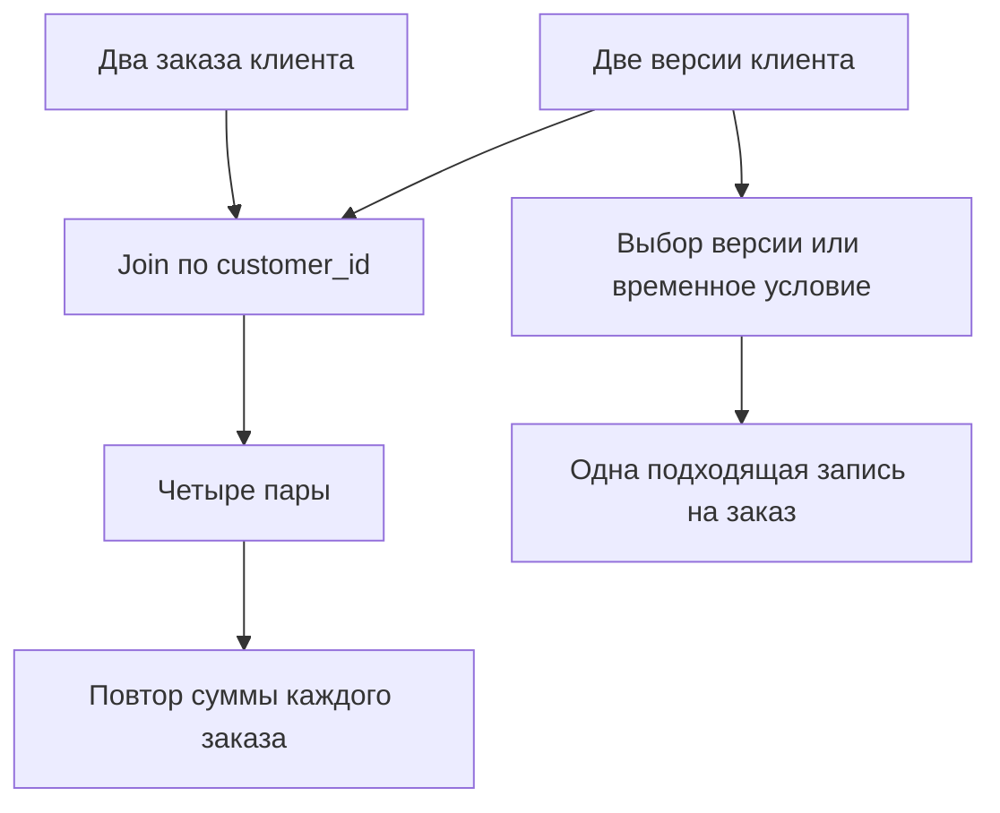
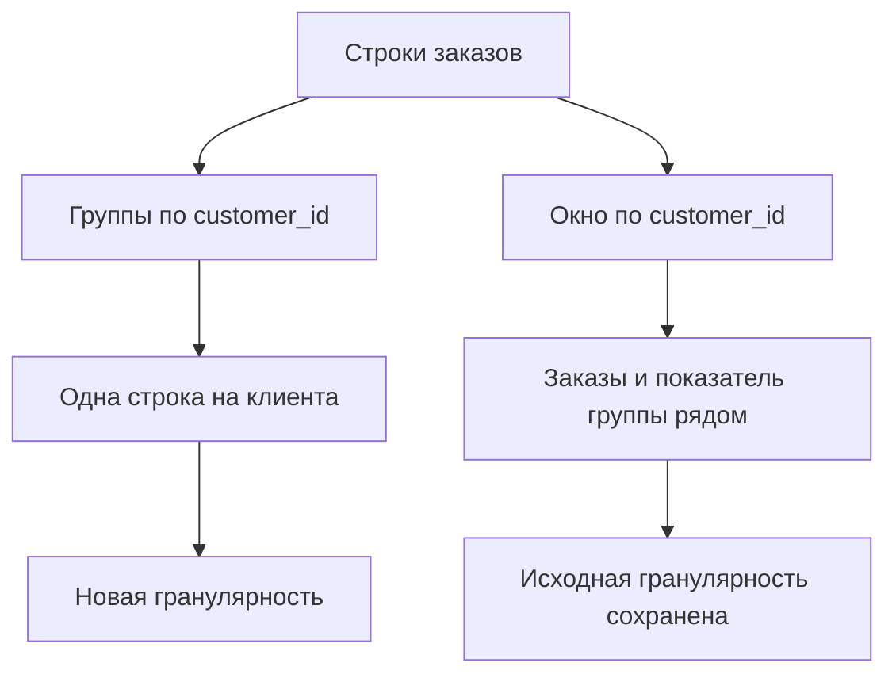
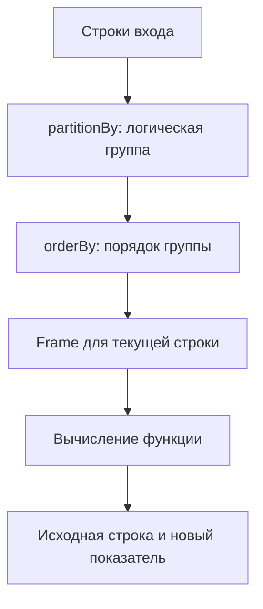
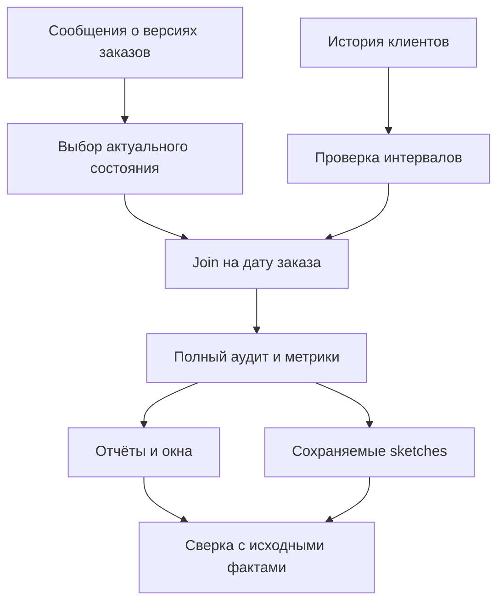

# 5. Соединения, агрегации и оконные вычисления

В этом разделе научимся объединять наборы данных, рассчитывать показатели по группам и анализировать последовательности событий. Здесь особенно важно понимать, **что означает одна строка результата**: заказ, позицию заказа, клиента, событие или итог по нескольким измерениям.

Ошибка в join может незаметно удвоить выручку. Неправильный frame окна — включить лишние события. Недостаточный ключ сортировки — выбрать разные версии записи при повторных запусках. Поэтому примеры проверяют не только успешное выполнение, но и количество строк, пропуски, кратность и смысл результата.

**Окружение:** Apache Spark / PySpark **4.2.0**, Python **3.12**, Java **17**, Spark Classic. Часовой пояс Spark-сессии — UTC, ANSI-режим включён. Для возможностей новых версий указаны ограничения: `QUALIFY`, `nearestByJoin` и Tuple sketches требуют Spark 4.2; KLL и Theta функции — соответствующих API Spark 4.1+.

Короткие примеры выполняются последовательно. Они используют несколько учебных строк; `collect()` и `first()` возвращают только небольшой проверяемый результат. В конце страницы есть самостоятельный скрипт. На кластере задавайте master, ресурсы и пути хранения через настройки запуска.

**Проверка материала:** выполнены все 75 коротких примеров и итоговая практика с 44 проверками на Spark 4.2.0. Проверены обычные и временные join, оконные frames, QUALIFY, NEAREST BY и четыре семейства sketches.

```python
from datetime import date
from decimal import Decimal

from pyspark.sql import SparkSession, Window, functions as F, types as T

spark = (
    SparkSession.builder
    .master("local[2]")
    .appName("JoinsAggregationsAndWindows")
    .config("spark.sql.session.timeZone", "UTC")
    .config("spark.sql.ansi.enabled", "true")
    .config("spark.sql.shuffle.partitions", "2")
    .getOrCreate()
)
spark.sparkContext.setLogLevel("WARN")

orders = spark.createDataFrame([
    (101, 1, "web", date(2026, 1, 1), Decimal("10.00"), "paid"),
    (102, 1, "web", date(2026, 1, 2), Decimal("20.00"), "new"),
    (103, 2, "mobile", date(2026, 1, 1), Decimal("15.00"), "paid"),
    (104, 3, "mobile", date(2026, 1, 3), None, "new"),
    (105, None, "web", date(2026, 1, 3), Decimal("5.00"), "paid"),
], "order_id BIGINT, customer_id BIGINT, channel STRING, order_date DATE, amount DECIMAL(12,2), status STRING")

customers = spark.createDataFrame([
    (1, "Anna", "DE"),
    (2, "Boris", "RU"),
    (4, "Dina", "US"),
], "customer_id BIGINT, customer_name STRING, country STRING")

orders.createOrReplaceTempView("orders")
customers.createOrReplaceTempView("customers")
```

В `orders` одна строка — заказ, а в `customers` — актуальная запись клиента. Справочник не содержит клиентов 3 и `NULL`; клиент 4 не делал заказов в этом наборе. Эти случаи понадобятся для проверки полноты соединения.

**Содержание**

1. [Основы соединения наборов данных](#join-basics)
2. [Корректность join](#join-correctness)
3. [Сложные условия соединения](#complex-joins)
4. [Группировка и агрегатные функции](#aggregations)
5. [Приближённые агрегаты и sketches](#approximation)
6. [Многомерные агрегаты и изменение формы](#multidimensional)
7. [Основы оконных функций](#window-basics)
8. [Ранжирование и аналитические функции](#ranking)
9. [Агрегаты в окнах и последовательности событий](#event-sequences)
10. [Операции над множествами и дедупликация](#sets-and-deduplication)

---

<a id="join-basics"></a>

## Основы соединения наборов данных

### Условие соединения и ключи

Join строит пары строк, для которых условие соединения даёт `TRUE`. Чаще всего условие — равенство ключей, но оно может содержать несколько сравнений, интервалы и дополнительные ограничения.

```python
enriched_orders = orders.join(customers, on="customer_id", how="left")

assert enriched_orders.count() == 5
assert enriched_orders.where("order_id = 101").first().customer_name == "Anna"
```

Перед соединением определите:

- ключ и его пространство уникальности: один источник, tenant или вся система;
- тип ключа на обеих сторонах;
- допустимость пропуска, пустой строки и специальных значений;
- требуемую кратность соответствий;
- смысл строки, у которой соответствия нет.

Нормализация ключей должна быть предметной. Например, `00123` и `123` могут быть разными строковыми кодами. Приведение к числу уничтожит различие. Случайное преобразование строкового ключа в `DOUBLE` также может потерять точность большого идентификатора.

**Логический join и физическая стратегия — разные понятия.** `left` говорит, какие строки сохраняются. Broadcast hash, sort merge и другие стратегии говорят, как Spark выполняет вычисление. `broadcast` не исправляет неуникальный справочник и не меняет требуемый бизнес-смысл.

### Inner, left, right и full outer join

| Вид | Сохраняет | Что происходит без соответствия |
|---|---|---|
| `inner` | Только подходящие пары | Неподходящая строка не попадает в результат |
| `left` / `left_outer` | Все строки слева и найденные пары | Поля справа заполняются `NULL` |
| `right` / `right_outer` | Все строки справа и найденные пары | Поля слева заполняются `NULL` |
| `full` / `full_outer` | Все найденные пары и обе стороны без соответствия | Заполняются отсутствующие поля другой стороны |

```python
join_counts = {
    kind: orders.join(customers, "customer_id", kind).count()
    for kind in ["inner", "left", "right", "full"]
}
assert join_counts == {"inner": 3, "left": 5, "right": 4, "full": 6}
```

Клиент 1 создаёт две пары, потому что у него два заказа. Клиент 4 создаёт одну строку без заказа в `right` и `full`. Заказы клиентов 3 и `NULL` сохраняются в `left` и `full`.

Outer join не означает ровно одну выходную строку на строку сохранённой стороны. При нескольких соответствиях эта строка размножается. Данные справа при отсутствии пары становятся `NULL`, даже если исходное поле справочника имело `nullable=False`.

Не определяйте тип join по ожидаемому удобному количеству строк. Сначала задайте требование: сохранять все заказы, только обогащённые заказы или также клиентов без заказов.

### Left semi и left anti join

`left_semi` возвращает строки слева, для которых существует хотя бы одно соответствие. Поля справа не добавляются, число соответствий справа не размножает строку слева.

`left_anti` возвращает строки слева, для которых соответствия нет.

```python
known_customer_orders = orders.join(customers, "customer_id", "left_semi")
unknown_customer_orders = orders.join(customers, "customer_id", "left_anti")

assert set(known_customer_orders.columns) == set(orders.columns)
assert known_customer_orders.count() == 3
assert {r.order_id for r in unknown_customer_orders.select("order_id").collect()} == {104, 105}
```

Соединение по имени может изменить порядок выходных полей, вынеся ключ вперёд. Если нужен канонический порядок, задайте его явно через `select(*orders.columns)`.

Для проверки присутствия ключа semi join обычно выражает задачу точнее, чем inner join с последующим удалением дубликатов. При этом он сохраняет исходные повторяющиеся строки слева: это не `DISTINCT`.

Anti join полезен для поиска необогащённых событий, отсутствующих внешних ключей и новых сущностей. Его поведение с `NULL` определяется условием соединения; обычное равенство не считает два `NULL` соответствием.

### Cross join и декартово произведение

Cross join создаёт каждую пару строк двух входов:

```python
channels = spark.createDataFrame([("web",), ("mobile",)], "channel STRING")
days = spark.createDataFrame([
    (date(2026, 1, 1),), (date(2026, 1, 2),),
], "day DATE")

grid = channels.crossJoin(days)
assert grid.count() == 4
```

Для `N` строк слева и `M` справа получается `N × M` строк. Два набора по миллиону строк образуют триллион пар. Это существенно даже при компактной схеме.

Полезные случаи — небольшая календарная сетка, сочетания ограниченных категорий и тестовые данные. Если цель — соединение по ключу, забытое условие не становится корректным cross join из-за того, что запрос выполнился.

Настройки защиты от неявного декартова соединения и поддержка конкретного синтаксиса зависят от версии. Явный `crossJoin` обозначает намерение, но ответственность за допустимый размер остаётся у автора.

### Соединение по имени столбца и по выражению

При `on="customer_id"` Spark соединяет одинаково названные поля по равенству и оставляет один общий ключ в выходе. Список имён ведёт себя как `USING` для этих полей.

При соединении по выражению обе колонки ключа могут остаться в схеме:

```python
by_name = orders.join(customers, "customer_id", "left")
by_expression = (
    orders.alias("o")
    .join(customers.alias("c"), F.col("o.customer_id") == F.col("c.customer_id"), "left")
    .select(
        "o.*",
        F.col("c.customer_id").alias("matched_customer_id"),
        "c.customer_name", "c.country",
    )
)

assert by_name.columns.count("customer_id") == 1
assert by_expression.where("order_id = 104").first().matched_customer_id is None
```

Выражение нужно для разных имён ключа, null-safe сравнения и сложных предикатов. После него явно выбирайте поля результата. Иначе `select("customer_id")` может оказаться неоднозначным, а последующая запись — получить дубликаты имён.

В SQL аналогичные формы — `JOIN ... USING (customer_id)` и `JOIN ... ON o.customer_id = c.customer_id`. Они отличаются построением выходной схемы, поэтому `SELECT *` не является универсальным контрактом.

### Соединение по нескольким ключам

Составной ключ должен учитывать все части, в пределах которых идентификатор уникален:

```python
source_events = spark.createDataFrame([
    ("crm", 7, "sale"), ("erp", 7, "invoice"),
], "source STRING, local_id INT, event_type STRING")
source_lookup = spark.createDataFrame([
    ("crm", 7, "CRM object"), ("erp", 7, "ERP object"),
], "source STRING, local_id INT, label STRING")

compound_join = source_events.join(source_lookup, ["source", "local_id"], "left")
assert compound_join.count() == 2
assert compound_join.where("source = 'erp'").first().label == "ERP object"
```

Соединение только по `local_id` в этом примере даст четыре пары и смешает источники. Составной ключ также часто содержит tenant, организацию, версию или дату.

Не собирайте ключ через простой `concat_ws`: пропуски и разделители в данных могут сделать разные наборы частей одинаковыми. Соединяйте по отдельным типизированным полям или используйте документированный канонический ключ.

### NULL-ключи и null-safe join

Обычное `NULL = NULL` даёт `UNKNOWN`; такая пара не проходит join. Null-safe равенство `<=>`, в PySpark `eqNullSafe`, считает два `NULL` равными.

```python
nullable_left = spark.createDataFrame([(1,), (None,)], "key INT")
nullable_right = spark.createDataFrame([(1,), (None,)], "key INT")

ordinary_join = nullable_left.alias("l").join(
    nullable_right.alias("r"), F.col("l.key") == F.col("r.key"), "inner"
)
null_safe_join = nullable_left.alias("l").join(
    nullable_right.alias("r"), F.col("l.key").eqNullSafe(F.col("r.key")), "inner"
)
assert ordinary_join.count() == 1
assert null_safe_join.count() == 2
```

Null-safe join уместен, когда пропуск действительно является сопоставимой категорией. Если `NULL` означает «идентификатор неизвестен», связывать всех неизвестных клиентов друг с другом обычно неверно.

Несколько `NULL` с обеих сторон также могут создать `many-to-many` и большой перекос. Замена `NULL` на общий маркер не устраняет эту проблему и может дополнительно смешать пропуски с настоящим значением маркера.

Для составного null-safe условия применяйте `eqNullSafe` к каждой части и объединяйте выражения через `&`. Поведение NaN проверяйте отдельно: в Spark SQL NaN не равен SQL `NULL`.

**Практика:** составьте для пяти заказов ожидаемые результаты всех основных join. Затем добавьте повтор клиента 1 в справочник и предскажите, какие соединения изменят количество строк, а какие только подтвердят наличие соответствия.

---

<a id="join-correctness"></a>

## Корректность join

### Связи one-to-one, one-to-many и many-to-many

Кратность определяется данными ключа, а не именем таблицы:

| Связь для ключа | Строк слева | Строк справа | Подходящих пар |
|---|---:|---:|---:|
| One-to-one | 1 | 1 | 1 |
| One-to-many | 1 | `n` | `n` |
| Many-to-one | `m` | 1 | `m` |
| Many-to-many | `m` | `n` | `m × n` |

Заказы → уникальный справочник клиентов — обычно many-to-one. Клиенты → заказы — one-to-many. Заказы → история клиента только по `customer_id` — потенциально many-to-many, пока не добавлено временное условие.

```python
customer_duplicates = customers.groupBy("customer_id").count().where("count > 1")
assert customer_duplicates.count() == 0
```

Проверяйте уникальность **по реальному ключу соединения**. Таблица может иметь уникальный surrogate key, но содержать несколько строк по используемому бизнес-ключу. Схема DataFrame и название «справочник» не гарантируют уникальность данных.

### Размножение строк из-за неуникальных ключей

```python
duplicated_customers = customers.unionByName(
    spark.createDataFrame([(1, "Anna", "DE")], customers.schema)
)
multiplied = orders.join(duplicated_customers, "customer_id", "left")

before_amount = orders.agg(F.sum("amount").alias("total")).first().total
after_amount = multiplied.agg(F.sum("amount").alias("total")).first().total
assert multiplied.count() == 7
assert before_amount == Decimal("50.00")
assert after_amount == Decimal("80.00")
```

Один лишний клиент 1 повторил оба его заказа. Выручка выросла на 30, хотя новых продаж не было.

`distinct()` после join не является универсальным исправлением: он может удалить настоящие одинаковые события, а при разных полях версии справочника вовсе не уберёт повтор заказа. Правильное действие зависит от причины: исправить ключ, выбрать актуальную версию, агрегировать правую сторону до нужной гранулярности или отклонить нарушение контракта.



### Alias, self join и неоднозначные имена столбцов

Alias обозначает роль источника в выражении. Особенно важно это для self join:

```python
employees = spark.createDataFrame([
    (1, "Director", None), (2, "Analyst", 1), (3, "Engineer", 1),
], "employee_id INT, name STRING, manager_id INT")

employee_managers = (
    employees.alias("e")
    .join(employees.alias("m"), F.col("e.manager_id") == F.col("m.employee_id"), "left")
    .select(
        F.col("e.employee_id").alias("employee_id"),
        F.col("e.name").alias("employee_name"),
        F.col("m.name").alias("manager_name"),
    )
)
assert employee_managers.where("employee_id = 2").first().manager_name == "Director"
```

Условие `df.id == df.id` при неясной ссылке на два экземпляра источника не является надёжным способом сопоставления. После alias используйте квалифицированные ссылки на разные стороны.

Выходные имена должны быть уникальны и понятны. Если нужны оба состояния, называйте их `old_status`, `new_status`; не оставляйте две колонки `status`. Настройки анализа неоднозначного self join могут выявить ошибку, но отключение такой проверки не делает условие корректным.

### Фильтр в условии ON и фильтр после outer join

Фильтр после left join может убрать строки, которые соединение сохраняло:

```python
only_de_matches = (
    orders.alias("o")
    .join(
        customers.alias("c"),
        (F.col("o.customer_id") == F.col("c.customer_id")) & (F.col("c.country") == "DE"),
        "left",
    )
    .select("o.order_id", "c.country")
)
filtered_after_join = orders.join(customers, "customer_id", "left").where("country = 'DE'")

assert only_de_matches.count() == 5
assert filtered_after_join.count() == 2
```

В первой форме все заказы сохраняются, но данные клиента добавляются только для `DE`. Во второй фильтр применяется к готовым строкам. Для отсутствующей страны сравнение даёт `UNKNOWN`, поэтому строка исчезает.

| Требование | Где условие обычно выражается |
|---|---|
| Сохранить все заказы, обогащать только разрешённой записью | В `ON` или в предварительно отфильтрованной правой стороне |
| Оставить только заказы разрешённых клиентов | Inner/semi join с соответствующим ограничением |
| Исключить определённые строки готового результата | После join, с явной политикой `NULL` |

Не переносите условие механически ради оптимизации. Для outer join перемещение между `ON` и `WHERE` может поменять ответ.

### Проверка отсутствующих соответствий и полноты обогащения

Сделайте технический признак найденной строки справа. Не проверяйте необязательное поле, например имя клиента: оно может быть `NULL` даже у найденной записи.

```python
marked_customers = customers.withColumn("customer_found", F.lit(True))
checked_enrichment = orders.join(marked_customers, "customer_id", "left").withColumn(
    "customer_found", F.coalesce("customer_found", F.lit(False))
)

missing_customer_orders = checked_enrichment.where("NOT customer_found")
assert {r.order_id for r in missing_customer_orders.select("order_id").collect()} == {104, 105}
```

Отдельно различайте пропуск ключа слева, неизвестный ключ и исключённое фильтром соответствие. Эти причины ведут к разным исправлениям.

Для null-safe соединения признак справа особенно полезен: найденная строка сама может иметь `NULL` в ключе, поэтому `right.key IS NULL` не всегда означает отсутствие пары.

Проверка полноты не равна проверке уникальности. 100% найденных соответствий может сочетаться с двойными соответствиями и неверной выручкой.

### Контроль cardinality и сверка результата

Проверяйте не только общий размер, но и число строк на ключ исходной сущности:

```python
per_order_cardinality = checked_enrichment.groupBy("order_id").count()
assert per_order_cardinality.where("count != 1").count() == 0

join_audit = checked_enrichment.agg(
    F.count(F.lit(1)).alias("rows"),
    F.count_distinct("order_id").alias("orders"),
    F.sum("amount").alias("amount"),
    F.sum(F.when(~F.col("customer_found"), 1).otherwise(0)).alias("missing"),
).first()
assert (join_audit.rows, join_audit.orders, join_audit.missing) == (5, 5, 2)
assert join_audit.amount == Decimal("50.00")
```

Для ожидаемого many-to-one left join баланс строк и сохранение сумм — полезные инварианты. Они действуют при уникальном идентификаторе исходной строки и отсутствии других преобразований значений.

Одинаковое число строк до и после не доказывает правильность: потеря одного заказа и дублирование другого могут взаимно компенсироваться. Поэтому нужны проверки идентификаторов, кратности и предметных показателей.

Для ожидаемого one-to-many число строк должно расти. Проверяйте множество родителей, число элементов и сумму показателей на **нужной** гранулярности, а не требуйте одинакового размера любой ценой.

**Практика:** оформите контракт обогащения: одна запись справочника на заказ, все заказы сохранены, сумма не изменена, пропуски ключа выделены отдельно. Добавьте тест, в котором общий размер совпадает, но одна сущность потеряна и другая повторена.

---

<a id="complex-joins"></a>

## Сложные условия соединения

### Non-equi join и соединение по диапазонам

Non-equi join содержит сравнения, отличные от равенства. Например, сумма заказа должна попасть в диапазон тарифной категории:

```python
amount_bands = spark.createDataFrame([
    ("small", Decimal("0.00"), Decimal("15.00")),
    ("large", Decimal("15.00"), Decimal("100.00")),
], "band STRING, lower_bound DECIMAL(12,2), upper_bound DECIMAL(12,2)")

banded_orders = (
    orders.alias("o")
    .join(
        amount_bands.alias("b"),
        (F.col("o.amount") >= F.col("b.lower_bound"))
        & (F.col("o.amount") < F.col("b.upper_bound")),
        "left",
    )
    .select("o.order_id", "o.amount", "b.band")
)
assert banded_orders.where("order_id = 103").first().band == "large"
assert banded_orders.where("order_id = 104").first().band is None
```

Полуоткрытые диапазоны `[lower, upper)` позволяют не относить граничное значение 15 сразу к двум соседним категориям. `between` включает обе границы и здесь потребовал бы другой организации диапазонов.

Проверьте пересечения, пробелы и направление границ. Наличие одинакового ключа категории не делает диапазоны непересекающимися. Если кроме диапазона есть равенство, например `currency`, включайте его в условие: оно задаёт правильную область соответствия и может дать Spark полезную структуру join.

### Соединение по временным интервалам

Для истории состояния удобно использовать `[valid_from, valid_to)`, где `NULL valid_to` означает открытый конец:

```python
customer_history = spark.createDataFrame([
    (11, 1, date(2026, 1, 1), date(2026, 1, 10), "DE"),
    (12, 1, date(2026, 1, 10), None, "US"),
    (21, 2, date(2026, 1, 3), None, "RU"),
], "version_id INT, customer_id BIGINT, valid_from DATE, valid_to DATE, country STRING")

temporal_events = spark.createDataFrame([
    (1, 1, date(2026, 1, 1)),
    (2, 1, date(2026, 1, 10)),
    (3, 2, date(2026, 1, 1)),
    (4, 3, date(2026, 1, 20)),
], "event_id INT, customer_id BIGINT, event_date DATE")

history_condition = (
    (F.col("e.customer_id") == F.col("h.customer_id"))
    & (F.col("e.event_date") >= F.col("h.valid_from"))
    & (F.col("h.valid_to").isNull() | (F.col("e.event_date") < F.col("h.valid_to")))
)
interval_enrichment = (
    temporal_events.alias("e").join(customer_history.alias("h"), history_condition, "left")
    .select("e.*", "h.version_id", "h.country")
)
assert interval_enrichment.count() == 4
assert interval_enrichment.where("event_id = 2").first().country == "US"
assert interval_enrichment.where("event_id = 3").first().version_id is None
```

Событие ровно 10 января относится ко второй версии, а не к обеим. Для timestamp требуются согласованные часовые пояса и точность. Строковые даты перед соединением нужно разобрать в временной тип.

Определите смысл открытого начала, открытого конца, пропущенного времени события и периода до первой версии. Не заменяйте всё текущей версией без бизнес-правила: это меняет исторический результат.

### As-of обогащение через доступные операции Spark

As-of обычно означает «последняя известная запись на момент события». Это **направленное** соответствие, а не просто минимальная абсолютная разница времени: запись из будущего не подходит.

Если у изменений известен только `valid_from`, можно построить кандидатов, а затем выбрать последнего:

```python
history_candidates = (
    temporal_events.alias("e")
    .join(
        customer_history.alias("h"),
        (F.col("e.customer_id") == F.col("h.customer_id"))
        & (F.col("h.valid_from") <= F.col("e.event_date")),
        "left",
    )
    .select("e.*", "h.version_id", "h.valid_from", "h.country")
)
asof_priority = Window.partitionBy("event_id").orderBy(
    F.col("valid_from").desc_nulls_last(), F.col("version_id").desc_nulls_last()
)
asof_events = (
    history_candidates.withColumn("candidate_rank", F.row_number().over(asof_priority))
    .where("candidate_rank = 1").drop("candidate_rank")
)
assert asof_events.where("event_id = 2").first().version_id == 12
assert asof_events.where("event_id = 3").first().version_id is None
```

`event_id` должен однозначно идентифицировать исходную строку. Если разделить окно только по клиенту, останется один результат на клиента вместо одного результата на событие.

Этот вариант допускает применение последнего состояния после его явного окончания, потому что не проверяет `valid_to`. Он подходит для истории последовательных изменений без самостоятельного срока истечения. Для истекающих котировок, статусов или договоров нужен интервал либо дополнительное ограничение максимального возраста.

Для частого обогащения по изменениям полезно заранее получить `valid_to` через `lead(valid_from)`, согласовав конфликт одинаковых начал. Это сокращает множество исторических кандидатов, но корректность зависит от качества истории. `row_number` и окна подробно разобраны ниже на этой же странице.

### NEAREST BY / nearestByJoin: поиск ближайших и top-K соответствий для каждой строки слева; Spark 4.2+

Начиная с Spark 4.2 есть join, который выбирает до `K` лучших кандидатов справа **для каждой строки слева**. Он подходит для явно заданной метрики расстояния или похожести.

```python
queries = spark.createDataFrame([
    (1, 10.0), (2, 20.0),
], "query_id INT, point DOUBLE")
candidates = spark.createDataFrame([
    ("A", 11.0), ("B", 22.0), ("C", 5.0),
], "candidate_id STRING, candidate_point DOUBLE")

nearest = queries.nearestByJoin(
    candidates,
    rankingExpression=F.abs(queries.point - candidates.candidate_point),
    numResults=1,
    mode="exact",
    direction="distance",
).select("query_id", "candidate_id")

assert [(r.query_id, r.candidate_id) for r in nearest.orderBy("query_id").collect()] == [
    (1, "A"), (2, "B"),
]
```

Есть и SQL-синтаксис:

```python
queries.createOrReplaceTempView("nearest_queries")
candidates.createOrReplaceTempView("nearest_candidates")

nearest_sql = spark.sql("""
    SELECT q.query_id, c.candidate_id
    FROM nearest_queries q
    JOIN nearest_candidates c
      EXACT NEAREST 1 BY DISTANCE abs(q.point - c.candidate_point)
""")
assert nearest_sql.count() == 2
```

Параметр `numResults` — целое число от 1 до 100000. Он задаёт максимум соответствий, не число строк во всём результате. У каждого исходного запроса нужно сохранить свой уникальный идентификатор, чтобы затем сверять ответ.

API `nearestByJoin` не имеет обычного параметра `on`. Допустимость кандидатов по tenant, категории или времени нужно обеспечить подходящим способом до поиска или через другую конструкцию. Нельзя считать ближайший товар автоматически разрешённым товаром.

Для Spark до 4.2 используют явно построенные пары кандидатов и оконное ранжирование. Это позволяет задать дополнительные условия и tie-breaker, но также может быть дорогим.

### Ранжирование по DISTANCE и SIMILARITY; EXACT/APPROX и поддерживаемые виды join

| Параметр | Смысл |
|---|---|
| `distance` / SQL `DISTANCE` | Меньшее значение метрики лучше |
| `similarity` / SQL `SIMILARITY` | Большее значение метрики лучше |
| `exact` / SQL `EXACT` | Контракт точного поиска; метрика должна быть детерминированной |
| `approx` / SQL `APPROX` | Разрешение использовать приближённую стратегию при её наличии |
| `joinType="inner"` | Только найденные соответствия |
| `joinType="leftouter"` | Сохранить левую строку и при отсутствии кандидатов |

```python
nearest_by_similarity = queries.nearestByJoin(
    candidates,
    -F.abs(queries.point - candidates.candidate_point),
    1, "exact", "similarity",
)
assert nearest_by_similarity.where("query_id = 1").first().candidate_id == "A"

nearest_with_empty_pool = queries.nearestByJoin(
    candidates.where("false"),
    F.abs(queries.point - candidates.candidate_point),
    1, "approx", "distance", joinType="leftouter",
)
assert nearest_with_empty_pool.count() == 2
```

Поддерживаются именно inner и left outer, а не все виды обычного join. Не переносите привычные строки `how="left"` в этот API без проверки его сигнатуры.

Для равных значений метрики выбор между кандидатами не определён. Если требуется стабильный победитель, используйте способ с явным дополнительным критерием или документированную поддержку нужного ранжирования. Предварительный `orderBy` правого DataFrame не задаёт контракт tie-breaking этого оператора.

Также не полагайтесь на порядок всех выходных строк после последующих преобразований: финальный порядок задаётся отдельным `orderBy`.

### Стоимость NEAREST BY в Spark 4.2: полный перебор пар строк сохраняется даже при APPROX; ограничения и наличие индексного поиска проверять по версии

В Spark 4.2 текущая реализация рассматривает полное произведение левой и правой стороны. Верхняя граница `K` ограничивает число сохраняемых лучших кандидатов на левую строку, но **не отменяет вычисление метрики для пар**.

```python
nearest.explain(mode="formatted")
```

На 10000 запросов и миллион кандидатов получается до 10 миллиардов оценок метрики. Возвращаемые 10000 строк при `K=1` не делают этот поиск дешёвым.

`APPROX` в этой версии не является обещанием готового ANN-индекса. Он описывает допустимый контракт стратегии; наличие индексного поиска, поддерживаемые метрики и фактический план нужно проверять для используемой версии или платформы.

Ограничивайте допустимый пул, сначала применяйте доступные предметные фильтры и избегайте тяжёлой UDF в метрике. Если задача требует массового векторного поиска с индексом, отдельно оцените соответствующий движок и его интеграцию.

Документация: [nearestByJoin 4.2](https://spark.apache.org/docs/4.2.0/api/python/reference/pyspark.sql/api/pyspark.sql.DataFrame.nearestByJoin.html) и [SQL JOIN](https://spark.apache.org/docs/4.2.0/sql-ref-syntax-qry-select-join.html).

### Соединение с историей изменений и интервальными справочниками

История пригодна для однозначного обогащения, когда интервалы одного бизнес-ключа не пересекаются, границы корректны и правило выбора конфликтующих версий известно.

```python
history_order = Window.partitionBy("customer_id").orderBy("valid_from", "version_id")
checked_history = customer_history.withColumn(
    "next_start", F.lead("valid_from").over(history_order)
)
invalid_intervals = checked_history.where(
    F.col("customer_id").isNull()
    | F.col("valid_from").isNull()
    | (F.col("valid_to") <= F.col("valid_from"))
)
overlapping_intervals = checked_history.where(
    F.col("next_start").isNotNull()
    & (F.col("valid_to").isNull() | (F.col("valid_to") > F.col("next_start")))
)
assert invalid_intervals.count() == 0
assert overlapping_intervals.count() == 0
```

Ровно соприкасающиеся `[a,b)` и `[b,c)` не пересекаются. Открытый конец перед следующей версией — нарушение такого контракта. Проверка рассчитана на эту простую историю с известными началами; отдельно проверяйте уникальность версии, дубликаты начала и обязательные поля.

SCD Type 2 обычно хранит бизнес-ключ, surrogate/version key и интервал действия. Не соединяйте факт с историей только по бизнес-ключу. Не используйте `is_current=true` для исторического отчёта, если нужен статус на дату факта.

Поздно пришедшее исправление истории может изменить результат прошлого обогащения. Нужно решить, пересчитывается ли история фактов и как фиксируется версия справочника. Это часть контракта пайплайна, а не только выбора оператора Spark.

### EXISTS, NOT EXISTS, IN и NOT IN с NULL-значениями

При наличии `NULL` `NOT IN` отличается от «не найдено соответствие»:

```python
membership_left = spark.createDataFrame([(1,), (2,), (None,)], "key INT")
membership_right = spark.createDataFrame([(1,), (None,)], "key INT")
membership_left.createOrReplaceTempView("membership_left")
membership_right.createOrReplaceTempView("membership_right")

not_exists_rows = spark.sql("""
    SELECT l.key
    FROM membership_left l
    WHERE NOT EXISTS (
        SELECT 1 FROM membership_right r WHERE r.key = l.key
    )
""")
not_in_rows = spark.sql("""
    SELECT key FROM membership_left
    WHERE key NOT IN (SELECT key FROM membership_right)
""")
in_rows = spark.sql("""
    SELECT key FROM membership_left
    WHERE key IN (SELECT key FROM membership_right)
""")

assert not_exists_rows.count() == 2
assert not_in_rows.count() == 0
assert in_rows.count() == 1
```

Для ключа 2 наличие `NULL` в правом наборе не позволяет доказать результат `NOT IN` как `TRUE`. Левый `NULL` тоже требует отдельного решения. `NOT EXISTS` с обычным равенством возвращает и 2, и левый `NULL`, потому что подходящей пары нет.

Если неизвестные ключи нужно исключить, добавьте `l.key IS NOT NULL` явно. Если два пропуска считаются соответствием, используйте null-safe предикат в `EXISTS`/join. Semi и anti join часто удобны для такой задачи, но их условие должно совпадать с требуемой логикой.

### Риск полного перебора при сложном предикате

Наличие функции `join` не гарантирует эффективного поиска по ключу. Условия только по неравенству, похожести строк или дорогой пользовательской функции могут потребовать проверки большого количества пар.

Если есть часть с равенством, например tenant или категория, сохраняйте её как явное сравнение. Остальные ограничения могут проверяться как residual predicate после сужения кандидатов. Это не обещает конкретной стратегии: смотрите `explain` и фактические метрики Spark UI.

```python
banded_orders.explain(mode="formatted")
interval_enrichment.explain(mode="formatted")
```

Перед запуском оцените размеры сторон, ожидаемое число кандидатов на ключ и стоимость предиката. Уменьшайте вход проекцией нужных полей и корректными фильтрами. Небольшой выход не доказывает небольшую работу внутри join.

Предварительные buckets для диапазонов могут ускорить поиск, но создают собственные требования: широкий интервал должен попасть во все пересекаемые buckets, а точный предикат должен остаться после join. Потеря соответствий ради ускорения недопустима.

**Практика:** обогатите события состоянием на дату, проверив границу смены версии, период до первой записи и открытый конец. Сравните направленный as-of с ближайшей абсолютной датой и покажите пример, где ближайшая запись находится в будущем и потому не подходит.

---

<a id="aggregations"></a>

## Группировка и агрегатные функции

### groupBy и agg

Группировка заменяет строки одной группы сводной строкой. Она меняет гранулярность результата.

```python
customer_totals = orders.groupBy("customer_id").agg(
    F.count(F.lit(1)).alias("order_count"),
    F.sum("amount").alias("total_amount"),
)
assert customer_totals.count() == 4
assert customer_totals.where("customer_id = 1").first().total_amount == Decimal("30.00")
```

Теперь одна строка — группа `customer_id`, включая отдельную группу пропущенного ключа. Поле `order_id` нельзя просто выбрать рядом с итогом без правила агрегации: в группе клиента 1 два разных заказа.

`orders.agg(...)` выполняет глобальное агрегирование без ключей. `orders.groupBy().agg(...)` выражает ту же форму. Несколько показателей в одном `agg` обычно позволяют избежать серии отдельных полных вычислений.



Группировка часто требует shuffle, а агрегаты могут вычисляться частично до передачи данных. Это не означает, что все агрегаты имеют маленькое состояние: `collect_list` большой группы способен хранить огромный контейнер.

### count, count_distinct, sum, avg, min и max

```python
basic_totals = orders.agg(
    F.count(F.lit(1)).alias("rows"),
    F.count("amount").alias("known_amounts"),
    F.count_distinct("customer_id").alias("known_customers"),
    F.sum("amount").alias("sum_amount"),
    F.avg("amount").alias("avg_amount"),
    F.min("amount").alias("min_amount"),
    F.max("amount").alias("max_amount"),
).first()

assert basic_totals.rows == 5
assert basic_totals.known_amounts == 4
assert basic_totals.known_customers == 3
assert basic_totals.sum_amount == Decimal("50.00")
assert basic_totals.avg_amount == Decimal("12.50")
assert basic_totals.min_amount == Decimal("5.00")
assert basic_totals.max_amount == Decimal("20.00")
```

`sum`, `avg`, `min`, `max` обычно не включают `NULL` в вычисляемые значения. Поэтому среднее здесь — `50 / 4`, а не `50 / 5`. Замена неизвестной суммы нулём изменит среднее и требует бизнес-решения.

`count_distinct` считает разные ненулевые значения. Для нескольких аргументов учитывается комбинация; комбинации с `NULL` в аргументах требуют внимания к семантике этого агрегата. Для явного учёта пропуска как категории сформируйте согласованный структурный ключ или отдельную метрику.

Сумма и среднее decimal могут получить расширенный тип. Проверяйте выходную схему, переполнение и политику финального округления. Суммирование `DOUBLE` имеет особенности численной точности и может зависеть от порядка сложения; деньги с фиксированной точностью обычно требуют decimal.

### count(*) и count(column): различие для NULL

`count(*)` считает строки. `count(column)` — строки с ненулевым значением выбранного выражения. В DataFrame API для числа строк удобно `F.count(F.lit(1))`.

Особенно заметно различие после outer join:

```python
customer_order_counts = (
    customers.alias("c")
    .join(orders.alias("o"), F.col("c.customer_id") == F.col("o.customer_id"), "left")
    .groupBy(F.col("c.customer_id").alias("customer_id"))
    .agg(
        F.count(F.lit(1)).alias("joined_rows"),
        F.count("o.order_id").alias("actual_orders"),
    )
)
dina_counts = customer_order_counts.where("customer_id = 4").first()
assert dina_counts.joined_rows == 1
assert dina_counts.actual_orders == 0
```

Left join создал для Дины строку с `NULL`-полями заказа. Это одна строка результата и ноль реальных заказов. Для такого подсчёта поле `order_id` должно быть обязательным у настоящей записи.

`count_distinct` не исправляет все ошибки join. Если требуется количество событий, сначала определите, идентифицирует ли поле событие уникально и допустимы ли повторные экземпляры.

### first, last, collect_list и collect_set

`first` и `last` выбирают встретившиеся значения в агрегировании. `collect_list` собирает значения с повторениями, `collect_set` удаляет повторяющиеся значения.

```python
collection_events = spark.createDataFrame([
    ("a", 1, "x"), ("a", 2, None), ("a", 3, "x"), ("a", 4, "y"),
], "group_id STRING, seq INT, value STRING")

collected = collection_events.groupBy("group_id").agg(
    F.first("value", ignorenulls=True).alias("some_first"),
    F.last("value", ignorenulls=True).alias("some_last"),
    F.collect_list("value").alias("values"),
    F.collect_set("value").alias("unique_values"),
    F.collect_list(F.struct("seq", "value")).alias("events"),
).first()

assert sorted(collected.values) == ["x", "x", "y"]
assert set(collected.unique_values) == {"x", "y"}
assert len(collected.events) == 4
```

`NULL` простого значения не включается в эти собранные списки/множества. Но ненулевая структура с полем `value=NULL` сохраняется. Это важно для восстановления позиций и пропусков.

Порядок `collect_set` не является приоритетом, а большой `collect_list` не становится безопасным из-за распределённости всей таблицы. Если результат нужен как отдельная таблица событий, часто лучше сохранить строки, а не собрать их в гигантский массив.

### Зависимость порядка collect_list и first/last от выполнения

Предварительный `orderBy` перед `groupBy` не гарантирует, что после shuffle агрегат увидит строки в этом же порядке. `first` не означает «самый ранний по дате», а `last` — «последняя версия».

Для упорядоченного массива собирайте вместе значение и ключ порядка, а сортируйте **после** агрегирования:

```python
ordered_collections = collection_events.groupBy("group_id").agg(
    F.sort_array(F.collect_list(F.struct("seq", "value"))).alias("ordered_events")
).withColumn(
    "ordered_values", F.transform("ordered_events", lambda event: event.value)
)
assert ordered_collections.first().ordered_values == ["x", None, "x", "y"]
```

`seq` здесь уникален внутри группы. При равных ключах добавьте устойчивый tie-breaker. Сортировка структур сравнивает поля по порядку; не включайте случайно дополнительные поля как скрытое правило приоритета.

Для одной последней строки используйте окно с полным порядком либо подходящий `max_by` со согласованным ключом. У `max_by` равные значения критерия также требуют решения. Если нужно сохранить поля одной исходной записи, выбирайте структуру этой записи целиком: отдельные агрегаты по каждому полю могут собрать несуществующую комбинацию.

### Условные агрегаты и агрегаты с FILTER

Вычисляйте разные показатели одной группы без отдельного фильтрования и повторного запуска каждого отчёта:

```python
conditional_totals = orders.agg(
    F.sum(F.when(F.col("status") == "paid", F.col("amount"))).alias("paid_amount"),
    F.count(F.when(F.col("status") == "paid", F.lit(1))).alias("paid_orders"),
    F.count_distinct(F.when(F.col("status") == "paid", F.col("customer_id"))).alias("paid_customers"),
).first()
assert conditional_totals.paid_amount == Decimal("30.00")
assert conditional_totals.paid_orders == 3
assert conditional_totals.paid_customers == 2

filtered_aggregate = spark.sql("""
    SELECT
        sum(amount) FILTER (WHERE status = 'paid') AS paid_amount,
        count(*) FILTER (WHERE status = 'paid') AS paid_orders
    FROM orders
""").first()
assert filtered_aggregate.paid_orders == 3
```

`FILTER` внутри агрегата ограничивает строки **для этого показателя**. Общий `WHERE status='paid'` исключит строки и из всех остальных показателей запроса.

Различайте `sum(when(condition, amount))` и вариант с `otherwise(0)`. При отсутствии подходящих ненулевых сумм первый возвращает `NULL`; ноль означает другое выбранное правило. Для итогового контракта «нет продаж → ноль» часто понятнее применить `coalesce` к готовому агрегату.

Условие `NULL` не считается `TRUE`, поэтому не проходит `FILTER` и не выбирает ветку `when`. Проверки пропущенного статуса нужно считать явно.

### Статистические, логические и побитовые агрегаты

Для числового исследования доступны дисперсия, стандартное отклонение, ковариация, корреляция и другие функции. Различайте выборочную (`var_samp`, `stddev_samp`, `covar_samp`) и генеральную (`var_pop`, `stddev_pop`, `covar_pop`) форму.

```python
aggregate_flags = spark.createDataFrame([
    (True, 7), (None, 3), (False, None),
], "flag BOOLEAN, mask INT")

flag_totals = aggregate_flags.agg(
    F.bool_and("flag").alias("all_known_true"),
    F.bool_or("flag").alias("any_known_true"),
    F.bit_and("mask").alias("common_bits"),
    F.bit_or("mask").alias("any_bits"),
    F.bit_xor("mask").alias("xor_bits"),
).first()
assert flag_totals.all_known_true is False
assert flag_totals.any_known_true is True
assert (flag_totals.common_bits, flag_totals.any_bits, flag_totals.xor_bits) == (3, 7, 4)
```

Эти агрегаты игнорируют `NULL` входа; если нет ненулевых значений, результат может быть `NULL`. Поэтому `bool_and(TRUE,NULL)` по известным значениям отличается от `forall(array(TRUE,NULL), x -> x)`, где неизвестный элемент участвует в трёхзначной логике.

Побитовая маска не равна числу прав: `bit_or` объединяет выставленные биты, `sum` складывает числа и может перенести бит. Определите допустимую ширину и знак типа маски.

Статистический агрегат не проверяет пригодность измерений автоматически. Фильтруйте или отмечайте NaN, бесконечности и предметно неверные значения. Для постоянного поля или слишком маленькой группы корреляция и выборочная дисперсия требуют особой интерпретации.

### Агрегация пустого набора и групп с NULL

Глобальный агрегат по пустому входу возвращает сводную строку, а группировка с ключом — ни одной группы:

```python
empty_orders = orders.where("false")
empty_summary = empty_orders.agg(
    F.count(F.lit(1)).alias("rows"),
    F.sum("amount").alias("amount"),
    F.collect_list("order_id").alias("ids"),
).first()
assert empty_summary.rows == 0
assert empty_summary.amount is None
assert empty_summary.ids == []
assert empty_orders.groupBy("customer_id").count().count() == 0

null_groups = spark.createDataFrame([
    (None, 1), (None, 2), ("a", 3),
], "group_key STRING, value INT").groupBy("group_key").agg(F.sum("value").alias("total"))
assert null_groups.where("group_key IS NULL").first().total == 3
```

Группировка объединяет `NULL` ключи в одну группу, хотя обычный join не сопоставляет `NULL = NULL`. Это разные операции и разные правила.

Отсутствующая группа и присутствующая группа с итогом `NULL` — разные состояния. Чтобы отчёт содержал все категории, можно сначала агрегировать факты, затем присоединить результат к ограниченному справочнику категорий и согласованно заполнить отсутствующие итоги.

На пустом входе показатели «число нарушений» через `sum` требуют `coalesce(...,0)`, если контракт ожидает ноль. Не заполняйте нулём все показатели подряд: неизвестная средняя цена не равна нулевой цене.

**Практика:** посчитайте заказы, известные суммы, оплаченные суммы и уникальных известных клиентов. Объясните разницу между числом заказов и числом ненулевых сумм, а также между нулевой выручкой и неизвестной выручкой.

---

<a id="approximation"></a>

## Приближённые агрегаты и sketches

### approx_count_distinct и допустимая погрешность

Точный distinct может потребовать большое состояние и передачу ключей. `approx_count_distinct` оценивает количество различных ненулевых значений с помощью HyperLogLog++.

```python
estimated_customers = orders.agg(
    F.count_distinct("customer_id").alias("exact"),
    F.approx_count_distinct("customer_id", rsd=0.05).alias("estimated"),
).first()
assert estimated_customers.exact == 3
assert 2 <= estimated_customers.estimated <= 4
```

Последняя проверка относится только к маленькому учебному набору. Она не доказывает погрешность функции на всех данных.

`rsd` задаёт относительное стандартное отклонение оценки, а не жёсткую гарантию «каждый ответ отличается не более чем на 5%». Чем меньше требуемое отклонение, тем больше памяти и работы может понадобиться.

При очень высокой требуемой точности точный `count_distinct` может оказаться разумнее. Для финансового, юридически значимого или инвариантного контроля не заменяйте точный счётчик приближённым без согласования смысла метрики.

Само число оценки не позволяет позже объединить пересекающиеся наборы. Для такого использования нужно сохраняемое состояние sketch, а не только финальный count.

### percentile, percentile_approx и approx_percentile

Точный percentile и приближённый percentile могут отличаться даже на небольшом наборе из-за интерполяции и выбора наблюдаемого значения:

```python
percentile_input = spark.createDataFrame([
    (1.0,), (2.0,), (3.0,), (4.0,),
], "value DOUBLE")
percentile_totals = percentile_input.agg(
    F.percentile("value", 0.5).alias("exact_median"),
    F.percentile_approx("value", 0.5, 10000).alias("approx_median"),
    F.approx_percentile("value", [0.5, 1.0], 10000).alias("approx_values"),
).first()
assert percentile_totals.exact_median == 2.5
assert percentile_totals.approx_median == 2.0
assert percentile_totals.approx_values[-1] == 4.0
```

`percentile` вычисляет точный percentile по своей определённой семантике и может быть дорогим. PySpark-обёртка доступна с 3.5; SQL-возможности сверяйте отдельно. `median` — удобная точная форма для 0.5 в поддерживаемых версиях. Параметр `frequency` точного percentile задаёт кратность наблюдения: это согласованные целочисленные частоты, а не произвольные нормализованные веса.

`percentile_approx` и `approx_percentile` задают точность положительным параметром `accuracy`; большее значение увеличивает затраты. Не трактуйте допуск алгоритма как абсолютную ошибку в рублях или миллисекундах. Ранг и значение — разные величины.

Не усредняйте дневные p95, чтобы получить месячный p95. Percentile объединённого набора требует исходного распределения или подходящего объединяемого состояния.

### Гистограммы и оценка распределения

Гистограмма помогает увидеть распределение, которое скрывает одна средняя величина:

```python
histogram_input = spark.range(10).select(F.col("id").cast("double").alias("value"))
histogram = histogram_input.agg(
    F.histogram_numeric("value", F.lit(3)).alias("bins")
).first().bins
assert sum(bucket.y for bucket in histogram) == 10.0
assert len(histogram) <= 3
```

`histogram_numeric` в PySpark доступен с 3.5. Он возвращает массив структур с центром `x` и количеством `y`. Это приближённая гистограмма с неравными ширинами buckets, а не заранее заданные бизнес-диапазоны.

Если отчёт требует фиксированных границ «до 100», «100–1000», «от 1000», сформируйте категорию явным выражением или корректным диапазонным справочником и затем считайте строки. Зафиксируйте включённость границ и обработку пропусков.

При больших выбросах масштаб гистограммы может скрыть основную массу значений. Сравнивайте гистограмму с квантилями и количеством пропусков, а не используйте одну картинку как доказательство качества всех данных.

### HyperLogLog и функции sketches при наличии в версии

Sketch — компактное состояние приближённого вычисления. Его можно хранить в бинарной колонке, затем объединять и получать оценку без повторного чтения всех исходных ключей.

HLL-функции DataSketches доступны в Spark с 3.5:

```python
daily_visitors = spark.createDataFrame([
    ("day-1", 1), ("day-1", 2), ("day-2", 2), ("day-2", 3),
], "day STRING, visitor_id INT")
daily_hll = daily_visitors.groupBy("day").agg(
    F.hll_sketch_agg("visitor_id", 12).alias("sketch")
)
merged_hll = daily_hll.agg(F.hll_union_agg("sketch").alias("sketch"))
monthly_visitors = merged_hll.select(F.hll_sketch_estimate("sketch").alias("visitors")).first()
assert monthly_visitors.visitors == 3
```

Дневные точные счётчики равны 2 и 2, но за оба дня посетителей 3. Сумма счётчиков 4 неверна; объединение состояния учитывает пересечение ключей.

`lgConfigK` определяет размер/точность HLL-состояния. При разных параметрах слияние требует явной поддерживаемой политики; разрешение различий может понизить итоговую точность. Храните параметры и версию формата рядом с бинарными байтами.

Для HLL-агрегатора `NULL`, пустые строки и пустые бинарные значения имеют правила исключения. Это может отличаться от точного `count_distinct`, если пустое значение является допустимой категорией. Сверяйте состав входа до сравнения метрик.

HLL sketches не следует смешивать с любыми другими бинарными состояниями HyperLogLog. `approx_count_distinct` и DataSketches HLL — отдельные интерфейсы; одинаковая идея алгоритма не означает одинаковый wire-формат.

### KLL sketches: вычисление квантилей, объединение сохранённых sketches и выбор точности; поддержка по версии Spark

KLL сохраняет приближённое распределение для запросов квантилей и рангов. API семейства KLL доступен с Spark 4.1; есть отдельные функции для bigint, float и double.

```python
latencies = spark.range(100).select(
    (F.col("id") % 2).alias("batch"),
    F.col("id").cast("double").alias("latency"),
)
latency_sketches = latencies.groupBy("batch").agg(
    F.kll_sketch_agg_double("latency", 200).alias("sketch")
)
merged_latency = latency_sketches.agg(
    F.kll_merge_agg_double("sketch", 200).alias("sketch")
)
latency_profile = merged_latency.select(
    F.kll_sketch_get_n_double("sketch").alias("observations"),
    F.kll_sketch_get_quantile_double("sketch", F.lit(0.5)).alias("median"),
).first()
assert latency_profile.observations == 100
assert 45.0 <= latency_profile.median <= 55.0
```

Параметр `k` контролирует память и качество оценки; это не количество запрошенных квантилей. Значения и состояние должны соответствовать семейству типа. Байты KLL double нельзя передавать в функции для другого формата только потому, что все они `BINARY`.

Состояния за дни можно объединить и запросить месячные квантили. При этом KLL учитывает каждое наблюдение: повторное добавление одного и того же batch удвоит его вклад. Нужна защита от повторной обработки.

Гарантии относятся к приближению ранга, а не к фиксированной ошибке измерения. Для маленького набора наблюдаемый ответ может быть точным по рангу; это не превращает весь алгоритм в точный.

### Theta sketches: приближённые множества уникальных ключей, union, intersection и difference

Theta sketches поддерживают приближённые операции над множествами ключей. Это полезно для уникальных пользователей в нескольких аудиториях. Семейство функций доступно с Spark 4.1.

```python
audiences = spark.createDataFrame([(1, 2), (2, 3)], "left_key INT, right_key INT")
audience_sketches = audiences.agg(
    F.theta_sketch_agg("left_key").alias("a"),
    F.theta_sketch_agg("right_key").alias("b"),
)
audience_sizes = audience_sketches.select(
    F.theta_sketch_estimate(F.theta_union("a", "b")).alias("union_size"),
    F.theta_sketch_estimate(F.theta_intersection("a", "b")).alias("intersection_size"),
    F.theta_sketch_estimate(F.theta_difference("a", "b")).alias("only_a_size"),
).first()
assert (audience_sizes.union_size, audience_sizes.intersection_size, audience_sizes.only_a_size) == (3, 1, 1)
```

На этом маленьком примере множества `{1,2}` и `{2,3}` дают размеры 3, 1 и 1. При большом числе ключей состояние использует выборку и ответы становятся оценками.

Порядок `difference(a,b)` важен: это `A \ B`. Состояние не является таблицей всех исходных ключей и не заменяет точный anti join, если нужно перечислить сами строки.

Уникальность относится к каноническому ключу. Разные типы, пространства источников и правила нормализации должны согласовываться до создания sketches. Для агрегирования нескольких сохранённых состояний есть `theta_union_agg` и `theta_intersection_agg`.

### Tuple sketches: ключи со сводными значениями, режимы объединения и совместимость типов; Spark 4.2+

Tuple sketch расширяет учёт ключей связанными числовыми сводными значениями. Повторные записи одного ключа объединяются выбранным правилом. В Spark 4.2 есть семейства с integer и double summaries.

```python
user_spend = spark.createDataFrame([
    (1, 10.0), (2, 20.0), (2, 30.0),
], "user_id INT, spend DOUBLE")
spend_sketch = user_spend.agg(
    F.tuple_sketch_agg_double("user_id", "spend", 12, F.lit("sum")).alias("sketch")
)
spend_profile = spend_sketch.select(
    F.tuple_sketch_estimate_double("sketch").alias("users"),
    F.tuple_sketch_summary_double("sketch", F.lit("sum")).alias("total"),
    F.tuple_sketch_summary_double("sketch", F.lit("max")).alias("max_user_total"),
).first()
assert spend_profile.users == 2.0
assert spend_profile.total == 60.0
assert spend_profile.max_user_total == 50.0
```

Первый режим `sum` объединяет 20 и 30 для пользователя 2. Затем `max` при чтении summaries выбирает максимум уже полученных пользовательских итогов: 50, а не максимум исходного платежа 30.

Поддерживаемые режимы — `sum`, `min`, `max`, `alwaysone`. Совместимость типа summaries и режима слияния должна быть частью контракта состояния. Есть операции union/intersection/difference для Tuple sketches и интеграция с Theta состоянием.

На большом наборе со sampling итог становится оценкой. Не используйте пример с точным ответом 60 как доказательство пригодности sketch для точного финансового баланса. `DOUBLE` также не сохраняет decimal-точность денег.

```python
spend_by_batch = user_spend.withColumn("batch", F.col("user_id") % 2).groupBy("batch").agg(
    F.tuple_sketch_agg_double("user_id", "spend").alias("sketch")
)
merged_spend = spend_by_batch.agg(F.tuple_union_agg_double("sketch").alias("sketch"))
assert merged_spend.select(F.tuple_sketch_summary_double("sketch").alias("total")).first().total == 60.0
```

### Объединяемые состояния агрегатов

Не всякий финальный показатель можно объединить простым сложением:

| Показатель | Что достаточно хранить для объединения |
|---|---|
| Количество строк | Частичные количества для непересекающихся частей |
| Сумма | Частичные суммы и согласованный тип |
| Среднее | Сумма и число учитываемых значений |
| Уникальные ключи | Сами ключи либо подходящий sketch |
| Percentile | Распределение либо объединяемый quantile sketch |
| Выборочная дисперсия | Согласованное состояние, например count, mean и M2 |

```python
partial_averages = orders.groupBy("channel").agg(
    F.sum("amount").alias("amount_sum"),
    F.count("amount").alias("amount_count"),
)
combined_average = partial_averages.agg(
    (F.sum("amount_sum") / F.sum("amount_count")).alias("average")
).first().average
assert combined_average == Decimal("12.50")
```

Среднее средних без весов неверно, если группы имеют разный размер. Сумма дневных distinct также неверна при пересечении пользователей, а среднее p95 не является p95 общего набора.

Повторное объединение batch может быть безопасно для некоторых множественных состояний, но не для сумм и распределений наблюдений. Не обобщайте идемпотентность по названию «merge». Формат, параметры, тип ключа и границы исходной выборки нужно сохранять рядом с состоянием.

### Компромисс между точностью, памятью и скоростью

Выбор функции начинается с требования к ответу:

| Требование | Подход |
|---|---|
| Точный контроль числа сущностей | `count_distinct` по проверенному ключу |
| Оценка числа сущностей для исследования | `approx_count_distinct` |
| Уникальные сущности за объединяемые периоды | Сохраняемый HLL или Theta sketch |
| Операции над аудиториями | Theta sketch либо точные set/join операции |
| Объединяемые перцентили | KLL соответствующего типа |
| Приближённые ключи вместе с числовой сводкой | Tuple sketch |

Сравнивайте выбранный метод с точным эталоном на контролируемой выборке и проверяйте разнообразные распределения. Случайное совпадение на пяти строках не определяет точность на миллиарде.

Увеличение параметра точности увеличивает состояние **каждой группы**. Миллионы групп с большим sketch могут потребовать много памяти даже при небольшом состоянии одной группы. Также есть стоимость создания, сериализации, shuffle и слияния состояний.

Документируйте допустимый тип ошибки, период метрики и версии состояния. Если требуется удалить отдельные записи из накопленного распределения, заранее проверяйте поддержку такой операции: обычный merge не является произвольным retract.

Документация: [sketch functions](https://spark.apache.org/docs/4.2.0/sql-ref-sketch-aggregates.html), [HLL](https://spark.apache.org/docs/4.2.0/api/python/reference/pyspark.sql/api/pyspark.sql.functions.hll_sketch_agg.html), [KLL](https://spark.apache.org/docs/4.2.0/api/python/reference/pyspark.sql/api/pyspark.sql.functions.kll_sketch_agg_double.html), [Theta](https://spark.apache.org/docs/4.2.0/api/python/reference/pyspark.sql/api/pyspark.sql.functions.theta_sketch_agg.html), [Tuple](https://spark.apache.org/docs/4.2.0/api/python/reference/pyspark.sql/api/pyspark.sql.functions.tuple_sketch_agg_double.html).

**Практика:** сохраните дневные HLL и KLL состояния в Parquet, прочитайте их заново и рассчитайте показатель за объединённый период. Добавьте пользователя, который присутствует в двух днях, и повторную загрузку одного batch. Объясните, какие показатели повтор изменит и почему.

---

<a id="multidimensional"></a>

## Многомерные агрегаты и изменение формы

### rollup, cube и GROUPING SETS

`rollup` строит иерархические итоги. Для `(channel, status)` это детали по обоим полям, итог по channel и общий итог. Порядок полей определяет иерархию.

`cube` строит итоги для всех сочетаний выбранных измерений. `GROUPING SETS` позволяет перечислить только нужные сочетания.

```python
rollup_report = orders.rollup("channel", "status").agg(
    F.sum("amount").alias("amount"),
    F.grouping_id("channel", "status").alias("level"),
)
cube_report = orders.cube("channel", "status").agg(
    F.sum("amount").alias("amount"),
    F.grouping_id("channel", "status").alias("level"),
)
selected_levels = spark.sql("""
    SELECT channel, status, sum(amount) AS amount,
           grouping_id(channel, status) AS level
    FROM orders
    GROUP BY GROUPING SETS ((channel, status), (channel), ())
""")
assert rollup_report.count() == 7
assert cube_report.count() == 9
assert selected_levels.count() == 7
assert rollup_report.where("level = 3").first().amount == Decimal("50.00")
```

Число grouping sets не равно числу строк отчёта: в каждом наборе измерений есть свои различные группы. Для `d` измерений `cube` рассматривает `2^d` сочетаний, поэтому расширение набора измерений быстро увеличивает работу.

Итоговые строки и детальные строки хранятся вместе. Если затем просто сложить `amount` по всему отчёту, продажи будут учтены повторно на разных уровнях.

### grouping и grouping_id

`grouping(column)` показывает, свернуто ли измерение в данной итоговой строке: 1 для исключённого из этого уровня измерения, 0 для участвующего.

`grouping_id` объединяет признаки в битовую маску. Для двух полей `(channel, status)`:

| `grouping_id` | Channel | Status | Уровень |
|---:|---|---|---|
| 0 | Участвует | Участвует | Детальная группа |
| 1 | Участвует | Свернут | Итог по channel |
| 2 | Свернут | Участвует | Итог по status |
| 3 | Свернут | Свернут | Общий итог |

```python
level_report = orders.rollup("channel", "status").agg(
    F.sum("amount").alias("amount"),
    F.grouping("channel").alias("channel_is_total"),
    F.grouping("status").alias("status_is_total"),
    F.grouping_id("channel", "status").alias("level"),
)
assert level_report.where("level = 1 AND channel = 'web'").first().status_is_total == 1
```

Порядок аргументов важен: старший бит соответствует первому измерению. Используйте `grouping_id` только с согласованным набором группируемых полей; не вычисляйте его как произвольный признак уже готовой обычной таблицы.

Сохраняйте уровень отчёта в выходе. Иначе потребитель может принять итоговую строку за факт с пропущенной категорией.

### Отличие итогового NULL от исходного NULL

`NULL` в измерении может быть настоящим пропуском исходных данных или результатом сворачивания измерения. Отличить их позволяет `grouping`, а не `isNull()`.

```python
nullable_dimensions = spark.createDataFrame([
    ("web", "paid", 10), ("web", None, 5),
], "channel STRING, status STRING, amount INT")
nullable_report = nullable_dimensions.rollup("channel", "status").agg(
    F.sum("amount").alias("amount"),
    F.grouping("status").alias("status_is_total"),
    F.grouping_id("channel", "status").alias("level"),
)
assert nullable_report.where("channel = 'web' AND status IS NULL AND level = 0").first().amount == 5
assert nullable_report.where("channel = 'web' AND status IS NULL AND level = 1").first().amount == 15
```

Обе строки имеют `status=NULL`, но первая означает неизвестный статус, вторая — все статусы web. Массовый `fillna("ALL")` смешает их.

Для отображения сначала проверьте признак сворачивания, затем обработайте настоящий пропуск отдельной меткой. В хранилище полезно оставить исходное nullable-поле и уровень, а человекочитаемую подпись формировать отдельно.

### pivot с явным списком значений

Pivot превращает значения одного измерения в поля и агрегирует факты:

```python
channel_pivot = orders.groupBy("channel").pivot("status", ["paid", "new"]).agg(
    F.sum("amount")
)
assert channel_pivot.columns == ["channel", "paid", "new"]
assert channel_pivot.where("channel = 'web'").first().paid == Decimal("15.00")
assert channel_pivot.where("channel = 'mobile'").first().new is None
```

Явный список фиксирует ожидаемую схему и позволяет избежать предварительного обнаружения всех категорий. Он также определяет, какие категории будут представлены; неизвестные статусы требуют отдельного контроля.

Pivot — не простое транспонирование: несколько фактов одной клетки объединяются выбранным агрегатом. `sum`, `count`, `avg`, `first` создают разные отчёты. Выбор `first` не означает, что остальные факты были дубликатами.

В примере `mobile/new=NULL` при наличии заказа 104 с неизвестной суммой. Автоматическое заполнение этой клетки нулём скроет отсутствие цены. Если нужно различать «фактов нет» и «суммы неизвестны», считайте дополнительно число фактов и ненулевых сумм.

### Стоимость широкого pivot и роста числа групп

Большое количество категорий создаёт широкую схему, сложный план, крупные строки и неудобный формат для потребителей. Несколько агрегатов дополнительно увеличивают число выходных полей.

```python
channel_pivot.explain(mode="formatted")
```

Ограничение `spark.sql.pivotMaxValues` относится к обнаружению значений при соответствующем варианте API; оно не заменяет обоснование допустимой ширины всей схемы. Явный список из десятков тысяч категорий всё ещё может быть слишком большим.

Для динамических высококардинальных категорий обычно удобнее длинный формат `(group, category, metric)`. Он не требует изменения схемы при каждой новой категории и лучше подходит для join и фильтрации.

Группировка по слишком подробному набору ключей тоже может почти не уменьшить данные. При росте числа групп увеличиваются состояния агрегатов, shuffle и накладные расходы. Оцените число групп и размер состояния, прежде чем расширять отчёт.

### Гранулярность отчёта и предотвращение двойного счёта

Метрика должна рассчитываться на своей гранулярности. Сумма заказа не является суммой строки товара; после join с позициями она повторяется.

```python
order_items = spark.createDataFrame([
    (101, "item-1"), (101, "item-2"), (102, "item-3"),
], "order_id BIGINT, item_id STRING")
item_counts = order_items.groupBy("order_id").agg(
    F.count(F.lit(1)).alias("item_count")
)
orders_with_item_counts = orders.join(item_counts, "order_id", "left")
assert orders_with_item_counts.count() == 5
assert orders_with_item_counts.agg(F.sum("amount").alias("total")).first().total == Decimal("50.00")
```

Правая сторона сначала приведена к одному результату на заказ. Теперь join не размножает денежную сумму.

Если соединить две детальные таблицы фактов по заказу, например платежи и доставки, две оплаты и три доставки дадут шесть пар. Для независимых метрик обычно нужно агрегировать обе стороны до общего ключа отдельно, а затем соединить сводки.

Если сумма намеренно распределяется по категориям, задайте веса и проверьте, что их сумма для одного факта равна требуемой величине. `distinct(sum)` не является корректным общим способом исправить повторный счёт: разные заказы могут иметь одинаковую сумму.

**Практика:** подготовьте один отчёт по каналам и статусам, один иерархический отчёт и один pivot. Проверьте, что общий итог совпадает с фактами и что суммирование всех уровней отчёта запрещено вашим контрактом.

---

<a id="window-basics"></a>

## Основы оконных функций

### Window, partitionBy, orderBy и over

Окно вычисляет показатель рядом с каждой исходной строкой. В отличие от `groupBy`, обычный оконный `select` сам не сворачивает набор до одной строки на группу.

```python
customer_window = Window.partitionBy("customer_id")
orders_with_customer_total = orders.withColumn(
    "customer_total", F.sum("amount").over(customer_window)
)
assert orders_with_customer_total.count() == 5
assert orders_with_customer_total.where("order_id = 101").first().customer_total == Decimal("30.00")
assert orders_with_customer_total.where("order_id = 102").first().customer_total == Decimal("30.00")
```

`partitionBy` определяет логические группы окна, `orderBy` — порядок внутри группы, frame — строки, участвующие в конкретном вычислении, `over` применяет спецификацию к функции.



`NULL customer_id` попадут в одну логическую группу. Если это разные неизвестные клиенты, результат нельзя интерпретировать как общий показатель одного клиента. Решите, исключать ли такие строки или давать им отдельный устойчивый ключ.

После добавления общего итога клиента на каждую строку заказа его нельзя снова суммировать по заказам: итог повторяется. Сохранённая гранулярность не отменяет опасности двойного счёта.

### Оконная партиция и физическая партиция Spark

Оконная партиция — набор строк с одинаковыми значениями `partitionBy`. Физическая партиция — единица распределения и выполнения Spark.

| Понятие | Задаётся | Назначение |
|---|---|---|
| Логическая группа окна | `Window.partitionBy("customer_id")` | Какие строки рассматриваются вместе |
| Физическое распределение | План, shuffle, `repartition`, AQE | Где и какими задачами выполняется работа |
| Партиционирование файлов | `write.partitionBy(...)` | Каталоги/разделы хранилища |

```python
orders_with_customer_total.explain(mode="formatted")
```

Spark может потребовать перераспределение и сортировку перед оконным оператором. В одной физической партиции может находиться много разных клиентов. Номер физической партиции не является идентификатором окна.

Большой клиент с миллионами событий образует большую логическую группу. Простое увеличение числа shuffle-партиций не делит его окно на независимые группы без изменения результата. Для крупных групп нужны предметное ограничение, другой алгоритм или корректное разбиение с обработкой границ.

### rowsBetween и rangeBetween

`ROWS` задаёт границы по позициям отсортированных строк. `RANGE` — по значениям ключа сортировки и включает строки с подходящими значениями, в том числе peers с одинаковым ключом.

```python
frame_events = spark.createDataFrame([
    (1, "a", 10, 1), (2, "a", 10, 2), (3, "a", 20, 3),
], "event_id INT, group_id STRING, score INT, value INT")

rows_running = (
    Window.partitionBy("group_id").orderBy("score", "event_id")
    .rowsBetween(Window.unboundedPreceding, Window.currentRow)
)
range_running = (
    Window.partitionBy("group_id").orderBy("score")
    .rangeBetween(Window.unboundedPreceding, Window.currentRow)
)
frame_comparison = frame_events.select(
    "event_id",
    F.sum("value").over(rows_running).alias("rows_total"),
    F.sum("value").over(range_running).alias("range_total"),
).orderBy("event_id")
assert [(r.rows_total, r.range_total) for r in frame_comparison.collect()] == [
    (1, 3), (3, 3), (6, 6),
]
```

| Строка | Ключ `score` | `ROWS` накопительно | `RANGE` накопительно |
|---:|---:|---:|---:|
| 1 | 10 | 1 | 3 |
| 2 | 10 | 3 | 3 |
| 3 | 20 | 6 | 6 |

Смещаемый `RANGE`, например `rangeBetween(-7, 0)`, требует одного совместимого числового ключа сортировки. Специальные границы `CURRENT ROW` и неограниченные границы имеют дополнительные допустимые формы; не обобщайте ограничения числового смещения на все RANGE-окна.

`ROWS(-2,0)` означает текущую и до двух предыдущих строк, а не последние два дня. Для времени нужен временной диапазон в согласованных единицах или поддерживаемый SQL interval frame.

### Границы frame и frame по умолчанию

Границы включены. `Window.currentRow` означает текущую позицию для `ROWS` и значение/peers для соответствующего `RANGE`.

| Граница | Смысл |
|---|---|
| `Window.unboundedPreceding` | От начала группы |
| Отрицательное смещение | До текущей позиции/значения |
| `Window.currentRow` или 0 | Текущая позиция/значение |
| Положительное смещение | После текущей позиции/значения |
| `Window.unboundedFollowing` | До конца группы |

Без `orderBy` стандартное окно рассматривает всю группу. При наличии сортировки стандартный frame для обычных оконных агрегатов — `RANGE` от начала до текущего значения. Поэтому равные ключи сортировки могут получить одинаковый накопительный итог.

```python
whole_customer = Window.partitionBy("customer_id").orderBy("order_date", "order_id").rowsBetween(
    Window.unboundedPreceding, Window.unboundedFollowing
)
whole_totals = orders.withColumn("whole_total", F.sum("amount").over(whole_customer))
assert whole_totals.where("order_id = 101").first().whole_total == Decimal("30.00")
```

Функции могут предъявлять собственные требования к frame. Ранжирование и `lag/lead` не следует снабжать произвольным frame по аналогии с `sum`. Spark может отвергнуть несовместимую спецификацию.

`last_value` в frame до текущей строки обычно не означает последнее значение всей группы. Если нужен конец группы, укажите `unboundedFollowing` явно.

### Равные значения сортировки и детерминированный порядок

Для позиционных функций сортировка должна различать строки, если их порядок влияет на ответ:

```python
stable_sequence = Window.partitionBy("customer_id").orderBy("order_date", "order_id")
numbered_orders = orders.withColumn("position", F.row_number().over(stable_sequence))
assert numbered_orders.where("order_id = 102").first().position == 2
```

Дата может совпасть у нескольких заказов, поэтому используется также уникальный `order_id`. `monotonically_increasing_id` после случайного перераспределения не является устойчивым tie-breaker между запусками.

Однако для `rank` по сумме добавление уникального id меняет смысл: равные суммы перестают быть равными по полному ключу. Для рейтингов с ties и для выбора одной строки могут понадобиться **разные** спецификации окна.

Для `RANGE` по времени также не добавляйте идентификатор механически: он может изменить или сделать недопустимым диапазонный frame. Полный позиционный порядок и группировка peers по времени решают разные задачи.

### Окно без partitionBy и концентрация вычисления

Окно без логического разделения считает весь набор одной группой. Для многих таких операций Spark должен собрать данные в одну физическую партицию, что ограничивает масштабирование.

```python
global_order = Window.orderBy("order_date", "order_id")
globally_numbered = orders.withColumn("global_position", F.row_number().over(global_order))
globally_numbered.explain(mode="formatted")
```

На пяти строках это допустимо. На миллиардной таблице глобальная нумерация и сортировка имеют другую цену. Предупреждение о `WindowExec` без partition specification относится к выполнению, а не к синтаксической некорректности.

Если нужен top-N всего набора, рассмотрите прямой `orderBy(...).limit(N)` вместо полной нумерации. Если нужен идентификатор события, сначала используйте ключ источника, а не глобальный номер строки.

Большое число логических групп тоже не гарантирует баланс: один очень крупный ключ может доминировать. Исследуйте размеры групп и фактические задачи, а не только общий размер DataFrame.

**Практика:** сравните groupBy и window для суммы клиента. Затем добавьте два события с одинаковым временем и покажите разницу `ROWS` и `RANGE`, сохранив полный порядок только там, где нужен позиционный ответ.

---

<a id="ranking"></a>

## Ранжирование и аналитические функции

### row_number, rank и dense_rank

```python
rank_input = spark.createDataFrame([
    (1, "a", 100), (2, "a", 100), (3, "a", 80), (4, "a", 60),
], "event_id INT, team STRING, score INT")
rank_ties = Window.partitionBy("team").orderBy(F.desc("score"))
rank_unique = Window.partitionBy("team").orderBy(F.desc("score"), "event_id")

rank_result = rank_input.select(
    "event_id",
    F.row_number().over(rank_unique).alias("position"),
    F.rank().over(rank_ties).alias("rank"),
    F.dense_rank().over(rank_ties).alias("dense_rank"),
).orderBy("event_id")
assert [(r.position, r.rank, r.dense_rank) for r in rank_result.collect()] == [
    (1, 1, 1), (2, 1, 1), (3, 3, 2), (4, 4, 3),
]
```

`row_number` выдаёт последовательные номера и выбирает отдельную позицию для каждой строки. Для устойчивого выбора нужен полный порядок.

`rank` сохраняет одинаковый ранг ties и оставляет промежутки после них. `dense_rank` сохраняет ties без промежутков. Фильтр `rank <= 2` может вернуть больше двух строк и не обязан включить второе различное значение; `dense_rank <= 2` выберет два уровня score; `row_number <= 2` — две строки.

Определите смысл «топ-3»: три события, три места с ties или три разных значения. Эти требования дают разные результаты.

### percent_rank, cume_dist и ntile

```python
relative_ranks = rank_input.select(
    "event_id",
    F.percent_rank().over(rank_ties).alias("relative_rank"),
    F.cume_dist().over(rank_ties).alias("cumulative_fraction"),
    F.ntile(3).over(rank_unique).alias("bucket"),
).orderBy("event_id").collect()
assert relative_ranks[0].relative_rank == 0.0
assert relative_ranks[0].cumulative_fraction == 0.5
assert relative_ranks[-1].relative_rank == 1.0
assert [r.bucket for r in relative_ranks] == [1, 1, 2, 3]
```

`percent_rank` основан на `(rank-1)/(N-1)`; для группы из одной строки результат 0. `cume_dist` показывает долю строк, находящихся до текущей включительно с её peers в заданном порядке; для одной строки результат 1.

`ntile(k)` делит упорядоченные строки на до `k` почти равных по числу строк частей. Это не buckets равного диапазона значений и не гарантия, что ties попадут в одну часть. Для малой группы часть номеров buckets может отсутствовать.

Направление сортировки задаёт интерпретацию. При `score DESC` `cume_dist` относится к доле верхних по score строк, а не к накоплению от минимума.

### lag, lead и значения по умолчанию

`lag` получает значение из предыдущей строки, `lead` — из следующей в заданном порядке:

```python
offset_input = spark.createDataFrame([
    ("a", 1, 10), ("a", 2, None), ("a", 3, 30),
], "group_id STRING, seq INT, value INT")
offset_window = Window.partitionBy("group_id").orderBy("seq")
offset_result = offset_input.select(
    "seq", "value",
    F.lag("value", 1, -1).over(offset_window).alias("previous"),
    F.lead("value", 1, -1).over(offset_window).alias("next"),
).orderBy("seq").collect()
assert [r.previous for r in offset_result] == [-1, 10, None]
assert [r.next for r in offset_result] == [None, 30, -1]
```

Default применяется, когда нужной строки за границей группы нет. Он не заменяет `NULL` значения существующей строки. Если нужно заполнить оба случая, это отдельное правило через `coalesce`, которое потеряет различие причин.

Смещение измеряется строками, а не днями. «Предыдущая запись» и «значение ровно вчера» — разные задачи. Пропуски времени и равные времена требуют согласованного порядка.

Не используйте frame `rowsBetween` как способ ограничить `lag/lead`: для этих функций применяется их собственная оконная семантика, и пользовательский frame может быть запрещён.

### first_value, last_value и nth_value

Эти функции обращаются к значениям внутри frame. Нужен подходящий порядок и границы:

```python
all_offset_rows = offset_window.rowsBetween(Window.unboundedPreceding, Window.unboundedFollowing)
value_endpoints = offset_input.select(
    "seq",
    F.first_value("value", True).over(all_offset_rows).alias("first_known"),
    F.last_value("value", True).over(all_offset_rows).alias("last_known"),
    F.nth_value("value", 2).over(all_offset_rows).alias("second_position"),
    F.nth_value("value", 2, ignoreNulls=True).over(all_offset_rows).alias("second_known"),
).orderBy("seq").first()
assert value_endpoints.first_known == 10
assert value_endpoints.last_known == 30
assert value_endpoints.second_position is None
assert value_endpoints.second_known == 30
```

`nth_value` считает позиции от 1. С `ignoreNulls=True` счёт относится к ненулевым значениям в frame. Если подходящих значений недостаточно, результат `NULL`.

Для распространения последнего известного значения только из прошлого используйте frame до текущей строки. Для последнего известного значения всей группы frame включает будущее. Это особенно важно в признаках ML: использование будущего создаёт утечку.

`first_value` и `last_value` можно применять также как агрегаты без окна в поддерживаемом API, но это не даёт им упорядоченного смысла само по себе.

### IGNORE NULLS и поддержка конкретными функциями

SQL `IGNORE NULLS` поддерживается соответствующими аналитическими функциями, например `LAG`, `LEAD`, `FIRST_VALUE`, `LAST_VALUE`, `NTH_VALUE`. Это не универсальный модификатор для любого агрегата или ранжирования.

```python
offset_input.createOrReplaceTempView("offset_events")
ignored_null_offsets = spark.sql("""
    SELECT seq, value,
           lag(value, 1, -1) IGNORE NULLS OVER (
               PARTITION BY group_id ORDER BY seq
           ) AS previous_known
    FROM offset_events
    ORDER BY seq
""").collect()
assert [r.previous_known for r in ignored_null_offsets] == [-1, 10, 10]
```

В третьей строке обычный lag видел `NULL` второй строки, а IGNORE NULLS нашёл значение 10. Это меняет смысл: «предыдущая запись» превращается в «предыдущее известное значение».

В PySpark параметры отличаются по функциям. У `first/last` агрегатов параметр `ignorenulls`, у `first_value/last_value` и `nth_value` — соответствующие `ignoreNulls`; у показанных `lag/lead` обёрток нет такого флага, поэтому используется SQL. Сверяйте сигнатуру, а не переносите одинаковое написание между API.

### Top-N по группе и выбор последней записи: QUALIFY либо эквивалентный подзапрос или CTE

В DataFrame API добавьте ранг, затем отфильтруйте результат окна:

```python
top_two_per_team = (
    rank_input.withColumn("priority_rank", F.row_number().over(rank_unique))
    .where("priority_rank <= 2")
)
assert {r.event_id for r in top_two_per_team.select("event_id").collect()} == {1, 2}

rank_input.createOrReplaceTempView("rank_events")
top_two_cte = spark.sql("""
    WITH ranked AS (
        SELECT *, row_number() OVER (
            PARTITION BY team ORDER BY score DESC, event_id
        ) AS priority_rank
        FROM rank_events
    )
    SELECT * FROM ranked WHERE priority_rank <= 2
""")
assert top_two_cte.count() == 2
```

Для последней версии записи порядок обычно включает дату изменения, версию и устойчивый идентификатор источника. Если два противоречивых состояния имеют одинаковый полный приоритет, нужен контроль конфликта, а не случайный выбор.

Глобальный `limit(2)` не даёт по две строки каждому team. `rank <= 2` сохраняет ties и решает другую задачу, чем `row_number <= 2`.

### QUALIFY: фильтрация строк после вычисления оконных функций; Spark 4.2+

В Spark 4.2 `QUALIFY` позволяет выразить фильтр оконного результата в одном SQL-запросе:

```python
top_two_qualify = spark.sql("""
    SELECT event_id, team, score
    FROM rank_events
    QUALIFY row_number() OVER (
        PARTITION BY team ORDER BY score DESC, event_id
    ) <= 2
""")
assert {r.event_id for r in top_two_qualify.collect()} == {1, 2}
```

В `SELECT` или условии `QUALIFY` должна быть хотя бы одна оконная функция. Прямые агрегатные функции внутри условия `QUALIFY` не разрешены; проверку группового итога выражайте через `HAVING` или подходящий уже вычисленный выход.

Ссылки в `QUALIFY` разрешаются сначала относительно входных полей, затем относительно SELECT aliases, если одноимённого входного поля нет. Не называйте оконный alias так же, как существующий исходный столбец: условие может обращаться к другому значению, чем вы ожидаете.

Для Spark до 4.2 используйте CTE/подзапрос или DataFrame-эквивалент. Поддержка `QUALIFY` управляемой платформой раньше этой версии не доказывает поддержку таким же образом в Apache Spark той же ветки.

### Порядок вычисления WHERE, HAVING, окон и QUALIFY; ограничения выражений

Удобный логический порядок: выбор источников и join → `WHERE` → группы и агрегаты → `HAVING` → окна → `QUALIFY` → финальные distinct/сортировка/ограничение. Это объяснение семантики, а не обещание буквальной последовательности физических операторов после оптимизации.

```python
best_status_by_channel = spark.sql("""
    SELECT channel, status, sum(amount) AS total_amount,
           row_number() OVER (
               PARTITION BY channel ORDER BY sum(amount) DESC, status
           ) AS priority_rank
    FROM orders
    WHERE amount IS NOT NULL
    GROUP BY channel, status
    HAVING sum(amount) > 0
    QUALIFY priority_rank = 1
""")
assert best_status_by_channel.count() == 2
assert best_status_by_channel.where("channel = 'web'").first().status == "new"
```

Окно здесь ранжирует **уже агрегированные** статусы каждого канала, а не исходные заказы. `WHERE` предварительно исключил неизвестные суммы; `HAVING` ограничил группы; `QUALIFY` оставил победителя канала.

Если отфильтровать события по дате до `lag`, предыдущая запись вне периода не будет видна. Если нужен контекст за границей отчёта, сначала рассчитайте соответствующий оконный показатель на достаточном входе, а финальный период ограничьте после него.

Документация: [SELECT и QUALIFY](https://spark.apache.org/docs/4.2.0/sql-ref-syntax-qry-select.html), [оконный SQL-синтаксис](https://spark.apache.org/docs/4.2.0/sql-ref-syntax-qry-select-window.html).

**Практика:** выберите два события на группу и последнюю версию каждой сущности. Добавьте равные времена, пропущенные значения и конфликтующий приоритет. Проверьте одинаковый результат при перераспределении, когда порядок полностью задан.

---

<a id="event-sequences"></a>

## Агрегаты в окнах и последовательности событий

### Накопительные суммы и скользящие агрегаты

```python
event_log = spark.createDataFrame([
    (1, "u1", "2026-01-01 00:00:00", 5),
    (2, "u1", "2026-01-01 00:10:00", 7),
    (3, "u1", "2026-01-01 00:20:00", 3),
    (4, "u1", "2026-01-01 01:00:00", 9),
    (5, "u2", "2026-01-01 00:00:00", 4),
], "event_id INT, user_id STRING, event_time STRING, value INT").withColumn(
    "event_time", F.to_timestamp("event_time", "yyyy-MM-dd HH:mm:ss")
)
event_order = Window.partitionBy("user_id").orderBy("event_time", "event_id")
running_frame = event_order.rowsBetween(Window.unboundedPreceding, Window.currentRow)
last_two_rows = event_order.rowsBetween(-1, Window.currentRow)

running_events = event_log.withColumns({
    "running_total": F.sum("value").over(running_frame),
    "last_two_total": F.sum("value").over(last_two_rows),
})
u1_running = running_events.where("user_id = 'u1'").orderBy("event_id").collect()
assert [r.running_total for r in u1_running] == [5, 12, 15, 24]
assert [r.last_two_total for r in u1_running] == [5, 12, 10, 12]
```

Накопительный frame включает все предыдущие строки и текущую. Скользящий frame содержит ограниченный фрагмент. У начала группы он короче максимального размера: первая строка не получает искусственного предыдущего события.

`avg` считает ненулевые значения в frame. Если для метрики требуется минимум наблюдений, считайте их отдельно и выдавайте результат только при выполнении условия. Это отличается от безусловного заполнения пропусков нулями.

Положительная правая граница включает будущее. Такие окна могут быть нужны для ретроспективного анализа, но должны быть исключены из признаков, доступных лишь на момент текущего события.

### Окна по числу строк и по диапазону значений

Последние две строки и последние 30 минут — разные выборки:

```python
with_epoch_seconds = event_log.withColumn("event_second", F.unix_seconds("event_time"))
last_thirty_minutes = (
    Window.partitionBy("user_id").orderBy("event_second")
    .rangeBetween(-30 * 60, Window.currentRow)
)
time_totals = with_epoch_seconds.withColumn(
    "last_30min_total", F.sum("value").over(last_thirty_minutes)
)
assert time_totals.where("event_id = 3").first().last_30min_total == 15
assert time_totals.where("event_id = 4").first().last_30min_total == 9
```

У события в 01:00 предыдущая строка была в 00:20: `ROWS` включил её, а 30-минутный диапазон — нет. При одинаковом времени RANGE включает все соответствующие peers, включая строки, которые позже текущей по дополнительному позиционному порядку.

В примере времена имеют точность до секунд. `unix_seconds` отбросит меньшие доли; для микросекундного контракта используйте согласованные `unix_micros` и смещения либо SQL timestamp interval frame. Не смешивайте секунды с миллисекундами.

Диапазон здесь включает обе границы. Если требование задаёт полуоткрытый временной интервал или строгое исключение текущего события, выражайте его отдельно и проверяйте граничные значения.

### Сравнение события с предыдущим и следующим

```python
event_neighbors = event_log.withColumns({
    "previous_value": F.lag("value").over(event_order),
    "previous_time": F.lag("event_time").over(event_order),
    "next_time": F.lead("event_time").over(event_order),
}).withColumns({
    "value_change": F.col("value") - F.col("previous_value"),
    "gap_seconds": F.unix_seconds("event_time") - F.unix_seconds("previous_time"),
})
assert event_neighbors.where("event_id = 2").first().value_change == 2
assert event_neighbors.where("event_id = 4").first().gap_seconds == 2400
```

Сравнение требует полного порядка. Для времени с одинаковыми значениями определите, что означает соседство. Если нужны все события одного момента как единая группа, предварительно обработайте этот уровень отдельно.

Для изменения nullable-статуса можно использовать `eqNullSafe`, если переходы к/от пропуска значимы. Простое `status != previous_status` даст `UNKNOWN` при пропуске и не отметит переход.

Позднее событие изменит соседей уже известных событий. Batch-расчёт по полному согласованному набору и инкрементальный пересчёт только новых строк не эквивалентны.

### Gaps and islands и выделение последовательностей

Islands — непрерывные фрагменты последовательности по заданному правилу. Например, состояния `a,a,b,a,a` образуют три фрагмента, хотя разных состояний всего два.

```python
state_events = spark.createDataFrame([
    ("u1", 1, "a"), ("u1", 2, "a"), ("u1", 3, "b"),
    ("u1", 4, "a"), ("u1", 5, "a"),
], "user_id STRING, seq INT, state STRING")
state_order = Window.partitionBy("user_id").orderBy("seq")
state_prefix = state_order.rowsBetween(Window.unboundedPreceding, Window.currentRow)

state_boundaries = state_events.withColumns({
    "previous_seq": F.lag("seq").over(state_order),
    "previous_state": F.lag("state").over(state_order),
}).withColumn(
    "starts_island",
    F.when(
        F.col("previous_seq").isNull()
        | ~F.col("state").eqNullSafe(F.col("previous_state")),
        1,
    ).otherwise(0),
)
island_events = state_boundaries.withColumn(
    "island_number", F.sum("starts_island").over(state_prefix)
)
islands = island_events.groupBy("user_id", "island_number", "state").agg(
    F.min("seq").alias("first_seq"), F.max("seq").alias("last_seq"),
    F.count(F.lit(1)).alias("events"),
)
assert islands.count() == 3
assert island_events.where("seq = 4").first().island_number == 3
```

Алгоритм состоит из двух оконных этапов: определить границу через соседнюю строку, затем накопить число границ. Нельзя просто группировать по `state`: это склеит раздельные фрагменты `a`.

Правило острова может учитывать смену статуса, пропуск календарного дня, превышение интервала или комбинацию условий. Для последовательных уникальных целых значений/дней часто используют разницу значения и `row_number`; дубликаты и неравномерные шаги требуют предварительного определения семантики.

Номер фрагмента зависит от полного набора и порядка. Вставка более раннего события может перенумеровать последующие фрагменты; такой номер не всегда пригоден как постоянный внешний идентификатор.

### Временное сессионное разбиение в batch-данных

Выделим новую сессию при отсутствии предыдущего события или паузе **строго больше** 30 минут:

```python
session_boundaries = event_neighbors.withColumn(
    "starts_session",
    F.when(
        F.col("previous_time").isNull() | (F.col("gap_seconds") > 30 * 60),
        1,
    ).otherwise(0),
)
session_events = session_boundaries.withColumn(
    "session_number", F.sum("starts_session").over(running_frame)
)
batch_sessions = session_events.groupBy("user_id", "session_number").agg(
    F.min("event_time").alias("first_event_time"),
    F.max("event_time").alias("last_event_time"),
    F.count(F.lit(1)).alias("events"),
)
assert batch_sessions.where("user_id = 'u1'").count() == 2
assert batch_sessions.where("user_id = 'u2'").count() == 1
```

Для этого правила пауза ровно 30 минут остаётся в сессии. Если нужно `>=`, измените условие и соответствующий тест. Пропуски user/time надо обработать до расчёта: иначе неизвестные пользователи объединятся, а отсутствующий timestamp нарушит интерпретацию соседства.

В Spark есть также встроенный `session_window`:

```python
native_batch_sessions = event_log.groupBy(
    "user_id", F.session_window("event_time", "30 minutes").alias("session")
).agg(F.count(F.lit(1)).alias("events"))
assert native_batch_sessions.count() == 3
```

У встроенного окна `end` включает расширение на gap после последнего события. Это не то же поле, что `last_event_time` ручной сводки. Границы и правила соприкосновения интервалов проверяйте для выбранного контракта, особенно на паузе ровно gap.

Batch-сессии вычисляются по данному конечному входу. Для streaming нужны state, watermark, поздние события и правила завершения; они будут разобраны отдельно. Late event в batch также может соединить две прежде раздельные сессии.

### Совместное вычисление окон с одинаковыми ключами

Окна с совместимыми ключами разделения и сортировки могут использовать общие распределение и сортировку. Стройте их рядом, если нет зависимости от результата предыдущего окна:

```python
combined_windows = event_log.withColumns({
    "position": F.row_number().over(event_order),
    "previous_value": F.lag("value").over(event_order),
    "running_total": F.sum("value").over(running_frame),
})
combined_windows.explain(mode="formatted")
assert combined_windows.where("event_id = 4").first().running_total == 24
```

Разные frames не всегда требуют разных сортировок, но конкретное объединение зависит от плана. Разные порядки, например время по возрастанию и score по убыванию, могут потребовать отдельных операторов.

Если второе окно использует результат первого, как накопительный счётчик границ сессий после `lag`, нужны последовательные этапы. Избегайте вложения оконной функции в оконную функцию внутри одного выражения.

Заранее сократите ширину входа до нужных полей и исследуйте размеры крупных групп. Если задача сворачивает данные, иногда сначала правильная агрегация, а затем окно по сводкам существенно уменьшает работу. Сначала проверьте, что такая смена гранулярности сохраняет смысл.

**Практика:** выделите сессии, посчитайте накопительный итог внутри каждой сессии и сравните событие с предыдущим. Добавьте позднее событие, которое соединяет два фрагмента, и проверьте, что требуется пересчитать.

---

<a id="sets-and-deduplication"></a>

## Операции над множествами и дедупликация

### union и unionByName

В DataFrame API `union` объединяет строки **по позициям колонок** и сохраняет повторения. `unionByName` сопоставляет поля по именам.

```python
union_left = spark.createDataFrame([("A", "DE")], "id STRING, country STRING")
union_right = spark.createDataFrame([("RU", "B")], "country STRING, id STRING")

positional_union = union_left.union(union_right)
named_union = union_left.unionByName(union_right)
assert positional_union.where("id = 'RU'").first().country == "B"
assert named_union.where("id = 'B'").first().country == "RU"
assert union_left.union(union_left).count() == 2
```

Позиционный вариант успешно выполнился, потому что типы совместимы, но перепутал смысл полей. Это особенно опасно при двух одинаковых числовых или строковых типах.

В SQL `UNION ALL` сохраняет повторения, а `UNION` удаляет их. DataFrame `union` по этому свойству соответствует `UNION ALL`; слово union в разных интерфейсах не обещает одинаковую дедупликацию.

Обе операции требуют совместимости типов. Они не выполняют join и не совмещают поля двух строк по ключу. Схема внешнего контракта должна быть явной, особенно после чтения нескольких источников.

### allowMissingColumns и совместимость вложенных схем

`unionByName(..., allowMissingColumns=True)` позволяет добавить отсутствующие поля, заполняя их `NULL`; параметр доступен с 3.1.

```python
schema_old = spark.createDataFrame([
    (1, ("Berlin",)),
], "id INT, profile STRUCT<city:STRING>")
schema_new = spark.createDataFrame([
    (2, ("Moscow", "101000")),
], "id INT, profile STRUCT<city:STRING,postal_code:STRING>")

schema_union = schema_old.unionByName(schema_new, allowMissingColumns=True)
old_profile = schema_union.where("id = 1").first().profile
assert old_profile.city == "Berlin" and old_profile.postal_code is None
assert schema_union.where("id = 2").first().profile.postal_code == "101000"
```

Поддержка вложенного выравнивания зависит от вида контейнера и версии. Не обобщайте работу со struct на произвольные maps и все формы вложенных массивов. Проверяйте выходную схему и порядок полей.

Заполнение отсутствующего поля `NULL` не равно проверке обязательности или назначению бизнес-default. Различайте `profile=NULL` и присутствующую структуру с `postal_code=NULL`.

Приведения совместимых числовых типов могут расширить тип. Для конфликтующих типов, decimal scale и timestamp задайте каноническую схему явно. ANSI-режим может выявить значения, которые не подходят под выбранное приведение.

### intersect, intersectAll, except и exceptAll

Set operations сравнивают строки. Distinct-формы удаляют кратность, ALL-формы учитывают её.

```python
set_a = spark.createDataFrame([(1,), (1,), (1,), (2,), (None,)], "value INT")
set_b = spark.createDataFrame([(1,), (1,), (3,), (None,), (None,)], "value INT")

common_distinct = set_a.intersect(set_b)
common_all = set_a.intersectAll(set_b)
only_a_distinct = set_a.subtract(set_b)
only_a_all = set_a.exceptAll(set_b)

assert {r.value for r in common_distinct.collect()} == {1, None}
assert sorted(r.value for r in common_all.collect() if r.value is not None) == [1, 1]
assert common_all.count() == 3
assert [r.value for r in only_a_distinct.collect()] == [2]
assert sorted(r.value for r in only_a_all.collect()) == [1, 2]
```

В PySpark `subtract` соответствует `EXCEPT DISTINCT`; `except` — SQL-ключевое слово, а не имя Python-вызова в этом примере. `exceptAll` реализует `EXCEPT ALL`.

Эти операции сопоставляют колонки по позициям, а не по именам, поэтому сначала выровняйте порядок и типы. `unionByName` не означает, что остальные set API тоже автоматически работают по именам.

Для строк с `NULL` действует семантика set-сравнения: одинаковые пропуски могут считаться одинаковыми значениями строки. Это отличается от обычного `=` в условии join.

### Семантика множества и мультимножества

Для одной строки с кратностями `a` и `b`:

| Операция | Кратность в результате |
|---|---|
| `UNION ALL` | `a + b` |
| `UNION DISTINCT` | 1, если строка встречалась хотя бы с одной стороны |
| `INTERSECT ALL` | `min(a,b)` |
| `INTERSECT DISTINCT` | 1, если строка встречалась с обеих сторон |
| `EXCEPT ALL` | `max(a-b,0)` |
| `EXCEPT DISTINCT` | 1, если строка была слева и отсутствовала справа |

В примере выше значение 1 встречается трижды в A и дважды в B. После `INTERSECT ALL` остаются два экземпляра, после `EXCEPT ALL` — один. Distinct-разница не содержит 1 вовсе.

Выбирайте семантику по предметной задаче. Если одинаковые строки — отдельные события без сохранённого event id, `DISTINCT` может уничтожить реальные события. Если строки обозначают множество ключей, кратность может быть не нужна.

Ни одна из set operations не задаёт стабильный порядок вывода. Если он нужен для сравнения маленьких эталонов или экспорта, сортируйте явно.

### distinct и dropDuplicates

`distinct()` оставляет разные полные строки. `dropDuplicates(subset)` выбирает один экземпляр каждой комбинации указанных полей.

```python
repeated_events = spark.createDataFrame([
    (1, "old"), (1, "new"), (1, "new"), (2, "only"),
], "entity_id INT, payload STRING")
assert repeated_events.distinct().count() == 3
assert repeated_events.dropDuplicates(["entity_id"]).count() == 2
```

В первом результате остаются обе версии entity 1, потому что payload различается. Во втором одна версия исчезает, но это не означает, что выбрана актуальная.

`NULL` ключи при дедупликации могут объединиться в одну комбинацию. Если неизвестные ключи относятся к разным сущностям, такое удаление недопустимо. Сначала проверьте обязательность ключа или используйте устойчивый идентификатор сообщения.

Здесь обсуждаются конечные batch DataFrame. Дедупликация streaming требует отдельного понимания состояния и watermark; `dropDuplicatesWithinWatermark` не является безусловной заменой batch-правила.

### Почему dropDuplicates не задаёт правило выбора оставшейся строки

`dropDuplicates(["entity_id"])` не принимает приоритет по времени, версии или источнику. Поэтому нельзя обещать, какой payload выживет.

```python
arbitrary_survivors = repeated_events.repartition(3).dropDuplicates(["entity_id"])
assert arbitrary_survivors.count() == 2
```

Проверка подтверждает количество ключей, а не правильность состояния. Предварительный `orderBy` не превращает эту операцию в надёжный выбор последней записи после дальнейшего распределённого выполнения.

Если все повторы по ключу идентичны в значимых полях, произвольный экземпляр может быть достаточен. Если значения конфликтуют, нужно правило разрешения или явное отклонение конфликта.

Дедупликация по бизнес-ключу и идемпотентность доставки сообщения — разные задачи. Несколько версий одной сущности могут быть законными событиями, которые нельзя удалять из исторического лога.

### Детерминированная дедупликация через окно и критерий приоритета

```python
updates = spark.createDataFrame([
    ("a", 1, "2026-01-01 09:00:00", "r1", "old"),
    ("a", 2, "2026-01-01 10:00:00", "r2", "new"),
    ("a", 2, "2026-01-01 10:00:00", "r3", "corrected"),
    ("b", 1, "2026-01-01 09:00:00", "r4", "only"),
], "entity_id STRING, version INT, ingested_at STRING, record_id STRING, payload STRING").withColumn(
    "ingested_at", F.to_timestamp("ingested_at", "yyyy-MM-dd HH:mm:ss")
)

def select_current_updates(df):
    priority = Window.partitionBy("entity_id").orderBy(
        F.col("version").desc_nulls_last(),
        F.col("ingested_at").desc_nulls_last(),
        F.col("record_id").desc_nulls_last(),
    )
    return df.withColumn("priority_rank", F.row_number().over(priority)).where(
        "priority_rank = 1"
    ).drop("priority_rank")

current_updates = select_current_updates(updates)
assert current_updates.where("entity_id = 'a'").first().payload == "corrected"
assert current_updates.count() == 2
assert {
    (r.entity_id, r.record_id) for r in current_updates.collect()
} == {
    (r.entity_id, r.record_id) for r in select_current_updates(updates.repartition(3)).collect()
}
```

Приоритет здесь явно выбран: максимальная версия, затем время загрузки, затем record id по убыванию. Последний критерий должен быть устойчивым и различать кандидатов. Лексикографический порядок record id — учебное правило; в рабочем контракте его допустимость нужно обосновать.

Если версия отражает порядок источника, поздняя загрузка старой версии не должна автоматически побеждать новую. Если источник имеет tombstone/delete, сохраните его и примените после выбора актуального события по согласованным правилам.

```python
conflicting_priorities = updates.groupBy("entity_id", "version", "ingested_at").agg(
    F.count_distinct("payload").alias("payload_variants")
).where("payload_variants > 1")
assert conflicting_priorities.count() == 1
```

Конфликт более ранних критериев сохраняется диагностически, даже если дополнительный tie-breaker делает ответ воспроизводимым. Детерминированность — повторяемость выбора; она не доказывает истинность выбранного значения.

Для nullable payload `count_distinct(payload)` исключает `NULL`, поэтому полноценная проверка конфликтов должна дополнительно учитывать переходы между `NULL` и известным payload. В показанном наборе payload ненулевые.

**Практика:** объедините старую и новую схемы, сохраните настоящие события и выберите актуальное состояние сущности по версии источника. Добавьте одинаковые версии с разным payload и проверьте одновременно выбор и отдельную диагностику конфликта.

---

**Самостоятельная практика: актуальные заказы, история клиентов и аналитический отчёт**

Сохраните следующий код как `joins_aggregations_and_windows_practice.py`. Он использует девять входных сообщений о шести заказах: две версии заказа 101, повтор одного сообщения, две версии заказа 102 и ещё четыре заказа. У одного заказа сумма неизвестна, у одного — пропущен ключ клиента, ещё один клиент отсутствует в истории.

Пайплайн:

1. Выбирает актуальную версию каждого заказа по согласованному полному приоритету.
2. Проверяет интервальную историю и обогащает заказ на его дату.
3. Записывает полный аудит вместе с метриками.
4. Строит сводки, pivot, накопительные показатели и top-1 по клиенту.
5. Проверяет сессии, мультимножества, пустой вход и новые возможности Spark 4.2.
6. Сохраняет и повторно читает HLL/KLL states, затем проверяет их объединение.



Локальные временные пути подходят для `--local`. Для настоящего кластера замените их на общее хранилище. Учебные проверки возвращают на драйвер только несколько строк. В рабочей задаче размер возвращаемого результата должен быть ограничен отдельно.

<!-- SPARK_JOINS_PRACTICE_BEGIN -->
```python
import argparse
import json
import tempfile
from datetime import date
from decimal import Decimal
from pathlib import Path

from pyspark.sql import Observation, SparkSession, Window, functions as F


def check(condition, message):
    if not condition:
        raise AssertionError(message)
    checks.append(message)


def latest_orders(df):
    priority = Window.partitionBy("order_id").orderBy(
        F.col("revision").desc_nulls_last(),
        F.col("received_at").desc_nulls_last(),
        F.col("source_event_id").desc_nulls_last(),
    )
    return df.withColumn("priority_rank", F.row_number().over(priority)).where(
        "priority_rank = 1"
    ).drop("priority_rank")


def history_overlaps(df):
    order = Window.partitionBy("customer_id").orderBy("valid_from", "version_id")
    return df.withColumn("next_start", F.lead("valid_from").over(order)).where(
        F.col("next_start").isNotNull()
        & (F.col("valid_to").isNull() | (F.col("valid_to") > F.col("next_start")))
    )


def enrich_on_date(orders, history):
    condition = (
        (F.col("o.customer_id") == F.col("h.customer_id"))
        & (F.col("o.order_date") >= F.col("h.valid_from"))
        & (F.col("h.valid_to").isNull() | (F.col("o.order_date") < F.col("h.valid_to")))
    )
    return orders.alias("o").join(history.alias("h"), condition, "left").select(
        "o.*", F.col("h.version_id").alias("matched_version_id"), "h.country"
    ).withColumn("customer_found", F.col("matched_version_id").isNotNull())


def run(spark):
    raw = spark.createDataFrame([
        (101, 1, "2026-01-05", Decimal("10.00"), "paid", "web", 1, "2026-01-05 09:00:00", "r1"),
        (101, 1, "2026-01-05", Decimal("12.00"), "paid", "web", 2, "2026-01-06 09:00:00", "r2"),
        (101, 1, "2026-01-05", Decimal("12.00"), "paid", "web", 2, "2026-01-06 09:00:00", "r2"),
        (102, 1, "2026-01-15", Decimal("20.00"), "new", "web", 1, "2026-01-15 09:00:00", "r3"),
        (102, 1, "2026-01-15", Decimal("22.00"), "new", "web", 2, "2026-01-16 09:00:00", "r7"),
        (103, 2, "2026-01-07", Decimal("15.00"), "paid", "mobile", 1, "2026-01-07 09:00:00", "r4"),
        (104, 3, "2026-01-08", Decimal("7.00"), "paid", "mobile", 1, "2026-01-08 09:00:00", "r5"),
        (105, 1, "2026-01-16", None, "new", "web", 1, "2026-01-16 09:00:00", "r6"),
        (106, None, "2026-01-09", Decimal("5.00"), "paid", "web", 1, "2026-01-09 09:00:00", "r8"),
    ], "order_id BIGINT, customer_id BIGINT, order_date STRING, amount DECIMAL(12,2), "
       "status STRING, channel STRING, revision INT, received_at STRING, source_event_id STRING")
    raw = raw.withColumns({
        "order_date": F.to_date("order_date", "yyyy-MM-dd"),
        "received_at": F.to_timestamp("received_at", "yyyy-MM-dd HH:mm:ss"),
    })
    check(raw.count() == 9, "Девять входных сообщений")
    check(raw.distinct().count() == 8, "Один полностью повторный экземпляр сообщения")
    current = latest_orders(raw)
    check(current.count() == 6, "Шесть актуальных заказов")
    check(current.where("order_id = 101").first().amount == Decimal("12.00"), "Вторая версия заказа 101")
    check(current.where("order_id = 102").first().amount == Decimal("22.00"), "Вторая версия заказа 102")
    check(current.where("order_id = 101").first().source_event_id == "r2", "Устойчивый идентификатор источника")
    before = {(r.order_id, r.source_event_id) for r in current.collect()}
    after = {(r.order_id, r.source_event_id) for r in latest_orders(raw.repartition(3)).collect()}
    check(before == after, "Выбор состояния устойчив к перераспределению")

    history = spark.createDataFrame([
        (11, 1, date(2026, 1, 1), date(2026, 1, 10), "DE"),
        (12, 1, date(2026, 1, 10), None, "US"),
        (21, 2, date(2026, 1, 1), None, "RU"),
    ], "version_id INT, customer_id BIGINT, valid_from DATE, valid_to DATE, country STRING")
    check(history.where(
        F.col("customer_id").isNull() | F.col("valid_from").isNull()
        | F.col("country").isNull() | (F.col("valid_to") <= F.col("valid_from"))
    ).count() == 0, "Обязательные поля и направление интервалов истории")
    check(history_overlaps(history).count() == 0, "История не пересекается")
    bad_history = history.unionByName(spark.createDataFrame([
        (13, 1, date(2026, 1, 4), date(2026, 1, 6), "FR"),
    ], history.schema))
    check(history_overlaps(bad_history).count() > 0, "Проверка обнаруживает внесённое пересечение")

    enriched = enrich_on_date(current, history)
    check(enriched.count() == 6, "Историческое обогащение сохранило заказы")
    check(enriched.groupBy("order_id").count().where("count != 1").count() == 0,
          "На каждый заказ ровно одна строка")
    check(enriched.agg(F.sum("amount").alias("total")).first().total == Decimal("61.00"),
          "Сумма известных значений после join не изменилась")
    check(enriched.where("order_id = 101").first().country == "DE", "Историческая страна до смены")
    check(enriched.where("order_id = 102").first().country == "US", "Историческая страна после смены")
    check({r.order_id for r in enriched.where("NOT customer_found").collect()} == {104, 106},
          "Неизвестный и пропущенный клиент обнаружены")
    keys = history.select("customer_id").distinct()
    check(current.join(keys, "customer_id", "left_semi").count() == 4, "Semi join проверяет присутствие")
    check({r.order_id for r in current.join(keys, "customer_id", "left_anti").collect()} == {104, 106},
          "Anti join возвращает отсутствующие ключи")
    check(enriched.where("country = 'DE'").count() == 1, "Фильтр после outer join оставляет только DE")

    with tempfile.TemporaryDirectory(prefix="spark-joins-") as directory:
        audit_path = str(Path(directory) / "audit")
        sketch_path = str(Path(directory) / "sketches")
        observation = Observation("orders_audit")
        observed = enriched.observe(
            observation,
            F.count(F.lit(1)).alias("rows"),
            F.count("amount").alias("known_amounts"),
            F.sum(F.when(~F.col("customer_found"), 1).otherwise(0)).alias("missing_customer"),
            F.sum("amount").alias("known_amount_total"),
        )
        observed.write.mode("overwrite").parquet(audit_path)
        metrics = observation.get
        check(metrics == {"rows": 6, "known_amounts": 5, "missing_customer": 2,
                          "known_amount_total": Decimal("61.00")}, "Метрики полного записанного аудита")
        audit = spark.read.parquet(audit_path)
        check(audit.count() == 6, "Повторное чтение сохранило полный аудит")

        country_report = audit.groupBy("country").agg(
            F.count(F.lit(1)).alias("orders"), F.count("amount").alias("known_amounts"),
            F.sum("amount").alias("total"),
        )
        us = country_report.where("country = 'US'").first()
        check((us.orders, us.known_amounts, us.total) == (2, 1, Decimal("22.00")),
              "Отчёт различает количество заказов и известных сумм")
        check(country_report.where("country IS NULL").first().total == Decimal("12.00"),
              "Необогащённые заказы сохранены в отдельной группе")
        cube = audit.cube("country", "channel").agg(
            F.sum("amount").alias("total"), F.grouping_id("country", "channel").alias("level")
        )
        check(cube.where("level = 3").first().total == Decimal("61.00"), "Общий итог cube совпал с фактами")
        pivot = audit.groupBy("channel").pivot("status", ["paid", "new"]).agg(F.sum("amount"))
        check(pivot.where("channel = 'web'").first().paid == Decimal("17.00"), "Pivot по статусам канала")

        known_keys = audit.where("customer_id IS NOT NULL")
        order = Window.partitionBy("customer_id").orderBy("order_date", "order_id")
        running = order.rowsBetween(Window.unboundedPreceding, Window.currentRow)
        whole = order.rowsBetween(Window.unboundedPreceding, Window.unboundedFollowing)
        analytics = known_keys.withColumns({
            "running_amount": F.sum("amount").over(running),
            "last_known_amount": F.last_value("amount", True).over(whole),
        })
        check(analytics.count() == known_keys.count() == 5, "Оконные поля сохранили гранулярность")
        u1 = analytics.where("customer_id = 1").orderBy("order_date", "order_id").collect()
        check([r.running_amount for r in u1] == [Decimal("12.00"), Decimal("34.00"), Decimal("34.00")],
              "Накопительная сумма по клиенту с неизвестной суммой")
        check(all(r.last_known_amount == Decimal("22.00") for r in u1), "Последнее известное значение всей группы")
        recent = known_keys.withColumn("order_day", F.unix_date("order_date"))
        seven_days = Window.partitionBy("customer_id").orderBy("order_day").rangeBetween(-7, 0)
        recent = recent.withColumn("recent_amount", F.sum("amount").over(seven_days))
        check(recent.where("order_id = 102").first().recent_amount == Decimal("22.00"),
              "Диапазон семь дней отличается от предыдущих строк")

        priority = Window.partitionBy("customer_id").orderBy(F.col("amount").desc_nulls_last(), "order_id")
        top = known_keys.withColumn("priority_rank", F.row_number().over(priority)).where("priority_rank = 1")
        check({r.order_id for r in top.collect()} == {102, 103, 104}, "Top-1 на клиента по полному порядку")
        known_keys.createOrReplaceTempView("practice_known_orders")
        qualified = spark.sql("""
            SELECT order_id FROM practice_known_orders
            QUALIFY row_number() OVER (
                PARTITION BY customer_id ORDER BY amount DESC NULLS LAST, order_id
            ) = 1
        """)
        check({r.order_id for r in qualified.collect()} == {r.order_id for r in top.collect()},
              "QUALIFY совпал с DataFrame-эквивалентом")

        partial = audit.groupBy("channel").agg(
            F.sum("amount").alias("total"), F.count("amount").alias("n"), F.avg("amount").alias("mean")
        )
        means = partial.agg(
            (F.sum("total") / F.sum("n")).alias("weighted"), F.avg("mean").alias("unweighted")
        ).first()
        check(means.weighted == Decimal("12.20"), "Среднее объединено через сумму и число значений")
        check(means.unweighted != means.weighted, "Среднее средних без весов дало другой ответ")

        check(raw.select("order_id").exceptAll(current.select("order_id")).count() == 3,
              "EXCEPT ALL сохранил разницу кратностей версий")
        check(raw.select("order_id").subtract(current.select("order_id")).count() == 0,
              "EXCEPT DISTINCT не нашёл потерянных идентификаторов")
        empty = audit.where("false").agg(F.count(F.lit(1)).alias("rows"), F.sum("amount").alias("total")).first()
        check(empty.rows == 0 and empty.total is None, "Глобальный агрегат пустого входа")

        by_period = audit.withColumn(
            "period", F.when(F.col("order_date") <= F.lit(date(2026, 1, 9)), "early").otherwise("late")
        )
        states = by_period.groupBy("period").agg(
            F.hll_sketch_agg("customer_id", 12).alias("hll"),
            F.kll_sketch_agg_double(F.col("amount").cast("double"), 200).alias("kll"),
        )
        states.write.mode("overwrite").parquet(sketch_path)
        loaded_states = spark.read.parquet(sketch_path)
        merged = loaded_states.agg(
            F.hll_union_agg("hll").alias("hll"), F.kll_merge_agg_double("kll", 200).alias("kll")
        ).select(
            F.hll_sketch_estimate("hll").alias("customers"),
            F.kll_sketch_get_n_double("kll").alias("observations"),
            F.kll_sketch_get_quantile_double("kll", F.array(F.lit(0.0), F.lit(1.0))).alias("bounds"),
        ).first()
        check(merged.customers == 3, "HLL объединён после сохранения и повторного чтения")
        check(merged.observations == 5, "KLL сохранил число известных измерений")
        check(merged.bounds == [5.0, 22.0], "KLL сохранил границы объединённого распределения")

        audiences = spark.createDataFrame([(1, 2), (2, 3)], "a INT, b INT").agg(
            F.theta_sketch_agg("a").alias("a"), F.theta_sketch_agg("b").alias("b")
        )
        common = audiences.select(F.theta_sketch_estimate(F.theta_intersection("a", "b")).alias("n")).first().n
        check(common == 1, "Theta пересечение аудиторий")
        eligible_spend = audit.where("customer_id IS NOT NULL AND amount IS NOT NULL")
        tuple_state = eligible_spend.agg(
            F.tuple_sketch_agg_double("customer_id", F.col("amount").cast("double")).alias("s")
        ).select(
            F.tuple_sketch_estimate_double("s").alias("users"),
            F.tuple_sketch_summary_double("s").alias("total"),
        ).first()
        check(tuple_state.users == 3.0 and tuple_state.total == 56.0,
              "Tuple сводка относится только к явно допустимым ключам и суммам")

        q = audit.where("order_id IN (101,102)").select(
            F.col("order_id").alias("query_id"), F.col("amount").cast("double").alias("point")
        )
        p = spark.createDataFrame([("p10", 10.0), ("p21", 21.0), ("p30", 30.0)], "product_id STRING, price DOUBLE")
        nearest = q.nearestByJoin(p, F.abs(q.point - p.price), 1, "exact", "distance")
        check({(r.query_id, r.product_id) for r in nearest.collect()} == {(101, "p10"), (102, "p21")},
              "NEAREST BY выбрал ближайшую цену для каждой строки")

        activity = spark.createDataFrame([
            (1, "u1", "2026-01-01 00:00:00"), (2, "u1", "2026-01-01 00:10:00"),
            (3, "u1", "2026-01-01 01:00:00"), (4, "u2", "2026-01-01 00:00:00"),
        ], "event_id INT, user_id STRING, event_time STRING").withColumn(
            "event_time", F.to_timestamp("event_time", "yyyy-MM-dd HH:mm:ss")
        )
        activity_order = Window.partitionBy("user_id").orderBy("event_time", "event_id")
        activity = activity.withColumn("previous_time", F.lag("event_time").over(activity_order)).withColumn(
            "starts_session", F.when(
                F.col("previous_time").isNull()
                | (F.unix_seconds("event_time") - F.unix_seconds("previous_time") > 1800), 1
            ).otherwise(0)
        ).withColumn("session_number", F.sum("starts_session").over(
            activity_order.rowsBetween(Window.unboundedPreceding, Window.currentRow)
        ))
        check(activity.select("user_id", "session_number").distinct().count() == 3, "Ручное batch-разбиение на сессии")
        native_sessions = activity.groupBy("user_id", F.session_window("event_time", "30 minutes")).count()
        check(native_sessions.count() == 3, "Встроенные batch-сессии для тех же неграничных событий")

        print("Метрики аудита:", json.dumps(metrics, default=str, ensure_ascii=False))
        print("Заказов:", audit.count(), "Top-1 клиентов:", top.count())
        print("Границы сумм KLL:", merged.bounds)


if __name__ == "__main__":
    parser = argparse.ArgumentParser()
    parser.add_argument("--local", action="store_true", help="Локальный master для учебного запуска")
    args = parser.parse_args()
    checks = []
    builder = SparkSession.builder.appName("JoinsAggregationsAndWindowsPractice")
    if args.local:
        builder = builder.master("local[2]")
    spark = (
        builder.config("spark.sql.session.timeZone", "UTC")
        .config("spark.sql.ansi.enabled", "true")
        .config("spark.sql.shuffle.partitions", "2")
        .getOrCreate()
    )
    spark.sparkContext.setLogLevel("WARN")
    try:
        run(spark)
        print(f"Проверки пройдены: {len(checks)}")
    finally:
        spark.stop()
```
<!-- SPARK_JOINS_PRACTICE_END -->

Запуск:

```bash
python -m pip install 'pyspark==4.2.0'
python joins_aggregations_and_windows_practice.py --local
```

Для этих sketches дополнительные внешние JVM-модули подключать не требуется: используются функции выбранной версии Spark. Нужна совместимая Java и корректное окружение PySpark.

Основные строки вывода успешного запуска:

```text
Метрики аудита: {"rows": 6, "known_amounts": 5, "missing_customer": 2, "known_amount_total": "61.00"}
Заказов: 6 Top-1 клиентов: 3
Границы сумм KLL: [5.0, 22.0]
Проверки пройдены: 44
```

Временные файлы удаляются после выполнения. Для сохранения результата замените временный каталог на свой путь.

**Ожидаемый смысл результатов**

- Актуальных заказов — 6; известная сумма — `61.00`, но у одного заказа цена неизвестна.
- Необогащённых клиентов — 2 заказа; их суммы не исчезают из аудита.
- Top-1 рассчитан для трёх известных непустых ключей клиента. Пропущенный ключ исключён из этой аналитики явно, сохранив исходный заказ в аудите.
- HLL считает 3 различных непустых клиентских ключа. Он не является количеством найденных записей истории.
- KLL учитывает 5 известных сумм и возвращает границы `[5.0, 22.0]`.
- Tuple сводка `56.0` относится к явно отфильтрованному входу без пропущенных ключей и сумм, поэтому не совпадает с общей известной суммой `61.00`.

Последнее различие намеренное: одинаковые названия «сумма» не делают метрики сравнимыми, если они рассчитаны на разных входах.

**Что дополнить для рабочего пайплайна**

- Проверку обязательности и уникальности `source_event_id`, конфликта одинаковых приоритетов и правило tombstone/delete.
- Правило обработки поздних исправлений и повторного запуска. Выбор состояния в batch не заменяет протокол идемпотентной записи.
- Проверку интервалов истории до публикации и контроль одного соответствия на каждый факт.
- Политику для неизвестной суммы, пропущенного клиента и реально неизвестной страны найденного клиента.
- Версионирование схем и параметров sketches, защита от повторного включения batch в распределение KLL.
- Способ успешного commit результатов и связи метрик с опубликованной версией. Несколько записей разных директорий не образуют общую транзакцию автоматически.
- Обоснованный объём кандидатов для `NEAREST BY`; пример с тремя товарами не определяет пригодность полного перебора большого каталога.

**Вопросы для самопроверки**

1. Чем логический тип join отличается от физической стратегии его выполнения?
2. Когда left join возвращает больше строк, чем было слева?
3. Почему semi join не размножает строки по числу найденных соответствий, но сохраняет повторы слева?
4. Какие случаи различают обычное и null-safe равенство ключей?
5. Почему фильтр правой стороны в `ON` не всегда эквивалентен фильтру после outer join?
6. Какие проверки нужны, чтобы подтвердить корректность many-to-one обогащения?
7. Чем as-of отличается от ближайшей записи по абсолютной разнице времени?
8. Что ограничивает `K` в `NEAREST BY`, и почему `APPROX` не доказывает наличие индекса в Spark 4.2?
9. Почему `NOT IN` с правым `NULL` не эквивалентен anti join с обычным равенством?
10. Как отличаются `count(*)`, `count(amount)` и `count_distinct(customer_id)`?
11. Почему `orderBy` перед `groupBy` не задаёт надёжный порядок для `first/last` и `collect_list`?
12. Как посчитать среднее и distinct за объединённые периоды без ошибочного сложения итоговых показателей?
13. Какие задачи решают HLL, KLL, Theta и Tuple sketches? Какие состояния реагируют на повторное включение batch?
14. Как отличить настоящий `NULL` измерения от итогового `NULL` после rollup/cube?
15. Почему explicit pivot values полезны и почему большой список всё равно может быть дорогим?
16. Чем логическая группа окна отличается от физической партиции и файловой партиции?
17. Что происходит с ties в `ROWS` и `RANGE`? Когда уникальный tie-breaker меняет смысл ранга?
18. Как frame по умолчанию влияет на `last_value` и накопительный итог?
19. Почему default у `lag` не заменяет `NULL` существующей предыдущей строки?
20. Чем `row_number`, `rank`, `dense_rank`, `percent_rank`, `cume_dist` и `ntile` отличаются по смыслу?
21. В какой момент применяются `WHERE`, `HAVING` и `QUALIFY`? Как разрешаются aliases в `QUALIFY`?
22. Как `lag` и накопительная сумма границ выделяют islands и сессии?
23. Почему позднее событие может изменить номера и границы сессий?
24. Чем отличаются positional union, unionByName и SQL UNION DISTINCT?
25. Как ALL-операции сохраняют кратность, и почему `dropDuplicates` не задаёт актуальную версию?
26. Что делает дедупликацию воспроизводимой и почему это ещё не доказывает правильность приоритета?
