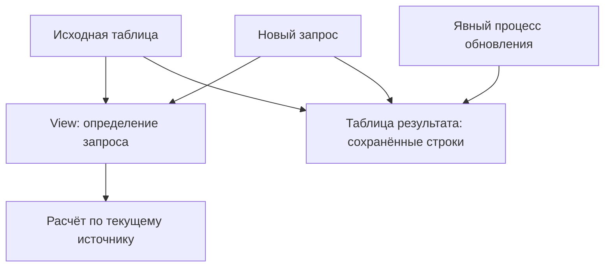
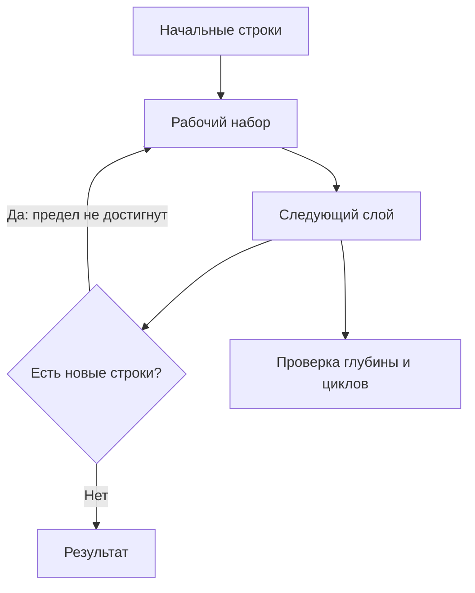
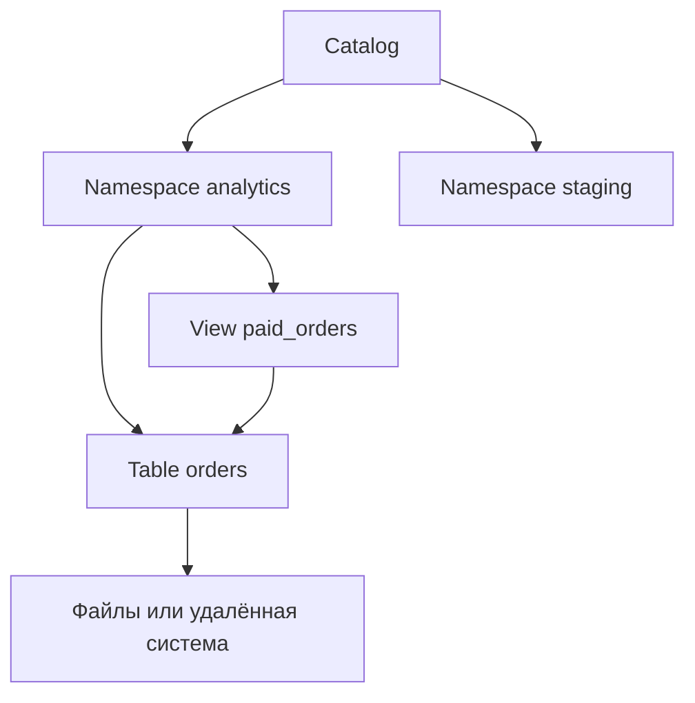
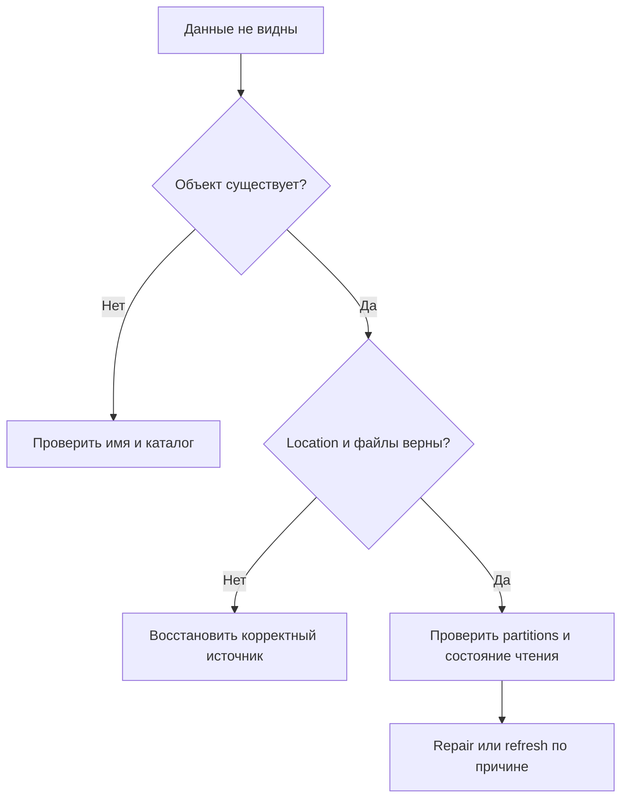
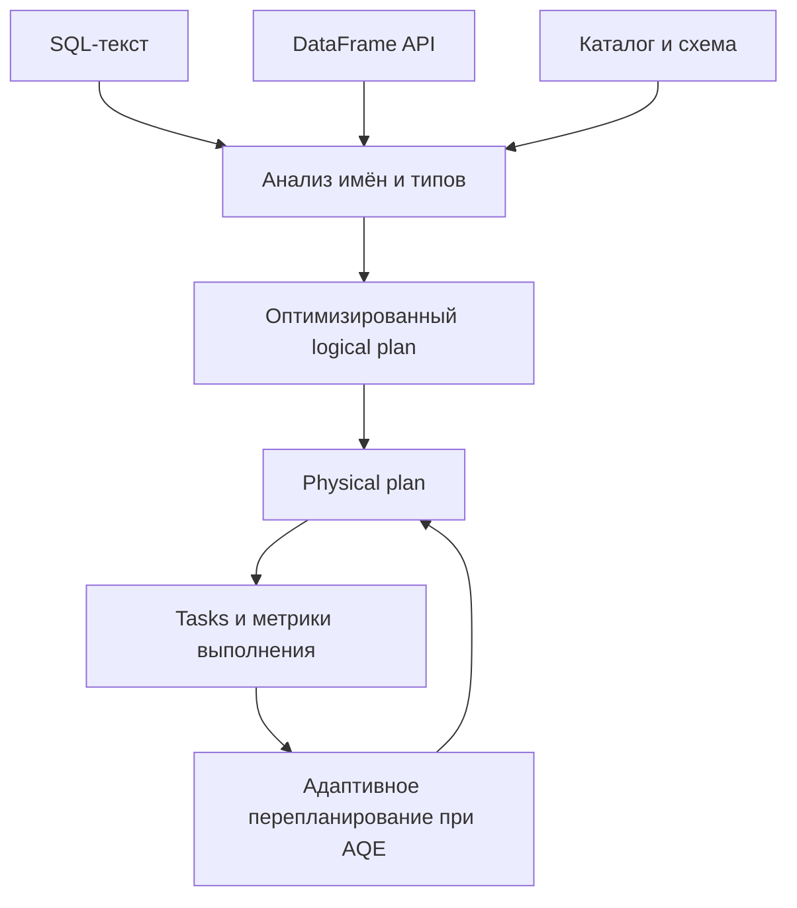

# 6. Spark SQL, таблицы и каталоги

В этом разделе разберём, как писать запросы на Spark SQL, давать данным имена, управлять таблицами и представлениями и понимать, где заканчиваются возможности движка и начинаются возможности каталога и источника данных.

Главный вопрос здесь — **что именно мы меняем**: текст запроса, объект каталога, схему, список партиций или физические данные. Успешный `CREATE TABLE` ещё не означает поддержку транзакций, а `DROP TABLE` может удалить и запись каталога, и файлы. Для каждой операции важно понимать её область действия.

**Файл:** `spark_sql_tables_and_catalogs.md`. Весь раздел находится на одной странице: 11 тем и 78 пунктов исходного оглавления.

**Окружение примеров:** Apache Spark / PySpark **4.2.0**, Python **3.12**, Java **17**, Spark Classic. Сессия работает в UTC с включённым ANSI-режимом. Основные примеры используют встроенный `spark_catalog`, каталог метаданных в памяти и Parquet; внешний Hive Metastore и дополнительные lakehouse-коннекторы не требуются.

**Проверка материала:** все 68 коротких исполняемых Python-примеров выполнены последовательно на Spark 4.2.0; итоговая практика прошла 50 проверок. Отдельный Hive-скрипт также успешно выполнен с собственным embedded Metastore. Шаблоны внешних V2-каталогов приведены с условиями применимости и не выдаются за выполненные примеры.

Новое SQL-выражение может поддерживаться парсером, но не поддерживаться выбранной таблицей. Поэтому примеры с внешними каталогами отмечены как шаблоны, а ограничения обычных Parquet-таблиц проверяются отдельно. В Spark 3.x многие конструкции из тем про SQL scripting, metric views и SQL Path недоступны.

**Как выполнять:** сначала запустите подготовительный блок, затем короткие Python-примеры по порядку. SQL внутри `spark.sql(...)` выполняется тем же движком, что и запрос из SQL-оболочки. Отдельные блоки `sql`, `xml` и `bash` служат для объяснения синтаксиса или настройки другого окружения. В конце страницы есть самостоятельная практика.

Учебные таблицы создаются в отдельном пространстве имён со случайным суффиксом. Пути относятся к временной локальной директории, а `collect()` используется только для нескольких проверяемых строк. На кластере нужен путь, доступный всем участникам приложения; временная директория драйвера для этого не подходит.

```python
from contextlib import contextmanager
from datetime import date
from decimal import Decimal
from pathlib import Path
from tempfile import TemporaryDirectory
from uuid import uuid4
from urllib.parse import unquote, urlparse

from pyspark.sql import SparkSession, functions as F
from pyspark.errors import AnalysisException, ParseException

sandbox = TemporaryDirectory(prefix="spark-sql-chapter-")
root = Path(sandbox.name).resolve()

spark = (
    SparkSession.builder
    .master("local[2]")
    .appName("SparkSQLTablesAndCatalogs")
    .config("spark.sql.warehouse.dir", (root / "warehouse").as_uri())
    .config("spark.sql.catalogImplementation", "in-memory")
    .config("spark.sql.session.timeZone", "UTC")
    .config("spark.sql.ansi.enabled", "true")
    .config("spark.sql.shuffle.partitions", "2")
    .getOrCreate()
)
spark.sparkContext.setLogLevel("ERROR")

db = "sql_chapter_" + uuid4().hex[:8]
# Имя сгенерировано нашим кодом и содержит только буквы, цифры и подчёркивание.
spark.sql(f"CREATE DATABASE {db}")

@contextmanager
def sql_conf(**settings):
    previous = {key: spark.conf.get(key, None) for key in settings}
    try:
        for key, value in settings.items():
            spark.conf.set(key, value)
        yield
    finally:
        for key, value in previous.items():
            if value is None:
                spark.conf.unset(key)
            else:
                spark.conf.set(key, value)

def table_path(name):
    rows = spark.sql("DESCRIBE EXTENDED IDENTIFIER(:name)", args={"name": name}).collect()
    location = next(row.data_type for row in rows if row.col_name == "Location")
    parsed = urlparse(location)
    assert parsed.scheme == "file", "В этом упражнении ожидается локальное хранилище"
    return Path(unquote(parsed.path))

orders = spark.createDataFrame([
    (101, 1, "web", date(2026, 1, 1), Decimal("10.00"), "paid"),
    (102, 1, "web", date(2026, 1, 2), Decimal("20.00"), "new"),
    (103, 2, "mobile", date(2026, 1, 1), Decimal("15.00"), "paid"),
    (104, 3, "mobile", date(2026, 1, 3), None, "new"),
    (105, None, "web", date(2026, 1, 3), Decimal("5.00"), "paid"),
], "order_id BIGINT, customer_id BIGINT, channel STRING, order_date DATE, amount DECIMAL(12,2), status STRING")
orders.createOrReplaceTempView("orders")
orders.write.format("parquet").saveAsTable(f"{db}.orders_base")
```

Начинайте в новом Python-процессе: `getOrCreate()` может вернуть уже существующую сессию, и тогда статические настройки каталога и warehouse не заменят её конфигурацию. Постоянные таблицы этого локального примера доступны другим Spark-сессиям того же приложения, но каталог `in-memory` не сохраняет их определения после завершения приложения.

**Содержание**

1. [Работа через SQL](#sql-queries)
2. [Представления и область видимости](#views)
3. [Metric views и семантическое описание показателей](#metric-views)
4. [Расширенные конструкции SQL](#advanced-sql)
5. [SQL scripting](#scripting)
6. [Каталоги и пространства имён](#catalogs)
7. [DDL и жизненный цикл таблицы](#ddl)
8. [Запись в таблицы и DML](#writes)
9. [Партиции таблиц и метаданные](#partition-metadata)
10. [Hive и Hive Metastore](#hive)
11. [Конфигурация SQL и семантика](#sql-configuration)

---

<a id="sql-queries"></a>

## Работа через SQL

### spark.sql и взаимное использование SQL и DataFrame API

`spark.sql()` принимает SQL-запрос и возвращает DataFrame. Его можно фильтровать, соединять, агрегировать и записывать обычным DataFrame API. В обратную сторону DataFrame можно зарегистрировать как временное представление и использовать в SQL.

```python
paid_sql = spark.sql("SELECT order_id, channel, amount FROM orders WHERE status = 'paid'")
paid_api = orders.where(F.col("status") == "paid").select("order_id", "channel", "amount")

assert set(paid_sql.collect()) == set(paid_api.collect())
assert paid_sql.where(F.col("amount") >= 10).count() == 2

paid_sql.createOrReplaceTempView("paid_orders")
assert spark.sql("SELECT SUM(amount) AS revenue FROM paid_orders").first().revenue == Decimal("30.00")
```

SQL и DataFrame API — способы построить структурированный запрос. Для эквивалентных операций Catalyst часто получает одинаковый или близкий план. Сам по себе переход от DataFrame API к SQL не гарантирует ускорения.

Для `SELECT` чтение основных данных обычно начинается при действии: `show`, `collect`, `count`, записи. При этом анализ схем и метаданных может происходить раньше. DDL/DML и SQL-скрипты обладают побочными эффектами: нельзя считать вызов `spark.sql("INSERT ...")` бездействующим лишь потому, что после него нет `show()`.

Выбирайте форму, которая делает преобразование понятнее: крупный аналитический запрос удобно выразить SQL, повторно используемую Python-функцию преобразования — DataFrame API. Схема и бизнес-смысл результата должны совпадать независимо от формы записи.

### SELECT, WHERE, GROUP BY, HAVING и ORDER BY

`WHERE` отбирает входные строки, а `HAVING` — уже сформированные группы. `ORDER BY` задаёт порядок результата целиком; без него порядок строк не является контрактом.

```python
revenue_by_channel = spark.sql("""
    SELECT channel,
           COUNT(*) AS order_count,
           SUM(amount) AS revenue
    FROM orders
    WHERE status = 'paid'
    GROUP BY channel
    HAVING SUM(amount) >= 10
    ORDER BY revenue DESC, channel ASC
""")

assert [(r.channel, r.order_count, r.revenue) for r in revenue_by_channel.collect()] == [
    ("mobile", 1, Decimal("15.00")),
    ("web", 2, Decimal("15.00")),
]
```

**Логика запроса:** источник и соединения → фильтр строк → группировка → фильтр групп → проекция → сортировка и ограничение результата. Физический план может выполнять допустимые преобразования в другом порядке, сохраняя смысл.

| Конструкция | На что действует | Частая ошибка |
| --- | --- | --- |
| `SELECT` | Выходные столбцы и выражения | `SELECT *` незаметно меняет контракт при новой колонке |
| `WHERE` | Отдельные входные строки | Использование агрегата вместо фильтра после группировки |
| `GROUP BY` | Ключи групп | Добавление измерения меняет гранулярность показателя |
| `HAVING` | Результаты группировки | Потеря групп с `NULL` или нулевой суммой без осознанного правила |
| `ORDER BY` | Весь результат | Сортировка без дополнительного ключа при равных значениях |

`COUNT(*)` считает строки, `COUNT(amount)` — только ненулевые значения. `SUM` игнорирует `NULL`; для группы, где все значения отсутствуют, результат может быть `NULL`. Решение о замене пропуска нулём должно следовать смыслу показателя.

Глобальная сортировка обычно требует перераспределения данных. Для отчёта используйте ограниченный результат с явным порядком, а для записи большого набора не сортируйте всё приложение без необходимости.

### CTE, вложенные запросы и set operations

CTE именует промежуточный запрос внутри одного statement. Он помогает выразить этапы расчёта, но не создаёт таблицу и не гарантирует материализацию или единственное вычисление.

```python
cte_result = spark.sql("""
    WITH eligible AS (
        SELECT customer_id, amount
        FROM orders
        WHERE status = 'paid' AND customer_id IS NOT NULL
    ), totals AS (
        SELECT customer_id, SUM(amount) AS total
        FROM eligible
        GROUP BY customer_id
    )
    SELECT customer_id, total
    FROM totals
    WHERE total >= 10
    ORDER BY customer_id
""")
assert [(r.customer_id, r.total) for r in cte_result.collect()] == [
    (1, Decimal("10.00")), (2, Decimal("15.00"))
]

all_rows = spark.sql("SELECT 1 AS x UNION ALL SELECT 1 AS x")
unique_rows = spark.sql("SELECT 1 AS x UNION SELECT 1 AS x")
assert all_rows.count() == 2
assert unique_rows.count() == 1
assert spark.sql("SELECT 1 AS x EXCEPT SELECT 2 AS x").first().x == 1
assert spark.sql("SELECT 1 AS x INTERSECT SELECT 1 AS x").first().x == 1
```

Для локальной изоляции этапа можно использовать вложенный запрос в `FROM`: `SELECT ... FROM (SELECT ...) AS prepared`. CTE удобнее, когда промежуточному результату нужно понятное имя или несколько ссылок.

`UNION` удаляет дубликаты, `UNION ALL` сохраняет их. `EXCEPT` вычисляет разность, `INTERSECT` — пересечение; варианты `ALL` учитывают кратность строк. Сопоставление колонок в SQL set operations идёт **по позиции**. Одинаковые имена не исправляют ошибочный порядок полей.

Типы соответствующих позиций должны быть совместимыми. Spark может вывести общий тип, поэтому после объединения проверяйте схему. Для стабильного контракта задавайте одинаковую проекцию и явные casts с обеих сторон.

Если CTE многократно читает дорогой источник, посмотрите план. Для контролируемого повторного использования понадобятся cache или отдельная опубликованная таблица, а не только имя CTE.

### Коррелированные подзапросы и ограничения их поддержки

Коррелированный подзапрос ссылается на столбцы внешнего запроса. Типичные случаи — проверка существования связанной записи и расчёт скалярного значения для внешнего ключа.

```python
existing_customers = spark.sql("""
    SELECT DISTINCT o.customer_id
    FROM orders AS o
    WHERE o.customer_id IS NOT NULL
      AND EXISTS (
          SELECT 1 FROM paid_orders AS p
          WHERE p.order_id = o.order_id
      )
    ORDER BY o.customer_id
""")
assert [r.customer_id for r in existing_customers.collect()] == [1, 2]

customer_totals = spark.sql("""
    SELECT c.customer_id,
           (SELECT SUM(o.amount)
            FROM orders AS o
            WHERE o.customer_id = c.customer_id) AS total
    FROM (SELECT DISTINCT customer_id FROM orders WHERE customer_id IS NOT NULL) AS c
    ORDER BY c.customer_id
""")
assert [(r.customer_id, r.total) for r in customer_totals.collect()] == [
    (1, Decimal("30.00")), (2, Decimal("15.00")), (3, None)
]
```

У скалярного подзапроса результат должен содержать не более одной строки. Несколько совпадений без агрегации или другого доказательства уникальности могут вызвать ошибку. `SUM` в примере формирует одно значение на внешний ключ; это не способ произвольно выбрать одну из нескольких записей.

Spark поддерживает определённые формы корреляции, а не произвольный SQL, принятый другой СУБД. В документации 4.2 ограничивается глубина поддерживаемой корреляции; ограничения также касаются положения внешних ссылок и отдельных сочетаний операторов. Проверяйте конкретный запрос через `EXPLAIN` и выполнение на граничных данных.

В частности, reference 4.2 указывает поддержку корреляции одним уровнем. Не рассчитывайте, что несколько вложенных внешних ссылок будут приняты только потому, что такой запрос работает в PostgreSQL; SQL functions с параметрическими ссылками тоже имеют ограничения.

Catalyst может преобразовать `EXISTS` в semi join, а агрегированный скалярный подзапрос — в join с агрегатом. Поэтому представление «для каждой строки выполняется отдельный сетевой запрос» не описывает универсально физическую реализацию Spark.

Для альтернативной записи через join сначала обеспечьте требуемую кратность правой стороны. Простое соединение с несколькими подходящими строками может размножить результат. Отдельно проверьте `NULL`: `NOT IN` с пропуском в подзапросе имеет трёхзначную логику и часто отличается от ожидаемого anti join.

### SQL-выражения, функции и оконные конструкции

В SQL доступны встроенные строковые, числовые, временные, коллекционные и агрегатные функции. Оконная функция вычисляет значение относительно группы строк и сохраняет детализацию результата.

```python
window_sql = spark.sql("""
    SELECT order_id, channel,
           COALESCE(amount, CAST(0 AS DECIMAL(12,2))) AS amount_filled,
           CASE WHEN status = 'paid' THEN 'confirmed' ELSE 'pending' END AS state,
           ROW_NUMBER() OVER (
               PARTITION BY channel ORDER BY order_date, order_id
           ) AS position,
           SUM(amount) OVER (
               PARTITION BY channel ORDER BY order_date, order_id
               ROWS BETWEEN UNBOUNDED PRECEDING AND CURRENT ROW
           ) AS running_amount
    FROM orders
""")
assert window_sql.where("order_id = 105").first().running_amount == Decimal("35.00")
assert window_sql.where("order_id = 104").first().amount_filled == Decimal("0.00")
```

Определяйте три части окна: `PARTITION BY` — независимые группы, `ORDER BY` — порядок внутри группы, frame — строки, участвующие в расчёте. Времени события может быть недостаточно для полного порядка; здесь дополнительный ключ — `order_id`.

`ROWS` задаёт границы по позициям строк, `RANGE` — по значениям порядка и группам равных значений. Для накопительного показателя выбирайте frame явно. SQL-функции вычисляют выражения над данными, а Python-цикл вокруг SQL управляет запуском запросов — это разные уровни работы.

При делении используйте согласованные числовые типы и правило для нулевого знаменателя, например `numerator / NULLIF(denominator, 0)`. Замена ошибки на `NULL` должна сопровождаться проверкой качества, иначе показатель станет незаметно неполным.

### Параметризованные запросы и безопасная передача значений

Передавайте значения отдельно от SQL-текста через `args`. Это сохраняет их типы и не позволяет кавычкам или SQL-операторам внутри строки изменить структуру запроса.

```python
filtered = spark.sql("""
    SELECT order_id FROM orders
    WHERE status = :status AND amount >= :minimum
    ORDER BY order_id
""", args={"status": "paid", "minimum": Decimal("10.00")})
assert [r.order_id for r in filtered.collect()] == [101, 103]

user_value = "paid' OR TRUE --"
assert spark.sql(
    "SELECT COUNT(*) AS n FROM orders WHERE status = :status",
    args={"status": user_value},
).first().n == 0

assert spark.sql(
    "SELECT order_id FROM orders WHERE channel = ? AND amount > ? ORDER BY order_id",
    args=["web", Decimal("15.00")],
).first().order_id == 102
```

Именованные markers `:name` появились в API Spark 3.4, позиционные `?` — в Spark 3.5. Не смешивайте оба вида в одном statement. Значение — это строка, число, дата и т. п.; имя таблицы или столбца требует `IDENTIFIER`, который разберём далее.

Не собирайте фильтр через `f"... WHERE status = '{user_value}'"`. Экранирование вручную легко ломается на кавычках, специальных символах и различиях SQL-режимов. Параметры решают задачу передачи значений, но не заменяют контроль того, какие объекты пользователь вправе читать или менять.

У `spark.sql()` есть также Python-подстановка через `kwargs`. Не путайте её с SQL markers: для обычных значений и динамических имён в этом разделе используем явные `args` и `IDENTIFIER`, чтобы форма запроса была видна непосредственно в коде.

### SQL-диалект Spark и отличие от PostgreSQL, Hive и других систем

Знание SQL переносится между системами, но синтаксис и гарантии конкретных операций нужно проверять. Spark выполняет запрос распределённым движком; установленный PostgreSQL-коннектор не превращает любую таблицу Spark в таблицу PostgreSQL.

| Область | Что проверить при переносе |
| --- | --- |
| Имена | Backticks, регистр, многочастные имена, правила каталога |
| Типы | `STRING`, `DECIMAL`, timestamps, интервалы, массивы, structs |
| Функции | Названия, аргументы, индексация, обработка `NULL` |
| Запись | Позиционное сопоставление, политика casts, overwrite партиций |
| DML | Возможности provider для `UPDATE`, `DELETE`, `MERGE` |
| Транзакции | Область commit, изоляция и поддержка каталога |
| Процедурный SQL | Версия scripting, синтаксис handlers, доступность курсоров |
| Сортировка | Глобальный порядок и цена shuffle |

В примерах строковые литералы заключены в одинарные кавычки, идентификаторы при необходимости — в backticks. Поведение двойных кавычек зависит от ANSI-настроек. `STRING` и `BOOLEAN` не следует механически заменять типами другого движка без проверки схем.

```python
literal_and_identifier = spark.sql("SELECT 'Spark SQL' AS `display name`, DATE '2026-01-01' AS day")
assert literal_and_identifier.first()["display name"] == "Spark SQL"
assert literal_and_identifier.first().day == date(2026, 1, 1)
```

SQL-запрос к JDBC-источнику может частично исполняться в удалённой базе через pushdown. При этом написанный для Spark запрос анализируется по правилам Spark, а переданный явно текст удалённого JDBC-запроса — по правилам удалённой СУБД. Эти два уровня нельзя смешивать.

**Практика по теме:** перепишите один запрос из DataFrame API в SQL, проверьте равенство результата, затем добавьте повторный заказ, `NULL` и значение с кавычкой. Объясните, какие проверки защищают бизнес-смысл, а какие — способ передачи параметров.

**Документация:** [SQL reference](https://spark.apache.org/docs/4.2.0/sql-ref.html), [SELECT](https://spark.apache.org/docs/4.2.0/sql-ref-syntax-qry-select.html), [CTE](https://spark.apache.org/docs/4.2.0/sql-ref-syntax-qry-select-cte.html), [set operators](https://spark.apache.org/docs/4.2.0/sql-ref-syntax-qry-select-setops.html), [parameter markers](https://spark.apache.org/docs/4.2.0/sql-ref-parameter-markers.html), [SparkSession.sql](https://spark.apache.org/docs/4.2.0/api/python/reference/pyspark.sql/api/pyspark.sql.SparkSession.sql.html).

---

<a id="views"></a>

## Представления и область видимости

### Локальные временные представления

Локальное временное представление даёт имя DataFrame или SQL-запросу внутри SparkSession. Оно не записывает строки в файлы и не является самостоятельным постоянным объектом Metastore.

```python
orders.where("status = 'paid'").createOrReplaceTempView("local_paid")
assert spark.table("local_paid").count() == 3
assert spark.catalog.getTable("local_paid").isTemporary

other_session = spark.newSession()
assert not other_session.catalog.tableExists("local_paid")
assert spark.catalog.tableExists("local_paid")
```

`createTempView` сообщает об ошибке, если имя уже занято; `createOrReplaceTempView` меняет определение. Чтобы избавиться от локального имени, используйте `spark.catalog.dropTempView("local_paid")` или `DROP VIEW`.

Локальное имя может затенять одноимённую постоянную таблицу при неквалифицированном обращении. В производственном запросе к постоянному объекту задавайте каталог и namespace явно. В Spark 4.2 появились также квалификаторы `session` и `system.session`; они помогают явно обозначить сессионный объект.

### Глобальные временные представления и global_temp

Глобальное временное представление доступно Spark-сессиям одного приложения. По умолчанию оно находится в служебном namespace `global_temp`, поэтому его читают через квалифицированное имя.

```python
orders.createOrReplaceGlobalTempView("shared_orders")
assert other_session.table("global_temp.shared_orders").count() == 5
assert spark.table("global_temp.shared_orders").count() == 5
assert spark.catalog.getTable("global_temp.shared_orders").isTemporary
```

«Глобальное» означает область приложения, а не всего кластера или всех пользователей платформы. Другое приложение с отдельным SparkContext не получает это представление автоматически. После завершения приложения определение исчезает.

Namespace задаётся конфигурацией `spark.sql.globalTempDatabase`; в примерах используется стандартное `global_temp`. Для удаления есть `dropGlobalTempView`. Не создавайте обычную базу с именем служебного namespace.

### Постоянные представления

Постоянное представление хранит определение запроса в каталоге. Его можно читать по имени из другой сессии и, при сохраняемом каталоге, из следующего приложения.

```python
spark.sql(f"""
    CREATE VIEW {db}.paid_view
    COMMENT 'Paid orders, one row per order'
    AS SELECT order_id, channel, order_date, amount
       FROM {db}.orders_base
       WHERE status = 'paid'
""")
assert spark.table(f"{db}.paid_view").count() == 3
assert other_session.table(f"{db}.paid_view").count() == 3
assert not spark.catalog.getTable(f"{db}.paid_view").isTemporary
```

Здесь источник — постоянная таблица, а не `orders` из временной сессии. Постоянное представление не должно зависеть от временных views, временных функций или сессионных переменных: при следующем обращении эти объекты могут отсутствовать.

Само слово «постоянное» описывает вид объекта. В локальном `in-memory` каталоге его метаданные всё равно потеряются после завершения приложения. Для долговечности нужен Hive Metastore или другой сохраняемый каталог.

Разрешения на чтение view и исходных таблиц, а также семантика прав владельца зависят от каталога и платформы. Наличие view само по себе не является универсальной политикой безопасности.

### Время жизни представления и сессии

| Объект | Область видимости | Когда исчезает |
| --- | --- | --- |
| Локальное temporary view | Одна SparkSession | Удаление или окончание сессии |
| Global temporary view | Сессии одного приложения | Удаление или окончание приложения |
| Постоянное view | Каталог и его права доступа | `DROP VIEW` или потеря несохраняемых метаданных |
| Cached result | Менеджер хранения приложения | Eviction, `UNCACHE`, остановка приложения |
| Материализованная таблица | Каталог и хранилище | Согласно операциям удаления и политике хранения |

`spark.newSession()` создаёт отдельную SQL-сессию с собственными временными views и SQLConf, но общим SparkContext и общей инфраструктурой постоянных таблиц. В отличие от него, повторный вызов `getOrCreate()` может вернуть ту же сессию.

```python
other_session.conf.set("spark.sql.shuffle.partitions", "3")
assert spark.conf.get("spark.sql.shuffle.partitions") == "2"
assert other_session.conf.get("spark.sql.shuffle.partitions") == "3"
assert not other_session.catalog.tableExists("orders")
assert other_session.catalog.tableExists(f"{db}.orders_base")
```

Не вызывайте `other_session.stop()` ради удаления пары временных views: остановка сессии останавливает общий SparkContext и может завершить работу остальных сессий этого приложения. Удаляйте нужные определения явно, а приложение останавливайте в конце.

### Представление, таблица и материализованный результат

Представление хранит запрос. Таблица представляет данные через каталог и provider. Материализованный результат сохраняет рассчитанные строки и имеет отдельный жизненный цикл обновления.

```python
snapshot_name = f"{db}.paid_snapshot"
spark.table(f"{db}.paid_view").write.format("parquet").saveAsTable(snapshot_name)

spark.sql(f"""
    INSERT INTO {db}.orders_base VALUES
    (106, 4, 'web', DATE '2026-01-04', 7.00, 'paid')
""")
assert spark.table(f"{db}.paid_view").count() == 4
assert spark.table(snapshot_name).count() == 3
```

View видит новый заказ, поскольку заново обращается к источнику. Snapshot содержит прежний расчёт, пока его явно не обновят. Временное `orders` при этом всё ещё содержит первоначальные пять строк: запись в отдельную таблицу не изменяет Python-объект с исходным планом.

`CACHE TABLE` и `df.cache()` ускоряют повторные вычисления, но не создают долговечную витрину. Кэш может быть вытеснен или пересчитан. Для сохранённого отчёта нужны дата расчёта, источник, контракт схемы и понятный способ обновления.

Поддержка специального DDL `CREATE MATERIALIZED VIEW`, автоматического refresh и инкрементального обновления зависит от платформы. Обычное `CREATE VIEW` Apache Spark не обещает эти функции.



### Зависимости представлений и изменения исходной схемы

Представление зависит от имён, типов и выражений источника. Удалённая таблица, переименованный столбец или несовместимый тип могут сделать сохранённое определение неработоспособным.

```python
spark.sql(f"CREATE TABLE {db}.schema_source (id INT) USING parquet")
spark.sql(f"CREATE VIEW {db}.stable_projection AS SELECT id FROM {db}.schema_source")
spark.sql(f"ALTER TABLE {db}.schema_source ADD COLUMNS (note STRING)")
assert spark.table(f"{db}.stable_projection").columns == ["id"]
```

Явный список столбцов задаёт понятный интерфейс view. `SELECT *` переносит часть решения о контракте на правила эволюции схемы. Новая колонка источника может быть нежелательной для downstream-системы, даже если Spark способен её принять.

Изменение схемы не исправляется универсально через `REFRESH TABLE`: refresh инвалидирует кэш и метаданные чтения, а не переписывает SQL-определение. Для изменения логики используйте `CREATE OR REPLACE VIEW` или поддерживаемый `ALTER VIEW`.

Во время миграции проверьте все зависимые views в отдельном окружении: анализ запроса, схему результата, casts и бизнес-показатели. Повторное создание с тем же именем может изменить права или свойства в конкретном каталоге, поэтому проверьте и метаданные.

### Политики представлений WITH SCHEMA BINDING, COMPENSATION, TYPE EVOLUTION и EVOLUTION

В Spark 4.0+ у постоянных views есть политики реакции на изменение схемы. Они не поддерживаются для temporary views. В Spark 4.2 стандартный режим — `COMPENSATION`.

| Политика | Контракт | Что проверить |
| --- | --- | --- |
| `BINDING` | Сохранение объявленной схемы с допустимыми безопасными upcasts | Совместимость типов источника с прежним результатом |
| `COMPENSATION` | Сохранение схемы с casts к прежним типам | Возможные ошибки cast во время выполнения |
| `TYPE EVOLUTION` | Адаптация типов результата | Изменение типов для downstream-потребителя |
| `EVOLUTION` | Адаптация типов, а без явного списка колонок — также состава результата | Новые и удалённые поля при `SELECT *` |

```python
spark.sql(f"CREATE TABLE {db}.evolution_source (id INT) USING parquet")
spark.sql(f"CREATE VIEW {db}.bound_view WITH SCHEMA BINDING AS SELECT * FROM {db}.evolution_source")
spark.sql(f"CREATE VIEW {db}.evolving_view WITH SCHEMA EVOLUTION AS SELECT * FROM {db}.evolution_source")
spark.sql(f"ALTER TABLE {db}.evolution_source ADD COLUMNS (label STRING)")

assert spark.table(f"{db}.bound_view").columns == ["id"]
assert spark.table(f"{db}.evolving_view").columns == ["id", "label"]
```

Если в определении view перечислены выходные имена столбцов, `EVOLUTION` действует как `TYPE EVOLUTION`: список имён ограничивает форму результата. Политика не превращает изменение любой таблицы в безопасную миграцию. Удаление поля, на которое явно ссылается выражение, остаётся проблемой.

Проверяйте схему реально проанализированного запроса `spark.table(view).schema`, а не только старую запись `DESCRIBE`: адаптация view может происходить при его разрешении. Для типа проверьте также значения, которые не проходят компенсирующий cast.

**Практика по теме:** создайте view и snapshot, добавьте строку источника, затем новую колонку. Сравните число строк и схемы. Объясните, какая из четырёх политик подходит стабильному API отчёта, а какая — исследовательской странице.

**Документация:** [CREATE VIEW](https://spark.apache.org/docs/4.2.0/sql-ref-syntax-ddl-create-view.html), [ALTER VIEW](https://spark.apache.org/docs/4.2.0/sql-ref-syntax-ddl-alter-view.html), [newSession](https://spark.apache.org/docs/4.2.0/api/python/reference/pyspark.sql/api/pyspark.sql.SparkSession.newSession.html).

---

<a id="metric-views"></a>

## Metric views и семантическое описание показателей

### CREATE VIEW ... WITH METRICS: декларативная семантическая модель аналитических показателей; Spark 4.2+

Metric view описывает измерения и меры: например, канал продаж, число оплаченных заказов и выручку. Потребитель выбирает измерения группировки, а определение меры задаёт согласованную формулу агрегирования.

Это полезно, когда несколько отчётов должны одинаково понимать «выручку»: только оплаченные заказы, определённая валюта, одинаковое правило для возвратов и пропусков. Обычное view фиксирует готовую форму запроса; metric view хранит описание показателей, которые вычисляются на выбранной гранулярности.

```python
metric_name = f"{db}.sales_metrics"
spark.sql(f"""
    CREATE VIEW {metric_name}
    WITH METRICS LANGUAGE YAML AS $$
version: 0.1
source: {db}.orders_base
filter: status = 'paid'
dimensions:
  - name: channel
    expr: channel
measures:
  - name: revenue
    expr: SUM(amount)
  - name: order_count
    expr: COUNT(*)
$$
""")

metric_result = spark.sql(f"""
    SELECT channel,
           MEASURE(revenue) AS revenue,
           MEASURE(order_count) AS order_count
    FROM {metric_name}
    GROUP BY channel
    ORDER BY channel
""")
assert [(r.channel, r.revenue, r.order_count) for r in metric_result.collect()] == [
    ("mobile", Decimal("15.00"), 1),
    ("web", Decimal("22.00"), 3),
]
```

В `orders_base` уже добавлен заказ 106, поэтому выручка `web` равна 22. Формула `MEASURE(revenue)` обращается к агрегатной мере; её нельзя понимать как сумму заранее рассчитанных значений столбца `revenue`.

**Версия:** metric views добавлены в Apache Spark 4.2. Наличие похожей функции у отдельной платформы не доказывает, что её YAML-схема и возможности совпадают с Apache Spark. Приведённый вариант `version: 0.1` проверен на указанном окружении.

Metric view не обещает материализацию, freshness SLA или корректность любой бизнес-формулы. Эти свойства нужно проектировать отдельно. Источник должен иметь определённую гранулярность: если join размножил заказы, семантическая модель сама не восстановит правильную выручку.

### YAML-описание модели аналитических показателей

YAML задаёт источник, фильтр исходных строк, измерения и агрегатные меры. Отступы являются частью синтаксиса. Строка `expr` содержит выражение Spark SQL, а не Python-код.

```yaml
version: 0.1
source: analytics.orders
filter: status = 'paid'
dimensions:
  - name: channel
    expr: channel
  - name: sales_day
    expr: order_date
measures:
  - name: revenue
    expr: SUM(amount)
  - name: order_count
    expr: COUNT(*)
  - name: average_order_value
    expr: SUM(amount) / NULLIF(COUNT(*), 0)
```

Это описание модели для существующей таблицы `analytics.orders`; в нашем локальном примере фактический источник указан через `db`. Не копируйте имя из шаблона, если такого объекта нет в каталоге.

| Элемент | Смысл | Ошибка проектирования |
| --- | --- | --- |
| `source` | Набор строк для вычисления | Неявная гранулярность после нескольких join |
| `filter` | Общий отбор строк | Разные правила оплаченного заказа в разных отчётах |
| `dimensions` | Доступные признаки группировки | Смешение измерения и агрегата |
| `measures` | Формулы агрегации | Суммирование коэффициентов или средних без весов |
| `version` | Версия описания | Использование YAML из другой платформы без проверки |

Средний чек правильнее пересчитать как отношение общей выручки к общему числу заказов. Среднее из средних по каналам даёт тот же ответ только при специальных условиях, например одинаковых весах.

Перед утверждением модели зафиксируйте единицы измерения, валюту, временную зону, правило признания выручки и обработку `NULL`. YAML выражает формулу, а эти условия задают её смысл. Для дополнительных возможностей модели проверяйте реализацию своей версии: не переносите автоматически поддержку сложных joins, вложенных мер или materialization из платформенной документации.

### Проверка определений показателей и корректности их использования в запросах

Проверяйте metric view относительно независимого базового запроса и нескольких уровней группировки. Создание определения не доказывает, что все запросы к нему корректны.

```python
metric_total = spark.sql(f"""
    SELECT MEASURE(revenue) AS revenue, MEASURE(order_count) AS n
    FROM {metric_name}
""").first()
base_total = spark.sql(f"""
    SELECT SUM(amount) AS revenue, COUNT(*) AS n
    FROM {db}.orders_base WHERE status = 'paid'
""").first()

assert metric_total == base_total
assert metric_total.revenue == Decimal("37.00")
assert metric_total.n == 4
```

**Минимальные проверки модели:**

- общий итог совпадает с независимо написанным SQL;
- сумма групп равна общему итогу для аддитивной меры;
- фильтр модели исключает нужные статусы;
- повторные ключи источника обнаруживаются до расчёта;
- `NULL`, пустой источник и нулевой знаменатель имеют определённое поведение;
- изменение YAML проходит те же проверки, что и изменение обычного кода.

Измерение можно группировать и фильтровать как измерение; меру вызывают в поддерживаемом агрегатном контексте через `MEASURE`. Запрос вроде `SELECT revenue FROM sales_metrics` не следует считать правильным способом чтения меры. На проверенной версии такая форма может завершаться ошибкой планирования; это ещё одна причина проверять реальное выполнение, а не только разбор текста.

Не все меры аддитивны: число уникальных клиентов, медиана, процентили и коэффициенты нельзя обычно складывать между пересекающимися группами. При объединении результатов запросов отличайте показатель от достаточных статистик, из которых его можно корректно пересчитать.

**Практика по теме:** добавьте измерение дня и меру среднего чека, затем сравните общий средний чек с невзвешенным средним по каналам. Найдите набор данных, на котором значения различаются.

**Источники:** [Spark 4.2 release notes](https://spark.apache.org/releases/spark-release-4-2-0.html), [исходный код metric views Apache Spark](https://github.com/apache/spark/tree/v4.2.0/sql/catalyst/src/main/scala/org/apache/spark/sql/metricview). Синтаксис и результаты основного примера дополнительно проверены локальным выполнением.

---

<a id="advanced-sql"></a>

## Расширенные конструкции SQL

### Table-valued functions и генераторы строк

Табличная функция возвращает набор строк. Например, `range` создаёт последовательность, а `explode` разворачивает массив. Генератор меняет количество строк, поэтому после него нужно заново определить гранулярность.

```python
assert [r.id for r in spark.sql("SELECT * FROM range(1, 4) ORDER BY id").collect()] == [1, 2, 3]

expanded = spark.sql("""
    SELECT t.customer_id, e.tag
    FROM VALUES (1, array('vip', 'web')), (2, array('mobile')) AS t(customer_id, tags),
         LATERAL explode(t.tags) AS e(tag)
    ORDER BY t.customer_id, e.tag
""")
assert [(r.customer_id, r.tag) for r in expanded.collect()] == [
    (1, "vip"), (1, "web"), (2, "mobile")
]
```

`explode` для массива выдаёт строку на элемент; для map — ключ и значение. `posexplode` добавляет позицию. Варианты `outer` сохраняют исходную строку при пустой или отсутствующей коллекции с соответствующими пропусками в результате.

Для большой строки с длинным массивом разворачивание может создать много строк и перекос. После последовательного разворачивания двух независимых массивов получается комбинация элементов, а не автоматическое попарное сопоставление. Если позиции связаны, сначала задайте это отношение, например через `arrays_zip`.

Аргументы некоторых TVF должны быть константными выражениями. Так, параметр SQL table function нельзя автоматически использовать как аргумент `range`, требующий foldable-значение. Проверяйте требования конкретной функции.

### LATERAL VIEW, lateral joins и коррелированные табличные выражения

`LATERAL VIEW` — привычная Spark/Hive-форма использования генератора рядом с исходной строкой. `LATERAL`-подзапрос может обращаться к колонкам источников, расположенных слева от него в `FROM`.

```python
lateral_view = spark.sql("""
    SELECT t.id, item
    FROM VALUES (1, array('a', 'b')), (2, array()) AS t(id, items)
    LATERAL VIEW OUTER explode(items) expanded AS item
    ORDER BY id, item
""")
assert [(r.id, r.item) for r in lateral_view.collect()] == [(1, "a"), (1, "b"), (2, None)]

lateral_query = spark.sql("""
    SELECT t.id, calc.doubled
    FROM VALUES (1), (2) AS t(id),
         LATERAL (SELECT t.id * 2 AS doubled) AS calc
    ORDER BY t.id
""")
assert [(r.id, r.doubled) for r in lateral_query.collect()] == [(1, 2), (2, 4)]
```

Без `LATERAL` обычный подзапрос в `FROM` не получает автоматически доступ к колонкам соседнего источника. Внешние ссылки нужно квалифицировать алиасом, чтобы локальное совпадающее имя не изменило смысл выражения.

Внешнее разворачивание помогает сохранить строку клиента без элементов, но фильтр `WHERE item = 'a'` после него снова уберёт строку с `NULL`. Обдумывайте, где должен применяться фильтр: к входному массиву, к строкам генератора или ко всему результату.

Lateral-конструкция не гарантирует определённый алгоритм выполнения. Смотрите план и проверяйте ограничения корреляции, недетерминированных выражений и cardinality в своей версии.

### IDENTIFIER clause и безопасные динамические имена объектов

Имя таблицы нельзя заменить строковым значением в `FROM :name`. `IDENTIFIER` преобразует строку в SQL-идентификатор, сохраняя отделение имени от текста запроса.

```python
read_table = f"{db}.orders_base"
selected_ids = spark.sql("""
    SELECT IDENTIFIER(:column_name) AS id
    FROM IDENTIFIER(:table_name)
    WHERE status = :status
    ORDER BY id
""", args={
    "column_name": "order_id",
    "table_name": read_table,
    "status": "paid",
})
assert [r.id for r in selected_ids.collect()] == [101, 103, 105, 106]
```

Целое квалифицированное имя передаётся внутрь `IDENTIFIER`. Не пишите `mydb.IDENTIFIER(:table)` или `IDENTIFIER(:db).table` для старых форм, которые не допускают такое разбиение. В Spark 4.2 возможности string-literal формы расширены; для переносимого примера достаточно одного полного имени.

Backticks отделяют части идентификатора, содержащие специальные символы: строка `` `catalog`.`schema`.`table` `` обозначает три части, а `` `name.with.dots` `` — одно имя. Если допускаете пользовательские имена, проверяйте их структуру и разрешённый namespace.

`IDENTIFIER` защищает структуру SQL, но не ограничивает доступ к данным. Для приложения с пользовательским выбором таблицы нужно сопоставление разрешённых логических имён с утверждёнными объектами, а не произвольное чтение любого имени, принятого каталогом.

### Parameter markers и отделение значений от текста запроса

Marker обозначает значение, `IDENTIFIER` — имя, SQL-текст — структуру операции. Эти три вещи лучше хранить отдельно.

```python
parameter_types = spark.sql("""
    SELECT :day AS day, :minimum AS minimum,
           :label AS label, :enabled AS enabled
""", args={
    "day": date(2026, 1, 1),
    "minimum": Decimal("12.50"),
    "label": "O'Reilly",
    "enabled": True,
}).first()
assert parameter_types.day == date(2026, 1, 1)
assert parameter_types.minimum == Decimal("12.50")
assert parameter_types.label == "O'Reilly"
assert parameter_types.enabled is True
```

Параметры не предназначены для передачи произвольного SQL-фрагмента, например `"amount > 10 OR status = 'paid'"`. Такая строка остаётся значением. Чтобы пользователь выбирал условие или порядок, сформируйте структуру запроса из проверенных вариантов программы и передайте только значения через markers.

Повторное употребление `:minimum` использует одно именованное значение. Позиционные markers связываются по порядку появления. Отсутствующий параметр вызывает `UNBOUND_SQL_PARAMETER`; это полезный сигнал ошибки вызова, который не нужно скрывать под пустым результатом.

Проверьте типы на границе API, особенно `Decimal`, даты, timestamps и массивы. Не превращайте все значения в строки заранее: это переносит ответственность за парсинг на SQL и меняет семантику ошибок.

### Pipe syntax и последовательное описание преобразований

Pipe syntax позволяет читать SQL в порядке преобразований: источник → фильтр → агрегирование → отбор групп → сортировка. В Apache Spark синтаксис появился в ветке 4.0.

```python
pipe_result = spark.sql("""
    FROM orders
    |> WHERE status = 'paid'
    |> AGGREGATE SUM(amount) AS revenue, COUNT(*) AS n GROUP BY channel
    |> WHERE revenue >= 10
    |> ORDER BY channel
""")
ordinary_result = spark.sql("""
    SELECT channel, SUM(amount) AS revenue, COUNT(*) AS n
    FROM orders WHERE status = 'paid'
    GROUP BY channel HAVING SUM(amount) >= 10
    ORDER BY channel
""")
assert pipe_result.collect() == ordinary_result.collect()
```

`|> AGGREGATE` вводит агрегирование, а следующий `|> WHERE` фильтрует результат предыдущего этапа. Это делает видимой смену уровня детализации. `|> SELECT` проецирует колонки; `EXTEND`, `DROP` и другие операторы имеют собственную семантику, которую нужно проверять по документации версии.

Каждый оператор опирается на колонки, доступные после предыдущего. Если колонка удалена или переименована, последующий этап не получает её автоматически из первоначальной таблицы.

Pipe syntax не является конвейером последовательной обработки строк на драйвере и не запрещает Catalyst менять физический план. Сравните `EXPLAIN FORMATTED` обоих вариантов и выбирайте форму по читаемости команды и поддержке окружения.

### Рекурсивные CTE: начальная и рекурсивная части, завершение рекурсии, нативная поддержка с Spark 4.1, ограничения версии и различия Apache Spark и платформенных расширений

Рекурсивный CTE описывает итеративное расширение результата: начальные строки и следующий слой, построенный из предыдущего. В Apache Spark нативная поддержка доступна с 4.1; в ранних версиях наличие похожего синтаксиса у платформы не означало его наличия в Spark.

```python
walk = spark.sql("""
    WITH RECURSIVE walk(id, path) MAX RECURSION LEVEL 10 AS (
        SELECT 1, array(1)
        UNION ALL
        SELECT edges.child, concat(walk.path, array(edges.child))
        FROM walk
        JOIN VALUES (1, 2), (2, 3), (3, 1) AS edges(parent, child)
          ON walk.id = edges.parent
        WHERE NOT array_contains(walk.path, edges.child)
    )
    SELECT id, path FROM walk ORDER BY id
""")
assert [(r.id, r.path) for r in walk.collect()] == [
    (1, [1]), (2, [1, 2]), (3, [1, 2, 3])
]
```

Здесь начальная строка — узел 1. Рекурсивная часть присоединяет следующие узлы. Проверка `array_contains` препятствует возвращению к уже посещённому узлу на **текущем пути**. Это не глобальная дедупликация всех путей: в графе с несколькими маршрутами один узел может появиться несколько раз с разными путями.



Ограничивайте глубину, объём результата и количество путей. Лимит — предохранитель, а условие завершения — часть алгоритма. Для бесконечной цепочки достижение `MAX RECURSION LEVEL` приводит к ошибке; это не успешный расчёт полного результата.

В проверенной версии рекурсивные определения используют `UNION ALL`; произвольный `UNION`, взаимная рекурсия и ссылки на рекурсивное отношение в некоторых агрегатах, окнах, сортировках и outer joins ограничены. Legacy-режимы CTE также могут мешать выполнению.

Для глубокого графового анализа оцените стоимость повторных итераций и рост результата. Иногда удобнее явный итеративный алгоритм с checkpoint или специализированная графовая библиотека. Но даже тогда нужно отдельно определить обработку циклов и гранулярность «одна строка — узел» либо «одна строка — путь».

### SQL-функции и SQL table functions при поддержке версии

SQL scalar function возвращает одно значение; SQL table function — отношение. Их тело написано SQL и отличается от Python UDF, которая исполняет Python-код в worker-процессах.

```python
spark.sql("""
    CREATE TEMPORARY FUNCTION add_tax(net DECIMAL(12,2))
    RETURNS DECIMAL(12,2)
    RETURN net * 1.20
""")
assert spark.sql("SELECT add_tax(10.00) AS gross").first().gross == Decimal("12.00")

spark.sql("""
    CREATE TEMPORARY FUNCTION integer_steps(last_value INT)
    RETURNS TABLE (value INT)
    RETURN SELECT explode(sequence(1, last_value)) AS value
""")
assert [r.value for r in spark.sql(
    "SELECT * FROM integer_steps(3) ORDER BY value"
).collect()] == [1, 2, 3]
```

Пример рассчитан на положительное `last_value`. Для `0`, отрицательного числа и `NULL` необходимо задать отдельное правило: `sequence(1, 0)` по умолчанию создаёт убывающую последовательность, а не пустой массив.

Для постоянной функции используйте квалифицированное имя и убедитесь, что каталог умеет сохранять такое определение. Временная функция живёт в сессии. У постоянной функции зависимости и область видимости должны оставаться корректными после её создания.

Параметры функции могут конфликтовать с одноимёнными столбцами запроса. Указывайте квалификаторы и проверяйте правила name resolution. `DETERMINISTIC` описывает обещание автора, а не делает случайный или зависимый от времени код детерминированным.

SQL UDF не даёт автоматической гарантии ускорения. Но для вычислений, выразимых встроенными SQL-функциями, сохраняется возможность анализа SQL-выражений без перехода в Python worker.

### CALL для процедур подключаемого каталога: аргументы, результаты, ProcedureCatalog и ограничения поддержки процедур

`CALL` обращается к процедуре, предоставленной каталогом. Такая процедура может выполнять обслуживание таблицы, например пересборку файлов или работу со snapshots. Конкретные имена и аргументы определяет реализация каталога.

**Шаблон для каталога, который документирует такую процедуру:**

```sql
CALL lakehouse.system.rewrite_data_files(table => 'analytics.orders');
```

Это пример формы вызова, знакомой некоторым lakehouse-каталогам, а не встроенная процедура `spark_catalog`. Перед выполнением нужен установленный коннектор, подходящая версия, конфигурация каталога и права на обслуживаемую таблицу.

```python
try:
    spark.sql(f"CALL spark_catalog.{db}.not_a_builtin_procedure()")
    raise AssertionError("Ожидалось ограничение встроенного каталога")
except AnalysisException as error:
    assert error.getCondition() == "MISSING_CATALOG_ABILITY.PROCEDURES"
```

Для поддержки процедур каталог реализует `ProcedureCatalog`, разрешает имя и связывает аргументы с контрактом процедуры. Результат и побочные эффекты определяются процедурой; нельзя переносить на неё универсальные ожидания о транзакциях или откате.

Позиционные аргументы требуют точного порядка, именованные — точных имён. При доступной поддержке `DESCRIBE PROCEDURE` помогает посмотреть контракт. Проверьте идемпотентность: повторный запуск после таймаута может снова выполнять обслуживание, даже если клиент не получил предыдущий ответ.

`CALL` не означает поддержку `CREATE PROCEDURE` с произвольным SQL-телом. SQL scripting, SQL function и каталоговая процедура — три разные возможности.

**Практика по теме:** раскройте массив с `NULL` и пустым значением двумя формами lateral-конструкций, передайте имя источника через `IDENTIFIER`, затем обойдите граф с циклом и докажите завершение обхода.

**Документация:** [TVF](https://spark.apache.org/docs/4.2.0/sql-ref-syntax-qry-select-tvf.html), [LATERAL VIEW](https://spark.apache.org/docs/4.2.0/sql-ref-syntax-qry-select-lateral-view.html), [IDENTIFIER](https://spark.apache.org/docs/4.2.0/sql-ref-identifier-clause.html), [pipe syntax](https://spark.apache.org/docs/4.2.0/sql-pipe-syntax.html), [SQL functions](https://spark.apache.org/docs/4.2.0/sql-ref-syntax-ddl-create-sql-function.html), [ProcedureCatalog API](https://spark.apache.org/docs/4.2.0/api/java/org/apache/spark/sql/connector/catalog/ProcedureCatalog.html), [грамматика SQL 4.2](https://github.com/apache/spark/blob/v4.2.0/sql/api/src/main/antlr4/org/apache/spark/sql/catalyst/parser/SqlBaseParser.g4).

---

<a id="scripting"></a>

## SQL scripting

### Compound statements и BEGIN/END

SQL scripting управляет последовательностью SQL statements: объявляет переменные, выбирает ветви, выполняет циклы и обрабатывает некоторые ошибки. Основная форма — compound statement `BEGIN ... END`.

```python
script_result = spark.sql("""
    BEGIN
      DECLARE items INT DEFAULT 2;
      SET items = items + 3;
      SELECT items AS result;
    END
""")
assert script_result.first().result == 5
```

Точки с запятой разделяют statements внутри блока. Передавайте весь блок одним вызовом `spark.sql`, а не разбивайте строку по `;`: разделитель может встретиться внутри вложенного блока, литерала или тела функции.

Не путайте `BEGIN` scripting с началом универсальной SQL-транзакции. Блок задаёт управление выполнением. Возможность rollback нескольких операций зависит от отдельного транзакционного API и подключённого каталога.

В проверенном окружении Python получает DataFrame завершающего возвращаемого результата. Для скриптов с несколькими результирующими запросами проверьте контракт конкретного клиента; удобнее проектировать один итоговый набор или явно записывать необходимые результаты.

### DECLARE VARIABLE, SET VAR и область видимости

Сессионная переменная существует между statements одной сессии. Локальная переменная compound statement исчезает при выходе из блока. Объявления пишут до исполняемых statements соответствующей области.

```python
spark.sql("DECLARE VARIABLE report_limit INT DEFAULT 10")
spark.sql("SET VAR report_limit = 20")
assert spark.sql("SELECT session.report_limit AS value").first().value == 20

local_scope = spark.sql("""
    BEGIN
      DECLARE report_limit INT DEFAULT 3;
      SELECT report_limit AS local_value, session.report_limit AS session_value;
    END
""").first()
assert local_scope.local_value == 3
assert local_scope.session_value == 20
spark.sql("DROP TEMPORARY VARIABLE report_limit")
```

Внутри блока обычно используют `DECLARE name TYPE` и `SET name = expression`; для сессионного изменения снаружи — `DECLARE VARIABLE` и `SET VAR`. Квалификатор `session` помогает отличить сессионное значение от локального.

Колонка запроса может иметь приоритет перед одноимённой переменной. Избегайте имён вроде `status` для параметра сценария, который читает колонку `status`; используйте понятное имя или квалификатор.

Переменная — скаляр или небольшой составной объект управления, а не механизм хранения распределённой таблицы или общего изменяемого состояния executors. Для накопления набора строк используйте таблицы и реляционные операции.

### IF, CASE и условное выполнение

`IF` выбирает список выполняемых statements. `CASE` существует и как выражение в запросе, и как процедурный statement; это разные формы.

```python
conditional = spark.sql("""
    BEGIN
      DECLARE input_count INT DEFAULT 5;
      DECLARE category STRING;
      IF input_count = 0 THEN
        SET category = 'empty';
      ELSEIF input_count < 10 THEN
        SET category = 'small';
      ELSE
        SET category = 'large';
      END IF;
      SELECT category AS category;
    END
""").first()
assert conditional.category == "small"

case_statement = spark.sql("""
    BEGIN
      DECLARE code INT DEFAULT 2;
      DECLARE label STRING;
      CASE code
        WHEN 1 THEN SET label = 'first';
        WHEN 2 THEN SET label = 'second';
        ELSE SET label = 'other';
      END CASE;
      SELECT label AS label;
    END
""").first()
assert case_statement.label == "second"
```

Для изменения значения каждой строки нужен `SELECT CASE WHEN ... END`. Для решения «запускать ли запись в таблицу» подходит процедурный `IF`.

Условие ветви должно дать `TRUE`; `NULL` не эквивалентен `TRUE`. Если пропуск требует отдельного поведения, добавьте `IS NULL`. Для пустого источника явно определите, нужно ли пропускать расчёт, публиковать пустую партицию или сообщать об ошибке качества.

### WHILE, REPEAT, FOR, LOOP, LEAVE и ITERATE

`WHILE` проверяет условие до итерации, `REPEAT` — после тела, `FOR` проходит строки небольшого управляющего запроса, а `LOOP` требует явного выхода. `LEAVE` завершает отмеченный цикл, `ITERATE` начинает его следующую итерацию.

```python
while_result = spark.sql("""
    BEGIN
      DECLARE n INT DEFAULT 0;
      WHILE n < 3 DO
        SET n = n + 1;
      END WHILE;
      SELECT n AS n;
    END
""").first()
assert while_result.n == 3

for_result = spark.sql("""
    BEGIN
      DECLARE total BIGINT DEFAULT 0;
      FOR row_item AS SELECT id FROM range(4) DO
        SET total = total + row_item.id;
      END FOR;
      SELECT total AS total;
    END
""").first()
assert for_result.total == 6

loop_result = spark.sql("""
    BEGIN
      DECLARE n INT DEFAULT 0;
      steps: LOOP
        SET n = n + 1;
        IF n < 3 THEN ITERATE steps; END IF;
        LEAVE steps;
      END LOOP steps;
      SELECT n AS n;
    END
""").first()
assert loop_result.n == 3
```

Метка цикла — адрес для `LEAVE` и `ITERATE`, а имя строки `FOR` — квалификатор её столбцов. Их роли отличаются.

Для каждого цикла запишите условие завершения и верхнюю границу работы. Если значение условия не меняется или `ITERATE` пропускает нужное изменение, сценарий может не завершиться. Не используйте цикл с одним DML на каждую строку большой таблицы вместо одного распределённого запроса.

`FOR` без сортировки не даёт договорённого порядка строк. Если управляющая логика зависит от порядка, добавьте его явно и ограничьте объём. Изменение той же таблицы, из которой читается цикл, требует понимания snapshot-семантики конкретного источника.

### Курсоры: DECLARE, OPEN, FETCH и CLOSE по версии

Курсор позволяет явно пройти результирующие строки внутри SQL-скрипта. В Spark 4.2 синтаксис есть, но в проверенной сборке он закрыт внутренним флагом; `CONTINUE HANDLER` тоже требует отдельного opt-in.

**Только для учебного эксперимента на Spark 4.2:**

```python
with sql_conf(**{
    "spark.sql.scripting.cursorEnabled": "true",
    "spark.sql.scripting.continueHandlerEnabled": "true",
}):
    cursor_result = spark.sql("""
        BEGIN
          DECLARE current_id BIGINT;
          DECLARE done BOOLEAN DEFAULT false;
          DECLARE total BIGINT DEFAULT 0;
          DECLARE ids CURSOR FOR SELECT id FROM range(4);
          DECLARE CONTINUE HANDLER FOR NOT FOUND SET done = true;

          OPEN ids;
          REPEAT
            FETCH ids INTO current_id;
            IF NOT done THEN
              SET total = total + current_id;
            END IF;
          UNTIL done END REPEAT;
          CLOSE ids;
          SELECT total AS total;
        END
    """).first()
    assert cursor_result.total == 6
```

`DECLARE CURSOR` сохраняет запрос, `OPEN` открывает его результат, `FETCH` получает следующую строку, `CLOSE` освобождает курсор. Конец набора обозначается `CURSOR_NO_MORE_ROWS`, SQLSTATE `02000`; обработчик `NOT FOUND` позволяет завершить обход.

После неудачного `FETCH` не добавляйте прежнее значение переменной повторно. Поэтому сумма меняется только при `NOT done`. Проверяйте соответствие числа столбцов и переменных назначения, их типы и попытки чтения закрытого курсора.

Флаги `cursorEnabled` и `continueHandlerEnabled` помечены внутренними в исходном коде Spark. Их наличие и значение не следует считать стабильным публичным контрактом для любого дистрибутива. На версиях без поддержки предпочтите `FOR` над небольшим управляющим набором либо обычный агрегат для расчёта данных.

### EXECUTE IMMEDIATE и динамический SQL

`EXECUTE IMMEDIATE` выполняет SQL, содержащийся в строке. Он нужен, когда меняется сама команда, а не только значение фильтра. Для значений в динамической строке используются markers и `USING`.

```python
dynamic_result = spark.sql("""
    BEGIN
      DECLARE total INT;
      EXECUTE IMMEDIATE 'SELECT :left_value + :right_value'
        INTO total USING 3 AS left_value, 4 AS right_value;
      SELECT total AS total;
    END
""").first()
assert dynamic_result.total == 7
```

`INTO` подходит скалярному запросу: не более одной строки и совместимые выходные поля. Это не способ забрать большой DataFrame в переменную. Для возвращения набора или записи данных используйте соответствующий statement без скалярного `INTO`.

Динамическое имя объекта можно передать через `IDENTIFIER(:name)` внутри SQL-строки и связать через `USING`. Условия и операторы формируйте из доверенных вариантов. Конкатенация пользовательского SQL-фрагмента сохраняет риск инъекции даже при параметризованных остальных значениях.

Обычно простой параметризованный `spark.sql(query, args=...)` понятнее. Используйте динамическую форму, когда действительно меняется SQL-структура, и сохраняйте диагностируемый шаблон команды без раскрытия секретных значений.

### Condition handlers, SQLSTATE и error classes

Обработчик связывает определённую ошибку с действием. Можно указать Spark error class, SQLSTATE или более общий класс условий. Предпочитайте самое узкое условие, смысл которого известен.

```python
handled = spark.sql("""
    BEGIN
      DECLARE value INT DEFAULT 7;
      DECLARE EXIT HANDLER FOR DIVIDE_BY_ZERO
        SELECT 'division_failed' AS outcome;
      SET value = CAST(1 / 0 AS INT);
      SELECT 'success' AS outcome;
    END
""").first()
assert handled.outcome == "division_failed"
```

Error class вроде `DIVIDE_BY_ZERO` — имя ошибки Spark, SQLSTATE вроде `22012` — код категории SQL-ошибки. Сообщение для человека может меняться и содержать контекст; не стройте основной контроль по поиску случайной фразы в тексте исключения.

Handlers полезны для ожидаемых ситуаций: пустой управляющий результат, завершение курсора, допустимое отсутствие объекта. Они не делают некорректный расчёт корректным. Например, нулевой знаменатель финансового показателя часто нужно явно фиксировать как проблему данных, а не подменять любым числом.

Синтаксические ошибки и ошибки подготовки всего скрипта не обязаны попадать в handler, объявленный внутри ещё не подготовленного блока. Для диагностики анализируйте фазу возникновения ошибки. Общий `SQLEXCEPTION` не является обещанием перехватить любой сбой JVM, сети или инфраструктуры.

### EXIT/CONTINUE handlers и вложенные области обработки ошибок

`EXIT` заканчивает compound statement, где объявлен обработчик. `CONTINUE` продолжает выполнение после statement, который вызвал условие. Поэтому они по-разному влияют на последующие записи и итоговый результат.

```python
with sql_conf(**{"spark.sql.scripting.continueHandlerEnabled": "true"}):
    continued = spark.sql("""
        BEGIN
          DECLARE value INT DEFAULT 7;
          DECLARE CONTINUE HANDLER FOR SQLSTATE '22012' SET value = 99;
          SET value = CAST(1 / 0 AS INT);
          SELECT value AS value;
        END
    """).first()
    assert continued.value == 99

nested_exit = spark.sql("""
    BEGIN
      DECLARE outcome STRING DEFAULT 'started';
      inner_block: BEGIN
        DECLARE value INT;
        DECLARE EXIT HANDLER FOR DIVIDE_BY_ZERO SET outcome = 'handled';
        SET value = CAST(1 / 0 AS INT);
        SET outcome = 'not_reached';
      END inner_block;
      SELECT outcome AS outcome;
    END
""").first()
assert nested_exit.outcome == "handled"
```

Вложенный `EXIT` завершает внутренний блок, а внешний может продолжить работу. Искать обработчик начинают в ближайшей подходящей области; более специфичное условие получает приоритет при соответствующей доступности handlers.

Handler не должен считаться собственным универсальным страховочным механизмом: ошибка внутри него может потребовать внешнего обработчика или завершить скрипт. Добавление ещё одного handler без понятной политики делает контроль менее прозрачным.

При `CONTINUE` проверьте, какие переменные и данные остались после неудачного statement. Последующая операция может иначе использовать незаполненное значение. Для записи в итоговую таблицу часто безопаснее явно вернуть статус сбоя или остановить подходящую область выполнения.

### Различие процедурного управления и распределённого вычисления данных

SQL scripting управляет **запусками statements**, а SQL-запрос распределяет вычисления по tasks. Цикл не превращает последовательную управляющую логику в параллельную обработку всех строк.

```python
relational_total = spark.sql("SELECT SUM(id) AS total FROM range(4)").first().total
assert relational_total == for_result.total == 6
```

Сумма через `SUM` выражает одну распределённую агрегацию. `FOR` подходит, например, для нескольких дат обслуживания или ограниченного перечня объектов, когда на каждый объект нужно отдельное действие с его собственным контрактом.

| Задача | Подход |
| --- | --- |
| Преобразовать миллион строк | `SELECT`, выражения, joins, агрегаты |
| Рассчитать накопительное значение | Оконная функция с явным frame |
| Проверить пустоту небольшого управляющего набора | Скалярная проверка и условие |
| Выполнить разные операции для нескольких объектов | Scripting или оркестратор |
| Планировать pipeline с retries и расписанием | Система оркестрации с журналом запусков |

Один script может запустить много Spark jobs, а один SQL-запрос — несколько stages. Границы блоков scripting не являются границами partitions или stages. Смотрите Spark UI, чтобы оценить фактическое число запусков и их стоимость.

### SQL script и отсутствие общей транзакции произвольного набора statements

`BEGIN ... END` не обещает rollback всего блока. Если одна запись завершилась, а следующая операция упала, данные предыдущей записи могут остаться опубликованными.

```python
spark.sql(f"CREATE TABLE {db}.script_effects (id INT) USING parquet")
script_status = spark.sql(f"""
    BEGIN
      DECLARE value INT;
      DECLARE EXIT HANDLER FOR DIVIDE_BY_ZERO SELECT 'failed_after_insert' AS status;
      INSERT INTO {db}.script_effects VALUES (1);
      SET value = CAST(1 / 0 AS INT);
      INSERT INTO {db}.script_effects VALUES (2);
      SELECT 'completed' AS status;
    END
""").first()
assert script_status.status == "failed_after_insert"
assert [r.id for r in spark.table(f"{db}.script_effects").collect()] == [1]
```

Первая строка сохранилась, вторая не вставлена. Handler изменил управление, но не отменил завершённую запись.

В Spark 4.2 появились дополнительные API транзакций Data Source V2 для поддерживающих каталогов. Это отдельный контракт: нужно проверить реализацию каталога, количество участвующих таблиц, операции, изоляцию и способ commit/abort. Сам синтаксис scripting и обычный Parquet не дают этих гарантий автоматически.

Для pipeline проектируйте повторный запуск: идентификатор запуска, staging-результат, проверка качества, способ публикации и правило повторной обработки. Не используйте `append` без дедупликации там, где retry обязан давать тот же результат.

**Практика по теме:** выполните запись, затем ожидаемую ошибку. Покажите, какие данные остались. После этого сделайте повторный запуск без удвоения результата и объясните, за счёт чего достигнута идемпотентность.

**Документация:** [SQL scripting](https://spark.apache.org/docs/4.2.0/sql-ref-scripting.html), [compound statements](https://spark.apache.org/docs/4.2.0/control-flow/compound-stmt.html), [IF](https://spark.apache.org/docs/4.2.0/control-flow/if-stmt.html), [FOR](https://spark.apache.org/docs/4.2.0/control-flow/for-stmt.html), [FETCH](https://spark.apache.org/docs/4.2.0/control-flow/fetch-stmt.html), [EXECUTE IMMEDIATE](https://spark.apache.org/docs/4.2.0/sql-ref-syntax-aux-exec-imm.html), [флаги в SQLConf 4.2](https://github.com/apache/spark/blob/v4.2.0/sql/catalyst/src/main/scala/org/apache/spark/sql/internal/SQLConf.scala).

---

<a id="catalogs"></a>

## Каталоги и пространства имён

### Catalog, namespace, database, schema и table

Каталог связывает SQL-имя с объектом и его метаданными. Namespace группирует объекты. Во встроенном session catalog привычные `database` и `schema` обозначают пространство имён одного уровня; подключаемый каталог может иметь другую иерархию.

| Термин | Что обозначает | Пример |
| --- | --- | --- |
| Catalog | Реализация поиска и управления объектами | `spark_catalog`, `lakehouse` |
| Namespace | Пространство имён внутри каталога | `analytics`, иногда `team.analytics` |
| Database / schema | SQL-имя пространства имён в поддерживаемом контексте | `CREATE DATABASE analytics` |
| Table | Именованный объект с данными и provider | `orders` |
| View | Именованное определение запроса | `paid_orders` |
| Location | Путь фактического хранения | `s3a://bucket/warehouse/orders` |



Каталог — не обязательный отдельный сервер. Он может хранить метаданные в памяти, обращаться к Hive Metastore, REST-сервису или другой реализации. Файлы не обязаны находиться на том же узле, где живут метаданные.

Для внешнего каталога проверяйте поддерживаемые namespaces и операции. Имя `catalog.team.analytics.orders` не будет автоматически принято `spark_catalog`, который в этом окружении ожидает database одного уровня.

### Текущий каталог и текущее пространство имён

Неквалифицированные имена разрешаются относительно контекста сессии и, для новых механизмов, SQL Path. Чтобы запрос был воспроизводимым, полезно печатать текущий контекст и использовать полное имя важных объектов.

```python
current = spark.sql("SELECT current_catalog() AS catalog, current_database() AS database").first()
assert current.catalog == "spark_catalog"
assert current.database == "default"

previous_db = spark.catalog.currentDatabase()
try:
    spark.catalog.setCurrentDatabase(db)
    assert spark.catalog.currentDatabase() == db
    assert spark.table("orders_base").count() == 6
finally:
    spark.catalog.setCurrentDatabase(previous_db)
```

`USE DATABASE`, `USE SCHEMA` и каталоговые формы `USE` зависят от версии и реализации. В API есть `setCurrentCatalog` и `setCurrentDatabase`; смена каталога не означает, что прежний namespace существует в новом.

Смена контекста влияет на последующие неквалифицированные обращения. Она не переносит таблицы между каталогами. В многопользовательском notebook особенно легко унаследовать `USE` от предыдущей ячейки: квалифицированное имя устраняет эту скрытую зависимость.

### Одночастные и многочастные имена объектов

Одночастное имя `orders_base` зависит от контекста. Двухчастное `database.table` обычно уточняет database в текущем каталоге. Трёхчастное `catalog.database.table` явно указывает каталог.

```python
one_part_context = spark.catalog.currentDatabase()
try:
    spark.catalog.setCurrentDatabase(db)
    a = spark.table("orders_base").count()
    b = spark.table(f"{db}.orders_base").count()
    c = spark.table(f"spark_catalog.{db}.orders_base").count()
    assert a == b == c == 6
finally:
    spark.catalog.setCurrentDatabase(one_part_context)
```

Правила многокомпонентных имён определяет разрешение каталога. Первую часть нельзя всегда трактовать как database: она может оказаться зарегистрированным catalog. Поэтому используйте полный путь и проверяйте `DESCRIBE EXTENDED` при неоднозначности.

Точка внутри backticks относится к самому имени, а точка между частями — разделитель. Поле `payload.customer.id` может обозначать путь внутри struct, тогда как `` `payload.customer.id` `` обозначает имя одной колонки.

Не смешивайте SQL-имя с файловым путём. `spark.table("analytics.orders")` ищет объект каталога, а `spark.read.parquet(path)` читает файлы. SQL-форма `parquet.` + backtick-путь обращается к источнику по пути и не создаёт запись каталога.

### SET PATH, CURRENT_PATH(), квалифицированные встроенные и сессионные имена: разрешение имён при нескольких каталогах; opt-in поддержка Spark 4.2+

SQL Path задаёт порядок поиска неквалифицированных таблиц, функций и сессионных объектов в запросах и DML. В Spark 4.2 `SET PATH` требует `spark.sql.path.enabled=true`; по умолчанию изменение пути выключено.

```python
with sql_conf(**{"spark.sql.path.enabled": "true"}):
    try:
        spark.sql(f"SET PATH = system.builtin, system.session, spark_catalog.{db}")
        path_text = spark.sql("SELECT CURRENT_PATH() AS path").first().path
        assert f"spark_catalog.{db}" in path_text
        assert spark.table("orders_base").count() == 6
        assert spark.sql("SELECT system.builtin.upper('spark') AS word").first().word == "SPARK"
        assert spark.table("system.session.orders").count() == 5
    finally:
        spark.sql("SET PATH = DEFAULT_PATH")
```

`system.builtin` относится к встроенным функциям, `system.session` — к временным views, функциям и переменным. Порядок поиска имеет значение: первый подходящий объект определяет результат. Квалифицированное имя позволяет обойти неоднозначность.

DDL создаёт и изменяет неквалифицированный объект относительно **текущих catalog и schema**, а не произвольного первого элемента PATH. `SET PATH` не меняет автоматически место, где `CREATE TABLE t` создаст `t`.

Постоянное view и SQL function сохраняют путь, действовавший при создании, для разрешения своего тела. Последующая смена пути вызывающей сессии не должна незаметно перенаправлять зависимости такого объекта. При этом контекстные функции внутри тела могут возвращать контекст вызывающего запроса; не используйте их как доказательство привязки источника.

Начальный путь связан с `spark.sql.defaultPath`, `system.builtin`, `system.session` и текущим namespace. Для обычного приложения достаточно явных полных имён; PATH полезен, когда сознательно строится порядок поиска. Не переносите эту возможность на Spark 3.x по аналогии с PostgreSQL `search_path`.

### Session catalog и подключаемые каталоги

`spark_catalog` — стандартный каталог сессионной инфраструктуры Spark. Дополнительные каталоги подключаются по имени через `spark.sql.catalog.<name>` и реализацию `CatalogPlugin`.

**Шаблон запуска с каталогом Iceberg; нужны совместимые зависимости и реальное хранилище:**

```bash
spark-submit \
  --conf spark.sql.catalog.lakehouse=org.apache.iceberg.spark.SparkCatalog \
  --conf spark.sql.catalog.lakehouse.type=hadoop \
  --conf spark.sql.catalog.lakehouse.warehouse=s3a://YOUR_BUCKET/warehouse \
  application.py
```

Этот блок показывает расположение конфигурации, а не готовую установку: нужны пакет Iceberg под версию Spark и Scala, Hadoop/S3-зависимости, credentials и подходящая архитектура каталога. Для production выбор Hadoop, REST или Hive catalog влияет на гарантию публикации и конкурентную запись.

Регистрация каталога не делает все файлы warehouse его таблицами. Каталог должен понимать метаданные своего формата. `USING parquet` в session catalog и Iceberg-таблица, использующая Parquet для файлов данных, имеют разные возможности.

Часть настроек задаётся до создания SparkSession, например SQL extensions и зависимости JVM. Позднее `spark.conf.set` не загружает отсутствующий класс и не устраняет бинарную несовместимость. Проверяйте конфигурацию запуска, а не только текст notebook.

### Каталог метаданных и фактическое место хранения данных

Метаданные описывают схему, provider, свойства, partitioning и location. Данные могут находиться в локальной файловой системе, HDFS, object storage или удалённой базе.

```python
orders_location = table_path(f"{db}.orders_base")
assert orders_location.exists()
assert list(orders_location.rglob("*.parquet"))

metadata = spark.sql(f"DESCRIBE EXTENDED {db}.orders_base").collect()
assert any(r.col_name == "Provider" and r.data_type == "parquet" for r in metadata)
assert any(r.col_name == "Type" and r.data_type == "MANAGED" for r in metadata)
```

Доступ к Metastore без доступа к файлам недостаточен для чтения. Доступ к файлам без определения каталога позволяет прочитать путь, но не возвращает автоматически прежнее SQL-имя, свойства и правила записи таблицы.

Удаление каталога метаданных не обязательно удаляет данные; удаление файлов не обязательно удаляет SQL-определение. Резервное копирование схемы и резервное копирование данных решают разные задачи.

Для lakehouse-форматов метаданные самой таблицы могут храниться в хранилище рядом с data files, а каталог указывать на актуальную версию метаданных. Непосредственная подмена файлов в обход протокола таблицы может сделать результат неполным или повредить логическую целостность.

### Catalog API: перечень объектов, существование и refresh

Catalog API помогает проверить контекст и метаданные из Python. Проверка существования удобна для диагностики, но не защищает от конкурентного изменения между проверкой и использованием объекта.

```python
assert spark.catalog.currentCatalog() == "spark_catalog"
assert spark.catalog.databaseExists(db)
assert spark.catalog.tableExists(f"{db}.orders_base")
assert spark.catalog.functionExists("upper")

listed = spark.catalog.listTables(db)
assert "orders_base" in {item.name for item in listed}
columns = spark.catalog.listColumns(f"{db}.orders_base")
assert "amount" in {item.name for item in columns}
spark.catalog.refreshTable(f"{db}.orders_base")
```

Полезные методы: `listCatalogs`, `listDatabases`, `listTables`, `listColumns`, `listFunctions`, `getTable`, `tableExists`, `refreshTable`, `refreshByPath`, управление временными views и кэшем.

Некоторые списки могут включать сессионные временные объекты: смотрите `isTemporary`, catalog и namespace, а не только имя. В большом каталоге сплошной `listTables` может быть дорогим; используйте конкретное имя или поддерживаемый фильтр.

`refreshTable` инвалидирует связанные метаданные/кэш чтения, чтобы последующее обращение могло получить актуальное состояние. Он не переписывает файлы, не выполняет `REPAIR TABLE` и не добавляет транзакционных гарантий.

**Практика по теме:** создайте одинаковое имя view в сессии и постоянную таблицу в namespace. Продемонстрируйте, какое обращение разрешается в каждый объект, затем прочитайте provider и location через Catalog API и SQL.

**Документация:** [Catalog API](https://spark.apache.org/docs/4.2.0/api/python/reference/pyspark.sql/catalog.html), [SET PATH](https://spark.apache.org/docs/4.2.0/sql-ref-syntax-aux-conf-mgmt-set-path.html), [name resolution](https://spark.apache.org/docs/4.2.0/sql-ref-name-resolution.html), [Data Source V2](https://spark.apache.org/docs/4.2.0/sql-data-sources-v2.html), [Iceberg Spark configuration](https://iceberg.apache.org/docs/latest/spark-configuration/).

---

<a id="ddl"></a>

## DDL и жизненный цикл таблицы

### CREATE TABLE, CTAS и CREATE TABLE LIKE

`CREATE TABLE` задаёт схему и способ хранения. CTAS (`CREATE TABLE AS SELECT`) одновременно создаёт объект и записывает результат запроса. `CREATE TABLE LIKE` копирует определение поддерживаемого исходного объекта без копирования его строк.

```python
spark.sql(f"""
    CREATE TABLE {db}.empty_orders (
        order_id BIGINT,
        amount DECIMAL(12,2)
    ) USING parquet
""")
spark.sql(f"""
    CREATE TABLE {db}.paid_ctas USING parquet AS
    SELECT order_id, amount FROM {db}.orders_base WHERE status = 'paid'
""")
spark.sql(f"CREATE TABLE {db}.paid_like LIKE {db}.paid_ctas")

assert spark.table(f"{db}.empty_orders").count() == 0
assert spark.table(f"{db}.paid_ctas").count() == 4
assert spark.table(f"{db}.paid_like").count() == 0
assert spark.table(f"{db}.paid_like").columns == ["order_id", "amount"]
```

CTAS выводит схему из запроса. Явный `CAST` в `SELECT` помогает зафиксировать типы. Комментарии, defaults, ограничения, свойства и partitioning нельзя считать автоматически перенесёнными в любой CTAS или LIKE: проверяйте конкретную форму и provider.

`IF NOT EXISTS` предотвращает ошибку повторного создания, но не проверяет, что существующая таблица имеет нужную схему и нужные данные. Для deployment выполните независимую проверку контракта, а изменение схемы оформите отдельной миграцией.

`CREATE OR REPLACE TABLE` зависит от каталога. Даже если парсер принимает его, встроенный V1 provider может не поддерживать замену. Не заменяйте эту операцию автоматически на `DROP` + `CREATE`, если требуется атомарная смена объекта.

### Managed и external tables

Managed table обычно хранит данные в location, выбранной каталогом, и связывает удаление таблицы с удалением её данных. External table использует явно заданное location; удаление определения обычно оставляет файлы.

```python
spark.sql(f"CREATE TABLE {db}.managed_demo USING parquet AS SELECT 1 AS id")
managed_demo_path = table_path(f"{db}.managed_demo")
assert managed_demo_path.exists()

external_path = root / "external_demo"
spark.range(2).write.parquet(str(external_path))
spark.sql("""
    CREATE TABLE IDENTIFIER(:name) (id BIGINT)
    USING parquet LOCATION :path
""", args={"name": f"{db}.external_demo", "path": external_path.as_uri()})
assert spark.catalog.getTable(f"{db}.managed_demo").tableType == "MANAGED"
assert spark.catalog.getTable(f"{db}.external_demo").tableType == "EXTERNAL"
```

Классификация — свойство каталога и DDL, а не расширение файла. Managed и external могут обе хранить Parquet. Внешняя таблица не обязательно расположена вне warehouse, а managed не обязательно лежит на локальном диске.

Provider и каталог могут иметь собственные правила purge, retention и удаления метаданных snapshots. Перед destructive-операцией смотрите тип объекта, location и контракт каталога. Название `external` не обещает защиту от любого `overwrite` или стороннего удаления файлов.

### LOCATION, OPTIONS и TBLPROPERTIES

`LOCATION` задаёт путь, `OPTIONS` — параметры источника, `TBLPROPERTIES` — свойства таблицы. Часть свойств используется provider, часть служит описательной метаинформацией.

```python
option_path = root / "options_demo"
spark.sql("""
    CREATE TABLE IDENTIFIER(:name) (id INT)
    USING parquet
    OPTIONS (compression 'snappy')
    LOCATION :path
    TBLPROPERTIES ('owner_team' = 'training', 'grain' = 'one row per id')
""", args={"name": f"{db}.options_demo", "path": option_path.as_uri()})
spark.sql(f"INSERT INTO {db}.options_demo VALUES (1)")
properties = {r.key: r.value for r in spark.sql(f"SHOW TBLPROPERTIES {db}.options_demo").collect()}
assert properties["owner_team"] == "training"
assert spark.table(f"{db}.options_demo").first().id == 1
```

Произвольное свойство `grain` документирует ожидание, но не создаёт ограничение уникальности. Неизвестный `TBLPROPERTIES` может сохраняться, не влияя на выполнение. Отдельный ключ вроде `mergeSchema` также не обязан работать в любом provider.

Не храните пароли и access tokens в сохраняемых свойствах или SQL-тексте: их могут показать `SHOW CREATE TABLE`, журналы и метаданные. Для подключения используйте механизм секретов и credentials выбранной платформы.

Если меняете `LOCATION`, выясните, это перенос данных или только изменение указателя. Для обычного DDL смена metadata path не обязана физически переносить старые файлы.

### ALTER TABLE и изменение схемы или свойств

`ALTER TABLE` меняет определение таблицы: добавляет поля, изменяет допустимые свойства, комментарии, location или другие элементы, поддерживаемые provider.

```python
spark.sql(f"ALTER TABLE {db}.empty_orders ADD COLUMNS (source STRING)")
spark.sql(f"ALTER TABLE {db}.empty_orders SET TBLPROPERTIES ('contract_version' = '2')")
assert spark.table(f"{db}.empty_orders").columns == ["order_id", "amount", "source"]
assert {r.key: r.value for r in spark.sql(
    f"SHOW TBLPROPERTIES {db}.empty_orders"
).collect()}["contract_version"] == "2"
```

Добавление nullable-поля часто не требует переписать все старые файлы: reader может вернуть `NULL` для отсутствующего поля. Это поведение нужно отличать от физического появления колонки в каждом файле.

Переименование и удаление колонок особенно зависят от формата таблицы. Обычный Parquet path не хранит универсальную историю field identity. Табличный формат может использовать идентификаторы полей и поддерживать более безопасные metadata-изменения.

Типовые вопросы перед изменением: читают ли старые приложения новый тип, что происходит со старыми файлами, нужна ли перезапись, меняется ли partitioning, как обновляются зависимые views. Успешный DDL не означает автоматически совместимый downstream-контракт.

### DEFAULT и NOT NULL: семантика, проверка при записи, отличие от nullable в StructField и зависимость от provider/version

`DEFAULT` задаёт значение для поддерживаемой записи, когда колонка не указана или явно используется `DEFAULT`. Явный `NULL` обычно остаётся пропуском; это не команда «подставить default».

```python
spark.sql(f"""
    CREATE TABLE {db}.defaults_demo (
        id INT,
        status STRING DEFAULT 'new'
    ) USING parquet
""")
spark.sql(f"INSERT INTO {db}.defaults_demo (id) VALUES (1)")
spark.sql(f"INSERT INTO {db}.defaults_demo VALUES (2, NULL)")
assert [(r.id, r.status) for r in spark.sql(
    f"SELECT * FROM {db}.defaults_demo ORDER BY id"
).collect()] == [(1, "new"), (2, None)]
```

`NOT NULL` описывает ограничение таблицы; `StructField(nullable=False)` описывает схему и может проверяться отдельным способом создания DataFrame. Последнее не устанавливает автоматически сохраняемое ограничение во всех файловых readers/writers.

В обычном V1 Parquet через session catalog важно проверить фактическое сохранение nullability и проверку записи. В нашем базовом окружении при стандартных настройках `NOT NULL` в DDL не предотвращает вставку пропуска:

```python
spark.sql(f"CREATE TABLE {db}.nullable_probe (id INT NOT NULL) USING parquet")
spark.sql(f"INSERT INTO {db}.nullable_probe VALUES (NULL)")
assert spark.table(f"{db}.nullable_probe").first().id is None
```

Spark 4.2 добавил `spark.sql.fileSource.insert.enforceNotNull`. Его нужно рассматривать вместе с тем, сохранил ли конкретный путь создания таблицы ограничения и какой write path используется. Проверьте настройку **до создания** учебной таблицы, схему каталога и реальный отказ записи; изменение флага после создания объекта с потерянным ограничением его не восстановит.

```python
from pyspark.errors import SparkRuntimeException

with sql_conf(**{"spark.sql.fileSource.insert.enforceNotNull": "true"}):
    spark.sql(f"CREATE TABLE {db}.enforced_not_null (id INT NOT NULL) USING parquet")
    try:
        spark.sql(f"INSERT INTO {db}.enforced_not_null VALUES (NULL)")
        raise AssertionError("Запись NULL должна быть отвергнута")
    except SparkRuntimeException as error:
        assert error.getCondition() == "NOT_NULL_ASSERT_VIOLATION"
    spark.sql(f"INSERT INTO {db}.enforced_not_null VALUES (1)")
    assert spark.table(f"{db}.enforced_not_null").first().id == 1
```

Такой порядок создания и вставки проверен на Spark 4.2. Схема прочитанного файлового DataFrame может всё равно показывать `nullable=True`: nullability reader и сохранённый контракт записи нужно проверять отдельно.

Для производственной таблицы с требованием «пропуск запрещён» выберите поддерживающий provider и включите нужные проверки, затем выполните отрицательный тест. Дополнительная проверка `WHERE id IS NULL` перед публикацией полезна, но не заменяет согласованное ограничение при конкурентной записи.

Существующие данные, новые вставки, casts, defaults и изменение схемы требуют отдельных проверок. `DEFAULT` не гарантирует автоматического исправления всех старых физических файлов.

### DROP, TRUNCATE и последствия для файлов

`DROP TABLE` удаляет объект каталога и, для соответствующих managed tables, данные. `TRUNCATE TABLE` очищает содержимое поддерживаемой таблицы, сохраняя её определение. `DROP VIEW` удаляет определение view, а не исходные таблицы.

```python
spark.sql(f"DROP TABLE {db}.managed_demo")
assert not spark.catalog.tableExists(f"{db}.managed_demo")
assert not managed_demo_path.exists()

spark.sql(f"DROP TABLE {db}.external_demo")
assert not spark.catalog.tableExists(f"{db}.external_demo")
assert external_path.exists()
assert spark.read.parquet(str(external_path)).count() == 2

spark.sql(f"TRUNCATE TABLE {db}.paid_ctas")
assert spark.catalog.tableExists(f"{db}.paid_ctas")
assert spark.table(f"{db}.paid_ctas").count() == 0
```

Эти проверки относятся только к созданным нами временным данным. Обычный `TRUNCATE` для external table session catalog имеет ограничения; не трактуйте его как универсальную команду удаления произвольного файлового пути.

`IF EXISTS` скрывает отсутствие объекта, но не защищает от удаления неправильной существующей таблицы. Проверьте qualified name, location, тип, зависимые объекты и область операции. `DROP DATABASE ... CASCADE` способен затронуть множество объектов и managed data.

Наличие файлов в корзине, purge и retention зависит от файловой системы и provider. Не обещайте восстановление только потому, что операция называлась `DROP`, а не ручное удаление.

### Комментарии таблиц и столбцов

Комментарии объясняют назначение, гранулярность, единицы измерения и происхождение данных. Они особенно полезны там, где короткое имя колонки не раскрывает контракт.

```python
spark.sql(f"""
    CREATE TABLE {db}.documented (
        id INT COMMENT 'Source identifier, not a row number',
        amount DECIMAL(12,2) COMMENT 'Amount in EUR'
    ) USING parquet
    COMMENT 'One row per source record'
""")
assert spark.catalog.getTable(f"{db}.documented").description == "One row per source record"
assert next(c for c in spark.catalog.listColumns(f"{db}.documented") if c.name == "amount").description == "Amount in EUR"
```

Описание не исполняется как constraint. Комментарий «уникальный ключ» нужно подтвердить проверкой уникальности; «UTC» — соответствующим типом и временной семантикой записи.

Поддержка изменения комментария через `ALTER TABLE ... ALTER COLUMN ... COMMENT` или `COMMENT ON` зависит от синтаксиса и provider. Выберите документированную форму, затем проверьте `DESCRIBE` или Catalog API.

Полезно описывать критерий включения строки, смысл `NULL`, валюта/единица, период актуальности и идентификатор исходного события. Не помещайте в комментарии персональные данные или секреты.

### Различия DDL для конкретных table providers

Одинаковый SQL может проходить в одном каталоге и отвергаться в другом. Поддержка разбивается на возможности: создание, schema evolution, row-level operations, partition transforms, staging replacement и транзакции.

| Операция | Обычная V1 Parquet-таблица | Каталог с полноценным table format |
| --- | --- | --- |
| Create / CTAS | Обычно доступны | Доступность по реализации |
| Добавить nullable-поле | Часто metadata-операция | Поддерживаемая эволюция формата |
| Rename / drop column | Ограничены | Зависят от field identity и версии |
| Replace table | Может быть недоступна | Проверить atomic/staged replace |
| `NOT NULL` | Проверить сохранение и enforcement | Проверить runtime enforcement |
| `UPDATE` / `DELETE` / `MERGE` | Не обещаются обычным Parquet | Нужна row-level поддержка |
| Time travel / rollback | Нет универсального протокола | Зависят от формата и retention |

Parquet — файловый формат; Iceberg, Delta Lake и Hudi — табличные форматы с дополнительными протоколами и собственными интеграциями. Использование Parquet внутри Iceberg не сводит Iceberg-таблицу к набору файлов для произвольного редактирования.

При миграции проверьте не только названия функций, но и semantics commit, конкурентных writers, эволюции partitioning и внешних readers. Матрица возможностей должна относиться к точной версии **Spark + коннектор + каталог**, а не только к названию продукта.

**Практика по теме:** создайте managed и external table в учебных каталогах, запишите по две строки, выполните `DROP`, затем проверьте наличие определения и файлов. Повторите отдельно проверку default и явного `NULL`.

**Документация:** [CREATE DATASOURCE TABLE](https://spark.apache.org/docs/4.2.0/sql-ref-syntax-ddl-create-table-datasource.html), [CREATE TABLE LIKE](https://spark.apache.org/docs/4.2.0/sql-ref-syntax-ddl-create-table-like.html), [ALTER TABLE](https://spark.apache.org/docs/4.2.0/sql-ref-syntax-ddl-alter-table.html), [DROP TABLE](https://spark.apache.org/docs/4.2.0/sql-ref-syntax-ddl-drop-table.html), [TRUNCATE](https://spark.apache.org/docs/4.2.0/sql-ref-syntax-ddl-truncate-table.html).

---

<a id="writes"></a>

## Запись в таблицы и DML

### INSERT INTO и INSERT OVERWRITE

`INSERT INTO` обычно добавляет строки. `INSERT OVERWRITE` заменяет область данных, определённую формой statement, partition specification и правилами provider. В непартиционированном примере ниже область — вся таблица.

```python
spark.sql(f"CREATE TABLE {db}.insert_demo (id INT, label STRING) USING parquet")
spark.sql(f"INSERT INTO {db}.insert_demo VALUES (1, 'old'), (2, 'keep')")
spark.sql(f"INSERT INTO {db}.insert_demo VALUES (3, 'added')")
assert spark.table(f"{db}.insert_demo").count() == 3

spark.sql(f"INSERT OVERWRITE {db}.insert_demo SELECT 4 AS id, 'replacement' AS label")
assert [(r.id, r.label) for r in spark.table(f"{db}.insert_demo").collect()] == [(4, "replacement")]
```

По умолчанию обычный insert сопоставляет результат запроса по позиции. Явный список целевых колонок или `BY NAME` позволяет управлять соответствием. `INSERT INTO t (b, a) SELECT x, y` связывает `x` с `b`, `y` с `a`; имена самих `x` и `y` этого правила не отменяют.

Для файловой таблицы партиционные поля могут оказаться в конце схемы, в том числе после CTAS. Не переносите порядок из исходного `SELECT` в последующий `VALUES` без проверки. Явный список целевых колонок, как в итоговой практике, устраняет эту зависимость.

Перед overwrite проверьте границу замены и независимые контрольные строки вне неё. Пустой вход тоже имеет значение: полная перезапись пустым набором может очистить таблицу. Не используйте одно слово `overwrite` как достаточное описание способа публикации.

### INSERT ... WITH SCHEMA EVOLUTION: управление эволюцией схемы при вставке; Spark 4.2+ и поддержка источником

В Spark 4.2 появилась явная форма `INSERT WITH SCHEMA EVOLUTION ...`. **Порядок ключевых слов важен: `WITH SCHEMA EVOLUTION` идёт после `INSERT`, перед `INTO` или `OVERWRITE`.** Наличие синтаксиса не обещает поддержку обычной V1-таблицей.

**Шаблон для совместимого V2 provider:**

```sql
INSERT WITH SCHEMA EVOLUTION INTO lakehouse.analytics.orders BY NAME
SELECT order_id, amount, source_system
FROM staging_orders;
```

Если `source_system` новый, provider должен поддерживать соответствующее изменение схемы и запись. Допустимые расширения, вложенные поля, отсутствующие колонки, defaults и type widening требуют проверки точной реализации.

```python
try:
    spark.sql(f"""
        INSERT WITH SCHEMA EVOLUTION INTO {db}.insert_demo BY NAME
        SELECT 5 AS id, 'next' AS label, 'extra' AS source_system
    """)
    raise AssertionError("Ожидалось ограничение V1 Parquet")
except AnalysisException as error:
    assert error.getCondition() == "UNSUPPORTED_INSERT_WITH_SCHEMA_EVOLUTION"
assert spark.table(f"{db}.insert_demo").columns == ["id", "label"]
```

Не подменяйте schema evolution настройкой `mergeSchema` читателя Parquet. Reader merge объединяет увиденные схемы файлов, а table schema evolution меняет контракт таблицы и её записи.

Эволюцию включают сознательно: неконтролируемое новое поле может оказаться опечаткой, потерянной нормализацией или частью секретных данных. Для стабильного pipeline полезно сравнивать incoming schema с утверждённым контрактом и разрешать только согласованные изменения.

### saveAsTable и insertInto: разрешение столбцов по имени и позиции

У `DataFrameWriter.saveAsTable` в режиме append к существующей таблице колонки сопоставляются по именам. `insertInto` ориентируется на порядок, игнорируя имена. Если типы совпадают, ошибка порядка может пройти без исключения.

```python
spark.sql(f"CREATE TABLE {db}.by_name_demo (first_name STRING, city STRING) USING parquet")
spark.sql(f"CREATE TABLE {db}.by_position_demo (first_name STRING, city STRING) USING parquet")

reversed_columns = spark.createDataFrame([("Berlin", "Anna")], "city STRING, first_name STRING")
reversed_columns.write.mode("append").saveAsTable(f"{db}.by_name_demo")
reversed_columns.write.insertInto(f"{db}.by_position_demo")

assert spark.table(f"{db}.by_name_demo").first().first_name == "Anna"
assert spark.table(f"{db}.by_position_demo").first().first_name == "Berlin"

reversed_columns.select("first_name", "city").write.insertInto(f"{db}.by_position_demo")
assert {r.first_name for r in spark.table(f"{db}.by_position_demo").collect()} == {"Anna", "Berlin"}
```

Последняя вставка показывает исправление проекции, но не удаляет уже ошибочно записанную строку. В реальном pipeline неправильные данные нужно исправить отдельной управляемой операцией.

`insertInto` требует существующую таблицу и совместимую схему. Настройки `format` и `options` этого writer не переопределяют уже заданный provider таблицы. Режимы и overwrite также нужно проверять по контракту API.

Для записи не полагайтесь на случайный порядок полей после join или `select('*')`. Формируйте явную целевую проекцию и проверяйте имена, типы и количество колонок. Для колонок с одинаковыми типами особенно важен тест значений, а не только успешной записи.

### DataFrameWriterV2: append, overwrite и overwritePartitions

V2 writer задаётся через `df.writeTo(table_name)`. Он работает с возможностями целевой V2-таблицы и позволяет выразить несколько разных типов записи.

| Метод | Область действия |
| --- | --- |
| `append()` | Добавить входные строки |
| `overwrite(condition)` | Заменить данные, соответствующие поддерживаемому условию |
| `overwritePartitions()` | Заменить партиции, представленные во входных данных |
| `create()` | Создать новую таблицу |
| `replace()` | Заменить существующую таблицу и её определение по правилам каталога |
| `createOrReplace()` | Создать или заменить объект |

**Шаблон для уже настроенного V2 каталога; эти строки не выполняются в базовом Parquet-окружении:**

```python
# Фрагменты альтернативных операций: выберите одну под контракт публикации.
# prepared.writeTo("lakehouse.analytics.orders").append()
# prepared.writeTo("lakehouse.analytics.orders").overwrite(F.col("order_date") == F.lit(date(2026, 1, 1)))
# prepared.writeTo("lakehouse.analytics.orders").overwritePartitions()
```

`overwritePartitions()` удаляет прежние строки затронутых партиций целиком, включая те, которые отсутствуют в новой выгрузке. Поэтому вход должен содержать **полный новый набор** для каждой заменяемой партиции.

V2 API не повышает capabilities V1-таблицы. Вызов `writeTo(...).append()` для обычной V1-таблицы session catalog может завершиться сообщением, что запись в V1 table через эту форму не поддерживается.

Перед condition overwrite определите, ограничивает ли provider новые строки тем же предикатом и как проверяется его соответствие partitioning. Не обещайте универсальный row-level overwrite, если таблица умеет только замену целых партиций.

### Статическая и динамическая перезапись партиций

Статический overwrite использует заданную область партиций. Динамический overwrite выбирает партиции, фактически присутствующие во входе. Конфигурация `spark.sql.sources.partitionOverwriteMode` относится к определённым файловым write paths; Hive SerDe и V2 writers могут иметь другие правила.

```python
spark.sql(f"CREATE TABLE {db}.partition_write (value INT, day STRING) USING parquet PARTITIONED BY (day)")
spark.sql(f"INSERT INTO {db}.partition_write VALUES (1, 'a'), (9, 'b')")

# Явная статическая партиция: меняется только 'a'.
spark.sql(f"INSERT OVERWRITE {db}.partition_write PARTITION (day = 'a') SELECT 2 AS value")
assert [(r.value, r.day) for r in spark.sql(
    f"SELECT * FROM {db}.partition_write ORDER BY day"
).collect()] == [(2, "a"), (9, "b")]

# Динамический выбор партиций из данных входного запроса.
with sql_conf(**{"spark.sql.sources.partitionOverwriteMode": "dynamic"}):
    spark.sql(f"INSERT OVERWRITE {db}.partition_write SELECT 3 AS value, 'a' AS day")
assert [(r.value, r.day) for r in spark.sql(
    f"SELECT * FROM {db}.partition_write ORDER BY day"
).collect()] == [(3, "a"), (9, "b")]
```

В режиме `static` полная partition specification отсутствует — это может означать замену более широкой области, вплоть до всей таблицы. Чем шире статический префикс партиций, тем больше потенциально удаляемый набор.

У dynamic overwrite пустой набор не содержит затрагиваемых партиций. Если требуется **очистить** конкретный день с нулём строк, нужно явно выразить эту область поддерживаемой командой; пустая выгрузка сама не обозначает удаление дня.

Защитите запись тестом строки из соседней партиции. Для многомерного partitioning проверьте полный ключ партиции и отсутствие лишних значений во входе. Динамический режим не означает универсальную атомарность нескольких партиций для конкурентных readers.

### REPLACE TABLE и возможности каталога

`REPLACE TABLE` меняет таблицу как объект, а `INSERT OVERWRITE` — определённую область её данных. При замене могут измениться схема, partitioning и свойства.

**Шаблон для поддерживающего каталога:**

```sql
CREATE OR REPLACE TABLE lakehouse.analytics.daily_sales
USING iceberg
AS SELECT order_date, SUM(amount) AS revenue
FROM source_orders
GROUP BY order_date;
```

Уточните, сохраняются ли права, свойства, идентификатор таблицы и история snapshots. Новый объект с тем же именем не обязательно обладает всеми характеристиками прежнего.

V2 каталог может поддерживать staged/atomic replacement через соответствующий API. Если поддержки нет, Spark либо откажет операции, либо будет использовать иной доступный путь с другим контрактом. Не предполагайте атомарность по одному названию statement.

Вариант `DROP TABLE` → `CREATE TABLE` создаёт промежуток без объекта и способен удалить managed data. Его нельзя считать равнозначной заменой при требовании непрерывного чтения и безопасного отката.

### UPDATE, DELETE и MERGE при поддержке источником и версией

Row-level DML требует поддержки целевой таблицей. Обычные Parquet-файлы не дают сами по себе протокол изменения отдельных строк, snapshots и конфликтов writers.

**Шаблон для row-level provider:**

```sql
MERGE INTO lakehouse.analytics.customers AS target
USING incoming_customers AS source
ON target.customer_id = source.customer_id
WHEN MATCHED THEN UPDATE SET
  customer_name = source.customer_name,
  updated_at = source.updated_at
WHEN NOT MATCHED THEN INSERT (customer_id, customer_name, updated_at)
  VALUES (source.customer_id, source.customer_name, source.updated_at);
```

До merge проверьте уникальность source по ключу сопоставления и правило выбора актуального события. Несколько входных строк на один target могут вызвать ошибку или привести к provider-specific поведению.

Различайте ключ бизнес-сущности и идентификатор события; идемпотентность merge зависит от этих правил. Если позднее событие приходит со старым timestamp, без условия актуальности оно может перезаписать более новую запись.

`UPDATE ... SET`, `DELETE ... WHERE`, `MERGE` и Python `mergeInto` имеют свои ограничения и версии. Нужно проверить поддержку каталога, row-level extensions, разрешённых выражений и schema evolution. Наличие SQL-парсера для команды недостаточно.

### INSERT ... REPLACE ON/USING и BY NAME: поддерживаемые варианты и условия применимости в Spark 4.2+

В Spark 4.2 добавлены формы замены совпадающих строк входным набором. `REPLACE USING` задаёт ключевые колонки, `REPLACE ON` — условие сопоставления. `BY NAME` управляет соответствием полей входа и цели, а не уникальностью строк.

**Синтаксические шаблоны для поддерживающего V2 provider:**

```sql
INSERT INTO lakehouse.analytics.customers BY NAME
REPLACE USING (customer_id)
SELECT customer_name, customer_id FROM incoming_customers;

INSERT INTO lakehouse.analytics.customers AS target BY NAME
REPLACE ON (target.customer_id = source.customer_id)
SELECT customer_id, customer_name FROM incoming_customers AS source;
```

Операция удаляет соответствующий старый набор и вставляет новые строки по контракту реализации. Это не обязательное попарное обновление каждой исходной строки и не автоматическое ограничение уникальности. Уточните сопоставление `NULL`, повторные ключи source и поведение при отсутствии совпадения.

```python
spark.sql(f"CREATE TABLE {db}.replace_probe (id INT, label STRING) USING parquet")
spark.sql(f"INSERT INTO {db}.replace_probe VALUES (1, 'old')")
try:
    spark.sql(f"""
        INSERT INTO {db}.replace_probe BY NAME REPLACE USING (id)
        SELECT 'new' AS label, 1 AS id
    """)
    raise AssertionError("Ожидалось отсутствие capability у V1 Parquet")
except AnalysisException as error:
    assert error.getCondition() == "UNSUPPORTED_FEATURE.TABLE_OPERATION"
assert spark.table(f"{db}.replace_probe").first().label == "old"
```

`BY NAME` существовал до Spark 4.2; новым является расширение семейства `REPLACE ON/USING`. Флаги `spark.sql.insertIntoReplaceOn.enabled` и `spark.sql.insertIntoReplaceUsing.enabled` управляют доступностью синтаксиса в 4.2, но не добавляют capabilities целевой таблице.

`REPLACE WHERE` использует предикат области замены, а `REPLACE ON/USING` — сопоставление со входом. Не путайте эти формы между собой и с одноимёнными опциями внешней платформы.

### Отсутствие универсальных ACID-гарантий у произвольного файлового источника

У файловой записи есть commit protocol и обработка попыток tasks, но это не универсальная транзакционная база. Для ACID важны атомарность, согласованность, изоляция и долговечность в конкретной области операций.

| Вопрос | Почему нужен ответ |
| --- | --- |
| Как публикуется новый результат? | Reader не должен видеть случайную смесь версий |
| Что делает второй writer? | Нужен способ обнаружить или разрешить конфликт |
| Есть ли общий commit нескольких таблиц? | Отдельные успешные записи не образуют одну транзакцию |
| Как выполняется retry? | Append способен повторно добавить те же строки |
| Можно ли читать согласованный snapshot? | Файловый listing не равнозначен версии таблицы |
| Как восстановить предыдущую версию? | Нужны история и retention, а не только старое имя |

Atomic rename в одной файловой системе и публикация набора объектов в object storage имеют разные свойства. Простой перенос директории не является универсальным алгоритмом атомарного commit для любого хранилища.

Для больших production pipeline выбирайте table format и каталог под требования к конкурентной записи, обновлениям и readers. В обычном файловом варианте явно проектируйте staging, валидацию, публикацию и управление повторными запусками. Проверяйте фактические гарантии connector, filesystem и reader, которые участвуют в процессе.

**Практика по теме:** докажите разницу записи по имени и позиции на двух `STRING`-полях. Затем перезапишите одну партицию и проверьте контрольную строку в соседней. Объясните, почему успешные проверки не доказывают ACID при двух конкурентных writers.

**Документация:** [INSERT](https://spark.apache.org/docs/4.2.0/sql-ref-syntax-dml-insert-table.html), [saveAsTable](https://spark.apache.org/docs/4.2.0/api/python/reference/pyspark.sql/api/pyspark.sql.DataFrameWriter.saveAsTable.html), [insertInto](https://spark.apache.org/docs/4.2.0/api/python/reference/pyspark.sql/api/pyspark.sql.DataFrameWriter.insertInto.html), [DataFrameWriterV2](https://spark.apache.org/docs/4.2.0/api/python/reference/pyspark.sql/api/pyspark.sql.DataFrameWriterV2.html), [Spark 4.2 release notes](https://spark.apache.org/releases/spark-release-4-2-0.html). Новые формы вставки дополнительно сверены с [грамматикой Spark 4.2](https://github.com/apache/spark/blob/v4.2.0/sql/api/src/main/antlr4/org/apache/spark/sql/catalyst/parser/SqlBaseParser.g4).

---

<a id="partition-metadata"></a>

## Партиции таблиц и метаданные

### PARTITIONED BY и физические каталоги партиций

Партиционирование таблицы распределяет данные по значениям ключа хранения. В обычном файловом примере `day='a'` соответствует директории вроде `day=a/`. Это не то же самое, что количество Spark partitions во время вычисления.

```python
partition_location = table_path(f"{db}.partition_write")
assert (partition_location / "day=a").exists()
assert (partition_location / "day=b").exists()
assert list((partition_location / "day=a").glob("*.parquet"))
```

| Понятие | Что разделяет | Управление |
| --- | --- | --- |
| Partition Spark | Работу задач и части распределённого набора | `repartition`, shuffle, reader planning |
| Partition таблицы | Области хранения и metadata | `PARTITIONED BY`, table format transforms |
| Файл | Физическую единицу хранения | Writer, parallelism, compaction, параметры размера |

Одна партиция таблицы может содержать много файлов и обрабатываться многими Spark tasks. Один Spark partition при записи может затронуть несколько storage partitions, если в нём встречаются разные ключи.

Для высококардинального ключа, например `order_id`, каталогов может стать слишком много. Выбирайте partitioning под типичные фильтры и объём данных. У форматов с hidden partitioning логический столбец и физический partition transform могут отличаться от простых `key=value`-директорий.

### SHOW PARTITIONS и управление метаданными партиций

`SHOW PARTITIONS` показывает зарегистрированные партиции поддерживаемой таблицы. Это не универсальный рекурсивный просмотр всех файлов хранилища.

```python
known_partitions = {r.partition for r in spark.sql(f"SHOW PARTITIONS {db}.partition_write").collect()}
assert known_partitions == {"day=a", "day=b"}

manual_partition_path = root / "manual_partition_c"
spark.createDataFrame([(7,)], "value INT").write.parquet(str(manual_partition_path))
spark.sql("""
    ALTER TABLE IDENTIFIER(:name)
    ADD PARTITION (day = 'c') LOCATION :path
""", args={"name": f"{db}.partition_write", "path": manual_partition_path.as_uri()})
assert spark.table(f"{db}.partition_write").where("day = 'c'").first().value == 7
```

Здесь добавлено соответствие значения `day` и location, где уже существуют файлы с колонкой `value`. Партиционный столбец получается из metadata partition specification; не нужно дублировать его в каждом файле этой учебной партиции.

`ADD PARTITION`, `DROP PARTITION`, смена location и их последствия для данных зависят от типа таблицы. У managed table удаление партиции может удалить её файлы. Не используйте `DROP PARTITION` как универсальный безопасный способ «только почистить metadata».

Поддержка `SHOW PARTITIONS` и ручных partition DDL отличается у V2 catalogs и table formats. Таблицы с transforms требуют собственного способа просмотра metadata; путь `day=...` не описывает их устройство универсально.

### Восстановление метаданных через REPAIR TABLE

`REPAIR TABLE` сопоставляет физические директории партиций с каталогом. Обычный `ADD PARTITIONS` обнаруживает новые значения и регистрирует их. Это полезно для legacy-файловой таблицы, в location которой данные появились вне её SQL writer.

```python
discovery_path = root / "discovery"
spark.createDataFrame([(1, "a"), (2, "b")], "value INT, day STRING").write.partitionBy("day").parquet(str(discovery_path))
spark.sql("""
    CREATE TABLE IDENTIFIER(:name) (value INT, day STRING)
    USING parquet PARTITIONED BY (day) LOCATION :path
""", args={"name": f"{db}.discovery", "path": discovery_path.as_uri()})

spark.sql(f"REPAIR TABLE {db}.discovery ADD PARTITIONS")
assert {r.partition for r in spark.sql(f"SHOW PARTITIONS {db}.discovery").collect()} == {"day=a", "day=b"}
assert spark.table(f"{db}.discovery").count() == 2
```

| Режим | Metadata-изменение |
| --- | --- |
| `ADD PARTITIONS` | Зарегистрировать обнаруженные новые директории |
| `DROP PARTITIONS` | Удалить записи для отсутствующих locations |
| `SYNC PARTITIONS` | Совместить ADD и DROP |

`MSCK REPAIR TABLE` — совместимая Hive-форма. `ALTER TABLE ... RECOVER PARTITIONS` может решать аналогичную задачу для поддерживаемого объекта.

Repair выполняет listing, поэтому на большом количестве директорий он может быть дорогим. Он не проверяет бизнес-корректность строк, не выполняет дедупликацию и не ремонтирует повреждённый Parquet footer.

Для Iceberg, Delta или Hudi нельзя автоматически регистрировать произвольные data files обычным repair: логический набор файлов задаёт metadata-протокол формата. Используйте его документированные процедуры импорта или восстановления.

### REFRESH TABLE и инвалидирование метаданных

`REFRESH TABLE` заставляет последующие чтения обновить связанные metadata и кэш. Это полезно, если файлы того же известного объекта поменялись вне текущего запроса.

```python
spark.sql(f"REFRESH TABLE {db}.discovery")
spark.catalog.refreshTable(f"{db}.discovery")
assert spark.table(f"{db}.discovery").count() == 2
```

Refresh не равен repair. Первый обновляет состояние чтения существующего объекта, второй изменяет partition metadata. Если новая партиция не зарегистрирована, обновление файлового listing известной таблицы само по себе может её не включить.

`spark.catalog.refreshByPath(path)` работает относительно пути и зависимых объектов. `UNCACHE TABLE` удаляет cached result; `REFRESH TABLE` имеет иной контракт инвалидирования. Выбирайте команду по причине устаревания, а не по принципу «любая команда со словом refresh».

Уже построенный DataFrame может содержать старые разрешённые зависимости или файловый план. После внешнего изменения создайте новый запрос и проверьте состояние таблицы. Не меняйте исходные файлы конкурентно с выполняющимся чтением в надежде, что refresh сделает его согласованным snapshot.

### Метаданные после внешнего изменения файлов

Изменения в обход каталога создают разрыв между содержимым storage и зарегистрированным логическим набором. В этом упражнении новая storage partition сначала существует физически, а затем регистрируется явно.

```python
spark.createDataFrame([(3, "c")], "value INT, day STRING").write.mode("append").partitionBy("day").parquet(str(discovery_path))
assert (discovery_path / "day=c").exists()
assert {r.partition for r in spark.sql(f"SHOW PARTITIONS {db}.discovery").collect()} == {"day=a", "day=b"}

spark.sql(f"REFRESH TABLE {db}.discovery")
assert spark.table(f"{db}.discovery").count() == 2
spark.sql(f"REPAIR TABLE {db}.discovery ADD PARTITIONS")
assert spark.table(f"{db}.discovery").count() == 3
```

Это намеренный пример для обычной внешней Parquet-таблицы. Производственный writer лучше направлять через поддерживаемый table API, чтобы не разводить metadata и файлы вручную.

Если исчезли старые файлы, reader может получить ошибку отсутствующего пути. Настройки вроде `ignoreMissingFiles` способны сделать запрос неполным, поэтому их включение нельзя считать исправлением целостности.

Новый столбец в части файлов также не обязан сразу появиться в схеме каталога. Различайте schema inference, `mergeSchema`, `ALTER TABLE` и table-format schema evolution. Эти механизмы решают разные задачи.

### Разделение операций над метаданными и над содержимым файлов

| Операция | Обычно меняет metadata | Обычно меняет данные | Уточнение |
| --- | --- | --- | --- |
| `CREATE VIEW` | Да | Нет | Сохраняется определение запроса |
| `ADD PARTITION ... LOCATION` | Да | Не копирует существующие строки | Возможны filesystem-действия реализации |
| `REPAIR ... ADD` | Да | Не пересчитывает строки | Listing существующих каталогов |
| `REFRESH TABLE` | Состояние чтения и кэша | Не переписывает данные | Не регистрирует универсально новые partitions |
| `INSERT` | Может обновить статистики/partitions | Да | Точный commit определяется provider |
| `TRUNCATE` | Сохраняет определение | Очищает область | Доступность зависит от объекта |
| `DROP TABLE` | Да | Зависит от типа и provider | Managed/external и purge имеют значение |

При разборе проблемы сначала установите факт: есть ли SQL-объект, какие partitions зарегистрированы, какое location используется, существуют ли файлы и какой новый запрос их читает. Затем выбирайте операцию восстановления.



Для транзакционного table format добавьте проверку snapshot и metadata log. Нельзя решать такую проблему только по результату прямого чтения `*.parquet`: часть файлов может быть ещё не опубликована, уже исключена или предназначена для delete-механизма.

**Практика по теме:** добавьте директорию новой партиции в учебное внешнее location. Зафиксируйте состояние до и после refresh и repair. Объясните, что изменилось в каждой фазе и почему данные в файлах оставались теми же.

**Документация:** [SHOW PARTITIONS](https://spark.apache.org/docs/4.2.0/sql-ref-syntax-aux-show-partitions.html), [REPAIR TABLE](https://spark.apache.org/docs/4.2.0/sql-ref-syntax-ddl-repair-table.html), [REFRESH TABLE](https://spark.apache.org/docs/4.2.0/sql-ref-syntax-aux-cache-refresh-table.html), [ALTER TABLE](https://spark.apache.org/docs/4.2.0/sql-ref-syntax-ddl-alter-table.html).

---

<a id="hive"></a>

## Hive и Hive Metastore

### enableHiveSupport и конфигурация Hive

`enableHiveSupport()` включает Hive-интеграцию при наличии подходящих JVM-зависимостей. Она нужна для Hive SerDe tables, Hive Metastore и соответствующих возможностей сессионного каталога.

**Создание новой сессии в отдельном приложении:**

```python
# Это только builder. Основную учебную сессию он не заменяет.
hive_builder = (
    SparkSession.builder
    .appName("HiveCatalogExample")
    .config("spark.sql.warehouse.dir", "/PATH/ACCESSIBLE/TO/CLUSTER/warehouse")
    .enableHiveSupport()
)
# hive_spark = hive_builder.getOrCreate()  # В отдельном процессе с подготовленной конфигурацией.
```

Warehouse задаёт location managed tables, а не адрес Metastore. Для локального эксперимента без внешней конфигурации Spark может создать embedded Metastore в текущем окружении. Это не общий production-каталог для разных пользователей и кластеров.

Hive support задаётся до инициализации сессии. `getOrCreate()` поверх уже работающей `in-memory` сессии не следует считать способом переключить её на Hive. Запускайте отдельный процесс и проверьте `spark.sql.catalogImplementation`.

Для чтения Hive SerDe tables нужные классы должны быть доступны там, где они используются, включая executors. Ошибка отсутствующего SerDe — проблема зависимостей, а не обязательно отсутствия данных.

### hive-site.xml и подключение внешнего Metastore

Внешний Hive Metastore обычно доступен через Thrift endpoint. `hive-site.xml` содержит его параметры; в окружении Spark файл должен попадать в используемую конфигурацию, например `SPARK_CONF_DIR`.

**Шаблон конфигурации; адрес заменяется на реальный endpoint:**

```xml
<configuration>
  <property>
    <name>hive.metastore.uris</name>
    <value>thrift://METASTORE_HOST:9083</value>
  </property>
</configuration>
```

Возможен также соответствующий `spark.hadoop.hive.metastore.uris` в конфигурации запуска. Выберите способ, принятый в вашей инфраструктуре, и проверьте, какие настройки реально увидел клиент.

Связь driver → Metastore и связь executors → storage — разные соединения. Разрешение читать metadata не предоставляет автоматически права на HDFS/S3. В защищённом окружении отдельно настраиваются аутентификация, credentials, сетевые маршруты и доступ к путям.

`core-site.xml` и `hdfs-site.xml` относятся к Hadoop и файловой инфраструктуре. URI Metastore не является JDBC URI его внутренней SQL-базы. Spark обычно обращается к сервису Metastore, а не напрямую к backend-БД, где сервис хранит свои таблицы.

Этот шаблон не выполняет подключение к чужому сервису. Для локальной проверки далее используется отдельный embedded Metastore с собственным временным location.

### Hive SerDe tables и Spark data source tables

Hive SerDe table описывает сериализацию через SerDe и input/output formats. Spark data source table задаёт provider через `USING`. Оба объекта могут зарегистрироваться в Hive Metastore и хранить Parquet.

```sql
-- В сессии с Hive support:
CREATE TABLE training_hive.serde_orders (id INT, label STRING)
STORED AS PARQUET;

CREATE TABLE training_hive.datasource_orders (id INT, label STRING)
USING parquet;
```

При `DESCRIBE EXTENDED` увидите разные определения provider/storage. Совпадение физического формата не делает правила DDL и записи полностью одинаковыми.

Spark может конвертировать чтение Hive Parquet/ORC tables в собственный data source reader. Поэтому SerDe-определение в Metastore не гарантирует, что физический scan использует Hive reader. Проверьте план и настройки `spark.sql.hive.convertMetastoreParquet` / `convertMetastoreOrc`.

Для нестандартного SerDe нужно знать семантику типов, escapes, partition columns и его зависимости. Автоматический перенос DDL с `STORED AS` на `USING` без сравнения результатов может изменить обработку строк.

### Совместимость схем, партиций и форматов хранения

Сверяйте схему каталога, физические типы файлов и ожидания writer/reader. Тип, accepted Hive, не всегда одинаково интерпретируется всеми Spark- и внешними readers.

| Область | Что сравнить |
| --- | --- |
| Decimal | Precision, scale, округление и переполнение |
| Timestamp | Часовой пояс, LTZ/NTZ, календарь и physical encoding |
| Partition columns | Типы, строковое представление значений, `NULL`-маркер |
| `CHAR` / `VARCHAR` | Ограничения длины и правила пробелов |
| Вложенные типы | Имена полей, nullability, field identity |
| Parquet / ORC | Writer version, compression, reader conversion |

Старые Hive partitions иногда содержат значения, не приводимые к типу partition column. Решение «все невалидные значения читать как `NULL`» меняет результат фильтров и группировки; фиксируйте его как часть контракта.

Для миграции сделайте небольшой набор совместимости: крайние decimal-значения, исторические даты, разные timestamps, Unicode, `NULL` и пустые строки. Сравните чтение через Hive и через Spark, количество строк и важные показатели.

Метаданные не заменяют проверку содержимого файлов. Если объявить другую схему над старым location, Spark может не суметь прочитать данные или получить иной результат. Перед изменение DDL изучите физический формат.

### Версии клиента Metastore и конфликты зависимостей

Версия клиента Metastore, встроенная Hive-библиотека и версия сервиса — связанные, но разные параметры. Для Spark 4.2 документация указывает builtin-клиент Hive 2.3.10; поддерживаемые диапазоны внешних клиентов нужно сверять по документации выбранной версии.

Основные настройки — `spark.sql.hive.metastore.version`, `spark.sql.hive.metastore.jars` и при соответствующем режиме `spark.sql.hive.metastore.jars.path`. Для `builtin` версия должна совпадать с включённой сборкой. Режим `path` требует заранее подготовленного согласованного набора JAR.

Не добавляйте случайные Hive JAR поверх уже имеющихся в classpath ради устранения первой ошибки. Это может заменить классы Guava, Jackson, Hadoop и logging несовместимыми версиями и привести к `NoSuchMethodError`, `ClassNotFoundException` или ошибкам сериализации.

**Диагностика:** установите, на какой стороне ошибка — driver, executor или Metastore; затем зафиксируйте версии Spark/Scala/Java/Hive/Hadoop, набор JAR и первую причинную ошибку. Для решения класса конфликта важнее согласованный classpath, чем повторные retries.

Клиент для доступа к metadata и встроенные библиотеки выполнения Hive могут загружаться разными classloaders. Настройки shared/barrier prefixes применяются к этой архитектуре, а не являются универсальным способом исправить любые зависимости.

### Ограничения работы с Hive ACID и сторонними расширениями

Чтение Hive Metastore не означает универсальную поддержку Hive ACID-таблиц. Их логический набор строк может зависеть от base/delta/delete_delta, transaction IDs и valid write IDs. Прямое чтение директорий как обычного Parquet/ORC может дать неправильный результат.

Перед подключением выясните: тип таблицы, транзакционный режим, Hive-версию, поддерживаемый connector, допустимые чтение/запись, правила compaction и concurrency. Если функция реализована внешним расширением, нужны его зависимости и документированные ограничения.

Та же осторожность относится к собственным SerDe, Hive UDF/UDAF, storage handlers и платформенным каталогам. Успешный `SHOW TABLES` проверяет только доступность metadata, а не поддержку корректного чтения и всех операций.

Для обмена между движками иногда проще согласовать доступный обоим table format и общий каталог, но это отдельное архитектурное решение. Поддержку формата, snapshots, типов и commit-политик нужно проверить на обеих сторонах.

**Локальная практика Hive — самостоятельный скрипт в новом процессе.** Он создаёт только собственный embedded Metastore и временный warehouse, сравнивает два определения Parquet-таблиц, затем удаляет учебные объекты. Нужна сборка Spark с Hive-зависимостями.

<!-- SPARK_SQL_HIVE_BEGIN -->
```python
from pathlib import Path
from tempfile import TemporaryDirectory

from pyspark.sql import SparkSession

with TemporaryDirectory(prefix="spark-hive-practice-") as directory:
    hive_root = Path(directory).resolve()
    hive_spark = (
        SparkSession.builder.master("local[2]")
        .appName("HiveMetastorePractice")
        .config("spark.sql.warehouse.dir", (hive_root / "warehouse").as_uri())
        .config("spark.hadoop.javax.jdo.option.ConnectionURL",
                f"jdbc:derby:;databaseName={hive_root / 'metastore'};create=true")
        .config("spark.sql.shuffle.partitions", "2")
        .enableHiveSupport()
        .getOrCreate()
    )
    hive_spark.sparkContext.setLogLevel("ERROR")
    try:
        assert hive_spark.conf.get("spark.sql.catalogImplementation") == "hive"
        hive_spark.sql("CREATE DATABASE training_hive")
        hive_spark.sql("CREATE TABLE training_hive.serde (id INT, label STRING) STORED AS PARQUET")
        hive_spark.sql("CREATE TABLE training_hive.datasource (id INT, label STRING) USING parquet")
        hive_spark.sql("INSERT INTO training_hive.serde VALUES (1, 'serde')")
        hive_spark.sql("INSERT INTO training_hive.datasource VALUES (2, 'source')")
        assert hive_spark.table("training_hive.serde").first().label == "serde"
        assert hive_spark.table("training_hive.datasource").first().label == "source"
        for name, expected_provider in [("serde", "hive"), ("datasource", "parquet")]:
            metadata = hive_spark.sql(f"DESCRIBE EXTENDED training_hive.{name}").collect()
            assert next(r.data_type for r in metadata if r.col_name == "Provider") == expected_provider
        hive_spark.sql("DROP DATABASE training_hive CASCADE")
        assert not hive_spark.catalog.databaseExists("training_hive")
        print("Hive practice: checks passed")
    finally:
        hive_spark.stop()
```
<!-- SPARK_SQL_HIVE_END -->

Embedded Derby здесь используется для изолированного упражнения. Для совместного production-доступа приложений нужен отдельно управляемый Metastore и его соответствующая конфигурация.

**Документация:** [Hive tables](https://spark.apache.org/docs/4.2.0/sql-data-sources-hive-tables.html), [enableHiveSupport](https://spark.apache.org/docs/4.2.0/api/python/reference/pyspark.sql/api/pyspark.sql.SparkSession.builder.enableHiveSupport.html), [Hive table DDL](https://spark.apache.org/docs/4.2.0/sql-ref-syntax-ddl-create-table-hiveformat.html), [Apache Hive transactions](https://hive.apache.org/docs/latest/user/hive-transactions/).

---

<a id="sql-configuration"></a>

## Конфигурация SQL и семантика

### SET, RESET и SQLConf сессии

SQLConf содержит настройки анализа и выполнения запросов сессии. Их можно менять через SQL `SET` или `spark.conf`; `RESET` убирает runtime override, но возвращаемое значение зависит от исходной конфигурации и defaults.

```python
previous_shuffle = spark.conf.get("spark.sql.shuffle.partitions")
try:
    spark.sql("SET spark.sql.shuffle.partitions = 5")
    assert spark.conf.get("spark.sql.shuffle.partitions") == "5"
    spark.sql("RESET spark.sql.shuffle.partitions")
finally:
    spark.conf.set("spark.sql.shuffle.partitions", previous_shuffle)
assert spark.conf.get("spark.sql.shuffle.partitions") == "2"
```

`SET` без параметров и `SET -v` помогают просмотреть настройки и сведения о них. В production журналируйте релевантные параметры, не выгружая автоматически секреты из всей конфигурации.

Не всякая настройка изменяется после старта. Static SQL configs, загрузка extensions, classpath и ресурсы driver/executors требуют корректного запуска. Ошибка «cannot modify static config» означает, что нужен другой этап настройки, а не больше повторных `SET`.

Используемый в примерах `sql_conf` сохраняет и возвращает прежнее значение в `finally`. Это предотвращает скрытое изменение поведения следующей ячейки notebook, даже если эксперимент завершился исключением.

### ANSI-поведение и приведения; spark.sql.storeAssignmentPolicy и отличие политики записи от обработки выражений

`spark.sql.ansi.enabled` влияет на вычисление выражений: ошибочные casts, переполнение и некоторые правила разрешения типов. `spark.sql.storeAssignmentPolicy` отдельно определяет допустимые неявные преобразования при записи в колонку таблицы.

```python
assert spark.sql("SELECT CAST('7' AS INT) AS value").first().value == 7
assert spark.sql("SELECT TRY_CAST('bad' AS INT) AS value").first().value is None

spark.sql(f"CREATE TABLE {db}.assignment_demo (id INT) USING parquet")
with sql_conf(**{
    "spark.sql.ansi.enabled": "false",
    "spark.sql.storeAssignmentPolicy": "ANSI",
}):
    assert spark.sql("SELECT CAST('bad' AS INT) AS value").first().value is None
    try:
        spark.sql(f"INSERT INTO {db}.assignment_demo VALUES ('7')")
        raise AssertionError("STRING -> INT не должен разрешаться политикой ANSI записи")
    except AnalysisException as error:
        assert error.getCondition() == "INCOMPATIBLE_DATA_FOR_TABLE.CANNOT_SAFELY_CAST"

spark.sql(f"INSERT INTO {db}.assignment_demo SELECT CAST('7' AS INT)")
assert spark.table(f"{db}.assignment_demo").first().id == 7
```

Выключение ANSI expressions не переключило политику записи: строка остаётся несовместимой с `INT` по неявному правилу. Явный корректный cast позволяет передать целевое числовое значение.

| Политика записи | Смысл |
| --- | --- |
| `ANSI` | Ограничить неразумные неявные преобразования и контролировать переполнение |
| `STRICT` | Не принимать потенциальную потерю точности или усечение |
| `LEGACY` | Более свободные casts, совместимые с прежним поведением |

Legacy-политика может принять значение, которое строгий контракт должен отклонить. Выбирайте её для осознанной совместимости, а не как общий способ убрать ошибки pipeline.

`TRY_CAST` превращает определённые невалидные значения в `NULL`; после него проверьте количество неуспешных преобразований. В противном случае качество данных ухудшится, хотя приложение завершится успешно.

### spark.sql.ansi.enabled и spark.sql.ansi.enforceReservedKeywords: проверка reserved keywords при включении обоих флагов

Включённый ANSI-режим сам по себе не означает запрет всех reserved keywords в именах. Для соответствующей проверки нужен также `spark.sql.ansi.enforceReservedKeywords=true`.

```python
with sql_conf(**{
    "spark.sql.ansi.enabled": "true",
    "spark.sql.ansi.enforceReservedKeywords": "true",
}):
    try:
        spark.sql("SELECT 1 AS select")
        raise AssertionError("Неквотированный reserved keyword должен быть отвергнут")
    except ParseException as error:
        assert error.getCondition() == "PARSE_SYNTAX_ERROR"
    assert spark.sql("SELECT 1 AS `select`").first()["select"] == 1
```

Кавычки для идентификатора позволяют явно использовать такое имя, но для нового контракта удобнее обычное понятное название. Чужая схема с keyword-колонкой требует аккуратного quoting при чтении и записи.

Дополнительный флаг `spark.sql.ansi.doubleQuotedIdentifiers` влияет на значение двойных кавычек при включённом ANSI. В этом материале используем одинарные кавычки для строк и backticks для имён, чтобы не зависеть от такого переключения.

### Часовой пояс, case sensitivity и legacy-настройки

Часовой пояс сессии влияет на интерпретацию и отображение определённых timestamps. Case sensitivity относится к разрешению имён и не является правилом сравнения строковых значений.

```python
with sql_conf(**{"spark.sql.session.timeZone": "UTC"}):
    assert spark.sql("SELECT date_format(timestamp_seconds(0), 'HH:mm') AS time").first().time == "00:00"
with sql_conf(**{"spark.sql.session.timeZone": "Europe/Berlin"}):
    assert spark.sql("SELECT date_format(timestamp_seconds(0), 'HH:mm') AS time").first().time == "01:00"

spark.sql("SELECT 1 AS MixedName").createOrReplaceTempView("case_demo")
with sql_conf(**{"spark.sql.caseSensitive": "false"}):
    assert spark.sql("SELECT mixedname FROM case_demo").first()[0] == 1
with sql_conf(**{"spark.sql.caseSensitive": "true"}):
    assert spark.sql("SELECT MixedName FROM case_demo").first()[0] == 1
assert spark.conf.get("spark.sql.session.timeZone") == "UTC"
```

UTC-представление epoch отличается от Berlin-представления того же момента. `TIMESTAMP_NTZ` описывает локальное время без такой же привязки к абсолютному instant; тип нужно выбирать по смыслу источника.

Разрешение `MixedName`/`mixedname` и сравнение значений `'A'`/`'a'` — разные задачи. Для последних важны collation и выражения обработки текста, а не только `spark.sql.caseSensitive`.

Legacy-настройки помогают миграциям: парсер дат, календарные rebasing-правила, CTE precedence и иные изменения поведения. Каждый включённый legacy flag должен иметь причину, проверку совместимости и план пересмотра при обновлении.

### Разрешение функций и временные пользовательские функции

Spark разрешает встроенные, сессионные и каталоговые функции по правилам имён, PATH и сигнатур. Регистрация Python UDF добавляет сессионную функцию, но не устанавливает её как постоянный catalog routine.

```python
spark.udf.register("training_normalize", lambda value: value.strip().lower() if value is not None else None, "string")
assert spark.catalog.functionExists("training_normalize")
assert spark.sql("SELECT training_normalize('  Spark  ') AS value").first().value == "spark"
assert spark.sql("SELECT lower(trim('  Spark  ')) AS value").first().value == "spark"
assert not other_session.catalog.functionExists("training_normalize")
```

Для этой простой операции встроенные `lower(trim(...))` лучше выражают цель и оставляют вычисление внутри Spark SQL. Python UDF полезна, когда нужен алгоритм, который нельзя разумно выразить встроенными функциями; её сериализация, null semantics и Python worker-стоимость требуют отдельного разбора.

SQL UDF из предыдущей темы и Python UDF — разные реализации. Каталоговая функция может требовать JVM-класс и ресурсы; временная функция не становится доступной другому приложению автоматически.

Избегайте случайного повторного использования имён встроенных функций. В Spark 4.2 квалификаторы `system.builtin` и `system.session` помогают выразить нужную область. `DESCRIBE FUNCTION EXTENDED` полезен, чтобы проверить сигнатуру и фактически разрешённый объект.

### Зависимость поведения SQL от версии и конфигурации

Результат определяется не только текстом запроса: важны Spark, версия коннектора, каталог, SQLConf, схема и данные. Для воспроизводимого приложения сохраняйте этот контекст вместе с результатом теста.

```python
sql_context = {
    "spark_version": spark.version,
    "catalog": spark.catalog.currentCatalog(),
    "database": spark.catalog.currentDatabase(),
    "ansi": spark.conf.get("spark.sql.ansi.enabled"),
    "assignment_policy": spark.conf.get("spark.sql.storeAssignmentPolicy"),
    "time_zone": spark.conf.get("spark.sql.session.timeZone"),
}
assert sql_context["ansi"] == "true"
assert sql_context["time_zone"] == "UTC"
assert sql_context["catalog"] == "spark_catalog"
```

| Возможность раздела | Ориентир версии Apache Spark | Дополнительное условие |
| --- | --- | --- |
| Named markers API | 3.4+ | Совместимая форма вызова |
| Positional markers API / IDENTIFIER | 3.5+ | Поддерживаемая позиция в SQL |
| SQL scripting / pipe syntax / view schema policies | 4.0+ | Синтаксис и ограничения выбранной minor version |
| Native recursive CTE | 4.1+ | Ограничения рекурсии и legacy flags |
| `CONTINUE HANDLER` | 4.1+ | В проверенной 4.2 сборке внутренний opt-in |
| Metric views / SQL Path | 4.2+ | PATH opt-in, совместимое определение модели |
| SQL cursors | 4.2+ | Внутренний opt-in в проверенной сборке |
| Insert schema evolution / REPLACE ON/USING | 4.2+ | Capabilities целевого provider |
| File-source NOT NULL enforcement | 4.2+ | Флаг, сохранённое ограничение и write path |

Проверка версии — необходимая, но недостаточная предпосылка. Платформа может добавлять features раньше или изменять defaults; подключаемый provider может поддерживать только часть нового API.

При обновлении сравнивайте schemas и значения на характерных входных наборах. Изменение default `ansi.enabled` способно превратить прежний тихий `NULL` в исключение; изменение path или case semantics — разрешить другой объект либо сделать имя неоднозначным.

### EXPLAIN и переход от SQL к анализу плана

`EXPLAIN` показывает, как Spark анализирует и планирует запрос. Он помогает отличить SQL-структуру от физического чтения, shuffle, join и вычисления выражений.

```python
explain_rows = spark.sql(f"""
    EXPLAIN FORMATTED
    SELECT channel, SUM(amount) AS revenue
    FROM {db}.orders_base
    WHERE status = 'paid'
    GROUP BY channel
""").collect()
plan_text = "\n".join(row[0] for row in explain_rows)
assert "Scan" in plan_text
assert "Aggregate" in plan_text
assert "amount" in plan_text
```

| Вариант | Что смотреть |
| --- | --- |
| `EXPLAIN` / `SIMPLE` | Основные физические операторы |
| `EXPLAIN EXTENDED` | Parsed, analyzed, optimized logical plans и physical plan |
| `EXPLAIN FORMATTED` | Структуру physical plan и детали узлов |
| `EXPLAIN COST` | Доступные оценки статистик и размеров |
| `EXPLAIN CODEGEN` | Поддерживаемую генерацию кода физических операторов |

SQL-парсер формирует unresolved plan, анализ разрешает имена и типы, optimizer применяет правила, planner выбирает физические операторы. Не каждый выбор Spark вычисляет перебором всех возможных планов по идеальной полной cost model: важны эвристики, статистики и включённые CBO-возможности.



Смотрите реально выбранный scan, проекцию нужных колонок, фильтры, exchange и операторы join. Для AQE план до выполнения может отличаться от итогового; фактическое время, объём чтения, skew и spill проверяйте в Spark UI.

`EXPLAIN` не выполняет полноценный расчёт результата и не доказывает отсутствие runtime-ошибки cast, проблемы данных или отказа хранилища. Для DML даже успешный анализ не заменяет проверку capabilities и корректности публикации на тестовой таблице.

**Практика по теме:** выполните один cast при разных ANSI-настройках и отдельно insert при разных assignment policies. Затем поменяйте timezone и сравните отображение одного instant. Завершите сравнением плана SQL и эквивалентного DataFrame API.

**Документация:** [ANSI compliance](https://spark.apache.org/docs/4.2.0/sql-ref-ansi-compliance.html), [configuration](https://spark.apache.org/docs/4.2.0/configuration.html), [SET](https://spark.apache.org/docs/4.2.0/sql-ref-syntax-aux-conf-mgmt-set.html), [RESET](https://spark.apache.org/docs/4.2.0/sql-ref-syntax-aux-conf-mgmt-reset.html), [EXPLAIN](https://spark.apache.org/docs/4.2.0/sql-ref-syntax-qry-explain.html), [SQL migration guide](https://spark.apache.org/docs/4.2.0/sql-migration-guide.html).

**Завершение коротких примеров**

Удаляется только созданный нами namespace со случайным именем. Не заменяйте `db` на существующую рабочую базу: `CASCADE` удаляет её объекты и может удалить managed data.

```python
spark.catalog.dropGlobalTempView("shared_orders")
spark.sql(f"DROP DATABASE {db} CASCADE")
spark.stop()
sandbox.cleanup()
```

---

**Итоговая практика: каталог заказов и ежедневная витрина**

Создадим маленький pipeline: входные версии заказов → постоянная таблица актуальных заказов → view оплаченных заказов → сохранённый snapshot → ежедневная витрина. Затем добавим событие, проверим расхождение view и snapshot, пересчитаем один день и докажем идемпотентность повторной публикации этой партиции.

**Что нужно получить:**

- из 7 входных событий — 6 заказов после выбора последней версии;
- у заказа 101 актуальная сумма 12, а не 10;
- первоначально 4 оплаченных заказа с общей суммой 39;
- после нового оплаченного заказа — 5 заказов и сумма 42 в view/metric view;
- snapshot остаётся с 4 заказами до отдельного обновления;
- повторная перезапись дня 2026-01-04 не удваивает его строки;
- соседний день сохраняет прежние показатели;
- default, `NOT NULL`, области видимости и partition metadata подтверждены проверками.

**Способ выполнения:** сохраните следующий блок как `spark_sql_practice.py` и запустите `python spark_sql_practice.py` в окружении с PySpark 4.2.0 и Java 17. Скрипт использует только local mode, собственный каталог и временные пути. Для переноса на кластер нужно отдельно изменить master, storage locations и сохраняемый каталог.

<!-- SPARK_SQL_PRACTICE_BEGIN -->
```python
from contextlib import contextmanager
from datetime import date
from decimal import Decimal
from pathlib import Path
from tempfile import TemporaryDirectory
from urllib.parse import unquote, urlparse
from uuid import uuid4

from pyspark.sql import SparkSession
from pyspark.errors import SparkRuntimeException


def main():
    checks = []

    def check(condition, description):
        if not condition:
            raise AssertionError(description)
        checks.append(description)
        print(f"OK {len(checks):02d}: {description}")

    with TemporaryDirectory(prefix="spark-sql-practice-") as directory:
        root = Path(directory).resolve()
        spark = (
            SparkSession.builder.master("local[2]")
            .appName("SparkSQLPractice")
            .config("spark.sql.warehouse.dir", (root / "warehouse").as_uri())
            .config("spark.sql.catalogImplementation", "in-memory")
            .config("spark.sql.session.timeZone", "UTC")
            .config("spark.sql.ansi.enabled", "true")
            .config("spark.sql.shuffle.partitions", "2")
            .getOrCreate()
        )
        spark.sparkContext.setLogLevel("ERROR")
        db = "sql_practice_" + uuid4().hex[:8]
        global_name = "shared_" + uuid4().hex[:8]

        @contextmanager
        def configured(**settings):
            previous = {key: spark.conf.get(key, None) for key in settings}
            try:
                for key, value in settings.items():
                    spark.conf.set(key, value)
                yield
            finally:
                for key, value in previous.items():
                    if value is None:
                        spark.conf.unset(key)
                    else:
                        spark.conf.set(key, value)

        def local_location(name):
            rows = spark.sql("DESCRIBE EXTENDED IDENTIFIER(:name)", args={"name": name}).collect()
            location = next(r.data_type for r in rows if r.col_name == "Location")
            return Path(unquote(urlparse(location).path))

        def scalar(query, args=None):
            return spark.sql(query, args=args).first()[0]

        try:
            check(tuple(int(v) for v in spark.version.split(".")[:2]) >= (4, 2), "Подходящая версия Spark")
            check(spark.conf.get("spark.sql.catalogImplementation") == "in-memory", "Изолированный учебный каталог")
            spark.sql(f"CREATE DATABASE {db}")
            raw = spark.createDataFrame([
                (101, 1, "web", date(2026, 1, 1), Decimal("10.00"), "paid", 1),
                (101, 1, "web", date(2026, 1, 1), Decimal("12.00"), "paid", 2),
                (102, 1, "web", date(2026, 1, 2), Decimal("20.00"), "new", 1),
                (103, 2, "mobile", date(2026, 1, 1), Decimal("15.00"), "paid", 1),
                (104, 3, "mobile", date(2026, 1, 3), None, "new", 1),
                (105, None, "web", date(2026, 1, 3), Decimal("5.00"), "paid", 1),
                (106, 4, "web", date(2026, 1, 4), Decimal("7.00"), "paid", 1),
            ], "order_id BIGINT, customer_id BIGINT, channel STRING, order_date DATE, amount DECIMAL(12,2), status STRING, revision INT")
            raw.createOrReplaceTempView("incoming")
            check(raw.count() == 7, "Все входные версии приняты")
            check(scalar("SELECT COUNT(*) FROM (SELECT order_id, revision FROM incoming GROUP BY order_id, revision HAVING COUNT(*) > 1)") == 0,
                  "Ключ версии не содержит неоднозначных повторов")

            spark.sql(f"""
                CREATE TABLE {db}.orders USING parquet PARTITIONED BY (order_date) AS
                WITH ranked AS (
                    SELECT *, ROW_NUMBER() OVER (
                        PARTITION BY order_id ORDER BY revision DESC
                    ) AS position
                    FROM incoming
                )
                SELECT order_id, customer_id, channel, order_date, amount, status
                FROM ranked WHERE position = 1
            """)
            check(scalar(f"SELECT COUNT(*) FROM {db}.orders") == 6, "Получены шесть актуальных заказов")
            check(scalar(f"SELECT COUNT(DISTINCT order_id) FROM {db}.orders") == 6, "Ключ заказа уникален")
            check(scalar(f"SELECT amount FROM {db}.orders WHERE order_id = 101") == Decimal("12.00"), "Выбрана последняя версия заказа 101")
            check(scalar(f"SELECT COUNT(*) FROM {db}.orders WHERE amount IS NULL") == 1, "Пропуск суммы сохранён и учтён")
            check(scalar(f"SELECT COUNT(*) FROM {db}.orders WHERE customer_id IS NULL") == 1, "Пропуск customer_id не потерял заказ")
            check(scalar("SELECT COUNT(*) FROM IDENTIFIER(:name)", {"name": f"{db}.orders"}) == 6,
                  "Динамическое имя разрешается через IDENTIFIER")
            check(scalar(f"SELECT COUNT(*) FROM {db}.orders WHERE status = :status",
                         {"status": "paid' OR TRUE --"}) == 0, "Значение параметра не изменяет SQL")
            check(scalar(f"SELECT COUNT(*) FROM {db}.orders WHERE status = ? AND channel = ? AND amount > ?",
                         ["paid", "web", Decimal("11.00")]) == 1, "Позиционные параметры связаны с правильными значениями")

            spark.sql(f"CREATE VIEW {db}.paid AS SELECT order_id, channel, order_date, amount FROM {db}.orders WHERE status = 'paid'")
            check(scalar(f"SELECT COUNT(*) FROM {db}.paid") == 4, "View содержит четыре оплаченных заказа")
            check(scalar(f"SELECT SUM(amount) FROM {db}.paid") == Decimal("39.00"), "Начальная выручка корректна")
            spark.sql(f"CREATE TABLE {db}.snapshot USING parquet AS SELECT * FROM {db}.paid")
            check(scalar(f"SELECT COUNT(*) FROM {db}.snapshot") == 4, "Snapshot материализован")
            spark.sql(f"""
                CREATE TABLE {db}.daily USING parquet PARTITIONED BY (order_date) AS
                SELECT channel, SUM(amount) AS revenue, COUNT(*) AS order_count, order_date
                FROM {db}.paid GROUP BY channel, order_date
            """)
            check(scalar(f"SELECT SUM(revenue) FROM {db}.daily") == Decimal("39.00"), "Первоначальная витрина сходится с детализацией")

            spark.table(f"{db}.orders").createOrReplaceTempView("local_orders")
            spark.table(f"{db}.orders").createOrReplaceGlobalTempView(global_name)
            other = spark.newSession()
            check(spark.catalog.tableExists("local_orders"), "Локальное view видно в исходной сессии")
            check(not other.catalog.tableExists("local_orders"), "Локальное view отсутствует в другой сессии")
            check(other.table(f"global_temp.{global_name}").count() == 6, "Global temporary view доступно другой сессии приложения")
            check(other.table(f"{db}.paid").count() == 4, "Постоянное view доступно другой сессии")

            spark.sql(f"INSERT INTO {db}.orders (order_id, customer_id, channel, order_date, amount, status) VALUES (107, 5, 'web', DATE '2026-01-04', 3.00, 'paid')")
            check(scalar(f"SELECT COUNT(*) FROM {db}.orders") == 7, "Новый заказ записан в таблицу")
            check(scalar(f"SELECT COUNT(*) FROM {db}.paid") == 5, "View отражает новое состояние источника")
            check(scalar(f"SELECT COUNT(*) FROM {db}.snapshot") == 4, "Snapshot сохранил прежний результат")
            spark.sql(f"""
                CREATE VIEW {db}.metrics WITH METRICS LANGUAGE YAML AS $$
version: 0.1
source: {db}.orders
filter: status = 'paid'
dimensions:
  - name: channel
    expr: channel
measures:
  - name: revenue
    expr: SUM(amount)
  - name: order_count
    expr: COUNT(*)
$$
            """)
            metric = spark.sql(f"SELECT MEASURE(revenue) AS revenue, MEASURE(order_count) AS n FROM {db}.metrics").first()
            check(metric.revenue == Decimal("42.00"), "Metric view считает актуальную выручку")
            check(metric.n == 5, "Metric view применяет общий фильтр оплаты")

            rewrite_day = f"""
                INSERT OVERWRITE {db}.daily PARTITION (order_date = DATE '2026-01-04')
                SELECT channel, SUM(amount), COUNT(*)
                FROM {db}.paid WHERE order_date = :day
                GROUP BY channel
            """
            spark.sql(rewrite_day, args={"day": date(2026, 1, 4)})
            first_publication = spark.sql(f"SELECT * FROM {db}.daily ORDER BY order_date, channel").collect()
            check(scalar(f"SELECT revenue FROM {db}.daily WHERE order_date = DATE '2026-01-04'") == Decimal("10.00"),
                  "Пересчитан полный результат затронутого дня")
            check(scalar(f"SELECT SUM(revenue) FROM {db}.daily WHERE order_date = DATE '2026-01-01'") == Decimal("27.00"),
                  "Контрольные данные соседнего дня сохранены")
            spark.sql(rewrite_day, args={"day": date(2026, 1, 4)})
            second_publication = spark.sql(f"SELECT * FROM {db}.daily ORDER BY order_date, channel").collect()
            check(first_publication == second_publication, "Повторная публикация партиции идемпотентна")
            check(scalar(f"SELECT SUM(revenue) FROM {db}.daily") == Decimal("42.00"), "Итог витрины совпадает с metric view")

            spark.sql(f"CREATE TABLE {db}.defaults (id INT, state STRING DEFAULT 'new') USING parquet")
            spark.sql(f"INSERT INTO {db}.defaults (id) VALUES (1)")
            spark.sql(f"INSERT INTO {db}.defaults VALUES (2, NULL)")
            check(scalar(f"SELECT state FROM {db}.defaults WHERE id = 1") == "new", "Пропущенная колонка использует default")
            check(scalar(f"SELECT state FROM {db}.defaults WHERE id = 2") is None, "Явный NULL не подменяется default")
            with configured(**{"spark.sql.fileSource.insert.enforceNotNull": "true"}):
                spark.sql(f"CREATE TABLE {db}.required (id INT NOT NULL) USING parquet")
                rejected = False
                try:
                    spark.sql(f"INSERT INTO {db}.required VALUES (NULL)")
                except SparkRuntimeException as error:
                    rejected = error.getCondition() == "NOT_NULL_ASSERT_VIOLATION"
                check(rejected, "NOT NULL реально проверяется выбранным write path")
                spark.sql(f"INSERT INTO {db}.required VALUES (1)")
                check(scalar(f"SELECT COUNT(*) FROM {db}.required") == 1, "После отказа допустимая запись проходит")

            spark.sql(f"CREATE TABLE {db}.schema_base (id INT) USING parquet")
            spark.sql(f"CREATE VIEW {db}.bound WITH SCHEMA BINDING AS SELECT * FROM {db}.schema_base")
            spark.sql(f"CREATE VIEW {db}.evolving WITH SCHEMA EVOLUTION AS SELECT * FROM {db}.schema_base")
            spark.sql(f"ALTER TABLE {db}.schema_base ADD COLUMNS (label STRING)")
            check(spark.table(f"{db}.bound").columns == ["id"], "Binding сохраняет состав колонок")
            check(spark.table(f"{db}.evolving").columns == ["id", "label"], "Evolution принимает новую колонку")
            spark.sql(f"CREATE TABLE {db}.like_empty LIKE {db}.schema_base")
            check(scalar(f"SELECT COUNT(*) FROM {db}.like_empty") == 0, "LIKE не копирует строки")

            with configured(**{"spark.sql.scripting.cursorEnabled": "true", "spark.sql.scripting.continueHandlerEnabled": "true"}):
                cursor_total = scalar("""
                    BEGIN
                      DECLARE current_id BIGINT;
                      DECLARE done BOOLEAN DEFAULT false;
                      DECLARE total BIGINT DEFAULT 0;
                      DECLARE ids CURSOR FOR SELECT id FROM range(4);
                      DECLARE CONTINUE HANDLER FOR NOT FOUND SET done = true;
                      OPEN ids;
                      REPEAT
                        FETCH ids INTO current_id;
                        IF NOT done THEN SET total = total + current_id; END IF;
                      UNTIL done END REPEAT;
                      CLOSE ids;
                      SELECT total;
                    END
                """)
                check(cursor_total == 6, "Курсор завершился без повторного использования последней строки")

            spark.sql(f"CREATE TABLE {db}.effects (id INT) USING parquet")
            status = scalar(f"""
                BEGIN
                  DECLARE value INT;
                  DECLARE EXIT HANDLER FOR DIVIDE_BY_ZERO SELECT 'failed';
                  INSERT INTO {db}.effects VALUES (1);
                  SET value = CAST(1 / 0 AS INT);
                  INSERT INTO {db}.effects VALUES (2);
                  SELECT 'completed';
                END
            """)
            check(status == "failed", "Handler изменил управление скриптом")
            check(scalar(f"SELECT COUNT(*) FROM {db}.effects") == 1, "Первая запись не была автоматически отменена")

            external = root / "external"
            spark.range(2).write.parquet(str(external))
            spark.sql("CREATE TABLE IDENTIFIER(:name) (id BIGINT) USING parquet LOCATION :path",
                      args={"name": f"{db}.external", "path": external.as_uri()})
            check(spark.catalog.getTable(f"{db}.external").tableType == "EXTERNAL", "Location зарегистрировано как external table")
            spark.sql(f"DROP TABLE {db}.external")
            check(external.exists() and spark.read.parquet(str(external)).count() == 2, "DROP external сохранил файлы")
            spark.sql(f"CREATE TABLE {db}.managed USING parquet AS SELECT 1 AS id")
            managed_location = local_location(f"{db}.managed")
            spark.sql(f"DROP TABLE {db}.managed")
            check(not managed_location.exists(), "DROP managed удалил собственные учебные данные")

            discovered = root / "discovered"
            spark.createDataFrame([(1, "a"), (2, "b")], "value INT, day STRING").write.partitionBy("day").parquet(str(discovered))
            spark.sql("CREATE TABLE IDENTIFIER(:name) (value INT, day STRING) USING parquet PARTITIONED BY (day) LOCATION :path",
                      args={"name": f"{db}.discovered", "path": discovered.as_uri()})
            spark.sql(f"REPAIR TABLE {db}.discovered ADD PARTITIONS")
            check(scalar(f"SELECT COUNT(*) FROM {db}.discovered") == 2, "Repair зарегистрировал начальные partitions")
            spark.createDataFrame([(3, "c")], "value INT, day STRING").write.mode("append").partitionBy("day").parquet(str(discovered))
            spark.sql(f"REFRESH TABLE {db}.discovered")
            check(scalar(f"SELECT COUNT(*) FROM {db}.discovered") == 2, "Refresh не заменил регистрацию новой partition")
            spark.sql(f"REPAIR TABLE {db}.discovered ADD PARTITIONS")
            check(scalar(f"SELECT COUNT(*) FROM {db}.discovered") == 3, "После repair новые данные вошли в таблицу")

            with configured(**{"spark.sql.path.enabled": "true"}):
                try:
                    spark.sql(f"SET PATH = system.builtin, system.session, spark_catalog.{db}")
                    check(scalar("SELECT COUNT(*) FROM orders") == 7, "SQL Path разрешил имя из выбранного namespace")
                finally:
                    spark.sql("SET PATH = DEFAULT_PATH")
            check(spark.conf.get("spark.sql.ansi.enabled") == "true", "ANSI-настройка сохранена")
            check(spark.conf.get("spark.sql.session.timeZone") == "UTC", "Часовой пояс сохранён")
            plan = "\n".join(r[0] for r in spark.sql(f"EXPLAIN FORMATTED SELECT SUM(amount) FROM {db}.orders").collect())
            check("Aggregate" in plan and "Scan" in plan, "План содержит scan и распределённую агрегацию")

            spark.catalog.dropGlobalTempView(global_name)
            spark.sql(f"DROP DATABASE {db} CASCADE")
            check(not spark.catalog.databaseExists(db), "Учебные catalog objects удалены")
            print(f"Practice completed: {len(checks)} checks passed")
        finally:
            spark.stop()


if __name__ == "__main__":
    main()
```
<!-- SPARK_SQL_PRACTICE_END -->

**Почему это именно учебная публикация:** скрипт доказывает корректность однопроцессного пересчёта одной партиции на небольшом наборе. Он не моделирует двух конкурентных writers, crash между публикациями разных таблиц, облачное хранилище или общий transaction commit. Для production эти требования нужно обеспечить выбранной архитектурой и отдельными проверками.

В проверенном окружении последний вывод: `Practice completed: 50 checks passed`.

**Задания после практики**

1. Добавьте два события с одинаковыми `order_id` и `revision`. Объясните, почему одного `ORDER BY revision DESC` уже недостаточно, и задайте корректный дополнительный критерий либо отклоните неоднозначный вход.
2. Добавьте новую `NULL`-сумму с `status='paid'`. Определите, нужно ли отклонять запись, учитывать её в количестве заказов и как маркировать неполноту выручки.
3. Сделайте день без оплаченных заказов и реализуйте намеренное очищение ранее опубликованной партиции этого дня. Докажите, что соседние дни не изменились.
4. Передайте дату расчёта через named marker, а имя источника — через `IDENTIFIER`. Проверьте значения с кавычками и запрет выбора неразрешённого объекта.
5. Создайте постоянное view со стабильной проекцией и view `WITH SCHEMA EVOLUTION`. Добавьте колонку источника и сравните downstream-контракты.
6. Для metric view добавьте средний чек. Проверьте общий итог на уровне всех каналов и покажите, почему нельзя просто усреднить средние по каналам.
7. В отдельном локальном Hive-скрипте сохраните две таблицы с одинаковыми строками через `STORED AS PARQUET` и `USING parquet`. Сравните metadata, physical plan и результаты.
8. Для настроенного внешнего V2 каталога составьте матрицу поддерживаемых DDL/DML и отрицательные тесты. Укажите точные версии Spark, connector и каталога рядом с результатами.

---

**Вопросы для самопроверки**

1. Почему SQL и DataFrame API могут иметь одинаковый физический план?
2. Создаёт ли CTE постоянную таблицу или гарантированный кэш?
3. Чем отличаются `WHERE` и `HAVING`?
4. В чём разница локального, global temporary и постоянного view?
5. Почему `spark.newSession()` не даёт общий доступ к локальным temporary views?
6. Чем snapshot таблица отличается от view и от cache?
7. Как отличаются четыре view schema policies?
8. Для чего metric view использует `MEASURE`, и какие показатели нельзя складывать по группам?
9. Почему значение в `:name` нельзя использовать непосредственно как имя таблицы?
10. Чем parameter markers отличаются от склейки SQL-строки?
11. Как прекращается рекурсивный CTE и почему проверка циклов должна быть явной?
12. Чем SQL UDF отличается от Python UDF и каталоговой процедуры?
13. Что означают `EXIT` и `CONTINUE` в SQL handlers?
14. Даёт ли `BEGIN ... END` общий rollback всех statements?
15. Что задаёт каталог, а что — location?
16. Меняет ли `SET PATH` место создания неквалифицированной таблицы?
17. Почему `saveAsTable(..., mode='append')` и `insertInto` могут по-разному записать те же колонки?
18. Чем dynamic partition overwrite отличается от полного overwrite?
19. Почему `BY NAME` не обеспечивает уникальность ключа?
20. Чем repair отличается от refresh?
21. Почему удаление external table обычно сохраняет файлы, но внешний путь всё ещё можно испортить overwrite?
22. Почему `enableHiveSupport` не гарантирует поддержку Hive ACID?
23. Как отдельно влияют `ansi.enabled`, `storeAssignmentPolicy` и `enforceReservedKeywords`?
24. Что может доказать `EXPLAIN`, а что требует настоящего выполнения?

<details>
<summary><strong>Краткие ответы для проверки</strong></summary>

1. Оба API описывают структурированные операции, которые анализирует и оптимизирует Spark SQL. Синтаксис не является отдельным алгоритмом вычисления.
2. Нет: CTE ограничен statement, а способ повторного вычисления определяет план.
3. `WHERE` фильтрует строки до группировки, `HAVING` — группы по их результатам.
4. Локальное view связано с сессией, global temporary — с приложением, постоянное — с каталогом и его жизненным циклом metadata.
5. У новой сессии отдельные локальные определения и SQLConf, хотя SparkContext общий.
6. View хранит запрос, snapshot — рассчитанные строки, cache — недолговечный ускоряющий результат в инфраструктуре приложения.
7. Binding сохраняет контракт с безопасными изменениями типов; compensation добавляет casts; type evolution меняет типы; evolution без списка колонок может менять и состав результата.
8. Мера вычисляется агрегированием на выбранной гранулярности. Коэффициенты, медианы и distinct counts обычно нельзя складывать как выручку.
9. Marker обозначает значение. `IDENTIFIER` нужен для преобразования параметра в SQL-имя.
10. API связывает типизированное значение отдельно от SQL-структуры. Кавычка внутри значения не становится SQL-оператором.
11. Рекурсивная часть должна перестать выдавать следующий слой. Лимит защищает от бесконечной работы, а проверка посещённого пути предотвращает конкретные циклы.
12. SQL UDF имеет SQL-тело, Python UDF выполняет Python-код, процедура предоставляется каталогом и может иметь отдельные побочные эффекты.
13. EXIT завершает объявивший его блок; CONTINUE продолжает после statement, вызвавшего условие.
14. Нет. Уже завершённые записи могут остаться; общий transaction требует отдельного поддерживаемого протокола.
15. Каталог разрешает имя и metadata; location указывает фактическое хранилище. Доступ к одному не означает доступ к другому.
16. Нет. DDL использует текущие catalog/schema; PATH управляет соответствующим поиском объектов для запросов и DML.
17. Append через saveAsTable сопоставляет колонки по имени, insertInto — по позиции. При одинаковых типах перестановка может пройти незаметно.
18. Dynamic заменяет партиции из входа. Полная или широко заданная static-перезапись способна заменить намного большую область.
19. BY NAME задаёт соответствие колонок. Уникальность бизнес-ключей и source cardinality проверяются отдельно.
20. Repair изменяет регистрацию storage partitions; refresh обновляет состояние metadata/кэша чтения известного объекта.
21. DROP external обычно удаляет определение. Overwrite работает с содержимым location и имеет собственный destructive-контракт.
22. Hive support даёт интеграцию с metadata и Hive-возможностями, но корректное чтение транзакционных таблиц требует поддержки их протокола.
23. ANSI управляет выражениями, assignment policy — неявными casts записи; reserved keywords проверяются при соответствующем сочетании двух флагов.
24. EXPLAIN показывает разрешение и план. Runtime casts, реальные данные, storage failures, производительность и корректность публикации требуют выполнения и наблюдения.

</details>
