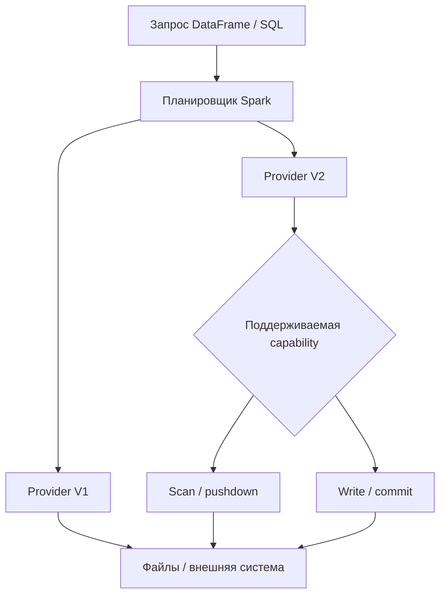
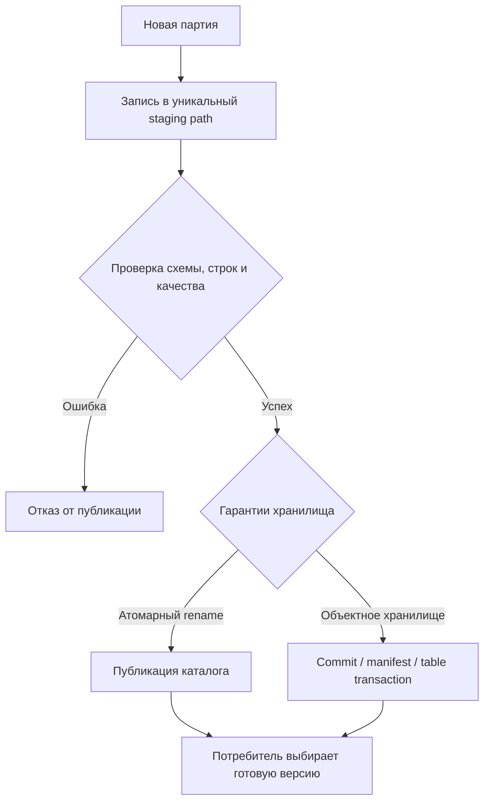
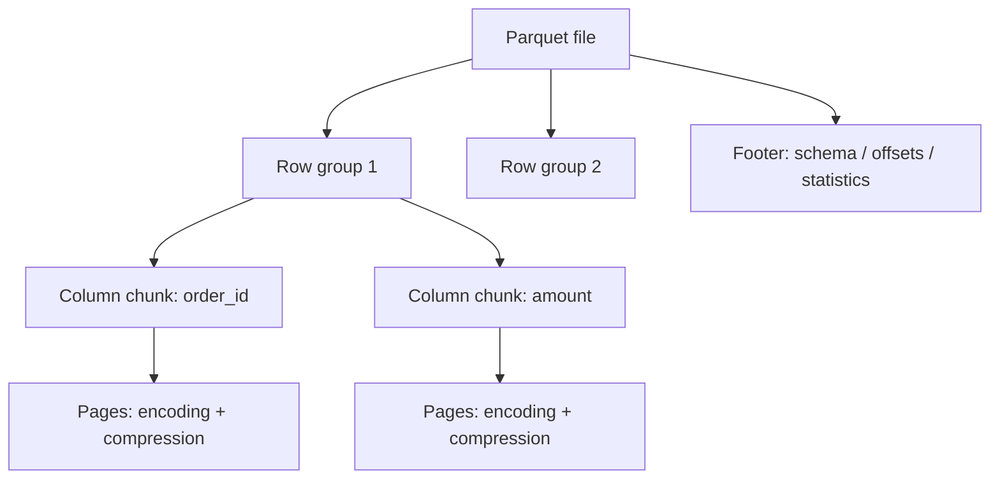
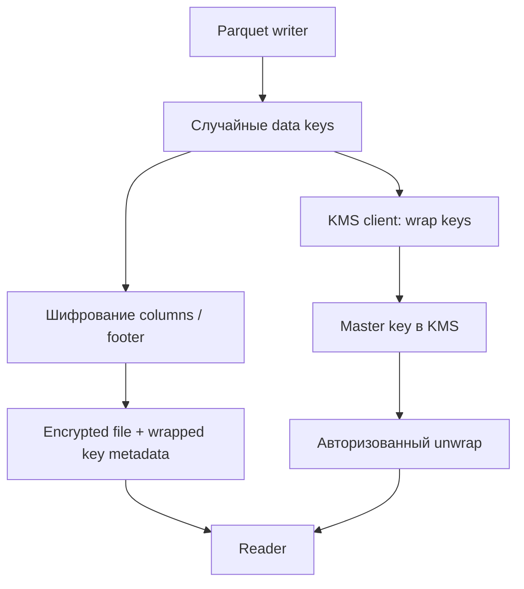
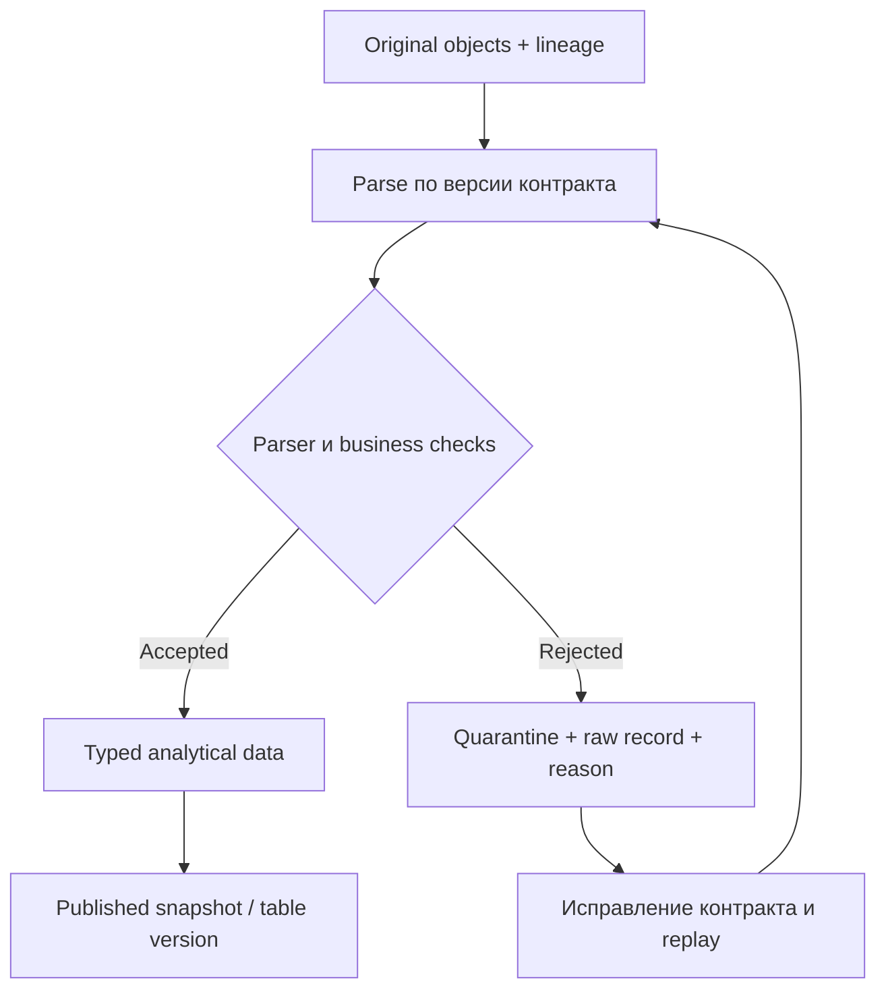

# 7. Чтение, запись и файловые форматы

Spark работает с логическими строками и столбцами, а хранилище — с файлами, каталогами, блоками и объектами. Между ними находится источник данных: он интерпретирует байты, извлекает схему, планирует чтение и публикует результат записи. Ошибка на этой границе может изменить не только скорость, но и состав данных: потерять строки, перепутать столбцы или удалить соседние партиции.

В этом разделе разбираются **10 тем и 77 пунктов** исходного оглавления. Структура: раздел → тема → пункт. Внутри каждой темы собраны объяснения, примеры и ограничения, чтобы изучать материал на одной странице.

**Файл:** `reading_writing_and_file_formats.md`.

**Версия примеров.** Базовое окружение — Apache Spark **4.2.0**, Python 3.12, Java 17, Spark Classic, локальная файловая система. Примеры XML требуют Spark 4.0+, автоматического Parquet shredding — Spark 4.1+. Для Spark 3.x проверяйте документацию соответствующей версии: доступность функций, кодеки и значения настроек могут отличаться.

**Проверка примеров.** На указанном окружении выполнены 68 коротких Python-блоков, 45 проверок итоговой практики и отдельные практики Avro/Protobuf и Parquet encryption. Проверки подтверждают функциональное поведение маленьких fixtures; выводы о производительности требуют измерений на ваших данных.

**Что уже нужно знать.** SparkSession, DataFrame, схемы и типы, ленивое выполнение, партиции вычисления, преобразования, действия и `explain`. Работа с каталогами разобрана в предыдущем разделе. S3, HDFS, JDBC, credentials и особенности connectors подробно относятся к следующему разделу.

**Содержание**

1. [Единый интерфейс источников данных](#source-interface)
2. [Режимы записи и корректность публикации](#write-publication)
3. [Текст, CSV и TSV](#text-csv-tsv)
4. [JSON](#json)
5. [Parquet](#parquet)
6. [ORC](#orc)
7. [Avro и Protobuf](#avro-protobuf)
8. [XML, бинарные файлы и изображения](#xml-binary-images)
9. [Общие файловые опции](#generic-file-options)
10. [Сжатие и выбор формата](#compression-format-choice)

**Как выполнять примеры**

Короткие Python-примеры идут последовательно и используют общую сессию и каталог `ROOT`, созданные ниже. Самостоятельные практики Avro/Protobuf, шифрования и итоговый проект имеют собственный запуск и окружение; выполняйте их в отдельных процессах. SQL, Bash, XML и `.proto` служат отдельными фрагментами соответствующих форматов.

Установка для основных примеров:

```bash
python -m venv .venv
source .venv/bin/activate
python -m pip install pyspark==4.2.0 pyarrow==18.1.0 pillow==12.3.0
```

В Windows активируйте `.venv\Scripts\Activate.ps1`. Java установите отдельно и проверьте `java -version` и `JAVA_HOME`. `pyarrow` используется для осмотра Parquet footer, Pillow — для создания маленькой учебной картинки; Spark не требует их для обычного чтения Parquet и image source.

Создадим небольшие заказы, содержащие дату, денежную сумму, строку и NULL:

```python
from pathlib import Path
from tempfile import TemporaryDirectory
from datetime import date, datetime
from decimal import Decimal
import json
import os
import shutil
import uuid
from contextlib import contextmanager
from pyspark.sql import SparkSession, functions as F, types as T

workspace = TemporaryDirectory(prefix="spark_files_chapter_")
ROOT = Path(workspace.name)

spark = (
    SparkSession.builder
    .master("local[2]")
    .appName("chapter-7-files")
    .config("spark.sql.shuffle.partitions", "2")
    .config("spark.sql.session.timeZone", "UTC")
    .config("spark.sql.warehouse.dir", str(ROOT / "warehouse"))
    .getOrCreate()
)
spark.sparkContext.setLogLevel("ERROR")

@contextmanager
def sql_settings(**changes):
    previous = {key: spark.conf.get(key) for key in changes}
    try:
        for key, value in changes.items():
            spark.conf.set(key, value)
        yield
    finally:
        for key, value in previous.items():
            spark.conf.set(key, value)

order_schema = T.StructType([
    T.StructField("order_id", T.IntegerType()),
    T.StructField("customer", T.StringType()),
    T.StructField("amount", T.DecimalType(10, 2)),
    T.StructField("order_date", T.DateType()),
    T.StructField("country", T.StringType()),
    T.StructField("note", T.StringType()),
])
orders = spark.createDataFrame([
    (1, "Анна", Decimal("100.50"), date(2026, 1, 1), "RU", None),
    (2, "Борис", Decimal("200.00"), date(2026, 1, 1), "RU", ""),
    (3, "Carol", Decimal("30.25"), date(2026, 1, 2), "DE", "gift"),
    (4, "Dan", Decimal("40.00"), date(2026, 1, 2), "DE", "regular"),
], order_schema)
assert orders.count() == 4
assert orders.schema["amount"].dataType == T.DecimalType(10, 2)
```

`TemporaryDirectory` и `Path.write_text` здесь относятся к локальной учебной среде. В кластере локальный путь драйвера не становится общим путём всех executors: используйте доступное им хранилище. Данные теста специально маленькие, поэтому `collect()` и просмотр локальных файлов безопасны; для настоящего набора размер результата нужно ограничивать.

<a id="source-interface"></a>
## Единый интерфейс источников данных

### DataFrameReader и DataFrameWriter

`SparkSession.read` возвращает **DataFrameReader** — объект настройки пакетного чтения. Reader выбирает источник, схему и опции, затем создаёт DataFrame. `DataFrame.write` возвращает **DataFrameWriter** — объект настройки записи существующего DataFrame.

Удобно разделять четыре действия:

1. Указать, **что читать**: источник и путь.
2. Указать, **как интерпретировать**: схема, разделитель, временная зона, parser mode.
3. Выполнить преобразования DataFrame.
4. Указать, **как публиковать**: формат, режим, partitionBy, назначение.

```python
basic_path = ROOT / "basic_parquet"
orders.write.mode("errorifexists").parquet(str(basic_path))
loaded_orders = spark.read.parquet(str(basic_path))
assert loaded_orders.count() == 4
assert loaded_orders.filter("order_id = 1").first().customer == "Анна"
```

`parquet()` — удобная форма общего интерфейса, а не отдельный вычислительный движок. После чтения тот же DataFrame участвует в `select`, `join`, SQL и агрегациях.

Reader может выполнить listing файлов и чтение метаданных уже при создании DataFrame. CSV/JSON schema inference также может запустить задания **до вашего первого явно написанного action**. Ленивость трансформаций не означает, что любое обращение к источнику полностью откладывается.

Writer выполняет действие: `save`, `parquet`, `csv`, `saveAsTable` запускают вычисление необходимого плана. При повторной записи без cache Spark может вычислить upstream ещё раз.

### format, schema, option, options, load и save

Общий интерфейс полезен, когда формат приходит из конфигурации приложения:

```python
csv_path = ROOT / "orders_csv"
(
    orders.write
    .format("csv")
    .mode("errorifexists")
    .options(header="true", sep=";", nullValue="<NULL>")
    .save(str(csv_path))
)

csv_orders = (
    spark.read
    .format("csv")
    .schema(order_schema)
    .option("header", "true")
    .options(sep=";", nullValue="<NULL>", emptyValue="", enforceSchema="false")
    .load(str(csv_path))
)
assert csv_orders.filter("order_id = 2").first().note == ""
```

| Метод | Назначение | На что обратить внимание |
|---|---|---|
| `format("parquet")` | Provider чтения/записи | Расширение имени само по себе provider не выбирает |
| `schema(...)` | Контракт входных столбцов | Применяется на reader; writer получает схему из DataFrame |
| `option(key, value)` | Одна опция | Неизвестная опция может быть проигнорирована источником |
| `options(**dict)` | Несколько опций | Имена и значения принадлежат конкретному provider |
| `load(path)` | Создание DataFrame | Не гарантирует немедленное чтение всех строк |
| `save(path)` | Запись результата | Запускает job и commit |

Без `.format(...)` используется `spark.sql.sources.default`, обычно Parquet в базовом Spark. В учебном и production-коде формат лучше указывать явно. Опция `header=true` не имеет общего смысла для всех форматов: Parquet не содержит CSV-заголовка, а Avro использует другую схему файла.

`schema("id INT, amount DECIMAL(10,2)")` и `schema(StructType(...))` задают один и тот же вид контракта. Наличие `nullable=False` в Python-схеме само по себе не превращает файловое хранилище в систему с ограничениями целостности; проверяйте бизнес-условия отдельными выражениями.

### Чтение одного пути, нескольких путей и glob-шаблонов

Путь может обозначать файл, каталог результата Spark или набор каталогов. Для Parquet удобно использовать вариативную форму `parquet(*paths)`, для общего reader — список путей в `load`.

```python
left_path = ROOT / "batch_a"
right_path = ROOT / "batch_b"
orders.filter("order_id <= 2").write.parquet(str(left_path))
orders.filter("order_id > 2").write.parquet(str(right_path))

one_batch = spark.read.parquet(str(left_path))
both_batches = spark.read.parquet(str(left_path), str(right_path))
glob_batches = spark.read.format("parquet").load(str(ROOT / "batch_*"))
assert one_batch.count() == 2
assert both_batches.count() == glob_batches.count() == 4
```

Glob раскрывается файловой системой/источником Spark, а не оболочкой Python. Для Hadoop-подобных путей часто работают `*`, `?` и наборы `{a,b}`; конкретный connector определяет поддерживаемое поведение. `pathGlobFilter` — другая опция: она отбирает имена файлов внутри читаемых путей.

Не складывайте в одну папку CSV, JSON, README и произвольные выгрузки, рассчитывая на расширения: CSV-reader способен интерпретировать посторонний текст как данные. Укажите допустимые пути или фильтр имён и проверяйте схему.

Не перечисляйте миллионы путей на драйвере в Python-списке без необходимости. Сам listing, метаданные и огромный план становятся нагрузкой ещё до обработки строк.

### Схема из метаданных и схема из содержимого

Схема может поступать из трёх мест: **явный контракт**, **метаданные формата/каталога**, **анализ значений**. Они дают разные гарантии.

| Формат | Как обычно появляется схема | Основной риск |
|---|---|---|
| CSV без `inferSchema` | Строковые столбцы и заголовок | Сумма остаётся string |
| CSV с `inferSchema` | Дополнительный проход по значениям | Маленькая выборка не отражает будущие данные |
| JSON/XML | Анализ наблюдаемых записей | Редкое поле/тип не попадёт в схему |
| Parquet/ORC | Метаданные файлов | Файлы разных партий могут иметь разные схемы |
| Avro container | Writer schema внутри контейнера | Reader schema может быть несовместима |
| Protobuf payload | Переданный descriptor/schema | Сам payload не содержит полноценное описание сообщения |

```python
strings_only = spark.read.option("header", "true").option("sep", ";").csv(str(csv_path))
inferred_csv = (
    spark.read.options(header="true", sep=";", inferSchema="true")
    .csv(str(csv_path))
)
assert strings_only.schema["amount"].dataType == T.StringType()
assert inferred_csv.schema["order_id"].dataType != T.StringType()
assert loaded_orders.schema["amount"].dataType == T.DecimalType(10, 2)
```

Inference отвечает «что встретилось сейчас», а контракт — «что приложение допускает». Для идентификаторов вроде `00123`, денег, времени и значений с неустойчивым типом лучше явно выбрать схему. Статистика inference не подтверждает отсутствие NULL, дубликатов или ошибочных бизнес-значений.

Даже self-describing формат не исключает schema governance: нужно согласовать единицы измерения, precision/scale, timestamp semantics, совместимость добавлений и правила удаления столбцов.

### Batch-источники, streaming-источники и их возможности

Пакетное чтение создаётся через `spark.read`, потоковое — через `spark.readStream`. Аналогично различаются `write` и `writeStream`. Потоковый DataFrame содержит незавершённый план: `collect()` нельзя использовать для выгрузки бесконечного входа.

Проверим файловый источник в режиме ограниченного по времени эксперимента:

```python
stream_input = ROOT / "stream_input"
stream_input.mkdir()
(stream_input / "first.json").write_text('{"id": 1}\n{"id": 2}\n', encoding="utf-8")
stream_df = spark.readStream.schema("id INT").json(str(stream_input))
stream_name = "files_stream_" + uuid.uuid4().hex
query = (
    stream_df.writeStream.format("memory")
    .queryName(stream_name)
    .outputMode("append")
    .option("checkpointLocation", str(ROOT / "stream_checkpoint"))
    .trigger(availableNow=True)
    .start()
)
query.awaitTermination()
assert stream_df.isStreaming
assert spark.table(stream_name).count() == 2
```

Memory sink предназначен для отладки, а не устойчивого хранения. `availableNow` здесь обрабатывает доступный вход и заканчивает query; это не делает memory sink надёжным production sink.

Для файлового stream важны: явная стабильная схема, checkpoint, новые завершённые файлы, договорённость о неизменности опубликованного входа. Перезаписывать уже обработанный файл как способ «отправить событие ещё раз» нельзя считать универсальным протоколом.

Поддержка batch не гарантирует поддержку streaming, а streaming source не обязательно является streaming sink. Проверяйте provider, output modes, checkpoint guarantees и ограничения опций. Например, фильтры `modifiedBefore`/`modifiedAfter` относятся к batch-файлам.

### Data Source V1 и V2: обзор различий

**Data Source** — интерфейс интеграции движка с источником. V1 и V2 относятся к API реализации providers, а не к поколению Parquet или отдельному файловому формату.

V2 предоставляет набор capability-интерфейсов для scan, filter/aggregate pushdown, записи, partitioning и catalog operations. Provider реализует только поддерживаемые возможности. Надпись V2 сама по себе не гарантирует ACID, delete, merge или быструю агрегацию.



При файловом чтении выбор V1/V2 зависит от версии Spark и `spark.sql.sources.useV1SourceList`. Для экспериментов с aggregate pushdown Parquet и ORC ниже используются V2 scans. В плане V1 часто встречается `FileScan`, V2 — `BatchScan`; проверяйте реальный план, а не только конфигурацию.

```python
print("V1 providers:", spark.conf.get("spark.sql.sources.useV1SourceList"))
loaded_orders.select("order_id", "amount").explain("formatted")
```

`df.write` и `df.writeTo("catalog.table")` — разные API записи. Второй работает с V2 tables/catalog capabilities и не заменяет произвольную запись в путь. Глубокая разработка собственного provider и catalog относится к отдельным продвинутым разделам.

<a id="write-publication"></a>
## Режимы записи и корректность публикации

### Append, overwrite, errorIfExists и ignore

Режим определяет поведение writer, если назначение уже существует. Он не задаёт уникальность строк, дедупликацию и exactly-once.

| Режим | Если назначение существует | Практическое следствие |
|---|---|---|
| `append` | Добавляет результат | Повторный запуск может добавить те же строки |
| `overwrite` | Заменяет область назначения | Область удаления зависит от provider и partition mode |
| `errorifexists` / `error` | Завершает запись ошибкой | Хорошо для нового уникального batch path |
| `ignore` | Не записывает новый результат | «Не было ошибки» не означает «новые данные появились» |

```python
modes_path = ROOT / "modes"
orders.filter("order_id = 1").write.mode("errorifexists").parquet(str(modes_path))
orders.filter("order_id = 2").write.mode("append").parquet(str(modes_path))
assert spark.read.parquet(str(modes_path)).count() == 2

orders.write.mode("ignore").parquet(str(modes_path))
assert spark.read.parquet(str(modes_path)).count() == 2

orders.filter("order_id = 3").write.mode("overwrite").parquet(str(modes_path))
assert spark.read.parquet(str(modes_path)).first().order_id == 3
```

Append в файловую папку не сравнивает ключи заказа: это добавление файлов. При повторной попытке **всего приложения** штатный commit отдельных tasks не превращается в дедупликацию batches. Нужны уникальный batch ID, журнал обработанных партий или транзакционная таблица с подходящей стратегией записи.

Не читайте DataFrame из пути, который одновременно перезаписываете этим же DataFrame. Ленивый scan может попытаться читать уже удалённые файлы; кроме ошибки, возможна некорректная публикация. Используйте отдельное назначение и осознанную процедуру замены.

### Каталог результата, part-файлы и служебные файлы

`spark.write.parquet("orders.parquet")` обычно создаёт **каталог с таким именем**, а внутри — набор part-файлов. Расширение каталога не делает его одним файлом.

```python
parts = sorted(basic_path.glob("part-*.parquet"))
assert len(parts) >= 1
print([p.name for p in parts])
print("Служебные объекты:", [p.name for p in basic_path.iterdir() if p.name.startswith(("_", "."))])
```

Part-файл создаётся задачей writer; число output tasks, partitionBy, ограничение записей и AQE влияют на итоговое количество. Это не обязано равняться числу executors или исходных входных файлов.

`_SUCCESS` обычно отмечает завершение write job выбранным committer. Он не содержит схему, контрольную сумму данных, бизнес-валидацию или доказательство общей транзакции. `_temporary`, checksum-файлы `.crc`, summary metadata и служебные каталоги имеют другое назначение и зависят от файловой системы и протокола.

CSV writer записывает header в каждый part-файл, если `header=true`. Чтобы передать пользователю один небольшой CSV, можно использовать отдельный экспортный шаг; `coalesce(1)` на большом наборе создаёт узкое место, а не общее решение small files.

Потребитель Spark обычно читает **каталог**, а не составляет список part-имён вручную. Имена part-файлов не являются бизнес-контрактом и могут меняться при повторном запуске.

### partitionBy, bucketBy и sortBy: назначение и ограничения

Эти операции относятся к разным видам организации результата.

| Операция | Что создаёт | Где применяется |
|---|---|---|
| `partitionBy("country")` | Каталоги `country=...` | Файловая запись с разделением по значению |
| `bucketBy(8, "customer_id")` | Фиксированные hash buckets с метаданными | Поддерживаемая запись таблицы через `saveAsTable` |
| `sortBy("customer_id")` | Сортировку внутри bucket | Вместе с bucketBy в классическом writer |
| `repartition(...)` | Партиции вычисления | До writer, может вызвать shuffle |
| `sortWithinPartitions(...)` | Локальный порядок строк | Внутри вычислительной партиции |

```python
partitioned_path = ROOT / "partitioned_orders"
orders.write.partitionBy("country").parquet(str(partitioned_path))
assert (partitioned_path / "country=RU").is_dir()
assert (partitioned_path / "country=DE").is_dir()
assert spark.read.parquet(str(partitioned_path)).count() == 4

bucket_table = "file_buckets_" + uuid.uuid4().hex
(
    orders.write.format("parquet")
    .bucketBy(2, "order_id")
    .sortBy("order_id")
    .saveAsTable(bucket_table)
)
assert spark.table(bucket_table).count() == 4
spark.sql(f"DROP TABLE `{bucket_table}`")
```

`bucketBy(...).parquet(path)` не является поддерживаемой заменой bucketed table: для использования buckets планировщику нужны метаданные таблицы. Hash bucketing Spark не следует автоматически считать совместимым с любым Hive bucketing.

`partitionBy` не обеспечивает один файл на значение и не «делает repartition» по универсальному правилу. Несколько tasks могут записывать одну storage partition. При высокой кардинальности — например, partitionBy по UUID заказа — получится множество каталогов и маленьких файлов.

Storage partition выбирайте по распространённым фильтрам и объёму: дата или укрупнённая категория часто полезнее пользовательского ID. Общий порядок чтения не гарантирован даже при сортировке файлов; для упорядоченного ответа нужен `orderBy`.

### maxRecordsPerFile и влияние на размер результата

`maxRecordsPerFile` ограничивает количество **строк в одном output-файле**, а не его байты. Разная длина строк, nested values, encoding и codec могут дать сильно разные размеры при одинаковом числе записей.

```python
limited_path = ROOT / "limited_files"
orders.coalesce(1).write.option("maxRecordsPerFile", 2).parquet(str(limited_path))
per_file = (
    spark.read.parquet(str(limited_path))
    .withColumn("source", F.input_file_name())
    .groupBy("source").count().collect()
)
assert len(per_file) == 2
assert all(row["count"] <= 2 for row in per_file)
```

Здесь один task записал два файла. В production число файлов складывается из количества output tasks, storage partitions и rollover writer. `maxRecordsPerFile=0` означает отсутствие этого ограничения, а не пустой файл.

Чтобы получить целевой размер, измерьте типичный compressed bytes/row, задайте разумный объём задачи и проверьте распределение результатов. Ограничение записей полезно против чрезмерно больших файлов, но слишком маленькое значение само создаёт small files.

### Перезапись партиций и риск удаления лишних данных

Для классических файловых источников Spark различает **static** и **dynamic partition overwrite**. В динамическом режиме при path write заменяются storage partitions, для которых текущая запись действительно произвела данные. В статическом режиме область очистки может быть шире, вплоть до всего целевого пути при обычной path overwrite.

```python
dynamic_path = ROOT / "dynamic_orders"
orders.write.partitionBy("country").parquet(str(dynamic_path))
replacement = orders.filter("country = 'RU'").withColumn("note", F.lit("updated"))
(
    replacement.write.mode("overwrite")
    .option("partitionOverwriteMode", "dynamic")
    .partitionBy("country")
    .parquet(str(dynamic_path))
)
after_overwrite = spark.read.parquet(str(dynamic_path))
assert after_overwrite.filter("country = 'DE'").count() == 2
assert after_overwrite.filter("country = 'RU' AND note = 'updated'").count() == 2
```

Опция writer применяется к этому файловому вызову; глобальная настройка — `spark.sql.sources.partitionOverwriteMode`. V2 `overwritePartitions`, Hive SerDe и table-format replacements имеют собственные контракты: переносить поведение одного provider на другой нельзя.

Если batch пуст для некоторой даты, dynamic overwrite **не обязательно удалит старую дату**: она не стала touched partition. Для замены в том числе пустой области нужен явный диапазон/предикат и операция с подходящими гарантиями.

При изменении partition columns или структуры назначения сначала проверьте новый layout в отдельном пути. Удаление данных при overwrite может происходить раньше успешного окончания вычисления; rollback обычной папки не гарантирован.

### Запись во временное место и публикация готового результата

Надёжный процесс сначала готовит новую версию, затем проверяет её, затем делает её доступной потребителям. Это особенно важно, если чтение запускается независимо от writer.



Локальный пример публикует **новый, ещё не существующий** каталог в пределах одного filesystem:

```python
stage_path = ROOT / ("stage_" + uuid.uuid4().hex)
published_path = ROOT / ("published_" + uuid.uuid4().hex)
orders.write.mode("errorifexists").parquet(str(stage_path))
check_publication = spark.read.parquet(str(stage_path))
assert check_publication.count() == 4
assert set(check_publication.columns) == set(orders.columns)
assert not published_path.exists()
os.rename(stage_path, published_path)
assert spark.read.parquet(str(published_path)).count() == 4
```

`os.rename` здесь работает с локальными путями Python. Он не выполняет операцию в S3/HDFS и не является переносимым distributed publication API. Атомарность rename зависит от filesystem и границ операции; на объектном хранилище rename часто реализуется через copy/delete.

Для версионных каталогов потребитель должен выбирать конкретную готовую версию через устойчивый pointer/manifest или metadata transaction. Просто сканировать родительскую папку со staging и всеми версиями нельзя: получится смесь или дублирование.

Проверка `count` и схемы — минимальная учебная проверка. Для реального контракта добавляются ключи, суммы, диапазоны дат, null-rate, контроль входной партии и ожидаемые storage partitions.

### Commit protocol и обработка неуспешной записи

Writer использует task/job commit: задачи создают результаты, выбранный протокол принимает успешную попытку, job завершает публикацию. Повторная попытка task не должна автоматически становиться второй принятой копией того же output, но это зависит от committer и хранилища.

Различайте три уровня:

- **Task commit:** какая попытка задачи принята.
- **Job commit:** собраны ли результаты всех нужных задач.
- **Транзакция таблицы:** какую версию одновременно видят readers и что происходит при конкурентных writers.

Первые два уровня у файлового writer не дают автоматически третий. Частично очищенное назначение после overwrite, остатки staging и конфликт двух приложений всё ещё возможны.

Для диагностики нужны stack trace, commit messages, путь назначения, режим, IDs приложения/партии, настройки protocol и committer. `spark.sql.sources.commitProtocolClass` относится к SQL write protocol, Hadoop committer — к механизму файловой публикации; менять их без совместимости connector нельзя.

После сбоя не запускайте безусловный append повторно, пока не известно, что уже опубликовано. И не удаляйте `_temporary` чужого приложения во время его работы. В своём процессе полезны уникальное назначение, журнал статуса партии и отделение подготовки от открытия результата reader.

**Мини-практика по публикации.** Повторите append два раза и докажите появление дублей. Затем сравните static и dynamic overwrite в двух отдельных учебных папках. Перед каждой операцией выпишите область, которую writer имеет право изменить, и проверьте соседнюю партицию после записи.
<a id="text-csv-tsv"></a>
## Текст, CSV и TSV

### text, textFile и строка как запись

Текстовый источник не пытается обнаружить таблицу: `spark.read.text(path)` создаёт один string-столбец `value`, обычно одна физическая строка становится одной записью.

```python
text_path = ROOT / "events.txt"
text_path.write_text("alpha\nbeta\ngamma\n", encoding="utf-8")
text_df = spark.read.text(str(text_path))
assert text_df.columns == ["value"]
assert [r.value for r in text_df.collect()] == ["alpha", "beta", "gamma"]

rdd_lines = spark.sparkContext.textFile(str(text_path))
assert rdd_lines.count() == 3
```

В PySpark Classic `SparkContext.textFile` возвращает RDD[str]. Метод `textFile` у Dataset reader встречается в JVM API; не переносите его имя механически на Python DataFrameReader. В Spark Connect нельзя рассчитывать на SparkContext/RDD API.

Writer `.text(...)` принимает один string-столбец. Если необходимо сохранить несколько полей, сначала задайте явную сериализацию, например JSON или корректный CSV, а не случайную конкатенацию через разделитель.

```python
text_output = ROOT / "text_output"
text_df.write.text(str(text_output))
assert spark.read.text(str(text_output)).count() == 3
```

Строковый источник полезен для логов, сырого ingestion и последующего разбора `from_json`/`from_csv`. Он сохраняет текст строки, но не гарантирует сохранение исходных байтов, кодировки и line endings. Для побайтового архива выбирайте бинарный источник или сохраняйте оригинальный объект отдельно.

### Разделитель, заголовок, кавычки и escape-символы

CSV — формат с правилами парсинга, а не `line.split(",")`. Разделитель может находиться внутри quoted field, кавычки могут быть экранированы, а запись — занимать несколько строк.

```python
quoted_path = ROOT / "quoted.csv"
quoted_path.write_text(
    'id;comment\n1;"hello; world"\n2;"say ""yes"""\n',
    encoding="utf-8",
)
quoted_df = (
    spark.read.schema("id INT, comment STRING")
    .options(header="true", sep=";", quote='"', escape='"', enforceSchema="false")
    .csv(str(quoted_path))
)
quoted_rows = {r.id: r.comment for r in quoted_df.collect()}
assert quoted_rows == {1: "hello; world", 2: 'say "yes"'}
```

Здесь `escape='"'` означает, что двойная кавычка внутри quoted field записана как `""`. Для выгрузки с backslash escaping нужен другой `escape`. Это свойство контракта файла, а не вкусовая настройка.

TSV использует тот же CSV-reader с `sep="\t"`. Название «TSV» не отменяет необходимости договориться об escaping, NULL и многострочности.

| Опция | Вопрос к поставщику файла |
|---|---|
| `sep` | Как отделяются поля? |
| `header` | Есть ли имена столбцов в каждом файле? |
| `quote` | Как обозначается quoted field? |
| `escape` | Как представлена кавычка внутри значения? |
| `quoteAll` | Нужно ли writer всегда брать значения в кавычки? |
| `comment` | Какие строки являются комментариями? |

Нельзя сначала удалять кавычки регулярным выражением, а затем разбирать CSV: это разрушает различие между данными и синтаксисом. Проверять настройки нужно на записи с разделителем, кавычкой, NULL, пустой строкой и переносом строки.

### Многострочные записи, кодировка и line separator

При `multiLine=false` reader ожидает независимые записи по строкам. Если quoted field содержит перевод строки, нужен `multiLine=true`.

```python
multiline_csv_path = ROOT / "multiline.csv"
multiline_csv_path.write_text('id,comment\n1,"first line\nsecond line"\n2,plain\n', encoding="utf-8")
multiline_csv = (
    spark.read.schema("id INT, comment STRING")
    .options(header="true", multiLine="true", encoding="UTF-8")
    .csv(str(multiline_csv_path))
)
assert multiline_csv.count() == 2
assert multiline_csv.filter("id = 1").first().comment == "first line\nsecond line"
```

Многострочное чтение усложняет разбиение файла на независимые input splits. Большой единый CSV с multiLine может стать одной тяжёлой задачей; последующий `repartition` не ускорит уже произошедший последовательный разбор этого файла.

`encoding` выбирает преобразование байтов в символы. Если поставщик пишет Windows-1251, reader с UTF-8 не «догадается», что текст русскоязычный. Проверьте несколько значений и договаривайтесь об encoding явно.

`lineSep` задаёт разделитель записей в поддерживаемом источнике и режиме. У CSV есть ограничения длины этого значения; обычные LF/CRLF надёжнее произвольного многосимвольного протокола. Для text доступны свои правила разделителя, а встроенные строковые функции не читают файлы и игнорируют часть файловых опций.

Не путайте экранированные символы `\n` внутри строки и настоящий перевод строки в файле. Они могут означать разные значения и требуют разных тестовых fixtures.

### NULL, пустое значение и значения по умолчанию

NULL обозначает отсутствие значения, `""` — существующую строку нулевой длины. CSV не имеет обязательного универсального NULL marker: нужно согласовать его с writer.

```python
null_csv_path = ROOT / "nulls.csv"
null_csv_path.write_text('id,note\n1,<NULL>\n2,""\n3,hello\n', encoding="utf-8")
null_csv = (
    spark.read.schema("id INT, note STRING")
    .options(header="true", nullValue="<NULL>", emptyValue="")
    .csv(str(null_csv_path))
)
assert [r.note for r in null_csv.orderBy("id").collect()] == [None, "", "hello"]

filled_notes = null_csv.withColumn("note", F.coalesce("note", F.lit("unknown")))
assert filled_notes.filter("id = 2").first().note == ""
```

При marker `<NULL>` строка с буквальным содержимым `<NULL>` тоже попадает под выбранный контракт. Если нужно сохранить такой текст, предусмотрите отдельное escaping/кодирование; CSV-кавычки сами по себе не всегда решают семантическую неоднозначность nullValue.

У CSV-reader и writer различается default `emptyValue`. В примере записи выше для writer оставлен default: пустая строка должна сериализоваться как quoted empty field. Безусловная передача `emptyValue=""` на обе стороны может разрушить roundtrip; проверяйте текст файла и восстановленные значения.

Значение по умолчанию — отдельное преобразование или правило приложения. Параметр `emptyValue` определяет интерпретацию/запись пустого string, а не универсальный default для отсутствующего numeric field.

Нельзя заменять все NULL нулём без анализа: отсутствующая сумма, нулевая сумма и ошибка парсинга — разные состояния. Для диагностики храните raw value и причину ошибки, для business layer — явно определяйте допустимые замены.

### PERMISSIVE, DROPMALFORMED и FAILFAST

Parser mode определяет реакцию на запись, которую reader не может разобрать по выбранной схеме/грамматике.

| Режим | Поведение | Где полезен |
|---|---|---|
| `PERMISSIVE` | Сохраняет доступные поля, проблемные значения могут стать NULL; raw record доступен при правильной corrupt column | Ingestion с quarantine |
| `DROPMALFORMED` | Пропускает malformed record | Только когда потеря строк осознанно допустима и измеряется |
| `FAILFAST` | Прерывает действие ошибкой | Строгий контракт и раннее обнаружение нарушений |

```python
bad_csv_path = ROOT / "bad_records.csv"
bad_csv_path.write_text("id,name\n1,Alice\nwrong,Bob\n2,Carol\n", encoding="utf-8")
audit_csv_schema = "id INT, name STRING, _corrupt_record STRING"
with sql_settings(**{"spark.sql.csv.parser.columnPruning.enabled": "false"}):
    parsed_csv = (
        spark.read.schema(audit_csv_schema)
        .options(header="true", mode="PERMISSIVE")
        .csv(str(bad_csv_path)).cache()
    )
    parsed_csv_rows = parsed_csv.collect()
    assert len(parsed_csv_rows) == 3
    assert sum(r._corrupt_record is not None for r in parsed_csv_rows) == 1

    dropped_csv = (
        spark.read.schema(audit_csv_schema)
        .options(header="true", mode="DROPMALFORMED")
        .csv(str(bad_csv_path))
    )
    assert len(dropped_csv.collect()) == 2
```

Для parser audit здесь отключено column pruning: разбор только выбранных столбцов способен менять классификацию malformed CSV. Эта настройка имеет стоимость; её используют на этапе полной проверки входных записей, а не автоматически во всех запросах.

Число CSV tokens меньше/больше schema fields само по себе не обязательно делает запись malformed: лишние значения могут быть отброшены, отсутствующие — стать NULL. Проверка обязательных полей, числа элементов и бизнес-правил нужна отдельно.

`count()` не всегда заставляет распарсить каждое нужное значение: оптимизатор может сократить read schema. Для проверки ошибок конкретного поля материализуйте полную схему, а не полагайтесь на один count.

```python
strict_csv_failed = False
try:
    (
        spark.read.schema("id INT, name STRING")
        .options(header="true", mode="FAILFAST")
        .csv(str(bad_csv_path)).collect()
    )
except Exception as exc:
    strict_csv_failed = True
    print("Ожидаемая ошибка parser:", type(exc).__name__)
assert strict_csv_failed
```

Встроенный `from_csv` не поддерживает `DROPMALFORMED`: он преобразует значение столбца, а не удаляет строку DataFrame. Не переносите все reader options на функции без проверки их собственного API.

### Corrupt record column и сохранение ошибочных записей

Чтобы сохранить raw malformed record при явной схеме, включите nullable string field с именем `columnNameOfCorruptRecord`, обычно `_corrupt_record`. Этот столбец представляет parser failure, а не любое плохое бизнес-значение.

```python
csv_quarantine = parsed_csv.filter(F.col("_corrupt_record").isNotNull())
csv_valid = parsed_csv.filter(F.col("_corrupt_record").isNull()).drop("_corrupt_record")
assert csv_quarantine.count() == 1
assert csv_valid.count() == 2

csv_quarantine.write.mode("errorifexists").json(str(ROOT / "csv_quarantine"))
assert csv_quarantine.first()._corrupt_record == "wrong,Bob"
parsed_csv.unpersist()
```

Сырой CSV/JSON reader ограничивает запросы, которые читают **только** corrupt column. Сначала материализуйте полный parse result через cache и action или запишите его в staging, затем выполняйте отдельный audit. В примере `collect()` выше действительно прочитал поля полного тестового набора.

Для реальной quarantine добавьте source path, batch ID, ingestion timestamp, contract version и причину отказа. Сам `PERMISSIVE` не помечает сумму `-100` malformed, если decimal parsed успешно: это уже domain validation.

Не удаляйте corrupt records без метрики. Контрольный баланс должен учитывать `accepted + parser rejected + business rejected`, а raw input должен оставаться доступным для повторного разбора с исправленным контрактом.

### Вывод схемы, enforceSchema и неодинаковые заголовки

`inferSchema=true` сканирует значения и выбирает типы, но не гарантирует стабильность между партиями. `samplingRatio` ограничивает наблюдаемую выборку: редкий string в numeric column легко останется незамеченным.

При `header=true`, `enforceSchema=true` reader применяет поля **по позиции** и может игнорировать имена заголовка. При `enforceSchema=false` проверяются имена и порядок с учётом case sensitivity; это не автоматический name-based reorder.

```python
wrong_header_path = ROOT / "wrong_header.csv"
wrong_header_path.write_text("name,id\nAlice,1\n", encoding="utf-8")
header_failed = False
try:
    (
        spark.read.schema("id INT, name STRING")
        .options(header="true", enforceSchema="false")
        .csv(str(wrong_header_path)).collect()
    )
except Exception as exc:
    header_failed = True
    print("Ожидаемое несоответствие заголовка:", type(exc).__name__)
assert header_failed
```

Если поставщик поменял порядок полей в части файлов, нужно нормализовать каждую согласованную версию отдельно, затем объединить данные по именам. Одна схема на mixed directory не исправляет разные заголовки.

Для CSV headers, похожих на число или имеющих повторяющиеся имена, зафиксируйте соглашение о names заранее. Удаление пробелов/изменение регистра должно быть явным преобразованием, которое можно проверить на конфликтующих колонках.

### Ограничения CSV для типов и больших объёмов

CSV удобен для обмена с человеком и внешней системой, но плохо выражает типы, вложенность, бинарные значения, schema evolution и точность семантики NULL. Native CSV writer не записывает struct/array/map как полноценные typed nested columns.

Если контракт требует nested payload, сериализуйте его явно, например в JSON string. Получится **CSV с JSON внутри поля**, у которого существуют два уровня escaping; получатель должен понимать оба.

```python
csv_with_payload = orders.select(
    "order_id",
    F.to_json(F.struct("customer", "amount", "country")).alias("payload"),
)
payload_csv_path = ROOT / "payload_csv"
csv_with_payload.write.option("header", "true").csv(str(payload_csv_path))
restored_payload = (
    spark.read.schema("order_id INT, payload STRING").option("header", "true")
    .csv(str(payload_csv_path))
    .withColumn("parsed", F.from_json("payload", "customer STRING, amount DECIMAL(10,2), country STRING"))
)
assert restored_payload.filter("order_id = 1").first().parsed.amount == Decimal("100.50")
```

Большой CSV приходится tokenise и преобразовывать; column pruning не даёт тех же физических возможностей, что колонночный файл. Отдельно влияют schema inference, unsplittable compression и multiLine.

Для долгоживущего analytical layer обычно выгодно сохранить raw CSV как оригинал, валидировать контракт и преобразовать accepted rows в Parquet/ORC или table format. Это не отменяет необходимость хранить lineage и rejection metrics.

**Практика по CSV.** Создайте TSV с NULL marker, пустой строкой, табуляцией и кавычкой внутри поля. Прочитайте его с явной схемой, запишите обратно и сравните значения после roundtrip. Затем добавьте ошибочную сумму и отдельно докажите, что parser rejection отличается от отрицательной, но корректно распарсенной суммы.

<a id="json"></a>
## JSON

### JSON Lines и многострочный JSON

По умолчанию Spark ожидает **JSON Lines**: каждая строка содержит самостоятельный JSON object. Обычный файл с красивыми отступами или массивом объектов требует `multiLine=true`.

```python
json_lines_path = ROOT / "events.jsonl"
json_lines_path.write_text('{"id":1,"name":"A"}\n{"id":2,"name":"B"}\n', encoding="utf-8")
json_array_path = ROOT / "events_array.json"
json_array_path.write_text('[\n  {"id":1,"name":"A"},\n  {"id":2,"name":"B"}\n]\n', encoding="utf-8")
json_lines_df = spark.read.schema("id INT, name STRING").json(str(json_lines_path))
json_array_df = (
    spark.read.schema("id INT, name STRING")
    .option("multiLine", "true").json(str(json_array_path))
)
assert json_lines_df.count() == json_array_df.count() == 2
```

JSON Lines удобен для независимого разбора записей и файловой пакетной обработки. Большой whole-document JSON ограничивает input parallelism: нельзя безопасно начать parser с произвольного байта внутри объекта.

Spark JSON writer обычно создаёт JSON Lines part-файлы. Он не собирает все строки DataFrame в один глобальный JSON array. Для небольшого экспортного документа массив можно сделать отдельным ограниченным этапом; для больших данных это становится нагрузкой на одну машину.

### Вложенные объекты, массивы и смешанные типы

JSON naturally описывает объекты и массивы, а Spark переводит их в struct и array. Типы значений всё равно нужно согласовать: `{"price":12}` и `{"price":"unknown"}` не превращаются в один стабильный numeric contract сами собой.

```python
nested_json_path = ROOT / "nested.jsonl"
nested_json_path.write_text(
    '{"id":1,"user":{"name":"Анна","age":30},"tags":["new","paid"]}\n'
    '{"id":2,"user":{"name":"Dan","age":40},"tags":[]}\n',
    encoding="utf-8",
)
nested_json_schema = "id INT, user STRUCT<name:STRING,age:INT>, tags ARRAY<STRING>"
nested_json_df = spark.read.schema(nested_json_schema).json(str(nested_json_path))
assert nested_json_df.filter("id = 1").first().user.age == 30
assert nested_json_df.select(F.size("tags").alias("n")).orderBy("n").first().n == 0
```

Map подходит для произвольных ключей одного value type, struct — для известной схемы с разными типами полей. Не объявляйте объект как map<string,string> только потому, что у него фигурные скобки: nested arrays и числовая семантика потребуют другой структуры.

Смешанные типы лучше сохранять в raw JSON, нормализовать явно или, на поддерживаемой версии, применять VARIANT. Это не разрешение смешивать единицы измерения и смыслы в одном поле: бизнес-контракт всё равно необходим.

### Явная схема, schema inference и samplingRatio

Явная JSON-схема позволяет читать нужные поля и сохранять стабильный тип между файлами. Дополнительные fields, не включённые в requested schema, обычно не появляются в результирующем DataFrame.

```python
json_inferred = spark.read.option("samplingRatio", 1.0).json(str(nested_json_path))
json_explicit = spark.read.schema("id INT, user STRUCT<name:STRING>").json(str(nested_json_path))
assert "tags" in json_inferred.columns
assert "tags" not in json_explicit.columns
assert json_explicit.first().user.name is not None
```

`samplingRatio` относится к inference, а не к фильтрации итогового DataFrame. Значение `0.1` не означает «прочитать десять процентов данных для аналитики» и не гарантирует строго одинаковую выборку разных файлов.

Поля, которые отсутствуют или всегда NULL в наблюдаемой выборке, плохо характеризуют будущую схему. Для schema evolution создайте контракт, набор совместимых изменений и regression fixtures с редкими структурами.

Inference полезен в разведке, но его результат следует изучить: numeric widening, string fallback, вложенные структуры, decimal precision и пустые массивы могут дать не ту модель, которая нужна приложению.

### Пропущенные поля, NULL и corrupt records

При struct schema отсутствующее поле и JSON literal `null` обычно дают SQL NULL. Это не одинаковые исходные события, но после обычного typed parsing различие может исчезнуть.

```python
json_null_path = ROOT / "json_nulls.jsonl"
json_null_path.write_text('{"id":1}\n{"id":2,"note":null}\n{"id":3,"note":""}\n', encoding="utf-8")
json_nulls = spark.read.schema("id INT, note STRING").json(str(json_null_path))
assert [r.note for r in json_nulls.orderBy("id").collect()] == [None, None, ""]

bad_json_path = ROOT / "bad.jsonl"
bad_json_path.write_text('{"id":1}\n{"id":"wrong"}\nnot-json\n', encoding="utf-8")
json_audit = (
    spark.read.schema("id INT, _corrupt_record STRING")
    .option("mode", "PERMISSIVE").json(str(bad_json_path)).cache()
)
json_audit_rows = json_audit.collect()
assert len(json_audit_rows) == 3
assert json_audit.filter(F.col("_corrupt_record").isNotNull()).count() == 2
json_audit.unpersist()
```

Если важно различать missing и explicit null, сохраняйте raw JSON или используйте модель с presence marker. В VARIANT на поддерживаемых версиях JSON null можно исследовать отдельно от SQL NULL; простая struct schema такой marker не создаёт.

Неизвестное поле может быть допустимой schema evolution, invalid type — parser rejection, а parsed NULL — допустимым/недопустимым бизнес-состоянием. Это три разные проверки.

При JSON-записи настройка `ignoreNullFields` определяет, будут ли NULL-поля объектов пропущены или записаны как `null`. Установите её явно, если presence важен для получателя.

### Форматы даты и времени и часовой пояс

JSON не содержит обязательного типа date/timestamp: это строки, которые Spark интерпретирует по схеме и format options. Выбор timestamp type и временной зоны влияет на значение.

```python
json_time_path = ROOT / "time.jsonl"
json_time_path.write_text('{"id":1,"event_date":"31.01.2026","event_time":"2026-01-31 12:34:56"}\n', encoding="utf-8")
json_time_df = (
    spark.read.schema("id INT, event_date DATE, event_time TIMESTAMP")
    .options(dateFormat="dd.MM.yyyy", timestampFormat="yyyy-MM-dd HH:mm:ss", timeZone="UTC")
    .json(str(json_time_path))
)
assert json_time_df.first().event_date == date(2026, 1, 31)
assert json_time_df.select(F.date_format("event_time", "HH:mm:ss").alias("t")).first().t == "12:34:56"
```

`TIMESTAMP` обычно соответствует timestamp с локальной временной зоной сессии для отображения; underlying instant и отображаемое local time — разные понятия. `TIMESTAMP_NTZ` описывает wall-clock time без привязки к зоне. Для межсистемного обмена договоритесь, что именно представляет поле.

Используйте IANA zone IDs (`Europe/Berlin`) или UTC, а не неоднозначные сокращения. DST делает некоторые local times неоднозначными или несуществующими; тестируйте такие даты отдельно.

Fractional seconds, offset и precision должны соответствовать pattern. Parser mode может превратить ошибку timestamp в NULL: после чтения контролируйте failed conversion, а не только отсутствие исключения.

### Опции парсера и несовместимые JSON-значения

Spark JSON parser может допускать некоторые расширения грамматики: single quotes, comments, unquoted names, numeric leading zeros, nonnumeric numbers. Это не означает, что такие файлы совместимы со строгими JSON readers.

```python
loose_json_path = ROOT / "loose.jsonl"
loose_json_path.write_text("{'id':1,'name':'Alice'}\n", encoding="utf-8")
accepted_loose = (
    spark.read.schema("id INT, name STRING")
    .option("allowSingleQuotes", "true").json(str(loose_json_path))
)
assert accepted_loose.first().id == 1

strict_json_failed = False
try:
    (
        spark.read.schema("id INT, name STRING")
        .options(allowSingleQuotes="false", mode="FAILFAST")
        .json(str(loose_json_path)).collect()
    )
except Exception as exc:
    strict_json_failed = True
    print("Строгий JSON отверг single quotes:", type(exc).__name__)
assert strict_json_failed
```

Для переносимого контракта предпочтительна строгая JSON-грамматика. Если принимаете расширение, запишите это в contract version и протестируйте каждый downstream consumer.

`NaN` и `Infinity` не являются обычными числами строгого JSON. Их поддержка parser и запись должны быть согласованы; для денежных значений лучше использовать decimal и domain validation.

Дубликаты keys в объекте тоже требуют правила: не следует рассчитывать, что все parsers выберут одинаковое значение. Проверка качества raw events должна происходить до превращения спорного документа в «однозначную» struct.

### JSON-файл и JSON внутри строкового столбца

`spark.read.json(path)` читает файловый набор. `from_json(column, schema)` разбирает уже существующее string-значение внутри каждой строки; оно может прийти из CSV, Kafka, JDBC или raw text.

```python
raw_json_rows = spark.read.text(str(json_lines_path)).withColumnRenamed("value", "raw")
parsed_strings = raw_json_rows.withColumn("event", F.from_json("raw", "id INT, name STRING"))
assert parsed_strings.select("event.id").orderBy("id").first().id == 1

json_strings = json_lines_df.select(F.to_json(F.struct("id", "name")).alias("payload"))
roundtrip_json = json_strings.select(F.from_json("payload", "id INT, name STRING").alias("event"))
assert roundtrip_json.count() == 2
```

У функции нет файлового header, listing и input splits. Часть file-specific options не применяется; `DROPMALFORMED` не является способом удаления строк через `from_json`.

Для audit удобно читать raw text, сразу добавлять file lineage, затем делать `from_json` с corrupt column внутри struct. Так сохраняется raw payload и появляется возможность повторить parsing без повторной выгрузки источника. Но при multiLine JSON `read.text` по строкам уже нарушит документ — сначала выберите правильную единицу записи.

**Практика по JSON.** Добавьте optional nested field в новую партию. Прочитайте обе версии одним явным контрактом, посчитайте missing values, затем измените numeric field на string в одной записи. Объясните, какие данные должны попасть в parser quarantine, а какие остаются корректной старой версией.
<a id="parquet"></a>
## Parquet

### Колонночное хранение, row groups, pages и footer

Parquet хранит данные колонками. Файл содержит **row groups**; в каждой row group находятся column chunks, а внутри них — pages с закодированными значениями. Footer описывает схему, расположение chunks и доступные статистики.



Column chunk — не Spark partition, row group — не обязательно один task, page — не HDFS block. Это разные уровни организации. Spark планирует input splits с учётом формата, размеров и опций; физический layout файла влияет на возможности reader, но не заменяет планировщик.

Осмотрим footer обычного Parquet с помощью PyArrow:

```python
import pyarrow.parquet as pq
sample_parquet_file = next(basic_path.glob("part-*.parquet"))
parquet_info = pq.ParquetFile(sample_parquet_file)
assert parquet_info.metadata.num_rows > 0
assert parquet_info.metadata.num_row_groups >= 1
print(parquet_info.schema)
print("Rows:", parquet_info.metadata.num_rows)
print("Row groups:", parquet_info.metadata.num_row_groups)
print("Columns:", parquet_info.metadata.num_columns)
```

Это чтение метаданных одного локального файла, а не Spark-агрегация всего каталога. Footer inspection полезен для диагностики: можно увидеть physical type, codec, row counts и наличие min/max/null statistics без чтения всех column values.

Большая row group может повысить эффективность последовательного чтения и сжатия, но потребовать больше памяти у writer/reader и дать более грубые границы skipping. Маленькие row groups увеличивают metadata overhead. Подбирать размер нужно по workload, а не по правилу «всегда больше».

### Физические и логические типы Parquet

Physical type задаёт представление байтов, logical annotation — их смысл. Например, INT32 может означать обычное число или число дней для DATE; BYTE_ARRAY — binary или UTF-8 string.

| Spark SQL type | Возможное physical representation | Семантика |
|---|---|---|
| INT | INT32 | Целое число |
| BIGINT | INT64 | Целое число большей ширины |
| STRING | BYTE_ARRAY + STRING annotation | Текст |
| BINARY | BYTE_ARRAY | Произвольные байты |
| DATE | INT32 + DATE annotation | Дата |
| DECIMAL(p,s) | INT32/INT64/FIXED_LEN_BYTE_ARRAY и annotation | Точное число с precision/scale |
| TIMESTAMP | INT96 либо INT64 + TIMESTAMP annotation | Зависит от режима writer |
| STRUCT/ARRAY/MAP | Groups и levels | Вложенная структура с presence/null semantics |

Точное представление decimal зависит от precision и legacy write mode. Nested values используют repetition/definition levels: NULL array, пустой array и array с NULL-element — разные значения, которые reader должен восстановить.

```python
physical_columns = [
    (parquet_info.schema.column(i).path,
     parquet_info.schema.column(i).physical_type,
     str(parquet_info.schema.column(i).logical_type))
    for i in range(len(parquet_info.schema))
]
print(physical_columns)
assert any(name == "order_date" and "Date" in logical for name, _, logical in physical_columns)
assert spark.read.parquet(str(basic_path)).schema["amount"].dataType == T.DecimalType(10, 2)
```

Parquet reader обычно делает columns nullable для совместимости. Сохранение decimal type не означает сохранение бизнес-ограничения `amount NOT NULL` или `amount >= 0`.

Явная read schema должна быть совместима с physical storage. Нельзя считать любое изменение `INT → STRING` обычным cast при scan: при несовместимости сначала прочитайте supported schema, затем преобразуйте DataFrame.

### Parquet-представление VARIANT и shredding полуструктурированных данных: возможности Spark 4.1+

VARIANT — тип Spark SQL для полуструктурированных значений. Его смысл отличается от string с JSON и от struct с заранее фиксированными полями. Shredding — способ физически выделить часто структурированные части VARIANT в typed Parquet fields, сохранив возможность представить значения других типов.

Создадим payload с одинаковым nested field и разными типами `extra`:

```python
variant_source = spark.createDataFrame([
    ('{"id":1,"user":{"age":25},"extra":"a"}',),
    ('{"id":2,"user":{"age":40},"extra":7}',),
], ["raw"])
variant_df = variant_source.select(F.parse_json("raw").alias("payload"))
variant_path = ROOT / "variant_parquet"
variant_df.write.parquet(str(variant_path))
variant_read = spark.read.parquet(str(variant_path))
variant_ages = variant_read.select(F.variant_get("payload", "$.user.age", "int").alias("age"))
assert [r.age for r in variant_ages.orderBy("age").collect()] == [25, 40]
```

В Parquet представление VARIANT использует metadata/value и, при shredding, typed_value. Typed layout служит для эффективного физического хранения; пользователь продолжает обращаться к логическому payload через VARIANT functions.

Shredding не равно `explode`: число бизнес-строк не увеличивается. Он также не является записью каждого JSON key в отдельный пользовательский столбец DataFrame. Исходный логический тип остаётся VARIANT.

Проверяйте возможность **конкретной версии**. Базовый VARIANT появился в Spark 4.0; автоматическое inference shredding schema и новые Parquet annotations относятся к 4.1+. Поддержка логического типа форматом и поддержка оптимизации конкретным reader — отдельные вещи.

### Вывод схемы shredding при записи

При автоматическом inference writer выбирает физическую типизацию из встреченных значений. Разные файлы/части записи могут иметь разные физические shredded layouts при едином логическом VARIANT type.

В Spark 4.2 соответствующая реализация использует `spark.sql.variant.inferShreddingSchema`; в исходном коде настройка отмечена **internal**, как и связанные ограничения глубины/ширины. Это полезно знать для воспроизводимого эксперимента, но не следует строить переносимый production API на внутренней настройке без проверки версии.

```python
print("Automatic shredding inference:", spark.conf.get("spark.sql.variant.inferShreddingSchema"))
assert spark.conf.get("spark.sql.variant.inferShreddingSchema").lower() == "true"
```

Для проверки физического layout используем Parquet JVM reader, входящий в установленный Spark. Этот диагностический мост доступен в Classic и не является публичным PySpark API для Spark Connect:

```python
variant_file = next(variant_path.glob("part-*.parquet"))
jvm = spark.sparkContext._jvm
hadoop_conf = spark.sparkContext._jsc.hadoopConfiguration()
footer_reader = jvm.org.apache.parquet.hadoop.ParquetFileReader.open(
    jvm.org.apache.parquet.hadoop.util.HadoopInputFile.fromPath(
        jvm.org.apache.hadoop.fs.Path(str(variant_file)), hadoop_conf
    )
)
try:
    variant_physical_schema = footer_reader.getFooter().getFileMetaData().getSchema().toString()
    print(variant_physical_schema)
    assert "typed_value" in variant_physical_schema
finally:
    footer_reader.close()
```

Не используйте `spark.sql.variant.forceShreddingSchemaForTest` для реальных pipelines: имя прямо указывает на internal testing. Стабильный способ управлять аналитическим контрактом — явно извлекать нужные typed columns, а VARIANT оставлять для гибкой части события.

Изменение типизации поля между партиями может повлиять на физическую оптимизацию, но не должно молча удалять несовпадающие значения. Поэтому отдельно проверяйте roundtrip полного payload, а не только одну numeric projection.

### Эффект shredding для чтения отдельных полей и совместимость читателей разных версий

Если запросу требуется только `$.user.age`, shredded layout может позволить читать выбранный typed field, а не декодировать весь payload. Эффект зависит от плана, reader и фактического файла.

```python
variant_ages.explain("formatted")
variant_plan = variant_ages._jdf.queryExecution().executedPlan().toString()
print(variant_plan)
assert "ReadSchema" in variant_plan
assert "struct<0:int>" in variant_plan
```

В проверенном Spark 4.2 plan содержит narrowed read schema для выбранного extraction. Текст и внутренние field names плана не являются стабильным API; этот assert демонстрирует именно проверенное учебное окружение. Для другой версии сравнивайте объяснение scan и реальные метрики.

Наличие projection не доказывает ускорение на любом dataset. Нужны одинаковые входы, контролируемый cache, объём чтения, время scan и запросы с разной долей projected fields. Чтение всего payload может получить меньше выгоды, чем выбор одного field.

**Проверенная граница совместимости:** PyArrow 18.1.0, использованный для обычного footer inspection, отверг новый Parquet VARIANT logical annotation. Тот же файл успешно читался Spark 4.2.0. Поэтому «умеет Parquet» не равно «поддерживает VARIANT/shredding этой версии».

Для обмена со старым reader можно явно экспортировать необходимые typed columns и/или JSON string. Это отдельное изменение контракта, которое нужно протестировать на NULL, missing keys, arrays, numbers и timestamp semantics.

### Векторизованное чтение и batch size

Vectorized reader декодирует колонночные значения batch-ами и уменьшает overhead на отдельные строки. Это **JVM/columnar execution**, а не Python vectorized UDF или pandas batch.

```python
with sql_settings(**{
    "spark.sql.parquet.enableVectorizedReader": "true",
    "spark.sql.parquet.columnarReaderBatchSize": "1024",
}):
    vector_read = spark.read.parquet(str(basic_path)).select("order_id", "amount")
    assert vector_read.count() == 4
    vector_read.explain("formatted")
```

`spark.sql.parquet.columnarReaderBatchSize` задаёт количество строк в reader batch, не размер входного файла и не число Spark partitions. Wide nested rows при том же числе строк требуют больше памяти, чем два integer columns.

Поддержка vectorized nested types определяется версией и `spark.sql.parquet.enableNestedColumnVectorizedReader`. В плане проверяйте `Batched` и columnar operators; UDF, неподдерживаемые типы и другие операторы могут менять путь выполнения.

Включение/увеличение batch size не является гарантией меньшего времени: оно влияет на memory pressure и overhead. Измерять следует на representative input, учитывая executor concurrency.

### Статистики, column pruning и predicate pushdown

Колонночный формат позволяет не читать ненужные columns и пропускать группы данных по metadata, если reader способен доказать, что они не подходят фильтру.

Различайте:

- **Partition pruning:** исключение каталогов по partition values.
- **Column pruning:** чтение только requested fields.
- **Predicate pushdown:** передача фильтра в scan.
- **Data skipping:** пропуск row groups/pages по доступным статистикам.
- **Residual filter:** проверка оставшихся строк после scan для точного результата.

```python
parquet_projection = (
    spark.read.parquet(str(basic_path))
    .filter(F.col("order_id") >= 3)
    .select("order_id", "amount")
)
assert [r.order_id for r in parquet_projection.orderBy("order_id").collect()] == [3, 4]
parquet_projection.explain("formatted")
```

В плане ищите `ReadSchema` и `PushedFilters`, а для partitioned data — `PartitionFilters`. Переданный фильтр не гарантирует, что удалось пропустить много данных: если все row groups содержат IDs 1–1000000, min/max может почти не помочь.

Физическая сортировка/кластеризация по часто фильтруемому ключу может сделать статистики полезнее. Эффект нужно сопоставить со стоимостью write shuffle/sort и характером future queries.

Python UDF вокруг ключа часто скрывает выражение от обычного pushdown. Для фильтрации сначала пробуйте встроенное выражение, которое источник способен интерпретировать.

### Aggregate pushdown для COUNT/MIN/MAX: статистики footer, настройки и ограничения поддерживаемого scan

Некоторые агрегаты можно получить из file/row-group statistics без чтения каждого значения. В Spark 4.2 для этого используем Parquet V2 scan и `spark.sql.parquet.aggregatePushdown=true`.

```python
stats_path = ROOT / "parquet_stats"
spark.createDataFrame([(1,), (2,), (None,)], "x INT").write.parquet(str(stats_path))
v1_list = spark.conf.get("spark.sql.sources.useV1SourceList")
without_parquet = ",".join(name for name in v1_list.split(",") if name != "parquet")
with sql_settings(**{
    "spark.sql.sources.useV1SourceList": without_parquet,
    "spark.sql.parquet.aggregatePushdown": "true",
}):
    footer_aggregate = spark.read.parquet(str(stats_path)).agg(
        F.count("*").alias("rows"),
        F.count("x").alias("non_null"),
        F.min("x").alias("minimum"),
        F.max("x").alias("maximum"),
    )
    stats_result = footer_aggregate.first()
    assert tuple(stats_result) == (3, 2, 1, 2)
    parquet_aggregate_plan = footer_aggregate._jdf.queryExecution().executedPlan().toString()
    assert "PushedAggregation: [COUNT(*), COUNT(x), MIN(x), MAX(x)]" in parquet_aggregate_plan
    print(parquet_aggregate_plan)
```

`COUNT(*)` — число строк, `COUNT(x)` — число non-NULL значений. Для второго нужны корректные null statistics, для MIN/MAX — доступная и подходящая типу статистика. Поддерживаемые типы и выражения ограничены реализацией: произвольные SUM/AVG, decimal/timestamp MIN/MAX и complicated filtered aggregates нельзя считать автоматически поддерживаемыми.

Если необходимая статистика отсутствует в footer одного из файлов, включённый pushdown может закончиться ошибкой. Не воспринимайте настройку как гарантированный универсальный fallback на row scan.

Pushdown не означает «агрегация выполняется только на драйвере»: tasks могут читать метаданные, а Spark объединяет partial aggregates. В плане остаются aggregation operators, которые суммируют/объединяют уже уменьшенные результаты.

### Проверка фактического чтения файловых метаданных и отличия от обычной агрегации строк

Проверять следует три независимых утверждения: результат корректен, aggregate действительно передан scan, объём чтения/время изменились. Маленький быстрый `count()` не подтверждает все три.

В V2 плане above `PushedAggregation` перечисляет COUNT/MIN/MAX, а `ReadSchema` содержит aggregate output fields. Обычная row aggregation, напротив, читает input column и агрегирует значения над ним.

```python
with sql_settings(**{
    "spark.sql.sources.useV1SourceList": without_parquet,
    "spark.sql.parquet.aggregatePushdown": "true",
}):
    ordinary_sum = spark.read.parquet(str(stats_path)).agg(F.sum("x").alias("sum_x"))
    assert ordinary_sum.first().sum_x == 3
    sum_plan = ordinary_sum._jdf.queryExecution().executedPlan().toString()
    assert "PushedAggregation: []" in sum_plan
    print(sum_plan)
```

Дополнительно можно сверить количество строк и statistics одного файла напрямую:

```python
stats_metadata = [pq.ParquetFile(f).metadata for f in stats_path.glob("part-*.parquet")]
assert sum(meta.num_rows for meta in stats_metadata) == 3
for meta in stats_metadata:
    for group_id in range(meta.num_row_groups):
        column_stats = meta.row_group(group_id).column(0).statistics
        print("null_count:", column_stats.null_count, "min:", column_stats.min, "max:", column_stats.max)
```

В Spark UI сравнивайте scan metrics, task input и elapsed time на одинаковых query/input. Metadata listing остаётся работой: миллион tiny files способен сделать metadata-only aggregate медленным.

Фильтр по data column меняет необходимый ответ: общий footer min/max/count не описывает произвольное подмножество строк. Если provider не может безопасно обработать filter, агрегат останется обычным. Результаты сравнивайте со scan без pushdown.

### Merge схем и стоимость mergeSchema

Разные партии Parquet могут содержать совместимые, но не одинаковые схемы. `mergeSchema=true` объединяет найденные columns и добавляет NULL там, где поля отсутствовали.

```python
schema_root = ROOT / "schema_versions"
spark.createDataFrame([(1, "A")], "id INT, name STRING").write.parquet(str(schema_root / "v1"))
spark.createDataFrame([(2, "B", "DE")], "id INT, name STRING, country STRING").write.parquet(str(schema_root / "v2"))
merged_schema_df = (
    spark.read.option("mergeSchema", "true")
    .parquet(str(schema_root / "v1"), str(schema_root / "v2"))
)
assert set(merged_schema_df.columns) == {"id", "name", "country"}
assert merged_schema_df.filter("id = 1").first().country is None
```

Schema merge — работа с метаданными множества файлов, поэтому listing/footer reading может быть заметным. Без merge Spark не обязан вернуть union всех встреченных schemas: выбор может опираться на summary metadata или schema части файлов.

Merge не является универсальным преобразованием несовместимых типов. Поле `id INT` в одной партии и `id STRING` в другой может привести к ошибке, а не к безопасному automatic cast. Нормализуйте incompatible versions отдельными чтениями и явным преобразованием.

В table format schema evolution управляется metadata protocol; reader не должен каждую операцию заново угадывать контракт из файлов. Даже там допустимые изменения и reader compatibility остаются вопросами конкретной реализации.

### Timestamp, INT96 и совместимость календарей

Для timestamp нужны две независимые договорённости: **physical encoding/precision** и **семантика времени**. INT96 — распространённое историческое представление; INT64 с TIMESTAMP annotation — стандартное typed представление с единицей точности и UTC-adjustment semantics.

```python
timestamp_path = ROOT / "timestamp_micros"
timestamp_df = spark.createDataFrame([(datetime(2026, 1, 31, 12, 34, 56, 123456),)], "event_time TIMESTAMP")
with sql_settings(**{"spark.sql.parquet.outputTimestampType": "TIMESTAMP_MICROS"}):
    timestamp_df.write.parquet(str(timestamp_path))
read_timestamp = spark.read.parquet(str(timestamp_path))
assert read_timestamp.select(F.date_format("event_time", "yyyy-MM-dd HH:mm:ss.SSSSSS").alias("s")).first().s == "2026-01-31 12:34:56.123456"
```

`TIMESTAMP_MILLIS` теряет microsecond precision сверх миллисекунд. `TIMESTAMP_NTZ` и `TIMESTAMP_LTZ` не следует заменять друг другом только ради чтения без ошибки: они описывают разные значения.

Spark 3+ использует proleptic Gregorian calendar; legacy writers могли использовать hybrid Julian/Gregorian interpretation. Для старых дат/времени предусмотрены datetime/int96 rebasing modes: `EXCEPTION`, `CORRECTED`, `LEGACY`. Режим выбирается по происхождению файла, а не по желанию убрать исключение.

Не включайте `LEGACY` для всех новых данных. Возьмите reference values до исторических границ календаря, сравните с producer и только затем задайте согласованное reading/writing правило.

При INT96 от разных производителей могут потребоваться compatibility options. Специальный флаг timestamp conversion не является универсальным исправлением любой часовой зоны. Время, точность и календарь проверяйте в roundtrip отдельно.

### Dictionary encoding и выбор сжатия

Dictionary encoding заменяет повторяющиеся значения ссылками на dictionary; compression дополнительно сжимает закодированные pages. Это два разных этапа.

```python
codec_path = ROOT / "parquet_zstd"
(
    orders.write
    .option("compression", "zstd")
    .option("parquet.enable.dictionary", "true")
    .parquet(str(codec_path))
)
assert spark.read.parquet(str(codec_path)).count() == 4
codec_file = next(codec_path.glob("part-*.parquet"))
codec_metadata = pq.ParquetFile(codec_file).metadata
assert codec_metadata.row_group(0).column(0).compression == "ZSTD"
print(codec_metadata.row_group(0).column(1).encodings)
```

Writer может выбрать dictionary для подходящих columns/pages и отказаться от него при неподходящей cardinality/лимитах. Наличие настройки не гарантирует dictionary на каждом chunk.

Snappy часто выбирают для небольшой CPU-цены, Zstandard — для компромисса скорости и размера, gzip — когда важнее compression ratio и совместимость. Это ориентиры, а не готовый benchmark конкретных данных.

Проверяйте фактический footer: codec, encodings, compressed/uncompressed sizes. Сравнение двух вариантов на четырёх строках показывает работоспособность, но ничего не доказывает об эффективности на терабайтах.

### Columnar encryption: шифрование выбранных столбцов и footer

Parquet modular encryption умеет защищать отдельные column chunks и footer. Это форматная защита содержимого, отличная от TLS транспорта, encrypted disk и server-side encryption объекта.

- **Column keys:** какие fields зашифрованы и каким master key identifier.
- **Footer key:** ключ защиты metadata/footer.
- **DEK:** случайный ключ данных конкретного файла/части.
- **KMS:** система управления master keys и правами доступа.



**Самостоятельная локальная практика шифрования.** Выполняйте в отдельном процессе. Для выбранного окружения Spark 4.2.0 используется parquet-hadoop 1.17.0; проверьте версию JAR своего дистрибутива перед скачиванием matching test JAR. `InMemoryKMS` — демонстрационная реализация из tests JAR, не production KMS.

```bash
mkdir -p jars
curl -fL https://repo.maven.apache.org/maven2/org/apache/parquet/parquet-hadoop/1.17.0/parquet-hadoop-1.17.0-tests.jar \
  -o jars/parquet-hadoop-1.17.0-tests.jar
spark-submit --master 'local[2]' \
  --jars jars/parquet-hadoop-1.17.0-tests.jar \
  parquet_encryption_practice.py
```

Сохраните следующий код как `parquet_encryption_practice.py`:

<!-- SPARK_FILES_ENCRYPTION_BEGIN -->
```python
from pathlib import Path
from tempfile import TemporaryDirectory
import base64
import os
from pyspark.sql import SparkSession

with TemporaryDirectory(prefix="parquet_encryption_") as temp:
    root = Path(temp)
    spark = SparkSession.builder.appName("parquet-encryption-practice").getOrCreate()
    spark.sparkContext.setLogLevel("ERROR")
    try:
        # Случайные демонстрационные ключи только для этого запуска.
        key_a = base64.b64encode(os.urandom(16)).decode("ascii")
        key_b = base64.b64encode(os.urandom(16)).decode("ascii")
        conf = spark.sparkContext._jsc.hadoopConfiguration()
        conf.set("parquet.crypto.factory.class", "org.apache.parquet.crypto.keytools.PropertiesDrivenCryptoFactory")
        conf.set("parquet.encryption.kms.client.class", "org.apache.parquet.crypto.keytools.mocks.InMemoryKMS")
        conf.set("parquet.encryption.key.list", f"columnKey:{key_a},footerKey:{key_b}")

        data = spark.createDataFrame([(1, "secret-A"), (2, "secret-B")], "id INT, secret STRING")
        destination = root / "encrypted"
        (
            data.write
            .option("parquet.encryption.column.keys", "columnKey:secret")
            .option("parquet.encryption.footer.key", "footerKey")
            .parquet(str(destination))
        )
        restored = spark.read.parquet(str(destination)).orderBy("id").collect()
        assert [(r.id, r.secret) for r in restored] == [(1, "secret-A"), (2, "secret-B")]
        files = list(destination.glob("part-*.parquet"))
        assert files
        assert all(file.read_bytes()[:4] == b"PARE" for file in files)
        print("OK: encrypted footer и два восстановленных значения")
    finally:
        spark.stop()
```
<!-- SPARK_FILES_ENCRYPTION_END -->

`PARE` показывает encrypted-footer representation; успешное чтение проверяет roundtrip. Это учебная проверка на маленьких файлах. В production не читают каждый файл полностью в Python ради первых четырёх байтов.

Если применён plaintext footer, часть metadata может быть доступна без footer decryption. Какие column chunks доступны reader, определяется keys и layout; column encryption не означает автоматически скрытие всех имён columns, statistics и путей.

### KMS client, ключи и совместимость чтения зашифрованных Parquet-файлов

Spark reader/writer использует Parquet crypto implementation и настроенный KMS client. Клиент должен быть доступен JVM драйвера и executors и уметь wrap/unwrap с выбранной KMS. Python import произвольного KMS SDK не подключает такой клиент к Parquet автоматически.

В реальном окружении master key bytes не помещают в исходники, публичные конфиги или Spark UI. Используются key IDs, сервисная аутентификация, права, аудит и управляемый lifecycle. Raw key list выше существует только для mock KMS и не является примером production credential management.

При совместимости проверяйте:

1. Версию Parquet library и поддержку modular encryption.
2. Наличие нужных client classes и зависимостей на всех executors.
3. Поддержку algorithms/footer mode у reader.
4. Доступ к нужным ключам и возможность прочитать старые key versions после rotation.
5. Отдельные reader identity и отказ при отсутствии разрешения.

Обычный reader, умеющий незашифрованный Parquet, может не уметь читать encrypted footer. «Ошибка inference» при открытии файла бывает следствием доступа к footer key, а не неправильного Spark schema.

DEK/KEK caching и double wrapping сокращают обращения к KMS, но меняют требования к revocation и memory handling. Проверка чтения в том же процессе с закешированными keys не заменяет негативный тест новым процессом без credentials.

Перед rollout проведите реальные cross-engine tests. Учебный mock показывает механизм, но не проверяет сеть KMS, IAM, key rotation, отказ сервиса и гарантии выбранного security deployment.

### Совместимость файлов разных производителей

Parquet — стандарт, но поддержка optional features и logical types различается у реализаций. Spark, Hive, Arrow, Trino и writer конкретной базы могут использовать разные timestamp modes, field IDs, codecs, encryption и encoding options.

Составьте небольшой interoperability fixture, содержащий decimal, Unicode, NULL, empty array, NULL array, nested struct, даты, timestamps с microseconds и редкие типы. Прочитайте **одни и те же файлы** каждым реальным downstream reader.

Важно проверить не только schema printout, но и значения: ID с leading zeros, decimal precision, отрицательные epoch timestamps и null/presence semantics. Открытый файл с тихо изменённым временем хуже понятной ошибки совместимости.

Spark-specific schema metadata в footer может помогать Spark восстановить его типы, но другой reader не обязан использовать её. Field IDs также работают только при соответствующей поддержке и настройках; переименование по name без ID contract может означать другой столбец.

При несовместимости лучше сделать явный экспортный контракт с подтверждённым набором features, чем включать несколько legacy flags вслепую. Документируйте producer, version, schema, timestamp semantics и нужные codecs.

**Практика по Parquet.** Сравните запросы на один столбец, на все столбцы, с фильтром и COUNT/MIN/MAX pushdown. Для каждого запишите scan type, ReadSchema, PushedFilters/PushedAggregation и метрики. Затем добавьте совместимый новый field и несовместимый новый type; объясните, что именно делает mergeSchema в каждом случае.
<a id="orc"></a>
## ORC

### Stripes, индексы и колонночная организация

ORC — колонночный формат. Основная крупная единица внутри файла называется **stripe**; она содержит data streams, index information и stripe footer. File footer/postscript описывают файл и параметры чтения.

Как и в Parquet, физические единицы ORC не равны Spark partitions. Один input task может читать несколько stripes, а число output files зависит от writer tasks и layout, а не только от stripe size.

```python
orc_path = ROOT / "orders_orc"
orders.write.format("orc").option("compression", "zstd").save(str(orc_path))
orc_orders = spark.read.orc(str(orc_path))
assert orc_orders.count() == 4
assert orc_orders.schema["amount"].dataType == T.DecimalType(10, 2)
```

ORC полезен там, где его структура, indexes, codecs и reader implementation хорошо поддержаны выбранной экосистемой. Нельзя заключить, что он «быстрее Parquet» или наоборот, только из названия формата: нужны workload и одинаковый physical layout.

Для диагностики используйте metadata tools ORC, план Spark и scan metrics. Схема в file footer остаётся контрактом physical storage, а бизнес-ограничения и table transaction находятся на другом уровне.

### Векторизованное чтение и pushdown

Native ORC reader поддерживает columnar batches и перенос подходящих filters в scan. Requested columns, nested support и фактический provider влияют на реализацию.

```python
with sql_settings(**{
    "spark.sql.orc.impl": "native",
    "spark.sql.orc.enableVectorizedReader": "true",
    "spark.sql.orc.columnarReaderBatchSize": "1024",
}):
    orc_projection = orc_orders.filter("order_id >= 3").select("order_id", "amount")
    assert orc_projection.count() == 2
    orc_projection.explain("formatted")
```

Проверяйте `ReadSchema`, `PushedFilters`, `PartitionFilters` и признаки batch scan. Наличие фильтра в pushdown показывает, что provider получил условие; насколько оно уменьшило чтение, определяют layout и statistics.

`spark.sql.orc.enableNestedColumnVectorizedReader` относится к поддержке nested structures у native reader. Это не переключатель pandas/Arrow execution и не число Spark tasks.

Batch size измеряется в строках, поэтому для wide nested records memory usage может быть заметно выше, чем для narrow table. Подбирать его нужно вместе с числом одновременно выполняемых tasks на executor.

### Сжатие, статистики и bloom filters

ORC хранит statistics и может создавать bloom filters для указанных columns. Bloom filter быстро отвечает «точно отсутствует» или «возможно присутствует»; возможны false positives, поэтому точный фильтр остаётся необходимым.

```python
orc_bloom_path = ROOT / "orc_bloom"
(
    orders.write.format("orc")
    .option("compression", "zstd")
    .option("orc.bloom.filter.columns", "customer")
    .option("orc.bloom.filter.fpp", "0.05")
    .save(str(orc_bloom_path))
)
assert spark.read.orc(str(orc_bloom_path)).filter("customer = 'Carol'").count() == 1
```

Параметр false-positive probability — целевая характеристика структуры, не обещание конкретного числа пропущенных rows в одном запросе. Bloom filter полезен для некоторых equality/in predicates; он не является индексом, который непосредственно возвращает row ID.

Создание bloom filters и более сильное сжатие стоят CPU, памяти и места metadata. Не включайте их на каждом field только потому, что они поддерживаются.

Statistics min/max/null count помогают skipping и aggregates. Случайное перемешивание значений по stripes может сделать min/max малоэффективным, даже если статистика присутствует.

### Aggregate pushdown и использование статистик формата при поддержке версии и источника

Для ORC V2 в Spark 4.2 можно передать поддерживаемые COUNT/MIN/MAX в scan. Механизм похож на Parquet pushdown, но использует ORC metadata и отдельную настройку.

```python
orc_stats_path = ROOT / "orc_stats"
spark.createDataFrame([(1,), (2,), (None,)], "x INT").write.orc(str(orc_stats_path))
without_orc = ",".join(name for name in v1_list.split(",") if name != "orc")
with sql_settings(**{
    "spark.sql.sources.useV1SourceList": without_orc,
    "spark.sql.orc.aggregatePushdown": "true",
}):
    orc_footer_aggregate = spark.read.orc(str(orc_stats_path)).agg(
        F.count("*").alias("rows"), F.count("x").alias("non_null"),
        F.min("x").alias("minimum"), F.max("x").alias("maximum"),
    )
    assert tuple(orc_footer_aggregate.first()) == (3, 2, 1, 2)
    orc_aggregate_plan = orc_footer_aggregate._jdf.queryExecution().executedPlan().toString()
    assert "PushedAggregation: [COUNT(*), COUNT(x), MIN(x), MAX(x)]" in orc_aggregate_plan
    print(orc_aggregate_plan)
```

Если нужных statistics нет или тип/выражение не поддержан, нельзя обещать такой перенос. Документированное отсутствие обязательной metadata при включённой оптимизации может привести к ошибке.

COUNT(*) и COUNT(nullable_column) проверяйте раздельно. Не обобщайте поддержку MIN/MAX на все SQL types. SUM/AVG над rows не превращаются в metadata-only operation только от включения этой настройки.

Даже с pushdown остаются listing, metadata reads, tasks и объединение partial results. Для множества small files стоимость этих этапов может преобладать.

### Native и Hive implementations

`spark.sql.orc.impl` выбирает `native` или `hive`. Native implementation — собственный Spark путь работы с ORC, в том числе vectorized features; Hive implementation использует соответствующую библиотеку/интеграцию.

| Вопрос | Что проверять |
|---|---|
| Какой reader выбран? | Provider, scan plan, `spark.sql.orc.impl` |
| Включён ли vectorized path? | Native options и фактический plan |
| Читается ли Hive SerDe table? | Каталог, SerDe и conversion settings |
| Как работают CHAR/VARCHAR и nested types? | Версия, schema и cross-reader fixture |

`spark.sql.hive.convertMetastoreOrc` может направлять Hive metastore ORC tables в встроенный reader Spark. Название Hive table само по себе не доказывает, что данные читает Hive SerDe.

Изменение implementation — не миграция файла и не преобразование формата: меняется способ его чтения/записи. После переключения сверяйте значения и schema, особенно если раньше использовались специфические типы или properties Hive.

Не смешивайте конфигурации от разных implementations без проверки: native vectorized flag не обязан менять поведение Hive reader.

### Эволюция схемы и взаимодействие с Hive

ORC сохраняет schema в метаданных и поддерживает определённые compatible changes. Spark может объединять schemas нескольких файлов через `mergeSchema`; цена — чтение metadata и проверка совместимости.

```python
orc_schema_root = ROOT / "orc_schema_versions"
spark.createDataFrame([(1, "A")], "id INT, name STRING").write.orc(str(orc_schema_root / "v1"))
spark.createDataFrame([(2, "B", "DE")], "id INT, name STRING, country STRING").write.orc(str(orc_schema_root / "v2"))
orc_merged = (
    spark.read.format("orc").option("mergeSchema", "true")
    .load([str(orc_schema_root / "v1"), str(orc_schema_root / "v2")])
)
assert orc_merged.filter("id = 1").first().country is None
assert orc_merged.filter("id = 2").first().country == "DE"
```

Каталог Hive и footer files — две структуры metadata. Если внешний writer изменил файлы, Spark cache/catalog могут требовать refresh или регистрацию новых partitions. Это не решается одним schema merge.

Не считайте одинаковыми изменение field position, rename и добавление nullable column: совместимость зависит от reader schema resolution и истории файла. Храните versioned fixtures для всех реально используемых readers.

Hive ACID tables имеют свои transaction/log/layout requirements. Набор ORC files в каталоге не становится Hive ACID table автоматически, а обычное path reading может не учитывать её transaction visibility.

### Выбор ORC или Parquet по требованиям экосистемы

Оба формата подходят для typed analytical data, column projection и statistics-based skipping. Выбор начинается с матрицы consumers, доступных features и требований к обмену.

| Критерий | Как принять решение |
|---|---|
| Основной reader | Проверить зрелость implementation и типичные workloads |
| Межсистемный обмен | Проверить все downstream engines на fixture |
| Типы и точность | Decimal, nested, timestamp, schema evolution |
| Specific features | Bloom filters, encryption, indexes, codec support |
| Operational cost | Размер, scan CPU, file counts, memory, write time |
| Table format | Проверить допустимые data file formats конкретной реализации |

Для сравнения используйте одинаковые rows, partition layout, output task count и примерно сопоставимые file sizes. Повторяйте measurements отдельно для cold storage reads и cache-assisted queries.

Не сравнивайте один большой ORC с тысячей tiny Parquet files и не приписывайте весь эффект самому формату. Исправление layout часто важнее смены расширения.

**Практика по ORC.** Создайте bloom filter на часто фильтруемый ключ, затем сравните equality query с вариантом без bloom. Проверьте result equality, план и input metrics. Отдельно измерьте COUNT/MIN/MAX с V2 aggregate pushdown.

<a id="avro-protobuf"></a>
## Avro и Protobuf

### Подключение модулей spark-avro и spark-protobuf

JVM-модули нужны, даже если Python-обёртки функций доступны через `pyspark.sql.avro` или `pyspark.sql.protobuf`. Успешный Python import не гарантирует наличие implementation на executors.

Для выбранного Spark 4.2.0/Scala 2.13:

```bash
python -m pip install protobuf==6.32.1
spark-submit --master 'local[2]' \
  --packages org.apache.spark:spark-avro_2.13:4.2.0,org.apache.spark:spark-protobuf_2.13:4.2.0 \
  avro_protobuf_practice.py
```

Версия Spark и Scala suffix должны соответствовать дистрибутиву. Для Spark 3.x или другого Scala build эти координаты нужно изменить; JVM binary compatibility не определяется одной версией Python.

В offline-кластере зависимости заранее поставляют через разрешённый artifact repository или `--jars` с нужными transitives. В notebook новые JARs обычно требуют запуска новой сессии/процесса, а не добавления конфигурации после `getOrCreate()`.

Python package `protobuf` в практике нужен для создания descriptor. Spark decoding выполняется JVM-модулем; установка этого Python package не заменяет `spark-protobuf` JAR.

### Avro-контейнеры и бинарные сообщения

Avro используется в двух разных формах:

| Форма | Что хранится | Как читать в Spark |
|---|---|---|
| Object container file | Header с writer schema, blocks, codec, sync markers | `spark.read.format("avro").load(path)` |
| Binary encoded record | Payload одного сообщения без полноценного file container | `from_avro(binary_column, writer_schema)` |

Avro — row-oriented serialization. Он удобен для сообщений и обмена evolving records; analytical projection имеет другую физическую стоимость, чем у Parquet/ORC.

Не передавайте целый Avro container в `from_avro`, ожидая получить все его записи: функция декодирует **один datum** по схеме, а не перечисляет blocks file container.

Protobuf message — тоже бинарный payload, но его wire format и правила schema evolution отличаются от Avro. Обычно нужен descriptor, message name и внешняя договорённость о framing: где одно сообщение заканчивается и начинается следующее.

Один binary file не обязательно является одним Protobuf message: там может быть stream с length prefix, архив или другой envelope. `binaryFile` читает байты, но не изобретает framing protocol.

### from_avro, to_avro и явная Avro-схема

`to_avro` сериализует значение Spark column в binary; `from_avro` превращает binary payload в typed value. Для records удобно передавать struct. Schema задаёт field names, порядок, типы и union branches.

Фрагмент из самостоятельной практики ниже использует:

```json
{
  "type": "record",
  "name": "Event",
  "fields": [
    {"name": "id", "type": "int"},
    {"name": "name", "type": ["null", "string"], "default": null}
  ]
}
```

Avro `int` соответствует Spark IntegerType. Если DataFrame field — LongType, явная Avro int-schema не является обещанием автоматического безопасного downcast. Приведите тип осознанно и проверьте диапазон.

`default` в Avro используется при schema resolution для отсутствующего writer field; это не универсальная подстановка NULL внутри уже существующей записи. Порядок union branches и defaults должен соответствовать спецификации и библиотеке выбранной версии.

Для binary input сохраните writer schema/schema ID: читать datum без знания writer contract неправильно. Если схема не совпадает, parser способен вернуть неверный результат или завершиться ошибкой; только «получился struct» недостаточно.

### from_protobuf, to_protobuf и descriptor files

`.proto` описывает messages; descriptor set — бинарное машинное представление описания. `from_protobuf`/`to_protobuf` используют fully qualified message name и descriptor file или подходящий generated JVM class.

```protobuf
syntax = "proto3";
package demo;
message Event {
  int32 id = 1;
  string name = 2;
}
```

Сгенерировать descriptor из настоящего `.proto` можно через compiler:

```bash
protoc --include_imports \
  --descriptor_set_out=event.desc \
  event.proto
```

`--include_imports` важен, если сообщение использует imported definitions. В практике ниже descriptor строится через Python API для маленькой схемы, поэтому отдельная установка protoc не нужна.

File path descriptor читается API для подготовки schema; он должен быть доступен соответствующему месту исполнения API, особенно в remote/Connect environment. Передача generated class требует matching/shaded dependencies, чтобы избежать конфликтов Protobuf classes.

Не используйте `spark.read.format("protobuf")` как универсальный reader каталога payload files: модуль предоставляет encode/decode functions, а transport/storage вы выбираете отдельно.

### Union, logical types и совместимость со Spark SQL types

Типизация сериализации и Spark SQL schema не обязаны совпадать один к одному.

| Конструкция | Что учитывать в Spark |
|---|---|
| Avro `null + T` | Nullable value типа T |
| Avro union нескольких разнородных branches | Может представляться struct с member fields; это не обычный SQL union |
| Avro logical date/timestamp/decimal | Нужно проверить logical annotation, units и precision |
| Protobuf repeated | Array |
| Protobuf nested message | Struct |
| Protobuf map | Map с ограничениями key/value types |
| Protobuf oneof | Структура alternative fields и правила presence |
| Protobuf Timestamp / Duration | Специальные mappings с precision/interval semantics |

Proto3 scalar field без explicit presence отличается от SQL nullable column: missing scalar может означать default в protocol. Options decoding, optional fields и wrapper messages позволяют менять представление, но должны согласовываться с producer.

Unsigned integers и enum values тоже требуют внимания: диапазон SQL integer и protocol integer различается, unknown enum value должен иметь правило обработки. Не приводите все числа к int «для удобства».

Рекурсивная schema и deeply nested messages могут требовать специальных options/ограничений глубины. Проверяйте semantics отсутствующих полей, а не только printSchema.

### Эволюция writer schema и reader schema

Avro schema resolution использует writer schema и reader schema. Добавление field с подходящим default может быть совместимым: старое сообщение не содержит новое поле, reader заполняет его по правилу schema resolution. Numeric promotion допускает определённые направления, а не любые casts.

Protobuf wire identity опирается на **field numbers**. Переименование field без изменения number обычно отличается от изменения number. Не переиспользуйте номер удалённого поля для другого смысла; используйте `reserved` и проверяйте compatibility tooling.

**Самостоятельная практика Avro и Protobuf.** Сохраните код как `avro_protobuf_practice.py` и запустите командой выше. Она проверяет Avro container, binary roundtrip, reader default/numeric promotion и Protobuf roundtrip.

<!-- SPARK_FILES_MODULES_BEGIN -->
```python
from pathlib import Path
from tempfile import TemporaryDirectory
import json
from google.protobuf import descriptor_pb2
from pyspark.sql import SparkSession, functions as F
from pyspark.sql.avro.functions import from_avro, to_avro
from pyspark.sql.protobuf.functions import from_protobuf, to_protobuf

with TemporaryDirectory(prefix="avro_protobuf_") as temp:
    root = Path(temp)
    spark = SparkSession.builder.appName("avro-protobuf-practice").getOrCreate()
    spark.sparkContext.setLogLevel("ERROR")
    try:
        data = spark.createDataFrame([(1, "Alice"), (2, None)], "id INT, name STRING")
        writer_schema = json.dumps({
            "type": "record", "name": "Event", "fields": [
                {"name": "id", "type": "int"},
                {"name": "name", "type": ["null", "string"], "default": None},
            ],
        })
        encoded = data.select(to_avro(F.struct("id", "name"), writer_schema).alias("payload"))
        decoded = encoded.select(from_avro("payload", writer_schema).alias("event")).select("event.*")
        assert [(r.id, r.name) for r in decoded.orderBy("id").collect()] == [(1, "Alice"), (2, None)]

        container_path = root / "avro_container"
        data.write.format("avro").option("avroSchema", writer_schema).save(str(container_path))
        container_rows = spark.read.format("avro").load(str(container_path)).orderBy("id").collect()
        assert [(r.id, r.name) for r in container_rows] == [(1, "Alice"), (2, None)]
        assert all(file.read_bytes()[:4] == b"Obj\x01" for file in container_path.glob("part-*.avro"))

        reader_schema = json.dumps({
            "type": "record", "name": "Event", "fields": [
                {"name": "id", "type": "long"},
                {"name": "name", "type": ["null", "string"], "default": None},
                {"name": "country", "type": "string", "default": "unknown"},
            ],
        })
        evolved = encoded.select(
            from_avro("payload", writer_schema, {"avroSchema": reader_schema}).alias("event")
        ).select("event.*")
        assert evolved.schema["id"].dataType.simpleString() == "bigint"
        assert {r.country for r in evolved.collect()} == {"unknown"}

        descriptor_set = descriptor_pb2.FileDescriptorSet()
        file = descriptor_set.file.add()
        file.name, file.package, file.syntax = "event.proto", "demo", "proto3"
        message = file.message_type.add()
        message.name = "Event"
        for name, number, field_type in [("id", 1, 5), ("name", 2, 9)]:
            field = message.field.add()
            field.name, field.number, field.type = name, number, field_type
            field.label = descriptor_pb2.FieldDescriptorProto.LABEL_OPTIONAL
        descriptor_path = root / "event.desc"
        descriptor_path.write_bytes(descriptor_set.SerializeToString())

        proto_data = spark.createDataFrame([(1, "Alice"), (2, "Bob")], "id INT, name STRING")
        proto_binary = proto_data.select(
            to_protobuf(F.struct("id", "name"), "demo.Event", str(descriptor_path)).alias("payload")
        )
        proto_decoded = proto_binary.select(
            from_protobuf("payload", "demo.Event", str(descriptor_path)).alias("event")
        ).select("event.*")
        assert [(r.id, r.name) for r in proto_decoded.orderBy("id").collect()] == [(1, "Alice"), (2, "Bob")]
        assert proto_binary.schema["payload"].dataType.simpleString() == "binary"
        print("OK: Avro container, binary Avro, schema evolution и Protobuf")
    finally:
        spark.stop()
```
<!-- SPARK_FILES_MODULES_END -->

Эта практика доказывает совместимость конкретного добавления Avro field и promotion int→long. Она не доказывает, что любое изменение record name, union branches или nested type совместимо. Для настоящей эволюции держите fixtures всех ещё читаемых schema versions и проверяйте обратную/прямую совместимость отдельно.

### Отдельная интеграция со Schema Registry и wire format

Schema Registry — внешний сервис, связывающий schema IDs/versions и schemas. Он не входит автоматически в native `from_avro`/`from_protobuf`. Нужны client/cache, правила authentication и decoding envelope выбранного producer.

Payload брокера может содержать magic byte, schema ID, message indexes, length prefix или иной envelope. **Wire format зависит от реализации и версии.** У Avro-протокола одного registry может быть один header, у Protobuf — дополнительные message index bytes. Нельзя универсально удалить пять байтов из любого payload.

Надёжный процесс:

1. Распознать и валидировать конкретный envelope.
2. Извлечь schema identity и при необходимости message identity.
3. Получить matching writer schema/descriptor из registry или cache.
4. Передать decoder именно datum bytes, а не header+datum.
5. Разделить transport errors, registry errors и decoding errors.

Не делайте HTTP lookup к registry для каждой строки через обычный Python UDF. Схем обычно намного меньше, чем сообщений: используйте cache/batch resolution и согласованную интеграцию connector. При нескольких schema IDs один фиксированный decoder должен иметь явно определённые границы применимости.

Безопасный replay требует сохранить raw payload, schema identity и transport metadata. Изменение текущей registry schema не должно заставлять старое сообщение читаться как новое без writer schema resolution.

**Практика по бинарным форматам.** Добавьте в Protobuf optional/repeated field с новым number и проверьте старый и новый payload двумя descriptors. Затем рассмотрите удаление поля: перечислите номера, которые нужно зарезервировать, и условия сохранения raw messages для replay.
<a id="xml-binary-images"></a>
## XML, бинарные файлы и изображения

### XML-источник: доступность в версии и подключение внешнего модуля

В Apache Spark 4.0+ XML — встроенный источник: `spark.read.xml` или `.format("xml")`. Для Spark 3.x обычно использовался внешний `spark-xml`; координаты и поддержка должны соответствовать Spark/Scala versions.

Не добавляйте старый XML module к Spark 4.x только по примеру из старой статьи. Это способ получить конфликт provider names/classes вместо недостающей функциональности.

```python
xml_path = ROOT / "orders.xml"
xml_path.write_text(
    '<orders>\n'
    '  <order id="1"><amount>10.50</amount><tags><tag>a</tag><tag>b</tag></tags></order>\n'
    '  <order id="2"><amount>20.00</amount><tags><tag>c</tag></tags></order>\n'
    '</orders>\n',
    encoding="utf-8",
)
xml_schema = "_id STRING, amount DECIMAL(10,2), tags STRUCT<tag:ARRAY<STRING>>"
xml_orders = spark.read.schema(xml_schema).option("rowTag", "order").xml(str(xml_path))
assert xml_orders.count() == 2
assert xml_orders.filter("_id = '1'").first().amount == Decimal("10.50")
```

XML-файл, XML внутри string column и whole-file string — разные входы. Для parsing строкового XML в Spark 4.x существуют встроенные функции; не путайте их с file source и его input splitting.

Native support не означает поддержку любого XML-документа как реляционной таблицы. Пространства имён, mixed content, attributes, repeated elements и выбор row boundary требуют явного контракта.

### Row tag, атрибуты, вложенность и схема XML

`rowTag` задаёт элемент, который становится одной строкой DataFrame. В `<orders><order>...</order></orders>` это `order`, а не автоматически root `orders`.

Атрибуты по умолчанию получают prefix `_`: `id="1"` становится `_id`. `attributePrefix` позволяет выбрать другой prefix. `valueTag`, обычно `_VALUE`, используется для текстового значения элемента, у которого также есть attributes.

```python
assert xml_orders.schema["tags"].dataType == T.StructType([
    T.StructField("tag", T.ArrayType(T.StringType()))
])
assert xml_orders.filter("_id = '1'").first().tags.tag == ["a", "b"]
xml_typed_ids = xml_orders.withColumn("order_id", F.expr("try_cast(_id AS INT)"))
assert xml_typed_ids.filter("order_id = 2").count() == 1

xml_output = ROOT / "xml_output"
xml_orders.write.options(rowTag="order", rootTag="orders").xml(str(xml_output))
xml_again = spark.read.schema(xml_schema).option("rowTag", "order").xml(str(xml_output))
assert xml_again.count() == 2
```

Для внешних IDs часто полезно сначала хранить attribute как STRING: это сохраняет leading zeros и позволяет отдельно audit conversion через `try_cast`. В проверке Spark 4.2 invalid numeric attribute мог завершать file reading ошибкой несмотря на PERMISSIVE; строковый raw contract и отдельная validation дают более управляемое поведение.

Repeated tags должны отражаться как array в явной схеме. Inference по файлу, где встретился только один tag, способен выбрать другую форму, чем по файлу с повторениями.

XML writer создаёт набор part-файлов с выбранным root/row structure. Он не является канонизатором исходного документа: порядок атрибутов, whitespace и namespaces могут измениться. Если нужна точная исходная подпись/байты, сохраняйте original object.

### Проверка XML по XSD и обработка повреждённых записей

`rowValidationXSDPath` позволяет валидировать отдельные row fragments по XSD. XSD validation не заменяет read schema, не выводит автоматически Spark types и не гарантирует проверку всех межстрочных бизнес-отношений документа.

Создадим XSD с обязательным integer attribute и decimal amount:

```python
xsd_path = ROOT / "order.xsd"
xsd_path.write_text('''<xs:schema xmlns:xs="http://www.w3.org/2001/XMLSchema">
  <xs:element name="order">
    <xs:complexType>
      <xs:sequence>
        <xs:element name="amount" type="xs:decimal"/>
      </xs:sequence>
      <xs:attribute name="id" type="xs:integer" use="required"/>
    </xs:complexType>
  </xs:element>
</xs:schema>''', encoding="utf-8")
validated_xml_path = ROOT / "validate.xml"
validated_xml_path.write_text(
    '<orders>\n<order id="1"><amount>10.5</amount></order>\n'
    '<order id="bad"><amount>12</amount></order>\n</orders>\n',
    encoding="utf-8",
)
spark.sparkContext.addFile(str(xsd_path))
xml_validated = (
    spark.read.schema("_id STRING, amount DOUBLE, _corrupt_record STRING")
    .options(rowTag="order", rowValidationXSDPath="order.xsd", mode="PERMISSIVE")
    .xml(str(validated_xml_path)).cache()
)
xml_validation_rows = xml_validated.collect()
assert len(xml_validation_rows) == 2
assert sum(r._corrupt_record is not None for r in xml_validation_rows) == 1
assert xml_validated.filter(F.col("_corrupt_record").isNotNull()).first()._corrupt_record.startswith("<order")
xml_validated.unpersist()
```

XSD должен быть доступен executors; `addFile` здесь распространяет маленький fixture, а basename используется при validation. В кластере проверьте location resolution и imports/includes всех XSD dependencies.

Malformed XML, XSD violation, invalid numeric conversion и business rejection — разные причины отказа. При audit сохраняйте raw row fragment и source lineage. Parser mode не гарантирует восстановление произвольного структурно разрушенного документа, где невозможно найти row boundaries.

XML capabilities и edge cases менялись между внешним модулем и native source. Перед миграцией сравните fixtures с attributes, namespaces, repeated fields, corrupt records и XSD.

### binaryFile: path, length, modificationTime и content

`binaryFile` создаёт по одной строке на файл. Обычная схема содержит path, modificationTime, length и binary content. Он не декодирует изображение, Avro container, архив или Protobuf автоматически.

```python
binary_dir = ROOT / "binary_input"
binary_dir.mkdir()
(binary_dir / "a.bin").write_bytes(b"\x00\x01\x02")
(binary_dir / "b.bin").write_bytes(b"abcde")
binary_df = spark.read.format("binaryFile").load(str(binary_dir))
assert set(binary_df.columns) == {"path", "modificationTime", "length", "content"}
assert sorted(r.length for r in binary_df.select("length").collect()) == [3, 5]
assert binary_df.filter("length = 3").first().content == bytearray(b"\x00\x01\x02")
```

`length` — длина объекта в байтах, а не число rows/events внутри него. `content` может оказаться большим contiguous binary value. Partitioning множества файлов распределяет файлы, но не делает один огромный object набором независимых records.

Если нужны только metadata, выбирайте `path`, `length`, `modificationTime` и проверяйте requested schema/scan: source может не загружать content. Не вызывайте `collect()` на всех binary contents ради списка имён.

Binary file source предназначен для чтения; не рассчитывайте на `.write.format("binaryFile")` как симметричный произвольный binary writer. Для хранения payload columns можно использовать Parquet/Avro или отдельный, осознанно выбранный output protocol.

### wholeTextFiles и чтение файла как одной записи

В Spark Classic `SparkContext.wholeTextFiles` возвращает пары `(path, text)`: одна запись соответствует целому текстовому файлу. Это отличается от `textFile`, где записи обычно соответствуют строкам.

```python
whole_text = spark.sparkContext.wholeTextFiles(str(text_path)).collect()
assert len(whole_text) == 1
assert whole_text[0][1] == "alpha\nbeta\ngamma\n"

whole_text_df = spark.read.text(str(text_path), wholetext=True)
assert whole_text_df.count() == 1
assert whole_text_df.first().value == "alpha\nbeta\ngamma\n"
```

У DataFrame text source `wholetext=true` также меняет единицу записи на весь файл, но не добавляет path column автоматически. При необходимости добавьте supported file lineage expression.

В PySpark у `.text(...)` есть собственный аргумент `wholetext`. Передавайте его явно, как выше, либо используйте `.format("text").option("wholetext", "true").load(path)`: default аргумента helper-метода может переопределить ранее заданную option.

Метод подходит для небольших документов, но не для гигантского файла, который нельзя удержать в памяти одной task. `minPartitions` не разрежет один whole-file record на безопасные части.

RDD-based вариант не доступен как универсальный API Spark Connect. Для переносимого SQL/DataFrame pipeline предпочтительнее DataFrame source, если он отвечает требованиям формата.

### Image data source и ограничения обработки изображений

Image source декодирует поддерживаемые изображения JVM ImageIO и возвращает struct `image`. Это уже **decoded representation**, а не исходные PNG/JPEG bytes.

```python
from PIL import Image
image_dir = ROOT / "images"
image_dir.mkdir()
Image.new("RGB", (3, 2), color=(255, 0, 0)).save(image_dir / "red.png")
(image_dir / "invalid.jpg").write_bytes(b"not-an-image")
images = spark.read.format("image").option("dropInvalid", "true").load(str(image_dir))
image_row = images.first().image
assert images.count() == 1
assert (image_row.width, image_row.height, image_row.nChannels) == (3, 2, 3)
assert len(image_row.data) == 18
```

| Поле | Значение |
|---|---|
| `origin` | Путь источника |
| `height`, `width` | Размер decoded image |
| `nChannels` | Число channels |
| `mode` | OpenCV-compatible type code, не строка `RGB` |
| `data` | Pixel bytes в representation reader |

Для распространённого трёхканального случая порядок может быть BGR, а не привычный Pillow RGB. Нельзя передать `data` модели без проверки channel order, type, shape и scaling.

`dropInvalid=true` удаляет undecodable images — это потеря записей, которую нужно измерить. Для audit считайте входные объекты и отдельно фиксируйте непрошедшие; простое количество accepted rows не даёт списка ошибок.

EXIF orientation, alpha channel, unusual pixel types и codec support зависят от decoder. Image source не является универсальной библиотекой computer vision; feature extraction, resizing и GPU inference относятся к отдельному processing pipeline.

### Большие бинарные объекты и риск исчерпания памяти

Whole-file source решает распределение **между файлами**, но один record по-прежнему должен обрабатываться конкретной task. Один большой content string/binary value способен переполнить JVM/Python memory независимо от общего количества executors.

Decoded image может занимать намного больше compressed JPEG. Приблизительно RGB uint8 image размера W×H требует W×H×3 байт только на pixels; добавьте buffers decoder, serialization и batch/model tensors. Число concurrent tasks умножает эти расходы.

```python
binary_inventory = binary_df.select("path", "length", "modificationTime")
assert binary_inventory.agg(F.sum("length").alias("total_bytes")).first().total_bytes == 8
binary_inventory.show(truncate=False)
```

Фильтр по length перед выбором content полезен только при способности source не материализовать отброшенный content; подтвердите projection/predicate behavior реального reader. Для серьёзных limits лучше иметь object inventory и исключать слишком большие files до whole-file scan.

Безопасная архитектура для больших objects: хранить исходные объекты отдельно, передавать references/metadata, использовать специализированный chunk-aware decoder и ограничивать concurrency. Добавление executor memory не заменяет правильную единицу обработки.

**Практика по XML/бинарным данным.** Сравните rowTag `order` и root `orders` на маленьком документе. Затем сравните PNG bytes из binaryFile и pixel bytes из image source. Объясните различие lengths и условия, при которых каждое представление требуется приложению.

<a id="generic-file-options"></a>
## Общие файловые опции

### Partition discovery и basePath

При layout `country=RU/part-...parquet` reader может восстановить partition column из пути. Эти значения часто не хранятся в самом data file, потому что одинаковы для всего storage partition.

```python
ru_subpath = partitioned_path / "country=RU"
ru_without_base = spark.read.parquet(str(ru_subpath))
ru_with_base = spark.read.option("basePath", str(partitioned_path)).parquet(str(ru_subpath))
assert "country" not in ru_without_base.columns
assert "country" in ru_with_base.columns
assert {r.country for r in ru_with_base.collect()} == {"RU"}
assert ru_with_base.count() == 2
```

При чтении подкаталога reader по умолчанию начинает discovery ниже данного root и может не включить partition field, находящийся в самом выбранном пути. `basePath` задаёт корень partition layout и возвращает контекст.

Тип partition value может выводиться отдельно от schema data fields. `001` в имени каталога может стать числом и потерять leading zeros, если включён type inference. Для строкового контракта предусмотрена `spark.sql.sources.partitionColumnTypeInference.enabled=false`.

Не объединяйте несовместимые partition layouts под одним root без нормализации. Два уровня каталогов с разными field names/порядком способны дать ошибку discovery или другую модель, чем ожидалось.

### pathGlobFilter и recursiveFileLookup

`pathGlobFilter` отбирает **имена файлов** и обычно сохраняет partition discovery. `recursiveFileLookup=true` ищет файлы рекурсивно и **отключает** автоматический вывод partition columns.

```python
filtered_files = (
    spark.read.option("pathGlobFilter", "*.parquet")
    .parquet(str(partitioned_path))
)
recursive_files = (
    spark.read.option("recursiveFileLookup", "true")
    .parquet(str(partitioned_path))
)
assert filtered_files.count() == recursive_files.count() == 4
assert "country" in filtered_files.columns
assert "country" not in recursive_files.columns
```

Recursive lookup удобен для произвольного деревообразного raw landing. Для Hive-style partitioned layout он может убрать полезный metadata contract и partition pruning.

Glob в `load("/data/day=*/...")` выбирает входные пути, а pathGlobFilter выбирает names внутри scan. Ни одна из этих операций не проверяет, что содержимое `.parquet` действительно Parquet.

Не используйте recursive lookup как автоматическое лекарство от неправильного root. Сначала выпишите ожидаемые storage partitions и поля, которые должны восстанавливаться из paths.

### modifiedBefore и modifiedAfter при поддержке режима

Эти batch options отбирают файлы по filesystem modification time, а не по event time столбца и не по дате в имени файла. Формат значения — `YYYY-MM-DDTHH:mm:ss`, зона берётся из option/session contract.

```python
modified_read = (
    spark.read.options(
        modifiedAfter="2000-01-01T00:00:00",
        modifiedBefore="2099-01-01T00:00:00",
        timeZone="UTC",
    ).parquet(str(basic_path))
)
assert modified_read.count() == 4
```

Они не поддерживаются файловыми Structured Streaming sources. Для event-time filtering используйте DataFrame expression, для устойчивого incremental ingestion — контролируемую inventory/checkpoint/manifest стратегию.

Modification time может меняться при copy, overwrite и миграции storage. Такой фильтр не является универсальным watermark и сам по себе не гарантирует отсутствие пропусков/повторений между batch runs.

При строгом interval contract проверьте границы `before/after` на значениях ровно в boundary и точность timestamps конкретного filesystem. Не заменяйте sequence/batch IDs wall-clock предположением.

### ignoreMissingFiles и ignoreCorruptFiles

`ignoreMissingFiles=true` позволяет продолжить scan, если ранее перечисленный файл исчез к моменту его чтения. Это не разрешение читать вообще несуществующий исходный root: path validation может завершиться раньше.

`ignoreCorruptFiles=true` позволяет пропустить файл, который source не может прочитать. Это **file-level handling**, отдельное от `PERMISSIVE` и corrupt-record handling внутри CSV/JSON/XML.

```python
mixed_parquet_dir = ROOT / "mixed_parquet"
mixed_parquet_dir.mkdir()
for source in basic_path.glob("part-*.parquet"):
    shutil.copy2(source, mixed_parquet_dir / source.name)
(mixed_parquet_dir / "broken.parquet").write_bytes(b"this is not parquet")
read_survivors = (
    spark.read.schema(order_schema)
    .option("ignoreCorruptFiles", "true")
    .parquet(str(mixed_parquet_dir))
)
assert read_survivors.count() == 4
```

В примере schema задана явно, чтобы audit относился к scan файлов, а не к inference по случайно выбранному damaged footer. Результат показывает surviving rows, но не доказывает полноту входа.

Игнорирование errors не исправляет данные. Если читатель должен быть полным, missing/corrupt objects — ошибка контракта. Если частичный результат допустим, публикуйте его с метриками пропущенных объектов и доступной inventory.

Для immutable published datasets исчезновение файлов обычно указывает на конфликт writers/cleanup или повреждение. Эти options не следует применять вместо расследования нарушенного publication protocol.

### Пустые каталоги, скрытые файлы и служебные объекты

Без data files reader не всегда может вывести схему. Явная schema позволяет описать ожидаемый пустой dataset, если source/режим поддерживает этот случай.

```python
empty_dir = ROOT / "empty_input"
empty_dir.mkdir()
empty_parquet = spark.read.schema("id INT, name STRING").parquet(str(empty_dir))
assert empty_parquet.count() == 0
assert empty_parquet.columns == ["id", "name"]

hidden_dir = ROOT / "hidden_text"
hidden_dir.mkdir()
(hidden_dir / "visible.txt").write_text("visible\n", encoding="utf-8")
(hidden_dir / ".hidden.txt").write_text("hidden\n", encoding="utf-8")
(hidden_dir / "_SUCCESS").write_text("service\n", encoding="utf-8")
assert spark.read.text(str(hidden_dir)).count() == 1
```

Стандартные file sources применяют правила исключения hidden/service names, но у них есть исключения и source-specific metadata. Не используйте общее правило «всё с underscore не читается» как описание всех table formats и connectors.

Пустой directory, directory только со служебными файлами, zero-byte data file и корректный data file с zero rows — разные ситуации. Каждый источник имеет собственную реакцию: для Parquet zero-byte object не является валидным пустым Parquet.

При публикации пустого результата договоритесь о schema/manifest/metadata, а не только о наличии папки. Downstream inference не должен случайно зависеть от того, встретилась ли в batch хотя бы одна row.

### Совместное чтение несовместимых файлов

Один file scan предполагает совместимый формат и schema. Расширения файлов не являются надёжной проверкой payload, а `mergeSchema` не преобразует один формат в другой.

| Ситуация | Правильная стратегия |
|---|---|
| CSV и JSON в одной landing zone | Раздельные allowed paths и readers |
| Совместимые Parquet schemas | Явная read schema или осознанный merge |
| Несовместимые типы одного field | Раздельный scan, normalize, unionByName |
| Corrupt file | Quarantine/отказ согласно contract |
| Разные timestamp semantics | Отдельная интерпретация и нормализация времени |

Пример нормализации двух DataFrame после раздельного чтения:

```python
old_batch = spark.read.parquet(str(schema_root / "v1"))
new_batch = spark.read.parquet(str(schema_root / "v2"))
normalized_batches = old_batch.unionByName(new_batch, allowMissingColumns=True)
assert normalized_batches.count() == 2
assert normalized_batches.filter("id = 1").first().country is None
```

`allowMissingColumns` заполняет отсутствующие поля NULL; он не является проверкой semantic compatibility. Перед union задайте canonical types, units и значения default, а incompatible conversion сохраните в audit.

В production лучше разделять форматы и версии физически либо иметь metadata, которое указывает допустимые файлы. Filename filtering — вспомогательный инструмент, не замена contract validation.

### Метаданные файла: input_file_name для происхождения строки и DataFrame.inputFiles для списка файлов, с ограничениями источника и API

`input_file_name()` возвращает имя файла в контексте file scan и помогает добавить lineage к строке. `DataFrame.inputFiles()` возвращает best-effort список input files, известный плану; это metadata API, а не column expression.

```python
file_lineage = spark.read.parquet(str(basic_path)).withColumn("source_file", F.input_file_name())
lineage_rows = file_lineage.select("order_id", "source_file").collect()
assert len(lineage_rows) == 4
assert all(row.source_file.endswith(".parquet") for row in lineage_rows)

listed_inputs = spark.read.parquet(str(basic_path)).inputFiles()
assert len(listed_inputs) == len(list(basic_path.glob("part-*.parquet")))
print(listed_inputs)
```

Добавляйте row lineage рядом с чтением **до** join/aggregation/cache, пока происхождение однозначно. После объединения нескольких sources выражение может быть неоднозначным, запрещённым или потерять ожидаемый контекст. Для двух сторон join задайте два lineage columns заранее.

`inputFiles()` не обещает вернуть только фактически прочитанные файлы после всех filters/optimizations и не покрывает любые providers. JDBC, in-memory DataFrame и некоторые connectors не имеют обычной файловой provenance. План может объединять/deduplicate сведения источников.

Spark Connect и внешние платформы поддерживают свои ограничения/functions/metadata columns. Нельзя универсально рассчитывать на platform-specific `_metadata.file_path` в базовом Apache Spark; выбирайте API по документированной поддержке.

Path — тоже metadata: он может содержать бизнес-идентификаторы. В отчётах audit полезны normalized path/object ID и batch ID; полный URI не всегда нужен конечному пользователю.

**Практика по файловым опциям.** Прочитайте одну storage partition с basePath и без него, затем весь root с recursive lookup. Сравните schema и plan. В отдельной временной папке удалите один file после создания DataFrame и сравните поведение с ignoreMissingFiles и без него; объясните, почему частичный scan не равен успешному полному ingestion.
<a id="compression-format-choice"></a>
## Сжатие и выбор формата

### Snappy, Zstandard, gzip, LZ4 и доступность кодеков

Codec меняет представление данных и затраты CPU/IO, но не их логическую схему. Допустимое имя codec зависит от формата и библиотек дистрибутива.

| Codec | Частый мотив выбора | Что проверить |
|---|---|---|
| Snappy | Быстрое сжатие/распаковка при умеренной степени сжатия | Native library и поддержку reader |
| Zstandard (`zstd`) | Баланс размера и скорости | Уровень, версия и availability в формате |
| gzip | Совместимость обмена и более сильное сжатие | CPU-цену и unsplittable whole-file streams |
| LZ4 | Высокая скорость | Конкретный вариант framing: `lz4`, `lz4_raw`, block codec |
| none/uncompressed | Минимизация codec CPU, диагностика | Более высокий IO/storage cost |

Одно имя не всегда означает одинаковое framing. Например, Parquet `lz4_raw` и произвольный `.lz4` text file — не взаимозаменяемые payloads. Список codecs из Parquet docs нельзя механически перенести в CSV, ORC или Avro.

```python
gzip_text_path = ROOT / "text_gzip"
text_df.write.option("compression", "gzip").text(str(gzip_text_path))
assert spark.read.text(str(gzip_text_path)).count() == 3
assert any(file.name.endswith(".gz") for file in gzip_text_path.glob("part-*"))
```

Codec availability включает JVM classes, native dependencies и поддержку downstream readers. Если codec не поддержан, добавление option не преобразует его в ближайший аналог; получите ошибку или source-specific behavior.

Параметр `spark.io.compression.codec` относится к внутренним Spark данным вроде shuffle/broadcast/cache serialization в соответствующих путях, а не автоматически к output Parquet files. Для output задавайте format-specific writer option/configuration.

### Сжатие файла и сжатие блоков колонночного формата

Сжатие всего text stream и сжатие pages/blocks внутри self-describing columnar format по-разному влияют на random access и splitting.

| Представление | Где применён codec | Возможность отдельного чтения |
|---|---|---|
| CSV.gz | На целый byte stream файла | Обычно нельзя начать с произвольного compressed offset |
| Parquet с gzip | Внутри column pages/chunks | Reader использует footer и границы формата |
| ORC со zstd | На streams/blocks формата | Reader использует ORC metadata |
| Внешний gzip поверх Parquet | Вокруг всего файла | Обычный Parquet random-access reader не обязан это поддерживать |

`.option("compression", "gzip").parquet(path)` создаёт Parquet с внутренним codec, а не общий gzip wrapper поверх готового `.parquet`.

```python
parquet_gzip_path = ROOT / "parquet_internal_gzip"
orders.write.option("compression", "gzip").parquet(str(parquet_gzip_path))
parquet_gzip_file = next(parquet_gzip_path.glob("part-*.parquet"))
with parquet_gzip_file.open("rb") as handle:
    assert handle.read(4) == b"PAR1"
assert pq.ParquetFile(parquet_gzip_file).metadata.row_group(0).column(0).compression == "GZIP"
assert spark.read.parquet(str(parquet_gzip_path)).count() == 4
```

Не переименовывайте externally compressed object в `.parquet`, чтобы «подсказать формат». Расширение не меняет byte layout. Сохранение footer access — одно из важных преимуществ встроенного columnar compression.

### Splittable и non-splittable файлы

Splittable source позволяет планировать чтение частей одного файла независимо. Для text это зависит от codec и record boundaries; для Parquet/ORC — от границ их физической структуры и reader.

Plain newline text обычно допускает разделение по byte ranges с корректным восстановлением границ строк. Обычный gzip stream часто non-splittable; bzip2 implementations могут поддерживать splitting. MultiLine parsing добавляет свои ограничения независимо от codec.

Количество Spark input partitions не равно числу HDFS blocks. Даже `spark.sql.files.maxPartitionBytes` не обещает разрезать unsplittable файл или одну whole-file record на независимые задачи.

```python
with sql_settings(**{"spark.sql.files.maxPartitionBytes": "1048576"}):
    small_scan = spark.read.parquet(str(basic_path))
    assert small_scan.count() == 4
    print("Input partitions:", small_scan.rdd.getNumPartitions())
```

`rdd.getNumPartitions()` здесь — диагностический Classic API на маленьком наборе. Он показывает compute partition count, а не количество row groups или файлы будущей записи.

При input planning учитываются размер файлов, open cost, split support и другие настройки min/max partition counts. Объяснение «Spark всегда читает по HDFS blocks 128 MB» неверно для общего случая, особенно S3 и non-splittable источников.

Если bottleneck — один huge gzip CSV, repartition после reading может помочь дальнейшим операциям, но не устранит одну task, которая должна распаковать исходный stream. Лучше заранее менять ingestion/file layout.

### Компромисс CPU, объёма хранения и сетевой передачи

Сильное сжатие уменьшает storage и transferred bytes, но требует CPU при записи и чтении. Если workload IO-bound, меньше bytes могут помочь; если CPU-bound, дополнительная codec работа может стать bottleneck.

Для сравнения измеряйте минимум:

- Write elapsed time и executor CPU.
- Total compressed bytes и распределение file sizes.
- Read elapsed time и scan/input metrics.
- Peak memory, spills и concurrent tasks.
- Стоимость listing и количество объектов.

```python
compression_sizes = {
    "snappy": sum(file.stat().st_size for file in basic_path.glob("part-*.parquet")),
    "zstd": sum(file.stat().st_size for file in codec_path.glob("part-*.parquet")),
    "gzip": sum(file.stat().st_size for file in parquet_gzip_path.glob("part-*.parquet")),
}
assert all(size > 0 for size in compression_sizes.values())
print(compression_sizes)
```

Это инвентаризация учебного output, **не benchmark рекомендации**: на четырёх строках header/footer overhead часто важнее codec. Для реального сравнения возьмите representative data, одинаковый partitioning/task count и изолируйте cache effects.

Полезно сравнить полный cost запроса: planning, network, decoding, joins и write. Ускорение scan на 20% мало меняет pipeline, где почти всё время занимает skewed join.

Целевой размер файлов — компромисс между listing overhead, parallelism, metadata granularity и размером одной task. Не выбирайте universal magic number без измерения набора и ограничений потребителей.

### Формат для raw, промежуточных и аналитических данных

Разные этапы pipeline решают разные задачи, поэтому один формат не обязан быть оптимальным везде.

| Слой | Главная цель | Практичный контракт |
|---|---|---|
| Raw/original | Replay и доказательство исходного события | Исходные bytes/objects, source metadata, batch ID |
| Parsed/quarantine | Разделение accepted и rejected | Raw payload + typed fields + reason |
| Intermediate | Повторное использование и снижение стоимости | Typed columnar data, явная schema, разумный layout |
| Analytical | Быстрые filters/aggregations и устойчивые публикации | Columnar files + при необходимости table metadata/transactions |
| Export | Совместимость получателя | CSV/JSON/Avro/иной согласованный формат |



Raw data не обязательно должен быть CSV/JSON: если поставщик даёт Avro container или binary object, сохраните original contract. Преобразование в JSON ради единообразия может потерять precision, bytes или schema identity.

Intermediate files иногда лучше cache, если upstream дорог, данных много и они нужны нескольким приложениям. Но path-based staging не освобождает от retention, layout и atomic publication.

Для аналитики чаще важны typed columns, pruning, schema stability и прозрачная snapshot visibility. Формат экспорта выбирают по потребителю, даже если он менее эффективен для Spark scan.

### Почему Parquet, Delta, Iceberg и Hudi относятся к разным уровням хранения

Parquet/ORC/Avro — **форматы файлов/сериализации**. Delta Lake, Apache Iceberg и Apache Hudi — **табличные форматы/протоколы управления таблицей**, которые организуют data files и metadata о версиях/изменениях.

| Уровень | Что описывает |
|---|---|
| Storage system | Где лежат bytes и какие операции доступны |
| Data file format | Как bytes представляют columns/records |
| Table format/protocol | Какие файлы входят в snapshot, schemas, deletes и commits |
| Catalog | Как найти именованную таблицу и её metadata |
| Query engine | Как выполнить scan, join, aggregate и write |

Delta обычно использует Parquet data files с transaction log. Iceberg metadata определяет snapshots и наборы допустимых data/delete files; поддерживаемые форматы зависят от спецификации и engine. Hudi управляет commits, indexing и разными table layouts; base/log representation зависит от table type и версии.

Подробные транзакционные протоколы и их deployment не входят в этот файловый раздел, но границу уровней нужно понимать сразу. Создание `orders.write.parquet(path)` не создаёт Delta/Iceberg/Hudi table.

Опасная ошибка — прочитать только Parquet files из директории table format, игнорируя metadata. Можно получить удалённые, устаревшие или ещё не опубликованные данные, пропустить delete semantics и объединить несколько snapshots. Используйте соответствующий table reader/catalog integration.

Выбор table format включает connector compatibility, concurrent write guarantees, schema/partition evolution и supported operations. Выбор Parquet codec/file size остаётся отдельной задачей внутри этого уровня.

**Практическое правило выбора.** Сначала определите consumers и correctness requirements, затем table protocol при необходимости, затем compatible data file format и layout, после этого подбирайте codec по измерениям.

**Итоговая практика: ingestion с quarantine и публикацией**

Задача: прочитать CSV-партию с явным контрактом, сохранить raw malformed rows, отделить business-invalid records, записать accepted rows в partitioned Parquet, проверить output и опубликовать новую версию. Затем проверить JSON/ORC roundtrip, NULL/empty semantics, schema evolution и dynamic overwrite.

Практика полностью самостоятельна, работает локально, не требует Avro/Protobuf JARs, XSD, KMS или внешних сервисов. Она не обещает production atomicity S3 и не изменяет существующие пользовательские данные: все paths создаются в собственном временном каталоге.

Сохраните код как `files_ingestion_practice.py`:
<!-- SPARK_FILES_PRACTICE_BEGIN -->
```python
from pathlib import Path
from tempfile import TemporaryDirectory
from decimal import Decimal
from datetime import date
import json
import os
import uuid
from pyspark.sql import SparkSession, functions as F, types as T


def main():
    checks = []

    def verify(name, condition):
        if not condition:
            raise AssertionError(name)
        checks.append(name)
        print(f"PASS {len(checks):02d}: {name}", flush=True)

    with TemporaryDirectory(prefix="spark_files_ingestion_") as temp:
        root = Path(temp)
        spark = (
            SparkSession.builder.master("local[2]")
            .appName("files-ingestion-practice")
            .config("spark.sql.shuffle.partitions", "2")
            .config("spark.sql.session.timeZone", "UTC")
            .config("spark.sql.csv.parser.columnPruning.enabled", "false")
            .config("spark.sql.warehouse.dir", str(root / "warehouse"))
            .getOrCreate()
        )
        spark.sparkContext.setLogLevel("ERROR")
        try:
            source = root / "orders.csv"
            source.write_text(
                'order_id,customer,amount,order_date,country,note\n'
                '1,Анна,100.50,2026-01-01,RU,<NULL>\n'
                '2,Борис,200.00,2026-01-01,RU,""\n'
                '3,Carol,30.25,2026-01-02,DE,gift\n'
                '4,Dan,40.00,2026-01-02,DE,regular\n'
                'wrong,Eli,50.00,2026-01-02,US,bad-id\n'
                '5,Eve,-10.00,2026-01-02,US,negative\n'
                '6,Fred,5.00,2026-01-03,US,ok\n'
                '7,Gina,,2026-01-03,DE,missing-amount\n',
                encoding="utf-8",
            )
            schema = (
                "order_id INT, customer STRING, amount DECIMAL(10,2), "
                "order_date DATE, country STRING, note STRING, _corrupt_record STRING"
            )
            parsed = (
                spark.read.schema(schema)
                .options(header="true", nullValue="<NULL>", emptyValue="", mode="PERMISSIVE")
                .csv(str(source))
                .withColumn("source_file", F.input_file_name())
                .withColumn("batch_id", F.lit("batch-001"))
                .cache()
            )
            parsed_rows = parsed.collect()  # Полный parse только маленького fixture.
            verify("Восемь входных записей", len(parsed_rows) == 8)
            verify("Decimal contract", parsed.schema["amount"].dataType == T.DecimalType(10, 2))
            verify("File lineage заполнен", all(r.source_file.endswith("orders.csv") for r in parsed_rows))
            verify("NULL marker", next(r for r in parsed_rows if r.order_id == 1).note is None)
            verify("Пустая строка сохранена", next(r for r in parsed_rows if r.order_id == 2).note == "")

            parser_rejected = parsed.filter(F.col("_corrupt_record").isNotNull())
            parser_accepted = parsed.filter(F.col("_corrupt_record").isNull()).drop("_corrupt_record")
            business_rule = (
                F.col("order_id").isNotNull()
                & F.col("amount").isNotNull()
                & (F.col("amount") > 0)
                & F.col("order_date").isNotNull()
                & F.col("country").isNotNull()
            )
            classified = parser_accepted.withColumn("is_valid", F.coalesce(business_rule, F.lit(False)))
            business_rejected = classified.filter(~F.col("is_valid")).drop("is_valid")
            accepted = classified.filter("is_valid").drop("is_valid").cache()
            accepted_rows = accepted.collect()
            verify("Одна parser rejection", parser_rejected.count() == 1)
            verify("Две business rejection", business_rejected.count() == 2)
            verify("Пять accepted rows", len(accepted_rows) == 5)
            verify("Полный баланс записей", len(accepted_rows) + parser_rejected.count() + business_rejected.count() == 8)
            verify("Business rejection IDs", {r.order_id for r in business_rejected.collect()} == {5, 7})
            verify("Сохранён raw malformed row", parser_rejected.first()._corrupt_record.startswith("wrong,"))
            verify("Нет duplicate IDs", accepted.select("order_id").distinct().count() == 5)
            expected_total = Decimal("375.75")
            verify("Контрольная сумма", accepted.agg(F.sum("amount")).first()[0] == expected_total)

            parser_rejected.write.json(str(root / "parser_quarantine"))
            business_rejected.write.json(str(root / "business_quarantine"))
            verify("Parser quarantine читается", spark.read.json(str(root / "parser_quarantine")).count() == 1)
            verify("Business quarantine читается", spark.read.json(str(root / "business_quarantine")).count() == 2)

            stage = root / ("stage_" + uuid.uuid4().hex)
            published = root / "published_batch_001"
            (
                accepted.write.mode("errorifexists")
                .option("compression", "zstd")
                .option("maxRecordsPerFile", 2)
                .partitionBy("order_date")
                .parquet(str(stage))
            )
            staged = spark.read.parquet(str(stage))
            verify("Staging row count", staged.count() == 5)
            verify("Staging сумма", staged.agg(F.sum("amount")).first()[0] == expected_total)
            verify("Staging typed date", staged.schema["order_date"].dataType == T.DateType())
            verify("Три storage partitions", len(list(stage.glob("order_date=*"))) == 3)
            verify("Published path ещё не существует", not published.exists())
            os.rename(stage, published)  # Только локальный same-filesystem пример.
            published_df = spark.read.parquet(str(published))
            verify("Каталог опубликован", published.exists() and not stage.exists())
            verify("Published IDs", {r.order_id for r in published_df.collect()} == {1, 2, 3, 4, 6})
            counts_by_file = published_df.withColumn("f", F.input_file_name()).groupBy("f").count().collect()
            verify("maxRecordsPerFile соблюдён", all(r["count"] <= 2 for r in counts_by_file))
            verify("Part-файлы существуют", bool(list(published.rglob("part-*.parquet"))))

            day = published / "order_date=2026-01-01"
            day_without_base = spark.read.parquet(str(day))
            day_with_base = spark.read.option("basePath", str(published)).parquet(str(day))
            verify("Без basePath partition field отсутствует", "order_date" not in day_without_base.columns)
            verify("С basePath partition field восстановлен", "order_date" in day_with_base.columns)
            verify("Выбраны две записи дня", day_with_base.count() == 2)
            recursive = spark.read.option("recursiveFileLookup", "true").parquet(str(published))
            verify("Recursive scan сохранил строки", recursive.count() == 5)
            verify("Recursive отключил discovery", "order_date" not in recursive.columns)

            json_path = root / "accepted_json"
            accepted.write.option("ignoreNullFields", "false").json(str(json_path))
            json_read = spark.read.schema(accepted.schema).json(str(json_path))
            verify("JSON typed roundtrip count", json_read.count() == 5)
            verify("JSON decimal roundtrip", json_read.agg(F.sum("amount")).first()[0] == expected_total)
            verify("JSON NULL roundtrip", json_read.filter("order_id = 1").first().note is None)

            orc_path = root / "accepted_orc"
            accepted.write.option("compression", "zstd").orc(str(orc_path))
            orc_read = spark.read.orc(str(orc_path))
            verify("ORC typed roundtrip count", orc_read.count() == 5)
            verify("ORC decimal roundtrip", orc_read.agg(F.sum("amount")).first()[0] == expected_total)

            export_path = root / "export_csv"
            (
                accepted.drop("source_file", "batch_id").write
                .options(header="true", sep=";", nullValue="<NULL>")
                .csv(str(export_path))
            )
            export_schema = accepted.drop("source_file", "batch_id").schema
            export_read = (
                spark.read.schema(export_schema)
                .options(header="true", sep=";", nullValue="<NULL>", emptyValue="")
                .csv(str(export_path))
            )
            verify("CSV export count", export_read.count() == 5)
            verify("CSV export empty string", export_read.filter("order_id = 2").first().note == "")
            verify("CSV export NULL", export_read.filter("order_id = 1").first().note is None)

            replacement = accepted.filter("order_date = DATE '2026-01-01'").withColumn("note", F.lit("updated"))
            (
                replacement.write.mode("overwrite")
                .option("partitionOverwriteMode", "dynamic")
                .partitionBy("order_date").parquet(str(published))
            )
            replaced = spark.read.parquet(str(published))
            verify("Dynamic overwrite сохранил общий count", replaced.count() == 5)
            verify("Dynamic overwrite обновил target day", replaced.filter("order_date = DATE '2026-01-01' AND note = 'updated'").count() == 2)
            verify("Соседний день сохранён", replaced.filter("order_date = DATE '2026-01-02'").count() == 2)
            verify("Последний день сохранён", replaced.filter("order_date = DATE '2026-01-03'").count() == 1)

            version_root = root / "schema_versions"
            spark.createDataFrame([(1,)], "id INT").write.parquet(str(version_root / "v1"))
            spark.createDataFrame([(2, "new")], "id INT, label STRING").write.parquet(str(version_root / "v2"))
            merged = spark.read.option("mergeSchema", "true").parquet(str(version_root / "v1"), str(version_root / "v2"))
            verify("Schema merge содержит новое поле", set(merged.columns) == {"id", "label"})
            verify("Старой версии добавлен NULL", merged.filter("id = 1").first().label is None)
            verify("Новое значение сохранено", merged.filter("id = 2").first().label == "new")

            report = {"batch_id": "batch-001", "input": 8, "accepted": 5,
                      "parser_rejected": 1, "business_rejected": 2,
                      "amount_total": str(expected_total), "checks": checks}
            report_path = root / "report.json"
            report_path.write_text(json.dumps(report, ensure_ascii=False, indent=2), encoding="utf-8")
            verify("Отчёт читается", json.loads(report_path.read_text(encoding="utf-8"))["accepted"] == 5)
            print(f"ALL PASS: {len(checks)} проверок", flush=True)
            print("Для сохранения результата проекта замените временный root своим новым учебным каталогом.")
        finally:
            spark.catalog.clearCache()
            spark.stop()


if __name__ == "__main__":
    main()
```
<!-- SPARK_FILES_PRACTICE_END -->

Запуск:

```bash
spark-submit --master 'local[2]' files_ingestion_practice.py
```

Проект очищает собственный временный каталог после завершения. Для сохранения результатов измените root на новый каталог и управляйте его очисткой явно. Raw original, parser quarantine, business quarantine и published output имеют разные цели и retention policies.

**Что добавить самостоятельно**

1. Добавьте batch-002 и продумайте, как обнаружить повторную обработку уже опубликованной партии.
2. Добавьте invalid date, неизвестный country и duplicate order_id; для каждой причины сохраните rejection code.
3. Запишите новый nested JSON field и проверьте roundtrip с явной схемой.
4. Сравните COUNT/MIN/MAX с V2 pushdown и обычный SUM, сохранив планы и метрики.
5. Добавьте пустую партицию в логическую область замены и объясните, почему dynamic overwrite не удалит её автоматически.
6. Создайте corrupted file в отдельном copy output и покажите, как partial reading меняет completeness contract.
7. Повторите чтение interoperability fixture другим engine, не меняя исходных файлов.
8. Для S3-публикации замените local rename механизмом, совместимым с реальным connector/committer или table protocol.

**Вопросы для самопроверки**

1. Почему `spark.read` может выполнить работу до вашего первого явно написанного action?
2. Чем схема из footer отличается от schema inference по значениям?
3. Какие CSV cases нельзя корректно разобрать через `split`?
4. Чем NULL, empty string, missing field и parser error отличаются друг от друга?
5. Почему `enforceSchema=false` не переставляет CSV columns по именам?
6. Почему `count()` не всегда проверяет conversion каждого CSV field?
7. Как сохранять corrupt records и почему нужен полный материализованный parse result?
8. Почему JSON Lines и multiLine JSON имеют разные свойства parallel reading?
9. Как reader получает timestamp type/time zone из JSON?
10. Чем row group, page, Spark partition и HDFS block отличаются?
11. Что означают `ReadSchema`, `PushedFilters`, `PartitionFilters` и `PushedAggregation`?
12. Почему COUNT(x) отличается от COUNT(*) при footer aggregates?
13. Почему SUM обычно нельзя получить тем же Parquet metadata pushdown?
14. Что произойдёт при отсутствии требуемых footer statistics?
15. Чем VARIANT shredding отличается от explode и flatten DataFrame?
16. Почему Parquet file, читаемый Spark 4.2, может не открыться старой Arrow library?
17. Что векторизует vectorized reader и почему batch size не измеряется в байтах?
18. Какие изменения schemas допустимы для merge, а какие требуют отдельной нормализации?
19. Как совместимость timestamp encoding отличается от совместимости календарей?
20. Чем dictionary encoding отличается от compression?
21. Чем Parquet column encryption отличается от TLS и server-side object encryption?
22. Какие зависимости и разрешения нужны reader зашифрованного footer?
23. Чем ORC bloom filter отличается от индекса и от точного фильтра строк?
24. Почему Hive table name не определяет implementation ORC reader?
25. Чем Avro container отличается от datum bytes для from_avro?
26. Для чего Avro reader schema использует default нового поля?
27. Почему Protobuf field number важнее имени для wire compatibility?
28. Почему Schema Registry lookup и transport envelope не входят автоматически в decoder functions?
29. Как rowTag, attributes и repeated elements превращаются в Spark schema?
30. Почему XSD validation не заменяет business validation?
31. Чем binaryFile content отличается от image.data?
32. Почему repartition не решит OOM от одной huge whole-file record?
33. Как basePath меняет partition discovery?
34. Почему recursiveFileLookup убирает partition columns?
35. Почему modification time фильтр не является event-time watermark?
36. Чем ignoreCorruptFiles отличается от PERMISSIVE?
37. Какие гарантии не предоставляет `_SUCCESS`?
38. Почему append не даёт дедупликацию повторных batches?
39. Чем dynamic overwrite отличается от общей транзакционной замены snapshot?
40. Почему нельзя читать table-format directory как произвольный набор Parquet files?

**Критерии понимания раздела**

Вы умеете описать input contract, выбрать явную схему и unit of record; различаете parser и business errors; сохраняете lineage и rejection metrics; объясняете physical layout и проверяете scan plan. Перед записью можете назвать область удаления, ожидаемое количество файлов и механизм публикации. Вы не переносите гарантии локальной папки, отдельного codec или provider на весь Spark и все storage systems.

**Завершение общей сессии**

После выполнения коротких примеров освободите ресурсы. Самостоятельные scripts выше завершают собственную сессию в `finally`.

```python
spark.catalog.clearCache()
spark.stop()
workspace.cleanup()
```
