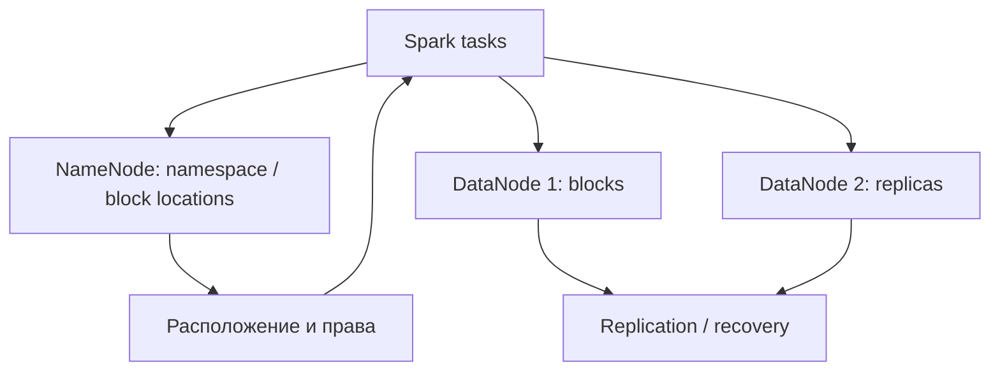
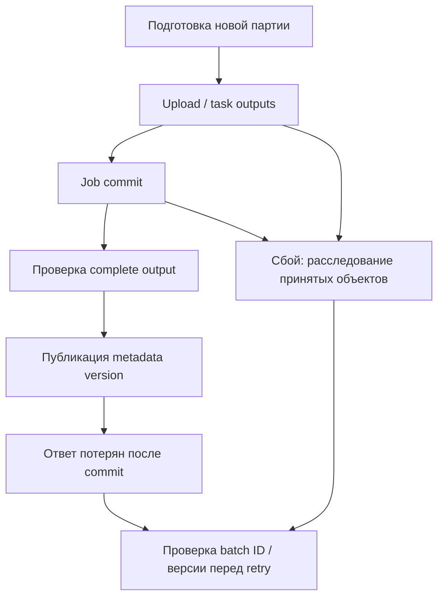
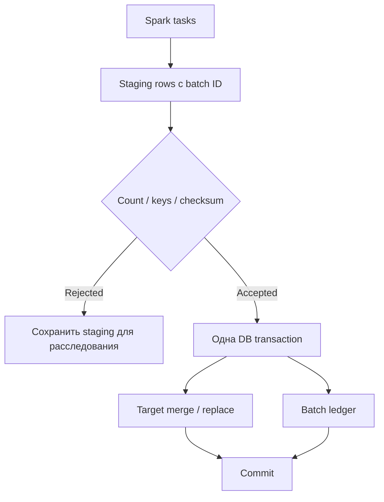
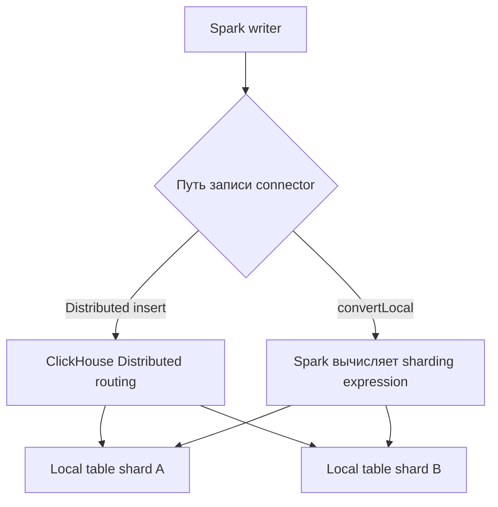
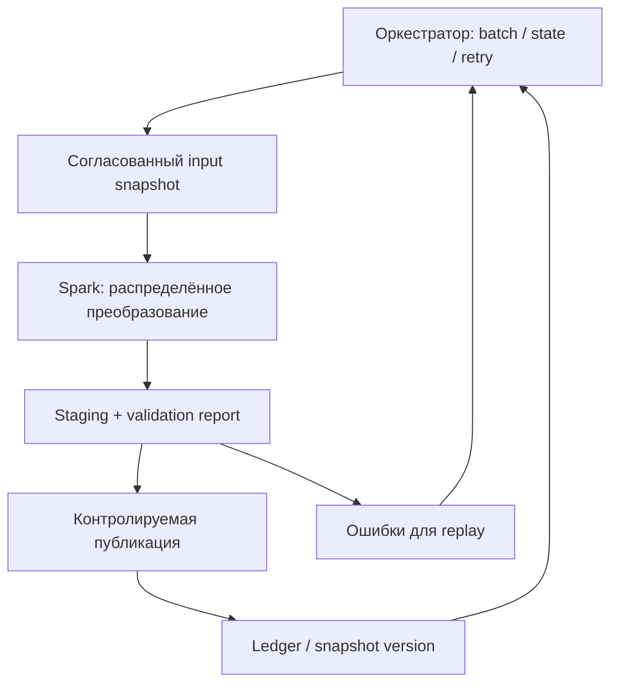

# 8. Системы хранения и внешние источники

Spark распределяет вычисления, но данные остаются в конкретной системе: HDFS, объектном хранилище, SQL-базе, аналитической базе, NoSQL или внешнем API. У каждой системы свои границы параллелизма, права доступа, стоимость запросов и правила видимости результата. Быстрое Spark-приложение может перегрузить источник, а успешно завершившийся task — оставить повторно записанные строки.

Здесь разобраны **9 тем и 69 пунктов** оглавления. Структура сохраняется: раздел → тема → пункт. Объяснения, примеры, схемы и практики находятся на одной странице.

**Файл:** `storage_and_external_sources.md`.

**Предварительные знания.** SparkSession, executor/task, DataFrame, схемы, joins, partitioning, ленивое выполнение, Spark UI и `explain`. Чтение форматов файлов, NULL/parser modes и layout Parquet/ORC разбирались в предыдущем разделе. Здесь внимание на системах хранения, connectors и корректности интеграции.

**Окружения и границы проверки**

- Основные локальные примеры: Spark **4.2.0**, Python 3.12, Java 17, Spark Classic, Hadoop libraries дистрибутива, JDBC driver **H2 2.3.232**.
- H2 in-memory работает внутри JVM локального Spark и не требует внешнего сервера. Этот URL нельзя переносить в distributed cluster как общую базу: разные JVM получат разные базы.
- S3/ABFS/GCS, production JDBC, ClickHouse и другие connectors показаны как **шаблоны внешнего подключения**. Им нужны выбранные совместимые JARs, сеть, endpoint и credentials; локальная проверка H2 не доказывает их работу.
- Для ClickHouse native connector используйте его собственную compatibility matrix. На дату проверки **12 октября 2026 года** документация connector 0.10.0 перечисляет Spark 3.3–3.5 и 4.0, а не 4.2. Эти примеры предназначены для отдельно подобранного совместимого окружения.
- Для внешних шаблонов никогда не подставляйте рабочие credentials в GitHub. Переменные окружения в примерах объясняют передачу значений; production secret delivery и обновление identity организует платформа.

**Проверка материала.** На локальном окружении выполнены 40 коротких Python-блоков, 40 проверок JDBC-практики и 17 проверок HTTP-практики. Внешние подключения к облакам, ClickHouse и другим сервисам отмечены как шаблоны; им нужны собственные compatible environments и integration tests.

**Содержание**

1. [Файловые системы и Hadoop connectors](#filesystems-connectors)
2. [Amazon S3 и S3-совместимые хранилища](#s3-compatible)
3. [Azure и Google Cloud Storage](#azure-gcs)
4. [Надёжная работа с объектным хранилищем](#object-storage-correctness)
5. [JDBC: чтение из реляционных баз](#jdbc-reading)
6. [JDBC: запись и транзакции](#jdbc-writing)
7. [Внешние аналитические и NoSQL-системы](#external-analytical-nosql)
8. [ClickHouse connector и интеграция](#clickhouse)
9. [Внешние сервисы из задач Spark](#external-services)

**Как выполнять код**

Короткие локальные Python-блоки выполняются последовательно в одной сессии. Блоки с пометкой **«Шаблон внешнего окружения»** выполняются отдельно после настройки соответствующей системы. Самостоятельные JDBC- и HTTP-практики ниже создают собственное окружение и завершают его сами.

Установка:

```bash
python -m venv .venv
source .venv/bin/activate
python -m pip install pyspark==4.2.0
mkdir -p jars
curl -fL https://repo.maven.apache.org/maven2/com/h2database/h2/2.3.232/h2-2.3.232.jar \
  -o jars/h2-2.3.232.jar
pyspark --master 'local[2]' --jars jars/h2-2.3.232.jar
```

В Windows активируйте окружение командой `.venv\Scripts\Activate.ps1`. Java установите отдельно. JAR нужно подключить **до создания SparkContext**; повторный `getOrCreate()` не перезапускает уже созданную JVM с новым classpath.

Создадим общую учебную сессию. В PySpark shell она уже существует, но matching builder settings надо передавать при запуске или использовать отдельный Python-процесс. Здесь показан setup для нового процесса:

```python
from pathlib import Path
from tempfile import TemporaryDirectory
from decimal import Decimal
from datetime import date
from contextlib import contextmanager
from urllib.parse import urlsplit
import json
import os
import uuid
import hashlib
from pyspark.sql import SparkSession, functions as F, types as T

workspace = TemporaryDirectory(prefix="spark_storage_chapter_")
ROOT = Path(workspace.name)
JDBC_URL = "jdbc:h2:mem:chapter8_" + uuid.uuid4().hex + ";DB_CLOSE_DELAY=-1"
spark = (
    SparkSession.builder.master("local[2]")
    .appName("chapter-8-storage")
    .config("spark.sql.shuffle.partitions", "2")
    .config("spark.sql.session.timeZone", "UTC")
    .config("spark.sql.warehouse.dir", str(ROOT / "warehouse"))
    .config("spark.sql.catalog.labdb", "org.apache.spark.sql.execution.datasources.v2.jdbc.JDBCTableCatalog")
    .config("spark.sql.catalog.labdb.url", JDBC_URL)
    .config("spark.sql.catalog.labdb.driver", "org.h2.Driver")
    .config("spark.sql.catalog.labdb.user", "sa")
    .config("spark.sql.catalog.labdb.password", "")
    .getOrCreate()
)
spark.sparkContext.setLogLevel("ERROR")

@contextmanager
def sql_settings(**changes):
    previous = {key: spark.conf.get(key) for key in changes}
    try:
        for key, value in changes.items():
            spark.conf.set(key, value)
        yield
    finally:
        for key, value in previous.items():
            spark.conf.set(key, value)

orders = spark.createDataFrame([
    (1, 1, Decimal("100.50"), "RU", date(2026, 1, 1)),
    (2, 1, Decimal("200.00"), "RU", date(2026, 1, 1)),
    (3, 2, Decimal("30.25"), "DE", date(2026, 1, 2)),
    (4, 3, Decimal("40.00"), "US", date(2026, 1, 2)),
], "id INT, customer_id INT, amount DECIMAL(10,2), country STRING, event_date DATE")
assert orders.count() == 4
```

Сессия Spark Classic позволяет ниже осмотреть Hadoop/JDBC JVM API через диагностический мост. Это учебные helpers; Spark Connect не предоставляет такой же `_jvm`/`_jsc` доступ. Прикладные чтение и запись остаются обычными DataFrame/JDBC operations.

<a id="filesystems-connectors"></a>
## Файловые системы и Hadoop connectors

### Локальная файловая система и доступность пути на исполнителях

`/data/orders` и `file:///data/orders` обозначают локальную файловую систему **машины, которая обращается к пути**. В local mode driver и tasks работают на одной машине, поэтому пример кажется универсальным. На кластере executors могут видеть другой диск или вообще не иметь такого каталога.

```python
local_data = ROOT / "orders"
orders.write.parquet(str(local_data))
local_uri = local_data.as_uri()
local_read = spark.read.parquet(local_uri)
assert local_uri.startswith("file:///")
assert local_read.count() == 4
```

Для кластерного input нужно одно из условий: общее хранилище, одинаково смонтированный shared filesystem или корректная раздача небольших вспомогательных файлов. Совпадение строк пути не доказывает совпадение содержимого.

`SparkContext.addFile` подходит для небольшого reference/config fixture, а не для незаметной раздачи терабайтного dataset на все nodes. Local path driver нельзя автоматически передать Python worker как «общий источник».

В Kubernetes учитывайте mounts, persistent volumes, pod identity и lifetime. В YARN — расположение локализованных ресурсов и доступ executor user. Отдельно проверяйте путь **из task**, а не только через `ls` на driver node.

### Hadoop FileSystem API и URI источников

Spark file sources используют Hadoop FileSystem abstraction. URI scheme выбирает реализацию: `hdfs`, `s3a`, `abfs/abfss`, `gs`, `file`; authority и path задают конкретное расположение.

```python
jvm = spark.sparkContext._jvm
hadoop_conf = spark.sparkContext._jsc.hadoopConfiguration()
jpath = jvm.org.apache.hadoop.fs.Path(local_uri)
filesystem = jpath.getFileSystem(hadoop_conf)
assert filesystem.exists(jpath)
assert filesystem.getFileStatus(jpath).isDirectory()
local_statuses = filesystem.listStatus(jpath)
assert any(status.getPath().getName().endswith(".parquet") for status in local_statuses)
print("Filesystem URI:", filesystem.getUri().toString())
```

`FileSystem.get(uri, conf)`/`Path.getFileSystem(conf)` не делают одинаковыми гарантии всех implementations. Общие methods create/list/delete/rename могут иметь разную атомарность и цену.

| URI | Что выбирает |
|---|---|
| `file:///data/x` | Local filesystem |
| `hdfs://nameservice/data/x` | HDFS namespace / nameservice |
| `s3a://bucket/prefix` | Hadoop S3A connector |
| `abfss://container@account.dfs.core.windows.net/path` | ABFS с TLS |
| `gs://bucket/path` | GCS connector |

Не собирайте cloud URI через `Path(...)` локального Python: он описывает OS path и может нормализовать слеши иначе. Используйте явно построенный URI с проверенными bucket/container names.

CLI `hadoop fs` и Spark могут получать разные конфигурации/classpaths. Если CLI читает объект, это ещё не доказывает, что executor JVM использует тот же provider и identity.

### HDFS, блоки, репликация и NameNode

HDFS отделяет metadata от content: NameNode управляет namespace и расположением blocks, DataNodes хранят block replicas. Client сначала узнаёт расположение, затем получает bytes у DataNodes; NameNode обычно не прокачивает через себя весь file content.



Block size и replication factor — storage settings. Task/input partition определяется source, splitability, files и Spark planning; «один HDFS block всегда равен одной Spark partition» неверно.

Replication повышает устойчивость к отказам DataNodes, но не исправляет неправильный overwrite приложения. Small files нагружают namespace/listing и уменьшают эффективность scans. HDFS locality может помогать, но не отменяет network IO и scheduler constraints.

**Шаблон внешнего окружения: HDFS**

<!-- SPARK_STORAGE_TEMPLATE_BEGIN -->
```python
hdfs_orders = (
    spark.read.schema("id INT, amount DECIMAL(10,2)")
    .parquet("hdfs://analytics-ns/data/orders")
)
hdfs_orders.select("id", "amount").show(10)
```
<!-- SPARK_STORAGE_TEMPLATE_END -->

HA nameservice, `core-site.xml`/`hdfs-site.xml`, Kerberos, delegation tokens и ACL должны быть согласованы на driver и executors. Connection success к NameNode не гарантирует доступность DataNodes и всех нужных network ports.

### Объектное хранилище и отличие от файловой системы

Object store хранит объекты по keys. «Каталог» часто является соглашением о prefix, а не отдельной inode-структурой. FileSystem connector переводит Spark operations в HTTP/API calls.

| Свойство | HDFS / filesystem | Object store |
|---|---|---|
| Путь | Namespace с directories | Object key / prefix |
| Rename directory | Может быть metadata operation | Часто серия copy/delete operations |
| Append к одному файлу | Зависит от filesystem | Обычно запись нового объекта/другой protocol |
| Listing | Namespace operation | API requests с pagination |
| Lock/transaction | Необходимо смотреть реализацию | Не появляется автоматически из совместимости S3 API |

Это не означает, что object store всегда eventual consistent: AWS S3 предоставляет strong consistency для обычных object reads/writes/listing в документированных пределах. Однако strong consistency отдельных объектов не является транзакцией множества part-files.

Не используйте URI scheme как доказательство атомарности rename, compare-and-swap или snapshot visibility. Прочитайте guarantees сервиса и connector отдельно.

### Hadoop configuration и параметры spark.hadoop.*

При запуске `spark.hadoop.<key>` переносит значение в Hadoop configuration без префикса `spark.hadoop.`. Например, `spark.hadoop.fs.s3a.endpoint` задаёт `fs.s3a.endpoint` для S3A.

```python
hadoop_conf.set("chapter8.example", "configured")
assert hadoop_conf.get("chapter8.example") == "configured"
print("Hadoop version:", jvm.org.apache.hadoop.util.VersionInfo.getVersion())
```

Этот setter изменяет Hadoop configuration драйвера в текущей Classic сессии. Для распределённого запуска важные настройки задают **до старта** через builder, spark-submit, platform configuration или site XML, чтобы tasks получили нужный contract.

Не считайте `spark.conf.set("spark.hadoop.fs...", value)` универсальным способом перенастроить уже созданный FileSystem client: Hadoop configuration, Spark SQL config и cached filesystem instance — разные объекты. После создания client прежние endpoint/identity settings могут сохраняться.

**Шаблон внешнего окружения: configuration при запуске**

```bash
spark-submit \
  --conf spark.hadoop.fs.s3a.endpoint.region=eu-central-1 \
  --conf spark.hadoop.fs.s3a.connection.maximum=64 \
  application.py
```

Число 64 — пример явно выбранного лимита, не рекомендация для любого кластера. Secrets не следует передавать в публичной command line: используйте approved identity/secret mechanism. Spark redaction уменьшает exposure в части logs/UI, но не заменяет управление credentials.

### Версии connector, Hadoop libraries и зависимостей SDK

Connector запускается внутри JVM classpath и зависит от Hadoop, SDK, HTTP clients, Jackson/Guava и других библиотек. Правильная версия Spark не гарантирует совместимость произвольной версии connector.

```python
runtime_identity = {
    "spark": spark.version,
    "hadoop": jvm.org.apache.hadoop.util.VersionInfo.getVersion(),
    "java": jvm.java.lang.System.getProperty("java.version"),
    "scala": jvm.scala.util.Properties.versionNumberString(),
}
assert runtime_identity["spark"] == "4.2.0"
assert runtime_identity["hadoop"]
print(runtime_identity)
```

`spark-submit --packages` решает dependency retrieval, но не доказывает binary compatibility. Для `hadoop-aws` обычно требуется версия, соответствующая Hadoop libraries сборки; matching AWS SDK должен поступать из опубликованного dependency set этой версии.

`ClassNotFoundException` часто означает отсутствующий JAR; `NoSuchMethodError` — конфликт/несовместимость уже найденных classes. Проверяйте jar origin и versions на driver **и executors**, не только наличие имени файла.

При управляемой платформе сначала выясните, какие connectors уже поставляются. Добавление второй копии cloud SDK или Hadoop client может сломать ранее рабочий путь. Зафиксируйте matrix: Spark, Scala binary version, Java, Hadoop, connector, SDK, service version и проверенный способ запуска.

**Практика.** Составьте inventory versions вашей сессии, прочитайте локальный URI через DataFrame и Hadoop API, затем объясните, почему тот же `file://` путь не становится cluster-wide dataset.
<a id="s3-compatible"></a>
## Amazon S3 и S3-совместимые хранилища

### S3A connector и схема s3a

S3A — Hadoop connector для доступа к S3 API. Apache Spark обращается к нему через `s3a://bucket/prefix`, а provider Parquet/CSV/JSON интерпретирует полученные bytes.

Схема `s3://` в управляемой платформе может обозначать другую implementation, например встроенный platform filesystem. Поэтому копировать configuration между `s3`, `s3a` и платформами без проверки нельзя.

**Шаблон внешнего окружения: batch read**

<!-- SPARK_STORAGE_TEMPLATE_BEGIN -->
```python
s3_input = "s3a://training-data/raw/orders/"
s3_orders = (
    spark.read.schema("id INT, amount DECIMAL(10,2), event_date DATE")
    .parquet(s3_input)
)
s3_orders.filter("event_date >= DATE '2026-01-01'").explain("formatted")
```
<!-- SPARK_STORAGE_TEMPLATE_END -->

Для работы нужны `hadoop-aws` и его matching SDK dependencies, а также доступ к endpoint и identity. Часть Spark distributions включает их заранее; в других их нужно добавить. Не устанавливайте произвольный «самый новый» hadoop-aws поверх старого Hadoop client.

`spark.read.format("parquet")` выбирает **формат**, `s3a` выбирает **storage connector**. Наличие одного не подтверждает наличие другого. Ошибка `No FileSystem for scheme s3a` относится к connector registration/classpath, а не к Parquet schema.

### Credentials providers и временные credentials

Credentials provider получает identity credentials для SDK: environment, instance/container role, assumed role, temporary session или другой поддерживаемый механизм. Он должен работать там, где создаётся storage client, в том числе на executors.

Временные AWS credentials включают access key, secret key, **session token** и expiration. Передать только первые два значения недостаточно. Long-running приложение также должно уметь получить новые credentials после истечения срока.

**Шаблон внешнего окружения: platform identity**

```bash
spark-submit \
  --conf spark.hadoop.fs.s3a.aws.credentials.provider=software.amazon.awssdk.auth.credentials.DefaultCredentialsProvider \
  read_s3.py
```

Этот class относится к AWS SDK v2; имя provider из SDK v1 начинается с другого package. Сначала проверьте, что выбранный Hadoop/S3A release поддерживает такой provider и что его chain соответствует способу доставки identity вашей платформы.

| Механизм | Что важно |
|---|---|
| VM/container role | Endpoint identity доступен каждой нужной JVM |
| Workload identity/web identity | Token file/role binding и SDK support |
| AssumeRole | Source identity, STS permissions, role session refresh |
| Temporary static tuple | Полный tuple + expiration; ручной tuple не гарантирует refresh |
| Environment variables | Переменные должны быть у executors; driver env не распространяется автоматически |
| Hadoop credential provider store | Доставка/доступ и поддержка конкретного filesystem |

Hadoop CredentialProvider для хранения secrets и AWS credentials provider для получения SDK identity — разные abstractions, хотя названия похожи. Не перепутайте `hadoop.security.credential.provider.path` и `fs.s3a.aws.credentials.provider`.

Не выводите credentials в notebook/logs и не включайте secret в URL. Redaction не мешает случайному прямому print значения из Python. Credentials renewal и negative permission tests входят в проверку интеграции.

### IAM roles, endpoint, region и path-style access

Authentication отвечает «кто вы», authorization — «что вы можете». Role может быть получена успешно, но не иметь ListBucket/GetObject/PutObject/DeleteObject или KMS permissions для выбранного prefix.

Endpoint и region участвуют в маршрутизации/signing. Неправильная зона может привести к redirect/signature errors, неправильный endpoint — к обращению не в тот storage service.

**Шаблон внешнего окружения: отдельные storage settings**

```bash
spark-submit \
  --conf spark.hadoop.fs.s3a.endpoint.region=eu-central-1 \
  --conf spark.hadoop.fs.s3a.connection.ssl.enabled=true \
  read_s3.py
```

Для S3-compatible services часто нужен custom endpoint и `fs.s3a.path.style.access=true`. Path style помещает bucket в path, virtual-host style — в hostname. Требования определяют сервис, DNS и TLS certificate, а не Spark SQL.

Для TLS проверьте certificate trust на JVM executors. Отключение certificate validation или TLS для устранения connection error не является корректной настройкой production интеграции.

При multiple buckets используют supported per-bucket configuration. Не изменяйте global endpoint/credentials посреди приложения, надеясь, что cached clients автоматически обновятся.

### MinIO и локальное S3-совместимое окружение

Локальное S3-compatible окружение позволяет практиковать endpoints, paths, credentials и file publication без облачного аккаунта. Оно полезно для интеграционных fixtures, но не заменяет AWS IAM/KMS/STS и реальные service limits.

**Актуальность дистрибутива.** Репозиторий `minio/minio` архивирован 25 апреля 2026 года и отмечен как больше не поддерживаемый. Его README описывает source-only community distribution и отдельно перечисляет AIStor alternatives. Поэтому старую команду `docker run minio/minio:latest` нельзя представлять как проверенный текущий способ установки. Выберите конкретную поддерживаемую поставку либо закреплённую учебную сборку по [официальному репозиторию](https://github.com/minio/minio).

**Шаблон внешнего окружения: уже выбранный локальный server**

Если вы уже собрали или выбрали закреплённый учебный image с MinIO-compatible CLI, его можно запустить локально. `S3_LAB_IMAGE` должен указывать на конкретный tag/digest выбранной сборки; это не предложение использовать устаревший `latest`.

```bash
: "${S3_LAB_IMAGE:?Укажите закреплённый учебный image}"
: "${S3_ACCESS_KEY:?Задайте локальный access key}"
: "${S3_SECRET_KEY:?Задайте локальный secret key}"
mkdir -p minio-data
docker run --rm --name spark-s3-lab \
  -p 127.0.0.1:9000:9000 -p 127.0.0.1:9001:9001 \
  -v "$PWD/minio-data:/data" \
  -e MINIO_ROOT_USER="$S3_ACCESS_KEY" -e MINIO_ROOT_PASSWORD="$S3_SECRET_KEY" \
  "$S3_LAB_IMAGE" server /data --console-address ':9001'
```

Для выбранного image подтвердите command-line flags и version в его инструкции. Docker setup приведён как внешний шаблон и здесь не запускался. После старта server отдельным терминалом создайте учебный bucket:

```bash
export S3_ENDPOINT='http://127.0.0.1:9000'
export S3_REGION='us-east-1'
# S3_ACCESS_KEY и S3_SECRET_KEY задайте локально вне репозитория.
aws --endpoint-url "$S3_ENDPOINT" --region "$S3_REGION" \
  s3api create-bucket --bucket spark-lab
```

AWS CLI использует свои credentials mechanisms (`AWS_ACCESS_KEY_ID`, `AWS_SECRET_ACCESS_KEY`, profiles и другие). Переменные `S3_ACCESS_KEY` ниже относятся к Python-шаблону; они не становятся AWS CLI identity автоматически. Для CLI настройте dedicated учебный profile/environment.

Пример новой SparkSession для S3-compatible endpoint; зависимости S3A уже должны быть подключены:

<!-- SPARK_STORAGE_TEMPLATE_BEGIN -->
```python
import os
from pyspark.sql import SparkSession

storage_spark = (
    SparkSession.builder.appName("s3-compatible-lab")
    .config("spark.hadoop.fs.s3a.endpoint", os.environ["S3_ENDPOINT"])
    .config("spark.hadoop.fs.s3a.endpoint.region", os.environ.get("S3_REGION", "us-east-1"))
    .config("spark.hadoop.fs.s3a.path.style.access", "true")
    .config("spark.hadoop.fs.s3a.connection.ssl.enabled", "false")  # Только локальный HTTP fixture.
    .config("spark.hadoop.fs.s3a.aws.credentials.provider", "org.apache.hadoop.fs.s3a.SimpleAWSCredentialsProvider")
    .config("spark.hadoop.fs.s3a.access.key", os.environ["S3_ACCESS_KEY"])
    .config("spark.hadoop.fs.s3a.secret.key", os.environ["S3_SECRET_KEY"])
    .getOrCreate()
)
storage_spark.range(10).write.mode("errorifexists").parquet("s3a://spark-lab/example-batch")
assert storage_spark.read.parquet("s3a://spark-lab/example-batch").count() == 10
```
<!-- SPARK_STORAGE_TEMPLATE_END -->

В distributed/container setup `127.0.0.1` означает текущую машину/контейнер executor. Нужно адресовать server, доступный всем участникам, и обеспечить network route. Для настоящего TLS endpoint замените fixture settings и trust configuration.

Этот roundtrip — минимальный smoke test. Затем проверяйте multipart, committer, interrupted write, missing permissions и concurrent readers на selected implementation.

### Multipart upload, connection pool и request retries

Большой object может записываться multipart upload: создаётся upload session, загружаются parts, затем выполняется completion. Пока completion не выполнен, object не является обычной завершённой новой версией для reader.

Параллельные Spark tasks, filesystem clients и SDK threads создают суммарную нагрузку. Connection pool относится к конкретному client/JVM, а не автоматически ко всему кластеру.

| Настройка/понятие | Для чего | Цена слишком большого значения |
|---|---|---|
| `fs.s3a.connection.maximum` | Лимит connections client | Рост нагрузки и числа sockets |
| `fs.s3a.threads.max` | Потоки операций connector | Больше concurrency и памяти |
| `fs.s3a.multipart.size` | Размер upload part | Большие buffers/retry units |
| Retry policy SDK/S3A | Временные ошибки | Retry amplification и длинные hangs |
| Upload buffer strategy | Где держать данные перед upload | RAM или local disk pressure |

Изучайте defaults и units конкретной версии. Для memory upload buffers учитывайте number of active blocks × part size × concurrent streams; это может выходить за JVM heap accounting или конкурировать с Python memory.

Retryable network failure не равна ошибке credentials/schema. Permanent failure не станет успешным от сотни retries. Задайте ограниченные attempts, backoff, deadline и наблюдаемые counters.

### Стоимость listing, запросов, rename и удаления объектов

Для object store стоимость определяется не только гигабайтами: есть listing/head/get/put/copy/delete calls, transfer и service latency. На millions of small files planning и request overhead могут быть тяжелее собственно scan.

Rename prefix часто означает copy каждого объекта и delete исходных keys. Это может быть долгой операцией с частичным результатом при сбое. Copy большого object также может использовать multipart copy.

```python
local_file_inventory = [path for path in local_data.glob("part-*.parquet")]
assert local_file_inventory
print("Файлы учебного output:", len(local_file_inventory))
```

Локальная inventory показывает только file count; реальные cloud requests измеряйте через connector/service metrics. Не умножайте local rename time на количество объектов и не выдавайте результат за cloud benchmark.

Для layout важны число files, typical size, partition cardinality и доступность metadata manifests. Partition pruning может сократить scan, но не всегда устраняет listing всех keys, если metadata discovery устроено иначе.

Deletion policy должен учитывать snapshots/readers и ownership. Массовое удаление по prefix не заменяет table-format cleanup и может разрушить ещё используемые версии.

### Committers и безопасная публикация файлов

S3-aware committer меняет публикацию output, чтобы не полагаться на дорогой rename как в обычном filesystem. Staging/directory/partitioned/magic variants имеют разные requirements и conflict handling.

**Шаблон внешнего окружения: совместимый S3A magic committer**

```bash
spark-submit \
  --conf spark.hadoop.fs.s3a.committer.name=magic \
  --conf spark.hadoop.fs.s3a.committer.magic.enabled=true \
  --conf spark.hadoop.mapreduce.outputcommitter.factory.scheme.s3a=org.apache.hadoop.fs.s3a.commit.S3ACommitterFactory \
  --conf spark.sql.sources.commitProtocolClass=org.apache.spark.internal.io.cloud.PathOutputCommitProtocol \
  --conf spark.sql.parquet.output.committer.class=org.apache.spark.internal.io.cloud.BindingParquetOutputCommitter \
  write_s3.py
```

Это не универсальный paste для всех builds. Нужны соответствующие Spark cloud classes (в некоторых distributions через matching `spark-hadoop-cloud`), S3A modules и проверка source/provider path. Managed platforms могут использовать свой committer и несовместимые overrides.

Смотрите **фактически выбранный committer в logs** и проведите failure test на отдельном output. Если writer silently продолжает использовать rename committer, набор конфигурационных строк ничего не доказал.

Job commit многих объектов всё равно не следует считать транзакционной сменой snapshot для независимого reader, который сканирует prefix во время completion. Для согласованного snapshot используйте version selection/manifest или transaction protocol table format.

### Различия гарантий AWS S3 и других реализаций S3 API

Совместимость API означает поддержку request shapes/operations, но не тождество всех guarantees. Проверяйте consistency, multipart, conditional requests, versioning, encryption, STS и pagination каждого сервиса.

AWS S3 имеет документированную strong consistency обычных object reads/writes/listing. Старые материалы и даже отдельные cloud-integration страницы могут ещё описывать S3 как eventual consistent; для актуальной модели ориентируйтесь на [официальную документацию S3](https://docs.aws.amazon.com/AmazonS3/latest/userguide/Welcome.html).

ETag не всегда является MD5 file content, особенно для multipart и encryption modes. Используйте документированные checksum fields/algorithms, если требуется content integrity.

| Проверка | Что должно быть доказано |
|---|---|
| PUT → GET/LIST | Видимость нового объекта |
| Overwrite → read | Семантика версии и metadata |
| Multipart completion/abort | Видимость и очистка parts |
| Concurrent writers | Conflict/conditional write behavior |
| Range read | Корректность byte ranges для columnar readers |
| Connector committer | Совместимость выбранного publication protocol |

Local S3-compatible fixture подтверждает интеграцию с ним. Прежде чем использовать выводы для AWS или другого vendor, повторите обязательные tests на целевом сервисе.

<a id="azure-gcs"></a>
## Azure и Google Cloud Storage

### ADLS Gen2, ABFS и abfss

ABFS connector обращается к Azure Blob File System endpoint; ADLS Gen2 с hierarchical namespace добавляет filesystem-oriented semantics. URI имеет вид `abfss://container@account.dfs.core.windows.net/path`.

`abfss` означает TLS transport; название схемы не является credential. `wasb/wasbs` относятся к другой исторической интеграции Azure и не взаимозаменяемы с ABFS по конфигурации и свойствам.

**Шаблон внешнего окружения**

<!-- SPARK_STORAGE_TEMPLATE_BEGIN -->
```python
adls_uri = "abfss://training@storageaccount.dfs.core.windows.net/orders/"
adls_orders = spark.read.parquet(adls_uri)
adls_orders.select("id", "amount").show(10)
```
<!-- SPARK_STORAGE_TEMPLATE_END -->

Для работы нужны matching hadoop-azure dependencies, сеть/DNS, выбранный OAuth/SAS/другой supported identity и права. Возможности directory rename при hierarchical namespace отличаются от «copy/delete prefix» generic object store; проверяйте конкретный account и используемый endpoint.

Это важное исключение: не переносите утверждение об отсутствии directory rename в S3 на все cloud filesystems. Общий Spark API не стирает различия storage implementations.

### OAuth, managed identities и способы получения токенов

ABFS поддерживает несколько token provider implementations. Service principal client credentials, managed identity и workload identity отличаются тем, откуда берётся token и какие ресурсы доступны runtime.

**Шаблон внешнего окружения: service principal для одного account**

<!-- SPARK_STORAGE_TEMPLATE_BEGIN -->
```python
account = "storageaccount.dfs.core.windows.net"
azure_spark = (
    SparkSession.builder.appName("adls-example")
    .config(f"spark.hadoop.fs.azure.account.auth.type.{account}", "OAuth")
    .config(f"spark.hadoop.fs.azure.account.oauth.provider.type.{account}",
            "org.apache.hadoop.fs.azurebfs.oauth2.ClientCredsTokenProvider")
    .config(f"spark.hadoop.fs.azure.account.oauth2.client.id.{account}", os.environ["AZURE_CLIENT_ID"])
    .config(f"spark.hadoop.fs.azure.account.oauth2.client.secret.{account}", os.environ["AZURE_CLIENT_SECRET"])
    .config(f"spark.hadoop.fs.azure.account.oauth2.client.endpoint.{account}",
            f"https://login.microsoftonline.com/{os.environ['AZURE_TENANT_ID']}/oauth2/token")
    .getOrCreate()
)
```
<!-- SPARK_STORAGE_TEMPLATE_END -->

Для managed identity используется соответствующий provider, например `MsiTokenProvider`, с доступом к platform identity endpoint. Для workload identity нужен supported `WorkloadIdentityTokenProvider`, federation setup и token file; произвольная VM не получает эту identity автоматически.

Имена properties/provider classes проверяйте по версии Hadoop. Не меняйте только class name, оставляя client-secret настройки другой схемы authentication: разные providers требуют разных параметров.

Tokens истекают. Проверяйте refresh на long-running queries и executors, а не только начальный driver listing. Ошибка 401 и 403 обычно требуют разных действий: identity/token versus authorization.

### GCS connector и схема gs

GCS connector реализует Hadoop filesystem для `gs://bucket/path`. У Google managed Spark он может поставляться заранее; в собственном Spark installation его обычно подключают отдельно.

**Шаблон внешнего окружения: GCS input**

<!-- SPARK_STORAGE_TEMPLATE_BEGIN -->
```python
gcs_orders = spark.read.parquet("gs://training-data/orders/")
gcs_orders.filter("country = 'RU'").show(10)
```
<!-- SPARK_STORAGE_TEMPLATE_END -->

Дистрибутив connector должен соответствовать Hadoop/Java окружению; shaded JAR часто упрощает dependency isolation, но не является гарантией совместимости любой версии.

`spark.read.format("bigquery")` и `spark.read.parquet("gs://...")` используют **разные connectors**: первый — аналитическую систему BigQuery, второй — объектное хранилище GCS. Даже если BigQuery connector применяет GCS staging, эти роли остаются раздельными.

Configuration names, auth options, transport gRPC/HTTP support и performance settings менялись между GCS connector versions. Используйте config reference закреплённой версии, а не смешивайте примеры разных поколений.

### Service accounts и workload identity

Service account — identity, а не обязательно JSON key file. На managed compute предпочтительный доступ часто организован через platform identity/ADC и federation без долгоживущего private key.

**Шаблон внешнего окружения: Application Default Credentials при поддержке connector**

```bash
spark-submit \
  --conf spark.hadoop.fs.gs.auth.type=APPLICATION_DEFAULT \
  read_gcs.py
```

ADC должен разрешаться в runtime каждой нужной JVM. Рабочая авторизация `gcloud` на вашем ноутбуке не гарантирует авторизацию executors в отдельном кластере.

Если требуется service account key file, его наличие на driver не обеспечивает доставку workers; проверьте supported provider и защищённый способ distribution. Не кладите JSON key в repository, image layer общего назначения или общедоступный bucket.

Workload Identity Federation связывает внешнюю workload identity с доступом Google Cloud. Нужны policy bindings и supported auth library/configuration. Это не то же самое, что environment variable с именем service account.

### Разрешения на чтение, запись и listing

Storage permissions рассматривайте по операциям, которые connector реально выполняет. Читать object с известным key и перечислять весь prefix — разные разрешения. Overwrite может требовать delete, committer — multipart/metadata operations, encrypted object — доступ к ключу.

| Сценарий | Что проверить |
|---|---|
| File discovery | List directory/prefix |
| Schema inference | Read metadata/footer/ranges |
| Scan | Read object content |
| Append | Create/write objects + commit operations |
| Overwrite | Delete/replace требуемой области |
| Cleanup | Abort multipart/delete temporary objects |

В ADLS hierarchical namespace учитывайте сочетание RBAC и ACL/traversal permissions. В GCS — bucket/object IAM и configured policy; модель directory ACL нельзя автоматически перенести между ними.

Проверяйте минимальный контракт на выделенном учебном prefix. Ошибка в listing может быть permissions issue, хотя GET отдельного объекта работает. Успех driver operation также не доказывает права executor identity.

### Настройки соединений, повторных попыток и пропускной способности

Cloud connectors управляют threads, connections, read-ahead, buffers, request retries и timeouts. Конкретные option names и units относятся к connector version.

Ограничение внутри одного JVM client умножается на число executors и одновременно работающих приложений. Dynamic allocation может увеличить суммарную нагрузку даже без изменения вашего configuration file.

Тюнинг начинайте с наблюдений: latency/throughput, retry counts, throttled responses, executor memory, open files/streams и request volume. Затем меняйте один связанный набор settings и проверяйте total cost.

Large read-ahead может помочь последовательному scan и мешать selective reads, где нужна маленькая часть columnar file. Write buffers могут попасть в memory overhead или local disk; проверьте это вместе с task concurrency.

Timeout одного запроса не ограничивает весь pipeline, если retries создают новые attempts. Нужны понятные per-request deadlines, bounded retry budget и application-level failure policy.

### Совместимость SDK и библиотек конкретного connector

ABFS/GCS connector, auth libraries и transport libraries образуют dependency set. Версии внутри managed image могут отличаться от Maven defaults для standalone Spark.

Составьте reproducible manifest без secrets: distributions, JAR coordinates/sha, auth mode, endpoint class, tests и result schema. Проверяйте его заново после platform/runtime upgrade.

```python
integration_manifest = {
    "spark": runtime_identity["spark"],
    "hadoop": runtime_identity["hadoop"],
    "jdbc_driver": "com.h2database:h2:2.3.232",
    "tested_storage": "local-file",
    "cloud_connectors": "отдельные внешние окружения",
}
assert "password" not in integration_manifest
print(integration_manifest)
```

Smoke test должен включать read, write, list, permissions failure и renewal/retry scenario по требованиям. «JAR загрузился» проверяет только classpath startup, а не полный integration contract.
<a id="object-storage-correctness"></a>
## Надёжная работа с объектным хранилищем

### Consistent listing и гарантии конкретного сервиса

Consistency отвечает на вопрос, что reader может увидеть после завершённой операции. Для strong-consistent object operations reader видит изменения согласно документированной модели; для eventually consistent operations возможна задержка. Но ни одна из этих формулировок сама не определяет snapshot наборов из тысяч объектов.

Представим output из part-A и part-B. Writer может успешно завершить A, затем завершить B. Reader между этими действиями увидит корректно опубликованный **один объект**, но неполный dataset. Это проблема multi-object publication, а не обязательно stale listing.

Для устойчивого чтения выберите протокол: immutable batch prefix + finished manifest, catalog/table transaction или другой supported mechanism. Manifest должен ссылаться на конкретный complete dataset, а consumer — следовать этому контракту.

```python
version_path = ROOT / "immutable_batch_001"
orders.write.mode("errorifexists").parquet(str(version_path))
local_manifest = {
    "batch_id": "001",
    "data_uri": version_path.as_uri(),
    "row_count": 4,
    "state": "ready",
}
assert spark.read.parquet(local_manifest["data_uri"]).count() == local_manifest["row_count"]
```

Это local fixture идеи immutable version. На настоящем object store дополнительно нужны guarantees записи/смены manifest, ownership и conflict handling. Reader не должен выбирать «самую новую» версию по modification time случайного part-file.

### Отсутствие дешёвого атомарного rename каталога

В generic object namespace rename prefix часто реализуется как copy/delete каждого key. Это дорого, требует extra permissions и не даёт универсального atomic directory switch. У storage с hierarchical namespace может быть другая операция — проверяйте actual filesystem.

Поэтому не переносите локальную стратегию `os.rename(staging, published)` на S3. Python `os.rename` вообще не работает с `s3a://` как с OS path.

Частый паттерн: записать новую immutable версию и изменить маленький metadata pointer. Но **сама смена pointer тоже требует guarantees**: при конкурентных publishers нужен conditional update/version check либо сериализация публикации.

```python
pointer_path = ROOT / "current.json"
temporary_pointer = ROOT / "current.next.json"
temporary_pointer.write_text(json.dumps(local_manifest), encoding="utf-8")
os.replace(temporary_pointer, pointer_path)  # Только local same-filesystem demonstration.
selected = json.loads(pointer_path.read_text(encoding="utf-8"))
assert selected["state"] == "ready"
assert spark.read.parquet(selected["data_uri"]).count() == 4
```

Local replace демонстрирует consumer contract, но не реализует cloud compare-and-swap. Для object metadata выбирайте supported conditional operations/transactional catalog, а не смешивайте rename и overwrite без проверки.

### Сбой во время commit и частично опубликованные данные

Отказ может произойти при data upload, task commit, job commit, metadata publication или после remote commit, когда клиент не получил acknowledgment. Разные моменты требуют разных recovery действий.



Если response lost после успешного remote operation, retry не должен автоматически создавать вторую бизнес-партию. Нужны batch identity и способ спросить authoritative state.

Cleanup staging должен знать, кому принадлежат объекты и есть ли активный writer/reader. `delete(prefix, recursive=true)` после любого исключения может удалить уже опубликованные данные или output другого приложения.

В logs храните application ID, batch ID, attempt ID, destination version и итоговый publication status. Контроль row count/keys/sums относится к data validation, commit status — к visibility; проверяйте оба.

### Конкурентные writers и конфликтующие перезаписи

Два writer могут прочитать одну текущую версию, независимо подготовить replacements и опубликовать их. Без conflict detection последний pointer/update может скрыть результат первого; overwrite общего prefix способен затронуть чужую незавершённую запись.

| Стратегия | Что решает | Что остаётся |
|---|---|---|
| Уникальный batch prefix | Не смешивает task output разных batches | Выбор актуальной версии |
| Один publisher / lock | Сериализует публикацию | Lease expiry, ownership, recovery |
| Version/conditional update | Обнаруживает metadata conflict | Retry/rebase policy |
| Table-format transaction | Управляет snapshot commit по protocol | Ограничения connector и supported operations |

Не используйте task partition ID как глобальный batch ID: число/распределение partitions меняется. Business batch identity должна быть стабильна между application retries.

```python
batch_ids = ["orders-2026-01-01-v1", "orders-2026-01-01-v2"]
batch_paths = [f"s3a://training-data/orders/versions/{batch_id}" for batch_id in batch_ids]
assert len(batch_paths) == len(set(batch_paths))
```

Уникальные строки paths здесь проверены локально; конфликт при публикации cloud metadata они не устраняют. Ошибки concurrent overwrites следует воспроизводить в изолированном integration test, а не проверять на общем production prefix.

### Жизненный цикл объектов и очистка незавершённых загрузок

Разделите retention для raw, staging, published versions, table snapshots, checkpoints и incomplete multipart uploads. Один lifecycle rule «удалять всё старше семи дней» может уничтожить состояние stream или snapshot, который ещё читает consumer.

Incomplete multipart upload расходует storage, даже если конечный object не виден. Abort policy и recovery должны соответствовать максимально возможной длительности job и guarantees committer.

Deletion старых data files table format выполняют по metadata protocol: сначала определить, что файлы больше не нужны никакому поддерживаемому snapshot, затем очищать. Generic prefix lifecycle не знает об active readers и metadata references.

Храните ownership marker и batch state для temporary objects. GC должен быть идемпотентным и не захватывать текущий batch. Service versioning полезен для recovery, но не заменяет application correctness или backups по нужному контракту.

### Throttling, сетевые таймауты и лимиты запросов

Ошибки 429/503 и соответствующие service codes могут означать временное ограничение нагрузки. Синхронный aggressive retry всех tasks создаёт retry storm.

Используйте bounded retries, exponential backoff с jitter, supported Retry-After и ограничение concurrency. Иногда правильное исправление — снизить число tasks/requests или поменять layout, а не увеличить timeout.

```python
def request_capacity(active_tasks, requests_per_task):
    if active_tasks < 0 or requests_per_task < 0:
        raise ValueError("Отрицательная concurrency")
    return active_tasks * requests_per_task

assert request_capacity(8, 4) == 32
assert request_capacity(40, 4) == 160
```

Это верхняя оценка **одного приложения**, а не глобальный rate limiter. Добавьте остальные jobs, retries, connector background threads и service-side limits.

Различайте connect timeout, read timeout, statement timeout и deadline всей операции. Повторение side effect допустимо только при понятной idempotency/recovery semantics. Permanent auth/type errors не должны проходить через ту же бесконечную retry loop.

### Данные, shuffle и checkpoints: разные требования к хранению

| Назначение | Основные требования |
|---|---|
| Data input/output | Durable files/objects, layout, consumer visibility, retention |
| Shuffle | Высокая скорость task exchange/spill, подходящая локальность и recovery strategy |
| Streaming checkpoint | Durable state/progress с поддерживаемым atomic metadata behavior |
| Local temp/spill | Достаточный объём и IO; lifecycle executor |
| Reference/config files | Малый размер, воспроизводимая доставка |

Object store удобен для durable datasets, но не становится автоматически быстрым shuffle disk. Remote shuffle implementations имеют отдельный протокол; просто заменить `spark.local.dir` на `s3a://...` нельзя.

Checkpoint location принадлежит конкретной streaming query и её совместимому плану/state contract. Не используйте один checkpoint для двух независимых queries. Cleanup checkpoint во время работы лишает приложение recovery history.

Cloud-aware checkpoint file managers и connector committers относятся к разным операциям. Для checkpoint нужна поддержка выбранной Spark/storage версии и dedicated path, для batch writer — его отдельный commit protocol.

**Практика.** Нарисуйте состояние batch в пяти точках: до записи, после половины uploads, после job commit, после validation, после metadata publication. Для каждой точки определите, может ли consumer читать output и как writer узнает, допустим ли retry.

<a id="jdbc-reading"></a>
## JDBC: чтение из реляционных баз

### JDBC driver, url, dbtable и query

JDBC driver — JVM библиотека конкретной СУБД. Spark driver готовит relation/schema, а executor tasks открывают database connections и выполняют partition queries. JDBC source отличается от Spark Thrift/JDBC server: здесь Spark является **клиентом базы**.

Создадим fixture внутри H2 JVM. Низкоуровневой bridge используется только для учебного DDL/проверок; в реальном проекте schemas и publication procedures обычно создаются DB migrations, SQL tools или оркестрацией.

```python
jvm_loader = jvm.java.lang.Thread.currentThread().getContextClassLoader()
h2_driver = jvm_loader.loadClass("org.h2.Driver").newInstance()

def open_lab_connection():
    properties = jvm.java.util.Properties()
    properties.setProperty("user", "sa")
    properties.setProperty("password", "")
    return h2_driver.connect(JDBC_URL, properties)

def execute_lab_sql(statement):
    connection = open_lab_connection()
    command = connection.createStatement()
    try:
        command.execute(statement)
    finally:
        command.close()
        connection.close()

def lab_scalar(statement):
    connection = open_lab_connection()
    command = connection.createStatement()
    result = None
    try:
        result = command.executeQuery(statement)
        if not result.next():
            raise ValueError("Запрос не вернул строку")
        return result.getString(1)
    finally:
        if result is not None:
            result.close()
        command.close()
        connection.close()

execute_lab_sql('CREATE TABLE source_orders ("id" INT, "customer_id" INT, "amount" DECIMAL(10,2), "region" VARCHAR(20))')
execute_lab_sql("INSERT INTO source_orders VALUES (-5,1,10,'A'),(1,1,20,'A'),(2,2,30,'B'),(5,2,40,'B'),(99,3,50,'C'),(NULL,3,60,'C')")
execute_lab_sql('CREATE TABLE customers ("customer_id" INT PRIMARY KEY, "name" VARCHAR(30))')
execute_lab_sql("INSERT INTO customers VALUES (1,'Alice'),(2,'Bob'),(3,'Carol')")

jdbc_options = {"url": JDBC_URL, "driver": "org.h2.Driver", "user": "sa", "password": ""}
jdbc_orders = spark.read.format("jdbc").options(**jdbc_options, dbtable="source_orders").load()
assert jdbc_orders.count() == 6
assert lab_scalar("SELECT COUNT(*) FROM source_orders") == "6"
```

`dbtable` может быть table name или subquery с alias, допустимый в FROM СУБД. `query` — отдельный SQL query, который Spark оборачивает в subquery; одновременно `dbtable` и `query` задавать нельзя.

```python
remote_filtered = (
    spark.read.format("jdbc")
    .options(**jdbc_options, query='SELECT "id", "amount" FROM source_orders WHERE "amount" >= 30')
    .load()
)
assert remote_filtered.count() == 4
```

Этот WHERE выполняется в базе по вашему явному query, даже без автоматического pushdown Spark. SQL grammar здесь принадлежит СУБД, тогда как `spark.sql(...)` использует Spark grammar.

Не вставляйте непроверенный пользовательский SQL/identifier в `dbtable` через f-string. JDBC reader options не предоставляют универсальный API bind parameters для произвольного query. Для динамических фильтров используйте проверенные typed values/allowlists и согласованный SQL construction layer.

### partitionColumn, lowerBound, upperBound и numPartitions

Parallel JDBC read формирует несколько range queries. Нужны numeric/date/timestamp partitionColumn, обе bounds и numPartitions. Каждая partition открывает собственное connection и получает свою часть результата.

```python
range_orders = (
    spark.read.format("jdbc")
    .options(**jdbc_options, dbtable="source_orders",
             partitionColumn="id", lowerBound="0", upperBound="10", numPartitions="3")
    .load()
)
assert range_orders.rdd.getNumPartitions() == 3
assert range_orders.count() == 6
```

`numPartitions` ограничивает параллелизм этих scan partitions; число **одновременно активных** connections ещё зависит от available tasks и attempts. Schema discovery и metadata connections могут добавляться отдельно.

Выбирайте partition key по распределению и query access path. Уникальный ID с большими пробелами может создать uneven ranges; дата, на которую приходится почти весь input, тоже не даст баланс сама по себе.

Подзапрос через `dbtable` полезен, когда нужны filtered input и range partitioning. `query` и `partitionColumn` одновременно не поддерживаются в общем reader API — используйте subquery alias, который понимает target DB.

### Границы разбиения как настройка stride, а не фильтр строк

lowerBound/upperBound задают шаг разбиения, а не WHERE-границы всего input. крайние partitions охватывают values вне указанного диапазона; NULL также должен попасть в один из диапазонов.

```python
range_ids = {row.id for row in range_orders.select("id").collect()}
assert {-5, 99, None}.issubset(range_ids)
assert range_ids == {-5, 1, 2, 5, 99, None}
```

Таким образом, bounds 0–10 не исключили -5 и 99. Чтобы прочитать бизнес-диапазон, задайте WHERE явно:

```python
bounded_business_read = (
    spark.read.format("jdbc")
    .options(**jdbc_options,
             dbtable='(SELECT * FROM source_orders WHERE "id" >= 0 AND "id" < 10) AS selected_orders',
             partitionColumn="id", lowerBound="0", upperBound="10", numPartitions="3")
    .load()
)
assert {row.id for row in bounded_business_read.select("id").collect()} == {1, 2, 5}
```

Generated SQL и rounding boundaries зависят от implementation/version. Не копируйте пример условных диапазонов как точный algorithm Spark: проверяйте logs/query trace и balance actual rows.

Если bounds получены дорогим MIN/MAX query, учитывайте стоимость такого preparation step и изменения source между bounds calculation и scan. Bounds не фиксируют snapshot базы.

### Predicates и ручное разбиение запросов

`DataFrameReader.jdbc(..., predicates=[...])` создаёт partition query для каждого predicate. Это полезно для строковых групп, unequal ranges или заранее рассчитанных boundaries.

```python
manual_predicates = ['"id" < 3 OR "id" IS NULL', '"id" >= 3']
manual_orders = spark.read.jdbc(
    JDBC_URL, "source_orders", predicates=manual_predicates,
    properties={"driver": "org.h2.Driver", "user": "sa", "password": ""},
)
assert manual_orders.rdd.getNumPartitions() == 2
assert manual_orders.count() == 6
```

Predicates должны быть **непересекающимися и полными**, если нужна одна копия каждой source row. Spark не проверяет это за вас и не делает deduplication overlapping query results.

```python
overlapping_orders = spark.read.jdbc(
    JDBC_URL, "source_orders", predicates=['"id" <= 5', '"id" >= 2'],
    properties={"driver": "org.h2.Driver", "user": "sa", "password": ""},
)
assert overlapping_orders.count() == 7  # Две overlapping записи, но NULL пропущен.
```

Здесь -5,1,2,5 читаются первым query, 2,5,99 — вторым. Результат содержит дубли 2/5 и теряет NULL. Это нагляднее, чем считать manual predicates автоматически «более точным» partitioning.

Избегайте unstable synthetic key вроде `row_number()` без устойчивого порядка/snapshot, если разные connections будут вычислять его заново. Границы partitions могут стать inconsistent и дать duplicates/gaps.

### fetchsize и streaming результатов драйвером БД

`fetchsize` — JDBC hint/driver option, определяющая получение rows из ResultSet порциями. Он не задаёт Spark partition count, write batch size или предел общего результата.

```python
fetch_read = (
    spark.read.format("jdbc")
    .options(**jdbc_options, dbtable="source_orders", fetchsize="100", queryTimeout="5")
    .load()
)
assert fetch_read.count() == 6
```

В PostgreSQL cursor-based fetching требует подходящих connection/statement conditions, в том числе отключённого autocommit. Spark Postgres dialect делает version-specific preparation; положительный fetchsize сам по себе не доказывает streaming в любом custom driver/провайдере.

Некоторые drivers при fetchsize=0 буферизуют весь result, другие интерпретируют hint иначе. MySQL streaming/cursor modes также зависят от driver settings. Читайте официальную документацию именно JDBC driver.

Больший fetchsize снижает network round trips, но увеличивает buffers. Для wide rows estimate memory должен учитывать row width, JDBC buffers, Spark conversion и task concurrency.

Проверяйте memory/throughput и database session behavior, а не только скорость маленького count. `queryTimeout` — statement execution limit по поддержке driver, не универсальный deadline всего Spark job.

### Pushdown фильтров, агрегатов и LIMIT при поддержке

Filter pushdown уменьшает transferred rows, column pruning — transferred columns. V2 JDBC также может переносить aggregates, limits, offsets и другие supported operators.

```python
jdbc_projection = jdbc_orders.filter(F.col("amount") >= Decimal("30.00")).select("id", "amount")
assert jdbc_projection.count() == 4
jdbc_projection.explain("formatted")

v2_orders = spark.table("labdb.PUBLIC.SOURCE_ORDERS")
v2_sum = v2_orders.agg(F.sum("amount").alias("total"))
assert v2_sum.first().total == Decimal("210.00")
v2_sum_plan = v2_sum._jdf.queryExecution().executedPlan().toString()
assert "PushedAggregates: [SUM(amount)]" in v2_sum_plan
print(v2_sum_plan)
```

В отличие от footer statistics файлов, SQL-база может выполнить SUM над rows сама. Это **database computation pushdown**, а не Parquet metadata-only optimization.

При нескольких JDBC partitions aggregate может быть partial: база выполняет промежуточные операции, Spark делает final merge. Для LIMIT/Top-N также возможна final Spark operation; подробности зависят от numPartitions, partition key и dialect.

```python
v2_top = v2_orders.orderBy(F.col("amount").desc()).limit(2)
assert [r.amount for r in v2_top.collect()] == [Decimal("60.00"), Decimal("50.00")]
v2_top.explain("formatted")
```

Неподдерживаемая expression/UDF остаётся в Spark. Default `pushDownPredicate=true` или `pushDownAggregate=true` показывает разрешение optimization, но не доказывает её применение. Сверяйте plan и DB-side SQL.

### Join pushdown для JDBC V2 с Spark 4.1: поддержка каталога и диалекта, включая Oracle, PostgreSQL, MySQL и SQL Server

Начиная со Spark 4.1 появилась infrastructure для переноса supported joins в Data Source V2 providers. У JDBC это требует совместимых scan builders/catalog identity, поддерживаемого DB dialect, переводимого condition и разрешённых optimization settings.

**Важная проверенная деталь Spark 4.2:** `spark.sql.optimizer.datasourceV2JoinPushdown` — internal setting, default `false`. JDBC option `pushDownJoin` сама по себе имеет default `true`, но не включает выключенное optimizer rule. Internal config не является стабильным production API: проверяйте source/docs вашего release.

Для Oracle, PostgreSQL, MySQL и SQL Server support зависит от version dialect и supported join forms. Нельзя обещать перенос любого join, outer/semi/anti/cross, сложного condition или соединения двух разных sources.

На проверенном H2 dialect Spark 4.2 также заявлена поддержка join. Используем её для локального эксперимента:

```python
with sql_settings(**{"spark.sql.optimizer.datasourceV2JoinPushdown": "true"}):
    pushed_join = (
        spark.table("labdb.PUBLIC.SOURCE_ORDERS").alias("o")
        .join(spark.table("labdb.PUBLIC.CUSTOMERS").alias("c"), "customer_id", "inner")
        .select("id", "name", "amount")
    )
    assert pushed_join.count() == 6
    pushed_join_plan = pushed_join._jdf.queryExecution().executedPlan().toString()
    assert "PushedJoins" in pushed_join_plan
    print(pushed_join_plan)
```

Используется V2 catalog, а не просто два legacy `.read.jdbc` DataFrames. Одинаковый hostname ещё не доказывает compatibility scans: provider сравнивает relevant catalog/options/connection properties.

В implementation Spark 4.2 JDBC builder прямо поддерживает INNER, LEFT и RIGHT join forms с переводимым condition; это не утверждение о всех future releases. Если condition/форма не поддержаны, Spark может оставить join в своём плане.

### Проверка переноса join по плану Spark и запросам на стороне базы

Проверяйте **два свидетельства**: Spark plan показывает один pushed join scan вместо двух независимых scans + Spark join, DB получает SQL с JOIN.

```python
with sql_settings(**{"spark.sql.optimizer.datasourceV2JoinPushdown": "false"}):
    spark_side_join = (
        spark.table("labdb.PUBLIC.SOURCE_ORDERS").alias("o")
        .join(spark.table("labdb.PUBLIC.CUSTOMERS").alias("c"), "customer_id", "inner")
        .select("id", "name", "amount")
    )
    spark_join_rows = sorted((r.id if r.id is not None else -999, r.name, r.amount) for r in spark_side_join.collect())
    spark_join_plan = spark_side_join._jdf.queryExecution().executedPlan().toString()
    assert "Join" in spark_join_plan
    print(spark_join_plan)
```

В отдельной практике ниже включается H2 query trace и проверяется SQL с JOIN. Для production СУБД используйте разрешённые query logs/session monitoring и EXPLAIN plan базы. Секреты, данные и literal parameters не должны попадать в публичный отчёт.

Сравнивайте не только наличие JOIN, но и transferred rows/bytes, source CPU/IO, timing и concurrency. Один remote JOIN может быть эффективнее выгрузки обеих таблиц, но тяжёлый join на перегруженной OLTP способен ухудшить весь сервис.

Pushdown и без него должны возвращать согласованный результат на immutable fixture. При изменяющемся source различие snapshots может маскироваться под «ошибку optimizer»; сначала обеспечьте comparable input.

### NULL, распределение ключей и перекос JDBC-партиций

NULL partition key попадает в отдельную/крайнюю partition по generated conditions. Если таких строк очень много, одна task получит большую долю input. Аналогичный skew возникает от плотных range hotspots.

```python
partition_counts = (
    range_orders.withColumn("spark_partition", F.spark_partition_id())
    .groupBy("spark_partition").count().collect()
)
assert sum(row["count"] for row in partition_counts) == 6
assert range_orders.filter(F.col("id").isNull()).count() == 1
print(partition_counts)
```

`spark_partition_id()` — diagnostic expression; upstream transformations могут менять IDs. Смотрите фактический scan-stage task distribution и generated DB predicates.

Equal-width ranges не означают equal-row ranges. Можно рассчитать quantile boundaries, разделить hot keys/NULL отдельными non-overlapping predicates или читать согласованными batches. Расчёт quantiles тоже создаёт source workload.

Индекс по partition key может помочь range access, но много queries иногда читает таблицу многократно. Посмотрите database execution plans: перенос сортировки/scan из Spark в source не гарантирует снижение total IO.

### Согласованность снимка при параллельных соединениях

Parallel JDBC read обычно означает несколько независимых connections/transactions. Даже `REPEATABLE READ` на каждой из них не гарантирует, что все начали с одного snapshot.

Если row меняет partition key во время чтения, она может оказаться в двух queries или ни в одном. Если IDs стабильны, но amount меняется, aggregate может смешать разные моменты времени. Spark partitioning не создаёт distributed DB snapshot.

| Решение | Когда подходит |
|---|---|
| Immutable export/staging snapshot | Повторяемый batch без изменения source |
| Consistent DB snapshot protocol | При специальной поддержке СУБД и connection coordination |
| CDC + watermark/offset | Incremental integration с определённым change contract |
| Read replica | Снижает primary workload, но требует оценки lag/consistency |
| Один connection | Иногда упрощает snapshot, но уменьшает parallelism |

JDBC writer option `isolationLevel` относится к **записи** и не является универсальной настройкой snapshot всех reader connections. `sessionInitStatement` может подготовить каждую session, но сам по себе не связывает их в один общий snapshot.

Проверяйте requirements до оптимизации: approximate reporting и финансовый reconciled snapshot требуют разных гарантий. Для воспроизводимого training fixture source не меняется во время scan.

### Ограничение нагрузки на production-базу: компромисс между передачей данных в Spark и выполнением join на стороне БД

Цель — обеспечить нужный результат при допустимой нагрузке на source, а не занять все Spark cores. Начинайте с минимально достаточных columns/filters, лимита connections и согласованного периода выгрузки.

```python
source_budget = {"allowed_connections": 4, "spark_reader_partitions": 3}
assert source_budget["spark_reader_partitions"] <= source_budget["allowed_connections"]
```

Это проверка статической configuration одного reader. Она не учитывает metadata calls, retries, другие приложения и speculation; настоящую нагрузку наблюдайте на базе.

| Подход | Плюс | Цена |
|---|---|---|
| Remote filter/projection | Меньше network bytes | Source CPU/IO для query |
| Remote join/aggregation | Сильно уменьшенный результат | Memory/temp/locks/workload в DB |
| Выгрузка в Spark | Computation на Spark cluster | Network, extraction и storage |
| Immutable DB export | Стабильный snapshot, reusable input | Отдельный export/staging lifecycle |
| CDC | Не нужно каждый раз full scan | Сложнее change/offset semantics |

Сравните total cost и latency для пользователей источника. Для OLTP часто важнее predictable bounded workload, чем минимальное время Spark batch. Repartition DataFrame после чтения не уменьшит количество уже выполненных database queries.

**Практика по JDBC read.** Докажите, что bounds не фильтруют rows; составьте полные predicates с NULL; сравните V1 filter pushdown, V2 aggregate и join. Для каждого query сохраните expected rows, Spark plan, actual DB SQL и concurrency budget.
<a id="jdbc-writing"></a>
## JDBC: запись и транзакции

### batchsize и число параллельных соединений

JDBC writer разбивает DataFrame по compute partitions. Обычно непустая task partition открывает connection, готовит INSERT statement и отправляет rows через JDBC batches. `batchsize` задаёт rows в batch, `numPartitions` — ограничение параллелизма writer.

```python
(
    orders.repartition(4).write.format("jdbc")
    .options(**jdbc_options, dbtable="written_orders", batchsize="2", numPartitions="2")
    .mode("errorifexists").save()
)
written_orders = spark.read.format("jdbc").options(**jdbc_options, dbtable="written_orders").load()
assert written_orders.count() == 4
assert written_orders.agg(F.sum("amount")).first()[0] == Decimal("370.75")
```

Если input partitions больше numPartitions, classic JDBC writer может уменьшить их через coalesce. Это не гарантия идеально равных batches или полного использования всех заданных connections.

Больший batchsize уменьшает round trips, но увеличивает memory buffers и размер одной повторяемой операции. Некоторые JDBC drivers имеют отдельные optimized batch settings; они не являются стандартными Spark properties.

Число connections ограничивайте по source budget, а не по максимальному executor count. Wide rows, indexes/triggers, transaction log и lock contention могут сделать десятки параллельных inserts хуже нескольких.

### isolationLevel и транзакция отдельной партиции

`isolationLevel` — writer option для database connection конкретной task. При поддержке transactions Spark может отключать autocommit, записывать все batches partition и делать commit после её окончания.

```python
(
    orders.coalesce(1).write.format("jdbc")
    .options(**jdbc_options, dbtable="isolated_orders",
             batchsize="2", isolationLevel="READ_COMMITTED")
    .save()
)
assert lab_scalar("SELECT COUNT(*) FROM isolated_orders") == "4"
```

**Batch не обязательно равен transaction.** При transactional writer несколько executeBatch calls могут входить в одну transaction task partition. `batchsize=1000` не обещает commit каждых тысячи rows.

| Уровень | Область гарантии |
|---|---|
| JDBC batch | Способ передачи группы statements |
| Connection transaction | Atomicity/isolation в поддерживаемой СУБД |
| Spark task attempt | Выполнение одной попытки partition |
| Spark application | Не получает автоматически одну общую DB transaction |

Если выбранный isolation level не поддержан, implementation/driver могут использовать fallback или ошибку. `NONE` и systems без transaction support требуют отдельной оценки partial writes.

`SERIALIZABLE` на каждой connection не связывает все connections в единую distributed transaction. Он может повысить lock/conflict cost, но не предотвратить application replay duplicates сам по себе.

### createTableOptions и createTableColumnTypes

Writer может создать target table, если её нет. `createTableOptions` добавляет поддерживаемые DB-specific table options, `createTableColumnTypes` задаёт SQL types некоторых columns вместо mapping по умолчанию.

```python
custom_columns = spark.createDataFrame([(1, "hello")], "id INT, label STRING")
(
    custom_columns.write.format("jdbc")
    .options(**jdbc_options, dbtable="custom_types",
             createTableColumnTypes="id BIGINT, label VARCHAR(64)")
    .save()
)
custom_read = spark.read.format("jdbc").options(**jdbc_options, dbtable="custom_types").load()
assert custom_read.schema["id"].dataType == T.LongType()
assert custom_read.first().label == "hello"
```

Указанные column types должны проходить Spark parser/mapping выбранного release и соответствовать target dialect. Этот option не является способом произвольно вставить SQL fragment вроде constraints, indexes или unsupported vendor type.

**Шаблон внешнего окружения: DB-specific table options**

<!-- SPARK_STORAGE_TEMPLATE_BEGIN -->
```python
(
    export_df.write.format("jdbc")
    .options(url=mysql_url, driver="com.mysql.cj.jdbc.Driver",
             user=db_user, password=db_password,
             dbtable="analytics_export", createTableOptions="ENGINE=InnoDB")
    .mode("errorifexists").save()
)
```
<!-- SPARK_STORAGE_TEMPLATE_END -->

Для важной production table часто лучше заранее создать schema, keys, constraints, indexes и privileges migrations-инструментом. Автоматическая creation по DataFrame может потерять нужные defaults или выбрать нежелательную width/type.

### Overwrite, truncate и сохранение структуры таблицы

При classic JDBC overwrite Spark обычно удаляет и создаёт таблицу заново, если выбранный путь не использует supported truncate. Это может удалить indexes, constraints, permissions и DB-specific metadata.

`truncate=true` действует только при поддержке dialect и compatible schema. Если dialect не поддерживает операцию, option может быть проигнорирован и writer выберет drop/recreate. Поэтому **настройка не доказывает сохранение структуры**.

Проверенная особенность H2 dialect в этом окружении: при overwrite с `truncate=true` primary key прежней таблицы **не сохранился**.

```python
execute_lab_sql('CREATE TABLE overwritten_guard ("id" INT PRIMARY KEY, "label" VARCHAR(20))')
execute_lab_sql("INSERT INTO overwritten_guard VALUES (1,'old')")
spark.createDataFrame([(2, "new")], "id INT, label STRING").write.format("jdbc").options(
    **jdbc_options, dbtable="overwritten_guard", truncate="true"
).mode("overwrite").save()
assert lab_scalar("SELECT COUNT(*) FROM overwritten_guard") == "1"

connection = open_lab_connection()
keys = connection.getMetaData().getPrimaryKeys(None, "PUBLIC", "OVERWRITTEN_GUARD")
try:
    has_primary_key = keys.next()
finally:
    keys.close()
    connection.close()
assert not has_primary_key  # Результат именно проверенного H2/Spark dialect.
```

Это fixture-specific evidence, не universal behavior всех databases. Для целевой БД проверьте schema metadata до/после write, permissions и behavior при failure.

TRUNCATE в СУБД имеет свои transaction/foreign-key/cascade semantics. Option `cascadeTruncate` может затронуть связанные таблицы и не является обычной optimization flag. Для production replacement предпочтительнее заранее согласованный staging/publish protocol.

### Повторная попытка задачи и риск повторной вставки

Если remote commit прошёл, но task не успел сообщить Spark об успехе, повторная попытка может повторить INSERT. Рестарт всего приложения с append создаёт такой же риск независимо от task retries.

```python
replayed_batch = orders.select("id", "amount")
replayed_batch.write.format("jdbc").options(**jdbc_options, dbtable="append_replay").save()
replayed_batch.write.format("jdbc").options(**jdbc_options, dbtable="append_replay").mode("append").save()
assert lab_scalar("SELECT COUNT(*) FROM append_replay") == "8"
assert lab_scalar('SELECT COUNT(DISTINCT "id") FROM append_replay') == "4"
```

Уникальный constraint защищает от identical keys, но retry может завершиться ошибкой duplicate key, а не автоматически стать successful no-op. Для корректного replay нужен defined upsert/merge/procedure или publication ledger.

Spark JDBC append не предоставляет universal exactly-once protocol для всех databases. Не обещайте, что `isolationLevel=SERIALIZABLE`, большой batchsize или отключение retries устраняет ambiguous commit.

External side effects требуют stable business keys и проверяемого результата. Для append-only ingestion часто используют `(batch_id, record_id)`/source event identity, не случайный UUID на каждую попытку.

### Staging table, уникальные ключи и публикация результата

Надёжная схема: Spark пишет в выделенный staging, приложение проверяет count/keys/sums, затем database-side transaction публикует данные и регистрирует batch. Publication выполняется одной контролируемой connection/procedure.



Local H2 example создаёт typed staging и публикует четыре orders. Пустой password относится только к изолированной in-memory учебной базе.

```python
stage_table = "stage_publish_" + uuid.uuid4().hex
orders.select("id", "amount").write.format("jdbc").options(**jdbc_options, dbtable=stage_table).save()
assert lab_scalar(f'SELECT COUNT(*) FROM {stage_table}') == "4"
assert lab_scalar(f'SELECT SUM("amount") FROM {stage_table}') == "370.75"

execute_lab_sql('CREATE TABLE published_orders ("id" INT PRIMARY KEY, "amount" DECIMAL(10,2))')
execute_lab_sql('CREATE TABLE batch_ledger ("batch_id" VARCHAR(80) PRIMARY KEY, "rows" INT)')
connection = open_lab_connection()
statement = connection.createStatement()
try:
    connection.setAutoCommit(False)
    statement.execute(f'INSERT INTO published_orders SELECT "id", "amount" FROM {stage_table}')
    statement.execute("INSERT INTO batch_ledger VALUES ('batch-001',4)")
    connection.commit()
except Exception:
    connection.rollback()
    raise
finally:
    statement.close()
    connection.close()
assert lab_scalar("SELECT COUNT(*) FROM published_orders") == "4"
assert lab_scalar("SELECT COUNT(*) FROM batch_ledger") == "1"
```

Stage table name здесь генерирует само приложение из фиксированного prefix+hex UUID. Пользовательские identifier values требуют allowlist/quoting strategy; parameters prepared statement относятся к **values**, а не universal SQL identifiers.

Для repeated batch нужно сначала проверить ledger в transaction и корректно разрешить concurrent publication. Один SELECT вне transaction + INSERT позднее имеет race. Уникальный ledger key помогает conflict detection, но целевой DML и ledger entry должны commit/rollback вместе.

Неполный Spark write может оставить staging. Поэтому target не должен читать staging напрямую, а cleanup должен происходить после resolved state. Конкретный MERGE/UPSERT/replacement SQL зависит от СУБД.

### Почему JDBC-запись не является общей транзакцией всего DataFrame

Несколько Spark partitions используют независимые connections. Одна может commit, другая fail и rollback. Ошибка `.save()` не означает, что target полностью остался прежним.

Local demonstration показывает, что rollback одной connection не откатывает commit другой:

```python
execute_lab_sql('CREATE TABLE independent_transactions ("id" INT PRIMARY KEY)')
connection_a = open_lab_connection()
connection_b = open_lab_connection()
statement_a = connection_a.createStatement()
statement_b = connection_b.createStatement()
try:
    connection_a.setAutoCommit(False)
    connection_b.setAutoCommit(False)
    statement_a.execute("INSERT INTO independent_transactions VALUES (1)")
    connection_a.commit()
    statement_b.execute("INSERT INTO independent_transactions VALUES (2)")
    connection_b.rollback()
finally:
    statement_a.close()
    statement_b.close()
    connection_a.close()
    connection_b.close()
assert lab_scalar("SELECT COUNT(*) FROM independent_transactions") == "1"
assert lab_scalar('SELECT MAX("id") FROM independent_transactions') == "1"
```

Это DB-level иллюстрация границы transaction. Spark не использует универсальную two-phase commit всех JDBC connections. Для глобальной atomic publication нужен отдельный протокол, например staged write + single DB transaction, учитывающий возможности целевой БД.

`coalesce(1)` может уменьшить write до одной task/transaction в подходящем provider, но превращает запись в bottleneck и не решает ambiguous commit/replay всего приложения. Его нельзя считать общей enterprise exactly-once стратегией.

**Практика по JDBC write.** Измерьте batchsize и connections отдельно. Проверьте constraints до/после overwrite, покажите дубли append replay и rollback publication transaction. Повторно обработайте один batch так, чтобы target и ledger остались неизменными.

<a id="external-analytical-nosql"></a>
## Внешние аналитические и NoSQL-системы

### Connectors для ClickHouse, Cassandra, Elasticsearch и MongoDB

Native connector знает partition/access model внешней системы лучше, чем generic file/JDBC interface, но добавляет version-specific capabilities и dependencies.

| Система | На что смотреть при чтении | На что смотреть при записи |
|---|---|---|
| ClickHouse | Partitions, shards, query pushdown, engine semantics | Batches, routing, parts, deduplication guarantees |
| Cassandra | Token ranges, partition keys, locality, consistency level | Upsert keys, write consistency, tombstones/TTL |
| Elasticsearch | Shards, search predicates, field mappings | Document ID, index/bulk result errors, refresh |
| MongoDB | Aggregation pipeline, partitioner, BSON schema | Document identity, insert/replace/upsert mode, bulk semantics |

«Есть connector» не значит «поддерживает мою Spark/Scala version». Многие production connectors отстают от самого нового Spark release; выберите matrix сначала, coding API — затем.

**Шаблон внешнего окружения: MongoDB reader выбранной совместимой версии**

<!-- SPARK_STORAGE_TEMPLATE_BEGIN -->
```python
mongo_df = (
    spark.read.format("mongodb")
    .option("connection.uri", os.environ["MONGODB_URI"])
    .option("database", "training")
    .option("collection", "orders")
    .load()
)
mongo_df.printSchema()
```
<!-- SPARK_STORAGE_TEMPLATE_END -->

Не складывайте credential-bearing URI в GitHub/log output. При mixed BSON schemas используйте explicit contract и audit редких types. Connector может делать sampling, что не гарантирует completeness schema.

Отдельно изучайте visibility: acknowledged Elasticsearch bulk write не обязательно означает немедленную видимость поиска без refresh contract; Cassandra consistency и MongoDB read/write concern имеют собственные границы. Эти гарантии не задаются одним Spark save mode.

### Connectors для BigQuery, Snowflake и облачных DWH

DWH connectors могут читать через optimized storage APIs и выполнять query pushdown, а запись — делать напрямую или через staged files + load operation. Credentials и compute billing относятся к внешней платформе.

**Шаблон внешнего окружения: BigQuery**

<!-- SPARK_STORAGE_TEMPLATE_BEGIN -->
```python
bq_df = spark.read.format("bigquery").option("table", "project_id.analytics.orders").load()
bq_df.select("order_id", "amount").filter("amount > 0").explain("formatted")
```
<!-- SPARK_STORAGE_TEMPLATE_END -->

Для BigQuery connector direct/indirect write modes используют разные APIs и guarantees; indirect может требовать GCS temporary bucket, direct — appropriate Storage Write API support/options. Выбор mode и delivery semantics проверьте по connector release.

Snowflake connector использует warehouse compute, connection options и свои pushdown/staging mechanisms. Его JDBC dependency, Spark/Scala support и DWH privileges нужно согласовать вместе.

Сравнивайте стоимость полного pipeline: source query compute, storage API reads, staging storage, network egress, Spark cluster и load jobs. «Pushdown уменьшил Spark time» может означать, что дорогая computation переехала на warehouse.

### Прямой connector, JDBC и файловый staging

| Способ | Когда полезен | Что проверить |
|---|---|---|
| Native connector | Specific API, partitioning, pushdown | Compatibility и source-specific guarantees |
| JDBC | SQL access и простой relational contract | Connections, mapping, snapshot, transactional write scope |
| File staging/export | Стабильный reusable snapshot, bulk load | Format/layout, publication, credentials, cleanup |
| Change stream / CDC | Incremental changes | Offsets, ordering, delete/update semantics |

Файловый staging иногда лучше ограничивает workload базы и делает replay независимым от неё. Но результат export должен быть complete/versioned, а load operation — иметь stable batch identity.

JDBC simpler API не означает более дешёвую интеграцию: narrow sequential ResultSet может проиграть optimized storage API на больших extracts. Native connector тоже не автоматически выигрывает, если использует неверный partitioner или unsupported pushdown.

Важная граница: content file format (Parquet/Avro) и external import protocol (load job, COPY INTO, bulk API) — разные уровни. Успешное создание files не подтверждает successful import в DWH.

### Partitioning, pushdown и ограничения внешней системы

Внешняя partition — не обязательно Spark partition. Cassandra token range, MongoDB chunk/range, Elasticsearch shard и ClickHouse partition/shard описывают разные единицы.

Connector строит input tasks, учитывая source metadata и settings. Проверяйте, какие queries делает task, можно ли partition key filter pushdown и не происходит ли full scan source несколько раз.

```python
connector_budget = {
    "source_parallel_queries": 4,
    "spark_scan_tasks": 4,
    "max_rows_per_request": 1000,
}
assert connector_budget["spark_scan_tasks"] <= connector_budget["source_parallel_queries"]
```

Это local configuration check, не механизм enforcement. Для реального connector нужен observed task/query distribution и source-side metrics.

Aggregation/limit pushdown может быть partial; source filter после UDF или cast может не переводиться. Объяснение плана Spark сопоставляйте с запросами внешней системы, особенно если connector docs обещают optimized reads.

### Mapping типов и схема индекса или таблицы

Типы сравнивайте по semantics, а не только по похожему имени: unsigned range, precision/scale, timestamp/time zone, arrays/maps, nullable values и document field absence.

| Проблема | Возможное последствие |
|---|---|
| UInt64 → signed long | Значения вне диапазона |
| Decimal → double | Потеря точности |
| Missing document field → NULL | Потеря presence semantics |
| Nested document → flattened fields | Conflicts имён/arrays |
| DateTime precision mismatch | Округление fractional seconds |
| FixedString → string | Потеря binary/padding semantics |

```python
mapping_fixture = spark.createDataFrame([
    ("18446744073709551615", Decimal("12345.67"), None),
], "unsigned_id STRING, amount DECIMAL(20,2), optional_value STRING")
assert mapping_fixture.first().unsigned_id == "18446744073709551615"
assert mapping_fixture.first().amount == Decimal("12345.67")
```

Строка для unsigned ID здесь — пример явно сохранённого контракта, не universal recommendation для всех connectors. Если выбранный release поддерживает exact decimal mapping, его тоже можно использовать после roundtrip verification.

Создайте interop fixture с boundary values, NULL, missing fields, nested arrays и timestamps. Проверьте запись и чтение фактической целевой таблицы/index/collection: Spark schema alone не фиксирует mapping внешней системы.

### Batch size, rate limits и безопасность повторных попыток

Remote bulk APIs часто возвращают результаты **по элементам**: transport HTTP 200 может содержать часть rejected documents. Connector должен корректно разобрать partial success и не повторить successful items без idempotency.

Batch size ограничивают по count и по bytes: несколько крупных documents способны превысить request-size limit даже при маленьком числе rows. Нужно считать serialized payload, не только Spark row count.

Согласуйте retry budget connector, SDK, Spark task и application orchestration. Stable document IDs/upsert keys помогают, но их semantics зависят от write mode и source concurrency.

Не отключайте retries как замену idempotency: temporary errors тогда приводят к недоступности, а ambiguous commit всё равно остаётся. Не включайте бесконечные retries для permanent schema/permission errors.

### Гарантии конкретного connector и матрица совместимости

Для каждого release зафиксируйте supported Spark/Scala/Java/source versions, modes, types, pushdown forms, retry semantics и visibility. Пример matrix:

| Проверка | Обязательный результат |
|---|---|
| Startup/read | Driver и executors имеют matching classes |
| Schema mapping | Boundary values roundtrip без потерь |
| Parallel read | Нет gaps/duplicates по выбранному snapshot |
| Write replay | Определены duplicate/upsert semantics |
| Partial failure | Известны принятые и отклонённые items |
| Concurrent writers | Поддерживаемый conflict behavior |
| Upgrade | Regression fixtures проходят на новом stack |

В слове «exactly-once» всегда уточняйте scope: task attempt, source offset, load job, document ID или business batch. Гарантия одного уровня не автоматически распространяется на end-to-end pipeline.

**Практика по connectors.** Выберите одну систему, составьте matrix, прочитайте и запишите interop fixture. Затем воспроизведите partial bulk failure и повторный запуск того же batch; измерьте source queries/requests и итоговые уникальные business records.
<a id="clickhouse"></a>
## ClickHouse connector и интеграция

### Spark-native connector и JDBC: Catalog API, TableProvider API и различия возможностей

С ClickHouse можно работать через generic Spark JDBC source либо native Spark connector. В native connector есть два patterns: именованный catalog и `.format("clickhouse")` TableProvider.

| Способ | Контракт | Когда удобен |
|---|---|---|
| Generic JDBC | SQL ResultSet / INSERT по JDBC driver | Простая relational интеграция, явный remote query |
| Native Catalog API | `catalog.database.table`, V2 table operations | Общая конфигурация и Spark SQL по именам таблиц |
| Native TableProvider | Format + connection/table options на operation | Изолированное чтение/запись и per-operation settings |

Доступные pushdown, creation, overwrite и routing capabilities определяются connector version и API. Не переносите возможности TableProvider на Catalog или JDBC без проверки.

**Шаблон внешнего окружения: native TableProvider**

<!-- SPARK_STORAGE_TEMPLATE_BEGIN -->
```python
clickhouse_read = (
    spark.read.format("clickhouse")
    .options(host=os.environ["CH_HOST"], protocol="https", http_port="8443",
             database="training", table="orders",
             user=os.environ["CH_USER"], password=os.environ["CH_PASSWORD"], ssl="true")
    .load()
)
clickhouse_read.select("id", "amount").explain("formatted")
```
<!-- SPARK_STORAGE_TEMPLATE_END -->

Этот код требует separately compatible Spark/Scala/connector stack и реальный ClickHouse. Он не выполнялся на H2 и не считается проверенным внешним roundtrip.

### Совместимость Spark/Scala/connector, координаты JAR и имя ClickHouseCatalog в выбранной версии

Runtime artifact connector содержит Spark binary version и Scala suffix. Для documented Spark 4.0/Scala 2.13 stack с connector 0.10.0 pattern такой:

```text
com.clickhouse.spark:clickhouse-spark-runtime-4.0_2.13:0.10.0
com.clickhouse:clickhouse-jdbc:0.9.5:all
```

Во втором случае `all` — Maven classifier, который включает нужные client dependencies; обычный JAR и `all` не обязательно имеют одинаковое содержимое. В offline/restricted deployment поставьте matching JARs через artifact repository или `--jars`.

```bash
spark-submit \
  --jars jars/clickhouse-spark-runtime-4.0_2.13-0.10.0.jar,jars/clickhouse-jdbc-0.9.5-all.jar \
  clickhouse_job.py
```

Сначала убедитесь, что эти конкретные artifacts есть и соответствуют вашему release manifest. Данные координаты приведены для compatibility-matrix stack, а не для установки connector 4.0 в локальный Spark 4.2.

В текущей документации catalog class — **`com.clickhouse.spark.ClickHouseCatalog`**. Старые материалы могут использовать `xenon.clickhouse.ClickHouseCatalog`; это имя другого поколения connector. Изменение class name без замены matching artifact/dependencies не исправит интеграцию.

Connector release, JDBC/client release и server version зафиксируйте вместе. Schema/type support, retryable codes и distributed-write guards менялись между versions.

### Конфигурация catalog: host, protocol, http_port, TLS/SSL, credentials и квалифицированные имена таблиц

Catalog объединяет connection settings для named tables. Укажите hostname отдельно от protocol/port и используйте полностью квалифицированное `catalog.database.table`.

**Шаблон внешнего окружения: новая совместимая сессия**

<!-- SPARK_STORAGE_TEMPLATE_BEGIN -->
```python
clickhouse_spark = (
    SparkSession.builder.appName("clickhouse-training")
    .config("spark.sql.catalog.clickhouse", "com.clickhouse.spark.ClickHouseCatalog")
    .config("spark.sql.catalog.clickhouse.host", os.environ["CH_HOST"])
    .config("spark.sql.catalog.clickhouse.protocol", "https")
    .config("spark.sql.catalog.clickhouse.http_port", "8443")
    .config("spark.sql.catalog.clickhouse.user", os.environ["CH_USER"])
    .config("spark.sql.catalog.clickhouse.password", os.environ["CH_PASSWORD"])
    .config("spark.sql.catalog.clickhouse.option.ssl", "true")
    .getOrCreate()
)
ch_orders = clickhouse_spark.table("clickhouse.training.orders")
ch_orders.select("id", "amount").show(10)
```
<!-- SPARK_STORAGE_TEMPLATE_END -->

HTTP port 8123/HTTPS port 8443 — распространённые defaults/examples, но deployment может использовать другие ports. Это не native TCP port 9000/9440 по универсальному правилу; transport зависит от выбранного client/API.

TLS включает encryption transport и проверку certificate/hostname по selected client settings. Options `sslmode`, `ssl_mode`, truststore и custom CA относятся к конкретному JDBC/client release; не копируйте неизвестное имя property из старой статьи и не отключайте validation для production.

Если один Spark application использует несколько ClickHouse instances, создавайте независимые catalog names/settings. Проверьте source hosts, cluster node discovery и доступность всех discovered endpoints executors.

### Границы Spark SQL и удалённого ClickHouse SQL: pushdown и корректное применение ClickHouse FINAL

`spark.sql("SELECT ... FROM clickhouse.training.orders")` сначала разбирается **Spark SQL parser**. ClickHouse-specific clauses/functions не становятся частью Spark grammar автоматически.

`FINAL` относится к ClickHouse query semantics некоторых MergeTree-family engines: он применяет соответствующие merge/reconciliation rules при SELECT. Это не обычный Spark SQL hint и не «быстрая финальная агрегация». Он может заметно увеличить query cost.

Не вставляйте `FINAL` прямо в Spark SQL `FROM` в надежде, что catalog передаст его как есть. Используйте documented remote-query mechanism выбранного connector либо generic JDBC `query`, где SQL принадлежит ClickHouse.

**Шаблон внешнего окружения: явный remote JDBC query**

<!-- SPARK_STORAGE_TEMPLATE_BEGIN -->
```python
final_sql = """
SELECT id, amount, event_date
FROM training.orders FINAL
WHERE event_date >= toDate('2026-01-01')
  AND event_date < toDate('2026-02-01')
"""
final_result = (
    spark.read.format("jdbc")
    .options(url=os.environ["CH_JDBC_URL"], driver="com.clickhouse.jdbc.ClickHouseDriver",
             user=os.environ["CH_USER"], password=os.environ["CH_PASSWORD"], query=final_sql)
    .load()
)
```
<!-- SPARK_STORAGE_TEMPLATE_END -->

Query оборачивается Spark в subquery; проверьте, что выбранный ClickHouse JDBC/server корректно поддерживает эту форму. Если нужен parallel partitionColumn, примените supported `dbtable` subquery pattern и безопасные predicates.

FINAL не заменяет stable snapshot всех параллельных reads и не делает append exactly-once. Для ReplacingMergeTree его необходимость зависит от engine schema/version field, merge state и требования видеть reconciled rows.

В native Catalog API часть ClickHouse settings можно передавать через documented catalog client options. Сам `SET` в Spark SQL не обязательно выполняется в remote ClickHouse session. Подтверждайте resulting remote SQL/settings через query logs.

### Запись в локальные и Distributed tables: маршрутизация, useClusterNodes и поддержка sharding expression

Local MergeTree table хранит данные конкретного shard/replica. Distributed table задаёт маршрутизацию запросов/вставок по cluster/sharding expression; её имя не гарантирует, что bytes физически лежат на подключённой node.



`spark.clickhouse.write.distributed.useClusterNodes` управляет выбором nodes для Distributed write в поддерживаемом path. `spark.clickhouse.write.distributed.convertLocal=true` меняет подход: connector записывает local tables и должен корректно вычислить routing сам; при этом useClusterNodes может игнорироваться.

**Шаблон внешнего окружения: осознанно оставить routing ClickHouse**

<!-- SPARK_STORAGE_TEMPLATE_BEGIN -->
```python
clickhouse_spark.conf.set("spark.clickhouse.write.distributed.convertLocal", "false")
clickhouse_spark.conf.set("spark.clickhouse.write.distributed.useClusterNodes", "true")
validated_orders.writeTo("clickhouse.training.orders_distributed").append()
```
<!-- SPARK_STORAGE_TEMPLATE_END -->

Cluster topology/discovered node addresses должны быть доступны executors. Успешный driver connection к одному endpoint не подтверждает network access ко всем nodes.

При unsupported sharding expression нельзя «просто проигнорировать transform» и ожидать правильного direct-local placement. Сначала выберите routing owner и проверьте distribution/rows на всех shards.

### repartitionByPartition и localSortByPartition: распределение записи, дополнительный shuffle/sort и влияние отключения

Эти настройки относятся к ClickHouse **storage partition key** и preparation writer, а не к общему исправлению Spark join skew.

| Настройка | Назначение | Возможная стоимость |
|---|---|---|
| `write.repartitionByPartition` | Распределить вход по ClickHouse partition keys | Spark shuffle, skew по hot storage partition |
| `write.localSortByPartition` | Локально сгруппировать/сортировать по partition | CPU/memory/sort spill |
| `write.localSortByKey` | Подготовка по sort key | Дополнительная локальная сортировка |
| `write.repartitionNum` | Задать requirement по числу partitions | Влияние на write concurrency/files/parts |

Префикс полного ключа — `spark.clickhouse.`. В документации localSortByPartition default связан с repartitionByPartition; фиксируйте значения явно, если делаете controlled experiment.

Отключение может убрать expensive shuffle/sort, но увеличить количество ClickHouse parts или ухудшить распределение. Эффект проверяют по двум сторонам: Spark plan/UI и ClickHouse parts/merges/query latency.

Не включайте repartitionByPartition ради тезиса «Spark всегда плохо размазывает данные». Partitioning надо выбирать для конкретного write contract, а skew joins анализировать отдельно.

### Пакетная запись, compression.codec, maxRetry и retryInterval; согласование connector retries с повторными попытками Spark

ClickHouse insert batch влияет на overhead, создание parts, network и memory. В connector `spark.clickhouse.write.batchSize` измеряется в records; `compression.codec` относится к его transfer path и не является Parquet compression option.

**Шаблон внешнего окружения: явный budget**

<!-- SPARK_STORAGE_TEMPLATE_BEGIN -->
```python
clickhouse_spark.conf.set("spark.clickhouse.write.batchSize", "10000")
clickhouse_spark.conf.set("spark.clickhouse.write.compression.codec", "lz4")
clickhouse_spark.conf.set("spark.clickhouse.write.maxRetry", "3")
clickhouse_spark.conf.set("spark.clickhouse.write.retryInterval", "10s")
```
<!-- SPARK_STORAGE_TEMPLATE_END -->

Числа — начальный пример, не универсальная optimization recipe. Подберите batch count/bytes по row width, concurrent tasks, server memory и desired part sizes.

Connector retry, underlying HTTP client retry, Spark task retry и application replay могут последовательно повторять одинаковый side effect. Не оценивайте total attempts одним значением maxRetry.

ClickHouse deduplication зависит от engine, insert shape, settings, window и устойчивости batch identity; это не автоматическая гарантия для любого reshuffled DataFrame. Меняющийся порядок/разбиение rows способен изменить block identity.

### async_insert и wait_for_async_insert: буферизация, подтверждение записи, ошибки и видимость результата

`async_insert=1` переносит batching части небольших inserts в server-side buffer. Flush происходит по установленным thresholds; asynchronous здесь описывает server buffering, а не «Spark больше не ждёт никаких результатов».

| Режим | Что означает acknowledgment |
|---|---|
| `async_insert=1, wait_for_async_insert=1` | Ответ после successful buffer flush по contract сервера |
| `async_insert=1, wait_for_async_insert=0` | Принятие в buffer; later flush errors не возвращаются тому же client request |

После buffered acknowledgment нельзя обещать немедленную query visibility или устойчивость на диске, если выбрана fire-and-forget форма. Даже wait=1 не является общей transaction всех Spark partitions и всех replicas/shards.

**Шаблон внешнего окружения: HTTP client parameters поддерживаемой версии**

<!-- SPARK_STORAGE_TEMPLATE_BEGIN -->
```python
clickhouse_spark.conf.set(
    "spark.sql.catalog.clickhouse.option.custom_http_params",
    "async_insert=1,wait_for_async_insert=1",
)
```
<!-- SPARK_STORAGE_TEMPLATE_END -->

Передача setting зависит от native connector/client API: для TableProvider используются documented `settings.<key>` там, где они применимы, для catalog — соответствующие client options. Проверьте actual effective settings в ClickHouse; само присутствие строки в SparkConf не доказывает, что HTTP client её отправил.

Большие client-side batches Spark уже решают часть batching задачи. Измерьте, даёт ли async buffering дополнительную пользу для вашего write pattern, и как меняются part creation, latency, errors и replay semantics.

### ignoreUnsupportedTransform и корректность partition/sharding transforms при выбранном способе Distributed-записи

ClickHouse partition/sharding expressions могут содержать функции, которые connector не способен вычислить средствами Spark. `spark.clickhouse.ignoreUnsupportedTransform=true` позволяет игнорировать некоторые unsupported transforms, но не превращает их в correct Spark expressions.

Для чтения или server-routed write допустимые последствия могут отличаться от direct-local write. Если Spark должен сам выбрать shard, игнорирование routing expression способно положить данные не туда.

В connector 0.10.0 documented guard отклоняет опасную комбинацию direct-local conversion и unsupported sharding, если её явно не разрешили через `write.distributed.convertLocal.allowUnsupportedSharding`. Наличие этого override не является исправлением routing.

**Шаблон внешнего окружения: обнаружить проблему до записи**

<!-- SPARK_STORAGE_TEMPLATE_BEGIN -->
```python
clickhouse_spark.conf.set("spark.clickhouse.ignoreUnsupportedTransform", "false")
clickhouse_spark.conf.set("spark.clickhouse.write.distributed.convertLocal", "false")
```
<!-- SPARK_STORAGE_TEMPLATE_END -->

Для конкретной таблицы запишите partition expression, sharding expression, ordering key, write path и routing owner. Проверьте sample routing и aggregated distribution всех shards, totals и duplicates.

**Практика по ClickHouse.** На отдельно совместимом stack прочитайте обычную и reconciled FINAL выборку, сравните планы и remote queries. Затем испытайте batches, partition preparation и async acknowledgment на выделенной таблице. Результаты сравнивайте по row keys/sums, parts, latency и поведению retry, а не только по отсутствию Spark exception.
<a id="external-services"></a>
## Внешние сервисы из задач Spark

### HTTP/gRPC-вызовы и стоимость обращения на каждую строку

Внешний запрос в task — не обычная чистая DataFrame expression. Он расходует network connections, service quota и latency, а повторное вычисление Spark может повторить side effect.

При N строках и одном request на строку получится примерно N requests, не считая retries. Если средняя latency 50 ms, последовательная task обрабатывает около 20 запросов/сек до учёта serialization и другой работы. Тысяча tasks может превратить медленный pipeline в перегрузку сервиса.

```python
rows_to_enrich = 10000
batch_size = 100
minimum_batches = (rows_to_enrich + batch_size - 1) // batch_size
assert minimum_batches == 100
```

Это count estimate, не гарантия throughput. Rate limits могут быть на identity, route, tenant или весь сервис. gRPC deadline также не превращает вызываемую operation в идемпотентную.

Не запускайте create/send/update side effects из обычной scalar UDF, когда Spark может переисполнить её и у пользователя нет publication protocol. Для read-only enrichment тоже нужны timeout, status/error handling, reproducible reference version и возможность replay.

### Инициализация клиента один раз на партицию

Клиент следует создавать внутри worker process, а не сериализовать открытую connection с драйвера. `mapPartitions`/`foreachPartition` позволяют переиспользовать client между rows одной task attempt.

**Шаблон внешнего окружения: один requests.Session на partition**

<!-- SPARK_STORAGE_TEMPLATE_BEGIN -->
```python
def enrich_partition(rows):
    import requests
    import os
    endpoint = os.environ["ENRICHMENT_ENDPOINT"]
    with requests.Session() as session:
        for row in rows:
            response = session.get(endpoint, params={"id": row.id}, timeout=(3, 10))
            response.raise_for_status()
            payload = response.json()
            yield row.id, payload["label"]

# Требует requests и worker-side identity/configuration на всех исполнителях.
# enriched = input_df.rdd.mapPartitions(enrich_partition)
```
<!-- SPARK_STORAGE_TEMPLATE_END -->

Сессионный client создаётся на **task attempt**, не строго один раз на executor за всю жизнь приложения. Retry создаёт новую partition execution. Client cleanup должен происходить и при exception.

Credentials должны быть доступны workers через approved identity mechanism. Нельзя безопасно рассчитывать, что Python env драйвера автоматически совпадает с env executors.

В Spark Connect RDD-based API недоступен как в Classic. Поддерживаемые DataFrame batch APIs и server-side deployment выбирайте по версии; они всё равно требуют корректного side-effect contract.

### Пулы соединений, таймауты и bounded concurrency

Connection pool сокращает repeated setup, bounded concurrency ограничивает количество одновременно активных requests. Это разные параметры: большой pool не означает, что service выдержит столько tasks.

Для synchronous client один последовательный request per partition часто проще контролировать. Если добавляете ThreadPoolExecutor/async batch processing, ограничьте workers, pending futures, bytes и deadline — не создавайте future для каждой строки partition заранее.

```python
executor_count = 4
concurrent_tasks_per_executor = 2
requests_in_flight_per_task = 3
estimated_in_flight = executor_count * concurrent_tasks_per_executor * requests_in_flight_per_task
assert estimated_in_flight == 24
```

Speculation, retries и другие applications могут увеличить total. Dynamic allocation также меняет upper bound. Для строгого глобального quota нужен механизм вне локального Python semaphore одного task.

Установите connect/read deadlines, лимит response body и timeout retry budget. Если ответ получен только частично или connection потеряна после request body, mutation state может быть ambiguous.

Не используйте один HTTPConnection одновременно в нескольких threads без гарантий client thread safety. Для pooling и gRPC channel sharing ориентируйтесь на documented client behavior.

### Batch requests и ограничение общей нагрузки

Batch API уменьшает request count и часто лучше использует service throughput. Однако нужно обрабатывать per-item statuses, partial success, maximum payload bytes и границы record identity.

```python
from itertools import islice

def bounded_batches(iterator, size):
    if size <= 0:
        raise ValueError("Размер batch должен быть положительным")
    iterator = iter(iterator)
    while True:
        batch = list(islice(iterator, size))
        if not batch:
            return
        yield batch

assert list(bounded_batches(range(5), 2)) == [[0, 1], [2, 3], [4]]
```

Функция держит в памяти один batch, а не всю partition. Для variable-width records дополните лимитом serialized bytes. Большой array response тоже может переполнить memory независимо от count limit.

Retry частичного batch должен знать, какие items уже приняты. Повторение всех items допустимо только при stable idempotency contract. HTTP 200 не является доказательством успешности каждого элемента.

Уважайте Retry-After и service concurrency budget. Async Python loop без лимита задач делает ситуацию хуже, даже если экономит client CPU.

### Идемпотентность, request ID и повторные попытки Spark

Идемпотентность означает, что повтор операции с тем же смыслом не создаёт дополнительный бизнес-эффект. Для неё нужен **серверный контракт**, а не только client header.

Stable key должен сохраняться между task attempts, repartition и application replay. Если вы генерируете UUID на каждую попытку, сервер видит новую operation. Если key основан только на Spark partition ID, изменения plan могут изменить grouping и identity.

```python
def stable_operation_id(namespace, business_id, version):
    canonical = json.dumps([namespace, str(business_id), str(version)], separators=(",", ":"))
    return hashlib.sha256(canonical.encode("utf-8")).hexdigest()

key_first = stable_operation_id("order-enrichment", 123, "v1")
key_retry = stable_operation_id("order-enrichment", 123, "v1")
key_new_version = stable_operation_id("order-enrichment", 123, "v2")
assert key_first == key_retry
assert key_first != key_new_version
```

Сервер должен проверять, что повторный key соответствует тому же payload/operation. Один key с другим payload — conflict, а не безопасный no-op. Срок хранения idempotency ledger должен покрывать допустимый replay horizon.

Transport error после отправки request не доказывает, что сервер ничего не сделал. Опрос authoritative status по operation ID или повтор с supported stable key разрешает ambiguity. Отключение Spark retries не убирает уже случившийся network ambiguity.

Практика HTTP ниже специально симулирует «сервер применил batch, но вернул temporary error». Клиент повторяет тот же request, а ledger сохраняет по одной записи на business identity.

### Отдельный этап обогащения и предварительная выгрузка справочников

Если небольшой справочник можно получить один раз, загрузите согласованную версию и выполните обычный join. Это уменьшает внешние requests, делает результат воспроизводимым и отделяет service availability от Spark transformations.

```python
customer_reference = spark.createDataFrame([(1, "standard"), (2, "premium"), (3, "standard")],
                                           "customer_id INT, segment STRING")
reference_enriched = orders.join(F.broadcast(customer_reference), "customer_id", "left")
assert reference_enriched.count() == 4
assert reference_enriched.filter("customer_id = 2").first().segment == "premium"
```

Broadcast здесь допустим, потому что fixture содержит три rows. Для настоящего справочника проверьте размер/memory and freshness requirements; не используйте hint вместо оценки объёма.

Выгрузке нужны reference version, fetch timestamp, source identity и completeness check. Если mutable service отвечает разными версиями между requests, enrichment может быть inconsistent даже без Spark ошибок.

Для большого справочника храните typed snapshot и выбирайте обычную distributed join strategy. Для редкого online enrichment можно сделать отдельный bounded stage, сохраняющий responses/errors и допускающий replay.

### Разделение распределённой обработки и оркестрации внешних API

Spark хорошо выполняет массовые преобразования. Оркестрация jobs/load requests/publication/notifications должна иметь отдельную durable state machine, ownership и retry policy.



Не отправляйте управляющий «создать таблицу / запустить load job / уведомить» API call из каждого executor, если действие должно произойти один раз на batch. Сначала завершите distributed preparation, затем выполните контролируемую publication operation.

`foreachPartition` не гарантирует unique invocation. Возвращаемая функцией строка «успех» также не доказывает remote transaction: нужно authoritative target state и durable ledger.

**Самостоятельная практика A: JDBC extract, pushdown и транзакционная публикация**

Практика создаёт собственную H2 file database в temporary directory, проверяет range/predicate reads, aggregate и join pushdown, actual SQL query trace, duplicate replay, rollback и single-connection publication ledger. СУБД локальная: IAM, production concurrency и performance чужой базы она не проверяет.

Сохраните код как `jdbc_storage_practice.py` и запустите:

```bash
spark-submit --master 'local[2]' --jars jars/h2-2.3.232.jar jdbc_storage_practice.py
```

<!-- SPARK_STORAGE_JDBC_PRACTICE_BEGIN -->
```python
from pathlib import Path
from tempfile import TemporaryDirectory
from decimal import Decimal
import uuid
from pyspark.sql import SparkSession, functions as F, types as T


def main():
    checks = []

    def verify(name, condition):
        if not condition:
            raise AssertionError(name)
        checks.append(name)
        print(f"PASS {len(checks):02d}: {name}", flush=True)

    with TemporaryDirectory(prefix="jdbc_storage_practice_") as temp:
        root = Path(temp)
        url = f"jdbc:h2:file:{root / 'lab'};DB_CLOSE_DELAY=-1;TRACE_LEVEL_FILE=2"
        spark = (
            SparkSession.builder.master("local[2]").appName("jdbc-storage-practice")
            .config("spark.sql.shuffle.partitions", "2")
            .config("spark.sql.session.timeZone", "UTC")
            .config("spark.sql.catalog.labdb", "org.apache.spark.sql.execution.datasources.v2.jdbc.JDBCTableCatalog")
            .config("spark.sql.catalog.labdb.url", url)
            .config("spark.sql.catalog.labdb.driver", "org.h2.Driver")
            .config("spark.sql.catalog.labdb.user", "sa")
            .config("spark.sql.catalog.labdb.password", "")
            .getOrCreate()
        )
        spark.sparkContext.setLogLevel("ERROR")
        jvm = spark._jvm
        driver = jvm.java.lang.Thread.currentThread().getContextClassLoader().loadClass("org.h2.Driver").newInstance()
        properties = jvm.java.util.Properties()
        properties.setProperty("user", "sa")
        properties.setProperty("password", "")
        options = {"url": url, "driver": "org.h2.Driver", "user": "sa", "password": ""}

        def connect():
            return driver.connect(url, properties)

        def execute(statement):
            connection = connect()
            command = connection.createStatement()
            try:
                command.execute(statement)
            finally:
                command.close()
                connection.close()

        def scalar(statement):
            connection = connect()
            command = connection.createStatement()
            result = None
            try:
                result = command.executeQuery(statement)
                if not result.next():
                    raise AssertionError("Пустой scalar result")
                return result.getString(1)
            finally:
                if result is not None:
                    result.close()
                command.close()
                connection.close()

        def read(table):
            return spark.read.format("jdbc").options(**options, dbtable=table).load()

        try:
            execute('CREATE TABLE source_orders ("id" INT, "customer_id" INT, "amount" DECIMAL(10,2), "region" VARCHAR(20))')
            execute("INSERT INTO source_orders VALUES (-5,1,10,'A'),(1,1,20,'A'),(2,2,30,'B'),(5,2,40,'B'),(99,3,50,'C'),(NULL,3,60,'C')")
            execute('CREATE TABLE customers ("customer_id" INT PRIMARY KEY, "name" VARCHAR(30))')
            execute("INSERT INTO customers VALUES (1,'Alice'),(2,'Bob'),(3,'Carol')")
            source = read("source_orders")
            verify("Шесть source rows", source.count() == 6)
            verify("Exact decimal mapping", source.schema["amount"].dataType == T.DecimalType(10, 2))
            verify("Source total", source.agg(F.sum("amount")).first()[0] == Decimal("210.00"))

            ranges = spark.read.format("jdbc").options(
                **options, dbtable="source_orders", partitionColumn="id",
                lowerBound="0", upperBound="10", numPartitions="3", fetchsize="100",
            ).load()
            verify("Три JDBC partitions", ranges.rdd.getNumPartitions() == 3)
            verify("Bounds не отфильтровали source", ranges.count() == 6)
            ids = {r.id for r in ranges.select("id").collect()}
            verify("Нижняя внешняя граница сохранена", -5 in ids)
            verify("Верхняя внешняя граница сохранена", 99 in ids)
            verify("NULL key сохранён", None in ids)
            bounded = spark.read.format("jdbc").options(
                **options,
                dbtable='(SELECT * FROM source_orders WHERE "id" >= 0 AND "id" < 10) AS selected_orders',
                partitionColumn="id", lowerBound="0", upperBound="10", numPartitions="3",
            ).load()
            verify("Явный WHERE ограничил rows", {r.id for r in bounded.collect()} == {1, 2, 5})
            predicates = spark.read.jdbc(url, "source_orders",
                                        predicates=['"id" < 3 OR "id" IS NULL', '"id" >= 3'],
                                        properties={"driver": "org.h2.Driver", "user": "sa", "password": ""})
            verify("Predicates полны", predicates.count() == 6)
            verify("Predicates без duplicates", len(predicates.select("id").distinct().collect()) == 6)

            remote_query = spark.read.format("jdbc").options(
                **options, query='SELECT "id", "amount" FROM source_orders WHERE "amount" >= 30',
            ).load()
            verify("Remote query filter", remote_query.count() == 4)
            projected = source.filter("amount >= 30").select("id", "amount")
            verify("Spark filter возвращает те же rows", projected.count() == 4)
            filter_plan = projected._jdf.queryExecution().executedPlan().toString()
            verify("Filter отмечен как pushed", "PushedFilters" in filter_plan and "GreaterThanOrEqual" in filter_plan)

            v2_aggregate = spark.table("labdb.PUBLIC.SOURCE_ORDERS").agg(F.sum("amount").alias("total"))
            verify("V2 aggregate result", v2_aggregate.first().total == Decimal("210.00"))
            verify("V2 aggregate pushed", "PushedAggregates: [SUM(amount)]" in v2_aggregate._jdf.queryExecution().executedPlan().toString())
            original_join_flag = spark.conf.get("spark.sql.optimizer.datasourceV2JoinPushdown")
            try:
                spark.conf.set("spark.sql.optimizer.datasourceV2JoinPushdown", "true")
                pushed = (spark.table("labdb.PUBLIC.SOURCE_ORDERS")
                          .join(spark.table("labdb.PUBLIC.CUSTOMERS"), "customer_id")
                          .select("id", "name", "amount"))
                pushed_rows = sorted((r.id if r.id is not None else -999, r.name, r.amount) for r in pushed.collect())
                pushed_plan = pushed._jdf.queryExecution().executedPlan().toString()
                verify("Pushed join row count", len(pushed_rows) == 6)
                verify("Join отмечен в scan", "PushedJoins" in pushed_plan)
                verify("Нет Spark SortMergeJoin", "SortMergeJoin" not in pushed_plan)
                trace_path = root / "lab.trace.db"
                verify("H2 trace создан", trace_path.is_file())
                trace = trace_path.read_text(encoding="utf-8", errors="replace")
                verify("Database trace содержит INNER JOIN", "INNER JOIN" in trace.upper())

                spark.conf.set("spark.sql.optimizer.datasourceV2JoinPushdown", "false")
                local_join = (spark.table("labdb.PUBLIC.SOURCE_ORDERS")
                              .join(spark.table("labdb.PUBLIC.CUSTOMERS"), "customer_id")
                              .select("id", "name", "amount"))
                local_rows = sorted((r.id if r.id is not None else -999, r.name, r.amount) for r in local_join.collect())
                verify("Pushdown сохранил результат", local_rows == pushed_rows)
                verify("Без pushdown join остался в Spark", "Join" in local_join._jdf.queryExecution().executedPlan().toString())
            finally:
                spark.conf.set("spark.sql.optimizer.datasourceV2JoinPushdown", original_join_flag)

            valid = source.filter(F.col("id").isNotNull() & (F.col("id") > 0)).select("id", "amount").cache()
            verify("Четыре valid rows", valid.count() == 4)
            verify("Valid total", valid.agg(F.sum("amount")).first()[0] == Decimal("140.00"))
            stage_name = "stage_" + uuid.uuid4().hex
            valid.repartition(2).write.format("jdbc").options(
                **options, dbtable=stage_name, batchsize="2", numPartitions="2", isolationLevel="READ_COMMITTED",
            ).save()
            verify("Staging count", scalar(f"SELECT COUNT(*) FROM {stage_name}") == "4")
            verify("Staging total", scalar(f'SELECT SUM("amount") FROM {stage_name}') == "140.00")

            # Fixture одного publisher; concurrency policy внедряется отдельно.
            execute('CREATE TABLE target_orders ("id" INT PRIMARY KEY, "amount" DECIMAL(10,2))')
            execute('CREATE TABLE publication_ledger ("batch_id" VARCHAR(80) PRIMARY KEY, "row_count" INT)')

            def publish(batch_id, fail_before_commit=False):
                connection = connect()
                connection.setAutoCommit(False)
                lookup = connection.prepareStatement('SELECT "row_count" FROM publication_ledger WHERE "batch_id" = ?')
                command = connection.createStatement()
                insert_ledger = connection.prepareStatement('INSERT INTO publication_ledger VALUES (?, ?)')
                result = None
                try:
                    lookup.setString(1, batch_id)
                    result = lookup.executeQuery()
                    if result.next():
                        connection.rollback()
                        return "replayed"
                    result.close()
                    result = None
                    command.execute(f'INSERT INTO target_orders SELECT "id", "amount" FROM {stage_name}')
                    insert_ledger.setString(1, batch_id)
                    insert_ledger.setInt(2, 4)
                    insert_ledger.executeUpdate()
                    if fail_before_commit:
                        raise RuntimeError("Учебный отказ перед commit")
                    connection.commit()
                    return "published"
                except Exception:
                    connection.rollback()
                    raise
                finally:
                    if result is not None:
                        result.close()
                    lookup.close()
                    command.close()
                    insert_ledger.close()
                    connection.close()

            simulated_failure = False
            try:
                publish("batch-001", fail_before_commit=True)
            except RuntimeError:
                simulated_failure = True
            verify("Отказ publication воспроизведён", simulated_failure)
            verify("Target rollback", scalar("SELECT COUNT(*) FROM target_orders") == "0")
            verify("Ledger rollback", scalar("SELECT COUNT(*) FROM publication_ledger") == "0")
            verify("Первый successful publish", publish("batch-001") == "published")
            verify("Target опубликован", scalar("SELECT COUNT(*) FROM target_orders") == "4")
            verify("Ledger опубликован", scalar("SELECT COUNT(*) FROM publication_ledger") == "1")
            verify("Повтор batch распознан", publish("batch-001") == "replayed")
            verify("Replay не создал duplicates", scalar("SELECT COUNT(*) FROM target_orders") == "4")
            verify("Replay сохранил сумму", scalar('SELECT SUM("amount") FROM target_orders') == "140.00")

            valid.write.format("jdbc").options(**options, dbtable="unsafe_append").save()
            valid.write.format("jdbc").options(**options, dbtable="unsafe_append").mode("append").save()
            verify("Обычный append replay дал восемь rows", scalar("SELECT COUNT(*) FROM unsafe_append") == "8")
            verify("Но уникальных IDs всё ещё четыре", scalar('SELECT COUNT(DISTINCT "id") FROM unsafe_append') == "4")

            execute('CREATE TABLE task_atomicity ("id" INT PRIMARY KEY)')
            invalid_write = spark.createDataFrame([(10,), (10,)], "id INT")
            write_failed = False
            try:
                invalid_write.coalesce(1).write.format("jdbc").options(
                    **options, dbtable="task_atomicity", batchsize="1", isolationLevel="READ_COMMITTED",
                ).mode("append").save()
            except Exception:
                write_failed = True
            verify("Duplicate key write отвергнут", write_failed)
            verify("Одна partition transaction откатилась", scalar("SELECT COUNT(*) FROM task_atomicity") == "0")
            print(f"ALL PASS: {len(checks)} JDBC проверок", flush=True)
        finally:
            spark.catalog.clearCache()
            spark.stop()


if __name__ == "__main__":
    main()
```
<!-- SPARK_STORAGE_JDBC_PRACTICE_END -->

File DB и trace удаляются вместе с temporary directory. Для исследования реальной базы используйте отдельную test schema и её штатные monitoring/transaction tools. Internal Spark plan strings и optimizer flag закреплены для указанной версии.
**Самостоятельная практика B: HTTP batches, ambiguous response и replay**

Практика запускает собственный HTTP-server на случайном localhost port и вызывает его из Spark Classic tasks. Сначала сервер применяет batch, затем один раз отвечает 503, имитируя временную ошибку после remote side effect. Повтор с теми же operation IDs не создаёт новые records. Затем приложение повторяет весь набор с другим repartition.

Этот server и его ledger существуют только в памяти текущего учебного процесса. Для production нужны durable ledger, authentication, expiry/retention, multi-instance consistency и per-item error policy. Localhost не является адресом сервиса на distributed cluster.

Сохраните код как `http_partition_practice.py`:

<!-- SPARK_STORAGE_HTTP_PRACTICE_BEGIN -->
```python
from http.server import BaseHTTPRequestHandler, ThreadingHTTPServer
from threading import Thread, Lock
import http.client
import hashlib
import json
import time
from pyspark.sql import SparkSession, functions as F


def operation_key(event_id):
    canonical = json.dumps(["training-events", event_id, "v1"], separators=(",", ":"))
    return hashlib.sha256(canonical.encode("utf-8")).hexdigest()


def main():
    checks = []

    def verify(name, condition):
        if not condition:
            raise AssertionError(name)
        checks.append(name)
        print(f"PASS {len(checks):02d}: {name}", flush=True)

    state = {"ledger": {}, "calls": 0, "duplicates": 0, "temporary_errors": 0,
             "fail_once": True, "max_batch": 0}
    lock = Lock()

    class Handler(BaseHTTPRequestHandler):
        protocol_version = "HTTP/1.1"

        def log_message(self, *args):
            pass

        def respond(self, code, body, retry_after=None):
            encoded = json.dumps(body).encode("utf-8")
            self.send_response(code)
            self.send_header("Content-Type", "application/json")
            self.send_header("Content-Length", str(len(encoded)))
            if retry_after is not None:
                self.send_header("Retry-After", str(retry_after))
            self.end_headers()
            self.wfile.write(encoded)

        def do_POST(self):
            if self.path != "/events/batch":
                self.respond(404, {"error": "unknown-route"})
                return
            length = int(self.headers.get("Content-Length", "0"))
            if not 0 < length <= 65536:
                self.close_connection = True
                self.respond(413, {"error": "payload-limit"})
                return
            try:
                items = json.loads(self.rfile.read(length))["items"]
                if not isinstance(items, list) or not 1 <= len(items) <= 2:
                    raise ValueError("invalid batch")
                for item in items:
                    if not {"operation_id", "event_id", "value"}.issubset(item):
                        raise ValueError("missing fields")
            except (ValueError, KeyError, TypeError):
                self.respond(400, {"error": "invalid-payload"})
                return
            with lock:
                state["calls"] += 1
                state["max_batch"] = max(state["max_batch"], len(items))
                batch_seen = {}
                for item in items:
                    key = item["operation_id"]
                    previous = state["ledger"].get(key)
                    if previous is None:
                        previous = batch_seen.get(key)
                    if previous is not None and previous != item:
                        self.respond(409, {"error": "same-key-different-payload"})
                        return
                    batch_seen[key] = item
                applied = 0
                for item in items:
                    key = item["operation_id"]
                    if key in state["ledger"]:
                        state["duplicates"] += 1
                    else:
                        state["ledger"][key] = item
                        applied += 1
                if state["fail_once"]:
                    state["fail_once"] = False
                    state["temporary_errors"] += 1
                    self.respond(503, {"error": "simulated-after-commit"}, retry_after=0)
                    return
                self.respond(200, {"applied": applied, "accepted": len(items)})

    server = ThreadingHTTPServer(("127.0.0.1", 0), Handler)
    server.daemon_threads = True
    port = server.server_address[1]
    server_thread = Thread(target=server.serve_forever, kwargs={"poll_interval": 0.05}, daemon=True)
    server_thread.start()
    spark = SparkSession.builder.master("local[2]").appName("http-partition-practice").getOrCreate()
    spark.sparkContext.setLogLevel("ERROR")

    def publish_partition(rows):
        # Открытый driver-side client не сериализуется в workers.
        client = http.client.HTTPConnection("127.0.0.1", port, timeout=3)
        buffer = []

        def send_batch(items):
            body = json.dumps({"items": items}, separators=(",", ":")).encode("utf-8")
            if len(body) > 65536:
                raise ValueError("request body limit")
            for attempt in range(3):
                try:
                    client.request("POST", "/events/batch", body=body,
                                   headers={"Content-Type": "application/json"})
                    response = client.getresponse()
                    encoded = response.read(65537)
                    if len(encoded) > 65536:
                        raise ValueError("response body limit")
                    if response.status == 200:
                        result = json.loads(encoded)
                        if result.get("accepted") != len(items):
                            raise ValueError("partial response requires item-level recovery")
                        return
                    if response.status not in (429, 503):
                        raise ValueError(f"permanent HTTP status {response.status}")
                    retry_after = response.getheader("Retry-After")
                    delay = float(retry_after) if retry_after else 0.05 * (2 ** attempt)
                    if not 0 <= delay <= 0.2:
                        raise ValueError("Retry-After превышает budget учебного fixture")
                    client.close()
                except (OSError, TimeoutError, http.client.HTTPException):
                    client.close()
                    delay = 0.05 * (2 ** attempt)
                if attempt == 2:
                    raise RuntimeError("bounded retry budget exhausted")
                time.sleep(delay)

        try:
            for row in rows:
                buffer.append({"operation_id": operation_key(row.event_id),
                               "event_id": row.event_id, "value": row.value})
                if len(buffer) == 2:
                    send_batch(buffer)
                    buffer = []
            if buffer:
                send_batch(buffer)
        finally:
            client.close()

    try:
        events = spark.range(8).select(
            F.col("id").cast("int").alias("event_id"),
            (F.col("id") * 10).cast("int").alias("value"),
        )
        verify("Восемь input events", events.count() == 8)
        events.repartition(2).rdd.foreachPartition(publish_partition)
        with lock:
            first = {key: value for key, value in state.items() if key != "ledger"}
            first_records = list(state["ledger"].values())
        verify("Все events приняты", len(first_records) == 8)
        verify("Внешние IDs сохранены", {item["event_id"] for item in first_records} == set(range(8)))
        verify("Значения сохранены", sum(item["value"] for item in first_records) == 280)
        verify("Ambiguous response воспроизведён", first["temporary_errors"] == 1)
        verify("Повторный batch распознан", first["duplicates"] >= 1)
        verify("Batch size ограничен", first["max_batch"] == 2)
        verify("Client retry budget ограничил requests", 5 <= first["calls"] <= 8)

        # Новый repartition, те же business operation IDs.
        events.repartition(3).rdd.foreachPartition(publish_partition)
        with lock:
            replay_records = list(state["ledger"].values())
            replay_calls = state["calls"]
            replay_duplicates = state["duplicates"]
        verify("Application replay не создал records", len(replay_records) == 8)
        verify("Replay не изменил values", sum(item["value"] for item in replay_records) == 280)
        verify("Replay всё же сделал запросы", replay_calls > first["calls"])
        verify("Replay всех events распознан", replay_duplicates >= 8)

        conflict = {"operation_id": operation_key(0), "event_id": 0, "value": 999}
        client = http.client.HTTPConnection("127.0.0.1", port, timeout=3)
        try:
            client.request("POST", "/events/batch", body=json.dumps({"items": [conflict]}),
                           headers={"Content-Type": "application/json"})
            response = client.getresponse()
            code = response.status
            response.read()
        finally:
            client.close()
        verify("Тот же key с другим payload отвергнут", code == 409)
        intra_batch_conflict = [
            {"operation_id": operation_key(9), "event_id": 9, "value": 90},
            {"operation_id": operation_key(9), "event_id": 9, "value": 999},
        ]
        client = http.client.HTTPConnection("127.0.0.1", port, timeout=3)
        try:
            client.request("POST", "/events/batch", body=json.dumps({"items": intra_batch_conflict}),
                           headers={"Content-Type": "application/json"})
            response = client.getresponse()
            intra_batch_code = response.status
            response.read()
        finally:
            client.close()
        verify("Conflicting key внутри batch отвергнут", intra_batch_code == 409)
        with lock:
            verify("Conflicting batch не применён частично", operation_key(9) not in state["ledger"])
            verify("Conflict не изменил существующее событие", state["ledger"][operation_key(0)]["value"] == 0)
            verify("В ledger всё ещё восемь records", len(state["ledger"]) == 8)
        print(f"ALL PASS: {len(checks)} HTTP проверок", flush=True)
    finally:
        spark.stop()
        server.shutdown()
        server.server_close()
        server_thread.join(timeout=2)


if __name__ == "__main__":
    main()
```
<!-- SPARK_STORAGE_HTTP_PRACTICE_END -->

Запуск:

```bash
spark-submit --master 'local[2]' http_partition_practice.py
```

Короткий retry пример понимает integer-seconds Retry-After учебного сервера и ограниченный delay. Production client должен корректно поддерживать documented header forms, jitter, deadline, authentication и item-level statuses. Ledger in-memory показывает idempotency semantics только пока server жив; после рестарта ему нужна persistent storage.

**Что добавить самостоятельно**

1. В JDBC publication добавьте batch metadata/hash и проверьте conflict одного batch ID с другими данными.
2. Реализуйте concurrent publication policy для двух writers и проверьте rollback при ledger conflict.
3. Добавьте source changes во время parallel read и покажите проблему несогласованного snapshot.
4. Создайте skewed NULL/hot-key fixture для range queries и сравните с manual predicates.
5. Подключите выделенный S3-compatible fixture и проверьте multipart/committer failure; затем повторите обязательные tests на целевом storage.
6. Для HTTP ledger добавьте persistence и проверьте replay после рестарта сервера.
7. Реализуйте per-item partial success и повтор только unresolved records.
8. Сделайте read-only enrichment через reference snapshot вместо per-row API и сравните request count.
9. На ClickHouse compatible stack проверьте rows/parts/routing до и после смены write settings.
10. Для выбранного DWH connector составьте стоимость read/compute/staging/load и сравните два integration paths.

**Вопросы для самопроверки**

1. Почему одинаковый `file://` path на driver и executor не доказывает одинаковые данные?
2. Как URI scheme и file format участвуют в одном Spark read?
3. Какие операции выполняет NameNode, а какие DataNodes?
4. Почему HDFS block, Spark partition и output part-file — разные единицы?
5. Как `spark.hadoop.*` попадает в Hadoop configuration?
6. Почему изменение config после создания FileSystem client может не подействовать?
7. Что обычно различает ClassNotFoundException и NoSuchMethodError?
8. Чем AWS credentials provider отличается от Hadoop credential provider store?
9. Почему temporary credentials требуют session token и refresh strategy?
10. Как role, endpoint, region, path style и TLS участвуют в S3 access?
11. Почему несколько Spark tasks могут исчерпать connection pool или storage quota?
12. Чем completed multipart upload отличается от загруженных отдельных parts?
13. Почему S3 ETag не всегда равен content MD5?
14. Какие операции делают rename prefix дорогим и неатомарным?
15. Чем committer отличается от table snapshot transaction?
16. Почему strong listing не даёт атомарный commit всех part-files?
17. Какие Azure HNS guarantees отличаются от generic S3 namespace?
18. Чем ABFS connector отличается от BigQuery/GCS connectors?
19. Какие permissions нужны overwrite и cleanup сверх простого read?
20. Почему один checkpoint нельзя разделять между независимыми streaming queries?
21. Что делать, если ответ после remote commit потерян?
22. Чем version pointer отличается от prefix scan по modification time?
23. Как ограничить retry amplification SDK → connector → task → application?
24. Где открываются JDBC connections и как задаётся их parallelism?
25. Почему JDBC bounds не фильтруют rows?
26. Как predicates могут создать duplicates или потерять NULL?
27. Чем fetchsize отличается от batchsize и numPartitions?
28. Какие driver conditions нужны для cursor-based fetching?
29. Чем JDBC aggregate pushdown отличается от Parquet footer aggregation?
30. Почему `pushDownJoin=true` недостаточно в проверенном Spark 4.2?
31. Как доказать join pushdown по Spark plan и DB trace?
32. Почему REPEATABLE READ отдельных connections не создаёт общий snapshot?
33. Почему batchsize не обязательно задаёт transaction boundaries?
34. Как overwrite/truncate может изменить constraints/indexes?
35. Почему task rollback не откатывает уже committed другую partition?
36. Какие guarantees предоставляет staging + publication ledger и что нужно для concurrency?
37. Почему acknowledged bulk write не всегда означает visible/complete target state?
38. Как выбрать native connector, JDBC или staging/export?
39. Какие boundary types должны входить в interoperability fixture?
40. Чем native ClickHouse Catalog API отличается от TableProvider и JDBC?
41. Почему ClickHouse FINAL нельзя вставить в Spark grammar произвольно?
42. Кто должен вычислять sharding expression при Distributed write?
43. Как repartitionByPartition влияет на Spark shuffle и ClickHouse parts?
44. Что означает acknowledgment при wait_for_async_insert=0 и =1?
45. Почему ignoreUnsupportedTransform может изменить correctness routing?
46. Почему HTTP client создают внутри partition, а не сериализуют открытую connection?
47. Как local concurrency limit превращается в суммарную cluster нагрузку?
48. Почему random UUID на retry не даёт идемпотентность?
49. Как сервер должен реагировать на один operation ID с другим payload?
50. Когда reference snapshot + join лучше per-row API enrichment?

**Критерии понимания раздела**

Вы умеете назвать connector, version matrix, identity и permissions каждого input/output; описать фактические запросы executors и допустимую source нагрузку; объяснить snapshot/read/write guarantees. Перед retry знаете, как отличить неприменённую operation от ambiguous commit. Для публикации можете показать batch identity, validation, authoritative target state и recovery policy.

**Завершение общей сессии**

После коротких локальных примеров освободите собственные resources. Самостоятельные scripts завершают собственную сессию в `finally`.

```python
spark.catalog.clearCache()
spark.stop()
workspace.cleanup()
```
