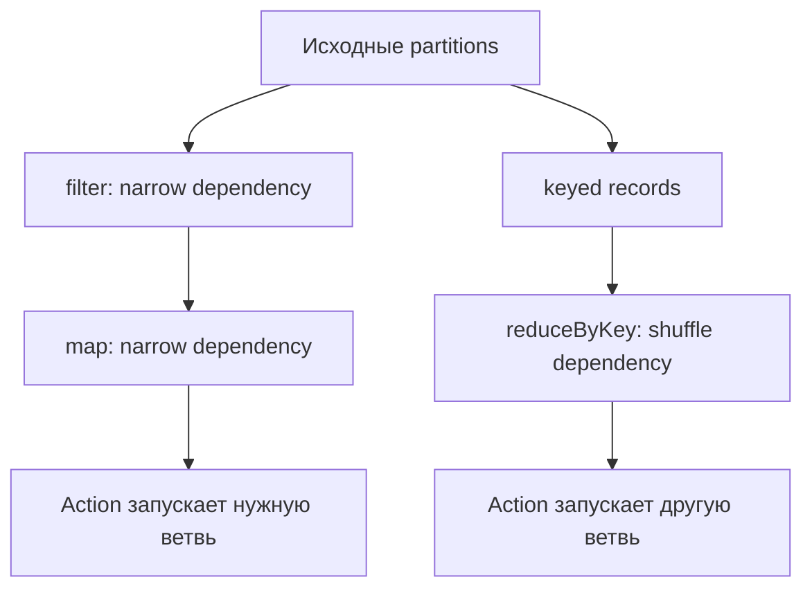
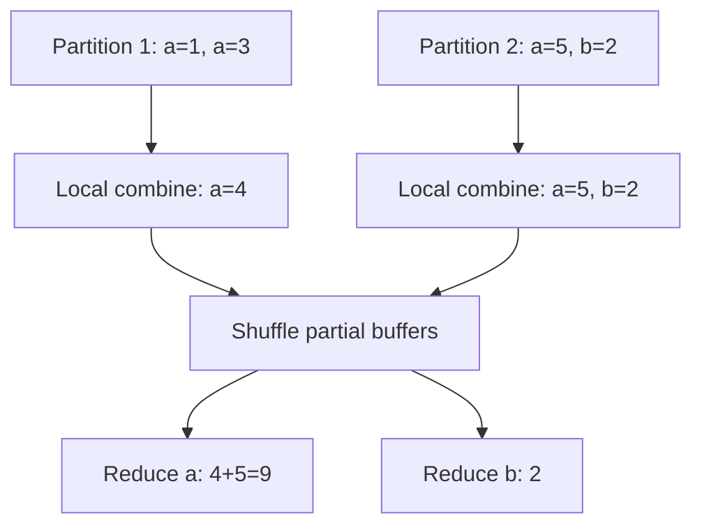
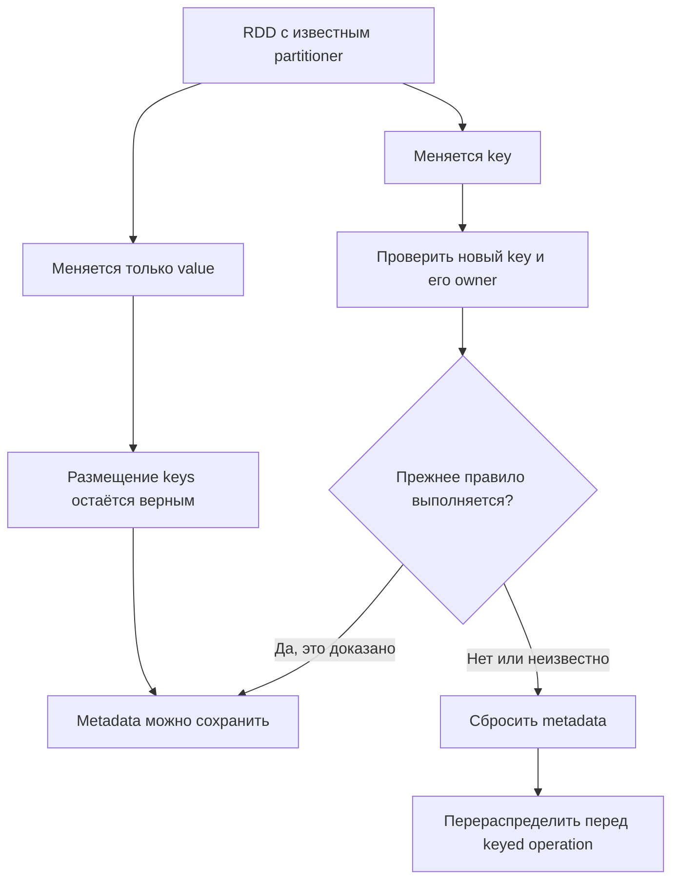
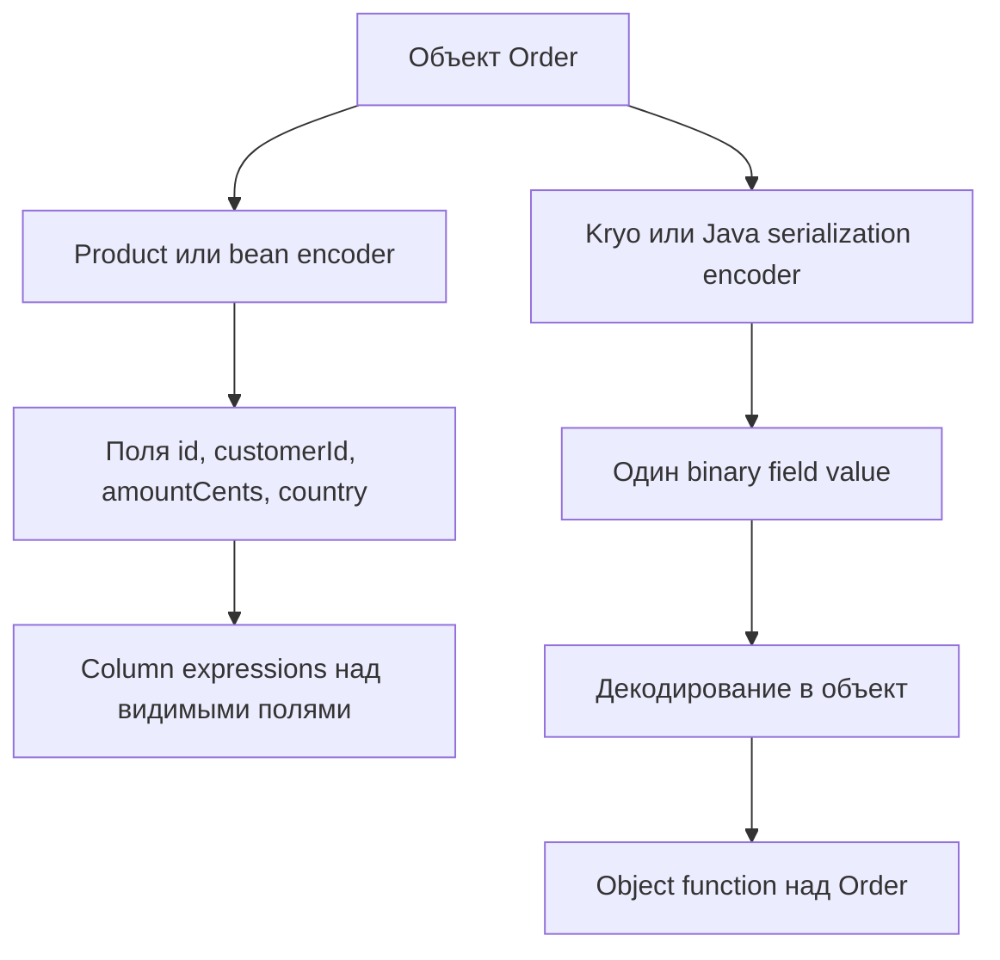
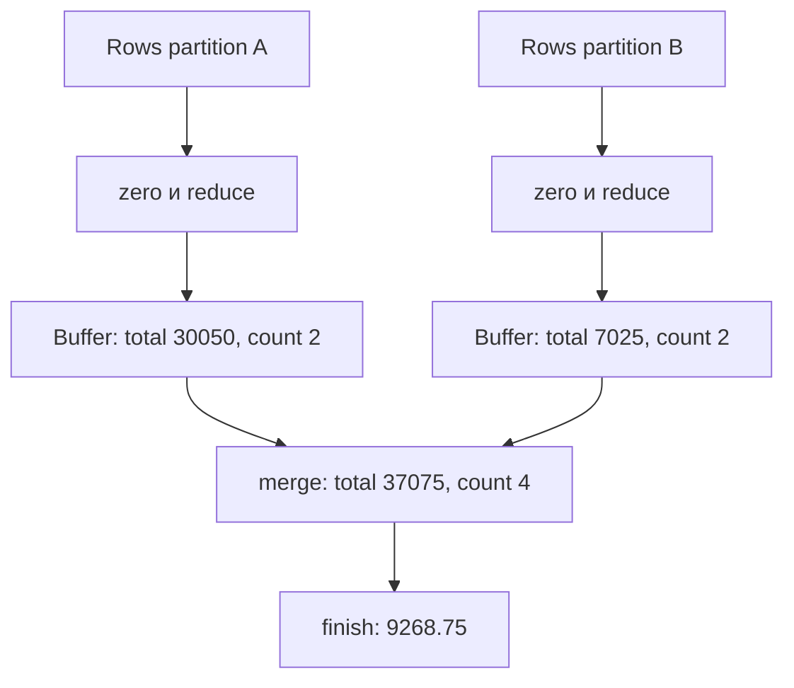

# 9. RDD и типизированный Dataset

RDD даёт прямой доступ к распределённой коллекции: вы выбираете функции над элементами, правила разбиения по ключу и форму промежуточного состояния. Типизированный Dataset связывает объекты Scala/Java с движком Spark SQL через Encoders. Эти API полезны для конкретных задач, но требуют понимать границы оптимизации, сериализации, памяти и повторного выполнения.

Раздел охватывает **9 тем и 60 пунктов** оглавления. Структура: раздел → тема → пункт. Все объяснения, примеры, схемы и практики находятся на одной странице.

**Файл:** `rdd_and_typed_dataset.md`.

**Предварительные знания.** SparkSession, driver/executor/task, transformations/actions, shuffle, схемы DataFrame, SQL expressions, joins, агрегаты и работа с файлами. Здесь эти понятия применяются к RDD и typed JVM API; устройство scheduler и общий memory tuning относятся к соответствующим разделам.

**Окружение.** Apache Spark **4.2.0**, Scala **2.13.18**, Java 17, Python 3.12, Spark Classic. Для другой версии проверьте signatures и доступность методов. RDD/SparkContext API не является API Spark Connect; typed Dataset доступен в Scala/Java, но не как `Dataset[T]` в PySpark.

**Содержание**

1. [Основы RDD](#rdd-basics)
2. [Трансформации RDD](#rdd-transformations)
3. [Действия RDD](#rdd-actions)
4. [PairRDD и операции по ключу](#pair-rdd)
5. [Партиционирование RDD](#rdd-partitioning)
6. [Broadcast variables и accumulators](#shared-variables)
7. [Типизированный Dataset в Scala и Java](#typed-dataset)
8. [Группировки и агрегаты Dataset](#dataset-grouping)
9. [Сохранение и диагностика RDD](#rdd-storage-diagnostics)

**Как выполнять примеры**

Короткие Python-блоки идут последовательно и используют общий setup ниже. Scala-фрагменты имеют свой setup внутри JVM-программы; определения case classes/partitioner/aggregator вынесены на уровень class/object, где это необходимо. Java-практика показывает полноценный bean и typed functions. Самостоятельные итоговые программы ниже запускаются отдельно.

Установка Python-окружения:

```bash
python -m venv .venv
source .venv/bin/activate
python -m pip install pyspark==4.2.0
```

Для Scala/Java используйте Spark distribution той же версии и его matching JARs. Не соединяйте Scala 2.12 application с `_2.13` dependencies. Java установите отдельно; в Windows используйте подходящую команду активации virtual environment.

Общий Python setup:

```python
from pathlib import Path
from tempfile import TemporaryDirectory
from collections import Counter
from itertools import islice
import json
import math
from pyspark.sql import SparkSession, functions as F, types as T
from pyspark import StorageLevel, TaskContext, BarrierTaskContext, AccumulatorParam

workspace = TemporaryDirectory(prefix="spark_rdd_chapter_")
ROOT = Path(workspace.name)
spark = (
    SparkSession.builder.master("local[2]")
    .appName("chapter-9-rdd")
    .config("spark.sql.shuffle.partitions", "2")
    .config("spark.sql.session.timeZone", "UTC")
    .getOrCreate()
)
sc = spark.sparkContext
sc.setLogLevel("ERROR")
numbers = sc.parallelize(list(range(1, 11)), 3)
pairs = sc.parallelize([("a", 1), ("b", 2), ("a", 3), ("c", 4), ("b", 5)], 2)
assert numbers.count() == 10
assert pairs.count() == 5
```

`parallelize` здесь создаёт маленький fixture из driver collection. Для большого input данные должны поступать из распределённого источника: сбор всего dataset на driver и последующий parallelize не является масштабируемым ingestion.

<a id="rdd-basics"></a>
## Основы RDD

### Resilient Distributed Dataset и lineage

**Resilient Distributed Dataset** — распределённая коллекция элементов с информацией о зависимостях. RDD immutable: transformation создаёт новый RDD, а не меняет логическое содержимое исходного.

Lineage хранит, какие родители и операции нужны для вычисления partition. При потере вычисленного блока Spark может восстановить его из зависимостей, если исходный input и transformations позволяют это сделать. Это не копия всех данных на driver и не полноценный durable backup.

```python
filtered_numbers = numbers.filter(lambda value: value % 2 == 0)
squared_numbers = filtered_numbers.map(lambda value: value * value)
assert squared_numbers.collect() == [4, 16, 36, 64, 100]
assert numbers.count() == 10
print(squared_numbers.toDebugString().decode("utf-8"))
```



Narrow dependency позволяет task читать нужные parent partitions без общего redistribution. Shuffle dependency требует передачи/перераспределения данных и обычно разделяет stages. Не каждая transformation создаёт новый stage.

Lineage предполагает повторяемость вычисления. Недетерминированный запрос внешнего API или side effect внутри map может дать другой результат/повторный эффект при replay. Resilience вычислительного плана не означает exactly-once внешней операции.

Cache/persist сохраняет вычисленные blocks для reuse, checkpoint разрывает часть lineage по своему контракту. Подробная настройка storage/checkpoint рассматривается отдельно; здесь важно отличать lazy description, материализованный block и durable dataset.

### Создание через parallelize, textFile и внешние источники

`SparkContext.parallelize` распределяет уже существующую driver collection. `textFile` создаёт RDD строк из доступного filesystem URI. Hadoop InputFormat и другие integrations дают дополнительные способы чтения.

```python
text_path = ROOT / "words.txt"
text_path.write_text("spark rdd\nspark sql\npython scala\n", encoding="utf-8")
lines = sc.textFile(str(text_path), minPartitions=2)
assert lines.count() == 3
assert sorted(lines.collect()) == ["python scala", "spark rdd", "spark sql"]
```

`minPartitions` — ориентир reader/planning, а не обещание произвольного разрезания whole-file или unsplittable compressed input. Файл должен быть доступен tasks; локальный путь driver не превращается в shared cluster path.

Для Parquet/JSON/JDBC обычно удобнее typed source через DataFrameReader и только затем `.rdd`, если действительно нужен RDD stage. Так сохраняются schema/source features на границе чтения.

Создание RDD из file path не обязательно сразу читает все records. Некоторые metadata/preparation operations и методы вроде zipWithIndex могут запускать отдельные jobs ещё до основного action — проверяйте API, а не упрощённое правило «до collect никогда нет работы».

### RDD с примитивами, объектами и парами ключ–значение

RDD[T] в Scala/Java хранит логическую коллекцию объектов T. PySpark RDD содержит Python values, которые передаются через сериализацию между driver/worker/JVM execution paths.

```python
object_rows = sc.parallelize([
    {"id": 1, "amount_cents": 10050},
    {"id": 2, "amount_cents": 20000},
], 2)
amounts_from_objects = object_rows.map(lambda row: row["amount_cents"])
assert amounts_from_objects.sum() == 30050
assert pairs.keys().distinct().count() == 3
```

PairRDD — обычный RDD с двухэлементными `(key, value)` записями и доступными keyed operations. Он не автоматически упорядочен, unique-key или relational table с schema constraints.

Объект должен быть serializable соответствующим language/runtime mechanism. Открытые sockets, SparkSession, file handles и mutable driver client нельзя считать переносимыми values closure.

В Python `dict`/custom class не даёт Catalyst schema: Spark не понимает смысл `row["amount_cents"]` как SQL field expression внутри arbitrary Python map. Более сложные объекты повышают serialization cost и требования к dependencies workers.

### Количество партиций и partitioner

**Partition count** показывает, на сколько частей разделена коллекция. **Partitioner** описывает правило назначения ключа partition для keyed RDD. Это разные свойства: RDD может иметь несколько partitions и не иметь известного partitioner.

```python
assert numbers.getNumPartitions() == 3
assert numbers.partitioner is None
partitioned_pairs = pairs.partitionBy(2)
assert partitioned_pairs.getNumPartitions() == 2
assert partitioned_pairs.partitioner is not None
print("Partitioner:", partitioned_pairs.partitioner)
```

Partition count влияет на task count/concurrency, но одна большая/skewed partition способна остаться bottleneck. Маленькое число partitions может недоиспользовать cluster, слишком большое — увеличить scheduling/shuffle overhead.

Наличие metadata partitioner означает, что Spark считает ключи разложенными по определённому правилу. Если пользователь неправильно сохраняет эту metadata после изменения keys, keyed operations могут стать некорректными.

Нельзя вывести partitioner из размера RDD, числа executors или names output files. Проверяйте actual property и distribution records.

### Преобразование между RDD и DataFrame

`df.rdd` в PySpark Classic возвращает RDD[Row]. `spark.createDataFrame(rdd, schema)` создаёт relational representation из совместимых records. Переход не обязан быть бесплатным: меняются representations и возможности optimizer.

```python
order_rows = sc.parallelize([(1, "a", 10050), (2, "a", 20000), (3, "b", 3025)], 2)
order_schema = "id INT, customer STRING, amount_cents LONG"
orders_df = spark.createDataFrame(order_rows, order_schema)
assert orders_df.agg(F.sum("amount_cents")).first()[0] == 33075
assert orders_df.rdd.map(lambda row: row.amount_cents).sum() == 33075

normalized_rdd = orders_df.rdd.map(lambda row: (row.id, row.customer.upper(), row.amount_cents))
normalized_df = spark.createDataFrame(normalized_rdd, order_schema)
assert normalized_df.filter("customer = 'A'").count() == 2
```

Схема writer/reader DataFrame не проверяется Scala/Python type hints сама собой. Возвращаемые values должны соответствовать schema: например, declared numeric type и произвольный string не являются безопасным casting contract.

DataFrame → Python RDD → DataFrame может добавить Python processing и потерять видимость transformations для Catalyst. Если преобразование выражается через built-in functions, сначала рассмотрите их.

Partitioner keyed RDD не становится SQL distribution metadata таблицы после createDataFrame. Для последующего SQL join optimizer не обязан знать ваш custom hash function.

### Когда оправдан низкоуровневый API

RDD полезен для алгоритмов над произвольными структурами, интеграции с Hadoop Input/OutputFormat, специализированного partitioning и существующего RDD code. Он также помогает понять execution model Spark.

| Задача | Часто удобнее |
|---|---|
| SQL filters/joins/aggregations | DataFrame / Spark SQL |
| Typed JVM domain transformations | Dataset с понятным encoder |
| Custom keyed algorithm/partitioner | RDD при обоснованной необходимости |
| Python per-partition processing | Поддерживаемый partition/batch API по задаче |
| Просто «хочу быстрее Spark» | Сначала plan/UI и built-in expressions |

RDD не получает Catalyst optimization arbitrary object functions и AQE возможностей SQL plan в том же объёме. Ручной контроль даёт ответственность за shuffle, aggregation state, skew и serialization.

Не переходите в RDD только для `map`, который заменяется `select`/`withColumn`. Для конкретного exception из API возможен разумный isolated RDD stage; измерьте полный pipeline и сохраните ясный input/output contract.

**Практика.** Выполните одинаковую сумму через RDD и DataFrame, сравните зависимости и plan. Объясните, какую логику optimizer видит в SQL expression и какую не видит внутри Python lambda.

<a id="rdd-transformations"></a>
## Трансформации RDD

### map, flatMap и filter

`map` возвращает по одному result element на каждый input element, `flatMap` — ноль/несколько элементов, `filter` — сохраняет входные элементы, прошедшие predicate. Все три operations ленивые относительно основного processing и обычно narrow.

```python
plus_one = numbers.map(lambda value: value + 1)
evens = numbers.filter(lambda value: value % 2 == 0)
words = lines.flatMap(lambda line: line.split())
assert plus_one.take(3) == [2, 3, 4]
assert evens.collect() == [2, 4, 6, 8, 10]
assert sorted(words.collect()) == ["python", "rdd", "scala", "spark", "spark", "sql"]
```

Если map возвращает list, он остаётся одним element; flatMap раскрывает iterable. Возвращать string из flatMap обычно означает получить отдельные characters, а не одну строку.

Порядок внутри narrow transformations сохраняется по соответствующему iterator contract, но после shuffle глобальное ordering нельзя предполагать. Не используйте incidental order как business key.

Функция должна быть replay-safe. Создание внешней записи внутри map не становится exactly-once от того, что map — transformation.

### mapPartitions и mapPartitionsWithIndex

`mapPartitions` получает iterator одной partition. Это позволяет инициализировать ресурс один раз на task attempt и обработать values потоково. `mapPartitionsWithIndex` дополнительно передаёт partition index.

```python
def summarize_partition(values):
    count = 0
    total = 0
    for value in values:
        count += 1
        total += value
    yield count, total

partition_summaries = numbers.mapPartitions(summarize_partition).collect()
assert sum(count for count, _ in partition_summaries) == 10
assert sum(total for _, total in partition_summaries) == 55

partition_labels = numbers.mapPartitionsWithIndex(
    lambda index, values: ((index, value) for value in values)
).collect()
assert {index for index, _ in partition_labels} == {0, 1, 2}
```

Iterator — не list всей partition. Не вызывайте `list(values)` без оценки объёма. Returning iterator/generator помогает bounded memory, но функция может всё равно создать unbounded accumulator внутри.

Initializer находится на worker, а не на driver. Retry/speculation может повторить initialization и side effects. Partition index описывает план текущего выполнения и не заменяет stable business operation ID.

`preservesPartitioning` — отдельный обещанный metadata contract, подробнее ниже. Он не включается потому, что функция «кажется безопасной».

### union, intersection, subtract и distinct

RDD collections имеют multiset-поведение: duplicates — нормальные элементы. Set-like operations обладают собственными правилами multiplicity.

```python
left_values = sc.parallelize([1, 1, 2, 3], 2)
right_values = sc.parallelize([1, 4], 2)
assert sorted(left_values.union(right_values).collect()) == [1, 1, 1, 2, 3, 4]
assert left_values.intersection(right_values).collect() == [1]
assert sorted(left_values.subtract(right_values).collect()) == [2, 3]
assert sorted(left_values.distinct().collect()) == [1, 2, 3]
```

`union` не делает deduplication и часто объединяет input partitions. `intersection` возвращает distinct common elements. `subtract` удаляет values, встречающиеся справа, а remaining duplicates могут сохраниться.

Intersection/distinct/subtract обычно требуют shuffle. В коде, где нужен только фильтр по маленькому справочнику, broadcast set может изменить подход, но сначала оцените размер и semantics.

Equality/hashing custom objects должны быть корректными и согласованными между сериализованными copies. Не используйте mutable object identity как distributed key.

### sample, randomSplit и cartesian

`sample` создаёт случайную выборку по fraction; fraction — probability/expected share, не exact row count. При sampling with replacement элемент может повториться.

```python
sample_all = numbers.sample(withReplacement=False, fraction=1.0, seed=42)
assert sample_all.count() == 10
splits = numbers.randomSplit([0.7, 0.3], seed=42)
split_values = [set(part.collect()) for part in splits]
assert split_values[0].isdisjoint(split_values[1])
assert split_values[0] | split_values[1] == set(range(1, 11))

product = sc.parallelize(["a", "b"], 2).cartesian(sc.parallelize([1, 2, 3], 2))
assert product.count() == 6
```

Weights randomSplit нормализуются; маленький fixture не обязан дать ровно 7/3 rows. Reproducibility seed зависит также от input/order/partitioning и implementation. Изменённый dataset layout может изменить assignment.

Cartesian создаёт произведение cardinalities: N×M result rows, а partition count зависит от product input partitions. Это опасная операция на больших collections, даже если обе по отдельности помещаются на cluster.

Не используйте randomSplit как гарантированную chronological split ML данных: temporal leakage и business grouping требуют отдельного правила.

### sortBy, keyBy, zip, zipWithIndex и zipWithUniqueId

`sortBy` упорядочивает по вычисляемому ключу. `keyBy` добавляет key к исходному value. Zip соединяет elements **по partition/position**, а не по business identity.

```python
sorted_desc = numbers.sortBy(lambda value: value, ascending=False, numPartitions=2)
assert sorted_desc.take(3) == [10, 9, 8]
keyed_numbers = numbers.keyBy(lambda value: value % 2)
assert keyed_numbers.filter(lambda pair: pair[0] == 0).count() == 5

zip_left = sc.parallelize([1, 2, 3, 4], 2)
zip_right = sc.parallelize(["a", "b", "c", "d"], 2)
assert zip_left.zip(zip_right).collect() == [(1, "a"), (2, "b"), (3, "c"), (4, "d")]
indices = numbers.zipWithIndex().collect()
assert [index for _, index in indices] == list(range(10))
unique_ids = numbers.zipWithUniqueId().values().collect()
assert len(unique_ids) == len(set(unique_ids)) == 10
```

Zip требует одинакового числа partitions и элементов в каждой соответствующей partition. Равенство total count недостаточно. Несовместимый layout даёт ошибку, а совместимый layout всё равно не означает совпадение business records.

`zipWithIndex` строит consecutive indices и может запустить preparation job для размеров partitions. `zipWithUniqueId` избегает такого prefix-count этапа, но IDs могут иметь gaps.

Оба ID зависят от partitioning/order. Они не стабильны между arbitrary reshuffles и не подходят как universal idempotency key внешней записи.

### glom и риск сборки большой партиции в память

`glom()` превращает каждую partition в один list element. Это удобный способ посмотреть маленький fixture, но теперь вся partition должна материализоваться как list.

```python
glommed = numbers.glom().collect()
assert len(glommed) == 3
assert sum(len(partition) for partition in glommed) == 10
print(glommed)
```

Есть два уровня memory risk: list partition на worker и итог всех lists на driver при collect. Большая partition может дать OOM ещё до того, как driver что-либо получит.

Для диагностики размеров используйте streaming counter через mapPartitions, а не glom всего production input. Для samples ограничивайте число элементов `islice(iterator, n)`.

```python
partition_previews = numbers.mapPartitions(lambda values: [list(islice(values, 2))]).collect()
assert all(len(preview) <= 2 for preview in partition_previews)
```

Даже preview всех partitions может быть большим при миллионах partitions; здесь их всего три. Размер диагностического результата тоже должен иметь budget.

### Pipe и запуск внешней программы с учётом окружения

`RDD.pipe` запускает внешнюю программу для partition, передаёт вход через stdin и читает output lines из stdout. Это integration с process protocol, а не обычная Python function call.

**Локальный пример для POSIX окружения с `tr`:**

```python
piped = sc.parallelize(["hello", "spark"], 2).pipe("tr a-z A-Z")
assert sorted(piped.collect()) == ["HELLO", "SPARK"]
```

Executable, libraries, permissions и environment должны быть доступны workers. На Windows этот fixture требует соответствующую POSIX среду или другой executable. В проверенном PySpark `pipe` принимает строку, которая разбирается на arguments; JVM API имеет другие overloads. Для динамических аргументов используйте корректное quoting и не вставляйте untrusted command fragments.

Программа должна корректно работать с boundaries records, stderr, exit code и encoding. Внешнее приложение, которое ждёт всё input в memory или пишет слишком много diagnostic text в stdout, может испортить protocol.

Pipe тоже повторяется при task replay. Создаваемые внешней программой side effects должны быть idempotent/recoverable; Spark не превращает arbitrary subprocess в transactional sink.

**Практика.** Посмотрите lazy lineage map/filter, затем shuffle distinct/sort. Составьте пример, где zip total counts совпадают, но counts per partition различаются; объясните, почему это не join.
<a id="rdd-actions"></a>
## Действия RDD

### count, take, first, top и takeOrdered

Action запускает вычисления нужной ветви RDD. Разные actions отличаются объёмом чтения, aggregation и возвращаемого результата.

```python
assert numbers.count() == 10
assert numbers.take(3) == [1, 2, 3]
assert numbers.first() == 1
assert numbers.top(3) == [10, 9, 8]
assert numbers.takeOrdered(3) == [1, 2, 3]
assert numbers.takeOrdered(2, key=lambda value: -value) == [10, 9]
```

| Action | Результат | Особенность |
|---|---|---|
| count | Количество elements | Нужно определить count всего input |
| take(n) | До n первых элементов по RDD iteration order | Не global sorted top |
| first | Один первый element | Ошибка на empty RDD |
| top(n) | Наибольшие elements по ordering | Distributed top selection |
| takeOrdered(n) | Наименьшие по заданному key | Ограниченный output, но scan может быть полным |

`take(10)` ограничивает result memory, но не гарантирует cheap source scan для любой lineage: upstream sort/shuffle может потребовать работу над всем input. Поиск first rows в empty partitions также создаёт scanning/preparation work.

Ordering actions требуют корректного comparable key. Для equal keys задайте tie-breaker, если reproducibility важна; иначе выбор одинаково ранжированных records может зависеть от layout.

### collect, collectAsMap и toLocalIterator

`collect()` переносит весь result на driver. `collectAsMap()` превращает keyed result в local map; повторяющиеся keys конфликтуют и часть values теряется по map semantics.

```python
assert numbers.collect() == list(range(1, 11))
unique_key_totals = pairs.reduceByKey(lambda left, right: left + right).collectAsMap()
assert unique_key_totals == {"a": 4, "b": 7, "c": 4}

streamed_total = 0
for value in numbers.toLocalIterator():
    streamed_total += value
assert streamed_total == 55
```

`toLocalIterator()` позволяет потреблять result по partitions, не собирая его сразу в list. Driver всё равно получает весь обработанный вами stream; memory bound связан с largest partition, а prefetch может увеличить simultaneous buffers.

`list(rdd.toLocalIterator())` снова материализует весь result. Streaming consumption не помогает, если downstream код накапливает все elements в dict/list.

CollectAsMap допустим для маленького справочника с **проверенными unique keys**. Не рассчитывайте, что оно автоматически сгруппирует duplicates или выберет нужную «последнюю» business version.

### reduce, fold, aggregate и treeAggregate

`reduce` объединяет elements одной binary operation и требует non-empty input. `fold` добавляет neutral zero value; zero может использоваться в нескольких partial aggregations, поэтому он должен быть identity этой операции.

`aggregate` позволяет буферу U отличаться от input T. Seq operation добавляет input к buffer, comb operation объединяет buffers. `treeAggregate` организует объединение в несколько уровней, уменьшая fan-in driver при подходящей задаче.

```python
assert numbers.reduce(lambda left, right: left + right) == 55
assert numbers.fold(0, lambda left, right: left + right) == 55

sum_count = numbers.aggregate(
    (0, 0),
    lambda buffer, value: (buffer[0] + value, buffer[1] + 1),
    lambda left, right: (left[0] + right[0], left[1] + right[1]),
)
assert sum_count == (55, 10)
assert sum_count[0] / sum_count[1] == 5.5

tree_sum_count = numbers.treeAggregate(
    (0, 0),
    lambda buffer, value: (buffer[0] + value, buffer[1] + 1),
    lambda left, right: (left[0] + right[0], left[1] + right[1]),
    depth=2,
)
assert tree_sum_count == sum_count
```

Neutral zero для sum — 0, для product — 1, для `(sum,count)` — `(0,0)`. Non-neutral seed может повторно добавиться по partitions и дать неверный result. Average нельзя корректно получить «средним средних» без weights.

Mutable buffers допустимы при соблюдении contract, но shared state/aliasing легко ломают merge. Для учебных examples immutable tuples проще проверить. Не изменяйте второй merge operand без понимания API ownership.

Tree aggregation меняет topology, а не снимает необходимость bounded buffer и корректного associative merge. Огромный set/list в buffer всё ещё создаёт memory/network problems.

### countByKey и countByValue: размер результата на драйвере

Эти actions возвращают local mapping: частоты keys или values. Input может быть большим, а result compact — только если cardinality действительно мала.

```python
key_counts = dict(pairs.countByKey())
value_counts = dict(sc.parallelize(["x", "x", "y"], 2).countByValue())
assert key_counts == {"a": 2, "b": 2, "c": 1}
assert value_counts == {"x": 2, "y": 1}
```

Миллионы distinct user IDs дают mapping из миллионов entries на driver. То, что каждая entry — маленький integer, не гарантирует допустимую total memory.

Для большого cardinality оставляйте result distributed: `mapValues(...).reduceByKey(...)`, DataFrame groupBy/count или запись агрегатов в storage. Для diagnostic report выбирайте bounded top/sample по нужному contract.

CountByValue над arbitrary objects требует подходящего hashing/equality. Не используйте его для больших blob values или inconsistent mutable keys.

### foreach и foreachPartition

`foreach` выполняет function для каждого element, `foreachPartition` — для iterator partition. Они не возвращают преобразованный distributed dataset и предназначены для side-effect operations с собственным contract.

```python
processed_count = sc.accumulator(0)
numbers.foreach(lambda value: processed_count.add(1))
assert processed_count.value == 10

partition_count = sc.accumulator(0)
def count_partition(values):
    for _ in values:
        partition_count.add(1)

numbers.foreachPartition(count_partition)
assert partition_count.value == 10
```

Накопитель используется только как маленькая диагностическая иллюстрация. Для business count предпочтителен `numbers.count()`/distributed aggregate; replay и upstream accumulator placement разбираются ниже.

```python
driver_list = []
numbers.foreach(lambda value: driver_list.append(value))
assert driver_list == []
```

Function работает с serialized worker copy closure. Добавление values в driver-side list/dict внутри task не создаёт общий mutable state; оно не является способом collect result.

ForeachPartition удобнее per-row initialization внешнего клиента, но не гарантирует одну invocation на business partition. Task retries и re-execution должны быть учтены, особенно при writes.

### Ассоциативность и коммутативность распределённого агрегирования

Spark разбивает и объединяет partial results в порядке, зависящем от partitions/stages/attempts. Для unordered distributed reduction обычно нужна associative и commutative operation, а для fold/aggregate — correct identity/merge semantics.

```python
values = [1, 2, 3]
left_subtraction = (values[0] - values[1]) - values[2]
right_subtraction = values[0] - (values[1] - values[2])
assert left_subtraction != right_subtraction

left_sum = (values[0] + values[1]) + values[2]
right_sum = values[0] + (values[1] + values[2])
assert left_sum == right_sum == 6
```

Subtraction не associative; «всегда уменьшать accumulator на следующее значение» не эквивалентно reduce subtraction. Для такого смысла можно суммировать values и затем вычесть total из начального balance в отдельно заданном месте.

Floating point sum mathematically associative не является bitwise associative: округления зависят от порядка. Для exact currency используйте appropriate decimal/integer representation, учитывая overflow и диапазон. Детерминированное ordering и accurate summation — отдельные требования.

```python
assert (1e16 + -1e16) + 1.0 != 1e16 + (-1e16 + 1.0)
```

Для complex aggregates проверьте merge laws локальными fixtures и результат при разных partition counts. Тест на одном partition не обнаруживает многие ошибки combiner.

### Безопасная работа с внешними эффектами

Map/foreach/pipe functions могут выполняться повторно. Side effects не откатываются вместе с потерянным RDD block; successful database/API commit может предшествовать потере task acknowledgment.

| Side effect | Что нужно |
|---|---|
| API mutation | Stable operation ID, server idempotency, bounded retries |
| JDBC append | Defined replay/upsert/publication protocol |
| File output | Supported writer/committer и batch ownership |
| Metrics | Diagnostic interpretation, awareness of recomputation |
| Logging | Attempt/task context, ограниченный объём |

Не генерируйте случайный UUID при каждой попытке для одной business operation. Не используйте partition ID или attempt ID вместо stable event/batch identity. Они полезны для диагностики, а не для deduplication смысла операции.

Предпочтительно вернуть transformed records в RDD/DataFrame и использовать supported sink. Внешние APIs, staging и transactional publication подробно разобраны в предыдущем разделе; наличие RDD API не отменяет этих требований.

**Практика.** Реализуйте average через `(sum,count)`, проверьте 1/2/3 partitions и empty input contract. Покажите, как collectAsMap теряет duplicate-key values, и замените его distributed aggregation перед маленьким collect.

<a id="pair-rdd"></a>
## PairRDD и операции по ключу

### keys, values, mapValues и flatMapValues

`keys()`/`values()` извлекают части pair. `mapValues` меняет value, оставляя key; `flatMapValues` создаёт несколько values для того же key. Последние два могут сохранять известный partitioner.

```python
assert sorted(pairs.keys().collect()) == ["a", "a", "b", "b", "c"]
assert sorted(pairs.values().collect()) == [1, 2, 3, 4, 5]
incremented_values = partitioned_pairs.mapValues(lambda value: value + 10)
assert incremented_values.partitioner == partitioned_pairs.partitioner
assert sorted(incremented_values.values().collect()) == [11, 12, 13, 14, 15]
expanded_values = partitioned_pairs.flatMapValues(lambda value: [value, -value])
assert expanded_values.count() == 10
assert expanded_values.partitioner == partitioned_pairs.partitioner
```

Сохранение partitioner логично: keys не менялись, значит placement по keys остаётся correct. Обычный `map(lambda kv: (kv[0], new_value))` не обязательно сохраняет metadata автоматически, даже если human знает, что key тот же.

Keys/values сами по себе не deduplicate, sort или group. Если нужен один value на key, сначала определите правило combine/select.

### groupByKey и reduceByKey

`groupByKey` собирает values одного key в iterable. `reduceByKey` комбинирует values выбранной associative operation и обычно применяет partial/map-side combine до полного redistribution.

```python
grouped_values = pairs.groupByKey(numPartitions=2)
assert {key: sorted(values) for key, values in grouped_values.collect()} == {
    "a": [1, 3], "b": [2, 5], "c": [4]
}
reduced_values = pairs.reduceByKey(lambda left, right: left + right, numPartitions=2)
assert reduced_values.collectAsMap() == {"a": 4, "b": 7, "c": 4}
```

Если нужна sum/count/max, groupByKey+list обычно хранит/пересылает больше values, чем compact combiner. Это не значит, что groupByKey «запрещён»: он нужен, когда алгоритму действительно требуются отдельные group elements и есть memory/ordering strategy.

Iterable group не гарантирует business ordering. Если нужен chronological processing, используйте appropriate sorted-within-partition/group contract, а не list order после arbitrary shuffle.

Одна huge key group остаётся задачей одного group owner. Увеличение partition count не делит semantics одного key на несколько независимых groups.

### aggregateByKey, foldByKey и combineByKey

Эти операции дают разные способы compact aggregation:

| Метод | Как появляется buffer |
|---|---|
| reduceByKey | Первый/partial value того же type |
| foldByKey | Neutral zero и одна operation |
| aggregateByKey | Zero U, seq(U,V), comb(U,U) |
| combineByKey | create(V)→C, mergeValue(C,V), mergeCombiners(C,C) |

```python
key_sum_count = pairs.aggregateByKey(
    (0, 0),
    lambda buffer, value: (buffer[0] + value, buffer[1] + 1),
    lambda left, right: (left[0] + right[0], left[1] + right[1]),
    numPartitions=2,
)
assert key_sum_count.collectAsMap() == {"a": (4, 2), "b": (7, 2), "c": (4, 1)}
assert pairs.foldByKey(0, lambda left, right: left + right).collectAsMap() == {"a": 4, "b": 7, "c": 4}

combined_counts = pairs.combineByKey(
    lambda value: (value, 1),
    lambda buffer, value: (buffer[0] + value, buffer[1] + 1),
    lambda left, right: (left[0] + right[0], left[1] + right[1]),
    numPartitions=2,
)
assert combined_counts.collectAsMap() == key_sum_count.collectAsMap()
key_averages = combined_counts.mapValues(lambda buffer: buffer[0] / buffer[1])
assert key_averages.collectAsMap() == {"a": 2.0, "b": 3.5, "c": 4.0}
```

Average buffer хранит total/count, finish выполняется после correct merge. Если сразу хранить average без count, partial aggregates разного размера объединятся неправильно.

CombineByKey полезен, когда создание buffer зависит от первого value или zero неестественен. Buffer должен быть serializable и bounded по требованиям алгоритма.

Mutable list/set combiner может успешно работать на fixture и расти до OOM на hot key. Экономия map-side combine не превращает unbounded buffer в bounded.

### join, leftOuterJoin, rightOuterJoin, fullOuterJoin и cogroup

RDD join работает по key и multiplicity values. Если key встречается N раз слева и M справа, inner join создаёт N×M combinations для этого key.

```python
labels = sc.parallelize([("a", "A1"), ("a", "A2"), ("d", "D")], 2)
inner_pairs = pairs.join(labels)
assert inner_pairs.count() == 4
assert set(inner_pairs.collect()) == {
    ("a", (1, "A1")), ("a", (1, "A2")),
    ("a", (3, "A1")), ("a", (3, "A2")),
}
left_pairs = pairs.leftOuterJoin(labels)
right_pairs = pairs.rightOuterJoin(labels)
full_pairs = pairs.fullOuterJoin(labels)
assert left_pairs.count() == 7
assert right_pairs.count() == 5
assert full_pairs.count() == 8
assert left_pairs.filter(lambda pair: pair[0] == "c").first() == ("c", (4, None))
```

Outer join использует None/Option absence согласно language API. Если value сам допускает None, нужно отдельное правило отличать missing side от actual nullable business value.

```python
cogrouped = pairs.cogroup(labels)
cogroup_preview = {key: (sorted(left), sorted(right)) for key, (left, right) in cogrouped.collect()}
assert cogroup_preview["a"] == ([1, 3], ["A1", "A2"])
assert cogroup_preview["d"] == ([], ["D"])
```

Cogroup возвращает оба group iterables без создания полного Cartesian combinations сразу. Однако сами groups могут быть огромными; материализация или nested loops снова дают memory/output explosion.

RDD joins не используют SQL broadcast hint/AQE join strategy автоматически как DataFrame joins. Можно вручную использовать small broadcast lookup для определённого semantics, но это другой algorithm и другой memory contract.

### sortByKey и repartitionAndSortWithinPartitions

`sortByKey` задаёт sorted key order с распределением, соответствующим implementation. `repartitionAndSortWithinPartitions` сочетает выбранный partition function и sorting внутри каждой output partition.

```python
sorted_pairs = pairs.sortByKey(numPartitions=2)
assert [key for key, _ in sorted_pairs.collect()] == ["a", "a", "b", "b", "c"]
locally_sorted_pairs = pairs.repartitionAndSortWithinPartitions(numPartitions=2)
per_partition_keys = locally_sorted_pairs.mapPartitions(
    lambda values: [list(key for key, _ in values)]
).collect()
assert all(keys == sorted(keys) for keys in per_partition_keys)
```

Local sorted partitions не означают global order, если partitions назначены hash rule. Для global sorted result нужны согласованные key ranges и порядок partitions; сам `.collect()` не исправляет hash layout.

Value order при equal keys не гарантируется без tie-breaker. Для secondary sort иногда используют composite key и partitioner по его group component; нужно сохранить grouping и correct equality/ordering contract.

После map, меняющего ordering key, previous sorting не является гарантией нового порядка. Partitioner и ordering metadata — разные понятия.

### Map-side combine и стоимость передачи данных

Если key a встречается много раз в одной upstream partition, map-side combine может отправить один partial buffer вместо всех raw values. Для sum это уменьшает shuffle volume; reducer затем объединяет partial totals.



```python
combine_fixture = sc.parallelize([("a", 1), ("a", 3), ("a", 5), ("b", 2)], 2)
assert combine_fixture.reduceByKey(lambda left, right: left + right).collectAsMap() == {"a": 9, "b": 2}
```

Effect зависит от key locality/cardinality и размера buffer. Если каждый key уникален, reduction перед shuffle мало уменьшит rows; если buffer — растущий list, bytes могут почти не уменьшиться.

Оценивайте shuffle bytes/records, spill и task time, не только число transformations в коде. PairRDD combiner functions должны удовлетворять algebraic laws, иначе изменение topology даёт неверный result.

### Большие группы и неограниченный рост состояния ключа

Главный risk keyed algorithm — один key с огромным state или output. Group iterable, set уникальных values, список всех events и join Cartesian result могут требовать unbounded memory/time.

Для top-K достаточно bounded heap/limited collection, для average — `(sum,count)`, для count distinct — exact set только при допустимом cardinality или подходящий approximate sketch с известной ошибкой.

```python
def merge_top_two(left, right):
    return sorted(left + right, reverse=True)[:2]

bounded_top = pairs.combineByKey(
    lambda value: [value],
    lambda buffer, value: merge_top_two(buffer, [value]),
    merge_top_two,
)
assert bounded_top.collectAsMap() == {"a": [3, 1], "b": [5, 2], "c": [4]}
```

Буфер ограничен двумя values, но число keys всё ещё влияет на total task memory. Для большого K выберите структуру с нужной complexity вместо сортировки каждого нового list.

Salting может разнести associative partial aggregation hot key и потребовать second merge. Оно не делает arbitrary order-sensitive algorithm автоматически distributable и не снимает N×M join semantics.

**Практика.** Реализуйте per-key sum/count/average и top-K без groupByKey+list. Проверьте повторяющиеся keys в обоих join inputs и объясните cardinality результата до запуска.
<a id="rdd-partitioning"></a>
## Партиционирование RDD

### HashPartitioner и RangePartitioner

В JVM **HashPartitioner** назначает partition по hash key, **RangePartitioner** — по ordered key ranges, границы которых определяются sampling input. Их цель и ordering guarantees различаются.

| Правило | Что обеспечивает | Что не обещает |
|---|---|---|
| Hash partitioning | Один key направляется одному owner | Global key order и равный row count |
| Range partitioning | Ordered key ranges по partitions | Идеальный баланс hot key |
| Custom partitioner | User-defined placement | Correctness без ваших invariants |

В PySpark `.partitionBy(n)` использует default Python partition function, обычно `portable_hash`. Это не вызов публичного Scala RangePartitioner API в Python. `sortByKey` имеет свой range-oriented sorting implementation; детали между language APIs не следует отождествлять.

```python
hash_distribution = partitioned_pairs.mapPartitionsWithIndex(
    lambda index, values: ((key, index) for key, _ in values),
    preservesPartitioning=True,
).collect()
owners = {}
for key, index in hash_distribution:
    owners.setdefault(key, set()).add(index)
assert all(len(indices) == 1 for indices in owners.values())
```

Python hash randomization/portable hashing и JVM hashCode могут давать разный placement. Не объявляйте два RDD совместно partitioned только потому, что оба имеют два partitions, если key/hash rules различаются.

**Scala-фрагмент в JVM окружении:**

```scala
val keyedAmounts = ordersDs.rdd.map(order => order.customerId -> order.amountCents)
val hashPlaced = keyedAmounts.partitionBy(new org.apache.spark.HashPartitioner(2))
val rangeRule = new org.apache.spark.RangePartitioner[Long, Long](2, keyedAmounts)
val rangePlaced = keyedAmounts.partitionBy(rangeRule)
assert(hashPlaced.count() == ordersDs.count())
assert(rangePlaced.count() == ordersDs.count())
```

Этот fragment использует `ordersDs` из Scala setup ниже. RangePartitioner может использовать меньше requested partitions, если distinct sampled bounds недостаточно; sampling само создаёт preparation work.

### partitionBy, repartition и coalesce

`partitionBy` относится к keyed RDD и задаёт placement rule. `repartition` меняет число partitions с redistribution. `coalesce` может уменьшить число partitions без общего shuffle; режим с shuffle позволяет другую redistribution strategy.

```python
more_partitions = numbers.repartition(4)
fewer_partitions = more_partitions.coalesce(2)
assert more_partitions.getNumPartitions() == 4
assert fewer_partitions.getNumPartitions() == 2
assert sorted(fewer_partitions.collect()) == list(range(1, 11))
assert partitioned_pairs.partitioner is not None
```

Coalesce без shuffle может объединить uneven partitions и сохранить skew. Оно не даёт гарантии равных tasks и обычно не позволяет произвольно увеличить count без shuffle. `coalesce(1)` концентрирует downstream work в одной partition.

RDD `.partitionBy` не равно DataFrameWriter `.partitionBy`: первое раскладывает keys по compute partitions, второе организует storage directories/table layout.

Repartition keyed RDD без явного key partitioning не должен рассматриваться как preservation known partitioner. Проверяйте metadata после operation и стоимость additional shuffle.

### Пользовательский partitioner в JVM API

Custom JVM partitioner наследуется от `Partitioner` и определяет `numPartitions`/`getPartition`. Ключ всегда должен попадать в диапазон `[0, numPartitions)`, одинаковые keys — в одинаковую partition. Equality partitioners должна отражать equivalence rules.

<!-- SPARK_RDD_SCALA_DEFINITIONS_BEGIN -->
```scala
final class CustomerPartitioner(override val numPartitions: Int)
    extends org.apache.spark.Partitioner {
  require(numPartitions > 0)
  override def getPartition(key: Any): Int =
    Math.floorMod(key.asInstanceOf[Long].hashCode(), numPartitions)
  override def equals(other: Any): Boolean = other match {
    case that: CustomerPartitioner => that.numPartitions == numPartitions
    case _ => false
  }
  override def hashCode(): Int = numPartitions
}
```
<!-- SPARK_RDD_SCALA_DEFINITIONS_END -->

Определение предполагает Long keys. Не передавайте null/string key без отдельного documented rule; unsupported key должен быть detected, а не молча иметь случайный placement.

`Math.floorMod` избегает отрицательного результата `%` для отрицательного hash. `abs(hash)` недостаточен для minimum signed integer edge case.

В PySpark можно передать custom partitionFunc:

```python
def integer_bucket(key):
    return int(key) % 3

integer_pairs = sc.parallelize([(-1, "negative"), (1, "positive"), (4, "same-owner")], 2)
custom_placed = integer_pairs.partitionBy(3, integer_bucket)
custom_owners = custom_placed.mapPartitionsWithIndex(
    lambda index, rows: ((key, index) for key, _ in rows)
).collect()
assert {key: index for key, index in custom_owners} == {-1: 2, 1: 1, 4: 1}
```

Python partitionFunc и JVM Partitioner — разные API. Не используйте captured mutable counter/случайное число внутри placement rule. Semantics должна быть стабильна между workers и retries.

### Сохранение partitioner и preservesPartitioning

Некоторые transformations автоматически сохраняют partitioner: например, mapValues и filter при неизменных keys. Обычный map обычно сбрасывает metadata; mapPartitions может явно пообещать её сохранение.

```python
same_pairs = partitioned_pairs.map(lambda pair: pair)
assert same_pairs.partitioner is None
same_keys_values = partitioned_pairs.mapPartitions(
    lambda rows: ((key, value * 2) for key, value in rows),
    preservesPartitioning=True,
)
assert same_keys_values.partitioner == partitioned_pairs.partitioner
assert same_keys_values.reduceByKey(lambda left, right: left + right).collectAsMap() == {
    "a": 8, "b": 14, "c": 8
}
```

`preservesPartitioning=True` — **утверждение пользователя**, а не автоматическая проверка или repartition operation. Меняя keys, вы обязаны доказать, что их new placement остаётся корректным для прежнего rule. Иначе Spark может пропустить необходимый shuffle.

Ложная metadata опаснее потерянной optimization: distributed aggregate/join может обработать одно logical key в нескольких owners и вернуть неверный result. Если correctness invariant неочевиден, сбросьте partitioner и явно перераспределите данные.



Равенство числа partitions само по себе ничего не доказывает: ключ должен находиться именно в той partition, которую возвращает partitioner для этого ключа.

Не указывайте flag только ради уменьшения числа stages. Сначала проверьте rule и key distribution на fixture, затем диагностируйте lineage.

### Совместное партиционирование для операций по ключу

Если обе стороны имеют совместимый known partitioner, join/cogroup может использовать existing placement и избежать нового полного redistribution. Upstream shuffle создания этого layout всё равно остаётся в lineage.

```python
left_placed = pairs.partitionBy(2)
right_placed = sc.parallelize([("a", "A"), ("b", "B")], 2).partitionBy(2)
co_partitioned_join = left_placed.join(right_placed)
assert co_partitioned_join.partitioner == left_placed.partitioner
assert co_partitioned_join.count() == 4
print(co_partitioned_join.toDebugString().decode("utf-8"))
```

Сравнивайте parents, chosen partitioner и additional shuffle в конкретном API. «В toDebugString есть ShuffledRDD» не обязательно означает, что join добавил новый shuffle: это может быть прежний partitionBy.

Для multiple repeated keyed operations reuse/caching layout может окупиться. Если keyed stage используется один раз, предварительный partitionBy иногда добавляет work вместо экономии.

Co-partitioning не устраняет skew hot key, duplicates и join Cartesian output. Это optimization placement, а не изменение relational semantics.

### Почему partitioner RDD не равен партиционированию таблицы

RDD partitioner — in-memory/execution metadata о key ownership. File/table partitioning — storage layout/metadata по columns/transforms. Table bucketing/clustering — ещё отдельные contracts, которые знает SQL engine/catalog.

```python
rdd_table = spark.createDataFrame(partitioned_pairs, "key STRING, value INT")
assert rdd_table.count() == 5
assert rdd_table.rdd.partitioner is None
rdd_table.explain("formatted")
```

CreateDataFrame не обязан переносить arbitrary Python key rule в Catalyst distribution requirements. SQL operations могут сделать собственный Exchange, даже если upstream RDD физически был разложен удобно.

Также не существует универсального соответствия RDD partition number ↔ storage directory ↔ executor. Tasks могут выполняться на разных executors, а writer может создать несколько files для одной storage partition.

**Практика.** Сравните mapValues, filter, map и mapPartitions с flag по свойству partitioner. Затем выполните join двух одинаково partitioned RDD и отличите upstream shuffle от нового shuffle join.

<a id="shared-variables"></a>
## Broadcast variables и accumulators

### Создание, использование и уничтожение broadcast variable

`sc.broadcast(value)` создаёт handle к distributed read-only snapshot для tasks. Обычная closure переменная копируется при доставке task; broadcast позволяет эффективнее reuse большого, но допустимого reference value.

```python
segments = sc.broadcast({"a": "standard", "b": "premium", "c": "standard"})
segment_enriched = pairs.map(lambda pair: (pair[0], pair[1], segments.value.get(pair[0], "unknown")))
assert segment_enriched.filter(lambda row: row[2] == "premium").count() == 2
assert segments.value["a"] == "standard"
segments.unpersist(blocking=True)
assert segment_enriched.count() == 5  # Snapshot ещё существует, blocks могут быть доставлены заново.
```

`unpersist` удаляет cached executor blocks, но handle ещё usable и data может быть снова доставлена. `destroy` освобождает broadcast окончательно; после него нельзя планировать работу, которая должна его читать.

```python
segment_enriched.collect()  # Последнее использование маленького fixture.
segments.destroy(blocking=True)
```

Не destroy broadcast раньше выполнения lazy transformations, которые на него ссылаются. Driver-side function definition/создание RDD ещё не означает, что executors прочитали reference.

Broadcast consumes memory в workers/JVM paths; в Python deserialized value может иметь copies в нескольких Python worker processes. «Один executor» не обязательно означает «одна Python copy».

### Неизменяемые справочники и сериализация broadcast

Broadcast snapshot — read-only по контракту приложения. Mutable Python dict внутри value технически можно попытаться изменить, но это изменит worker-local copy, а не согласованное глобальное состояние.

```python
lookup_source = {"RU": "Europe", "US": "North America"}
lookup_broadcast = sc.broadcast(dict(lookup_source))
country_rows = sc.parallelize(["RU", "US", "XX"], 2)
country_result = country_rows.map(lambda country: (country, lookup_broadcast.value.get(country, "unknown")))
assert dict(country_result.collect()) == {"RU": "Europe", "US": "North America", "XX": "unknown"}
lookup_broadcast.destroy(blocking=True)
```

Не используйте broadcast hashmap как distributed counter, mutable cache с global consistency или channel обновления между tasks. Для новой версии справочника создайте новый snapshot/handle и согласуйте lifetime старого.

Value должен сериализоваться соответствующим runtime. Открытый connection, SparkContext или локальная runtime object graph не являются обычными broadcast payloads. Большой object может быть значительно больше в deserialized form, чем его bytes на диске.

Проверяйте cardinality, version/freshness и memory budget. Если справочник уже большой, typed distributed join может быть правильнее manual lookup.

### AccumulatorV2 и встроенные накопители

Accumulator собирает associative/commutative updates от tasks в driver-visible diagnostic state. В JVM базовый extensible API — `AccumulatorV2`; есть built-in long/double/collection accumulators. PySpark предоставляет свой Python accumulator API.

```python
positive_counter = sc.accumulator(0)
numbers.foreach(lambda value: positive_counter.add(1 if value > 0 else 0))
assert positive_counter.value == 10
```

Worker должен добавлять updates, а не использовать driver aggregate `.value` как текущий shared total. Чтение accumulator value в task не является синхронным обращением к общему счётчику; PySpark API такое чтение запрещает.

JVM пример создания long accumulator:

```scala
val processedRows = spark.sparkContext.longAccumulator("processed-rows")
ordersDs.foreach(_ => processedRows.add(1L))
assert(processedRows.value == ordersDs.count())
```

На fixture без дополнительных failures это показывает ожидаемую diagnostic value. Lifetime accumulator и scope actions/retries нужно учитывать отдельно — он не заменяет полноценный business result.

### Пользовательские накопители в поддерживаемых API

JVM custom accumulator реализует zero/copy/reset/add/merge/value и правильные ownership/merge laws. PySpark custom accumulator обычно использует `AccumulatorParam`, а не Python subclass JVM AccumulatorV2.

```python
class SumCountAccumulator(AccumulatorParam):
    def zero(self, value):
        return 0, 0
    def addInPlace(self, left, right):
        return left[0] + right[0], left[1] + right[1]

sum_count_accumulator = sc.accumulator((0, 0), SumCountAccumulator())
numbers.foreach(lambda value: sum_count_accumulator.add((value, 1)))
assert sum_count_accumulator.value == (55, 10)
```

Neutral state должен действительно быть neutral для update/merge. Custom value должен быть serializable и bounded; collection accumulator, который хранит каждый record, может переполнить driver.

Scala example AccumulatorV2 в итоговой программе ниже использует `(total,count)` и copy/reset. Его диагностическое состояние отдельно от typed Aggregator business output.

<!-- SPARK_RDD_SCALA_DEFINITIONS_BEGIN -->
```scala
final class SumCountMetric extends org.apache.spark.util.AccumulatorV2[Long, (Long, Long)] {
  private var total = 0L
  private var count = 0L
  override def isZero: Boolean = total == 0L && count == 0L
  override def copy(): SumCountMetric = {
    val result = new SumCountMetric
    result.total = total
    result.count = count
    result
  }
  override def reset(): Unit = { total = 0L; count = 0L }
  override def add(value: Long): Unit = { total += value; count += 1L }
  override def merge(other: org.apache.spark.util.AccumulatorV2[Long, (Long, Long)]): Unit = other match {
    case metric: SumCountMetric => total += metric.total; count += metric.count
    case _ => throw new IllegalArgumentException("Несовместимый accumulator")
  }
  override def value: (Long, Long) = (total, count)
}
```
<!-- SPARK_RDD_SCALA_DEFINITIONS_END -->

```scala
val customMetric = new SumCountMetric
spark.sparkContext.register(customMetric, "amount-sum-count")
ordersDs.foreach(order => customMetric.add(order.amountCents))
assert(customMetric.value == (37075L, 4L))
```

Не переносите unsupported methods между language APIs только потому, что имена концепций одинаковы. Python AccumulatorParam и JVM AccumulatorV2 имеют разные lifecycle implementations.

### Повторные вычисления, повторные попытки и точность накопителей

Accumulator update внутри transformation привязан к **исполнению**, а не уникальному business record. Если uncached lineage вычислен повторным action, updates могут повториться.

```python
recomputed_counter = sc.accumulator(0)
def observed_double(value):
    recomputed_counter.add(1)
    return value * 2

observed = numbers.map(observed_double)
assert observed.sum() == 110
assert recomputed_counter.value == 10
assert observed.sum() == 110
assert recomputed_counter.value == 20
```

Это deterministic fixture recomputation без искусственных failures. Tasks retries, stage re-execution, action placement и language implementation добавляют другие нюансы update delivery.

Spark документирует обработку updates в successful action tasks и различает updates внутри transformations, которые могут выполняться снова. Даже когда updates конкретного action учитываются по его task protocol, это не даёт once-per-business-record между разными actions/applications.

Cache может сократить re-execution, но eviction/lost blocks потребуют recomputation. Поэтому cache не превращает transformation-side accumulator в reliable total продаж.

### Накопители для диагностики и ограничения для бизнес-результата

Accumulator подходит для debug metrics: processed attempts, parser warnings, observed branches. Его значение нужно интерпретировать вместе с action scope, re-execution и caching.

```python
business_total = numbers.reduce(lambda left, right: left + right)
assert business_total == 55
business_sum_count = numbers.aggregate(
    (0, 0),
    lambda buffer, value: (buffer[0] + value, buffer[1] + 1),
    lambda left, right: (left[0] + right[0], left[1] + right[1]),
)
assert business_sum_count == (55, 10)
```

Business result должен быть частью deterministic distributed result и supported publication protocol. Не принимайте workflow decision «rows complete» только по accumulator без сверки authoritative output.

Не используйте accumulator как communication между workers или условие остановки task при достижении global threshold. Updates асинхронны/агрегированы, tasks не видят синхронный global state.

Для metrics с arbitrary-cardinality labels тоже нужен budget. Сбор всех ошибок/IDs в accumulator уступает distributed quarantine/output с bounded preview.

### Различие broadcast variable и broadcast join

Broadcast variable — programming abstraction SparkContext для user reference object. Broadcast join — SQL physical strategy/Exchange, при которой small relation доставляется executors для выполнения join.

| Свойство | Broadcast variable | Broadcast join |
|---|---|---|
| Пользовательский API | `sc.broadcast(value)` | SQL optimizer / `broadcast(df)` hint |
| Payload | Serializable object | Relation в execution representation |
| Использование | Worker function читает `.value` | Join operator |
| Семантика duplicates | Определяет ваш lookup code | SQL join multiplicity |
| Optimizer visibility | Arbitrary lookup function opaque | SQL relation/join доступны planner |

```python
reference_df = spark.createDataFrame([("a", "A"), ("b", "B"), ("c", "C")], "key STRING, label STRING")
small_facts_df = spark.createDataFrame(pairs, "key STRING, value INT")
sql_broadcast_join = small_facts_df.join(F.broadcast(reference_df), "key", "left")
assert sql_broadcast_join.count() == 5
sql_broadcast_join.explain("formatted")
```

Manual map lookup одного value на key и SQL join справочника с duplicate keys дают разные cardinalities. Не заменяйте SQL join dict lookup, не доказав uniqueness и missing/null semantics.

И обе формы требуют small payload относительно памяти workers. Название broadcast не означает, что объект unlimited или что one-way update становится global state.

**Практика.** Создайте версионированный broadcast lookup, выполните две actions и правильно освободите его после последнего использования. Сравните accumulator в transformation с aggregate result; объясните doubling при recomputation.
<a id="typed-dataset"></a>
## Типизированный Dataset в Scala и Java

### Dataset[T] и DataFrame как Dataset[Row] в JVM API

В JVM DataFrame — `Dataset[Row]`. Typed Dataset[T] добавляет compile-time тип объекта, который вы получаете в typed functions, и encoder для связи T с Spark internal representation.

Он всё ещё использует Spark SQL logical/physical plan, lazy execution и optimizer. Dataset не является RDD с другим названием и не означает, что все данные постоянно хранятся как JVM domain objects.

**Scala setup для коротких JVM-фрагментов:** объявите case classes на уровне исходного файла, вне `main`. В shell они имеют REPL-specific окружение; самостоятельные compiled programs ниже воспроизводят используемый типовой contract.

<!-- SPARK_RDD_SCALA_DEFINITIONS_BEGIN -->
```scala
case class Order(id: Long, customerId: Long, amountCents: Long, country: String)
case class CustomerStats(customerId: Long, totalCents: Long, count: Long)
case class SumCountBuffer(total: Long, count: Long)
```
<!-- SPARK_RDD_SCALA_DEFINITIONS_END -->

<!-- SPARK_RDD_SCALA_SETUP_BEGIN -->
```scala
import org.apache.spark.sql.{SparkSession, Dataset, Encoder, Encoders, Row}
import org.apache.spark.sql.functions._
import org.apache.spark.sql.expressions.Aggregator

val spark = SparkSession.builder().master("local[2]").appName("typed-dataset-chapter").getOrCreate()
spark.sparkContext.setLogLevel("ERROR")
import spark.implicits._

val ordersDs: Dataset[Order] = Seq(
  Order(1L, 1L, 10050L, "RU"),
  Order(2L, 1L, 20000L, "RU"),
  Order(3L, 2L, 3025L, "DE"),
  Order(4L, 3L, 4000L, "US")
).toDS()
val ordersFrame: Dataset[Row] = ordersDs.toDF()
assert(ordersDs.count() == 4L)
assert(ordersFrame.columns.toSet == Set("id", "customerId", "amountCents", "country"))
```
<!-- SPARK_RDD_SCALA_SETUP_END -->

Typed `ordersDs.map(_.amountCents)` даёт объектно-типизированную function. `ordersDs.select(col("amountCents"))` обычно даёт untyped Row representation, пока не выбран supported typed column/as mapping.

Typed API повышает выразительность domain logic, но `filter(col(...))`/SQL expression иногда остаётся лучше для optimizer visibility. Можно смешивать typed и relational operations в одном plan, понимая их границы.

### Case classes, Java beans и Encoders

Scala case class описывает fields и типы; `import spark.implicits._` предоставляет encoder derivation для supported product types. Tuple также является product type.

```scala
val orderEncoder: Encoder[Order] = Encoders.product[Order]
val reconstructed = spark.createDataset(ordersDs.collect().toSeq)(orderEncoder)
assert(reconstructed.schema("amountCents").dataType.typeName == "long")
assert(reconstructed.filter(_.country == "RU").count() == 2L)
```

Collect здесь допустим только для четырёх fixture rows. Настоящий Dataset из Parquet/таблицы не нужно сначала собирать на driver для re-creation.

Java bean должен быть public, concrete и иметь supported properties/getters/setters; для восстановления объекта обычно требуется доступный no-argument constructor. Полный `OrderBean` приведён в Java-практике ниже.

```java
Encoder<OrderBean> encoder = Encoders.bean(OrderBean.class);
Dataset<OrderBean> orders = spark.createDataset(javaRows, encoder);
Dataset<Long> cents = orders.map(
    (MapFunction<OrderBean, Long>) order -> order.getAmountCents(),
    Encoders.LONG()
);
```

Этот Java fragment использует `OrderBean`, `javaRows` и imports полноценной Java программы ниже. Boxed numeric properties допускают NULL иначе, чем primitive properties; schema nullability и domain defaults нужно проверять отдельно.

Не любой arbitrary class получает structured encoder автоматически. Field types, nested classes, collections, accessibility и unsupported types должны соответствовать encoder contract конкретного release.

### ExpressionEncoder, bean, Kryo и Java serialization encoders

Structured encoder связывает поля объекта с typed SQL fields. Binary Kryo/Java encoders сохраняют object в одном binary field: объектный type остаётся у application, но optimizer не видит его внутренние fields как обычные SQL columns.

| Encoder | Internal schema | Последствие |
|---|---|---|
| Product/case class | Структура named fields | Field projection и relational operations доступны |
| Bean | Структура bean properties | Требуются compatible bean conventions/types |
| Row(schema) | Заданная Row schema | Проверка/использование schema application |
| Kryo | Обычно один binary `value` field | Opaque object serialization |
| Java serialization | Один binary field | Opaque serialization с требованиями Serializable |

```scala
val structuredDs = spark.createDataset(Seq(Order(10L, 1L, 500L, "RU")))(Encoders.product[Order])
val kryoDs = spark.createDataset(Seq(Order(10L, 1L, 500L, "RU")))(Encoders.kryo[Order])
val javaSerializedDs = spark.createDataset(Seq(Order(10L, 1L, 500L, "RU")))(Encoders.javaSerialization[Order])
assert(structuredDs.columns.contains("amountCents"))
assert(kryoDs.schema("value").dataType.typeName == "binary")
assert(javaSerializedDs.schema("value").dataType.typeName == "binary")
assert(kryoDs.head().amountCents == 500L)
assert(javaSerializedDs.head().amountCents == 500L)
```

`ExpressionEncoder` относится к реализации/expressions encoder machinery, а supported entry points обычно — `Encoders`, implicits и typed operations. Не копируйте внутренние constructors из другой Spark version как stable application API.

Encoder не равен `spark.serializer`: первый определяет Dataset representation/schema, второй относится к соответствующим Spark object serialization paths. Выбор Kryo global serializer не превращает case class Dataset в binary encoder автоматически.

Binary fallback может решить конкретную type serialization задачу, но теряет field-level optimization и interoperability. Используйте его осознанно, а не как универсальный «быстрый encoder».



Даже у structured Dataset пользовательская lambda может быть непрозрачна оптимизатору. Схема полей и возможность анализировать тело функции — разные свойства.

### as[T], toDF и typed/untyped operations

`.as[T]` задаёт объектное decoding по encoder; он не является произвольным row-by-row mapping функции и не отменяет необходимость compatible input schema.

```scala
val typedAgain = ordersDs.toDF().as[Order]
assert(typedAgain.collect().toSet == ordersDs.collect().toSet)
val customerIds: Dataset[Long] = ordersDs.map(_.customerId)
assert(customerIds.distinct().count() == 3L)
val relationalProjection = ordersDs.select(col("id"), col("amountCents"))
assert(relationalProjection.columns.toSeq == Seq("id", "amountCents"))
```

Для case classes mapping ориентируется на fields/names и supported type conversion. Переименование/удаление required field может дать analysis/runtime decoding error. `.as[Order]` не вставляет автоматически business default, если contract неправильный.

`.toDF()` сохраняет relational plan/columns, но меняет статический объектный type на Row. После arbitrary typed map optimizer не обязан знать математический смысл lambda, хотя downstream relational fields снова имеют schema.

У Dataset `.as("alias")` и `.as[T]` разные overloads: первое задаёт relation alias, второе — target object type. В Java явный encoder передаётся `.as(Encoders.bean(...))`.

### map, flatMap, filter и mapPartitions

Typed functions получают объект T и возвращают supported U с encoder. Map — один output на input, flatMap — несколько, filter — сохранение T, mapPartitions — iterator по partition.

```scala
val discounted = ordersDs.map(order => order.copy(amountCents = order.amountCents / 2))
assert(discounted.filter(_.id == 1L).head().amountCents == 5025L)
val ruOrders = ordersDs.filter(_.country == "RU")
assert(ruOrders.count() == 2L)
val repeatedIds = ordersDs.flatMap(order => Iterator(order.id, order.id))
assert(repeatedIds.count() == 8L)
val partitionTotals = ordersDs.mapPartitions(rows => Iterator(rows.map(_.amountCents).sum))
assert(partitionTotals.collect().sum == 37075L)
```

Lambda должна быть serializable через closure handling. Не захватывайте целиком service object с connections, mutable state или SparkSession. Инициализируйте resources на executors/partition, если они нужны алгоритму.

Domain function может создавать/decoding JVM objects и ограничивать optimization. `ordersDs.filter(_.amountCents > 5000)` и `ordersDs.filter(col("amountCents") > 5000)` имеют одинаковый желаемый predicate, но различную видимость implementation для planner.

```scala
val objectFilter = ordersDs.filter(_.amountCents > 5000L)
val expressionFilter = ordersDs.filter(col("amountCents") > 5000L)
assert(objectFilter.collect().toSet == expressionFilter.collect().toSet)
objectFilter.explain("extended")
expressionFilter.explain("extended")
```

Это сравнение semantics/plan, не benchmark скорости четырёх строк. Для source pushdown особенно важно, можно ли перевести condition в source expression.

### Проверки компилятора и проверки схемы во время выполнения

Compile-time type проверяет доступ к field/member T и signatures typed functions. Он не проверяет содержимое Parquet, реальное SQL column name, nullability всех source values или business constraints.

**Пример, который должен быть отвергнут Scala compiler:**

<!-- SPARK_RDD_INVALID_SCALA_BEGIN -->
```scala
val invalidTypedAccess = ordersDs.map(_.nonexistentField)
```
<!-- SPARK_RDD_INVALID_SCALA_END -->

Этот negative example не включается в успешную программу. В отдельной compiler check отсутствие member у Order должно давать compilation error.

А schema mismatch доступен только после получения relational plan:

```scala
var schemaFailure = false
try {
  ordersDs.toDF().drop("country").as[Order].collect()
} catch {
  case _: org.apache.spark.sql.AnalysisException => schemaFailure = true
}
assert(schemaFailure)
```

Некоторые errors обнаруживаются analysis, другие — во время object decoding tasks. Non-nullable primitive field с actual NULL может дать runtime exception; boxed/Option representation требуется выбирать по контракту.

String SQL expressions и `col("typo")` не проверяются Scala compiler как field access. Типизированный Dataset не превращает произвольный SQL string в compile-time verified SQL.

### Почему в PySpark нет типизированного Dataset API

PySpark DataFrame имеет runtime Spark schema и Python Row/value representation. Python type hints/dataclass/Pydantic могут помогать вашему коду, но не создают JVM `Dataset[Order]` с Scala/Java encoder contract.

```python
python_typed_hint: list[tuple[int, str, int]] = [(1, "a", 10050)]
hint_df = spark.createDataFrame(python_typed_hint, "id INT, customer STRING, amount_cents LONG")
assert hint_df.schema["amount_cents"].dataType == T.LongType()
assert hasattr(hint_df, "schema")
```

Привычный `.map` typed Dataset example нельзя механически перевести в `df.map(...)` PySpark. Выберите built-in DataFrame expressions, RDD Classic stage или поддерживаемый Pandas/Arrow function API по задаче.

Для team interoperability можно описать common schema/contract и separate language implementations. Но доступные type systems и serialization costs остаются разными.

**Практика.** Создайте structured и binary Dataset одного объекта, сравните schemas и возможность `select("amountCents")`. Затем покажите compile-time missing member и runtime missing column как два разных класса ошибок.

<a id="dataset-grouping"></a>
## Группировки и агрегаты Dataset

### groupByKey и KeyValueGroupedDataset

Typed `groupByKey(function)` возвращает KeyValueGroupedDataset[K,T] — описание групп, а не materialized local Map[K,List[T]]. Group ownership требует distribution по key и зависит от plan.

```scala
val groupedOrders = ordersDs.groupByKey(_.customerId)
val groupedCounts = groupedOrders.count().collect().toMap
assert(groupedCounts == Map(1L -> 2L, 2L -> 1L, 3L -> 1L))
```

KeyValueGroupedDataset не имеет ровно тех же methods/semantics, что RDD groupByKey result. Тип key и value известен application, но пользовательская key function всё ещё может быть opaque для optimizer.

Если group key — обычный column и aggregate встроенный, relational `groupBy("customerId").agg(...)` часто проще для planner. Typed grouping полезен, когда нужен domain-specific group algorithm.

### mapGroups, flatMapGroups и cogroup

`mapGroups` получает `(key, iterator)` и возвращает один result на group, `flatMapGroups` — произвольное число. `cogroup` получает два iterators по одному key из двух grouped datasets.

```scala
val groupStats = groupedOrders.mapGroups { (key: Long, rows: Iterator[Order]) =>
  var total = 0L
  var count = 0L
  rows.foreach { order => total += order.amountCents; count += 1L }
  CustomerStats(key, total, count)
}
assert(groupStats.collect().map(row => row.customerId -> row.totalCents).toMap ==
  Map(1L -> 30050L, 2L -> 3025L, 3L -> 4000L))

val emittedOrders = groupedOrders.flatMapGroups { (key: Long, rows: Iterator[Order]) =>
  rows.map(order => (key, order.id))
}
assert(emittedOrders.count() == 4L)

val doubleGroups = groupedOrders.cogroup(groupedOrders) {
  (key: Long, left: Iterator[Order], right: Iterator[Order]) =>
    Iterator((key, left.size.toLong, right.size.toLong))
}
assert(doubleGroups.collect().map(row => row._1 -> (row._2, row._3)).toMap ==
  Map(1L -> (2L, 2L), 2L -> (1L, 1L), 3L -> (1L, 1L)))
```

MapGroups/flatMapGroups не дают partial aggregation произвольной function. Они доставляют group elements owner, что может требовать shuffle всех нужных records. Streaming iteration ограничивает user memory, но не отменяет network/skew/sort work.

Cogroup не является обычным join rows N×M автоматически: function сама выбирает matching/output algorithm. Можно реализовать merge-like operation по sorted iterators, но нужны correct ordering/null/multiplicity rules.

### reduceGroups и typed Aggregator

`reduceGroups` объединяет values одной associative reduction и возвращает key с reduced value. Typed Aggregator описывает compact buffer, reduce/merge/finish и encoders.

```scala
val reducedOrders = groupedOrders.reduceGroups { (left: Order, right: Order) =>
  Order(0L, left.customerId, left.amountCents + right.amountCents, "TOTAL")
}
assert(reducedOrders.collect().map { case (key, order) => key -> order.amountCents }.toMap ==
  Map(1L -> 30050L, 2L -> 3025L, 3L -> 4000L))
```

В reducer нельзя произвольно выбирать `left.id`/`left.country`, если смысл result должен быть независим от порядка: задайте отдельный aggregate record contract. Здесь id/country — фиксированные aggregate markers, а сумма associative на fixture без overflow.

Aggregator может поддержать partial aggregation и compact merge, в отличие от произвольного mapGroups. Он является частью business result plan, а не diagnostic accumulator.

### Буфер агрегата, merge и finish

Average требует total/count buffer. `zero` задаёт identity, `reduce` добавляет input, `merge` объединяет partial buffers, `finish` возвращает final output. Buffer/output должны иметь encoders.



Схема показывает допустимое разбиение fixture, а не обещает, что scheduler выберет именно эти границы partitions. Результат должен сохраняться при любом допустимом разбиении и порядке слияния buffers.

<!-- SPARK_RDD_SCALA_DEFINITIONS_BEGIN -->
```scala
final class MeanCents extends org.apache.spark.sql.expressions.Aggregator[Order, SumCountBuffer, Double] {
  override def zero: SumCountBuffer = SumCountBuffer(0L, 0L)
  override def reduce(buffer: SumCountBuffer, order: Order): SumCountBuffer =
    SumCountBuffer(buffer.total + order.amountCents, buffer.count + 1L)
  override def merge(left: SumCountBuffer, right: SumCountBuffer): SumCountBuffer =
    SumCountBuffer(left.total + right.total, left.count + right.count)
  override def finish(buffer: SumCountBuffer): Double =
    if (buffer.count == 0L) 0.0 else buffer.total.toDouble / buffer.count
  override def bufferEncoder: org.apache.spark.sql.Encoder[SumCountBuffer] =
    org.apache.spark.sql.Encoders.product[SumCountBuffer]
  override def outputEncoder: org.apache.spark.sql.Encoder[Double] =
    org.apache.spark.sql.Encoders.scalaDouble
}
```
<!-- SPARK_RDD_SCALA_DEFINITIONS_END -->

```scala
val averageCents = ordersDs.select(new MeanCents().toColumn).head()
assert(averageCents == 9268.75)
val groupedAverages = groupedOrders.agg(new MeanCents().toColumn).collect().toMap
assert(groupedAverages == Map(1L -> 15025.0, 2L -> 3025.0, 3L -> 4000.0))
```

Empty aggregate contract здесь явно выбран как 0.0. В приложении это может быть None/nullable output или ошибка: 0 при отсутствии rows и настоящий average=0 не всегда одно и то же.

Fixture integer totals малы. Для long-running сумм проверяйте overflow; для денег final floating average имеет rounding semantics. Exact decimal average требует другой buffer/output contract.

Проверяйте reduce/merge consistency: объединение двух buffers должно давать тот же смысл, что processing всех rows. Non-associative merge может проходить local test и ломаться после repartition.

### Сортировка внутри групп при наличии API

`mapGroups` не обещает нужный порядок iterator. На поддерживаемой версии `flatMapSortedGroups`/`cogroupSorted` дают sorted iterators по указанным expressions.

```scala
val largestByCustomer = groupedOrders.flatMapSortedGroups(col("amountCents").desc, col("id").asc) {
  (key: Long, rows: Iterator[Order]) =>
    rows.take(1).map(order => (key, order.amountCents))
}
assert(largestByCustomer.collect().toMap == Map(1L -> 20000L, 2L -> 3025L, 3L -> 4000L))
```

Sort key плюс tie-breaker делает selection contract ясным. Sorting не убирает shuffle/group ownership; относительную стоимость оценивайте по physical plan implementation. Нельзя вместо supported method просто отсортировать input где-то раньше и предположить сохранение порядка после grouping.

Для двух grouped inputs `cogroupSorted` задаёт сортировку каждой стороны отдельно. Java overload принимает arrays Column и appropriate CoGroup/FlatMapGroupsFunction + encoder; signatures различаются от curried Scala method.

### Итератор группы и риск материализации больших групп

Iterator позволяет one-pass processing, но `.toList`, `.toArray` и map всех records в local hash structure материализуют group целиком. Spill движка не предотвращает OOM пользовательского list после decoding.

```scala
val streamedCounts = groupedOrders.mapGroups { (key: Long, rows: Iterator[Order]) =>
  var count = 0L
  while (rows.hasNext) {
    rows.next()
    count += 1L
  }
  (key, count)
}
assert(streamedCounts.collect().toMap == groupedCounts)
```

Большая группа также ограничивает parallelism: один key должен обрабатываться владельцем group. Bounded user buffer сокращает memory, но не распределяет эту работу автоматически между всеми executors.

Если алгоритм decomposable, используйте typed Aggregator/reduceGroups/SQL aggregate. Если нужен полный sequence, задайте ограничения key cardinality/group size и sorted streaming algorithm по реальному contract.

### Потеря оптимизаций при переходе к непрозрачным объектным функциям

Catalyst видит schema, relational operators и built-in expressions, но не может универсально понять arbitrary Scala/Java lambda. Typed API предоставляет compiler types application, а не автоматическое раскрытие domain algorithm optimizer.

```scala
val typedCountryFilter = ordersDs.filter(order => order.country == "RU")
val sqlCountryFilter = ordersDs.filter(col("country") === "RU")
assert(typedCountryFilter.count() == sqlCountryFilter.count())
typedCountryFilter.explain("extended")
sqlCountryFilter.explain("extended")
```

В плане object functions могут требовать SerializeFromObject/DeserializeToObject/MapElements и related execution operators. Реальные names зависят от версии и optimization; изучайте actual plan.

Structured encoder сохраняет возможность relational downstream operations. Binary encoder и opaque group function уменьшают field/logic visibility сильнее. Поэтому выбирайте typed functions для того, где они полезны, а обычные column expressions сохраняйте там, где они понятнее и лучше оптимизируются.

**Практика.** Реализуйте одну per-customer сумму через mapGroups, reduceGroups, typed Aggregator и SQL aggregate. Проверьте одинаковые results и сравните partial aggregation/object operators в plans. Затем выделите top record по sorted group без materializing whole group.
<a id="rdd-storage-diagnostics"></a>
## Сохранение и диагностика RDD

### saveAsTextFile, saveAsObjectFile, saveAsPickleFile и Hadoop OutputFormat

RDD save methods запускают action и создают output directory с part-files. API и serialization format различаются между JVM и Python.

```python
text_output = ROOT / "rdd_text_output"
words.saveAsTextFile(str(text_output))
assert sorted(sc.textFile(str(text_output)).collect()) == sorted(words.collect())

pickle_output = ROOT / "rdd_pickle_output"
object_rows.saveAsPickleFile(str(pickle_output), batchSize=2)
restored_objects = sc.pickleFile(str(pickle_output))
assert sorted(restored_objects.collect(), key=lambda row: row["id"]) == [
    {"id": 1, "amount_cents": 10050}, {"id": 2, "amount_cents": 20000}
]
```

| API | Что сохраняет | Ограничение |
|---|---|---|
| saveAsTextFile | String representation records | Не typed table schema |
| JVM saveAsObjectFile | Serialized JVM objects по его storage contract | JVM/class/version compatibility |
| PySpark saveAsPickleFile | Pickled Python objects | Python/class/dependency compatibility |
| saveAsHadoopFile / NewAPI | Configured Hadoop OutputFormat + key/value types | Правильные converters и dependency set |

Text output custom tuple/dict по `str` не является universal JSON/CSV. Если нужен такой формат, сериализуйте явно и определите schema/escaping/null semantics.

Python pickle — executable object deserialization: не загружайте untrusted input. Для долгоживущего interoperable dataset typed Parquet/Avro и versioned schema обычно понятнее, чем arbitrary runtime object snapshot.

SaveAsObjectFile не следует показывать как метод PySpark RDD. JVM и Python object formats не являются взаимозаменяемыми, несмотря на общее слово object.

### Sequence files и совместимость JVM/Python API

Hadoop SequenceFile хранит key/value records с Hadoop Writable types. Spark может использовать converters между language values и Writable classes; поддерживаемые types должны совпадать с producer/reader.

```python
sequence_output = ROOT / "sequence_output"
sequence_pairs = sc.parallelize([(1, "one"), (2, "two")], 2)
sequence_pairs.saveAsSequenceFile(str(sequence_output))
sequence_roundtrip = sc.sequenceFile(str(sequence_output))
assert sorted(sequence_roundtrip.collect()) == [(1, "one"), (2, "two")]
```

Этот roundtrip проверен для simple integer/string fixture. Custom Writable и nested values требуют matching classes/converters; не выводите поддержку произвольного Python dict из этого примера.

Old Hadoop API и New Hadoop API имеют разные OutputFormat packages/contracts. При необходимости задавайте `keyClass`, `valueClass`, converters и Hadoop conf по выбранному API/version.

```python
hadoop_text_output = ROOT / "hadoop_text_output"
sequence_pairs.saveAsHadoopFile(
    str(hadoop_text_output),
    outputFormatClass="org.apache.hadoop.mapred.TextOutputFormat",
    keyClass="org.apache.hadoop.io.IntWritable",
    valueClass="org.apache.hadoop.io.Text",
)
assert sorted(sc.textFile(str(hadoop_text_output)).collect()) == ["1\tone", "2\ttwo"]
```

Output commit и shared filesystem access имеют те же требования корректности, что обычная file write. Package/class name и compatible Hadoop libraries относятся к implementation, а не бизнес-схеме.

### toDebugString и анализ зависимостей

`toDebugString` показывает RDD dependencies: parents, partition counts и implementation classes. Он помогает найти shuffle boundaries, но не является SQL explain и не показывает смысл Python function.

```python
word_counts = words.map(lambda word: (word, 1)).reduceByKey(lambda left, right: left + right)
debug_text = word_counts.toDebugString().decode("utf-8")
assert "ShuffledRDD" in debug_text
assert word_counts.collectAsMap() == {"spark": 2, "rdd": 1, "sql": 1, "python": 1, "scala": 1}
print(debug_text)
```

Names и RDD IDs зависят от version/порядка создания plan; не hardcode exact full output в production logic. Existing upstream shuffle может оставаться в lineage, даже если следующая operation не создала новый.

Сопоставляйте dependency tree со Spark UI stages/tasks, shuffle read/write, spills и длительностью. Количество узлов в debug tree не равно количеству дорогих stages.

Для Dataset используйте `.explain(...)`; для RDD — dependencies + execution metrics. Два представления описывают разные abstraction layers.

### TaskContext и информация о текущей задаче

TaskContext доступен внутри task и предоставляет stage/partition/attempt metadata. На driver `TaskContext.get()` обычно None/null, потому что driver code не является task.

```python
assert TaskContext.get() is None

def task_summary(rows):
    context = TaskContext.get()
    count = sum(1 for _ in rows)
    yield {
        "stage": context.stageId(),
        "partition": context.partitionId(),
        "attempt": context.attemptNumber(),
        "task_attempt_id": context.taskAttemptId(),
        "rows": count,
    }

task_summaries = numbers.mapPartitions(task_summary).collect()
assert sum(row["rows"] for row in task_summaries) == 10
assert {row["partition"] for row in task_summaries} == {0, 1, 2}
assert all(row["attempt"] >= 0 for row in task_summaries)
```

Stage ID/partition ID могут повторяться в другом application или stage attempt. Task attempt ID идентифицирует попытку в соответствующем execution scope, но не business operation.

Используйте metadata для logs, ownership temporary files/resources и диагностики retry. Для exactly-once sink нужны stable source/batch/record identity и target protocol.

Local properties доступны при поддержке API; их lifecycle и executor propagation зависят от driver setup. Не храните секреты в произвольном публичном debug report.

### Очистка ресурсов при завершении task

Клиент/файл/модель, созданные внутри partition, нужно закрывать при normal completion и exception. В Python generator используйте context manager или try/finally вокруг iteration; если функция возвращает lazy generator, lifetime resource должен охватывать его consumption.

```python
def partition_with_resource(values):
    from io import StringIO
    resource = StringIO()
    try:
        for value in values:
            resource.write(str(value))
            yield value * 2
    finally:
        resource.close()

assert numbers.mapPartitions(partition_with_resource).sum() == 110
```

Этот маленький fixture демонстрирует lifetime, а не сохраняет buffer всех rows для production. В настоящем алгоритме не копите output в StringIO без bound.

В JVM TaskContext имеет completion/failure listeners. В проверенном PySpark TaskContext нет публичного `addTaskCompletionListener`: нельзя копировать Scala listener example в Python как готовый API.

```scala
val closedResources = spark.sparkContext.longAccumulator("closed-task-resources")
val resourceProcessed = ordersDs.rdd.mapPartitions { rows =>
  val resource = new java.io.ByteArrayInputStream(Array.emptyByteArray)
  org.apache.spark.TaskContext.get().addTaskCompletionListener[Unit] { _ =>
    resource.close()
    closedResources.add(1L)
  }
  rows.map(_.id)
}
assert(resourceProcessed.count() == 4L)
assert(closedResources.value > 0L)
```

Completion cleanup не гарантируется при process/node kill, где JVM/Python не исполняет finally/listeners. Для удалённых resources нужны server-side TTL/leases и recovery, а local temp ownership — чтобы следующая cleanup не трогала чужую попытку.

Listener также может выполниться на failed attempt. Diagnostic count closed resources не равен count unique business partitions.

### Barrier execution mode и область его применения

Barrier mode нужен алгоритмам, где tasks stage должны стартовать совместно и синхронизироваться, например некоторым integrations distributed training. Это не general optimization обычного map/filter и не global transaction.

```python
def barrier_summary(values):
    context = BarrierTaskContext.get()
    messages = context.allGather(str(context.partitionId()))
    context.barrier()
    count = sum(1 for _ in values)
    yield context.partitionId(), count, sorted(messages)

barrier_result = (
    sc.parallelize(list(range(4)), 2)
    .barrier().mapPartitions(barrier_summary).collect()
)
assert sorted(row[0] for row in barrier_result) == [0, 1]
assert sum(row[1] for row in barrier_result) == 4
assert all(row[2] == ["0", "1"] for row in barrier_result)
```

Fixture имеет две barrier tasks и `local[2]`, то есть достаточно одновременно доступных slots. На кластере tasks barrier stage требуют compatible resources и scheduling support; insufficient slots/unsupported configurations могут сделать запуск невозможным.

Все участвующие tasks должны согласованно вызывать collectives/barriers. Если одна ветвь function пропустила call, остальные могут ждать до timeout. Ошибка task обычно требует coordinated stage recovery согласно barrier protocol.

Barrier не устраняет replay, не обеспечивает delivery внешних writes и не заменяет streaming watermark. Используйте его только там, где integration/algorithm требует synchronous task coordination.

**Практика.** Сохраните simple key/value SequenceFile, восстановите его и сравните values. Сопоставьте toDebugString с task metadata, затем выполните маленький barrier stage и объясните resource requirement.
**Самостоятельная практика A: RDD ingestion, compact aggregates и диагностика**

Программа читает JSON Lines, сохраняет parser/business rejections, считает per-customer aggregates через compact buffers, использует broadcast reference, записывает typed output и проверяет serialization/TaskContext. В конце она показывает повторные diagnostic updates после снятия cache.

Все inputs/outputs создаются в собственном temporary directory. `collect()` используется только для маленького fixture; в настоящем pipeline результаты и quarantine должны оставаться distributed.

Сохраните код как `rdd_practice.py`:

<!-- SPARK_RDD_PYTHON_PRACTICE_BEGIN -->
```python
from pathlib import Path
from tempfile import TemporaryDirectory
import json
from pyspark import StorageLevel, TaskContext, BarrierTaskContext
from pyspark.sql import SparkSession, functions as F


def main():
    checks = []

    def verify(name, condition):
        if not condition:
            raise AssertionError(name)
        checks.append(name)
        print(f"PASS {len(checks):02d}: {name}", flush=True)

    with TemporaryDirectory(prefix="rdd_practice_") as temp:
        root = Path(temp)
        spark = (SparkSession.builder.master("local[2]").appName("rdd-practice")
                 .config("spark.sql.shuffle.partitions", "2").getOrCreate())
        sc = spark.sparkContext
        sc.setLogLevel("ERROR")
        reference = None
        try:
            source = root / "orders.jsonl"
            source.write_text(
                '{"id":1,"customer":"a","amount_cents":10050}\n'
                '{"id":2,"customer":"a","amount_cents":20000}\n'
                '{"id":3,"customer":"b","amount_cents":3025}\n'
                '{"id":4,"customer":"c","amount_cents":4000}\n'
                '{"id":5,"customer":"a","amount_cents":-100}\n'
                '{"id":6,"customer":"x","amount_cents":1000}\n'
                'not-json\n'
                '{"id":7,"customer":"b","amount_cents":"wrong"}\n',
                encoding="utf-8",
            )
            raw = sc.textFile(str(source), minPartitions=2)
            parse_attempts = sc.accumulator(0)

            def classify(line):
                parse_attempts.add(1)  # Diagnostic execution metric, не business count.
                try:
                    obj = json.loads(line)
                    record_id = obj["id"]
                    customer = obj["customer"]
                    amount = obj["amount_cents"]
                    if type(record_id) is not int or type(amount) is not int or not isinstance(customer, str):
                        raise TypeError("Нарушение typed input contract")
                except (ValueError, KeyError, TypeError) as error:
                    return "parser-rejected", {"raw": line, "reason": type(error).__name__}
                if record_id <= 0 or amount <= 0 or not customer:
                    return "business-rejected", {"raw": line, "reason": "invalid-domain-value"}
                return "accepted", (record_id, customer, amount)

            classified = raw.map(classify).persist(StorageLevel.MEMORY_AND_DISK)
            verify("Восемь input records", classified.count() == 8)
            verify("Fixture parser выполнен восемь раз", parse_attempts.value == 8)
            parser_bad = classified.filter(lambda row: row[0] == "parser-rejected").values()
            business_bad = classified.filter(lambda row: row[0] == "business-rejected").values()
            accepted = classified.filter(lambda row: row[0] == "accepted").values()
            verify("Две parser rejections", parser_bad.count() == 2)
            verify("Одна business rejection", business_bad.count() == 1)
            verify("Пять accepted records", accepted.count() == 5)
            verify("Баланс input", parser_bad.count() + business_bad.count() + accepted.count() == 8)
            verify("Diagnostic не изменился при reuse cache", parse_attempts.value == 8)
            verify("Accepted IDs", set(accepted.map(lambda row: row[0]).collect()) == {1, 2, 3, 4, 6})

            keyed = accepted.map(lambda row: (row[1], (row[0], row[2]))).partitionBy(2)
            verify("Known keyed partitioner", keyed.partitioner is not None)
            verify("Две keyed partitions", keyed.getNumPartitions() == 2)
            unchanged_keys = keyed.mapValues(lambda value: value[1])
            verify("MapValues сохранил partitioner", unchanged_keys.partitioner == keyed.partitioner)
            verify("Обычный map сбросил partitioner", keyed.map(lambda row: row).partitioner is None)
            stats = keyed.aggregateByKey(
                (0, 0),
                lambda buffer, value: (buffer[0] + value[1], buffer[1] + 1),
                lambda left, right: (left[0] + right[0], left[1] + right[1]),
                numPartitions=2,
            )
            stats_map = stats.collectAsMap()
            verify("Четыре customer groups", len(stats_map) == 4)
            verify("Customer a compact buffer", stats_map["a"] == (30050, 2))
            verify("Customer b compact buffer", stats_map["b"] == (3025, 1))
            verify("Customer c compact buffer", stats_map["c"] == (4000, 1))
            verify("Неизвестный customer сохранён", stats_map["x"] == (1000, 1))
            total = accepted.map(lambda row: row[2]).sum()
            verify("Business total", total == 38075)
            verify("Merge totals совпали", sum(value[0] for value in stats_map.values()) == total)
            averages = stats.mapValues(lambda buffer: buffer[0] / buffer[1]).collectAsMap()
            verify("Weighted group average", averages["a"] == 15025.0)
            top_groups = stats.takeOrdered(2, key=lambda row: (-row[1][0], row[0]))
            verify("Bounded top customers", [row[0] for row in top_groups] == ["a", "c"])

            reference = sc.broadcast({"a": "standard", "b": "premium", "c": "standard"})
            enriched = accepted.map(lambda row: (row[0], row[1], row[2], reference.value.get(row[1], "unknown")))
            frame = spark.createDataFrame(enriched, "id INT, customer STRING, amount_cents LONG, segment STRING")
            verify("Typed DataFrame count", frame.count() == 5)
            verify("Unknown reference policy", frame.filter("customer = 'x'").first().segment == "unknown")
            verify("Typed schema", frame.schema["amount_cents"].dataType.simpleString() == "bigint")
            output = root / "accepted_parquet"
            frame.write.parquet(str(output))
            restored = spark.read.parquet(str(output))
            verify("Parquet count", restored.count() == 5)
            verify("Parquet total", restored.agg(F.sum("amount_cents")).first()[0] == 38075)

            parser_output = root / "parser_quarantine"
            business_output = root / "business_quarantine"
            parser_bad.map(lambda row: json.dumps(row, ensure_ascii=False)).saveAsTextFile(str(parser_output))
            business_bad.map(lambda row: json.dumps(row, ensure_ascii=False)).saveAsTextFile(str(business_output))
            verify("Parser quarantine count", sc.textFile(str(parser_output)).count() == 2)
            verify("Business quarantine count", sc.textFile(str(business_output)).count() == 1)
            verify("Raw malformed record сохранён", any(json.loads(row)["raw"] == "not-json" for row in sc.textFile(str(parser_output)).collect()))

            pickle_output = root / "accepted_pickle"
            accepted.saveAsPickleFile(str(pickle_output), batchSize=2)
            verify("Python object roundtrip", sorted(sc.pickleFile(str(pickle_output)).collect()) == sorted(accepted.collect()))
            sequence_output = root / "accepted_sequence"
            accepted.map(lambda row: (row[0], row[2])).saveAsSequenceFile(str(sequence_output))
            verify("SequenceFile simple values roundtrip", dict(sc.sequenceFile(str(sequence_output)).collect()) == {1: 10050, 2: 20000, 3: 3025, 4: 4000, 6: 1000})

            def metadata(rows):
                context = TaskContext.get()
                yield context.partitionId(), context.attemptNumber(), sum(1 for _ in rows)

            task_info = keyed.mapPartitions(metadata).collect()
            verify("Task metadata row total", sum(row[2] for row in task_info) == 5)
            verify("Task partition IDs", {row[0] for row in task_info} == {0, 1})
            verify("Driver не является task", TaskContext.get() is None)
            verify("Lineage содержит shuffle", "ShuffledRDD" in stats.toDebugString().decode("utf-8"))

            # После всех uses broadcast можно освободить.
            reference.destroy(blocking=True)
            reference = None
            classified.unpersist(blocking=True)
            verify("Recomputation сохранила input count", classified.count() == 8)
            verify("Diagnostic accumulator вырос при recomputation", parse_attempts.value == 16)
            print(f"ALL PASS: {len(checks)} Python проверок", flush=True)
        finally:
            if reference is not None:
                reference.destroy(blocking=True)
            spark.stop()


if __name__ == "__main__":
    main()
```
<!-- SPARK_RDD_PYTHON_PRACTICE_END -->

Запуск:

```bash
spark-submit --master 'local[2]' rdd_practice.py
```

Изучите отдельные counts rejected/accepted, compact buffers и diagnostic counter. После снятия cache business input count не изменился, а execution metric вырос: это разные смыслы результата.
**Самостоятельная практика B: Scala Dataset, compact typed aggregate и RDD partitioner**

Программа проверяет case class encoder, structured/binary representations, typed/untyped filters, mapGroups/reduceGroups/Aggregator, sorted group iterator, custom partitioner, AccumulatorV2 и task cleanup. Пример использует integer cents и маленький dataset; overflow/decimal policy определяйте по business contract.

Сохраните код как `RddDatasetPractice.scala`. Для обычного JDK и установленного Spark:

```bash
mkdir -p target/scala-classes
java -cp "$SPARK_HOME/jars/*" scala.tools.nsc.Main \
  -usejavacp -d target/scala-classes RddDatasetPractice.scala
jar --create --file target/rdd-dataset-practice.jar -C target/scala-classes .
"$SPARK_HOME/bin/spark-submit" --master 'local[2]' \
  --class RddDatasetPractice target/rdd-dataset-practice.jar
```

`SPARK_HOME` здесь обозначает уже установленный выбранный Spark distribution. Если он не включает compiler JAR, используйте matching Scala toolchain/build tool. Scala binary version и Spark dependencies должны совпадать. Сборка sbt/Maven/Gradle может заменить ручной compile/package.

<!-- SPARK_RDD_SCALA_PRACTICE_BEGIN -->
```scala
import org.apache.spark.{Partitioner, TaskContext}
import org.apache.spark.sql.{SparkSession, Dataset, Encoder, Encoders}
import org.apache.spark.sql.expressions.Aggregator
import org.apache.spark.sql.functions._
import org.apache.spark.util.AccumulatorV2

case class PracticeOrder(id: Long, customerId: Long, amountCents: Long, country: String)
case class PracticeBuffer(total: Long, count: Long)
case class PracticeStats(customerId: Long, total: Long, count: Long)

final class PracticeMean extends Aggregator[PracticeOrder, PracticeBuffer, Double] {
  override def zero: PracticeBuffer = PracticeBuffer(0L, 0L)
  override def reduce(buffer: PracticeBuffer, row: PracticeOrder): PracticeBuffer =
    PracticeBuffer(buffer.total + row.amountCents, buffer.count + 1L)
  override def merge(left: PracticeBuffer, right: PracticeBuffer): PracticeBuffer =
    PracticeBuffer(left.total + right.total, left.count + right.count)
  override def finish(buffer: PracticeBuffer): Double =
    if (buffer.count == 0L) 0.0 else buffer.total.toDouble / buffer.count
  override def bufferEncoder: Encoder[PracticeBuffer] = Encoders.product[PracticeBuffer]
  override def outputEncoder: Encoder[Double] = Encoders.scalaDouble
}

final class PracticeCustomerPartitioner(override val numPartitions: Int) extends Partitioner {
  require(numPartitions > 0)
  override def getPartition(key: Any): Int = Math.floorMod(key.asInstanceOf[Long].hashCode(), numPartitions)
  override def equals(other: Any): Boolean = other match {
    case rule: PracticeCustomerPartitioner => rule.numPartitions == numPartitions
    case _ => false
  }
  override def hashCode(): Int = numPartitions
}

final class PracticeMetric extends AccumulatorV2[Long, (Long, Long)] {
  private var total = 0L
  private var count = 0L
  override def isZero: Boolean = total == 0L && count == 0L
  override def copy(): PracticeMetric = {
    val result = new PracticeMetric
    result.total = total
    result.count = count
    result
  }
  override def reset(): Unit = { total = 0L; count = 0L }
  override def add(value: Long): Unit = { total += value; count += 1L }
  override def merge(other: AccumulatorV2[Long, (Long, Long)]): Unit = other match {
    case metric: PracticeMetric => total += metric.total; count += metric.count
    case _ => throw new IllegalArgumentException("Несовместимый metric")
  }
  override def value: (Long, Long) = (total, count)
}

object RddDatasetPractice {
  def main(args: Array[String]): Unit = {
    var checks = 0
    def verify(name: String, condition: Boolean): Unit = {
      require(condition, name)
      checks += 1
      println(f"PASS $checks%02d: $name")
    }
    val spark = SparkSession.builder().master("local[2]").appName("scala-rdd-dataset-practice").getOrCreate()
    spark.sparkContext.setLogLevel("ERROR")
    import spark.implicits._
    try {
      val input = Seq(
        PracticeOrder(1L, 1L, 10050L, "RU"),
        PracticeOrder(2L, 1L, 20000L, "RU"),
        PracticeOrder(3L, 2L, 3025L, "DE"),
        PracticeOrder(4L, 3L, 4000L, "US")
      )
      val ds: Dataset[PracticeOrder] = spark.createDataset(input)(Encoders.product[PracticeOrder])
      verify("Typed row count", ds.count() == 4L)
      verify("Structured field schema", ds.schema("amountCents").dataType.typeName == "long")
      verify("Case class roundtrip", ds.collect().toSet == input.toSet)
      verify("toDF/as roundtrip", ds.toDF().as[PracticeOrder].collect().toSet == input.toSet)
      val typedFilter = ds.filter(_.country == "RU")
      val expressionFilter = ds.filter(col("country") === "RU")
      verify("Typed filter count", typedFilter.count() == 2L)
      verify("Filter semantics coincide", typedFilter.collect().toSet == expressionFilter.collect().toSet)
      verify("Typed map total", ds.map(_.amountCents).collect().sum == 37075L)
      verify("Typed flatMap count", ds.flatMap(row => Iterator(row.id, row.id)).count() == 8L)
      verify("Typed partition aggregate", ds.mapPartitions(rows => Iterator(rows.map(_.amountCents).sum)).collect().sum == 37075L)

      val kryo = spark.createDataset(input)(Encoders.kryo[PracticeOrder])
      val javaSerialized = spark.createDataset(input)(Encoders.javaSerialization[PracticeOrder])
      verify("Kryo binary schema", kryo.columns.toSeq == Seq("value") && kryo.schema("value").dataType.typeName == "binary")
      verify("Kryo object roundtrip", kryo.collect().toSet == input.toSet)
      verify("Java serialization binary schema", javaSerialized.schema("value").dataType.typeName == "binary")
      verify("Java serialization object roundtrip", javaSerialized.collect().toSet == input.toSet)
      var missingFieldFailed = false
      try { ds.toDF().drop("country").as[PracticeOrder].collect() }
      catch { case _: org.apache.spark.sql.AnalysisException => missingFieldFailed = true }
      verify("Schema mismatch detected", missingFieldFailed)

      val groups = ds.groupByKey(_.customerId)
      verify("Group counts", groups.count().collect().toMap == Map(1L -> 2L, 2L -> 1L, 3L -> 1L))
      val stats = groups.mapGroups { (key: Long, rows: Iterator[PracticeOrder]) =>
        var total = 0L
        var count = 0L
        rows.foreach { row => total += row.amountCents; count += 1L }
        PracticeStats(key, total, count)
      }
      val totals = Map(1L -> 30050L, 2L -> 3025L, 3L -> 4000L)
      verify("Streaming mapGroups totals", stats.collect().map(row => row.customerId -> row.total).toMap == totals)
      val reduced = groups.reduceGroups { (left: PracticeOrder, right: PracticeOrder) =>
        PracticeOrder(0L, left.customerId, left.amountCents + right.amountCents, "TOTAL")
      }
      verify("reduceGroups totals", reduced.collect().map { case (key, row) => key -> row.amountCents }.toMap == totals)
      verify("Typed global mean", ds.select(new PracticeMean().toColumn).head() == 9268.75)
      verify("Typed grouped means", groups.agg(new PracticeMean().toColumn).collect().toMap ==
        Map(1L -> 15025.0, 2L -> 3025.0, 3L -> 4000.0))
      val sortedTop = groups.flatMapSortedGroups(col("amountCents").desc, col("id").asc) {
        (key: Long, rows: Iterator[PracticeOrder]) => rows.take(1).map(row => key -> row.amountCents)
      }
      verify("Sorted group top", sortedTop.collect().toMap == Map(1L -> 20000L, 2L -> 3025L, 3L -> 4000L))
      val co = groups.cogroup(groups) { (key: Long, left: Iterator[PracticeOrder], right: Iterator[PracticeOrder]) =>
        Iterator((key, left.size, right.size))
      }
      verify("Cogroup cardinality", co.count() == 3L)
      verify("Cogroup iterators", co.collect().map(row => row._1 -> (row._2, row._3)).toMap ==
        Map(1L -> (2, 2), 2L -> (1, 1), 3L -> (1, 1)))

      val keyed = ds.rdd.map(row => row.customerId -> row.amountCents)
      val rule = new PracticeCustomerPartitioner(2)
      val partitioned = keyed.partitionBy(rule)
      verify("Custom partitioner metadata", partitioned.partitioner.contains(rule))
      verify("Custom placement row count", partitioned.count() == 4L)
      val owners = partitioned.mapPartitionsWithIndex { (index, rows) => rows.map { case (key, _) => key -> index } }.collect()
      verify("One owner per key", owners.groupBy(_._1).values.forall(rows => rows.map(_._2).distinct.length == 1))
      verify("Correct partition range", owners.forall { case (_, index) => index >= 0 && index < 2 })
      verify("MapValues preserves metadata", partitioned.mapValues(_ + 1L).partitioner == partitioned.partitioner)
      verify("Map drops metadata", partitioned.map(row => row).partitioner.isEmpty)
      verify("RDD reduction totals", partitioned.reduceByKey(_ + _).collect().toMap == totals)
      val rangeRule = new org.apache.spark.RangePartitioner[Long, Long](2, keyed)
      verify("Range placement values", keyed.partitionBy(rangeRule).collect().toSeq.sorted == keyed.collect().toSeq.sorted)

      val metric = new PracticeMetric
      spark.sparkContext.register(metric, "practice-sum-count")
      ds.foreach(row => metric.add(row.amountCents))
      verify("AccumulatorV2 diagnostic value", metric.value == (37075L, 4L))
      val copied = metric.copy()
      copied.reset()
      verify("Reset copy is zero", copied.isZero)
      verify("Copy reset did not mutate original", metric.value == (37075L, 4L))
      val closed = spark.sparkContext.longAccumulator("task-resources-closed")
      val cleaned = ds.rdd.mapPartitions { rows =>
        val resource = new java.io.ByteArrayInputStream(Array.emptyByteArray)
        TaskContext.get().addTaskCompletionListener[Unit] { _ => resource.close(); closed.add(1L) }
        rows.map(_.id)
      }
      verify("Cleanup stage result", cleaned.count() == 4L)
      verify("Completion listeners ran", closed.value > 0L)
      val sqlTotals = ds.groupBy("customerId").agg(sum("amountCents").as("total")).collect()
        .map(row => row.getLong(0) -> row.getLong(1)).toMap
      verify("SQL aggregate matches typed/RDD", sqlTotals == totals)
      println(s"ALL PASS: $checks Scala проверок")
    } finally {
      spark.stop()
    }
  }
}
```
<!-- SPARK_RDD_SCALA_PRACTICE_END -->

Этот пример различает diagnostic AccumulatorV2 и Aggregator output. Для empty group/overflow/NULL contracts расширьте fixture отдельно; successful typed compilation не проверяет произвольную future source schema.
**Самостоятельная практика C: Java beans и типизированные Dataset functions**

Java-программа показывает полный bean contract, explicit encoders и typed function interfaces. Fields boxed Long допускают nullable representation; fixture содержит только non-NULL values. Для реального input отдельно задайте policy missing/NULL и проверьте decoding.

Сохраните код как `JavaDatasetPractice.java`:

<!-- SPARK_RDD_JAVA_PRACTICE_BEGIN -->
```java
import java.io.Serializable;
import java.util.ArrayList;
import java.util.Arrays;
import java.util.Collections;
import java.util.HashMap;
import java.util.HashSet;
import java.util.Iterator;
import java.util.List;
import java.util.Map;
import org.apache.spark.api.java.function.MapFunction;
import org.apache.spark.api.java.function.FilterFunction;
import org.apache.spark.api.java.function.FlatMapFunction;
import org.apache.spark.api.java.function.MapPartitionsFunction;
import org.apache.spark.api.java.function.MapGroupsFunction;
import org.apache.spark.api.java.function.FlatMapGroupsFunction;
import org.apache.spark.api.java.function.CoGroupFunction;
import org.apache.spark.api.java.function.ReduceFunction;
import org.apache.spark.sql.Column;
import org.apache.spark.sql.Dataset;
import org.apache.spark.sql.Encoder;
import org.apache.spark.sql.Encoders;
import org.apache.spark.sql.KeyValueGroupedDataset;
import org.apache.spark.sql.SparkSession;
import org.apache.spark.sql.expressions.Aggregator;
import scala.Tuple2;
import static org.apache.spark.sql.functions.col;

public class JavaDatasetPractice {
    public static class OrderBean implements Serializable {
        private Long id;
        private Long customerId;
        private Long amountCents;
        private String country;
        public OrderBean() {}
        public OrderBean(Long id, Long customerId, Long amountCents, String country) {
            this.id = id;
            this.customerId = customerId;
            this.amountCents = amountCents;
            this.country = country;
        }
        public Long getId() { return id; }
        public void setId(Long id) { this.id = id; }
        public Long getCustomerId() { return customerId; }
        public void setCustomerId(Long customerId) { this.customerId = customerId; }
        public Long getAmountCents() { return amountCents; }
        public void setAmountCents(Long amountCents) { this.amountCents = amountCents; }
        public String getCountry() { return country; }
        public void setCountry(String country) { this.country = country; }
    }
    public static class BufferBean implements Serializable {
        private long total;
        private long count;
        public BufferBean() {}
        public BufferBean(long total, long count) { this.total = total; this.count = count; }
        public long getTotal() { return total; }
        public void setTotal(long total) { this.total = total; }
        public long getCount() { return count; }
        public void setCount(long count) { this.count = count; }
    }
    public static class StatsBean implements Serializable {
        private Long customerId;
        private Long total;
        private Long count;
        public StatsBean() {}
        public StatsBean(Long customerId, Long total, Long count) {
            this.customerId = customerId;
            this.total = total;
            this.count = count;
        }
        public Long getCustomerId() { return customerId; }
        public void setCustomerId(Long customerId) { this.customerId = customerId; }
        public Long getTotal() { return total; }
        public void setTotal(Long total) { this.total = total; }
        public Long getCount() { return count; }
        public void setCount(Long count) { this.count = count; }
    }
    public static class MeanAggregator extends Aggregator<OrderBean, BufferBean, Double> {
        public BufferBean zero() { return new BufferBean(0L, 0L); }
        public BufferBean reduce(BufferBean buffer, OrderBean row) {
            return new BufferBean(buffer.getTotal() + row.getAmountCents(), buffer.getCount() + 1L);
        }
        public BufferBean merge(BufferBean left, BufferBean right) {
            return new BufferBean(left.getTotal() + right.getTotal(), left.getCount() + right.getCount());
        }
        public Double finish(BufferBean buffer) {
            return buffer.getCount() == 0L ? 0.0 : ((double) buffer.getTotal()) / buffer.getCount();
        }
        public Encoder<BufferBean> bufferEncoder() { return Encoders.bean(BufferBean.class); }
        public Encoder<Double> outputEncoder() { return Encoders.DOUBLE(); }
    }
    private static int checks = 0;
    private static void verify(String name, boolean condition) {
        if (!condition) throw new IllegalStateException(name);
        checks++;
        System.out.printf("PASS %02d: %s%n", checks, name);
    }
    private static List<Long> sortedIds(Dataset<OrderBean> dataset) {
        List<Long> result = new ArrayList<>();
        for (OrderBean row : dataset.collectAsList()) result.add(row.getId());
        Collections.sort(result);
        return result;
    }
    public static void main(String[] args) {
        SparkSession spark = SparkSession.builder().master("local[2]").appName("java-dataset-practice").getOrCreate();
        spark.sparkContext().setLogLevel("ERROR");
        try {
            List<OrderBean> javaRows = Arrays.asList(
                new OrderBean(1L, 1L, 10050L, "RU"),
                new OrderBean(2L, 1L, 20000L, "RU"),
                new OrderBean(3L, 2L, 3025L, "DE"),
                new OrderBean(4L, 3L, 4000L, "US")
            );
            Encoder<OrderBean> encoder = Encoders.bean(OrderBean.class);
            Dataset<OrderBean> orders = spark.createDataset(javaRows, encoder);
            Dataset<Long> cents = orders.map(
                (MapFunction<OrderBean, Long>) order -> order.getAmountCents(),
                Encoders.LONG()
            );
            verify("Bean row count", orders.count() == 4L);
            verify("Bean schema fields", new HashSet<>(Arrays.asList(orders.columns())).equals(
                new HashSet<>(Arrays.asList("id", "customerId", "amountCents", "country"))));
            verify("Bean schema type", orders.schema().apply("amountCents").dataType().typeName().equals("long"));
            verify("Bean roundtrip IDs", sortedIds(orders).equals(Arrays.asList(1L, 2L, 3L, 4L)));
            verify("Typed map sum", cents.collectAsList().stream().mapToLong(Long::longValue).sum() == 37075L);
            verify("toDF/as bean", sortedIds(orders.toDF().as(encoder)).equals(sortedIds(orders)));

            Dataset<OrderBean> typedFilter = orders.filter((FilterFunction<OrderBean>) order -> "RU".equals(order.getCountry()));
            Dataset<OrderBean> expressionFilter = orders.filter(col("country").equalTo("RU"));
            verify("Typed filter count", typedFilter.count() == 2L);
            verify("Typed/expression filter IDs", sortedIds(typedFilter).equals(sortedIds(expressionFilter)));
            Dataset<Long> repeated = orders.flatMap(
                (FlatMapFunction<OrderBean, Long>) order -> Arrays.asList(order.getId(), order.getId()).iterator(),
                Encoders.LONG());
            verify("FlatMap count", repeated.count() == 8L);
            Dataset<Long> partitionTotals = orders.mapPartitions((MapPartitionsFunction<OrderBean, Long>) rows -> {
                long total = 0L;
                while (rows.hasNext()) total += rows.next().getAmountCents();
                return Collections.singletonList(total).iterator();
            }, Encoders.LONG());
            verify("MapPartitions result", partitionTotals.collectAsList().stream().mapToLong(Long::longValue).sum() == 37075L);

            Dataset<OrderBean> kryo = spark.createDataset(javaRows, Encoders.kryo(OrderBean.class));
            Dataset<OrderBean> javaSerialized = spark.createDataset(javaRows, Encoders.javaSerialization(OrderBean.class));
            verify("Kryo binary schema", kryo.schema().apply("value").dataType().typeName().equals("binary"));
            verify("Kryo bean roundtrip", sortedIds(kryo).equals(sortedIds(orders)));
            verify("Java serialization binary schema", javaSerialized.schema().apply("value").dataType().typeName().equals("binary"));
            verify("Java serialization bean roundtrip", sortedIds(javaSerialized).equals(sortedIds(orders)));
            boolean schemaFailed = false;
            try { orders.toDF().drop("country").as(encoder).collectAsList(); }
            catch (Exception error) { schemaFailed = error instanceof org.apache.spark.sql.AnalysisException; }
            verify("Missing bean field rejected", schemaFailed);

            KeyValueGroupedDataset<Long, OrderBean> grouped = orders.groupByKey(
                (MapFunction<OrderBean, Long>) OrderBean::getCustomerId, Encoders.LONG());
            Map<Long, Long> counts = new HashMap<>();
            for (Tuple2<Long, Object> row : grouped.count().collectAsList()) {
                counts.put(row._1(), ((Number) row._2()).longValue());
            }
            verify("Typed group counts", counts.equals(Map.of(1L, 2L, 2L, 1L, 3L, 1L)));
            Dataset<StatsBean> stats = grouped.mapGroups((MapGroupsFunction<Long, OrderBean, StatsBean>) (key, rows) -> {
                long total = 0L;
                long count = 0L;
                while (rows.hasNext()) { total += rows.next().getAmountCents(); count++; }
                return new StatsBean(key, total, count);
            }, Encoders.bean(StatsBean.class));
            Map<Long, Long> totals = new HashMap<>();
            for (StatsBean row : stats.collectAsList()) totals.put(row.getCustomerId(), row.getTotal());
            Map<Long, Long> expectedTotals = Map.of(1L, 30050L, 2L, 3025L, 3L, 4000L);
            verify("MapGroups totals", totals.equals(expectedTotals));
            verify("Typed global mean", orders.select(new MeanAggregator().toColumn()).head() == 9268.75);
            Map<Long, Double> means = new HashMap<>();
            for (Tuple2<Long, Double> row : grouped.agg(new MeanAggregator().toColumn()).collectAsList()) means.put(row._1(), row._2());
            verify("Typed grouped means", means.equals(Map.of(1L, 15025.0, 2L, 3025.0, 3L, 4000.0)));

            Map<Long, Long> reduced = new HashMap<>();
            for (Tuple2<Long, OrderBean> row : grouped.reduceGroups((ReduceFunction<OrderBean>) (left, right) ->
                new OrderBean(0L, left.getCustomerId(), left.getAmountCents() + right.getAmountCents(), "TOTAL")).collectAsList()) {
                reduced.put(row._1(), row._2().getAmountCents());
            }
            verify("ReduceGroups totals", reduced.equals(expectedTotals));
            Dataset<OrderBean> top = grouped.flatMapSortedGroups(
                new Column[] {col("amountCents").desc(), col("id").asc()},
                (FlatMapGroupsFunction<Long, OrderBean, OrderBean>) (key, rows) ->
                    rows.hasNext() ? Collections.singletonList(rows.next()).iterator() : Collections.emptyIterator(),
                encoder);
            verify("Sorted groups output count", top.count() == 3L);
            Map<Long, Long> topAmounts = new HashMap<>();
            for (OrderBean row : top.collectAsList()) topAmounts.put(row.getCustomerId(), row.getAmountCents());
            verify("Sorted groups top values", topAmounts.equals(Map.of(1L, 20000L, 2L, 3025L, 3L, 4000L)));
            Dataset<String> co = grouped.cogroup(grouped,
                (CoGroupFunction<Long, OrderBean, OrderBean, String>) (key, left, right) -> {
                    int leftCount = 0;
                    int rightCount = 0;
                    while (left.hasNext()) { left.next(); leftCount++; }
                    while (right.hasNext()) { right.next(); rightCount++; }
                    return Collections.singletonList(key + ":" + leftCount + ":" + rightCount).iterator();
                }, Encoders.STRING());
            verify("Cogroup iterator counts", new HashSet<>(co.collectAsList()).equals(
                new HashSet<>(Arrays.asList("1:2:2", "2:1:1", "3:1:1"))));
            System.out.println("ALL PASS: " + checks + " Java проверок");
        } finally {
            spark.stop();
        }
    }
}
```
<!-- SPARK_RDD_JAVA_PRACTICE_END -->

Сборка и запуск с обычным JDK:

```bash
mkdir -p target/java-classes
javac --release 17 -cp "$SPARK_HOME/jars/*" \
  -d target/java-classes JavaDatasetPractice.java
jar --create --file target/java-dataset-practice.jar -C target/java-classes .
"$SPARK_HOME/bin/spark-submit" --master 'local[2]' \
  --class JavaDatasetPractice target/java-dataset-practice.jar
```

Проверки bean roundtrip сравнивают business IDs/values, а не identity JVM instances: deserialization создаёт новые objects. Если хотите использовать equals/hashCode domain objects, определите их по смыслу и не рассчитывайте на reference equality.

**Что добавить самостоятельно**

1. **Проверка законов агрегирования.** Для одного fixture выполните `aggregateByKey` с разным числом partitions, изменённым порядком records и дополнительным `repartition`. Сравнивайте maps результатов. Затем намеренно замените корректный merge сумм на вычитание и объясните, почему локальный пример не доказывает корректность распределённого алгоритма.
2. **Взвешенное среднее.** Создайте две неравные группы partitions: в одной одна строка, в другой девять. Сравните среднее partition averages с результатом буфера `(sum, count)`. Должно быть видно, почему финальная операция использует общий count, а не число partial buffers.
3. **Контракт partitioner.** Для маленького PairRDD проверьте каждую пару: `partitioner(key) == фактический partitionId`. Повторите после `mapValues`, после обычного `map` и после изменения keys. Не выставляйте `preservesPartitioning=True`, пока не доказали этот invariant. Сравните lineage двух последующих keyed operations.
4. **Большой ключ.** Создайте много records одного ключа. Сравните compact `reduceByKey` с собиранием всех values в list. Измерьте время, shuffle и размер промежуточного состояния через Spark UI. Сделайте ограниченный top-K combiner и объясните, почему его состояние ограничено K, а не числом records.
5. **Повторное выполнение и side effects.** В отдельном временном каталоге реализуйте небольшой sink со стабильным operation ID и проверкой payload. Повторите одно действие дважды. Продемонстрируйте, почему task attempt ID не подходит в качестве business deduplication key и почему произвольный `foreach` не делает запись транзакционной.
6. **Граница RDD/DataFrame.** Выполните одинаковый filter/project/aggregate сначала с column expressions, затем с `.rdd` и Python functions. Проверьте одинаковый business result; сравните планы, сериализацию и видимость schema. Не делайте вывод о скорости по единственному маленькому запуску.
7. **Java NULL policy.** Добавьте в bean fixture `country=null` и `amountCents=null`. Отдельно проверьте encoding, typed filter и функцию суммирования. Выберите явный контракт: reject, quarantine, nullable result или default. Nullable поле encoder не является автоматическим разрешением всех последующих Java операций с NULL.
8. **Scala schema mismatch.** Прочитайте DataFrame с неверным типом `amountCents`, с отсутствующим `country` и с дополнительным техническим полем. Проверьте `.as[Order]` и последующее action для каждого случая. Зафиксируйте, что проверяется компилятором, что анализатором и что вашими business checks.
9. **Sorted groups.** Реализуйте per-customer top-2 через `flatMapSortedGroups`, добавив tie-breaker по `id`. Возвращайте максимум две строки, не материализуя группу целиком. Сравните результат с SQL window на тех же входных данных и обратите внимание на место sort/shuffle в обоих планах.
10. **Обмен JVM/Python через SequenceFile.** Сохраните простые keys/values в Python и прочитайте matching Hadoop types в JVM. Затем поменяйте writable type и изучите ошибку. Отдельно объясните, почему Python pickle и Java object serialization не являются одним межъязыковым форматом.
11. **Отмена и cleanup.** В локальном fixture создайте ресурс на partition и намеренно выбросьте исключение во время iteration. Проверьте normal/exception cleanup. Объясните, какие гарантии исчезают при принудительном завершении процесса и какие ресурсы должны иметь TTL или внешний recovery.
12. **Barrier protocol.** Запустите пример с двумя tasks и двумя slots. Не добавляя несимметричных collectives, изучите scheduling и согласованный порядок barrier calls. Сформулируйте, какие условия нужны алгоритму и почему barrier не обеспечивает exactly-once запись во внешнюю систему.

**Вопросы для самопроверки**

1. Что означает каждая часть названия Resilient Distributed Dataset?
2. Что хранится в lineage и чего в нём нет?
3. При каких предположениях потерянную partition можно корректно пересчитать?
4. Чем создание RDD из driver collection отличается от чтения распределённого источника?
5. Почему количество partitions не равно числу executors?
6. Как различаются narrow dependency и shuffle dependency?
7. Когда `.rdd` оправдан, а когда column expression даёт более понятное решение?
8. Чем `map` отличается от `flatMap` по числу выходных элементов?
9. Зачем `mapPartitions` возвращает iterator и чем опасен `list(rows)`?
10. В чём различие между `mapPartitions` и `mapPartitionsWithIndex`?
11. Какие свойства duplicate records сохраняют `union`, `intersection` и `subtract`?
12. Почему `sample(fraction=...)` не обещает точное число строк?
13. Почему seed сам по себе не делает split устойчивым business partitioning?
14. Какой размер результата создаёт `cartesian` и что происходит с числом partitions?
15. Какие дополнительные требования есть у `zip`, кроме равного общего count?
16. Когда `zipWithIndex` выполняет подготовительную работу и почему индекс не заменяет domain ID?
17. Почему `glom().collect()` может переполнить и worker, и driver?
18. Что должно быть доступно на executors для выполнения `pipe`?
19. Чем отличаются `take`, `top` и `takeOrdered` по возвращаемому порядку?
20. Чем `collectAsMap` опасен при повторяющихся keys?
21. Как ограничивает память `toLocalIterator` и почему одна огромная partition всё равно опасна?
22. Что происходит с `reduce` на пустом RDD?
23. Какую роль играет neutral element в `fold` и `aggregate`?
24. Почему zero, добавляемый для partial computations, не должен менять результат?
25. Зачем существуют отдельные `seqOp` и `combOp`?
26. Чем `treeAggregate` отличается по организации объединения результатов?
27. Почему суммирование floating-point значений может немного зависеть от порядка?
28. Когда `countByKey` и `countByValue` становятся опасными для driver?
29. Какие side effects может повторить retry task или повторный action?
30. Почему успешный `foreachPartition` не доказывает atomic commit всего приложения?
31. Почему `mapValues` может сохранить partitioner, а обычный `map` обычно его сбрасывает?
32. Что делает map-side combine и какое состояние передаёт после локального агрегирования?
33. Чем `groupByKey` отличается от `reduceByKey` и когда действительно нужны все values?
34. Как распределяются функции `createCombiner`, `mergeValue` и `mergeCombiners` в `combineByKey`?
35. Почему маленький combiner не гарантирует равномерное распределение работы по keys?
36. Сколько строк выдаст join, если с обеих сторон есть несколько records одного key?
37. Как представлены отсутствующие стороны в PySpark outer joins?
38. Что возвращает `cogroup` и чем оно отличается от join?
39. Какие гарантии даёт `repartitionAndSortWithinPartitions`, а какие требует отдельно проверить?
40. В чём различие HashPartitioner и RangePartitioner?
41. Что обязан обеспечивать пользовательский JVM Partitioner, включая `equals` и `hashCode`?
42. Почему `preservesPartitioning=True` может повлиять на правильность результата?
43. Когда совместное партиционирование экономит новый shuffle и где остаётся upstream shuffle?
44. Почему RDD partitioner не переносится автоматически в SQL table distribution?
45. Чем `broadcast.unpersist()` отличается от `broadcast.destroy()`?
46. Почему mutable broadcast dict не является распределённым счётчиком?
47. Как Python worker processes влияют на memory footprint broadcast value?
48. Чем broadcast variable отличается от broadcast join?
49. Чем JVM `AccumulatorV2` отличается от Python `AccumulatorParam`?
50. Почему transformation accumulator может увеличиться при повторном вычислении?
51. Как отличить diagnostic metric от authoritative business aggregate?
52. Как связаны `Dataset[T]`, `Dataset[Row]` и JVM DataFrame?
53. Какие требования есть к Java bean для `Encoders.bean`?
54. Что видит Catalyst при product/bean encoder и при Kryo/Java serialization encoder?
55. Почему Dataset encoder не равен `spark.serializer`?
56. Какие ошибки typed lambda выявляет компилятор, а какие ошибки `.as[T]` остаются runtime checks?
57. Почему PySpark DataFrame со schema не превращается в Scala `Dataset[T]`?
58. Какие данные получает `mapGroups` и почему такая операция не обязана делать partial aggregation?
59. Как iterator позволяет ограничить application state и чего он не исправляет при skew?
60. Какой contract нужен reducer в `reduceGroups`?
61. За что отвечают `zero`, `reduce`, `merge` и `finish` в typed Aggregator?
62. Почему нельзя без весов усреднять частичные averages?
63. Зачем Aggregator нужны отдельные encoders для buffer и output?
64. Почему grouped iterator не считается отсортированным без соответствующего API?
65. Зачем sorted top-K нужен tie-breaker?
66. Какие оптимизации становятся труднее после перехода от SQL expressions к object functions?
67. Чем различаются text, Java object, Python pickle и SequenceFile outputs?
68. Что нужно согласовать для Hadoop InputFormat/OutputFormat и межъязыкового чтения?
69. Какие сведения показывает `toDebugString` и какие нужно смотреть в Spark UI?
70. Чем `partitionId`, `attemptNumber` и `taskAttemptId` отличаются от business identity?
71. Где доступен TaskContext и почему его нет для обычного driver code?
72. Какой cleanup API доступен в JVM и какой подход используется в проверенном PySpark?
73. Почему `finally` не гарантирует очистку после process kill?
74. Какие resource requirements и коллективный protocol есть у barrier stage?
75. Почему barrier synchronization не делает внешний sink транзакционным?

**Критерии понимания раздела**

Вы можете выбрать RDD, structured Dataset или DataFrame исходя из задачи; объяснить, какие данные и metadata переходят через границу API; назвать, где появятся shuffle, object serialization и driver collection. Для keyed algorithm умеете доказать корректность partitioner и merge laws, ограничить состояние каждого key и оценить размер output при duplicates.

Для Scala/Java отличаете тип объекта от схемы его SQL representation, умеете читать plan typed/untyped operations и реализовать bounded typed Aggregator. Для диагностических counters и внешних writes учитываете replay, lifetime resources и отдельно определяете authoritative business result. Привычка проверять результаты после изменения partitions важнее запоминания списка методов.

**Завершение общей сессии**

После коротких Python-примеров завершите созданную для них сессию и удалите её временные файлы. Все созданные в коротких примерах broadcast variables уже уничтожены после последнего использования. Самостоятельные Python/Scala/Java программы завершают собственные сессии в `finally`.

<!-- SPARK_RDD_PYTHON_CLEANUP_BEGIN -->
```python
spark.stop()
workspace.cleanup()
```
<!-- SPARK_RDD_PYTHON_CLEANUP_END -->

**Проверка примеров**

Примеры выполнены локально на указанном в начале Spark runtime. Короткие Python-блоки проверялись последовательно с общим setup; Scala definitions/setup и фрагменты собирались в JVM-программу. Итоговые практики запускались отдельно.

| Набор | Проверено |
|---|---|
| Короткие PySpark примеры | 52 блока, включая SequenceFile/Hadoop I/O и barrier stage |
| Короткие Scala примеры | 17 блоков выполнения с 4 блоками definitions и общим setup |
| Самостоятельная Python-практика | 37 проверок |
| Самостоятельная Scala-практика | 36 проверок |
| Самостоятельная Java-практика | 23 проверки |
| Намеренная ошибка Scala | Компилятор отклонил обращение к несуществующему полю `Order` |

Локальные fixtures проверяют результаты, схемы, сериализацию и контракты API. Они не являются benchmark кластера и не воспроизводят node loss, speculation, process kill или транзакционные гарантии внешнего sink. Кластерные сценарии требуют отдельных проверок окружения и failure injection.
