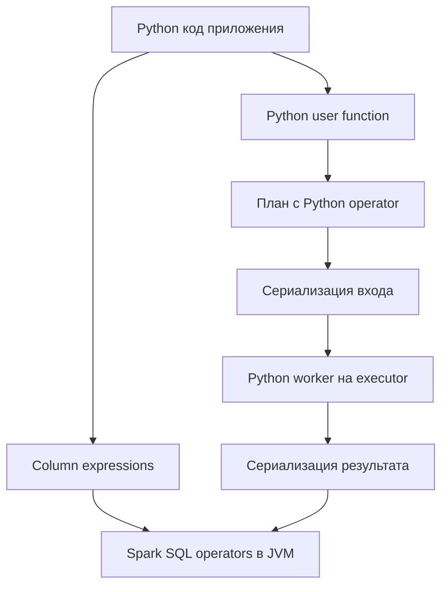
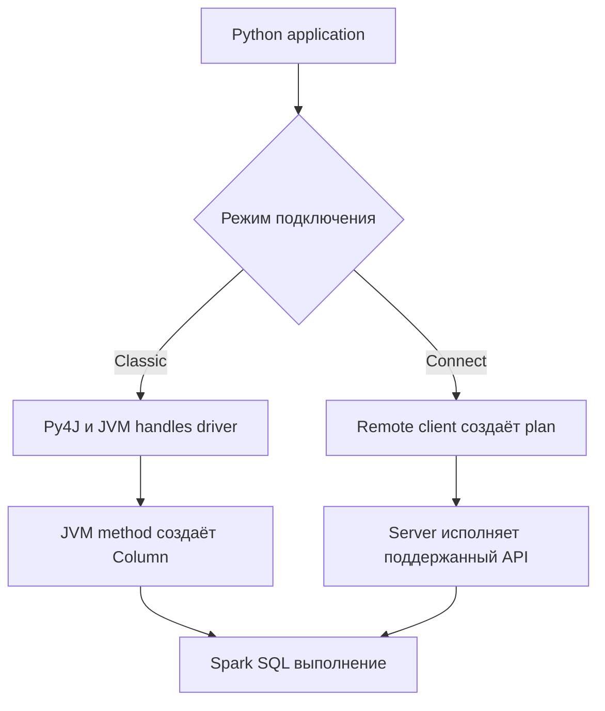
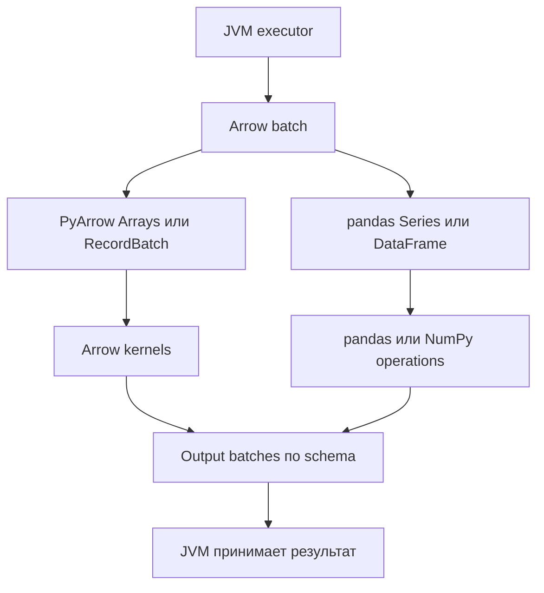
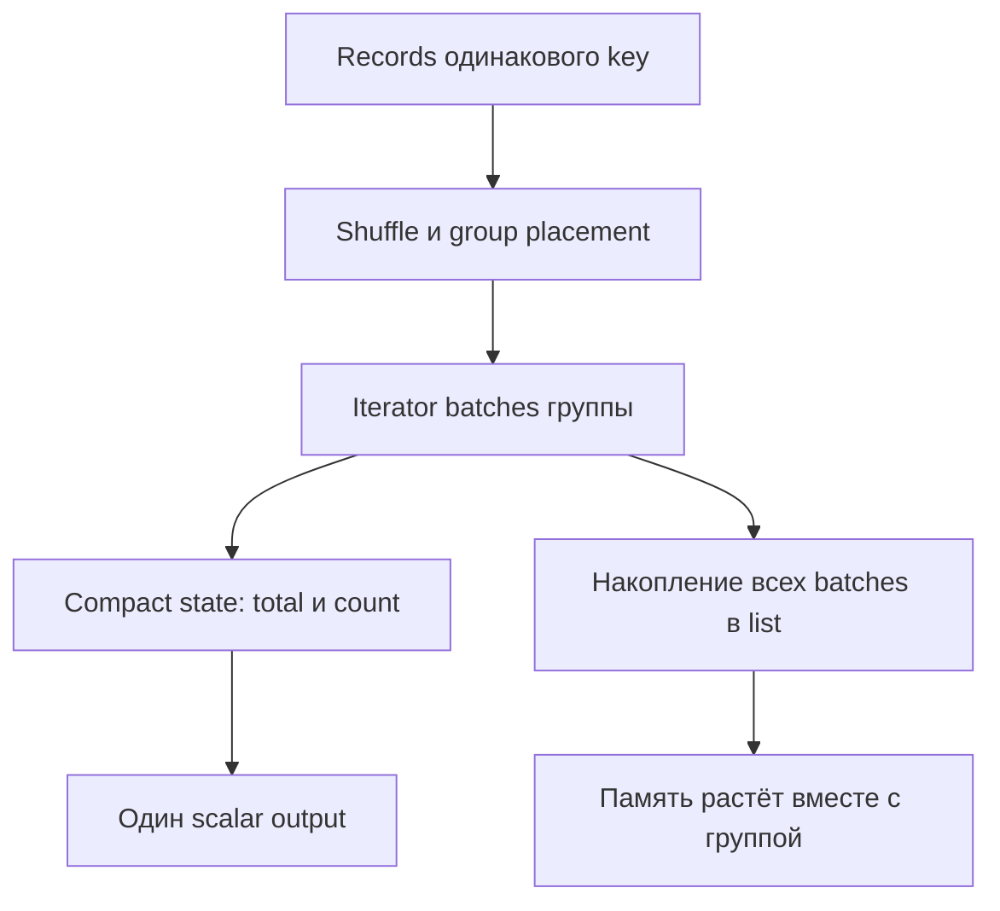
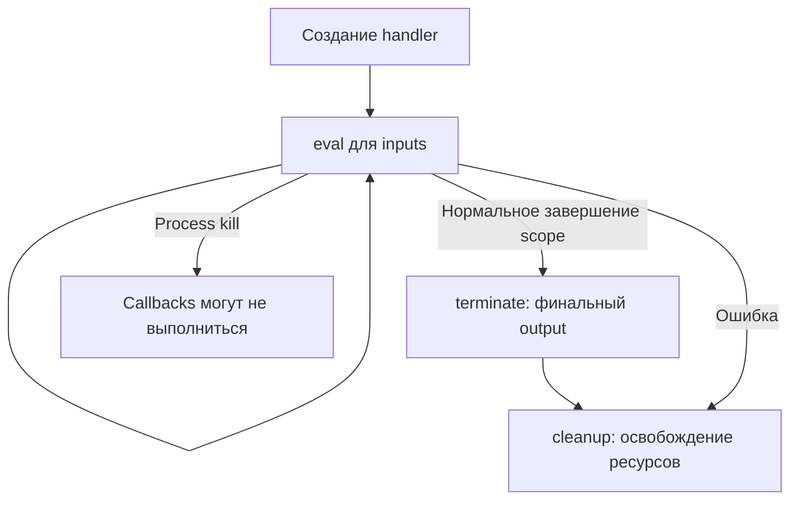

# 10. PySpark, JVM API, Arrow и пользовательские функции

Пользовательская функция в Spark — это не просто «обычная Python-функция, вызванная для таблицы». Её нужно сериализовать, доставить на исполнители, согласовать типы входа и выхода и встроить в распределённое выполнение. В зависимости от API она получает отдельное значение, колонку небольшого batch, iterator batches, целую группу или несколько входных таблиц. Эти различия определяют корректность, скорость и потребление памяти.

Раздел охватывает **10 тем и 75 пунктов** оглавления. Структура остаётся трёхуровневой: раздел → тема → пункт. Объяснения, код, схемы, практики и вопросы собраны на одной странице.

**Файл:** `pyspark_jvm_arrow_and_user_defined_functions.md`.

**Предварительные знания.** SparkSession, DataFrame, Column expressions, схемы, NULL, joins, groupBy, Window, partitions, transformations/actions. Для Scala/Java примеров нужны базовые классы, lambdas, сборка JAR и понимание сериализации. Здесь основной предмет — языковые границы и контракты пользовательских функций; полное устройство Catalyst и настройка ресурсов разбираются в соответствующих разделах.

**Окружение примеров.** Apache Spark **4.2.0**, Spark Classic, Python 3.12, pandas **2.2.3**, NumPy **2.3.5**, PyArrow **20.0.0**, Java 17 и Scala **2.13.18**. Версии зафиксированы для воспроизводимости, а не объявлены единственно допустимыми. Для своего runtime проверьте совместимость библиотек и доступность конкретного API.

В Spark 4.2 обычная `udf` по умолчанию использует Arrow для сериализации, если это позволяет окружение. Поэтому примеры явно задают `useArrow=False` или `useArrow=True`, когда сравнивают два пути. Нельзя переносить историческое утверждение «Python UDF всегда использует pickle» на любой современный runtime.

**Содержание**

1. [Выбор языкового интерфейса](#language-interface)
2. [Устройство PySpark Classic](#pyspark-classic)
3. [Скалярные UDF](#scalar-udfs)
4. [Apache Arrow](#apache-arrow)
5. [Pandas UDF](#pandas-udfs)
6. [Pandas Function API и Arrow Function API](#function-apis)
7. [Pandas API on Spark](#pandas-api-on-spark)
8. [UDTF и агрегатные расширения](#udtfs-and-aggregates)
9. [Функции на партициях и внешние ресурсы](#partition-functions)
10. [Инженерная организация языкового кода](#engineering)

**Как выполнять примеры**

Короткие Python-блоки используют общий setup и идут последовательно. Большие итоговые программы запускаются отдельно. Встроенные Java/Scala исходники сохраняйте с указанными именами; пользовательские JAR нужны только для примеров JVM-регистрации и wrappers. Все данные для `collect()` здесь — маленькие учебные fixtures.

```bash
python -m venv .venv
source .venv/bin/activate
python -m pip install \
  pyspark==4.2.0 pandas==2.2.3 numpy==2.3.5 pyarrow==20.0.0
```

Java устанавливается отдельно. В Windows используйте соответствующую команду активации virtual environment. На кластере Python executable и пакеты должны быть доступны также исполнителям: установка только в notebook driver не устанавливает библиотеку на все workers.

```python
from typing import Iterator, Tuple
from pathlib import Path
from tempfile import TemporaryDirectory
from contextlib import contextmanager
import os
import sys
import json
import math
import pandas as pd
import numpy as np
import pyarrow as pa
import pyarrow.compute as pc
from pyspark import TaskContext
from pyspark.sql import SparkSession, DataFrame, Window
from pyspark.sql import functions as F, types as T
from pyspark.sql.functions import udf, pandas_udf, arrow_udf, udtf, arrow_udtf
from pyspark.errors import PythonException, AnalysisException

workspace = TemporaryDirectory(prefix="spark_chapter10_")
ROOT = Path(workspace.name)
spark = (
    SparkSession.builder.master("local[2]")
    .appName("chapter-10-language-apis")
    .config("spark.sql.shuffle.partitions", "2")
    .config("spark.sql.session.timeZone", "UTC")
    .config("spark.sql.execution.arrow.pyspark.enabled", "true")
    .config("spark.sql.execution.arrow.pyspark.fallback.enabled", "false")
    .config("spark.sql.execution.arrow.maxRecordsPerBatch", "2")
    .getOrCreate()
)
sc = spark.sparkContext
sc.setLogLevel("ERROR")
rows = [
    (1, "a", 10.0, " Spark "),
    (2, "a", 20.0, "arrow"),
    (3, "b", None, ""),
    (4, "b", 40.0, None),
    (5, "c", -5.0, "sql"),
]
df = spark.createDataFrame(rows, "id LONG, key STRING, x DOUBLE, text STRING")
expected_normalized = ["SPARK", "ARROW", "", None, "SQL"]
expected_means = {"a": 15.0, "b": 40.0, "c": -5.0}

def ordered_values(frame, field):
    return [row[field] for row in frame.orderBy("id").collect()]

assert df.count() == 5
assert df.agg(F.sum("x")).first()[0] == 65.0
```

`maxRecordsPerBatch=2` помогает увидеть batch-контракты на маленьком input. Это учебная настройка, а не рекомендация использовать двухстрочные batches в production. Встроенные SQL operators продолжают работать по собственным правилам.

<a id="language-interface"></a>
## Выбор языкового интерфейса

### PySpark, Scala, Java и SQL: возможности и ограничения

| Интерфейс | Сильная сторона | Что учитывать |
|---|---|---|
| SQL | Декларативные relational transformations | Сложную объектную логику иногда неудобно выразить |
| PySpark DataFrame | Python orchestration и доступ к SQL expressions | Выполнение Python-кода над rows требует отдельного runtime |
| Scala Dataset/DataFrame | JVM libraries, case classes и typed transformations | Типизация объектов не устраняет serialization/object overhead |
| Java Dataset/DataFrame | Интеграция с Java libraries и явными interfaces | Bean/encoder conventions и более многословный код |
| Python Pandas/Arrow functions | Использование соответствующих библиотек на batches/groups | Контракты shapes/types, memory и дополнительные операторы |

Выбор языка приложения и выбор языка обработки records — разные решения. PySpark-приложение может целиком вычислять expressions в JVM. Оно также может вызвать JVM UDF, а Scala-приложение — загрузить Python UDF через доступную integration. Важно понять фактический execution path.

Типизированный `Dataset[T]` доступен в Scala/Java; у PySpark нет равнозначного публичного typed Dataset API. Spark Connect также меняет доступные границы: Python client отправляет планы удалённому серверу и не получает прямой handle его JVM.

### Общий движок выполнения SQL и DataFrame-выражений

Python вызов `F.upper(F.col("text"))` создаёт описание Spark expression. Он не вызывает Python `str.upper()` по одному разу для каждого record. После action Spark SQL engine анализирует и исполняет соответствующий план.

```python
native_normalized = df.select("id", F.upper(F.trim("text")).alias("normalized"))
df.createOrReplaceTempView("chapter10_input")
sql_normalized = spark.sql("SELECT id, upper(trim(text)) AS normalized FROM chapter10_input")
assert ordered_values(native_normalized, "normalized") == expected_normalized
assert ordered_values(sql_normalized, "normalized") == expected_normalized
native_normalized.explain("formatted")
```

Сравнивая PySpark и Scala DataFrame, сначала сравните operators, input и actions. Если оба языка построили эквивалентный relational plan, основной distributed computation может совпасть. Время client-side построения плана, connector setup и сериализации аргументов всё равно может различаться.

Наличие Python driver не доказывает наличие Python workers в вычислительной ветви. В плане ищите конкретные Python execution operators, а не ориентируйтесь только на расширение файла приложения.

### Python overhead для пользовательского кода

Когда в plan появляется Python UDF, нужны подготовка данных для передачи, переход JVM → Python, запуск/использование worker, вычисление функции и преобразование результата обратно. Крупная модель может добавить заметную стоимость инициализации и памяти.



Arrow может уменьшить стоимость обмена и открыть vectorized kernels, но сама Python-функция не исчезает. `Series.apply(lambda...)` поверх Arrow batches всё ещё может выполнять Python callback для каждого элемента. Векторизация — свойство вычисления внутри batch, а не название decorator.

Реальные узкие места могут находиться в I/O или shuffle; поэтому «любая Python UDF медленнее любой JVM-функции на фиксированное число раз» — слишком сильное утверждение. Для дешёвой операции дополнительные переходы часто заметнее, чем для тяжёлого вычисления модели.

### Типизированный JVM-код и стоимость преобразования объектов

JVM UDF не требует перехода в Python worker, но не превращается автоматически во встроенное Catalyst expression. Вызов пользовательского Java/Scala метода может быть непрозрачен optimizer, создавать objects и влиять на codegen boundaries.

Typed Dataset также связывает internal Spark representation и JVM objects через encoders. Часть plan может декодировать rows в case classes, вызвать lambda и сериализовать результат обратно. Compile-time тип `Order` не означает, что эта работа бесплатна.

Для простого вычисления обычно полезно сравнить встроенное expression, JVM UDF и object map. Для сложной бизнес-библиотеки достоинство JVM-функции может быть в reuse проверенной реализации, а не только в потенциальной скорости.

### Поддержка библиотек, компетенции команды и сопровождаемость

Оценивайте не только время одного job. Важны наличие библиотеки нужного языка, доставка зависимостей, стабильность runtime, способ регистрации функций, поддержка NULL, тестируемость и понятность plan команде.

| Вопрос | Практическое следствие |
|---|---|
| Логика выражается built-ins? | Используйте понятное SQL/DataFrame expression |
| Нужна NumPy/pandas/PyArrow операция? | Проверьте batch API и shapes/types |
| Есть поддерживаемая Java-библиотека? | Рассмотрите JVM UDF или отдельную integration |
| Нужен arbitrary output по группе? | Рассмотрите applyInPandas/applyInArrow с memory contract |
| Нужны несколько rows на аргумент? | Сначала проверьте explode/inline, затем UDTF |
| Требуется Spark Connect? | Исключите зависимости от `_jvm`, RDD и local JVM handles |

Публичное API с явной схемой обычно проще сопровождать, чем несколько private wrappers вокруг JVM internals. Если без private API нельзя обойтись, изолируйте его в одном adapter и проверяйте при upgrade.

### Сравнение производительности на конкретной нагрузке

Benchmark должен действительно потреблять вычисленную колонку. `df.withColumn("z", costly_udf("x")).count()` может не измерить UDF: optimizer способен убрать неиспользуемое expression, если действие требует лишь число rows.

```python
measurement_input = spark.range(20).select(F.col("id").cast("double").alias("x"))
measurement_output = measurement_input.withColumn("z", F.col("x") + F.lit(1.0))
# sum(z) действительно требует вычисления z; count() сам по себе этого не доказывает.
assert measurement_output.agg(F.sum("z")).first()[0] == 210.0
```

Для сравнения фиксируйте dataset, schema/NULL policy, число partitions, batch limits, hardware, версии, warm-up, число повторений и action. Отдельно измеряйте cold start и steady state. Материализация общей source ветви может убрать из сравнения повторное чтение, но кеширование результата одной реализации нарушит симметрию.

Сначала проверьте business equivalence. Затем смотрите wall time, Python/JVM memory, spill, shuffle и plan. Один удачный запуск на пяти строках подтверждает пример, а не преимущество интерфейса на production input.

**Практика.** Запишите одинаковую ASCII-нормализацию через built-ins, Python UDF, Pandas UDF, Arrow UDF и JVM UDF. Сначала сравните values/NULL/empty strings, затем планы; benchmark делайте на отдельном реалистичном input.

<a id="pyspark-classic"></a>
## Устройство PySpark Classic

### Python driver, JVM driver и Py4J

В Spark Classic Python driver работает рядом с JVM driver. Через Py4J Python получает доступ к JVM Spark objects и строит DataFrame/Column plans. Именно JVM часть взаимодействует со Spark scheduler и cluster manager; Python application управляет логикой своего приложения.

```python
assert spark.version == "4.2.0"
assert sc.applicationId
java_version = sc._jvm.java.lang.System.getProperty("java.version")
assert isinstance(java_version, str) and java_version
print("Python driver:", sys.version.split()[0], "JVM driver:", java_version)
```

`sc._jvm` — private handle конкретного Classic driver JVM. Полученная версия Java описывает этот процесс, а не доказывает одинаковую конфигурацию всех executors. Полезную диагностику превращайте в явные environment checks.

Py4J driver communication и worker data transport — разные каналы. Нет правила «Spark передаёт каждую executor row в Python через driver Py4J»: пользовательский код исполняется на Python workers соответствующих executors.

### Python workers на исполнителях

Python worker — отдельный процесс, который выполняет Python часть task и обменивается данными с JVM executor. У executor может одновременно работать несколько Python workers. Соответственно, memory одной модели может умножаться на число процессов.

```python
def worker_environment(iterator: Iterator[pd.DataFrame]) -> Iterator[pd.DataFrame]:
    import os
    import sys
    import pandas as pd
    import pyarrow as pa
    context = TaskContext.get()
    count = sum(len(batch) for batch in iterator)
    yield pd.DataFrame({
        "partition_id": [context.partitionId()],
        "pid": [os.getpid()],
        "python": [sys.version.split()[0]],
        "pandas": [pd.__version__],
        "pyarrow": [pa.__version__],
        "rows_seen": [count],
    })

worker_info = df.mapInPandas(
    worker_environment,
    "partition_id INT, pid LONG, python STRING, pandas STRING, pyarrow STRING, rows_seen LONG",
).collect()
assert sum(row.rows_seen for row in worker_info) == 5
assert all(row.pyarrow == "20.0.0" for row in worker_info)
```

Это диагностический fixture на существующих partitions; идентификаторы процессов не являются business IDs и не обещают постоянный executor placement. Worker может завершиться, быть заменён или обслужить следующий task.

### Сериализация функций и объектов через pickle/cloudpickle

Для доставки Python function/closure Spark использует соответствующую Python serialization machinery, в том числе cloudpickle. Это позволяет доставить многие пользовательские функции, но не делает любую object graph переносимой.

```python
from pyspark import cloudpickle

def make_adder(delta):
    def add(value):
        return value + delta
    return add

serialized_adder = cloudpickle.dumps(make_adder(3))
restored_adder = cloudpickle.loads(serialized_adder)
assert restored_adder(7) == 10
```

Функция может сериализоваться успешно и всё же упасть на worker: нужный Python module, native library, файл модели или executable может отсутствовать. Зависимости нужно доставлять отдельно. Модуль, импортируемый по имени, не обязательно вкладывается в closure целиком.

Pickle/cloudpickle serialization функции и Arrow serialization табличного input — независимые этапы. Использование Arrow не означает, что Spark перестал сериализовать сам Python handler и его closure. Не применяйте pickle к недоверенным внешним payloads как к обычному безопасному data format.

### Обмен данными между JVM и Python

| Путь | Что получает user code | Что важно |
|---|---|---|
| `udf(..., useArrow=False)` | Отдельные Python values | Батчирование transport не делает код vectorized |
| Scalar `udf(..., useArrow=True)` | Отдельные Python values | Arrow улучшает transport/coercion, не меняя обычную scalar signature |
| `pandas_udf` | Series/DataFrame или соответствующий iterator | pandas dtypes, length, index alignment |
| `arrow_udf` | Arrow Arrays или iterator; у aggregate — scalar output | Arrow types, null bitmap и kernels |
| `mapInPandas` / `mapInArrow` | Iterator partition batches | Можно менять число rows, требуется output schema |
| Grouped Function API | Группа целиком или её iterator | Shuffle, skew и lifetime group state |

Аргументы UDF сначала являются Spark Columns. Реальные Python/Arrow values появляются лишь внутри worker во время выполнения task. Вызов `my_udf("x")` в driver не означает, что функция получила строку `"x"` как бизнес-значение: этот аргумент обычно обозначает input column.

Схема output — контракт обратного перехода. Векторизованная функция, которая возвращает неподходящий dtype или неправильно обработала NULL, может упасть при сериализации даже после успешного вычисления Python тела.

### Повторное использование Python workers

`spark.python.worker.reuse` позволяет повторно использовать worker processes. Это уменьшает некоторые расходы запуска и доставки/инициализации, однако task, partition и worker не становятся одной неизменной сущностью.

```python
reuse_setting = sc.getConf().get("spark.python.worker.reuse", "true")
assert reuse_setting in {"true", "false"}
```

Не храните authoritative business state в Python module global и не рассчитывайте, что следующий key попадёт в тот же процесс. Worker-local cached model полезна как optimization с явным version/lifetime, но вычисление должно оставаться корректным после её потери.

Iterator UDF обеспечивает понятную область reuse ресурса в одном вызове handler. Возможность использовать этот ресурс между разными tasks — отдельная engineering задача, зависящая от worker lifetime и допустимого memory footprint.

### Python executable на driver и executors

Driver Python выбирается способом запуска приложения. Executor-side executable задают соответствующие параметры окружения/конфигурации, например `PYSPARK_PYTHON` и `spark.pyspark.python`. Есть также driver-specific настройки. Некоторые параметры должны быть установлены до старта приложения.

```python
print("Driver executable:", sys.executable)
print("Executor executable selection:", sc.pythonExec)
assert sys.version_info[:2] == (3, 12)
```

Путь `/opt/project/.venv/bin/python` имеет смысл только если он существует на нужных nodes/containers. Не подставляйте `sys.executable` локального ноутбука в кластерный submit автоматически. Нужны совместимые Python major/minor, зависимости и native ABI, а также доступ к model artifacts.

Для reproducibility используйте container image либо поддерживаемый способ доставки окружения и фиксируйте versions. `--py-files` доставляет Python modules/archives, но не является универсальной установкой compiled wheels и OS libraries.

### Python traceback и ошибка JVM как разные уровни диагностики

Полезно различать plan analysis, сериализацию closure, запуск worker, Python execution и output conversion. Они могут дать похожую оболочку Java exception, но требуют разных исправлений.

```python
@udf("double", useArrow=False)
def reject_negative(value):
    if value is not None and value < 0:
        raise ValueError("chapter10: negative input rejected")
    return value

try:
    df.select(reject_negative("x")).collect()
except PythonException as error:
    assert "chapter10: negative input rejected" in str(error)
else:
    raise AssertionError("Ожидалась PythonException")
```

| Признак | Где искать причину |
|---|---|
| `AnalysisException`, отсутствующая column/function | Plan, schema и регистрация |
| `PicklingError`, `cannot pickle ...` | Closure/object graph до выполнения |
| `ModuleNotFoundError` на worker | Executor environment и доставка dependencies |
| `PythonException` с пользовательским traceback | Значение input и тело function |
| Arrow conversion/length error | Output schema, dtype, NULL и shape |
| `ClassNotFoundException` при JVM UDF | JAR delivery, package name и classpath |
| Worker exit или OOM | Python/native memory, executor limits и node logs |

Читайте самую раннюю содержательную причину в chain, а не только последнюю строку `Job aborted`. Ошибка output serializer может быть вызвана корректно исполнившейся функцией с некорректным типом результата.

**Практика.** Получите маленькую таблицу worker versions/PIDs. Затем по очереди вызовите неверную column, несериализуемую closure и ожидаемое Python exception; для каждого случая назовите стадию отказа.

<a id="scalar-udfs"></a>
## Скалярные UDF

### Создание и регистрация Python UDF

Scalar UDF задаёт результат для одного набора input values. Spark возвращает `Column`, которую можно использовать в select, withColumn и других expressions. Регистрация добавляет имя для SQL-вызова в соответствующую SparkSession.

```python
def normalize_ascii(value):
    # Контракт fixture: удаляем только ASCII spaces по краям.
    return None if value is None else value.strip(" ").upper()

normalize_python = udf(normalize_ascii, T.StringType(), useArrow=False)
python_normalized = df.select("id", normalize_python("text").alias("normalized"))
assert ordered_values(python_normalized, "normalized") == expected_normalized
spark.udf.register("normalize_python", normalize_python)
assert ordered_values(
    spark.sql("SELECT id, normalize_python(text) AS normalized FROM chapter10_input"),
    "normalized",
) == expected_normalized
```

При `useArrow=False` выбирается обычный Python serialization path. Transport всё равно может обрабатывать batches, но тело `normalize_ascii` получает отдельный value. `register` не записывает функцию в библиотеку навсегда и не гарантирует её наличие в другой session/application.

Регистрация и создание Column происходят на driver. Не выполняйте внутри UDF SparkSession.sql, чтение Spark DataFrame или actions: task не становится самостоятельным driver для nested Spark jobs.

### returnType и соответствие возвращаемых значений схеме

`returnType` задаёт SQL type, который Spark ожидает после Python вычисления. Аннотация `-> int` обычной scalar function не заменяет этот contract. Default StringType не подходит для функции, которая должна возвращать числовой результат.

```python
@udf(T.IntegerType(), useArrow=False)
def safe_text_length(value):
    return None if value is None else len(value)

lengths = df.select("id", safe_text_length("text").alias("length"))
assert ordered_values(lengths, "length") == [7, 5, 0, None, 3]
assert lengths.schema["length"].dataType == T.IntegerType()

@udf("struct<normalized:string,length:int>", useArrow=False)
def normalized_with_length(value):
    if value is None:
        return None
    normalized = value.strip(" ").upper()
    return (normalized, len(normalized))

structured = df.select("id", normalized_with_length("text").alias("result"))
assert structured.filter("id = 1").first().result.normalized == "SPARK"
assert structured.filter("id = 4").first().result is None
```

Для structs нужно согласовать поля, порядок/форму values и NULL вложенность; для arrays/maps — types элементов и keys. Decimal, timestamp и binary требуют отдельных conversion fixtures. Python `bool` как subclass `int` не означает одинаковый SQL смысл типов.

Не рассчитывайте, что любое несоответствие завершится громкой ошибкой: некоторые serialization paths могут вернуть NULL, привести значение либо сообщить conversion error. Поведение зависит от типа и пути, поэтому некорректный contract исправляют в function, а не используют как способ cast.

### Scala/Java UDF и регистрация SQL-функций; использование JVM UDF из PySpark, доставка JAR и registerJavaFunction для совместимого класса

JVM scalar UDF можно вызвать из SQL/PySpark после регистрации. Java-класс для `registerJavaFunction` должен реализовать соответствующий Spark interface, быть доступен classloader и принимать/возвращать совместимые types.

Сохраните следующий исходник как `src/chapter10/NormalizeAscii.java`:

<!-- SPARK_UDF_JAVA_NORMALIZE_BEGIN -->
```java
package chapter10;
import java.util.Locale;
import org.apache.spark.sql.api.java.UDF1;
public final class NormalizeAscii implements UDF1<String,String> {
    public String call(String value) {
        return value == null ? null : value.replaceAll("^ +| +$", "").toUpperCase(Locale.ROOT);
    }
}
```
<!-- SPARK_UDF_JAVA_NORMALIZE_END -->

Контракт этого примера сравнивается на ASCII fixture. Java `trim()`, Python `strip()` и SQL `trim()` могут удалять разные whitespace characters; locale/Unicode casing также требуют явного контракта. Поэтому здесь используются только ASCII spaces по краям и фиксированная Java locale.

После сборки JAR по командам следующего пункта запустите новый PySpark application с этим JAR, например `spark-submit --jars target/chapter10-udf.jar application.py`. В notebook надёжнее настроить JAR до создания SparkSession. Изменение `spark.jars` у уже запущенного context не равнозначно корректной доставке и загрузке classes.

<!-- SPARK_UDF_BRIDGE_BEGIN -->
```python
spark.udf.registerJavaFunction("normalize_java", "chapter10.NormalizeAscii", T.StringType())
java_normalized = df.select("id", F.call_udf("normalize_java", F.col("text")).alias("normalized"))
assert ordered_values(java_normalized, "normalized") == expected_normalized
assert ordered_values(
    spark.sql("SELECT id, normalize_java(text) AS normalized FROM chapter10_input"),
    "normalized",
) == expected_normalized
```
<!-- SPARK_UDF_BRIDGE_END -->

Scala регистрация может использовать функцию/lambda и типы JVM API. Этот фрагмент выполняется внутри Scala application с созданной SparkSession:

<!-- SPARK_UDF_SCALA_BODY_BEGIN -->
```scala
spark.udf.register("normalize_scala", (value: String) =>
  if (value == null) null
  else value.replaceAll("^ +| +$", "").toUpperCase(java.util.Locale.ROOT)
)
val result = spark.sql("SELECT normalize_scala(' Spark ') AS normalized").head()
assert(result.getString(0) == "SPARK")
assert(spark.sql("SELECT normalize_scala(CAST(NULL AS STRING))").head().isNullAt(0))
```
<!-- SPARK_UDF_SCALA_BODY_END -->

JAR должен быть доступен driver для регистрации/analysis и executors для выполнения. Проверяйте Spark version, Scala binary suffix, dependency conflicts и class package. Обычно Spark dependencies предоставляются runtime и не должны бесконтрольно дублироваться в fat JAR.

### Wrappers через sc._jvm и private Column helpers: зависимость от Spark Classic и версии

Wrapper может вызвать JVM method, который возвращает Spark Column, и обернуть этот handle в Python Column. Такой adapter строит expression на driver; он не запускает JVM method для каждого record через Python callback.

Второй Java-исходник сохраните как `src/chapter10/Columns.java`:

<!-- SPARK_UDF_JAVA_COLUMNS_BEGIN -->
```java
package chapter10;
import org.apache.spark.sql.Column;
import org.apache.spark.sql.functions;
public final class Columns {
    private Columns() {}
    public static Column normalized(Column input) {
        return functions.call_udf("normalize_java", input);
    }
}
```
<!-- SPARK_UDF_JAVA_COLUMNS_END -->

Сборка обоих Java-классов с обычным JDK и установленным Spark:

```bash
mkdir -p target/java-classes
javac --release 17 -cp "$SPARK_HOME/jars/*" \
  -d target/java-classes src/chapter10/NormalizeAscii.java src/chapter10/Columns.java
jar --create --file target/chapter10-udf.jar -C target/java-classes .
```

Для показанного Spark Classic 4.2 Python wrapper выглядит так:

<!-- SPARK_UDF_BRIDGE_BEGIN -->
```python
from pyspark.sql.classic.column import Column as ClassicColumn, _to_java_column

def normalize_via_private_bridge(column):
    java_column = sc._jvm.chapter10.Columns.normalized(_to_java_column(column))
    return ClassicColumn(java_column)

wrapped = df.select("id", normalize_via_private_bridge(F.col("text")).alias("normalized"))
assert ordered_values(wrapped, "normalized") == expected_normalized
```
<!-- SPARK_UDF_BRIDGE_END -->

`sc._jvm`, `_to_java_column`, `_jc` и import path `classic.column` не являются одинаковым стабильным контрактом для всех версий/режимов. Старый example с helper из другого модуля может перестать импортироваться после upgrade. Изолируйте такой код, pin versions и добавьте маленький integration fixture.

В этом конкретном примере публичный `F.call_udf("normalize_java", ...)` уже решает задачу. Private wrapper показан, чтобы понимать существующие integrations, а не как обязательная надстройка над каждой JVM UDF.

### Ограничения прямого Py4J-доступа при переносе UDF-кода на Spark Connect

Spark Connect client не владеет удалённым driver JVM через Py4J и не предоставляет обычный SparkContext/RDD handle. Поэтому код, основанный на `_jvm`, `_jdf` или `_jc`, нельзя механически перенести на Connect.



Для переноса используйте поддерживаемые public expressions, регистрацию функций на стороне server либо поддерживаемые mechanisms доставки artifacts. Возможность загрузить JAR и зарегистрировать JVM function нужно проверять для конкретного Connect server/platform, а не выводить из наличия аналогичного Classic метода.

Python UDF и Pandas functions могут поддерживаться Connect через свой protocol, но это не означает поддержку произвольного driver-side Py4J bridge. В portable module отделите чистую DataFrame transformation от Classic-only adapter и проверяйте оба режима отдельно.

### Обработка NULL внутри UDF

SQL built-ins обычно имеют определённую NULL semantics. Пользовательская Python function получает `None` для соответствующего scalar input и должна сама решить, что делать. NULL, empty string, zero и NaN — разные значения.

```python
@udf("string", useArrow=False)
def label_missing(value):
    if value is None:
        return "MISSING"
    if value == "":
        return "EMPTY"
    return "PRESENT"

labels = df.select("id", label_missing("text").alias("label"))
assert ordered_values(labels, "label") == ["PRESENT", "PRESENT", "EMPTY", "MISSING", "PRESENT"]
```

Внешнее `when` или boolean condition не является гарантией short-circuit вокруг Python UDF. Planner может вынести вычисление функции в отдельный operator и применить condition позже. Если UDF способна упасть на NULL/negative/malformed value, защита должна находиться в самой функции.

Для нескольких inputs определите contract частично отсутствующих аргументов: NULL в одном аргументе может обнулять весь результат, использовать default или возвращать structured rejection. Не используйте `if not value` вместо проверки NULL, если `0` или `""` допустимы.

### Детерминированные и недетерминированные UDF

Scalar UDF считается deterministic по умолчанию: одинаковые inputs должны давать одинаковый result в рамках контрактов функции. Чтение времени, генерация случайного числа и внешнего изменяемого состояния могут нарушить это предположение.

```python
import random
random_token = udf(lambda: random.randint(0, 1_000_000), "long", useArrow=False).asNondeterministic()
assert random_token.deterministic is False
random_rows = spark.range(3).select("id", random_token().alias("token")).collect()
assert len(random_rows) == 3
assert all(0 <= row.token <= 1_000_000 for row in random_rows)
```

Не проверяйте, что все случайные результаты различны: такой test может случайно упасть. Не используйте random value из task как стабильный business ID, особенно при replay.

`asNondeterministic()` сообщает свойство optimizer, но не обеспечивает exactly-once invocation и не запрещает task retry. Для воспроизводимой бизнес-логики нужен deterministic rule по стабильным данным, version/reference snapshot и явно заданная policy.

### Почему UDF ограничивает видимость логики для оптимизатора

Catalyst видит arguments, return type и свойства UDF, но обычно не может разложить произвольное Python/Java body на relational rules. Это мешает, например, вывести эквивалентный source filter из произвольной function.

```python
native_filter = df.filter(F.col("x") > 15.0)

@udf("boolean", useArrow=False)
def above_fifteen(value):
    return False if value is None else value > 15.0

opaque_filter = df.filter(above_fifteen("x"))
assert [r.id for r in native_filter.orderBy("id").collect()] == [2, 4]
assert [r.id for r in opaque_filter.orderBy("id").collect()] == [2, 4]
native_filter.explain("formatted")
opaque_filter.explain("formatted")
```

Это не означает, что весь surrounding plan перестал оптимизироваться. Spark по-прежнему может pruning/reorder части плана согласно своей semantics. Непрозрачна конкретная функция, а степень последствий зависит от места её вызова.

Если фильтр по исходным columns можно применить раньше дорогой UDF, выразите его публичным expression и проверьте plan. Однако перенос filter через функцию допустим только при сохранении business meaning и error policy.

### Предпочтение встроенных функций и SQL-выражений

Для строк, дат, условий, arrays/maps, JSON, агрегатов и окон сначала ищите built-in. Higher-order functions часто заменяют Python цикл по array без выхода из Spark SQL engine.

```python
array_fixture = spark.createDataFrame([([1, 2, None],), (None,)], "items ARRAY<INT>")
array_result = array_fixture.select(F.transform("items", lambda value: value + 1).alias("items"))
assert [r.items for r in array_result.collect()] == [[2, 3, None], None]
```

Здесь Python lambda **строит Column expression**. Она не является row callback, который получает каждый array element в Python worker. Внутри такой lambda используйте поддерживаемые Spark expressions; вызов произвольной Python UDF из higher-order function не обязан поддерживаться.

Built-in не отменяет проверку semantics: NULL, timezone, rounding, Unicode и regex engine могут отличаться от локальной Python library. Выбор встроенного expression должен проходить те же result fixtures, что и пользовательская реализация.

### Arrow-оптимизированная Python UDF: отличия от Pandas UDF и от векторизованной функции, непосредственно получающей Arrow-массивы

Для обычной scalar signature `udf(..., useArrow=True)` меняет transport/conversion path, но function продолжает получать отдельные Python values. Pandas UDF получает pandas batches, Arrow-native UDF — Arrow arrays.

```python
normalize_arrow_transport = udf(normalize_ascii, "string", useArrow=True)
arrow_transport_result = df.select("id", normalize_arrow_transport("text").alias("normalized"))
assert ordered_values(arrow_transport_result, "normalized") == expected_normalized
arrow_transport_result.explain("formatted")
```

| API показанных примеров | Вход function | Вычисление |
|---|---|---|
| `udf(..., useArrow=False)` | `str` / `None` | Python scalar function |
| `udf(..., useArrow=True)` | `str` / `None` | Та же scalar function с Arrow transport |
| `pandas_udf` | `pd.Series` | pandas операции над batch |
| `arrow_udf` | `pa.Array` | Arrow kernels или выбранная batch logic |

В современных версиях некоторые UDF entry points также распознают vectorized type hints. Поэтому contract проверяют по полной signature и actual function type, а не только по имени `udf`. Здесь обычные scalar UDF намеренно заданы без batch annotations.

Arrow coercion и обычная Python serializer conversion не идентичны для всех types. Не используйте смену `useArrow` как неявное исправление несоответствующего return value. Установите compatible libraries, явно задайте schema и проверьте edge cases на обоих путях при миграции.

### @arrow_udf с Spark 4.1: вычисление над pyarrow.Array, скалярные и iterator-контракты

`arrow_udf` предоставляет Arrow-native interface. В scalar batch variant длина output соответствует длине input; Arrow null bitmap позволяет сохранять NULL без превращения каждого элемента в Python object.

```python
@arrow_udf("double")
def plus_one_arrow(values: pa.Array) -> pa.Array:
    return pc.add(values, 1.0)

arrow_scalar_result = df.select("id", plus_one_arrow("x").alias("y"))
assert ordered_values(arrow_scalar_result, "y") == [11.0, 21.0, None, 41.0, -4.0]

@arrow_udf("double")
def plus_one_arrow_iterator(batches: Iterator[pa.Array]) -> Iterator[pa.Array]:
    offset = pa.scalar(1.0, type=pa.float64())
    for batch in batches:
        yield pc.add(batch, offset)

arrow_iterator_result = df.select("id", plus_one_arrow_iterator("x").alias("y"))
assert ordered_values(arrow_iterator_result, "y") == ordered_values(arrow_scalar_result, "y")
```

Input Array — часть column внутри batch, а не вся распределённая column. Iterator variant позволяет reuse initialized resource внутри одного вызова; общее число output rows должно совпасть с input для scalar contract. В примере сохраняется также размер каждого batch.

`pa.Array.to_pylist()` с дальнейшим Python loop снова создаёт Python objects и может потерять преимущество kernels. Для supported Arrow operations используйте `pyarrow.compute`. Для struct output нужен совместимый StructArray, а не произвольный dict без schema contract.

`arrow_udf` появился в Spark 4.1. Старые Spark 3.x examples его не имеют. Grouped aggregate variants и их iterator contracts рассматриваются ниже: возвращаемый scalar имеет другую cardinality, чем scalar batch UDF.

**Практика.** Объясните, какой именно API получает values, Series и Arrays. Для одной operation проверьте NULL и output schema, затем прочитайте plan; отдельно обоснуйте, почему `useArrow=True` не доказывает vectorized computation.

<a id="apache-arrow"></a>
## Apache Arrow

### Колонночное представление и RecordBatch

Arrow задаёт типизированное columnar representation: значения, buffers и validity information. `Array` представляет одну колонку, `RecordBatch` — согласованный набор columns одинаковой длины, `Table` может содержать chunked columns из нескольких batches.

```python
arrow_batch = pa.RecordBatch.from_arrays(
    [pa.array([1, 2, 3], type=pa.int64()), pa.array([10.0, None, 30.0], type=pa.float64())],
    names=["id", "x"],
)
assert arrow_batch.num_rows == 3
assert arrow_batch.column("x").null_count == 1
arrow_table = pa.Table.from_batches([arrow_batch])
assert arrow_table.schema.field("id").type == pa.int64()
assert pc.sum(arrow_table.column("x")).as_py() == 40.0
```

Arrow NULL хранится через validity information, а не только специальный floating-point value. `NaN` может быть допустимым non-NULL double. Перевод в pandas способен изменить representation отсутствующих values, поэтому важно отдельно проверять SQL semantics и intermediate dtype.

RecordBatch — единица представления/обмена, а не синоним Spark partition, executor или business group. Одна partition обычно поступает несколькими batches; группа может быть одним объектом либо iterator batches в зависимости от API.

### Ускорение обмена данными между JVM, Python и pandas

Columnar exchange уменьшает некоторые расходы на row-by-row conversion и позволяет libraries работать с типизированными buffers. Но граница процессов, network, сериализация closure и object allocations не исчезают полностью.



Нельзя обещать zero-copy для любой операции Spark → Arrow → pandas. String/object conversion, nullable representation, repartition, формирование output и выбор kernel могут создавать дополнительные buffers/copies. Некоторые conversions могут быть cheap views, другие — нет.

Arrow не заменяет Catalyst и не является отдельным cluster manager. Он отвечает за representation/interop на соответствующей границе; SQL execution, tasks и shuffle остаются работой Spark.

### Arrow в createDataFrame, toPandas и Arrow API конкретной версии

`spark.sql.execution.arrow.pyspark.enabled` управляет соответствующими pandas conversion paths. Эта настройка не является универсальным выключателем всех Pandas UDF или Arrow-native functions: у них собственный execution contract.

```python
small_pdf = pd.DataFrame({"id": pd.Series([10, 11], dtype="int64"), "value": [1.5, 2.5]})
from_pandas = spark.createDataFrame(small_pdf)
assert from_pandas.schema["id"].dataType == T.LongType()
assert from_pandas.agg(F.sum("value")).first()[0] == 4.0
back_to_pandas = from_pandas.orderBy("id").toPandas()
assert back_to_pandas["id"].tolist() == [10, 11]

local_arrow = df.orderBy("id").toArrow()
assert isinstance(local_arrow, pa.Table) and local_arrow.num_rows == 5
from_arrow = spark.createDataFrame(local_arrow)
assert from_arrow.count() == 5
assert ordered_values(from_arrow, "x") == [10.0, 20.0, None, 40.0, -5.0]
```

В данном runtime доступны `DataFrame.toArrow()` и создание Spark DataFrame из `pa.Table`. Проверяйте version-specific API, а не переносите имя метода на старый Spark. Не путайте `toArrow()` с `mapInArrow()`: первое собирает результат на driver, второе запускает distributed function над partition batches.

Для pandas/Arrow inputs `verifySchema` не обеспечивает ту же row-by-row Python verification, что для обычного iterable input. Schema/type coercion выполняется по правилам выбранного conversion path. Проверяйте фактическую Spark schema после создания и business values после roundtrip.

### Поддержка типов и преобразование timestamps

Spark, pandas, NumPy и Arrow имеют разные type systems. Проверяйте integer width, nullable integers, decimals, arrays/maps/structs, binary, dictionary/extension types и timestamps. Поддерживаемость отдельного типа в Arrow library не доказывает поддержку любой комбинации в Spark UDF output.

| Область | Типичная граница |
|---|---|
| Integer + NULL в pandas | Обычный NumPy int dtype не хранит NULL; нужны appropriate representation/conversion |
| Decimal | Precision/scale и rounding должны совпасть со Spark DecimalType |
| Timestamps | Spark LTZ/NTZ, session timezone и точность отличаются от произвольного pandas timestamp |
| Struct | Нужны совместимые fields/order/child types и nullable contract |
| Nested types | Поддержку проверяют для конкретного API и версии |
| NaN и NULL | Это разные SQL значения, но некоторые pandas conversions сближают их representation |

Следующий fixture начинает с явно заданного UTC instant, чтобы не зависеть от timezone локальной Python машины:

```python
from datetime import datetime, timezone
instant = datetime(2024, 1, 1, 12, 0, 0, 123456, tzinfo=timezone.utc)
timestamp_table = pa.table({"ts": pa.array([instant], type=pa.timestamp("us", tz="UTC"))})
timestamp_frame = spark.createDataFrame(timestamp_table)
assert timestamp_frame.schema["ts"].dataType == T.TimestampType()
original_timezone = spark.conf.get("spark.sql.session.timeZone")
try:
    spark.conf.set("spark.sql.session.timeZone", "UTC")
    utc_pdf = timestamp_frame.toPandas()
    assert utc_pdf.ts.iloc[0].hour == 12
    assert utc_pdf.ts.iloc[0].microsecond == 123456
    spark.conf.set("spark.sql.session.timeZone", "Europe/Moscow")
    moscow_pdf = timestamp_frame.toPandas()
    assert moscow_pdf.ts.iloc[0].hour == 15
finally:
    spark.conf.set("spark.sql.session.timeZone", original_timezone)
```

У Spark TimestampType значение представляет instant, а pandas conversion использует session timezone для локального representation. В этом conversion pandas timestamp получается без timezone metadata; её нельзя считать автоматически сохранённой provenance исходного UTC input. TimestampNTZ имеет другую semantics и требует отдельного fixture.

Spark timestamp precision обычно microseconds; nanoseconds pandas/Arrow могут быть усечены. Для бизнес-ключей и ordering убедитесь, что такая потеря точности допустима. Не исправляйте время добавлением произвольных часов: сначала определите LTZ/NTZ и source timezone.

### Размер Arrow batch и потребление памяти

`spark.sql.execution.arrow.maxRecordsPerBatch` ограничивает количество records на поддерживаемых batch paths. Это не byte limit: две rows с огромными arrays/strings могут занимать больше памяти, чем тысячи коротких numeric rows.

```python
def batch_sizes(batches: Iterator[pa.RecordBatch]) -> Iterator[pa.RecordBatch]:
    for batch in batches:
        yield pa.RecordBatch.from_pydict({"batch_rows": [batch.num_rows]})

observed_batch_sizes = df.select("id", "x").mapInArrow(batch_sizes, "batch_rows LONG").collect()
assert sum(row.batch_rows for row in observed_batch_sizes) == 5
assert all(1 <= row.batch_rows <= 2 for row in observed_batch_sizes)
```

Память процесса включает input Arrow buffers, pandas/NumPy copies, state модели, temporary buffers вычисления, output и queued batches. Параллельные workers умножают эту нагрузку. Native Arrow memory может входить в Python RSS/executor container budget и не отображаться как JVM heap allocation.

Уменьшение batch иногда снижает peak memory, но увеличивает overhead и не лечит group skew. Некоторые whole-group API получают все data группы, независимо от обычного partition batch limit. Iterator group API уменьшает input materialization лишь при потоковом processing и bounded state.

Настройка `spark.sql.execution.arrow.pyspark.selfDestruct.enabled` относится к соответствующему conversion в pandas и может менять memory/CPU/copy trade-off. Не включайте её как общий способ «убрать память у любой UDF». Проверяйте поддержку и измеряйте actual peak RSS.

### Fallback и ошибки несовместимости

`spark.sql.execution.arrow.pyspark.fallback.enabled` может позволить некоторым pandas conversion paths перейти к обычному пути, если Arrow optimization не удалось подготовить. Это не universal retry mechanism для любого Arrow error.

```python
assert spark.conf.get("spark.sql.execution.arrow.pyspark.enabled") == "true"
assert spark.conf.get("spark.sql.execution.arrow.pyspark.fallback.enabled") == "false"
```

В учебном окружении fallback отключён, чтобы ошибка не скрывала фактический path. Ошибка во время уже начавшегося distributed Arrow execution не обязана переключиться на другой serializer. Неверный output Pandas UDF также не исправляется этой настройкой.

Отдельный случай — создание обычной Arrow-optimized scalar UDF при отсутствующих dependencies: в зависимости от runtime возможны warning/fallback либо отказ. Для обязательного Arrow-native API нужны его dependencies и совместимая schema; не рассчитывайте на прозрачную замену `arrow_udf` на row UDF.

Проверяйте versions на driver и workers, native ABI, supported types и actual plan. Если benchmark включён с fallback, зафиксируйте, какой path действительно выполнялся.

### Arrow ускоряет передачу, но не устраняет ограничение памяти драйвера

`toPandas()` и `toArrow()` возвращают локальный объект на driver. Даже идеально эффективная передача не позволяет хранить dataset большего размера, чем доступная память процесса.

```python
preview_pdf = df.orderBy("id").limit(3).toPandas()
preview_arrow = df.orderBy("id").limit(3).toArrow()
assert len(preview_pdf) == 3
assert preview_arrow.num_rows == 3
```

`limit` здесь ограничивает rows preview, но не bytes длинных payloads. При большой аналитике оставляйте результат распределённым: DataFrame transformations, mapInPandas/mapInArrow и запись в storage. Для агрегата сначала уменьшите cardinality в Spark и только затем выгружайте небольшой итог.

Повышение driver memory иногда помогает разумному bounded result, но не превращает collect/toPandas в distributed algorithm. JVM result buffers и Python object representation могут одновременно занимать память.

**Практика.** Выполните pandas и Arrow roundtrip небольшого fixture, включите разные session timezones и измерьте observed batch sizes. Для каждой операции укажите, находится result на driver или остаётся distributed.

<a id="pandas-udfs"></a>
## Pandas UDF

### Scalar Pandas UDF: Series → Series

Scalar Pandas UDF получает одну или несколько Series текущего batch и возвращает Series той же cardinality. Это удобный путь для pandas/NumPy operations, которые действительно работают над vector.

```python
@pandas_udf("double")
def plus_one_pandas(values: pd.Series) -> pd.Series:
    return values + 1.0

pandas_scalar_result = df.select("id", plus_one_pandas("x").alias("y"))
assert ordered_values(pandas_scalar_result, "y") == [11.0, 21.0, None, 41.0, -4.0]

@pandas_udf("string")
def normalize_pandas(values: pd.Series) -> pd.Series:
    return values.str.strip(" ").str.upper()

pandas_normalized = df.select("id", normalize_pandas("text").alias("normalized"))
assert ordered_values(pandas_normalized, "normalized") == expected_normalized
```

Function body не знает всю column, global row order или все records одного key. В одной Series могут быть rows нескольких keys. `.mean()` внутри scalar UDF считает среднее batch, а не distributed dataset или SQL group.

Число/границы batches могут измениться при настройках, partitions и runtime. Поэтому scalar output для конкретного input row должен соответствовать контракту независимо от batch grouping, если задача действительно является per-row computation.

### Iterator Pandas UDF и повторное использование инициализированного ресурса

Iterator UDF получает поток batches для одного invocation. Ресурс удобно инициализировать до loop и закрыть после consumption, вместо повторной дорогой загрузки для каждого Series.

```python
@pandas_udf("double")
def scaled_pandas_iterator(batches: Iterator[pd.Series]) -> Iterator[pd.Series]:
    scale = 2.0  # На месте этого fixture может быть read-only model.
    try:
        for values in batches:
            yield values * scale
    finally:
        # Здесь закрывают реальный ресурс, если он был создан.
        pass

scaled = df.select("id", scaled_pandas_iterator("x").alias("y"))
assert ordered_values(scaled, "y") == [20.0, 40.0, None, 80.0, -10.0]
```

Для нескольких input columns signature использует iterator tuples соответствующих Series. Iterator scalar contract требует общего output length, равного input length; пример также сохраняет individual batch lengths и порядок rows.

Инициализация здесь происходит на worker в пределах вызова, а не один раз на весь кластер. Task retry может повторно загрузить модель и снова выполнить расчёт. Не сохраняйте shared mutable business state в resource только потому, что он reuse внутри iterator.

### Grouped aggregate Pandas UDF

Grouped aggregate получает values одного logical group и возвращает один scalar. В отличие от scalar batch UDF это другая cardinality. Обычный Series variant может потребовать materialization всей group в Python.

```python
@pandas_udf("double")
def mean_non_null(values: pd.Series) -> float:
    valid = values.dropna()
    return float(valid.mean()) if len(valid) else None

grouped_pandas_means = df.groupBy("key").agg(mean_non_null("x").alias("mean_x"))
assert {row.key: row.mean_x for row in grouped_pandas_means.collect()} == expected_means
assert df.select(mean_non_null("x").alias("mean_x")).first().mean_x == 16.25
```

В данном fixture `.dropna()` означает, что и pandas NaN считается missing. Это совпадает с ожидаемой policy нашего input, который не содержит настоящих business NaN. Если NaN должен сохранять отдельный смысл, pandas conversion/aggregation нуждается в более точном contract.

Grouped aggregate Pandas UDF не получает automatic built-in partial aggregation: Spark не выводит `(sum,count)` из Python body. Для среднего встроенный `avg` обычно понятнее и лучше использует SQL aggregate machinery. Этот пример показывает API, а не необходимость писать свой average.

### Iterator-контракты групповых агрегатных Pandas/Arrow UDF в Spark 4.2: границы снижения памяти; batches не отменяют shuffle и не ограничивают пользовательский накопитель

Spark 4.2 добавляет grouped aggregate iterator contracts. Function может читать группу batches и держать compact state вместо одного целого Series/Array.

```python
@pandas_udf("double")
def mean_pandas_batches(batches: Iterator[pd.Series]) -> float:
    total = 0.0
    count = 0
    for values in batches:
        valid = values.dropna()
        total += float(valid.sum())
        count += len(valid)
    return total / count if count else None

@arrow_udf("double")
def mean_arrow_batches(batches: Iterator[pa.Array]) -> float:
    total = 0.0
    count = 0
    for values in batches:
        partial = pc.sum(values).as_py()
        total += 0.0 if partial is None else float(partial)
        count += len(values) - values.null_count
    return total / count if count else None

for aggregate_function in (mean_pandas_batches, mean_arrow_batches):
    output = df.groupBy("key").agg(aggregate_function("x").alias("mean_x"))
    assert {row.key: row.mean_x for row in output.collect()} == expected_means
```

В Arrow варианте denominator исключает NULL через null bitmap. Настоящий non-NULL NaN при этом не исключается автоматически: если такой input допускается, задайте policy явно. Для финансовых данных sum/mean double также имеют floating-point rounding contract.



Iterator не распределяет один key автоматически по нескольким независимым reducers и не отменяет shuffle. `list(batches)`, `concat` всей группы или accumulator, хранящий все values, снова делает state пропорциональным group size. Native buffers и framework state также входят в memory budget.

У iterator grouped aggregate в показанном runtime есть ограничение: **одна UDF на aggregation**. Не переносите пример на `.agg(iter_udf_a(...), iter_udf_b(...))` без проверки support. Несколько вычисляемых metrics при необходимости объединяют в поддержанный structured output contract либо считают иначе; support struct output различается между Pandas и Arrow aggregate APIs.

### Оконное применение и ограничения поддерживаемых frames

Обычный grouped aggregate Pandas UDF можно использовать как window expression в поддержанном runtime. Window frame определяет набор values конкретного output row; он не равен произвольному partition batch.

```python
rolling_window = Window.partitionBy("key").orderBy("id").rowsBetween(-1, 0)
rolling_means = df.withColumn("rolling_mean", mean_non_null("x").over(rolling_window))
assert ordered_values(rolling_means, "rolling_mean") == [10.0, 15.0, None, 40.0, -5.0]
```

В Spark 4.2 этот bounded rows frame проверен. Исторические examples и ограничения других версий нельзя переносить без проверки; некоторые frames, function variants, DISTINCT или combinations могут не поддерживаться. Доступность iterator aggregate для groupBy не доказывает его доступность для каждой window operation.

Window требует appropriate key placement/order и может быть дорогим для большого partition key. Даже small sliding frame не превращает opaque Python aggregate в incremental SQL algorithm. Не изменяйте input Series window function на месте: framework может reuse underlying data. Index Series не считайте domain row number.

### Аннотации типов и вывод типа Pandas UDF

Аннотации используются не только editor/type checker: они помогают Spark выбрать scalar, scalar iterator или aggregate execution contract. `pd.Series -> pd.Series` и `Iterator[pd.Series] -> float` обозначают разные operators/cardinality.

| Signature | Contract |
|---|---|
| `Series -> Series` | Scalar batch output |
| `Iterator[Series] -> Iterator[Series]` | Scalar iterator output |
| `Series -> float` | Grouped/global aggregate |
| `Iterator[Series] -> float` | Iterator grouped aggregate в поддержанной версии |
| `DataFrame -> DataFrame` в applyInPandas | Arbitrary output по группе |
| `Iterator[DataFrame] -> Iterator[DataFrame]` в applyInPandas | Group iterator Function API |

SQL return type задаётся отдельно. Type hint `pd.Series` не сообщает, что values внутри являются long, decimal или string. Если нужно сохранить static correctness для nullable scalar output, допустима соответствующая аннотация `Optional[float]`; проверьте её inference в выбранном runtime.

Старые `PandasUDFType` enum используются в legacy code. Для нового кода предпочитайте понятные signatures и актуальный Function API для grouped map, сохраняя явную output schema. Не добавляйте `from __future__ import annotations` бездумно, если inference/serialization конкретной версии не разрешает ваши forward references.

### Длина результата, индексы pandas и соответствие схеме

Scalar Pandas UDF не может произвольно отфильтровать rows. Выход обязан согласоваться с input cardinality и типом. Для filter/expansion выбирайте Function API или обычные Spark operations.

Pandas arithmetic выравнивает Series по index labels. Это способно создать лишние rows или NaN даже когда исходные vectors имеют одинаковую длину:

```python
left_series = pd.Series([10.0, 20.0], index=[10, 11])
right_series = pd.Series([1.0, 2.0], index=[0, 1])
misaligned = left_series + right_series
assert len(misaligned) == 4 and misaligned.isna().all()
positional_sum = left_series.reset_index(drop=True) + right_series.reset_index(drop=True)
assert positional_sum.tolist() == [11.0, 22.0]
```

Не сортируйте output Series независимо от связанных input rows и не воспринимайте pandas index как Spark row identity. В Pandas UDF result связывается с input positions согласно execution contract; pandas label alignment внутри вашей функции — отдельный риск.

Для struct scalar output используется подходящий DataFrame с согласованными fields, а не произвольная Series of dictionaries. Проверяйте field labels/order, dtypes, nullable values и пустые batches. У ошибки «expected N, got M» причина обычно в нарушенном shape, а не в insufficient cluster memory.

### Большие группы, NULL и особенности Arrow-типов

У группового API group size определяется data/key distribution. Настройка общего batch size не ограничивает group cardinality и не делает all-to-one hot key равномерным.

```python
missing_fixture = spark.createDataFrame([("empty", None), ("empty", None)], "key STRING, x DOUBLE")
assert missing_fixture.groupBy("key").agg(mean_non_null("x").alias("m")).first().m is None
assert missing_fixture.groupBy("key").agg(mean_arrow_batches("x").alias("m")).first().m is None
```

Для empty/all-NULL aggregate выбрана policy NULL, а не 0. Аналогично нужно определить zero weights, negative values, infinities и invalid decimals. В данных с настоящим NaN сверяйте Spark `isnan` и pandas/Arrow semantics отдельно.

При работе с integer columns pandas может представить nullable values через float/extension dtype; large int в float может потерять precision. Не возвращайте monetary long через промежуточный double без проверки. Структурированные/nested outputs нуждаются в API-specific schema fixtures.

**Практика.** Сравните native avg, Series aggregate, pandas iterator aggregate и Arrow iterator aggregate. Сделайте группы разного размера и NULL-only group; объясните, где ваше state bounded и где framework всё равно выполняет shuffle.

<a id="function-apis"></a>
## Pandas Function API и Arrow Function API

### Различие Pandas UDF и Pandas Function API при миграции старых примеров

Pandas UDF обычно вызывается как Column function: `f("x")`. Function API вызывается на DataFrame/GroupedData и возвращает новый Spark DataFrame. Его output может иметь другое число rows и другую schema.

| API | Вход user function | Output | Scope |
|---|---|---|---|
| Scalar Pandas UDF | Series batches | Series с согласованной cardinality | Column expression |
| Group aggregate Pandas UDF | Series или iterator Series | Scalar | Logical group / global aggregate |
| mapInPandas | Iterator DataFrames | Iterator DataFrames | Partition batches |
| applyInPandas | DataFrame либо iterator DataFrames | DataFrame либо iterator DataFrames | Group |
| mapInArrow | Iterator RecordBatches | Iterator RecordBatches | Partition batches |
| applyInArrow | Table либо iterator RecordBatches | Table либо iterator RecordBatches | Group |

Legacy `PandasUDFType.GROUPED_MAP` соответствует задаче grouped map, для которой современное публичное API — `groupBy(...).applyInPandas(...)`. Замена decorator без изменения точки вызова и function contract не является полноценной migration.

Название Pandas Function API не означает выполнение всего dataset через локальный pandas. Framework передаёт user function определённые partition batches или groups на исполнителях, а результат остаётся Spark DataFrame до локального action.

### mapInPandas и iterator of batches

`mapInPandas` передаёт iterator batches существующей partition. В отличие от scalar UDF можно уменьшить/увеличить rows и изменить columns согласно output schema.

```python
def positive_batches(batches: Iterator[pd.DataFrame]) -> Iterator[pd.DataFrame]:
    for batch in batches:
        selected = batch.loc[batch.x.notna() & (batch.x > 0), ["id", "key", "x"]].copy()
        selected["doubled"] = selected["x"] * 2.0
        yield selected

positive_mapped = df.mapInPandas(
    positive_batches,
    "id LONG, key STRING, x DOUBLE, doubled DOUBLE",
)
assert ordered_values(positive_mapped, "id") == [1, 2, 4]
assert ordered_values(positive_mapped, "doubled") == [20.0, 40.0, 80.0]
```

`mapInPandas` сам по себе не grouping operation и не обязан shuffle data. Если алгоритм требует все records одного key, нужно заранее создать appropriate grouping/placement и всё равно доказать boundaries/order. Простое `.repartition("key")` не превращает input iterator в автоматические callbacks по каждой group.

Не рассчитывайте, что batch определяет business transaction или файл output. Пустая partition может дать пустой iterator; output handler должен корректно обработать отсутствие input и не создавать фиктивную business row без необходимости.

### groupBy().applyInPandas и произвольная форма результата; соответствие legacy PandasUDFType.GROUPED_MAP современному API

Group function получает rows одного key. Можно вернуть ноль, одну или несколько строк, поэтому output schema задаётся отдельно от input.

```python
def summarize_group(pdf: pd.DataFrame) -> pd.DataFrame:
    valid = pdf.x.dropna()
    return pd.DataFrame({
        "key": [pdf["key"].iloc[0]],
        "total": [float(valid.sum())],
        "valid_count": [len(valid)],
    })

group_summaries = df.groupBy("key").applyInPandas(
    summarize_group,
    "key STRING, total DOUBLE, valid_count LONG",
)
assert {r.key: (r.total, r.valid_count) for r in group_summaries.collect()} == {
    "a": (30.0, 2), "b": (40.0, 1), "c": (-5.0, 1)
}
```

Здесь `pdf.iloc[0]` корректен, потому что callback соответствует существующей непустой group. Это не универсальная обработка empty pandas DataFrame для любого API. NULL grouping key требует отдельной policy: он образует SQL group и может иначе представляться в pandas.

Whole-group variant materializes group data в Python memory. Output одной summary row не доказывает bounded input memory. Для вычисляемого sum/count built-ins проще; grouped map оправдан для алгоритма, которому нужны custom group transformations.

Не рассчитывайте на порядок input rows внутри pdf. Если алгоритм зависит от time/id order, явно сортируйте соответствующие data и оценивайте memory/cost либо выберите поддержанный sorted execution contract.

### Iterator-вариант applyInPandas с Spark 4.1: передача группы частями и отличие от получения целого pandas.DataFrame

Iterator variant позволяет читать одну logical group несколькими DataFrames. В нашем примере state — только sum/count. Для выбора этого contract нужны полные type hints, включая grouping-key argument.

```python
def summarize_group_batches(
    keys: tuple,
    batches: Iterator[pd.DataFrame],
) -> Iterator[pd.DataFrame]:
    total = 0.0
    count = 0
    for batch in batches:
        valid = batch.x.dropna()
        total += float(valid.sum())
        count += len(valid)
    yield pd.DataFrame({"key": [str(keys[0])], "total": [total], "valid_count": [count]})

iterator_group_summaries = df.groupBy("key").applyInPandas(
    summarize_group_batches,
    "key STRING, total DOUBLE, valid_count LONG",
)
assert {r.key: (r.total, r.valid_count) for r in iterator_group_summaries.collect()} == {
    "a": (30.0, 2), "b": (40.0, 1), "c": (-5.0, 1)
}
```

Если забыть type hint `keys: tuple`, runtime может не определить iterator eval type, предупредить об inference и использовать обычный contract. Тогда generator result приведёт к ошибке «expected pandas.DataFrame». Это не исправляется изменением schema string.

`str(keys[0])` годится для нашего non-NULL string key fixture. Если key может быть NULL, не превращайте его автоматически в строки `"nan"`, `"None"` или `"<NA>"`: сохраните требуемую nullable semantics.

Iterator variant не вычисляет пользовательский group aggregate по частям на разных workers с automatic merge. Одна group по-прежнему проходит соответствующее placement, а user state должен сам оставаться bounded.

### Cogrouped applyInPandas

Cogroup Function API предоставляет для одного key две группы из двух inputs. У одной стороны может не быть rows. Это удобнее arbitrary per-key Python coordination, но не эквивалентно автоматически эффективному SQL join.

```python
right_groups = spark.createDataFrame([("a", "known"), ("d", "right-only")], "key STRING, label STRING")

def inspect_cogroup(keys, left_pdf, right_pdf):
    return pd.DataFrame({
        "key": [str(keys[0])],
        "left_rows": [len(left_pdf)],
        "right_rows": [len(right_pdf)],
    })

cogroup_pandas = df.groupBy("key").cogroup(right_groups.groupBy("key")).applyInPandas(
    inspect_cogroup,
    "key STRING, left_rows LONG, right_rows LONG",
)
assert {r.key: (r.left_rows, r.right_rows) for r in cogroup_pandas.collect()} == {
    "a": (2, 1), "b": (2, 0), "c": (1, 0), "d": (0, 1)
}
```

Обе стороны требуют appropriate shuffle/grouping. Whole-group cogroup materializes соответствующие data; сумма размеров сторон и output может быть большой. Если функция делает pandas merge с duplicates, business join output также может расти как произведение совпадающих records.

Не переносите поддержку iterator single-group applyInPandas на cogroup автоматически. В рассматриваемом API показан whole-group contract с двумя DataFrames; signatures и support конкретного варианта проверяют отдельно.

### mapInArrow и операции над RecordBatch

`mapInArrow` работает с iterator RecordBatches существующей partition. Схему результата задаёт application; function может менять число rows и не обязана переводить data в pandas.

```python
def arrow_positive_batches(batches: Iterator[pa.RecordBatch]) -> Iterator[pa.RecordBatch]:
    for batch in batches:
        valid_positive = pc.fill_null(pc.greater(batch.column("x"), 0.0), False)
        selected = batch.filter(valid_positive)
        yield pa.RecordBatch.from_arrays(
            [selected.column("id"), pc.multiply(selected.column("x"), 2.0)],
            names=["id", "doubled"],
        )

arrow_mapped = df.select("id", "x").mapInArrow(
    arrow_positive_batches,
    "id LONG, doubled DOUBLE",
)
assert ordered_values(arrow_mapped, "id") == [1, 2, 4]
assert ordered_values(arrow_mapped, "doubled") == [20.0, 40.0, 80.0]
```

SQL NULL predicate нельзя автоматически считать True/False: Arrow comparison с NULL даёт nullable boolean. Здесь `fill_null(..., False)` явно задаёт policy filtering. Для другого алгоритма NULL rows могут сохраняться или направляться в quarantine.

Return RecordBatch должен иметь согласованные columns, types и row counts. Не путайте scalar `arrow_udf` output `pa.Array` с `mapInArrow` output `pa.RecordBatch`: это разные levels интерфейса.

### groupBy().applyInArrow() и cogroup().applyInArrow(): обработка Arrow-таблиц по группам и соответствие схеме результата

Grouped Arrow API предоставляет Table одной group или, для iterator variant, RecordBatches. Grouping keys Arrow callback может получать как tuple Arrow Scalars: обычное Python value извлекается через `.as_py()`.

```python
def arrow_group_summary(keys: tuple, table: pa.Table) -> pa.Table:
    values = table.column("x")
    partial = pc.sum(values).as_py()
    return pa.table({
        "key": [keys[0].as_py()],
        "total": [0.0 if partial is None else float(partial)],
        "valid_count": [table.num_rows - values.null_count],
    })

arrow_groups = df.groupBy("key").applyInArrow(
    arrow_group_summary,
    "key STRING, total DOUBLE, valid_count LONG",
)
assert {r.key: (r.total, r.valid_count) for r in arrow_groups.collect()} == {
    "a": (30.0, 2), "b": (40.0, 1), "c": (-5.0, 1)
}

# Iterator single-group contract появился с Spark 4.1.
def arrow_group_batches(
    keys: tuple,
    batches: Iterator[pa.RecordBatch],
) -> Iterator[pa.RecordBatch]:
    total = 0.0
    count = 0
    for batch in batches:
        values = batch.column("x")
        partial = pc.sum(values).as_py()
        total += 0.0 if partial is None else float(partial)
        count += batch.num_rows - values.null_count
    yield pa.RecordBatch.from_pydict({"key": [keys[0].as_py()], "total": [total], "valid_count": [count]})

arrow_iterator_groups = df.groupBy("key").applyInArrow(
    arrow_group_batches,
    "key STRING, total DOUBLE, valid_count LONG",
)
assert {r.key: (r.total, r.valid_count) for r in arrow_iterator_groups.collect()} == {
    "a": (30.0, 2), "b": (40.0, 1), "c": (-5.0, 1)
}
```

Cogroup variant в данном API получает две whole-group Tables:

```python
def arrow_cogroup_summary(keys, left_table, right_table):
    return pa.table({
        "key": [keys[0].as_py()],
        "left_rows": [left_table.num_rows],
        "right_rows": [right_table.num_rows],
    })

arrow_cogroup = df.groupBy("key").cogroup(right_groups.groupBy("key")).applyInArrow(
    arrow_cogroup_summary,
    "key STRING, left_rows LONG, right_rows LONG",
)
assert {r.key: (r.left_rows, r.right_rows) for r in arrow_cogroup.collect()} == {
    "a": (2, 1), "b": (2, 0), "c": (1, 0), "d": (0, 1)
}
```

Arrow tables могут иметь chunked columns; kernels способны поддерживать ChunkedArray, но не любой сторонний function принимает её как обычный Array. При необходимости `combine_chunks()` создаёт соответствующее representation и может потребовать дополнительную память.

`applyInArrow` и cogrouped Arrow API в документации рассматриваемой версии помечены как нестабильные developer APIs. Фиксируйте runtime и запускайте integration fixtures при upgrade. Наличие Arrow-native execution не даёт автоматического partial aggregation или ограниченной group cardinality.

### Применение к группам без гарантии ограничения их размера

Group — logical set одинакового key. Размер группы определяет data, а не число executors и не удобный batch limit. В group-by pandas/Arrow API все records нужного key должны пройти соответствующий group processing.

| Variant | Что уменьшается | Что остаётся риском |
|---|---|---|
| Whole DataFrame/Table group | Удобство обработки полного набора | Полная input group в памяти |
| Iterator group | Возможность не materialize всю group в user code | Shuffle, hot key и framework buffers |
| Compact summary iterator | Bounded user accumulator | Один key может долго обрабатываться одной task |
| Iterator + list/concat всех batches | Практически нет пользы для group state | Повторная full materialization |
| Cogroup whole Tables | Две группы в одном callback | Память обеих сторон и возможный огромный output |

Salting применим только если алгоритм допускает partial results и корректный merge. Нельзя произвольно разделить business group, вычислить на кусках неассоциативный algorithm и ожидать прежний result. Перед такой optimization определите algebra агрегата и validation fixture.

Filter/project перед grouped API уменьшает bytes input. Для group function передавайте только действительно нужные fields. Это не исправляет hot key полностью, но может существенно уменьшить память и transport.

### Изменение числа строк и сохранение контрактов схемы

Function API допускает arbitrary output cardinality. При этом должен сохраняться meaningful row identity: expansion одной input row часто требует дополнительного output position/type, иначе duplicates нельзя различить.

```python
def repeat_batches(batches: Iterator[pd.DataFrame]) -> Iterator[pd.DataFrame]:
    for batch in batches:
        base = batch[["id"]].copy()
        first = base.assign(copy_number=np.int32(0))
        second = base.assign(copy_number=np.int32(1))
        yield pd.concat([first, second], ignore_index=True)

repeated = df.mapInPandas(repeat_batches, "id LONG, copy_number INT")
assert repeated.count() == 10
assert {(r.id, r.copy_number) for r in repeated.collect()} == {
    (identifier, copy_number) for identifier in range(1, 6) for copy_number in (0, 1)
}
```

Concat здесь выполняется лишь для одного маленького batch. Это не сбор всей partition. В реальном expansion оцените максимальное число output rows на input и размер temporary/output buffers.

Пустой output создавайте с согласованными names/dtypes либо не yield batch, если контракт допускает это. `pd.DataFrame()` без columns не всегда соответствует объявленной schema. Для strings/numbers/NULL не рассчитывайте на безошибочное implicit coercion.

### Различия между функцией для partition batches и функцией для целой группы

| Свойство | mapInPandas / mapInArrow | applyInPandas / applyInArrow |
|---|---|---|
| Основной scope | Existing partition | Logical group по keys |
| В одной callback scope могут быть разные keys | Да | Grouped variant передаёт выбранную group |
| Group shuffle — часть операции | Не обязателен самой map operation | Требуется appropriate group placement |
| Batch boundary совпадает с key boundary | Не гарантируется | Iterator batches относятся к одной group |
| Global order | Не обещан | Group rows тоже не обязаны быть sorted |
| Memory | Batch и user state | Group representation либо iterator/state |

Если задача — независимая модель на каждую row, partition batch API обычно понятнее, чем fake groupBy по constant key. GroupBy constant способен сосредоточить весь dataset в одной group и уничтожить параллелизм.

Если task требует temporal state всей entity, нужно явно определить sorting и group/state contract. Нельзя полагаться на «в исходном файле строки уже шли по времени»: shuffle и partitioning могут изменить доступный порядок.

**Практика.** Выполните filtering, expansion и group summary каждым подходящим API. Для каждого примера назовите scope, cardinality, output schema, order guarantees и memory bound; отдельно обработайте key, который есть только в одной стороне cogroup.

<a id="pandas-api-on-spark"></a>
## Pandas API on Spark

### Модель pandas-интерфейса над распределёнными данными

`pyspark.pandas` предоставляет pandas-like interface над Spark execution. Объект не является обычным локальным `pd.DataFrame`: операции строят distributed plan, а некоторые методы запускают jobs.

```python
import pyspark.pandas as ps

@contextmanager
def temporary_spark_conf(name, value):
    previous = spark.conf.get(name)
    spark.conf.set(name, value)
    try:
        yield
    finally:
        spark.conf.set(name, previous)
```

Одна и та же форма кода `frame.groupby(...).mean()` может вычисляться в разных execution models. Локальный pandas использует память одного процесса; pandas API on Spark может shuffle data и работать на executors. Pandas UDF — третья сущность: локальные pandas objects внутри distributed user function.

У API есть ограничения и отличия, включая dtype/index semantics, supported methods и стоимость операций. Смысл интерфейса — удобство миграции определённых workflows, а не обещание, что любой pandas script автоматически станет эффективным distributed algorithm.

### Создание и преобразование pandas-on-Spark DataFrame

В примере используем существующий stable business ID как index и явно контролируем ANSI mode для pandas-on-Spark части. После примера восстанавливаем настройку: глобальное изменение semantics приложения не должно оставаться незаметным.

```python
with temporary_spark_conf("spark.sql.ansi.enabled", "false"):
    ps_frame = df.pandas_api(index_col="id")
    ps_derived = ps_frame.assign(doubled=ps_frame["x"] * 2.0)
    restored_ps = ps_derived.to_spark(index_col="id")
    assert ordered_values(restored_ps, "doubled") == [20.0, 40.0, None, 80.0, -10.0]
    restored_ps.explain("formatted")
```

В выбранном runtime pandas API on Spark имеет ограничения взаимодействия с ANSI mode. Отключение здесь локально демонстрационное; не отключайте ANSI для production приложения только чтобы убрать warning. Сначала оцените desired cast/error semantics и поддержку своего version.

Также можно создать `ps.DataFrame` из маленького local pandas object. Это не масштабируемый ingestion больших данных: input уже находится на driver. Для distributed input используйте Spark readers или поддержанный pandas-on-Spark reader.

### Индекс, default index и связанные накладные расходы

Pandas-like alignment требует index. Если его нет, framework создаёт default index, который может потребовать extra work и technical columns.

| Default index mode | Что понимать |
|---|---|
| `sequence` | Глобальная последовательность может потребовать централизованной работы и снизить parallelism |
| `distributed` | Distributed-generated values не обязаны быть последовательными |
| `distributed-sequence` | Последовательный distribution-aware index также имеет вычислительную стоимость |

```python
with temporary_spark_conf("spark.sql.ansi.enabled", "false"):
    with ps.option_context("compute.default_index_type", "distributed"):
        default_index_frame = df.select("key", "x").pandas_api()
        default_index_spark = default_index_frame.to_spark()
        assert default_index_spark.count() == 5
```

Generated index не заменяет domain ID и не обещает стабильность между независимыми runs/repartition. В примере с `index_col="id"` нужно сначала доказать, что business ID подходит для desired alignment: pandas index допускает duplicates, но их semantics могут быть неожиданными при arithmetic/joins.

`to_spark()` без index_col не обязано сохранять index как обычную output column. Если downstream contract требует ID, включите его явно и проверьте schema. Не путайте pandas row labels с partition numbers.

### Операции между разными frames и неявные joins

Arithmetic между independent frames может выравнивать values по indexes и создавать distributed join. Два Series одинаковой длины не обязаны складываться позиционно.

```python
with temporary_spark_conf("spark.sql.ansi.enabled", "false"):
    left_ps = ps.from_pandas(pd.DataFrame({"v": [1.0, 2.0]}, index=pd.Index([10, 20], name="id")))
    right_ps = ps.from_pandas(pd.DataFrame({"v": [3.0, 4.0]}, index=pd.Index([10, 30], name="id")))
    with ps.option_context("compute.ops_on_diff_frames", True):
        aligned = (left_ps["v"] + right_ps["v"]).to_frame("sum_v").to_spark(index_col="id")
        aligned_values = {r.id: r.sum_v for r in aligned.collect()}
        assert aligned_values[10] == 4.0
        assert aligned_values[20] is None and aligned_values[30] is None
        aligned.explain("formatted")
```

Здесь row с index 20 не сложилась с row index 30. Alignment даёт missing result для unmatched indexes. Это может быть правильной semantics, но операция уже требует сопоставления records, а не простого local vector sum.

`compute.ops_on_diff_frames` управляет разрешением таких операций. Его defaults менялись между versions; пример задаёт значение явно. Включение разрешения не делает join бесплатным и не доказывает, что business alignment выбран верно.

### Границы совместимости с pandas

Проверяйте supported signatures, index behavior, dtype representation, missing values, sorting, ambiguous joins и APIs, которые требуют локализации. Совпадающее название метода не гарантирует identical execution или полной feature parity.

Особенно опасны workflows, основанные на Python iteration rows, mutable in-place state, positional assumptions и загрузке local object в closure. Некоторые apply operations создают Python workers; другие преобразуются в SQL expressions. Проверяйте actual plan и документацию метода.

`to_pandas()` pandas-on-Spark объекта собирает данные на driver. То, что input был distributed, не делает итоговый pandas object распределённым. Для preview ограничьте data, а для full result используйте distributed write.

### Переход к Spark DataFrame для контроля плана

Явный Spark DataFrame помогает видеть schema, plan, joins и partitioning и использовать обычные SQL expressions. Conversion не обязательно материализует все data, но может менять handling index columns.

```python
with temporary_spark_conf("spark.sql.ansi.enabled", "false"):
    ps_source = df.pandas_api(index_col="id")
    spark_source = ps_source.to_spark(index_col="id")
    explicit_total = spark_source.groupBy("key").agg(F.sum("x").alias("total"))
    assert {r.key: r.total for r in explicit_total.collect()} == {"a": 30.0, "b": 40.0, "c": -5.0}
    ps_source.spark.explain()
```

Для relational transformation такая граница может повысить понятность проекта: pandas-like code остаётся там, где он помогает, а core joins/aggregates выражены явными Spark operations. Не делайте многократные roundtrips между representations без причины.

### Почему привычная pandas-операция может вызвать дорогой shuffle

GroupBy, sort, index alignment, rolling/window и joins могут требовать data redistribution. Глобальный default sequence index или operation без partition key иногда создаёт single-partition bottleneck.

Стоимость следует из distributed requirements, даже если строка кода короткая. Для больших inputs читайте `spark.explain()`, избегайте accidental global sorting и используйте appropriate business index только там, где он нужен.

Полезно задавать вопрос: какие records должны встретиться для результата этой операции? Если ответ — «все строки всей таблицы» или «все одинаковые indexes из двух tables», у операции есть соответствующий communication/memory cost.

**Практика.** Возьмите две independent tables с частично совпадающими indexes. Выполните arithmetic и изучите generated join. Затем повторите задачу явным Spark join и сравните semantics unmatched keys и technical columns.

<a id="udtfs-and-aggregates"></a>
## UDTF и агрегатные расширения

### Python UDTF и возврат нескольких строк

User-defined table function возвращает relation с заданной schema. Один вызов может дать ноль, одну или несколько rows. Scalar UDF возвращает одно scalar/structured value в Column; array внутри scalar result ещё не является несколькими output rows без explode.

```python
@udtf(returnType="token STRING, position INT", useArrow=False)
class Words:
    def eval(self, value: str):
        if value is not None:
            for position, token in enumerate(value.split()):
                yield token, position

single_words = Words(F.lit("one two"))
assert [(r.token, r.position) for r in single_words.orderBy("position").collect()] == [("one", 0), ("two", 1)]
assert Words(F.lit(None).cast("string")).count() == 0
```

`returnType` должен описывать table fields. `yield` возвращает одну row соответствующей arity в обычном UDTF. Не возвращайте `Column`, Spark DataFrame или произвольный handler state как row result.

Для простого tokenization сначала рассмотрите Spark `split` + `posexplode`. UDTF полезна, когда нужна сложная handler logic или table argument contract, а не как обязательная замена встроенному generator.

### Регистрация табличной функции и lateral invocation

Регистрация даёт SQL table function name. Lateral invocation позволяет function ссылаться на fields текущей row входной relation.

```python
spark.udtf.register("chapter10_words", Words)
words_lateral = spark.sql("""
    SELECT t.id, w.token, w.position
    FROM chapter10_input t, LATERAL chapter10_words(t.text) w
""")
assert {(r.id, r.token, r.position) for r in words_lateral.collect()} == {
    (1, "Spark", 0), (2, "arrow", 0), (5, "sql", 0)
}
```

В данном lateral inner-style invocation input row, для которой function не выдала ни одной output row, не появляется в result. Сохранение исходных rows при zero output требует appropriate outer relational semantics поддержанного SQL/API, а не случайного placeholder внутри handler.

Table function используется в FROM/lateral context. Нельзя считать `SELECT chapter10_words(text)` аналогом scalar UDF. Если вы хотите вернуть array в одной column, используйте соответствующий scalar/array expression.

### Схема результата и жизненный цикл handler

Handler может иметь `__init__`, `eval`, `terminate` и `cleanup` в поддержанном API. Instance scope определяется execution protocol; он не равен singleton всего кластера. `eval` может вызываться много раз, `terminate` выдаёт финальные rows согласно contract, `cleanup` освобождает resources.

```python
@udtf(returnType="kind STRING, token STRING, count INT", useArrow=False)
class CountedWords:
    def __init__(self):
        self.seen = 0
    def eval(self, value: str):
        if value is not None:
            for token in value.split():
                self.seen += 1
                yield "token", token, None
    def terminate(self):
        yield "summary", None, self.seen
    def cleanup(self):
        self.seen = 0

counted = CountedWords(F.lit("one two")).collect()
assert sorted(r.token for r in counted if r.kind == "token") == ["one", "two"]
assert [r["count"] for r in counted if r.kind == "summary"] == [2]
```

Поле `count` читается через `row["count"]`: attribute `row.count` может обозначать унаследованный метод tuple. Для names, совпадающих с methods Row, используйте доступ по имени через brackets.



Пример вызван с одним маленьким scalar input. Не используйте число summaries как глобальный group count без понимания TABLE partitioning, instances и attempts. Mutable handler counter также может снова пройти весь input при retry.

`cleanup` не должен выдавать business rows и не является durable commit. Наличие `terminate` не гарантирует, что failure/process kill даст финальный output. Для dynamic schema некоторые обычные UDTF поддерживают analyze contract; это отдельное version-specific API, а не обязательный метод любого handler.

### Arrow-оптимизация UDTF при поддержке версии

`udtf(..., useArrow=True)` оптимизирует соответствующий exchange path обычного Python UDTF. Его `eval` продолжает получать обычные scalar/row inputs и выдавать rows, если это такой handler contract.

```python
@udtf(returnType="token STRING, position INT", useArrow=True)
class ArrowTransportWords:
    def eval(self, value: str):
        if value is not None:
            for position, token in enumerate(value.split()):
                yield token, position

optimized_words = ArrowTransportWords(F.lit("one two"))
assert [(r.token, r.position) for r in optimized_words.orderBy("position").collect()] == [("one", 0), ("two", 1)]
```

Это не тот же API, что Arrow-native `arrow_udtf`. `useArrow=True` не превращает обычный `eval(self, value: str)` в handler, принимающий RecordBatch. Как и для UDF, установите libraries на workers, согласуйте return schema и проверьте NULL/type conversion.

У обычных UDTF и Arrow-native UDTF properties/defaults могут отличаться от scalar UDF. В частности, нельзя переносить предположение о default determinism scalar UDF на table handler автоматически. Для pure UDTF при необходимости используйте поддержанный method задания determinism и проверьте planner semantics.

### @arrow_udtf с Spark 4.1: Arrow-аргументы, TABLE-аргументы, возврат RecordBatch/Table и жизненный цикл обработчика

Arrow-native UDTF принимает Arrow Arrays для scalar arguments либо RecordBatch для TABLE input и выдаёт Tables/RecordBatches. Это позволяет реализовать batch logic без обязательного Python callback для каждой input row.

```python
@arrow_udtf(returnType="x DOUBLE, y DOUBLE")
class ArrowIncrement:
    def eval(self, values: pa.Array):
        yield pa.table({"x": values, "y": pc.add(values, 1.0)})

assert ArrowIncrement(F.lit(2.0)).first().y == 3.0
```

Для TABLE argument используйте поддержанный `DataFrame.asTable()`:

```python
@arrow_udtf(returnType="id LONG, y DOUBLE")
class ArrowTableIncrement:
    def eval(self, batch: pa.RecordBatch):
        yield pa.table({
            "id": batch.column("id"),
            "y": pc.add(batch.column("x"), 1.0),
        })

arrow_table_output = ArrowTableIncrement(df.select("id", "x").asTable())
assert ordered_values(arrow_table_output, "y") == [11.0, 21.0, None, 41.0, -4.0]
spark.udtf.register("chapter10_arrow_table", ArrowTableIncrement)
arrow_table_sql = spark.sql("SELECT * FROM chapter10_arrow_table(TABLE(chapter10_input))")
assert ordered_values(arrow_table_sql, "y") == [11.0, 21.0, None, 41.0, -4.0]
```

Table argument — relational input, а не serialization всей таблицы в один Python object driver. RecordBatch содержит batch данного execution scope. Нужные repartition/order/single-partition requirements задаются поддержанным table-argument contract, а не выводятся из имени handler.

Output columns должны соответствовать return schema по names/types/shape. В примере IDs перенесены явно. Если handler фильтрует/расширяет rows, он должен сохранить appropriate identity и определить cardinality contract. Arrow-native `eval` должен yield Table/RecordBatch, а не tuples обычного UDTF.

`__init__`, `terminate` и `cleanup` могут поддерживать resource lifetime/завершение handler согласно protocol. Но whole-cluster singleton, guaranteed once-only lifecycle и output при process kill не гарантируются. В выбранной реализации Arrow-native UDTF не поддерживает `analyze` для dynamic return type: schema задаётся явно; проверьте это ограничение при upgrade.

### JVM Aggregator и пользовательские агрегаты

Scalar UDF обрабатывает inputs row, а aggregate объединяет много rows в один result. Для пользовательского JVM aggregate современный типизированный API задаёт `zero`, `reduce`, `merge`, `finish` и encoders. Раздел 9 подробно показывает typed Dataset Aggregator; здесь важна его регистрация как SQL aggregate.

<!-- SPARK_UDF_SCALA_DEFINITIONS_BEGIN -->
```scala
final class LongTotal extends org.apache.spark.sql.expressions.Aggregator[Long, Long, Long] {
  override def zero: Long = 0L
  override def reduce(buffer: Long, value: Long): Long = buffer + value
  override def merge(left: Long, right: Long): Long = left + right
  override def finish(buffer: Long): Long = buffer
  override def bufferEncoder: org.apache.spark.sql.Encoder[Long] = org.apache.spark.sql.Encoders.scalaLong
  override def outputEncoder: org.apache.spark.sql.Encoder[Long] = org.apache.spark.sql.Encoders.scalaLong
}
```
<!-- SPARK_UDF_SCALA_DEFINITIONS_END -->

<!-- SPARK_UDF_SCALA_BODY_BEGIN -->
```scala
val longInput = Seq(10L, 20L, 40L, -5L).toDS()
spark.udf.register("chapter10_total", org.apache.spark.sql.functions.udaf(new LongTotal))
longInput.toDF("amount").createOrReplaceTempView("chapter10_longs")
assert(spark.sql("SELECT chapter10_total(amount) AS total FROM chapter10_longs").head().getLong(0) == 65L)
```
<!-- SPARK_UDF_SCALA_BODY_END -->

Fixture не содержит NULL и не может overflow Long. Nullable input, overflow, decimal precision и empty result semantics в production требуют явного contract. Для associative sum buffer bounded; Spark может выполнять partial aggregation по supported aggregate implementation.

У legacy Scala examples могут встречаться другие UDAF base classes. Не объявляйте scalar `UDF1` агрегатом только потому, что в теле функция считает сумму массива. Регистрация extension и delivery JAR должны соответствовать interface выбранной версии.

Grouped Python/Pandas aggregate — другой execution model: он не становится JVM typed Aggregator и не получает automatic merge contract из Python body. Для стандартных sum/count/min/max/avg предпочитайте встроенные агрегаты.

### Ограничения UDF, UDTF и агрегатов в streaming и Connect

Support определяется комбинацией API, version, batch/streaming plan, execution mode и server platform. То, что function успешно исполнилась на static DataFrame в Classic, не доказывает поддержку в streaming query или Connect.

| Ситуация | Что проверить |
|---|---|
| Stateless scalar UDF в streaming | Supported operator, determinism, replay и environment |
| Grouped Python function в streaming | Требования к state, event-time и поддержке конкретного API |
| State-aware pandas APIs | Отдельный state contract, schema и output mode |
| UDTF / Arrow UDTF в streaming | Поддержку table/lateral operators в streaming plan данной версии |
| Python/Pandas UDF в Connect | Version/client-server compatibility и supported protocol |
| JVM private wrapper в Connect | Direct `_jvm`/`_jc` handles недоступны как Classic mechanism |
| JVM function на Connect server | Deployment и registration на server через supported mechanism |

Structured Streaming может повторно выполнить computations после failure. Side effect внутри function требует той же idempotency/recovery policy, что в batch; watermark не предотвращает дублирование arbitrary HTTP request.

Обычный grouped apply по static DataFrame не создаёт автоматически state между streaming micro-batches. Для этого нужен поддержанный stateful API с явным lifetime, key/state schema и timeout semantics. Не используйте Python module global как streaming state store.

Для проверки query недостаточно `df.isStreaming`: нужно построить поддержанный plan, выполнить небольшой integration scenario с checkpoint и проверить требуемую recovery behavior. Полный разбор streaming state и Connect deployment относится к соответствующим разделам.

**Практика.** Реализуйте table expansion обычным UDTF и Arrow-native handler. Затем объясните cardinality, NULL behavior и lifecycle scope. Для aggregate укажите отдельно neutral element, merge law и empty/NULL policy.

<a id="partition-functions"></a>
## Функции на партициях и внешние ресурсы

### Инициализация клиента, модели или справочника на партицию

Ресурс создавайте в worker-side function до batch/row loop. Это экономит повторную инициализацию, но scope — invocation/task attempt, а не весь executor и не весь кластер.

```python
class ReadOnlyScaleModel:
    def __init__(self, scale):
        self.scale = scale
        self.closed = False
    def predict(self, values):
        if self.closed:
            raise RuntimeError("Model is closed")
        return values * self.scale
    def close(self):
        self.closed = True

def predict_partition_batches(batches: Iterator[pd.DataFrame]) -> Iterator[pd.DataFrame]:
    model = ReadOnlyScaleModel(2.0)
    try:
        for batch in batches:
            yield pd.DataFrame({"id": batch.id, "prediction": model.predict(batch.x)})
    finally:
        model.close()

partition_predictions = df.select("id", "x").mapInPandas(
    predict_partition_batches,
    "id LONG, prediction DOUBLE",
)
assert ordered_values(partition_predictions, "prediction") == [20.0, 40.0, None, 80.0, -10.0]
```

Учебная модель не выполняет network I/O. Для реального client задайте timeout, bounded concurrency/batches, connection lifetime, authentication и service load budget. Инициализация один раз на invocation не ограничивает суммарные requests всех workers автоматически.

Большой read-only reference иногда лучше хранить как distributed snapshot и выполнить join. Broadcast может подойти для ограниченного справочника, но его Python representation и число workers входят в memory budget. Модель/справочник должны иметь явную version, чтобы retry видел согласованную логику.

### Итераторы и обработка без материализации всех данных

Обрабатывайте input по мере consumption и выдавайте output своевременно. Память определяется batch, temporary buffers, resource и user state; превращение iterator в list убирает эту границу.

```python
def partition_running_total(batches: Iterator[pa.RecordBatch]) -> Iterator[pa.RecordBatch]:
    total = 0.0
    count = 0
    for batch in batches:
        values = batch.column("x")
        partial = pc.sum(values).as_py()
        total += 0.0 if partial is None else float(partial)
        count += len(values) - values.null_count
    yield pa.RecordBatch.from_pydict({"total": [total], "valid_count": [count]})

partition_totals = df.select("x").mapInArrow(
    partition_running_total,
    "total DOUBLE, valid_count LONG",
)
assert partition_totals.agg(F.sum("total"), F.sum("valid_count")).first()[:] == (65.0, 4)
```

Это per-partition summary, после которого Spark объединяет компактные results. Per-partition mean нельзя усреднить без weights: нужны total/count или иной доказанный merge contract. Partition boundaries могут меняться; конечный result должен оставаться корректным при таком изменении.

Если алгоритм требует sorting всех input values, iterator сам по себе не делает его bounded. Определите внешний sort, spill или поддержанное ordered API. Внешний request/response batch также нужно ограничить по bytes, а не только числу records.

### Закрытие соединений и обработка завершения задачи

Lifetime ресурса должен охватывать consumption lazy generator. Если открыть resource, вернуть generator и закрыть resource до его iteration, вычисление начнётся уже с закрытым client.

```python
from io import StringIO

def local_resource_iterator(values):
    resource = StringIO("ready")
    try:
        for value in values:
            assert not resource.closed
            yield value * 2
    finally:
        resource.close()

assert list(local_resource_iterator([1, 2, 3])) == [2, 4, 6]
```

В Python используйте context manager/try-finally **внутри generator scope**. В JVM TaskContext поддерживает completion/failure listeners; в проверенном PySpark TaskContext нет equivalent public `addTaskCompletionListener`, поэтому Scala example нельзя скопировать в Python без adapter.

При normal completion/exception cleanup можно исполнить, но process kill/node loss могут не дать выполнить finally. Remote resources должны допускать recovery: TTL/leases, server-side cleanup или eventual expiration. Завершение local client не равно rollback уже выполненных remote writes.

### Неоднократный вызов при retry и speculation

Spark может повторно вычислять logical data из-за task retry, stage replay, повторных actions и других execution условий. Speculation может запустить competing attempts одного logical task. Локальное удачное выполнение не демонстрирует отсутствие этих сценариев.

External side effects внутри UDF/UDTF или partition function должны иметь понятный retry contract. Stable business operation ID и проверка payload помогают реализовать sink idempotency; random UUID или taskAttemptId обычно создают новый operation при повторе.

Function может быть вызвана больше/меньше раз, чем ожидает programmer, из-за pruning/reuse/plan transformations. Поэтому API-call billing, counters и durable writes не должны зависеть от предположения «эта UDF ровно один раз на input row».

Для authoritative business result возвращайте data в распределённый pipeline и записывайте через подходящий sink. Для диагностики используйте supported metrics с пониманием replay. Если внешнее обогащение возможно вынести в versioned reference table, это часто упрощает correctness и throughput.

### Непереносимые объекты, lock, socket и SparkSession в замыканиях

Open connection/socket/thread lock и SparkSession/SparkContext не являются обычными portable payloads closure. Некоторые объекты не сериализуются, другие сериализуются бессмысленно для удалённого worker.

```python
import threading
unportable_lock = threading.Lock()
try:
    cloudpickle.dumps(unportable_lock)
except (TypeError, ValueError) as error:
    assert "pickle" in str(error).lower() or "lock" in str(error).lower()
else:
    raise AssertionError("Lock неожиданно сериализовался")
```

Доставляйте serializable configuration, а client создавайте на worker. Не передавайте driver `SparkSession` в object field, которое function захватывает через self. Не пытайтесь обойти запрет nested Spark calls использованием `_jvm` из executor closure.

У успешной serialization также есть границы: file path может ссылаться на driver-local disk, credentials — истечь, native model handle — оказаться process-specific. Явно определяйте artifact delivery, permissions и reinitialization, не сериализуя уже открытый ресурс.

### Размер замыкания и неявное захватывание self

Bound method захватывает instance. Даже если method читает только `self.scale`, serializer может доставить fields self, включая большой payload или непереносимый client.

```python
class BulkyTransformer:
    def __init__(self):
        self.scale = 2
        self.unused_payload = bytearray(128_000)
    def transform(self, value):
        return value * self.scale

bulky = BulkyTransformer()
bound_method_bytes = cloudpickle.dumps(bulky.transform)
small_function_bytes = cloudpickle.dumps(make_adder(2))
assert len(bound_method_bytes) > len(small_function_bytes) + 100_000
```

Решение — выделить clean function и передать только нужные parameters, загрузить resource на worker либо использовать соответствующий broadcast/artifact mechanism. Broadcast большого объекта тоже требует memory/version contract; он не делает resource serializable автоматически.

Измеряйте serialized closure на representative object. Не печатайте сам payload: в нём могут находиться configuration или sensitive values. Изоляция configuration от runtime resources также облегчает unit/integration tests.

**Практика.** Создайте iterator transformation с read-only resource, затем проверьте exception cleanup локально. Сравните serialized size bound method и clean function. Для external sink сформулируйте stable identity и поведение повторного payload.

<a id="engineering"></a>
## Инженерная организация языкового кода

### Чистые функции DataFrame → DataFrame

Transformation function принимает DataFrame и параметры, возвращает новый DataFrame и не запускает action/запись/внешний request внутри себя. Чтение input, преобразование и публикация результата имеют явные границы.

```python
def normalize_text_frame(frame: DataFrame, source_column: str, output_column: str) -> DataFrame:
    return frame.withColumn(output_column, F.upper(F.trim(F.col(source_column))))

clean_pipeline = df.transform(lambda frame: normalize_text_frame(frame, "text", "normalized"))
assert ordered_values(clean_pipeline.select("id", "normalized"), "normalized") == expected_normalized
assert "normalized" not in df.columns
```

Такая function легче проверяется на маленьком fixture и не мешает caller управлять session, actions и sink. Она не должна создавать SparkSession в каждом вызове или фиксировать cluster resources внутри domain logic.

Если transformation использует модель, отделите serializable model configuration от process-local handle. Если нужно register UDF, делайте это явным setup шагом приложения, а не скрытым побочным эффектом generic transformation при каждом вызове.

### Типизация PySpark-кода и ограничения static type checking

Аннотации `DataFrame`, `Column`, `Iterator[pd.DataFrame]` и dataclasses для configuration улучшают interfaces, но не проверяют произвольную Spark SQL schema во время Python compilation. Строка `"customer_id"` остаётся runtime reference.

```python
def positive_values(frame: DataFrame) -> DataFrame:
    return frame.filter(F.col("x").isNotNull() & (F.col("x") > 0))

assert ordered_values(positive_values(df), "id") == [1, 2, 4]
```

Различайте Python bool и Spark Column. Для boolean expressions нужны `&`, `|`, `~` с appropriate parentheses; Python `and`, `or` и `if column` не вычисляют distributed predicate. Это semantic DSL boundary, а не только вопрос formatter.

Static checking не доказывает column existence, nullable compatibility, runtime type coercion, supported API version или отсутствие shuffle. Дополняйте типизацию schema validation и meaningful data fixtures, не дублируя каждую строку реализации в test.

Type hints Pandas/Arrow handlers также участвуют в runtime inference. Поэтому исправление annotation может поменять выбранный contract и должно проверяться execution fixture, особенно для iterator group APIs.

### Импорты функций, alias и предотвращение конфликтов имён

Предпочитайте `from pyspark.sql import functions as F` и явно квалифицированные Spark expressions. Тогда built-in Python `sum`, pandas methods и Spark `F.sum` не перекрывают друг друга случайно.

```python
python_total = sum([10, 20, 40, -5])
spark_total = df.agg(F.sum("x").alias("total")).first().total
assert python_total == spark_total == 65
```

Избегайте `from ... import *` в Python modules приложения. Names `sum`, `max`, `round`, `filter`, `col` и `udf` легко теряют ожидаемый смысл. SQL aliases также выбирайте явно, чтобы downstream field names не зависели от autogenerated expression text.

Называйте function по contract: `normalize_text_expression`, `normalize_text_scalar`, `normalize_text_batches`. Это полезнее, чем одно имя для нескольких принципиально разных execution models. Не скрывайте внутри «удобного helper» collect/toPandas полного input.

### Scala implicits, encoders и выбор Row или case class

`import spark.implicits._` предоставляет полезные conversions/encoders, связанные с конкретной SparkSession. Case class даёт typed access, а Row/schema позволяет работать с dynamic relational data. Выбор определяется shape и needed compile-time checks.

<!-- SPARK_UDF_SCALA_DEFINITIONS_BEGIN -->
```scala
case class LanguageRow(id: Long, text: String)
```
<!-- SPARK_UDF_SCALA_DEFINITIONS_END -->

<!-- SPARK_UDF_SCALA_BODY_BEGIN -->
```scala
val languageDs = Seq(LanguageRow(1L, " Spark "), LanguageRow(2L, null)).toDS()
val expressionDs = languageDs.select(
  org.apache.spark.sql.functions.col("id"),
  org.apache.spark.sql.functions.upper(org.apache.spark.sql.functions.trim(
    org.apache.spark.sql.functions.col("text")
  )).as("text")
).as[LanguageRow]
assert(expressionDs.collect().find(_.id == 1L).get.text == "SPARK")
assert(expressionDs.collect().find(_.id == 2L).get.text == null)
val typedLength = languageDs.map(row => if (row.text == null) 0 else row.text.length)
assert(typedLength.collect().sum == 7)
```
<!-- SPARK_UDF_SCALA_BODY_END -->

Column expression и typed lambda имеют разную optimizer visibility, даже если результат совпал. Scala compiler проверяет `.text` на case class, но имя `col("text")` и соответствие `.as[LanguageRow]` проверяются при analysis/decoding.

Case classes/aggregators, которые сериализуются на executor, удобно определять вне application-local captured scope. Не захватывайте outer instance с client/session через nested class без необходимости. Encoders не делают любой reference type бесплатным или безопасным для NULL.

### Java lambdas, сериализуемые функции и checked exceptions

Java Spark function interfaces определяют `call` и нужный serialization contract. Explicit encoder нужен для typed output. Lambda может случайно захватить outer object так же, как Python bound method.

Следующая самостоятельная JVM-программа проверяет Java UDF, Column wrapper, typed lambda и checked exception contract. Сохраните её как `src/chapter10/LanguageApiJava.java`, вместе с двумя Java-классами выше:

<!-- SPARK_UDF_JAVA_PRACTICE_BEGIN -->
```java
package chapter10;
import java.io.IOException;
import java.util.Arrays;
import java.util.List;
import org.apache.spark.api.java.function.FilterFunction;
import org.apache.spark.api.java.function.MapFunction;
import org.apache.spark.sql.Dataset;
import org.apache.spark.sql.Encoders;
import org.apache.spark.sql.SparkSession;
import org.apache.spark.sql.types.DataTypes;

public final class LanguageApiJava {
    private static int checks = 0;
    private static void verify(String name, boolean condition) {
        if (!condition) throw new IllegalStateException(name);
        checks++;
        System.out.printf("PASS %02d: %s%n", checks, name);
    }
    private static Long checkedDouble(Long value) throws IOException {
        if (value == null || value < 0) throw new IOException("Non-negative value required");
        return value * 2L;
    }
    public static void main(String[] args) throws Exception {
        SparkSession spark = SparkSession.builder().master("local[2]")
            .appName("chapter10-java").getOrCreate();
        spark.sparkContext().setLogLevel("ERROR");
        try {
            NormalizeAscii function = new NormalizeAscii();
            verify("Local non-null contract", "SPARK".equals(function.call(" Spark ")));
            verify("Local null contract", function.call(null) == null);
            verify("Local empty contract", "".equals(function.call("")));
            spark.udf().register("normalize_java", function, DataTypes.StringType);
            verify("Registered SQL UDF", "ARROW".equals(
                spark.sql("SELECT normalize_java(' arrow ')").head().getString(0)));
            verify("Registered SQL NULL", spark.sql("SELECT normalize_java(CAST(NULL AS STRING))").head().isNullAt(0));
            Dataset<String> words = spark.createDataset(Arrays.asList(" Spark ", "arrow"), Encoders.STRING());
            verify("Column wrapper", "SPARK".equals(words.toDF("text").select(
                Columns.normalized(org.apache.spark.sql.functions.col("text"))).head().getString(0)));
            Dataset<Long> values = spark.createDataset(Arrays.asList(10L, 20L, 40L, -5L), Encoders.LONG());
            MapFunction<Long, Long> doubleFunction = value -> value * 2L;
            List<Long> doubled = values.map(doubleFunction, Encoders.LONG()).collectAsList();
            verify("Serializable typed lambda", doubled.equals(Arrays.asList(20L, 40L, 80L, -10L)));
            Dataset<Long> positive = values.filter((FilterFunction<Long>) value -> value != null && value >= 0);
            MapFunction<Long, Long> checkedFunction = LanguageApiJava::checkedDouble;
            List<Long> checked = positive.map(checkedFunction, Encoders.LONG()).collectAsList();
            verify("Checked exception compatible interface", checked.equals(Arrays.asList(20L, 40L, 80L)));
            boolean rejected = false;
            try { checkedDouble(-1L); }
            catch (IOException expected) { rejected = true; }
            verify("Local rejection policy", rejected);
            System.out.println("ALL PASS: " + checks + " Java checks");
        } finally {
            spark.stop();
        }
    }
}
```
<!-- SPARK_UDF_JAVA_PRACTICE_END -->

```bash
mkdir -p target/java-classes
javac --release 17 -cp "$SPARK_HOME/jars/*" \
  -d target/java-classes src/chapter10/NormalizeAscii.java \
  src/chapter10/Columns.java src/chapter10/LanguageApiJava.java
jar --create --file target/chapter10-udf.jar -C target/java-classes .
"$SPARK_HOME/bin/spark-submit" --master 'local[2]' \
  --class chapter10.LanguageApiJava target/chapter10-udf.jar
```

Interface допускает checked exception в `call`, но exception всё равно может abort task/job. Это не automatic business quarantine и не retry policy для remote service. Здесь rejecting helper сначала проверен на accepted data, а invalid input проверяется отдельно.

Для external library client создавайте process-local instance внутри appropriate handler, а не захватывайте открытый connection в Java lambda. Явный serializable interface не делает все captured fields сериализуемыми.

### Единые контракты результатов для SQL, Python и JVM-реализаций

Contract включает schema, cardinality, keys, NULL/empty/NaN behavior, timestamps/timezones, numeric precision, sorting requirements, determinism и error/rejection policy. Equality только `count()` недостаточно для equivalence нескольких implementations.

```python
normalization_outputs = [
    native_normalized,
    python_normalized,
    arrow_transport_result,
    pandas_normalized,
]
for output in normalization_outputs:
    assert output.schema["normalized"].dataType == T.StringType()
    assert ordered_values(output, "normalized") == expected_normalized
```

Для JVM implementation сравнивайте тот же fixture после загрузки JAR. Для Unicode добавьте специальные cases и определите, должны ли implementations вообще совпадать при разных casing/whitespace rules. Для numeric aggregations задайте допустимую tolerance либо exact decimal contract.

Tests должны показывать результат на meaningful edge cases, а не зеркально повторять реализацию. Для API adapters нужен маленький integration test с actual Spark runtime/JAR, а для чистой parser/model math полезен отдельный быстрый local test.

**Практика.** Вынесите transformation в typed Python interface, добавьте shared schema/result fixtures и сравните native, Python, pandas, Arrow и JVM outputs. Объясните, какие свойства проверяет compiler/type checker, а какие подтверждает только execution.

**Самостоятельная практика: единый контракт нормализации и batch scoring**

Программа создаёт JSON Lines fixture, разделяет accepted/rejected data, сравнивает пять способов нормализации, считает групповые metrics, выполняет partition batch scoring и table expansion и сохраняет результат. Она использует native Spark reader, поэтому user functions получают тот же typed input, что и обычный DataFrame pipeline.

Важные policies: missing key/amount и negative amount отклоняются; zero amount допустим; NULL text сохраняется; empty/space-only text становится empty string. Все sums рассчитаны на небольших double values fixture; для денег в production нужен соответствующий decimal contract.

Сохраните код как `language_apis_practice.py`:

<!-- SPARK_UDF_PYTHON_PRACTICE_BEGIN -->
```python
from pathlib import Path
from tempfile import TemporaryDirectory
from typing import Iterator
import json
import pandas as pd
import pyarrow as pa
import pyarrow.compute as pc
from pyspark.sql import SparkSession, functions as F
from pyspark.sql.functions import udf, pandas_udf, arrow_udf, udtf, arrow_udtf


def main():
    checks = []
    def verify(name, condition):
        if not condition:
            raise AssertionError(name)
        checks.append(name)
        print(f"PASS {len(checks):02d}: {name}", flush=True)

    with TemporaryDirectory(prefix="language_apis_practice_") as directory:
        root = Path(directory)
        records = [
            {"id": 1, "key": "a", "x": 10.0, "text": " Spark "},
            {"id": 2, "key": "a", "x": 20.0, "text": "arrow"},
            {"id": 3, "key": "b", "x": None, "text": ""},
            {"id": 4, "key": "b", "x": 40.0, "text": None},
            {"id": 5, "key": "c", "x": -5.0, "text": "sql"},
            {"id": 6, "key": "a", "x": 0.0, "text": "  "},
            {"id": 7, "key": "b", "x": 25.0, "text": " two words "},
            {"id": 8, "key": None, "x": 99.0, "text": "orphan"},
        ]
        source = root / "input.jsonl"
        source.write_text("\n".join(json.dumps(row, ensure_ascii=False, allow_nan=False) for row in records), encoding="utf-8")
        spark = (SparkSession.builder.master("local[2]").appName("chapter10-practice")
                 .config("spark.sql.shuffle.partitions", "2")
                 .config("spark.sql.execution.arrow.maxRecordsPerBatch", "2")
                 .config("spark.sql.session.timeZone", "UTC").getOrCreate())
        spark.sparkContext.setLogLevel("ERROR")
        try:
            raw = spark.read.schema("id LONG, key STRING, x DOUBLE, text STRING").json(str(source))
            verify("Input count", raw.count() == 8)
            verify("Input schema", raw.schema["x"].dataType.simpleString() == "double")
            classified = raw.withColumn("reason",
                F.when(F.col("key").isNull(), F.lit("missing_key"))
                 .when(F.col("x").isNull(), F.lit("missing_amount"))
                 .when(F.col("x") < 0, F.lit("negative_amount")))
            rejected = classified.filter(F.col("reason").isNotNull())
            accepted = classified.filter(F.col("reason").isNull()).drop("reason")
            verify("Accepted count", accepted.count() == 5)
            verify("Rejected count", rejected.count() == 3)
            verify("Conservation", accepted.count() + rejected.count() == raw.count())
            verify("Rejection reasons", {r.id: r.reason for r in rejected.collect()} == {
                3: "missing_amount", 5: "negative_amount", 8: "missing_key"})
            verify("Zero amount accepted", accepted.filter("id = 6").first().x == 0.0)
            verify("Accepted total", accepted.agg(F.sum("x")).first()[0] == 95.0)

            def normalize_scalar(value):
                return None if value is None else value.strip(" ").upper()
            normal_pickle = udf(normalize_scalar, "string", useArrow=False)
            normal_transport = udf(normalize_scalar, "string", useArrow=True)
            @pandas_udf("string")
            def normal_pandas(values: pd.Series) -> pd.Series:
                return values.str.strip(" ").str.upper()
            @arrow_udf("string")
            def normal_arrow(values: pa.Array) -> pa.Array:
                return pc.utf8_upper(pc.utf8_trim(values, characters=" "))

            expected = {1: "SPARK", 2: "ARROW", 4: None, 6: "", 7: "TWO WORDS"}
            expressions = {
                "native": F.upper(F.trim("text")),
                "python": normal_pickle("text"),
                "arrow_transport": normal_transport("text"),
                "pandas": normal_pandas("text"),
                "arrow_native": normal_arrow("text"),
            }
            for name, expression in expressions.items():
                output = accepted.select("id", expression.alias("normalized"))
                verify(f"{name} values", {r.id: r.normalized for r in output.collect()} == expected)
                verify(f"{name} type", output.schema["normalized"].dataType.simpleString() == "string")
            spark.udf.register("practice_normalize", normal_transport)
            accepted.createOrReplaceTempView("practice_accepted")
            sql_result = spark.sql("SELECT id, practice_normalize(text) AS normalized FROM practice_accepted")
            verify("Registered SQL Python function", {r.id: r.normalized for r in sql_result.collect()} == expected)

            @pandas_udf("double")
            def mean_batches(batches: Iterator[pd.Series]) -> float:
                total = 0.0
                count = 0
                for values in batches:
                    valid = values.dropna()
                    total += float(valid.sum())
                    count += len(valid)
                return total / count if count else None
            actual_means = {r.key: r.mean_x for r in accepted.groupBy("key").agg(mean_batches("x").alias("mean_x")).collect()}
            native_means = {r.key: r.mean_x for r in accepted.groupBy("key").agg(F.avg("x").alias("mean_x")).collect()}
            verify("Iterator means contract", actual_means == {"a": 10.0, "b": 32.5})
            verify("Iterator/native means equal", actual_means == native_means)

            def summarize(keys: tuple, batches: Iterator[pd.DataFrame]) -> Iterator[pd.DataFrame]:
                total = 0.0
                count = 0
                for batch in batches:
                    values = batch.x.dropna()
                    total += float(values.sum())
                    count += len(values)
                yield pd.DataFrame({"key": [str(keys[0])], "total": [total], "valid_count": [count]})
            summaries = accepted.groupBy("key").applyInPandas(summarize, "key STRING, total DOUBLE, valid_count LONG")
            summary_values = {r.key: (r.total, r.valid_count) for r in summaries.collect()}
            verify("Group iterator summaries", summary_values == {"a": (30.0, 3), "b": (65.0, 2)})
            verify("Compact totals merge", sum(value[0] for value in summary_values.values()) == 95.0)

            def score_batches(batches: Iterator[pa.RecordBatch]) -> Iterator[pa.RecordBatch]:
                scale = pa.scalar(2.0, type=pa.float64())
                for batch in batches:
                    yield pa.RecordBatch.from_arrays([batch.column("id"), pc.multiply(batch.column("x"), scale)], names=["id", "score"])
            scored = accepted.select("id", "x").mapInArrow(score_batches, "id LONG, score DOUBLE")
            score_values = {r.id: r.score for r in scored.collect()}
            verify("Partition batch scores", score_values == {1: 20.0, 2: 40.0, 4: 80.0, 6: 0.0, 7: 50.0})
            verify("Score count", scored.count() == 5)
            verify("Score total", scored.agg(F.sum("score")).first()[0] == 190.0)

            @udtf(returnType="token STRING, position INT", useArrow=True)
            class Tokens:
                def eval(self, value: str):
                    if value is not None:
                        for position, token in enumerate(value.split()):
                            yield token, position
            spark.udtf.register("practice_tokens", Tokens)
            tokens = spark.sql("SELECT t.id, w.token, w.position FROM practice_accepted t, LATERAL practice_tokens(t.text) w")
            verify("Lateral output cardinality", tokens.count() == 4)
            verify("Lateral values", {(r.id, r.token, r.position) for r in tokens.collect()} == {
                (1, "Spark", 0), (2, "arrow", 0), (7, "two", 0), (7, "words", 1)})

            @arrow_udtf(returnType="id LONG, score DOUBLE")
            class TableScores:
                def eval(self, batch: pa.RecordBatch):
                    yield pa.table({"id": batch.column("id"), "score": pc.multiply(batch.column("x"), 2.0)})
            table_scored = TableScores(accepted.select("id", "x").asTable())
            verify("TABLE UDTF matches partition API", {r.id: r.score for r in table_scored.collect()} == score_values)

            enriched = accepted.withColumn("normalized", normal_arrow("text")).join(scored, "id")
            verify("Enriched key uniqueness", enriched.select("id").distinct().count() == 5)
            output = root / "accepted"
            quarantine = root / "rejected"
            enriched.write.parquet(str(output))
            rejected.write.parquet(str(quarantine))
            restored = spark.read.parquet(str(output))
            verify("Output roundtrip count", restored.count() == 5)
            verify("Output roundtrip normalized", {r.id: r.normalized for r in restored.collect()} == expected)
            verify("Output roundtrip score", restored.agg(F.sum("score")).first()[0] == 190.0)
            verify("Quarantine roundtrip count", spark.read.parquet(str(quarantine)).count() == 3)
            print(f"ALL PASS: {len(checks)} Python checks", flush=True)
        finally:
            spark.stop()


if __name__ == "__main__":
    main()
```
<!-- SPARK_UDF_PYTHON_PRACTICE_END -->

```bash
spark-submit --master 'local[2]' language_apis_practice.py
```

`collect()` и Python maps в проверках ограничены fixture. В production большой output остаётся distributed. Программа не делает remote side effects внутри UDF: запись расположена на явной границе pipeline.

**Самостоятельная Scala-программа для JVM-примеров**

Следующий код собирает три Scala-фрагмента раздела в одно приложение: scalar SQL UDF, SQL aggregate через Aggregator и typed/untyped transformations. Сохраните как `LanguageApiScala.scala`. Definitions вынесены вне main, чтобы не захватывать application-local state.

<!-- SPARK_UDF_SCALA_PRACTICE_BEGIN -->
```scala
final class LongTotal extends org.apache.spark.sql.expressions.Aggregator[Long, Long, Long] {
  override def zero: Long = 0L
  override def reduce(buffer: Long, value: Long): Long = buffer + value
  override def merge(left: Long, right: Long): Long = left + right
  override def finish(buffer: Long): Long = buffer
  override def bufferEncoder: org.apache.spark.sql.Encoder[Long] = org.apache.spark.sql.Encoders.scalaLong
  override def outputEncoder: org.apache.spark.sql.Encoder[Long] = org.apache.spark.sql.Encoders.scalaLong
}
case class LanguageRow(id: Long, text: String)
object LanguageApiScala {
 def main(args: Array[String]): Unit = {
val spark = org.apache.spark.sql.SparkSession.builder().master("local[2]").appName("chapter10-scala").getOrCreate()
spark.sparkContext.setLogLevel("ERROR")
import spark.implicits._
try {
spark.udf.register("normalize_scala", (value: String) =>
  if (value == null) null
  else value.replaceAll("^ +| +$", "").toUpperCase(java.util.Locale.ROOT)
)
val result = spark.sql("SELECT normalize_scala(' Spark ') AS normalized").head()
assert(result.getString(0) == "SPARK")
assert(spark.sql("SELECT normalize_scala(CAST(NULL AS STRING))").head().isNullAt(0))
println("PASS SCALA BLOCK 1")
val longInput = Seq(10L, 20L, 40L, -5L).toDS()
spark.udf.register("chapter10_total", org.apache.spark.sql.functions.udaf(new LongTotal))
longInput.toDF("amount").createOrReplaceTempView("chapter10_longs")
assert(spark.sql("SELECT chapter10_total(amount) AS total FROM chapter10_longs").head().getLong(0) == 65L)
println("PASS SCALA BLOCK 2")
val languageDs = Seq(LanguageRow(1L, " Spark "), LanguageRow(2L, null)).toDS()
val expressionDs = languageDs.select(
  org.apache.spark.sql.functions.col("id"),
  org.apache.spark.sql.functions.upper(org.apache.spark.sql.functions.trim(
    org.apache.spark.sql.functions.col("text")
  )).as("text")
).as[LanguageRow]
assert(expressionDs.collect().find(_.id == 1L).get.text == "SPARK")
assert(expressionDs.collect().find(_.id == 2L).get.text == null)
val typedLength = languageDs.map(row => if (row.text == null) 0 else row.text.length)
assert(typedLength.collect().sum == 7)
println("PASS SCALA BLOCK 3")
println("ALL PASS SCALA BLOCKS 3")
} finally {spark.stop()}
}
}
```
<!-- SPARK_UDF_SCALA_PRACTICE_END -->

```bash
mkdir -p target/scala-classes
java -cp "$SPARK_HOME/jars/*" scala.tools.nsc.Main \
  -usejavacp -d target/scala-classes LanguageApiScala.scala
jar --create --file target/chapter10-scala.jar -C target/scala-classes .
"$SPARK_HOME/bin/spark-submit" --master 'local[2]' \
  --class LanguageApiScala target/chapter10-scala.jar
```

Если Spark distribution не содержит compiler JAR, используйте соответствующий Scala toolchain или build tool. Scala binary version и Spark dependencies должны совпадать. JDK нужен для сборки и упаковки JVM исходников.

**Что добавить самостоятельно**

1. **Контракт текста.** Добавьте tabs, non-breaking spaces, Cyrillic, Unicode casing, empty и NULL. Сравните SQL/Python/Java/pandas/Arrow implementations. Сначала определите желаемую semantics, затем исправьте отличия; не объявляйте одну library «правильной» без business contract.
2. **Nullable types.** Сделайте fixture с nullable long, large integer выше exact double range, decimal и nested struct. Проверьте schema и values после каждого conversion. Найдите промежуточный путь, который теряет precision, и объясните причину.
3. **Timezone и точность.** Сравните TimestampType и TimestampNTZ, UTC и другую session timezone, microseconds/nanoseconds. Отдельно проверьте ambiguous/nonexistent local times там, где ваш application действительно использует их.
4. **Честный benchmark.** Сравните native expression, обычную UDF с двумя transport paths, Pandas UDF, Arrow UDF и JVM UDF на одинаковом representative input. Action должен потреблять output. Зафиксируйте cold/warm times, batch limits и peak memory; сделайте несколько повторений.
5. **Batch independence.** Выполните scalar functions с разными maxRecordsPerBatch и partitions. Output по business ID должен сохраняться. Намеренно используйте batch mean как row feature и покажите, почему такая функция меняет semantics при новом разбиении.
6. **Group memory.** Создайте hot key и сравните whole-group apply, iterator summary и iterator + concat всех batches. Не доводите учебную машину до OOM: достаточно bounded synthetic sizes и observed memory trend. Объясните, почему iterator не устраняет долгую обработку одного key.
7. **Invalid shapes.** Сделайте scalar Pandas UDF с неверной длиной output и Function API с неверными names/types. Зафиксируйте уровень отказа. Для each failure покажите правильный contract, а не просто расширение memory allocation.
8. **JVM adapter upgrade.** Запустите registerJavaFunction и private wrapper на своей закреплённой Spark version. Затем проверьте новый runtime в отдельном окружении. Сравните public API и private imports; не меняйте одновременно runtime и business logic.
9. **Connect migration.** Выделите portable transformation и Classic-only adapter. На реально доступном Connect server проверьте supported Python functions/artifact delivery. Document server versions и то, как регистрируются JVM extensions.
10. **UDTF cardinality.** Добавьте zero-output, single-output и multi-output inputs. Проверьте lateral semantics, output position и business identity. Сравните простой handler с built-in explode/posexplode.
11. **Resource lifetime.** Создайте small local resource и exception в середине iterator. Проверьте normal/exception cleanup и сформулируйте, что нельзя гарантировать при process kill. Для real remote client определите timeout и server-side recovery.
12. **Replay sink.** В controlled local fake sink задайте stable operation ID, payload hash и duplicate policy. Вызовите одинаковую transformation дважды. Покажите, почему taskAttemptId или новый random UUID не является подходящей business deduplication key.
13. **Pandas-on-Spark index.** Сравните explicit business index и три default index modes. Сложите independent Series с partial index overlap, прочитайте plan и повторите задачу явным Spark join.
14. **Политика NaN/Infinity.** Дополните Python-практику этими values. Определите accepted/rejected behavior, denominator среднего и representation quarantine. Проверьте отдельно Spark `isnan`, pandas `isna` и Arrow null bitmap.
15. **Closure audit.** Измерьте serializable payload clean function, bound method с большим self и функции, случайно захватившей client. Исправьте dependencies/configuration layout, не печатая sensitive payload.

**Вопросы для самопроверки**

1. Чем язык приложения отличается от языка выполнения expressions над rows?
2. Почему PySpark DataFrame с built-ins может не использовать Python workers в вычислительной ветви?
3. Что одинаково у эквивалентных SQL/Scala/PySpark relational plans, а что может различаться?
4. Какие накладные расходы добавляет Python UDF к простому expression?
5. Почему JVM UDF не становится встроенным Catalyst expression автоматически?
6. Какие object conversions может добавить typed Dataset lambda?
7. Какие team/deployment/library факторы влияют на выбор interface?
8. Почему `withColumn(udf(...)).count()` не всегда измеряет стоимость этой UDF?
9. Что нужно зафиксировать для воспроизводимого performance comparison?
10. Как связаны Python driver, JVM driver и Py4J в Classic?
11. Почему worker data transport не нужно представлять как передачу каждой executor row через driver Py4J?
12. Сколько Python copies модели может находиться внутри одного executor container?
13. Какие сведения worker PID/TaskContext дают, а каких placement guarantees не дают?
14. Чем serialization function closure отличается от serialization Arrow input batches?
15. Почему успешный cloudpickle test не доказывает наличие modules/native libraries на worker?
16. Что даёт worker reuse и какое shared state оно не гарантирует?
17. Почему driver `sys.executable` нельзя автоматически подставлять для удалённых nodes?
18. Что доставляет `--py-files` и чего он не устанавливает универсально?
19. Как различить analysis error, closure serialization error, Python traceback и output conversion error?
20. Чем создание scalar UDF отличается от её регистрации в SQL session?
21. Где исполняется тело UDF и почему оно не должно запускать nested Spark jobs?
22. Что задаёт returnType и почему scalar function annotation его не заменяет?
23. Почему неверный return value может дать conversion/NULL behavior вместо ожидаемой громкой ошибки?
24. Как JVM UDF доставляется на driver/executors и какой interface нужен registerJavaFunction?
25. Какие правила whitespace/casing различаются между Python/Java/SQL implementations?
26. Что на самом деле делает `_jvm` Column wrapper и почему он version-specific?
27. Как public `call_udf` уменьшает зависимость от private helper imports?
28. Почему Classic Py4J bridge нельзя напрямую перенести на Spark Connect?
29. Почему внешнее `when` не гарантирует защиту Python UDF от NULL?
30. Чем NULL, empty string, zero и NaN отличаются в вашем contract?
31. Что сообщает `asNondeterministic` и каких once-only guarantees оно не даёт?
32. Какие части plan остаются оптимизируемыми вокруг opaque UDF?
33. Почему Python lambda в `F.transform` не обязательно является Python worker callback?
34. Что меняет `udf(useArrow=True)` для обычной scalar signature?
35. Как различаются values, Series и Arrays на входе разных UDF APIs?
36. Что изменилось в default serialization обычной udf в Spark 4.2?
37. Какие length contracts есть у scalar Arrow UDF и её iterator variant?
38. Почему Arrow kernel и Python loop над `to_pylist()` могут иметь разную стоимость?
39. Чем Arrow Array, RecordBatch и Table отличаются от Spark partition/group?
40. Почему Arrow NULL bitmap не равен NaN representation?
41. Почему Arrow exchange не обещает zero-copy для любой Spark/pandas operation?
42. Какие conversions управляются arrow.pyspark.enabled, а какие имеют свой execution contract?
43. Чем `toArrow` отличается от `mapInArrow` по месту result и памяти?
44. Какие type/precision/timezone checks нужны pandas/Arrow roundtrip?
45. Почему maxRecordsPerBatch не является byte limit или group-size limit?
46. Как input, output, temporary buffers и worker concurrency определяют peak memory?
47. Когда Arrow fallback может сработать и почему не исправляет arbitrary execution/schema failure?
48. Почему toPandas/toArrow всё равно ограничены памятью driver?
49. Почему mean внутри scalar Pandas UDF считает batch mean, а не distributed/group mean?
50. Как iterator UDF определяет lifetime initialized resource?
51. Чем grouped aggregate Pandas UDF отличается от scalar batch UDF?
52. Почему Python body среднего не даёт Spark automatic partial sum/count aggregation?
53. Что снижает память у iterator grouped aggregate Spark 4.2 и какое ограничение есть у aggregation с такой UDF?
54. Почему iterator batches не отменяют shuffle и не делят один key между arbitrary reducers?
55. Какие window frame contracts нужно проверять для своей function/version?
56. Почему нельзя mutate input window Series и считать её index domain row ID?
57. Как type hints влияют на runtime inference Pandas/Arrow handlers?
58. Как pandas index alignment может нарушить output length scalar UDF?
59. Чем mapInPandas/mapInArrow отличаются от applyInPandas/applyInArrow по scope?
60. Как современный applyInPandas связан с legacy GROUPED_MAP examples?
61. Зачем iterator group function нужна annotation аргумента grouping keys?
62. Какие inputs и missing-side semantics есть у cogrouped Function API?
63. Какие shapes получает/возвращает Arrow grouped API и как извлекают grouping key scalar?
64. Почему support iterator single-group API не доказывает такой support у cogroup?
65. Как сохраняется meaningful identity при expansion числа rows?
66. Почему groupBy constant может уничтожить распределённую обработку?
67. Чем pandas, Pandas UDF и pandas API on Spark отличаются по execution model?
68. Как default index и arithmetic independent frames могут добавить expensive plan operations?
69. Что происходит с index при переходе pandas-on-Spark → Spark DataFrame?
70. Чем UDTF отличается от scalar UDF, возвращающей array?
71. Как lateral invocation влияет на input rows с zero output?
72. Как handler lifecycle связан с instances/partitions/attempts и чего не гарантирует cleanup?
73. Чем `udtf(useArrow=True)` отличается от `arrow_udtf`?
74. Что получает Arrow UDTF для scalar и TABLE inputs и какие output shapes допустимы?
75. Как различаются typed JVM Aggregator и grouped Python aggregate по merge contract?
76. Какие ограничения streaming/Connect нужно проверять отдельно от static Classic fixture?
77. Почему ресурс инициализируют внутри worker invocation, а не сериализуют открытый client?
78. Почему lazy generator должен владеть ресурсом до завершения consumption?
79. Какие side effects могут повторить retry, speculation или новый action?
80. Почему SparkSession, lock/socket и bound self опасны в closure?
81. Что проверяет PySpark static typing, а что остаётся schema/runtime validation?
82. Какие guarantees у Java serializable function interface и какие captured fields всё ещё непереносимы?
83. Какие properties, кроме count, нужны для equivalence SQL/Python/JVM implementations?

**Критерии понимания раздела**

Вы умеете назвать scope function, representation входа, output schema/cardinality и memory bound до написания реализации. Отличаете Scalar UDF, Pandas/Arrow batch UDF, Function API, UDTF и aggregate; понимаете, какие границы у Classic/Connect и где реально появляются Python workers.

Для user code можете показать result fixtures по NULL/shape/type/timezone, прочитать surrounding plan и сформулировать lifetime/replay contract resources. Выбираете built-ins там, где они выражают требуемую semantics, а пользовательский handler используете с явным объяснением его необходимости и стоимости.

**Завершение общей сессии**

После коротких локальных примеров завершите собственную SparkSession и удалите её временные files. Итоговые standalone applications завершают свои sessions в `finally`.

<!-- SPARK_UDF_CLEANUP_BEGIN -->
```python
spark.stop()
workspace.cleanup()
```
<!-- SPARK_UDF_CLEANUP_END -->

**Проверка примеров**

Примеры проверены на указанном в начале Spark Classic runtime. Короткие Python-блоки исполнялись с общим setup; ожидаемое Python exception проверялось как отрицательный сценарий. JVM bridge проверен с собранным JAR, а standalone Python/Java/Scala applications запускались отдельно.

| Набор | Результат |
|---|---|
| Короткие Python-примеры | 58 блоков прошли проверку |
| PySpark → зарегистрированная JVM UDF и private Column wrapper | 2 блока прошли проверку |
| Scala-фрагменты | 3 блока с definitions собраны и выполнены в отдельном application |
| Самостоятельная Python-практика | 34 проверки прошли |
| Самостоятельная Java-практика | 9 проверок прошли |
| Структура Markdown | 10 тем, 75 пунктов, 5 Mermaid-схем и работающие внутренние anchors |
| Ссылки на документацию | Проверены 26 ссылок |

Локальные fixtures подтверждают API contracts и результаты, а не cluster performance. Удалённый Spark Connect server, streaming recovery, реальные внешние services и process/node failure здесь не разворачивались: для них нужны соответствующие environment/integration tests. Настройки worker startup и native-library threads тестового окружения не являются universal production tuning рекомендациями.
