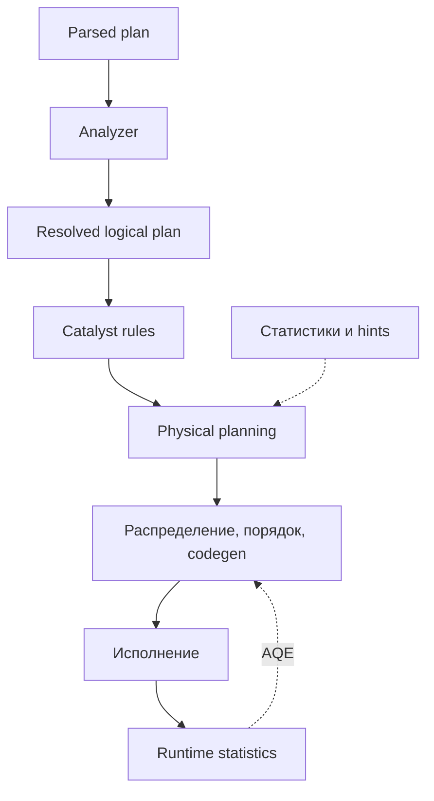
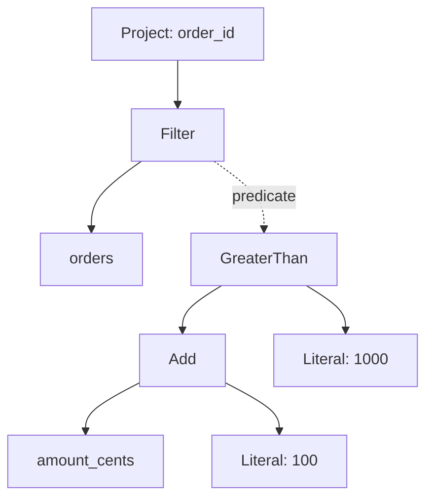
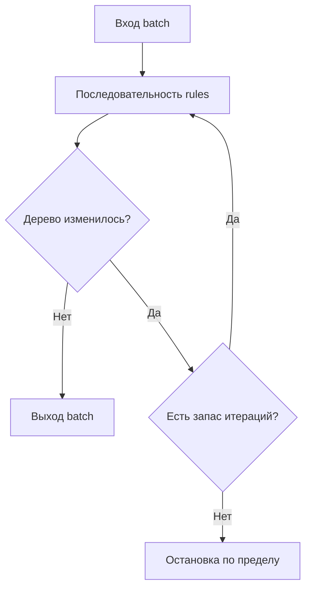
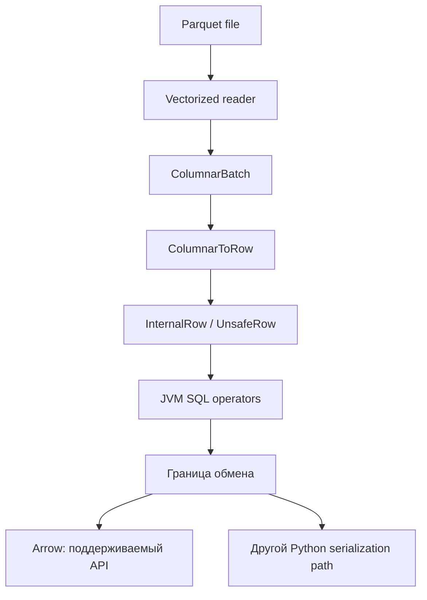
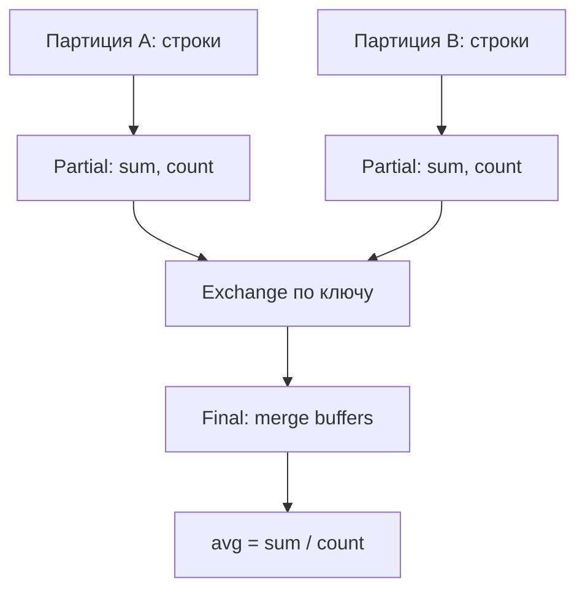
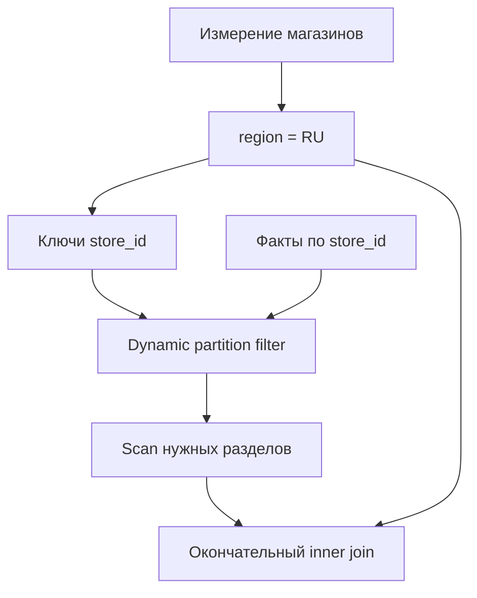

# 11. Планы запросов, Catalyst и движок выполнения

Основной язык примеров — **Python / PySpark**. Учебное окружение продолжает первый раздел: **Apache Spark 4.2.0, Python 3.12, JDK 17, Spark Classic**. Основной режим — `local[2]`. Для ручного Bloom filter приведён отдельный проверенный Scala-пример, поскольку соответствующего публичного метода PySpark нет.

Глава объясняет, как Spark превращает запрос в исполняемые операторы, что можно понять из плана и чем это отличается от измерений реального исполнения. Темы, пункты и их порядок сохранены из README. Заголовки имеют ровно три уровня: раздел → тема → пункт; задания и самопроверка находятся внутри пунктов.

**Содержание**

1. [Жизненный цикл запроса](#query-lifecycle)
2. [Чтение explain](#reading-explain)
3. [Catalyst Optimizer](#catalyst-optimizer)
4. [Статистики и cost-based optimization](#statistics-cbo)
5. [Tungsten и внутреннее представление данных](#tungsten)
6. [Физические агрегаты и сортировка](#aggregates-sort)
7. [Сканирование и уменьшение читаемых данных](#scan-pruning)
8. [Повторное использование и сложность плана](#reuse-plan-size)
9. [Query hints и границы управления](#query-hints)

**Как выполнять примеры**

Создай чистое окружение с установленным JDK 17 и PySpark 4.2.0:

```bash
python -m venv .venv
# Linux/macOS/WSL:
source .venv/bin/activate
# Windows PowerShell вместо предыдущей команды:
# .venv\Scripts\Activate.ps1
python -m pip install pyspark==4.2.0
```

Python-блоки выполняй сверху вниз в одной сессии. Первый блок создаёт `spark`, небольшие таблицы, временный каталог `lab` и диагностические helpers. Блоки с `sql_conf` временно меняют настройки и восстанавливают прежние значения. В notebook не останавливай сессию до последнего блока главы. Для самостоятельного запуска скопируй Python-блоки в `chapter11_lab.py` в исходном порядке и выполни `python chapter11_lab.py`.

Scala-блок запускай отдельно в `spark-shell --master local[2]` из дистрибутива Spark 4.2.0: `SparkSession` и `spark.implicits` там уже доступны. Штатный shell входит и в полный пакет PySpark; расположение `bin/spark-shell` зависит от установки.

Планы и IDs зависят от статистик, настроек и источника. Фрагменты дерева используются для объяснения, а точный текст получать нужно через `explain` в своей среде. Внутренние JVM API отмечены отдельно и относятся к Classic. Полные результаты учебных запросов малы, поэтому ограниченные `collect()` здесь используются осознанно.

Официальная документация: [Spark 4.2.0](https://spark.apache.org/docs/4.2.0/). Описание того, что реально проверено и что требует отдельного окружения, находится в последнем пункте главы.


<a id="query-lifecycle"></a>

## Жизненный цикл запроса


### SQL parser и unresolved logical plan

SQL-текст сначала превращается в дерево операторов и выражений. **Parser** проверяет грамматику: где `SELECT`, `FROM`, `WHERE`, как вложены скобки. На этом этапе он ещё не обязан знать, существует ли таблица и есть ли в ней указанная колонка.

**Unresolved logical plan** — логическое описание запроса с неразрешёнными ссылками: именами таблиц, колонок и функций. Синтаксически корректный `SELECT missing FROM orders` может пройти parser, но не последующий анализ. DataFrame API тоже строит логическое дерево, хотя весь пользовательский Python-код не проходит через SQL parser; SQL-строки в `expr`, `selectExpr` и `spark.sql` разбираются отдельно.

**Общее окружение главы.** Выполни следующий блок первым в новой Python-сессии. Остальные Python-фрагменты используют его переменные; Scala-пример запускается отдельно. Все пути временные и локальные, поэтому пример рассчитан на `local[2]`, а не на распределённый кластер.

```python
import contextlib
import io
import tempfile
from pathlib import Path
from time import perf_counter

import pyspark
from pyspark.sql import SparkSession, Window, functions as F
from pyspark.sql.types import LongType

lab = Path(tempfile.mkdtemp(prefix="spark-ch11-"))
spark = (
    SparkSession.builder.master("local[2]")
    .appName("spark-zero-to-hero-ch11")
    .config("spark.sql.warehouse.dir", (lab / "warehouse").as_uri())
    .config("spark.sql.shuffle.partitions", "4")
    .config("spark.python.use.daemon", "false")
    .config("spark.sql.adaptive.enabled", "false")
    .config("spark.sql.session.timeZone", "UTC")
    .getOrCreate()
)
spark.sparkContext.setLogLevel("WARN")
assert spark.version == "4.2.0", spark.version
print("VERSIONS:", pyspark.__version__, spark.version)

@contextlib.contextmanager
def sql_conf(**values):
    saved = {key: spark.conf.get(key, None) for key in values}
    try:
        for key, value in values.items():
            spark.conf.set(key, str(value))
        yield
    finally:
        for key, value in saved.items():
            if value is None:
                spark.conf.unset(key)
            else:
                spark.conf.set(key, value)

def explain_text(frame, mode="extended"):
    buffer = io.StringIO()
    with contextlib.redirect_stdout(buffer):
        frame.explain(mode=mode)
    return buffer.getvalue()

orders = spark.createDataFrame(
    [
        (1, 10, "Moscow", "completed", 12000),
        (2, 10, "Moscow", "completed", 8000),
        (3, 20, "Kazan", "completed", 5000),
        (4, 30, None, "completed", 3000),
        (5, 20, "Kazan", "cancelled", 7000),
        (6, None, "Moscow", "completed", -100),
    ],
    "order_id BIGINT, customer_id BIGINT, city STRING, "
    "status STRING, amount_cents BIGINT",
)
customers = spark.createDataFrame(
    [(10, "RU"), (20, "KZ"), (30, "RU"), (40, "DE")],
    "customer_id BIGINT, country STRING",
)
orders.createOrReplaceTempView("orders")
customers.createOrReplaceTempView("customers")
sql_query = """
SELECT coalesce(city, 'UNKNOWN') AS city,
       sum(amount_cents) AS revenue_cents
FROM orders
WHERE status = 'completed' AND amount_cents >= 0
GROUP BY coalesce(city, 'UNKNOWN')
"""
q = spark.sql(sql_query)
```

Для просмотра именно результата parser нужен диагностический internal API Spark Classic:

```python
parsed = spark._jsparkSession.sessionState().sqlParser().parsePlan(sql_query)
print(parsed.treeString())
```

В стартовом блоке `spark.python.use.daemon=false` выбирает прямой запуск Python workers для воспроизводимости в ограниченном локальном окружении; это не настройка SQL-оптимизации.

`_jsparkSession` не является стабильным публичным контрактом PySpark и недоступен таким же способом в Connect. Для обычной диагностики используй `q.explain(mode="extended")`. Название `Parsed Logical Plan` в выводе DataFrame не означает, что DataFrame был создан SQL-строкой.

Источник API: [SparkSession.sql](https://spark.apache.org/docs/4.2.0/api/python/reference/pyspark.sql/api/pyspark.sql.SparkSession.sql.html).


### Analyzer и разрешение имён, функций и типов

**Analyzer** связывает ссылки с реальными объектами: находит таблицу или представление, разрешает колонку в нужной области видимости, выбирает функцию и проверяет допустимость типов. Он также вставляет необходимые преобразования типов и проверяет правила агрегирования.

После join два поля `customer_id` могут иметь одинаковое имя, но разные идентификаторы выражений. Поэтому `name#123L` в плане означает конкретный атрибут, а не только строку `name`: `#123` — внутренний ID, `L` обычно сопровождает `BIGINT` в текстовом выводе. Эти ID меняются между запусками.

```python
from pyspark.errors import AnalysisException, ParseException

try:
    spark.sql("SELEC order_id FROM orders")
except ParseException:
    print("EXPECTED: syntax error")

try:
    spark.sql("SELECT missing_column FROM orders").explain()
except AnalysisException:
    print("EXPECTED: analysis error")

resolved = orders.alias("o").join(
    customers.alias("c"),
    F.col("o.customer_id") == F.col("c.customer_id"),
).select("o.order_id", "c.country")
assert resolved.count() == 5
```

В этом join обе строки клиента 20 учитываются, включая отменённый заказ: фильтра по статусу здесь нет. Строка с `NULL`-ключом не сопоставляется обычным равенством.

Ленивость не гарантирует, что любая ошибка появится только при action. В Classic многие проверки анализа выполняются уже при построении DataFrame; в Connect момент проверки может отличаться. Ошибку отсутствующей колонки нельзя исправить увеличением числа executor'ов.

**Самопроверка:** почему корректная SQL-грамматика не доказывает существование таблицы? Почему ссылка `o.customer_id` полезна даже при одинаковых типах ключей?


### Analyzed и optimized logical plan

**Analyzed plan** — уже разрешённое логическое дерево: известны входы, атрибуты, функции и результирующая схема. **Optimized plan** — его переписанная версия, в которой Catalyst устраняет лишнюю работу при сохранении семантики.

```python
q.explain(mode="extended")
actual = [tuple(row) for row in q.orderBy("city").collect()]
assert actual == [("Kazan", 5000), ("Moscow", 20000), ("UNKNOWN", 3000)]
```

В analyzed-части могут оставаться `SubqueryAlias` и дополнительные `Project`. В optimized-части ненужные оболочки часто исчезают, фильтры приближаются к источнику, а выражения упрощаются. Это всё ещё **логический** план: `Aggregate` пока не выбирает конкретную структуру хранения агрегатного буфера.

| Вопрос | Analyzed | Optimized |
| --- | --- | --- |
| Существует ли `amount_cents`? | Уже проверено | Используется разрешённая ссылка |
| Какой тип у суммы? | Определён | Сохраняется допустимая семантика |
| Можно ли удалить лишнюю проекцию? | Не основная цель анализа | Может удалить optimizer |
| Где будет shuffle? | Не физическое решение | Не окончательное физическое решение |

Оптимизация не обязана сохранять количество и расположение операторов пользовательской цепочки. Сравнивать результаты нужно с учётом `NULL`, дубликатов, типов и ошибок, а порядок строк — только после явной сортировки.


### Выбор физического плана и подготовка к исполнению

**Физический план** выбирает алгоритмы: например, `HashAggregate`, `SortMergeJoin` или `BroadcastHashJoin`, способ сканирования и обмена данными. Выбор учитывает свойства входов, статистики, настройки и hints; это не универсальный полный перебор всех возможных алгоритмов с точной ценой в миллисекундах.

При подготовке Spark приводит входы операторов к требуемым распределению и порядку, вставляет необходимые обмены и сортировки, подготавливает подзапросы и codegen. Например, одному оператору нужны все одинаковые ключи в одной партиции, а другому — ещё и сортировка по ключу внутри неё.

```python
q.explain(mode="formatted")
```



Схема разделяет подготовку и исполнение концептуально. При AQE они взаимодействуют: после завершения query stages Spark может изменить оставшуюся часть плана. Если сортировка или распределение уже обеспечены входом, дополнительный `Sort` или `Exchange` может не понадобиться.

**Практика:** найди в плане `q` частичный и финальный агрегаты. Объясни, какое требование финального агрегата удовлетворяет расположенный между ними `Exchange`.


### Переход от физических операторов к jobs и stages

Физические операторы описывают SQL-вычисление; планировщики Spark Core запускают для него распределённые задачи. В Classic многие операторы создают вычисления над RDD внутренних строк или колонковых батчей. Узкие зависимости позволяют выполнять несколько операторов в одном task; shuffle dependency становится границей scheduler stages.

При этом **SQL execution, job, scheduler stage и AQE query stage — разные сущности**. Один SQL-запрос может запускать несколько jobs: для broadcast, подзапросов, shuffle-стадий и получения результата. AQE материализует query stages, но их номера не обязаны совпадать с номерами scheduler stages. `BroadcastExchange` запускает работу для подготовки broadcast, однако сам по себе не является shuffle dependency.

```python
sc = spark.sparkContext
sc.setJobGroup("ch11-query", "chapter 11 aggregate", interruptOnCancel=True)
try:
    q.collect()  # Результат заведомо содержит три строки.
    print("JOB IDS:", sc.statusTracker().getJobIdsForGroup("ch11-query"))
finally:
    for key in ("spark.jobGroup.id", "spark.job.description", "spark.job.interruptOnCancel"):
        sc.setLocalProperty(key, None)
```

Число jobs здесь намеренно не фиксируется: оно зависит от версии, плана и режима. Метрики выполненных задач смотри в Spark UI. Наличие десяти `Project` в логическом плане не означает десять jobs, а число `*(n)` не является числом scheduler stages.

**Самопроверка:** почему нельзя оценить количество jobs просто подсчётом SQL-операторов? Чем подготовка broadcast отличается от shuffle?


### Различие SQL plan и RDD lineage

**SQL plan** сохраняет реляционный смысл: колонки, фильтры, join, агрегаты, типы и статистики. **RDD lineage** описывает зависимости распределённых коллекций и способ восстановить потерянные партиции. Один SQL-оператор может породить несколько низкоуровневых зависимостей; несколько SQL-операторов могут слиться в один участок выполнения.

```python
print(q.rdd.toDebugString().decode("utf-8"))
```

Этот фрагмент использует Classic. В lineage встретятся имена вроде `MapPartitionsRDD` и `ShuffledRowRDD`; они менее удобны для выяснения, почему был выбран конкретный join. Доступ к `.rdd` в PySpark создаёт представление с передачей данных в Python при его выполнении и может инициировать подготовку плана; он не нужен для обычного чтения SQL-плана.

| Задача диагностики | Основной инструмент |
| --- | --- |
| Почему колонка не разрешилась? | Ошибка анализа, analyzed plan, схема |
| Почему читаются лишние поля? | Optimized plan, `ReadSchema` сканирования |
| Какой join реально выбран? | Physical/final plan |
| Где shuffle и долгие tasks? | Physical plan вместе со Spark UI |
| Как связаны RDD и зависимости? | `toDebugString`, scheduler DAG |

**Практика по теме:** объясни путь одного запроса от SQL до task; подпиши, где определяется схема, где выбирается алгоритм и где запускается распределённая работа. Проверь результат `q` на шести учебных строках и на пустом входе. Не используй количество строк плана как оценку количества проходов по данным.


<a id="reading-explain"></a>

## Чтение explain


### simple, extended, formatted, cost и codegen

`DataFrame.explain` печатает план и возвращает `None`. Он предназначен для диагностики, а не для получения строк результата. У разных режимов разные цели:

| Режим | Что смотреть | Типичный вопрос |
| --- | --- | --- |
| `simple` | Краткий физический план | Какой join и где обмен? |
| `extended` | Parsed, analyzed, optimized, physical | Что переписал Catalyst? |
| `formatted` | Скелет физического плана и детали узлов | Какие поля читает конкретный scan? |
| `cost` | Оценки в логическом плане, физический план | Есть ли row count и размер? |
| `codegen` | Участки whole-stage codegen и Java-код | Какие операторы слились? |

```python
for mode in ("simple", "extended", "formatted", "cost", "codegen"):
    print("EXPLAIN MODE:", mode)
    q.explain(mode=mode)

sql_explain = spark.sql("EXPLAIN EXTENDED " + sql_query).collect()
assert any("Optimized Logical Plan" in row[0] for row in sql_explain)
```

`explain(extended=True)` — совместимый способ получить extended-вывод. В новом коде удобнее явно указать `mode`. Не передавай одновременно конфликтующие `extended` и `mode`.

Обычный `explain` не выполняет весь запрос над строками, но может анализировать каталог, читать файловые метаданные, подготавливать физический план и генерировать код. Поэтому «без action» не означает «без стоимости и без обращения к источнику». При AQE до выполнения может быть недостаточно материализованных участков для полезного `codegen`-вывода.

API сверено с [DataFrame.explain](https://spark.apache.org/docs/4.2.0/api/python/reference/pyspark.sql/api/pyspark.sql.DataFrame.explain.html) и [SQL EXPLAIN](https://spark.apache.org/docs/4.2.0/sql-ref-syntax-qry-explain.html).


### Scan, Project, Filter и Aggregate

Физическое дерево удобно читать **от листьев к корню**: входные строки поступают из scan, затем проходят фильтры и проекции, после чего агрегируются. Текст `explain` обычно напечатан наоборот: результат наверху, источники внизу. В formatted-выводе сначала найди номера узлов, затем прочитай их детали.

| Оператор | Назначение | Что проверить |
| --- | --- | --- |
| `Scan ExistingRDD` | Вход из созданного в памяти DataFrame | Не путать с чтением Parquet |
| `FileScan parquet` / `BatchScan` | Чтение файлового или V2-источника | Схему чтения, фильтры, партиции |
| `Project` | Вычисление и выбор выражений | Нет ли дорогих функций и лишних полей |
| `Filter` | Отбор строк | На каком входном объёме работает |
| `HashAggregate` и другие агрегаты | Объединение строк по ключам | Буфер, partial/final, число групп |

Для `q` ищи последовательность scan → filter → project → partial aggregate → exchange → final aggregate. Часть узлов может быть объединена в codegen-участок, но это не удаляет смысл операций.

```python
plan = explain_text(q, "formatted")
assert "Filter" in plan
assert "Aggregate" in plan
assert "Exchange" in plan
print(plan)
```

`Aggregate` в logical plan и `HashAggregate` в physical plan отвечают на разные вопросы: «что вычислить» и «каким алгоритмом». Отсутствие отдельного `Project` не доказывает, что выражение не вычисляется: оно могло быть встроено в другой оператор.


### Exchange, Sort и физические join operators

**Exchange** меняет распределение данных либо подготавливает broadcast. `Exchange hashpartitioning(k, 4)` обычно означает shuffle по ключу `k`, `RoundRobinPartitioning` — перераспределение без ключа, `SinglePartition` — сбор данных в одну партицию. `BroadcastExchange` создаёт представление для передачи другим исполнителям.

**Sort** задаёт порядок. Сортировка внутри партиций не создаёт общего порядка всего результата. Для глобального `orderBy` обычно нужны range distribution и локальная сортировка; для sort-merge join — распределение по ключу и сортировка каждого входа.

| Join operator | Идея | Главный ресурсный вопрос |
| --- | --- | --- |
| `BroadcastHashJoin` | Хэш-таблица малой стороны на исполнителях | Помещается ли broadcast с накладными расходами? |
| `SortMergeJoin` | Сведение отсортированных входов | Объём shuffle, sort, spill и skew |
| `ShuffledHashJoin` | После shuffle хэш-таблица на build side каждой партиции | Помещается ли самая большая build-партиция? |
| `BroadcastNestedLoopJoin` | Проверка пар строк с broadcast-стороной | Не слишком ли много сравнений? |
| `CartesianProduct` | Комбинации строк без эффективного equi-key | Не растёт ли результат как произведение размеров? |

```python
merge_join = orders.hint("MERGE").join(customers.hint("MERGE"), "customer_id")
merge_join.explain(mode="formatted")
assert merge_join.count() == 5
```

Даже equi-join не обязан содержать два новых `Exchange`: входы уже могут иметь подходящее распределение или использовать возможности источника. Тип join и допустимая build side тоже влияют на выбор. Название алгоритма не заменяет измерение размеров и времени.


### Whole-stage codegen markers и переходы между режимами

В simple/extended-выводе `*(1)`, `*(2)` обычно отмечают операторы, включённые в соответствующие whole-stage codegen-участки. Одинаковый номер помогает увидеть слияние; это **не ID job, task или scheduler stage**. В formatted-выводе можно встретить `codegen id`.

Границы могут возникать на обменах, Python execution, операторах без поддержки нужного codegen и переходах формата. `ColumnarToRow` переводит колонковые батчи в поток строк; `RowToColumnar` делает обратное, если этого требует план. Они не означают переход из Java в Python.

```python
native_expr = orders.select((F.col("amount_cents") + 1).alias("x"))
native_expr.explain(mode="codegen")
assert native_expr.filter("x = 12001").count() == 1
```

Отсутствие `*` у узла не доказывает, что он медленный: например, vectorized scan может эффективно читать батчи. Наличие `*` не доказывает отсутствие allocation, spill или дорогой функции. В `codegen` смотри также размеры методов, вспомогательные функции и разделы с исходным Java-кодом.

**Самопроверка:** почему несколько операторов с `*(1)` могут исполняться одним task, но один SQL-запрос с ними всё равно иметь несколько jobs?


### Estimated statistics и их отсутствие

`Statistics(sizeInBytes=..., rowCount=...)` — оценка optimizer, а не обязательно замер. Для `range` число строк известно из границ; для созданного из Python списка DataFrame точный row count часто не передан в статистики logical plan. В таком случае огромный `sizeInBytes` может быть защитной оценкой неизвестного размера.

```python
known = spark.range(0, 100, 1, 2)
known.explain(mode="cost")
orders.explain(mode="cost")
assert known.count() == 100
```

Отсутствующий `rowCount` нельзя читать как ноль. `sizeInBytes` обычно не равен сжатому размеру файла, памяти хэш-таблицы join или потреблению Python worker. Если данные фильтруются по коррелированным колонкам, оценка selectivity может существенно ошибаться даже при наличии отдельных column statistics.

**Практика:** сравни cost-планы `range(100)`, `range(100).filter("id < 10")` и `orders`. Проверь фактические counts. Объясни, почему точная статистика входа не гарантирует точную статистику любого выражения над ним.


### Initial, current и final plan при AQE

**AQE — Adaptive Query Execution** использует сведения, появившиеся во время выполнения. Initial plan построен до материализации всех нужных query stages; current plan показывает текущее решение; final plan — решение завершившегося adaptive execution. Runtime statistics могут привести к coalescing shuffle partitions, смене join strategy или обработке skew.

```python
with sql_conf(**{"spark.sql.adaptive.enabled": "true"}):
    adaptive_q = orders.groupBy("city").agg(F.sum("amount_cents").alias("total"))
    before = explain_text(adaptive_q, "formatted")
    adaptive_rows = adaptive_q.collect()
    after = explain_text(adaptive_q, "formatted")
    print("BEFORE:\n", before)
    print("AFTER:\n", after)
    assert "isFinalPlan=false" in before
    assert "isFinalPlan=true" in after
    assert sum(row.total for row in adaptive_rows) == 34900
```

Для проверки выполнен `collect()` **того же** `adaptive_q`. Вызов `adaptive_q.count()` строит отдельный агрегирующий запрос и не является надёжным способом финализировать именно тот план, который затем объясняется. В данном учебном случае результат мал; большие результаты нужно писать в контролируемый приёмник и изучать план соответствующего execution в UI.

После завершения в выводе могут одновременно отображаться final и initial plan. `AQEShuffleRead` с пометкой `coalesced` — чтение нескольких исходных shuffle partitions одной результирующей партицией, а не исчезновение уже выполненного shuffle. AQE не «отматывает назад» всю уже оплаченную работу.

[Документация AQE](https://spark.apache.org/docs/4.2.0/sql-performance-tuning.html#adaptive-query-execution).


### Сопоставление плана с SQL-вкладкой Spark UI

Spark UI связывает план с измерениями. В SQL-вкладке выбери конкретный execution, затем сопоставь scan, exchange, aggregate и join с их метриками. Из SQL execution перейди к jobs/stages и посмотри распределение длительности tasks, shuffle read/write, spill и входные объёмы.

```python
print("SPARK UI:", spark.sparkContext.uiWebUrl)
```

Ссылка действует, пока приложение и UI доступны. В notebook оставь сессию работающей; в отдельном скрипте можно временно добавить `input(...)` после вычисления. Доступ к UI на кластере зависит от развёртывания.

| Наблюдение | Следующий шаг |
| --- | --- |
| Мало output rows у scan, но много input bytes | Проверить, где фильтруются строки и работают ли file/row-group pruning |
| Большой shuffle write | Посмотреть ключи, ширину строк и возможность partial aggregation |
| Несколько tasks существенно медленнее остальных | Сравнить размеры партиций и распределение ключей |
| Большой spill | Сопоставить буферы операторов, параллелизм и memory pressure |
| Broadcast долго строится | Проверить стоимость вычисления build side и размер сериализации |

ID узлов и их детализация в `explain` и UI могут различаться; сопоставляй ещё имена операторов, ключи и структуру. Нулевые или отсутствующие SQL-метрики не всегда означают отсутствие ввода-вывода: учёт зависит от оператора и источника.

**Практика по теме:** для `q` сохрани extended и formatted-планы, выполни запрос, найди соответствующий execution. Для AQE-примера сравни initial/final. Ответь: какие выводы получены из плана, а какие подтверждены только измерениями?

Источник: [Spark Web UI, SQL Tab](https://spark.apache.org/docs/4.2.0/web-ui.html#sql-tab).


<a id="catalyst-optimizer"></a>

## Catalyst Optimizer


### Деревья выражений и операторов

Catalyst работает с деревьями двух связанных видов. **Дерево операторов** содержит scan, filter, project, join, aggregate. **Дерево выражений** внутри оператора содержит атрибуты, литералы, сравнения, арифметику и функции.

Например, `filter((amount_cents + 100) > 1000)` — это `Filter`, чей predicate состоит из `GreaterThan(Add(attribute, literal), literal)`. Spark может переписать видимые выражения, а произвольный Python-код внутри UDF таким деревом не представлен.



Структуру читают не только ради формы. Тип выражения, nullability, determinism и ссылки на атрибуты определяют допустимость переписывания. Например, произвольная перестановка выражений с ошибками или недетерминированными функциями может поменять наблюдаемое поведение.

```python
tree_demo = orders.filter((F.col("amount_cents") + 100) > 1000).select("order_id")
tree_demo.explain(mode="extended")
assert tree_demo.count() == 5
```


### Rules, rule batches и fixed-point execution

**Rule** принимает дерево и возвращает переписанное дерево. Правила объединены в **batches**, потому что один результат открывает возможность для другого: folding делает условие константным, simplification удаляет условие, pruning убирает больше колонок.

Batch может выполняться один раз либо до **fixed point**: после прохода дерево больше не меняется или достигнут предел итераций. Это не означает бесконечный поиск математически лучшего плана. Порядок batches и правила внутри них задаются реализацией версии; разные компоненты анализа и оптимизации могут использовать разные механизмы.



`ConstantFolding`, `CollapseProject` и `ColumnPruning` — узнаваемые имена, но не публичный интерфейс приложения. Увеличение `spark.sql.optimizer.maxIterations` не является первым решением для слишком большого плана: сначала сократи структуру, повторяющиеся выражения и лишние ветви. Выключение rules может ухудшить план, а некоторые правила нельзя безопасно исключить.

**Самопроверка:** почему один проход правил может быть недостаточен? Почему fixed point не означает глобальный оптимум по времени?


### Constant folding и simplification

**Constant folding** вычисляет выражения, результат которых не зависит от строк входа. **Simplification** сокращает условия и выражения: удаляет тождественное `AND TRUE`, упрощает некоторые ветви `CASE`, использует информацию о `NULL` там, где это допустимо.

```python
folded = (
    spark.range(5)
    .select("id", ((F.lit(2) + F.lit(3)) * F.lit(4)).alias("constant"))
    .filter(F.lit(True) & (F.col("id") >= 2))
)
folded.explain(mode="extended")
assert [tuple(r) for r in folded.orderBy("id").collect()] == [(2, 20), (3, 20), (4, 20)]
```

Здесь arithmetic действительно передан Spark как `Column`-выражение. Запись `F.lit((2 + 3) * 4)` сначала вычислила бы `20` средствами Python и не демонстрировала бы folding Spark.

Не переносить в SQL булеву алгебру без учёта трёхзначной логики: `x OR NOT x` не всегда `TRUE`, когда `x` — `NULL`. Выражение, содержащее `rand`, не является обычной константой только потому, что у функции нет ссылки на колонку. Ошибки приведения типов в ANSI mode тоже требуют сохранения допустимой семантики.

**Практика:** замени числовые литералы колонкой `amount_cents` и проверь, какая часть выражения осталась вычисляемой по строкам.


### Predicate pushdown и predicate propagation

**Predicate pushdown в логическом дереве** перемещает фильтр ближе к входу. Например, фильтр по независимому ключу может пройти через проекцию или допустимый join. **Predicate propagation** выводит дополнительные ограничения: при inner equi-join `a.id = b.id` и `a.id = 10` фильтр `b.id = 10` тоже может быть полезен.

```python
propagated = (
    orders.filter("customer_id = 10").alias("o")
    .join(customers.alias("c"), F.col("o.customer_id") == F.col("c.customer_id"))
)
propagated.explain(mode="extended")
assert propagated.count() == 2
```

Ищи фильтры на обеих сторонах и добавленные `isnotnull` для обычного равенства. Последние могут быть логическим следствием join, а не пользовательским правилом качества.

Проталкивание через **outer join** ограничено сохранением строк. Фильтр по правой стороне после left join может отклонять `NULL`-расширенные строки и позволять преобразовать join в inner; перемещение того же фильтра только во вход справа без изменения остальной семантики даст другой результат. Также нельзя бездумно опускать predicate через `limit`, окно или агрегат.

Проталкивание в дерево и перенос фильтра **в reader источника** — разные шаги. Наличие раннего `Filter` ещё не доказывает, что Parquet reader пропустил row groups или база получила `WHERE`.


### Column pruning и projection pruning

**Column pruning** удаляет поля, которые больше не нужны. **Projection pruning** сокращает вычисляемые и передаваемые выражения. Это уменьшает ширину строк, объём shuffle и размер буферов; у поддерживающего источника может также сократить чтение колонок.

```python
pruned = orders.select("order_id", "city", "status", "amount_cents").select("order_id")
pruned.explain(mode="extended")
assert pruned.columns == ["order_id"]
assert pruned.count() == 6
```

Для `ExistingRDD` физический вход может по-прежнему хранить исходную строку: этот пример демонстрирует оптимизацию проекций, а не экономию файлового ввода-вывода. Для доказательства последней потребуется `ReadSchema` реального scan.

Колонка может быть нужна оператору, даже если не присутствует в результате. После `select("order_id").filter(...)` ссылки должны разрешаться в конкретном плане; фильтр, join key, sort key и partition key требуют своих полей до выполнения соответствующей операции. Безусловное правило «читать только поля финального результата» неверно.

**Самопроверка:** почему `amount_cents` остаётся необходимым для фильтра, хотя выводится только `order_id`? Где проверить минимальную фактическую схему reader?


### Удаление избыточных операторов и объединение projections

Catalyst может объединять последовательные проекции, удалять ненужные aliases и некоторые сортировки, упрощать фильтры. Поэтому несколько `withColumn` в пользовательском коде иногда превращаются в один `Project` в optimized plan.

```python
projections = (
    orders.withColumn("a", F.col("amount_cents") + 1)
    .withColumn("b", F.col("a") + 1)
    .select("order_id", "b")
)
projections.explain(mode="extended")
assert projections.filter("order_id = 1").first().b == 12002
```

Удаление промежуточной колонки не обязательно убирает вычисление: выражение может быть подставлено в следующий узел. Оптимизатор учитывает цену повторного вычисления и недетерминированность; не каждый `Project` разрешено просто слить с соседним. Сортировка, нужная window или join, тоже не избыточна только потому, что пользователь не запросил порядок результата.

Время построения и анализа исходной цепочки уже затрачено, даже если optimizer впоследствии её сократил. Поэтому единый `select` для независимых полей полезен не только для красоты кода.


### Empty relation propagation: упрощение плана с пустыми входами и сохранение семантики разных типов join

Если Spark **доказал** пустоту входа — например, увидел `filter(FALSE)` или `limit(0)`, — он может распространить её по плану и удалить вычисления. Реально пустой файл или результат неизвестного predicate не обязательно известен optimizer заранее.

Семантика определяется типом операции:

| Операция | Пустая левая сторона | Пустая правая сторона |
| --- | --- | --- |
| Inner join | Пусто | Пусто |
| Left outer | Пусто | Все левые строки + `NULL` справа |
| Right outer | Все правые строки + `NULL` слева | Пусто |
| Full outer | Все правые строки + `NULL` слева | Все левые строки + `NULL` справа |
| Left semi | Пусто | Пусто |
| Left anti | Пусто | Все левые строки |

Если обе стороны пусты, все перечисленные joins пусты. Глобальный агрегат без ключей — особый случай: `COUNT(*)` возвращает одну строку с нулём, `SUM` — одну строку с `NULL`; группировка по ключу возвращает ноль групп.

```python
empty_customers = customers.filter(F.lit(False))
inner_empty = orders.join(empty_customers, "customer_id", "inner")
outer_empty = orders.join(empty_customers, "customer_id", "left")
assert inner_empty.count() == 0
assert outer_empty.count() == 6
assert outer_empty.filter("country IS NOT NULL").count() == 0
assert orders.join(empty_customers, "customer_id", "left_anti").count() == 6
empty_orders = orders.limit(0)
r = empty_orders.agg(F.count("*").alias("n"), F.sum("amount_cents").alias("s")).first()
assert (r.n, r.s) == (0, None)
assert empty_orders.groupBy("city").count().count() == 0
inner_empty.explain(mode="extended")
```

**Практика:** проверь остальные join types из таблицы на этих входах. Сначала запиши ожидаемое число строк, затем выполни запрос. Не заменяй outer join пустым DataFrame только потому, что одна сторона пуста.


### Оптимизация подзапросов и переписывание joins

Подзапрос — синтаксическая форма, а не обязательный отдельный проход по данным. Поддерживаемые `EXISTS`, `IN` и некоторые correlated scalar subqueries могут быть переписаны в joins и агрегаты. `EXISTS` часто соответствует left semi join, `NOT EXISTS` — left anti join.

```python
exists_q = spark.sql("""
SELECT o.order_id
FROM orders o
WHERE EXISTS (
  SELECT 1 FROM customers c
  WHERE c.customer_id = o.customer_id AND c.country = 'RU'
)
""")
exists_q.explain(mode="extended")
assert [r.order_id for r in exists_q.orderBy("order_id").collect()] == [1, 2, 4]
```

Это запрос без фильтра по статусу, но его RU-клиенты здесь имеют только completed-заказы. Добавление дубликатов в `customers` не должно умножить результат `EXISTS`; замена на обычный inner join без контроля уникальности может его умножить.

`NOT IN` нельзя автоматически считать обычным anti join: `NULL` в списке или подзапросе меняет результат, и Spark может использовать null-aware anti join. Scalar subquery обязан соблюдать ограничения числа строк и корреляции. Не все формы декоррелируются одинаково, а физический алгоритм после переписывания всё равно выбирается отдельно.

**Самопроверка:** чем `EXISTS` отличается от inner join при дубликатах ключа справа? Почему `NOT IN` и `NOT EXISTS` требуют отдельного разбора `NULL`?


### Границы оптимизации при UDF и object operations

Для встроенного выражения Catalyst видит дерево и типы. Для UDF он видит вызов с входами и выходным типом, но не умеет произвольно оптимизировать тело функции. JVM UDF тоже может быть непрозрачной; у Python UDF дополнительно появляется граница исполнения в Python worker.

```python
@F.udf(returnType=LongType())
def plus_one(value):
    return None if value is None else value + 1

udf_q = orders.select("order_id", plus_one("amount_cents").alias("x"))
udf_q.explain(mode="formatted")
assert udf_q.filter("order_id = 1").first().x == 12001
```

Для обычной scalar Python UDF в этой среде ожидается `BatchEvalPython`. Arrow-enabled UDF использует другой путь; отсутствие `BatchEvalPython` нельзя считать отсутствием Python по одному имени. Встроенные фильтры и pruning **вокруг** UDF всё ещё могут оптимизироваться: UDF не отключает весь Catalyst.

Typed Dataset `.map` в Scala/Java может добавлять object operations с десериализацией и сериализацией объектов. Отображение Python через RDD скрывает реляционную логику ещё сильнее. Если простую арифметику можно выразить встроенной функцией, сначала используй её.

UDF должна корректно обрабатывать допустимые входы сама; порядок вычисления SQL-предикатов и short circuit нельзя использовать как защиту от ошибки внутри функции.


### Просмотр изменения плана отдельными Catalyst rules: rule traces и plan-change logging при поддержке версии

Чтобы увидеть вклад конкретной rule, включают **plan-change logging**: Spark печатает изменения до/после применения правила или batch. В Spark 4.2.0 доступны internal-настройки `spark.sql.planChangeLog.level`, `.rules` и `.batches`. Настройка уровня Spark logger и настройка уровня сообщений plan-change — разные вещи: оба должны позволять увидеть запись.

```python
with sql_conf(**{
    "spark.sql.planChangeLog.level": "WARN",
    "spark.sql.planChangeLog.rules": "org.apache.spark.sql.catalyst.optimizer.ConstantFolding",
}):
    traced = spark.range(10).selectExpr("id", "(2 + 3) * 4 AS k").filter("k = 20")
    traced.explain(mode="extended")
    assert traced.count() == 10
```

Фрагмент создаёт **новый** запрос после установки настроек: уже подготовленный план может не пройти оптимизацию повторно. В логах ищи `Applying Rule` и полное имя правила; сообщения о batch без эффекта сами по себе не являются ошибкой. Если версия не содержит rule с данным именем, выбранный фильтр логов не даст нужной трассы.

Для узкой диагностики можно дополнительно выбрать batch через `.batches`; его точное имя нужно взять из реализации данной версии. Здесь оно намеренно не зафиксировано. Правила анализа, обычной оптимизации и AQE не обязаны иметь одинаковые имена и точки логирования.

Настройки сверены с [SQLConf Spark 4.2.0](https://raw.githubusercontent.com/apache/spark/v4.2.0/sql/catalyst/src/main/scala/org/apache/spark/sql/internal/SQLConf.scala). Они не заменяют публичный `explain` и не должны становиться обязательным контрактом production-пайплайна.

**Практика по теме:** сравни native и UDF-варианты `plus_one`, пустой inner/left join и цепочку проекций. Для каждого укажи, какое преобразование доказано планом, и отдельно проверь результат. **Вопросы:** что optimizer знает о UDF? Почему наличие лишнего `Project` в parsed plan ещё не является проблемой? Что сохраняет корректное переписывание outer join?


<a id="statistics-cbo"></a>

## Статистики и cost-based optimization


### Размер таблицы, row count и column statistics

Статистики позволяют оценивать размеры промежуточных результатов до выполнения. Здесь нужно различать **физический размер хранения**, **оценку размера logical relation**, **число строк** и **статистики отдельных колонок**.

| Статистика | Для чего полезна | Чего не обещает |
| --- | --- | --- |
| Размер relation в байтах | Первичная оценка входа, решение о broadcast | Точный размер hash table в памяти |
| `rowCount` | Оценка cardinality операторов | Правильную selectivity любого predicate |
| NDV | Число различных значений, оценка join/groupBy | Равномерное распределение ключей |
| `min` / `max` | Оценка диапазонных фильтров | Отсутствие концентрации значений внутри диапазона |
| `nullCount` | Оценка пропусков и условий `IS NULL` | Корректность бизнес-контракта |
| Средняя/максимальная длина | Приблизительная ширина строк | Полную стоимость объектов и индексов |

**Cardinality** — число строк на выходе узла. Большая ошибка у раннего фильтра распространяется дальше: join может оказаться намного больше ожидаемого. Именно поэтому cost-план полезно сопоставлять с фактическими output rows.

```python
orders_path = str(lab / "orders-parquet")
orders.write.mode("overwrite").parquet(orders_path)
file_orders = spark.read.parquet(orders_path)
file_orders.explain(mode="cost")
assert file_orders.count() == 6
```

Этот scan имеет сведения о файловом входе, однако наличие Parquet footer не означает, что Catalyst автоматически получил все column statistics и точный `rowCount`. Источник, каталог и режим чтения определяют, какие сведения доступны каждому уровню.


### ANALYZE TABLE и вычисление статистик

`ANALYZE TABLE` собирает статистики зарегистрированной таблицы, если это поддерживает её каталог/провайдер. Произвольный DataFrame или session temp view не следует считать эквивалентом постоянной catalog table для этой команды.

```python
orders.write.mode("overwrite").saveAsTable("ch11_orders")
customers.write.mode("overwrite").saveAsTable("ch11_customers")

spark.sql("ANALYZE TABLE ch11_orders COMPUTE STATISTICS NOSCAN")
spark.sql("ANALYZE TABLE ch11_orders COMPUTE STATISTICS")
spark.sql("ANALYZE TABLE ch11_orders COMPUTE STATISTICS FOR COLUMNS customer_id, city, amount_cents")
spark.sql("ANALYZE TABLE ch11_customers COMPUTE STATISTICS FOR ALL COLUMNS")
spark.sql("DESCRIBE EXTENDED ch11_orders").show(100, truncate=False)
spark.sql("DESCRIBE EXTENDED ch11_orders customer_id").show(100, truncate=False)

with sql_conf(**{"spark.sql.cbo.enabled": "true"}):
    spark.table("ch11_orders").explain(mode="cost")
```

`NOSCAN` собирает размер без полного сканирования строк и не даёт того же набора информации, что полный анализ. Обычный `COMPUTE STATISTICS` получает также число строк; `FOR COLUMNS` / `FOR ALL COLUMNS` собирает характеристики полей. Column analysis может потребовать значительного чтения и вычислений.

Здесь таблицы созданы в отдельном учебном warehouse. В рабочем каталоге не копируй `overwrite` без решения о назначении данных. Поддержка команд у V2-каталогов и table formats может отличаться.

[SQL ANALYZE TABLE](https://spark.apache.org/docs/4.2.0/sql-ref-syntax-aux-analyze-table.html).


### NDV, min/max, NULL count и histograms

**NDV — number of distinct values** — оценка числа различных ненулевых значений. Её нельзя заменять числом строк. У `customer_id` в учебных заказах три ненулевых ключа: 10, 20, 30; строк шесть; одна строка содержит `NULL`.

```python
stats_check = orders.agg(
    F.count("*").alias("rows"),
    F.countDistinct("customer_id").alias("ndv"),
    F.sum(F.col("customer_id").isNull().cast("long")).alias("nulls"),
    F.min("amount_cents").alias("minimum"),
    F.max("amount_cents").alias("maximum"),
).first()
assert tuple(stats_check) == (6, 3, 1, -100, 12000)

with sql_conf(**{"spark.sql.statistics.histogram.enabled": "true"}):
    spark.sql("ANALYZE TABLE ch11_orders COMPUTE STATISTICS FOR COLUMNS amount_cents")
    spark.sql("DESCRIBE EXTENDED ch11_orders amount_cents").show(100, truncate=False)
```

**Histogram** делит диапазон на интервалы и помогает оценить диапазонные predicates лучше, чем одна пара min/max. Сбор histogram имеет дополнительную стоимость и не применяется одинаково ко всем типам колонок. В реализации используются выборки/приближённые методы для части статистик; точность и устойчивость нужно оценивать на своих данных.

Две таблицы могут иметь одинаковые row count, NDV и min/max, но разное распределение: в одной ключ 10 встречается один раз, в другой — миллион. NDV не описывает heavy hitters полностью. Отдельные гистограммы двух колонок не описывают их корреляцию.

**Практика:** добавь много строк клиента 10, сохрани таблицу заново и повтори анализ. Предскажи, какие характеристики изменятся, а какие могут остаться прежними.


### Cardinality estimation и join order

Приближённая оценка inner equi-join при предположениях о равномерности и совпадающих доменах часто описывается формулой:

$$
|A \bowtie B| \approx \frac{|A|\cdot|B|}{\max(NDV(A.k),NDV(B.k))}.
$$

Это учебная модель, не полная спецификация Spark estimator. В реальных правилах учитываются доступные диапазоны, NULL, виды соединений и иные сведения. Если домены ключей не пересекаются, join пуст; если ключи сильно skewed, эта простая формула может сильно ошибиться.

**Join order** особенно важен при трёх и более таблицах: выгодно сначала уменьшить большой вход селективным измерением, если это сохраняет семантику. Внутренние joins дают больше свободы перестановок, чем outer joins. Нужные статистики, порог числа отношений и настройки CBO определяют, какие перестановки будут рассмотрены.

```python
with sql_conf(**{
    "spark.sql.cbo.enabled": "true",
    "spark.sql.cbo.joinReorder.enabled": "true",
}):
    cbo_join = spark.sql("""
        SELECT o.order_id, c.country
        FROM ch11_orders o
        JOIN ch11_customers c ON o.customer_id = c.customer_id
        WHERE c.country = 'RU'
    """)
    cbo_join.explain(mode="cost")
    assert cbo_join.count() == 3
```

Две таблицы демонстрируют estimates, но не доказывают пользу переупорядочивания трёхстороннего join. **Задание:** добавь третье измерение, собери его статистики и сравни logical join order при CBO on/off. Проверь одинаковые результаты, включая дубликаты.


### Устаревшие и неполные статистики

Статистики — снимок знаний о данных. После append, overwrite, замены файлов внешним процессом или изменения распределения ключей старые значения могут стать неверными. Автоматическое обновление зависит от каталога, команды записи и настроек; универсальной гарантии «Spark всегда пересчитает всё» нет.

Пример последствия: вчера справочник имел 5 МБ, сегодня 500 МБ. Старый estimate может склонить planner к broadcast, а фактическая build side создаст долгую подготовку и memory pressure. Другой случай — row count актуален, но filter selectivity оценена плохо из-за нового распределения дат.

Различай `REFRESH TABLE` и `ANALYZE TABLE`: refresh обновляет сведения/кэши о таблице и файлах в соответствии с реализацией; он не означает полноценный пересчёт всех CBO column statistics.

```python
spark.catalog.refreshTable("ch11_orders")
spark.sql("ANALYZE TABLE ch11_orders COMPUTE STATISTICS FOR ALL COLUMNS")
assert spark.table("ch11_orders").count() == 6
```

**Самопроверка:** достаточно ли `rowCount`, если запрос фильтрует сильно skewed категорию? Какая часть процесса загрузки должна отвечать за актуальность статистик? Как обнаружить разрыв между estimate и runtime output?


### Статистики файлового источника и статистики каталога

У статистик источника и каталога разные потребители. File listing даёт размеры файлов; Parquet footer может давать min/max/count для row groups; catalog table может хранить row count и column statistics, собранные `ANALYZE`. V2-коннектор может передавать optimizer собственную оценку relation.

Статистика footer, применённая reader для пропуска row group, не обязана появляться в `EXPLAIN COST` как гистограмма logical attribute. И наоборот, наличие catalog column statistics не доказывает использование reader-level pushdown.

| Уровень | Пример использования | Проверка |
| --- | --- | --- |
| Файлы/reader | Пропустить row group по min/max | Scan plan + input metrics |
| Каталог | Оценить число строк после predicate | `DESCRIBE EXTENDED`, cost plan |
| V2 source | Сообщить estimated size/rows | Контракт и план конкретного коннектора |
| Runtime | Изменить оставшийся AQE-план | `isRuntime=true`, final plan, UI |

**Практика:** сравни `spark.read.parquet(orders_path)` и `spark.table("ch11_orders")` после анализа. Входные значения совпадают, но набор доступных estimates может отличаться. Сначала назови, какой уровень статистик исследуешь, затем выбирай средство проверки.


### Настройки CBO и ограничения оценки стоимости

CBO управляется несколькими параметрами; они решают разные задачи:

| Настройка | Назначение |
| --- | --- |
| `spark.sql.cbo.enabled` | Использование CBO-оценок |
| `spark.sql.cbo.planStats.enabled` | Получение статистик из каталога для оценки плана |
| `spark.sql.cbo.joinReorder.enabled` | Cost-based перестановка подходящих joins |
| `spark.sql.cbo.joinReorder.dp.threshold` | Ограничение размера поиска join order |
| `spark.sql.statistics.histogram.enabled` | Сбор histogram при column analysis |
| `spark.sql.statistics.size.autoUpdate.enabled` | Автообновление size statistics в поддерживаемых сценариях |

```python
for key in (
    "spark.sql.cbo.enabled",
    "spark.sql.cbo.planStats.enabled",
    "spark.sql.cbo.joinReorder.enabled",
    "spark.sql.cbo.joinReorder.dp.threshold",
    "spark.sql.statistics.histogram.enabled",
    "spark.sql.statistics.size.autoUpdate.enabled",
):
    print(key, spark.conf.get(key))
```

Проверяй фактические значения своей сессии, а не только defaults документации: платформа может их переопределить. CBO не строит точную модель CPU, сети, декомпрессии, spill и Python UDF для любого запроса. AQE дополняет предварительные estimates фактическими сведениями, но не исправляет бесплатно все уже выполненные решения.

Настройки проверены по [официальной конфигурации](https://spark.apache.org/docs/4.2.0/configuration.html). **Практика по теме:** собери size, row count и column statistics; сравни estimates до/после; выполни join и сопоставь output rows. **Вопросы:** как ошибочная cardinality влияет на join order? Почему размер Parquet не равен памяти broadcast? Когда ANALYZE не стоит запускать на каждом запросе?


<a id="tungsten"></a>

## Tungsten и внутреннее представление данных


### UnsafeRow и компактное бинарное представление

**Tungsten** — название комплекса изменений для более эффективного управления памятью и исполнения Spark SQL. Один из ключевых элементов — `UnsafeRow`: компактное бинарное представление строки вместо отдельного JVM-объекта для каждого поля.

В обычном случае строка содержит область битов `NULL`, слоты фиксированной ширины и область переменной длины. Для строк, массивов и некоторых других значений слот может хранить сведения о смещении и длине. Размер и способ кодирования зависят от типа; не все значения просто «один long на колонку».

| Часть | Роль | Практическое следствие |
| --- | --- | --- |
| Null bitset | Какие поля отсутствуют | Компактная проверка пропуска |
| Fixed-width slots | Примитивы или ссылки на variable region | Меньше отдельных объектов |
| Variable-width region | Байты значений переменной длины | Широкие строки всё равно дороги |

Для трёх обычных полей базовые области null bits и slots занимают 8 + 3 × 8 = 32 байта, **до** variable payload, выравнивания и внешних накладных расходов. Это учебная иллюстрация layout, а не оценка полного JVM memory footprint любой строки.

`UnsafeRow` может ссылаться на переиспользуемый буфер. В собственном внутреннем операторе нельзя сохранить ссылку и предполагать, что bytes останутся неизменными после перехода iterator к следующей строке; при необходимости нужна копия. Пользователю DataFrame не требуется вручную создавать `UnsafeRow`.


### InternalRow, ColumnarBatch и Arrow: разные представления

Эти названия относятся к разным уровням:

| Представление | Что это | Где обычно встречается |
| --- | --- | --- |
| `InternalRow` | Внутренний контракт строки Spark SQL | Catalyst expressions и row operators |
| `UnsafeRow` | Конкретная бинарная реализация `InternalRow` | Многие физические SQL-операторы |
| `ColumnarBatch` | Набор column vectors для нескольких строк | Vectorized readers, columnar operators |
| Arrow | Формат и экосистема колонкового обмена | Границы JVM/Python, pandas/Arrow API |
| `pyspark.sql.Row` | Пользовательская строка в Python | Результат `collect`, локальное создание данных |

`InternalRow` не означает обязательный `UnsafeRow`: существуют и другие реализации. `ColumnarBatch` не является автоматически Arrow record batch. Parquet — формат хранения файла; после декодирования reader может создать column vectors. Наличие Arrow в обмене с Python не гарантирует колонковое исполнение всех предшествующих operators.



Это возможные пути, а не обязательная последовательность каждого запроса. В главе выполнена обычная scalar Python UDF без Arrow; Arrow-путь требует отдельных зависимостей и выбранного API и здесь не заявляется как исполненный.

API: [ColumnarBatch](https://spark.apache.org/docs/4.2.0/api/java/org/apache/spark/sql/vectorized/ColumnarBatch.html).


### Whole-stage code generation: генерация Java-кода, компиляция в JVM bytecode и границы слияния операторов

**Whole-stage code generation** объединяет совместимые физические операторы в сгенерированный Java-код. Spark компилирует этот код в JVM bytecode; JVM затем может дополнительно оптимизировать горячие участки через JIT. Это не компиляция SQL напрямую в native code вне JVM.

Например, scan → filter → project может стать одним циклом: взять строку, проверить условие, вычислить поле и передать его дальше. При этом остаются проверки `NULL`, типы, обработка ошибок и вызовы поддерживаемых функций.

```python
with sql_conf(**{"spark.sql.codegen.wholeStage": "true"}):
    fused = spark.range(20).filter("id % 2 = 0").selectExpr("id * 10 AS value")
    fused.explain(mode="codegen")
    fused_rows = [r.value for r in fused.orderBy("value").collect()]
assert fused_rows == list(range(0, 200, 20))
```

Границы слияния возникают на shuffle/broadcast exchanges, неподдерживаемых операторах, Python execution и некоторых переходах представления. Слишком широкая схема или большой сгенерированный метод тоже может ограничить codegen. `WholeStageCodegen` и scheduler stage — разные понятия, даже если текст содержит слово stage.

**Практика:** сравни codegen для встроенной арифметики и `plus_one`. Найди, где исполняется тело UDF и какие JVM-операторы вокруг него всё ещё могут сливаться.


### Слияние операторов и уменьшение накладных расходов JVM

Без слияния поток строк может проходить через несколько отдельных iterator-слоёв: каждый вызывает следующий, извлекает значения и передаёт результат. Слияние сокращает виртуальные вызовы, промежуточные упаковки и часть allocation; выражения могут использовать локальные переменные сгенерированного метода.

```python
with sql_conf(**{"spark.sql.codegen.wholeStage": "false"}):
    unfused = spark.range(20).filter("id % 2 = 0").selectExpr("id * 10 AS value")
    unfused.explain(mode="formatted")
    unfused_rows = [r.value for r in unfused.orderBy("value").collect()]
assert unfused_rows == fused_rows
```

Отключённый whole-stage не означает, что JVM перестала JIT-компилировать всё приложение. Spark также имеет codegen отдельных выражений. Изменение настройки между двумя actions над уже подготовленным объектом не всегда меняет его подготовленный план, поэтому здесь создаётся новый DataFrame внутри контекста.

Время на 20 строках преимущественно отражает запуск и подготовку. Для сравнения производительности нужны одинаковая workload, прогрев, повторные независимые измерения и метрики CPU/GC. Сначала докажи одинаковую семантику, потом измеряй скорость.


### Row-based и columnar execution

**Row-based execution** передаёт строки; **columnar execution** обрабатывает пачки значений по колонкам. Колонковый путь позволяет эффективно читать только нужные поля, уменьшать overhead и использовать батчевые операции. Но поддержка зависит от reader, типов, оператора и установленных plugins.

```python
columnar_scan = file_orders.select("order_id", "amount_cents").filter("amount_cents > 0")
columnar_scan.explain(mode="formatted")
assert columnar_scan.count() == 5
```

В этой среде scan Parquet может показывать `Batched: true`, затем `ColumnarToRow`. Это означает vectorized чтение с переходом к row operators; весь запрос от этого не становится полностью columnar. External/native execution plugins способны менять путь, поэтому план платформы может отличаться от Apache Spark Classic.

Переходы имеют стоимость. Полезно выяснить, не переводит ли цепочка данные несколько раз между строками, батчами, объектами и Python. Однако удаление нужного перехода без поддержки следующего operator невозможно простым hint.

**Самопроверка:** почему Parquet, Arrow и `ColumnarBatch` нельзя считать одним форматом? Почему columnar scan не гарантирует columnar join?


### On-heap и off-heap buffers

**On-heap**-буфер находится в JVM heap: например, `byte[]`, хранящий бинарные строки. **Off-heap**-буфер размещён вне heap, но память процесса и контейнера всё равно расходуется. Spark способен использовать оба способа, а некоторые readers и сторонние библиотеки управляют собственными native/direct allocations.

Для managed off-heap execution memory используются настройки `spark.memory.offHeap.enabled` и `spark.memory.offHeap.size`. Их задают при запуске SparkContext с соответствующим бюджетом памяти, а не переключают ради одного SQL-запроса в уже работающей сессии.

```python
print("OFF-HEAP ENABLED:", sc.getConf().get("spark.memory.offHeap.enabled", "false"))
print("OFF-HEAP SIZE:", sc.getConf().get("spark.memory.offHeap.size", "0"))
```

Этот блок **проверяет настройки**, а не доказывает размещение конкретного буфера. Для такого доказательства нужны реализация оператора и профиль памяти. Memory overhead, direct buffers, Arrow/native memory и Python workers не сводятся к одному значению `spark.memory.offHeap.size`.

**Задание:** составь бюджет executor-процесса: heap, managed off-heap, другие native allocations и внешние workers. Объясни, почему рост off-heap без роста лимита контейнера может закончиться завершением процесса.


### Почему Tungsten не означает, что весь Spark работает вне JVM heap

В Spark остаются JVM-объекты: план, метаданные, операторы, broadcast-структуры, часть агрегатных состояний, строковые/объектные значения и управляющие структуры. Бинарная строка в `byte[]` тоже может находиться на heap. Поэтому слова Unsafe и Tungsten не обозначают «всё вынесено за пределы GC».

В PySpark дополнительно существуют driver Python и Python workers. Их память не является JVM heap, но влияет на общий ресурсный лимит. `collect()` переносит результат на driver и создаёт пользовательские объекты независимо от того, насколько эффективно executors представляли строки раньше.

| Утверждение | Проверка смысла |
| --- | --- |
| «UnsafeRow всегда off-heap» | Неверно: зависит от backing storage |
| «Whole-stage codegen удаляет все объекты» | Неверно: сокращает часть расходов |
| «Vectorized scan означает native execution» | Неверно: стандартный reader может работать в JVM |
| «Большой heap решает любой OOM» | Неверно: возможен другой процесс или native/container limit |

**Практика по теме:** отметь в плане чтение батчей, переход в строки и границу Python. Сравни результаты codegen on/off. **Вопросы:** какая цель бинарного layout? Где остаётся GC? Какие метрики помогут отличить JVM heap pressure от Python memory pressure? Не делай вывод о памяти только по названию Tungsten.


<a id="aggregates-sort"></a>

## Физические агрегаты и сортировка


### HashAggregate, ObjectHashAggregate и SortAggregate

Физический aggregate operator выбирается по типам ключей, агрегатного состояния и поддерживаемым алгоритмам:

| Оператор | Как группирует | Что может мешать |
| --- | --- | --- |
| `HashAggregate` | Хэш-таблица с подходящим бинарным буфером | Много групп, крупные буферы, memory pressure |
| `ObjectHashAggregate` | Объектные состояния некоторых агрегатов | Размер объектов, GC, fallback на сортировку |
| `SortAggregate` | Последовательная обработка сгруппированного/отсортированного входа | Стоимость получения нужного порядка |

```python
hash_agg = orders.groupBy("customer_id").agg(F.sum("amount_cents").alias("s"))
object_agg = orders.groupBy("customer_id").agg(F.collect_set("city").alias("cities"))
hash_agg.explain(mode="formatted")
object_agg.explain(mode="formatted")
assert hash_agg.count() == 4
assert object_agg.count() == 4

with sql_conf(**{"spark.sql.execution.useObjectHashAggregateExec": "false"}):
    sort_agg = orders.groupBy("customer_id").agg(F.collect_set("city").alias("cities"))
    sort_agg.explain(mode="formatted")
    assert sort_agg.count() == 4
```

В этой версии первые запросы демонстрируют `HashAggregate` и `ObjectHashAggregate`, а отключение object hash aggregation для `collect_set` — `SortAggregate`. Настройка internal и используется только для учебного сравнения; не является рекомендацией production.

Внутренний fallback конкретного aggregate во время task может не выглядеть как замена имени верхнего узла в напечатанном плане. `collect_set` также не гарантирует порядок элементов: при проверке сортируй массив или сравнивай множества. `NULL` в данном агрегате не добавляется как обычный элемент множества.


### Partial, partial merge и final aggregation

Распределённая агрегация часто выполняется поэтапно:

1. **Partial**: task объединяет свои входные строки в локальные буферы.
2. **Обмен по ключу**: буферы одинакового ключа направляются нужной партиции.
3. **Final**: буферы объединяются и превращаются в итоговое значение.

**PartialMerge** объединяет буферы в другие промежуточные буферы; такой режим встречается в более сложных планах и не обязан быть отдельной стадией любого `groupBy`. Одноэтапный режим **Complete** обрабатывает вход и финализирует значение там, где соответствующий путь допустим. Режим агрегатной функции и количество scheduler stages — разные измерения.

```python
avg_q = orders.groupBy("customer_id").agg(F.avg("amount_cents").alias("mean"))
avg_q.explain(mode="extended")
means = {r.customer_id: r.mean for r in avg_q.collect()}
assert means == {10: 10000.0, 20: 6000.0, 30: 3000.0, None: -100.0}
```



Ищи `partial_sum`, `partial_avg` и итоговые функции. Частичная агрегация передаёт буферы, а не обязательно все исходные строки; при почти уникальном ключе экономия может быть небольшой.


### Агрегатный буфер и возможность предварительного объединения

**Агрегатный буфер** — состояние, достаточное для продолжения вычисления. Для `sum` это сумма и необходимые признаки состояния; для `avg` — как минимум сумма и число допустимых значений; для `count` — счётчик. Конкретный layout зависит от типа и реализации.

Усреднять средние партиций без весов нельзя. Если в первой партиции значения `[0, 10]`, а во второй `[100]`, средние 5 и 100 дают неверные 52.5; объединённые sum/count дают `110 / 3`.

```python
parts = [[0, 10], [100]]
wrong_mean = sum(sum(p) / len(p) for p in parts) / len(parts)
correct_mean = sum(sum(p) for p in parts) / sum(len(p) for p in parts)
assert wrong_mean == 52.5
assert abs(correct_mean - 110 / 3) < 1e-12
```

Предварительное объединение полезно, когда состояние компактнее строк. `collect_list` сохраняет множество значений и может создать огромный буфер даже при одном ключе. Слово aggregate не гарантирует сокращения памяти или данных.

Для custom aggregate важно, чтобы merge соответствовал вычислению по объединённому входу. Распределение и порядок merge меняются; floating-point addition не строго ассоциативна, поэтому побитово одинаковый результат `double sum` не всегда гарантирован. Точные денежные значения требуют осознанного выбора integral/decimal типов и контроля переполнений.

**Самопроверка:** какой буфер нужен для корректного среднего? Почему одна группа с `collect_list` может быть тяжелее миллиона групп с `count`?


### External sort и spill

**External sort** сортирует данные с возможностью выгрузить промежуточные отсортированные части на диск и затем объединить их. **Spill** — такая выгрузка при недостатке подходящего memory budget. Spill позволяет продолжить обработку, но добавляет запись/чтение и merge.

```python
sort_demo = orders.orderBy("amount_cents", "order_id")
sort_demo.explain(mode="formatted")
assert [r.order_id for r in sort_demo.collect()] == [6, 4, 3, 5, 2, 1]
```

На шести строках spill **не ожидается и здесь не проверялся**. Пример проверяет порядок и выбранный sort, а устройство spill объясняет, что искать при реальном memory pressure. Метрики memory spilled и disk spilled имеют разный смысл и не обязаны совпадать побайтно.

Spill может возникать при sort, hash aggregate и других operators. Причина не всегда в общем размере таблицы: одна большая/skewed партиция способна исчерпать бюджет одного task. Добавление executor'ов не уменьшит автоматически эту партицию.

**Практика:** на контролируемом большем входе найди в UI sort time, peak memory и spill. Сохрани объём, конфигурацию и распределение длительности tasks. Не вызывай искусственный OOM на рабочем кластере ради демонстрации.


### DISTINCT-агрегаты и дополнительные стадии

`COUNT(DISTINCT customer_id)` должен исключить дубликаты **между** партициями. Локальных distinct counts недостаточно: ключ 10 может присутствовать сразу в нескольких партициях. Поэтому план часто содержит дополнительное группирование/перераспределение по distinct key.

```python
distinct_q = orders.agg(
    F.countDistinct("customer_id").alias("customers"),
    F.sum("amount_cents").alias("total"),
)
distinct_q.explain(mode="extended")
assert tuple(distinct_q.first()) == (3, 34900)

multi_distinct = orders.agg(
    F.countDistinct("customer_id").alias("customers"),
    F.countDistinct("city").alias("cities"),
)
multi_distinct.explain(mode="formatted")
assert tuple(multi_distinct.first()) == (3, 2)
```

Несколько разных distinct-выражений могут приводить к `Expand` и более сложным агрегатам. Точное дерево зависит от версии и набора функций; не закрепляй фиксированное число stages для любого distinct.

`NULL` исключается из `countDistinct` в этих примерах. Приближённый `approx_count_distinct` может быть дешевле по состоянию, но меняет контракт точности и требует согласования, если показатель обязан быть точным.

**Самопроверка:** почему нельзя сложить distinct counts партиций? Что меняется при двух разных distinct keys в одном aggregate?


### Операторы Window и требования к сортировке

`Window` вычисляет результат для каждой строки, сохраняя её в выходе. Для `partitionBy("customer_id").orderBy("order_id")` все строки клиента должны оказаться вместе и иметь нужный порядок. Поэтому план часто содержит exchange по customer и sort по customer/order; при подходящем входе часть подготовки может уже быть выполнена.

```python
w = (
    Window.partitionBy("customer_id").orderBy("order_id")
    .rowsBetween(Window.unboundedPreceding, Window.currentRow)
)
window_q = orders.select(
    "order_id", "customer_id", "amount_cents",
    F.sum("amount_cents").over(w).alias("running_total"),
)
window_q.explain(mode="formatted")
assert [r.running_total for r in window_q.orderBy("order_id").collect()] == [
    12000, 20000, 5000, 3000, 12000, -100,
]
```

Без `partitionBy` window может потребовать собрать все строки в одну партицию. Большая логическая группа создаёт узкое место даже при большом числе executors. `orderBy` внутри окна не гарантирует глобальный порядок выходного DataFrame.

Frame `ROWS` считает строки, `RANGE` — значения sort key и peers. Если ключи сортировки не уникальны, нужна осознанная семантика и, когда требуется, дополнительный tie breaker. Несколько совместимых window expressions могут использовать общую подготовку; окна с разными order requirements могут требовать новых sorts.

**Практика по теме:** сравни `sum`, `avg`, `collect_set`, один и два distinct-агрегата, window. Для каждого подпиши требования к распределению/порядку и размер состояния. Добавь дубликаты order key и объясни поведение `ROWS` и `RANGE` до выполнения.

API: [Window](https://spark.apache.org/docs/4.2.0/api/python/reference/pyspark.sql/window.html).


<a id="scan-pruning"></a>

## Сканирование и уменьшение читаемых данных


### Projection pushdown и filter pushdown

**Projection pushdown** передаёт источнику минимальную схему чтения; **filter pushdown** передаёт поддерживаемые условия reader или внешней системе. Эти механизмы следует проверять отдельно от logical pruning и перемещения `Filter` по дереву.

```python
pushed = (
    spark.read.parquet(orders_path)
    .filter((F.col("amount_cents") > 5000) & (F.col("status") == "completed"))
    .select("order_id", "amount_cents")
)
pushed.explain(mode="formatted")
assert [r.order_id for r in pushed.orderBy("order_id").collect()] == [1, 2]
```

В scan ищи `ReadSchema`, `PushedFilters`, `DataFilters` и, если есть, `PartitionFilters`. В `ReadSchema` может остаться `status`, хотя его нет в результате: reader/Spark должны проверить predicate. `PushedFilters` показывает передачу условия, а не точное число реально пропущенных байтов.

Некоторые filters остаются residual: источник выполняет часть проверки, Spark дополнительно проверяет строки. Наличие `Filter` над scan не доказывает провал pushdown. Parquet может пропускать row groups по статистикам, но не каждый переданный predicate реализуется как точная фильтрация отдельных записей, особенно при vectorized reader.

Источник: [Parquet и reader-настройки](https://spark.apache.org/docs/4.2.0/sql-data-sources-parquet.html).


### Статическое partition pruning и динамическое pruning по результату другой стороны join

**Статическое partition pruning** использует известное при планировании условие по partition key: например, `store_id IN (0, 1)`. Оно исключает неподходящие разделы хранения. Это отличается от shuffle partitions и от фильтра обычной колонки внутри файла.

**Динамическое pruning** получает значения partition key из результата другой стороны join во время выполнения. Например, запрос ограничивает магазины по региону, после чего читает только соответствующие разделы продаж.

```python
facts = spark.range(0, 800, 1, 4).select(
    F.col("id").alias("sale_id"),
    (F.col("id") % 8).cast("int").alias("store_id"),
    (F.col("id") * 10).alias("amount_cents"),
)
dim_stores = spark.createDataFrame(
    [(i, "RU" if i < 2 else "OTHER") for i in range(8)],
    "store_id INT, region STRING",
)
fact_path = str(lab / "sales-partitioned")
dim_path = str(lab / "stores")
facts.write.mode("overwrite").partitionBy("store_id").parquet(fact_path)
dim_stores.write.mode("overwrite").parquet(dim_path)
fact_scan = spark.read.parquet(fact_path)
dim_scan = spark.read.parquet(dim_path)

static_pruned = fact_scan.filter("store_id IN (0, 1)")
static_pruned.explain(mode="formatted")
assert static_pruned.count() == 200
```

`store_id` хранится в пути раздела и восстанавливается reader; он может не присутствовать в физической Parquet-схеме файлов. Условие по `sale_id` само по себе не становится partition pruning по `store_id`, даже если автор знает связь между ними.


### Dynamic Partition Pruning в star schema: отфильтрованное измерение, join key и partition key таблицы фактов

В **star schema** крупная таблица фактов соединяется с небольшими измерениями. Типичный сценарий DPP: измерение отфильтровано по обычному атрибуту, join идёт по ключу, а fact table физически разделена по соответствующему partition key.

```python
with sql_conf(**{
    "spark.sql.adaptive.enabled": "true",
    "spark.sql.optimizer.dynamicPartitionPruning.enabled": "true",
}):
    dpp_q = fact_scan.join(
        F.broadcast(dim_scan.filter("region = 'RU'")), "store_id", "inner"
    ).select("sale_id", "store_id", "amount_cents")
    dpp_before = explain_text(dpp_q, "formatted")
    dpp_rows = dpp_q.collect()
    dpp_after = explain_text(dpp_q, "formatted")
    print(dpp_before)
    print(dpp_after)
    assert len(dpp_rows) == 200
    assert sum(r.amount_cents for r in dpp_rows) == 793000
```

Здесь измерение прочитано из файлов, а `region` не является прямой константой partition key в запросе. Поэтому пример позволяет увидеть именно получение ключей из другой стороны join. Filter на dimension и экономия чтения fact — разные части плана.



DPP не заменяет окончательный join: фильтр исключает заведомо неподходящие разделы, но не выполняет всё соединение. Дубликаты ключей dimension, дополнительные join predicates и выходные поля всё равно обрабатывает join.


### spark.sql.optimizer.dynamicPartitionPruning.enabled и проверка DynamicPruning в плане

`spark.sql.optimizer.dynamicPartitionPruning.enabled=true` разрешает оптимизацию, но не заставляет её появиться в каждом запросе. Нужны подходящий join, возможность runtime pruning в источнике, выгодность и допустимость фильтрации конкретной стороны.

```python
print("DPP ENABLED:", spark.conf.get("spark.sql.optimizer.dynamicPartitionPruning.enabled"))
print("DYNAMIC MARKERS:", [
    line.strip() for line in dpp_after.splitlines()
    if "dynamicpruning" in line.lower() or "subquery" in line.lower()
])

with sql_conf(**{
    "spark.sql.adaptive.enabled": "true",
    "spark.sql.optimizer.dynamicPartitionPruning.enabled": "false",
}):
    no_dpp = fact_scan.join(F.broadcast(dim_scan.filter("region = 'RU'")), "store_id")
    no_dpp_rows = no_dpp.collect()
    no_dpp.explain(mode="formatted")
assert len(no_dpp_rows) == len(dpp_rows) == 200
```

В logical/physical выводе встречаются разные записи: `DynamicPruning`, `dynamicpruningexpression`, `dynamicpruning#...`, broadcast/subquery nodes. Ищи их смысл и расположение в scan, а не одну универсальную строку. При повторном использовании broadcast вычисление ключей может разделять работу с build side join.

DPP нельзя применять так, чтобы удалить сохраняемые строки outer join. Отсутствие DPP не обязательно ошибка: таблица не partitioned по join key, predicate неселективен, reader не поддерживает путь или цена дополнительной подготовки превышает ожидаемую экономию.

**Практика:** при DPP on/off сравни не только counts, но и SQL-метрики scan fact: files, partitions, bytes. План с dynamic marker — свидетельство механизма, метрики — свидетельство полученной экономии.


### Устройство Bloom filter: битовый массив, хэши и вероятность ложноположительного ответа

**Bloom filter** — компактная вероятностная структура проверки принадлежности. Битовый массив имеет `m` битов; для каждого добавляемого ключа `k` хэш-позиций помечаются единицами. Если при проверке хотя бы одна позиция нулевая, ключа точно не было. Если все единицы, ключ **может** присутствовать.

При корректном построении и одинаковом кодировании ключей отсутствуют false negatives для добавленных значений; возможны **false positives**. Добавление слишком большого числа разных ключей насыщает массив и повышает вероятность ложноположительных ответов.

Учебная приближённая модель для `n` ключей:

$$
p \approx (1-e^{-kn/m})^k, \qquad
m \approx -\frac{n\ln p}{(\ln 2)^2}, \qquad
k \approx \frac{m}{n}\ln 2.
$$

```python
import math
n, target_fpp = 1_000_000, 0.01
m = math.ceil(-n * math.log(target_fpp) / math.log(2) ** 2)
k = round(m / n * math.log(2))
print("APPROX BLOOM:", m, "bits;", round(m / 8 / 1024 / 1024, 2), "MiB;", k, "hashes")
assert k == 7
```

Для миллиона ключей и целевого FPP 1% получается около 1.14 MiB битового массива, без serialization/объектных расходов. Конкретная реализация выбирает layout и hash strategy сама; формула не обещает точный размер файла.

FPP 1% означает вероятность `maybe` для отсутствующего ключа, а не «1% всех оставшихся строк ошибочны». Доля ложных кандидатов зависит также от числа отсутствующих входных значений. Bloom не хранит значения для восстановления строк и не является индексом точного поиска.


### Runtime filters: ручной Bloom filter, runtime bloom filter оптимизатора и bloom index файлового формата; различия механизмов и поддержка физического плана

Три механизма с похожим названием имеют разные пути:

| Механизм | Кто строит | Где проверяются ключи | Как доказать использование |
| --- | --- | --- | --- |
| Ручной Bloom | Код приложения | Его UDF/оператор/reader | Код, план и число кандидатов |
| Runtime Bloom optimizer | Spark для подходящего join | Вставленный runtime predicate | Optimized/physical plan, runtime metrics |
| Bloom index файла | Writer формата | Поддерживающий reader файла/row group | Метаданные файла и reader metrics |

`spark.sql.optimizer.runtime.bloomFilter.enabled` включает попытки оптимизации подходящих shuffle joins, часто при selective predicate на стороне построения. Решение ограничено размерами и формой дерева. Маленький учебный набор обычно не достигает штатного порога application-side scan; отсутствие Bloom на нём нормально.

Следующий эксперимент временно уменьшает **учебный порог** и отключает automatic broadcast, чтобы исследовать runtime Bloom на shuffle join. На этих маленьких входах одного `MERGE` hint и уменьшения порога было недостаточно; вариант ниже проверен по фактическому плану:

```python
flat_fact_path = str(lab / "sales-flat")
facts.write.mode("overwrite").parquet(flat_fact_path)
flat_fact = spark.read.parquet(flat_fact_path)
with sql_conf(**{
    "spark.sql.adaptive.enabled": "false",
    "spark.sql.optimizer.dynamicPartitionPruning.enabled": "false",
    "spark.sql.optimizer.runtime.bloomFilter.enabled": "true",
    "spark.sql.autoBroadcastJoinThreshold": "-1",
    "spark.sql.optimizer.runtime.bloomFilter.applicationSideScanSizeThreshold": "0",
    "spark.sql.optimizer.runtime.bloomFilter.creationSideThreshold": "1MB",
}):
    runtime_bloom_q = flat_fact.hint("MERGE").join(
        dim_scan.filter("region = 'RU'").hint("MERGE"), "store_id"
    )
    runtime_bloom_plan = explain_text(runtime_bloom_q, "extended")
    print(runtime_bloom_plan)
    assert "bloom_filter" in runtime_bloom_plan.lower()
    assert "might_contain" in runtime_bloom_plan.lower()
    assert runtime_bloom_q.count() == 200
```

В выполненном примере появились `bloom_filter_agg` / `partial_bloom_filter_agg` в подзапросе построения фильтра и `might_contain` на стороне фактов перед shuffle. Окончательный оператор остался `SortMergeJoin`. Ищи эти expressions и соответствующий subquery. В отличие от DPP фильтр может уменьшать строки **перед shuffle**, не обязательно исключая файлы. Поддержка зависит от версии, expressions и физических путей, поэтому marker нужно проверять, а не предполагать по флагу.

Параметры сверены с [конфигурацией Spark](https://spark.apache.org/docs/4.2.0/configuration.html). [Parquet Bloom filter](https://parquet.apache.org/docs/file-format/bloomfilter/) — отдельная спецификация; наличие индекса в формате не означает автоматическую поддержку его использования данным Spark reader.


### Ручное построение Bloom filter через DataFrameStatFunctions.bloomFilter в JVM API и передача фильтра исполнителям

В Scala/Java доступен `DataFrameStatFunctions.bloomFilter`. В публичном `pyspark.sql.DataFrameStatFunctions` Spark 4.2.0 этого метода **нет**. `df.stat.bloomFilter(...)` нельзя выдавать за переносимый PySpark API; вызов JVM через private bridge не превращает его в публичный Python-контракт.

**Отдельный исполняемый пример Scala для `spark-shell` Spark 4.2.0:**

```scala
import org.apache.spark.sql.functions._

def runBloomDemo(): Unit = {
  val dimKeys = Seq(10L, 20L, 30L).toDF("customer_id")
  val factKeys = Seq(10L, 11L, 20L, 99L, 30L).toDF("customer_id")
  val bloom = dimKeys.stat.bloomFilter("customer_id", 3L, 0.01d)
  assert(Seq(10L, 20L, 30L).forall(bloom.mightContainLong))
  
  val bytesOut = new java.io.ByteArrayOutputStream()
  bloom.writeTo(bytesOut)
  val broadcastBytes = spark.sparkContext.broadcast(bytesOut.toByteArray)
  
  val candidates = factKeys.as[Long].mapPartitions { keys =>
    val filter = org.apache.spark.util.sketch.BloomFilter.readFrom(broadcastBytes.value)
    keys.filter(key => filter.mightContainLong(key))
  }.toDF("customer_id")
  
  val exact = candidates.join(dimKeys, Seq("customer_id"), "inner")
  assert(exact.orderBy("customer_id").as[Long].collect().toSeq == Seq(10L, 20L, 30L))
  println(s"BLOOM_SCALA_OK: candidates=${candidates.count()}, exact=${exact.count()}")
  broadcastBytes.destroy()
}

runBloomDemo()
```

Здесь построение фильтра — action: Spark объединяет распределённые состояния и возвращает компактный фильтр driver. Executors получают broadcast сериализованных bytes; каждая `mapPartitions` восстанавливает фильтр один раз на партицию, а не один раз на строку. Driver не собирает все ключи вручную. Пример обёрнут в метод, чтобы closure в `spark-shell` захватывал только нужный broadcast, а не оболочку REPL с несериализуемыми объектами вроде `ByteArrayOutputStream`.

`expectedNumItems` и FPP определяют sizing. Пример использует ненулевой `Long`; для строк нужны одинаковая нормализация и подходящий метод проверки. Десятичные/сложные ключи нельзя произвольно передать в этот API. Broadcast уничтожается **после** всех actions; ленивый DataFrame зависит от него до завершения вычислений.

API: [DataFrameStatFunctions.bloomFilter](https://spark.apache.org/docs/4.2.0/api/scala/org/apache/spark/sql/DataFrameStatFunctions.html), [BloomFilter](https://spark.apache.org/docs/4.2.0/api/java/org/apache/spark/util/sketch/BloomFilter.html).


### Предварительная фильтрация перед join и сохранение корректности окончательного соединения

Для inner join предварительный Bloom filter безопасно отбрасывает с выбранной стороны ключи, которых точно нет на другой стороне. Оставшиеся кандидаты всё равно проходят **точное** соединение: false positives должны исчезнуть, а дубликаты и дополнительные predicates — обработаться как раньше.

В Scala-примере `candidates` может иметь больше трёх строк; проверяется именно `exact`. Нельзя assert'ить, что 11 и 99 обязательно дадут `false`: вероятностный фильтр допускает иной ответ. Пропущенный добавленный ключ — уже ошибка построения, типизации или кодирования.

| Join type | Что нельзя потерять при предварительной фильтрации |
| --- | --- |
| Inner / left semi | Все ключи с настоящими совпадениями |
| Left outer | Несопоставленные строки сохраняемой левой стороны |
| Full outer | Несопоставленные строки обеих сторон |
| Left anti | Строки, для которых точного совпадения нет |

Для left outer можно рассматривать фильтрацию неподходящей **правой** стороны по ключам слева, но нельзя выкинуть несопоставленные строки слева. Для anti join ответ Bloom `false` доказывает отсутствие совпадения, а `true` ещё требует точной проверки. `NULL` и null-safe equality добавляют отдельные правила.

**Задание:** добавь дубликат ключа 10 справа в Scala-пример. Предскажи точный multiset результата и сравни с обычным join без Bloom. Затем объясни, почему фильтрация сохраняемой стороны left outer нарушит контракт.


### Data skipping и статистики table formats

**Data skipping** исключает файлы или группы данных по метаданным, если доказано, что условие не может дать совпадений. Table formats могут хранить bounds, counts, partition metadata и manifests; их коннекторы используют эти сведения в scan planning.

Например, для predicate `amount_cents > 5000` файл с `max=4000` можно исключить. Файл с `min=0, max=10000` остаётся кандидатом, даже если фактически ни одна его строка не равна выбранному значению. Bounds дают доказательство отсутствия, а не полный индекс содержимого.

Отличай уровни: partition pruning исключает раздел хранения; file skipping — файл; Parquet statistics — row group/page в поддерживаемом пути; Bloom — вероятностные кандидаты. Не всякое размещение min/max гарантирует, что конкретный reader использует его.

**Clustering и распределение значений** влияют на полезность bounds: если в каждом файле присутствует почти весь диапазон, исключить мало что получится. Поэтому схема хранения и scan plan важнее самого факта наличия statistics.

Спецификация примера table-format metadata: [Apache Iceberg, data file metrics](https://iceberg.apache.org/spec/). В этой главе Iceberg/Delta не установлены и примеры их коннекторов не выполнялись; свойства стороннего table format проверяются отдельно для конкретной версии коннектора.


### Nested column pruning

**Nested column pruning** читает только нужные части сложного поля, когда источник и reader это поддерживают. Для `payload.customer.id` желательно не декодировать весь `payload`, особенно большой массив или соседнее строковое поле.

```python
nested_path = str(lab / "nested")
orders.select(
    "order_id",
    F.struct(
        F.struct(F.col("customer_id").alias("id"), F.col("city")).alias("customer"),
        F.col("status"),
        F.col("amount_cents"),
    ).alias("payload"),
).write.mode("overwrite").parquet(nested_path)

nested_q = spark.read.parquet(nested_path).select("order_id", "payload.customer.id")
nested_q.explain(mode="formatted")
assert nested_q.filter("order_id = 1").first()["id"] == 10
```

В `ReadSchema` ищи минимальную вложенную структуру, содержащую `customer.id`. Само обращение через точку ещё не доказывает, что reader не прочитал sibling fields. Операции вроде UDF, принимающей весь `payload`, могут сохранять потребность во всех его полях.

Колонки массивов/карт и nested predicates имеют дополнительные ограничения: поддержка pruning и pushdown неодинакова для всех типов и выражений. `spark.sql.optimizer.nestedSchemaPruning.enabled` — настройка optimizer, но результат надо проверять в конкретном scan.

**Практика:** замени выбор `payload.customer.id` на выбор всего `payload` и сравни `ReadSchema`.


### Разница фильтра до чтения и фильтра после чтения

Фильтры экономят разные ресурсы в зависимости от места:

| Место отбора | Что может сократиться | Что уже оплачено |
| --- | --- | --- |
| Partition/file pruning | Открытие и чтение исключённых файлов | Listing и подготовка метаданных |
| Row-group pruning | Чтение блоков данных | Доступ к footer и выбор файлов |
| Reader-level row filtering | Декодирование/передача части строк | Часть ввода-вывода и reader work |
| Spark `Filter` над scan | Объём следующих operators/shuffle | Чтение входа и часть декодирования |
| Фильтр после join/aggregate | Финальный output | Большая часть предыдущей обработки |

Эта таблица описывает возможную экономию, а не гарантированные bytes. Например, CSV reader может отфильтровать запись раньше передачи наружу, но текст файла всё равно нужно прочитать. Parquet min/max помогает пропускать row groups только при доказуемом несовпадении.

**Самопроверка:** почему фильтр перед shuffle полезен, даже если bytes scan не уменьшились? Почему `PushedFilters` и `PartitionFilters` нужно читать отдельно? Как UDF над ключом может мешать pruning?


### Проверка фактически прочитанных файлов и байтов

Проверять экономию нужно на **одном и том же логическом результате** и контролируемых executions. В Spark UI сравни scan metrics: число прочитанных файлов/партиций, размер выбранных файлов, input bytes/tasks и output rows. Доступные названия метрик зависят от V1/V2 reader и версии.

`DataFrame.inputFiles()` сообщает best-effort список файлов relations, а не надёжный список файлов, которые фактически прочитал конкретный execution после pruning. `input_file_name()` показывает файлы **строк, дошедших до точки вычисления выражения**, и тоже не включает прочитанные файлы без выходных строк.

```python
print("RELATION FILES:", len(fact_scan.inputFiles()))
observed_files = (
    fact_scan.filter("store_id IN (0, 1)")
    .select(F.input_file_name().alias("source_file"))
    .distinct().collect()
)
assert observed_files
print("FILES WITH OUTPUT ROWS:", [r.source_file for r in observed_files])
```

В этом наборе каждому выбранному разделу соответствуют выходные строки, поэтому список удобен для иллюстрации. Но его нельзя выдавать за полную telemetry чтения произвольного запроса. File size не равен bytes read: footer reads, compression, кеши и повторные обращения могут менять картину.

**Практика по теме:** сравни DPP on/off, static filter и обычный data filter. Сохрани final plans, counts и scan metrics. Проверка правильности должна включать `NULL`, дубликаты ключей и outer/anti joins; проверка пользы — фактический ввод-вывод и shuffle. Одного наличия слова Bloom или pruning в плане недостаточно.


<a id="reuse-plan-size"></a>

## Повторное использование и сложность плана


### Exchange reuse и subquery reuse

**Exchange reuse** позволяет совместимым участкам одного query execution использовать уже подготовленный shuffle/broadcast exchange. **Subquery reuse** позволяет повторно использовать одинаковый подходящий подзапрос. Для этого планы должны совпадать по внутренним критериям, а reuse должен поддерживаться выбранным путём исполнения.

```python
with sql_conf(**{"spark.sql.exchange.reuse": "true"}):
    a = orders.repartition(4, "customer_id").alias("a")
    b = orders.repartition(4, "customer_id").alias("b")
    exchange_reuse_q = a.join(b, F.col("a.customer_id") == F.col("b.customer_id"))
    exchange_reuse_q.explain(mode="formatted")
    assert exchange_reuse_q.count() == 9

with sql_conf(**{"spark.sql.execution.reuseSubquery": "true"}):
    subquery_reuse_q = spark.sql("""
        SELECT (SELECT max(amount_cents) FROM orders) AS a,
               (SELECT max(amount_cents) FROM orders) AS b
    """)
    subquery_reuse_q.explain(mode="formatted")
    assert tuple(subquery_reuse_q.first()) == (12000, 12000)
```

Ищи `ReusedExchange` / `ReusedSubquery` или соответствующие adaptive wrappers. Не каждый повторный фрагмент становится reusable: различаются распределение, expressions, determinism и форма дерева. В новых версиях дополнительные правила могут вообще объединить повторные subplans раньше физического reuse.

Это не общий кеш между независимыми actions. Python-переменная `a` и CTE `WITH ...` сами по себе не обещают материализацию и однократное чтение. Если следующий независимый запрос должен использовать физический результат, нужна отдельная стратегия persist/checkpoint/write.


### Кэшированный физический результат и повторное использование выражения

**Кеш** хранит физические данные вычисленного поддерева для последующих обращений. **Повторное использование выражения** может сокращать вычисление одинакового expression внутри конкретного operator/codegen участка. Это не кеш всего DataFrame и не долговременное хранилище.

```python
cached_orders = orders.select("customer_id", "amount_cents").cache()
try:
    assert cached_orders.count() == 6  # Материализуем учебный кеш.
    cached_q = cached_orders.groupBy("customer_id").agg(F.sum("amount_cents").alias("s"))
    cached_plan = explain_text(cached_q, "formatted")
    print(cached_plan)
    assert "InMemoryTableScan" in cached_plan
    assert sum(r.s for r in cached_q.collect()) == 34900
finally:
    cached_orders.unpersist(blocking=True)
```

Сам вызов `cache()` не означает, что все партиции уже вычислены. В этом примере `count()` намеренно материализует вход. Число materialized partitions и storage level проверяют в Storage UI. При вытеснении потерянная часть может пересчитываться из исходных зависимостей.

Common subexpression elimination не гарантирует, что UDF исполнится ровно один раз на строку во всём приложении. Оно также не создаёт exactly-once гарантию внешних эффектов. Ни кеш, ни expression reuse не должны использоваться для корректности функции с побочным эффектом.

**Самопроверка:** что произойдёт при втором action без cache? Что хранит `InMemoryRelation` и чем оно отличается от переменной Python?


### Длинные цепочки union и withColumn

Длинная последовательность `withColumn` создаёт вложенные logical projections ещё до оптимизации. Длинная цепочка `union` создаёт крупное дерево ветвей; одинаковый исходный DataFrame в нескольких ветвях может читаться неоднократно. Время driver analysis и optimization растёт независимо от объёма данных.

```python
base = spark.range(10)
wide_chain = base
for i in range(20):
    wide_chain = wide_chain.withColumn(f"v{i}", F.col("id") + i)
wide_select = base.select("id", *[(F.col("id") + i).alias(f"v{i}") for i in range(20)])
assert wide_chain.orderBy("id").collect() == wide_select.orderBy("id").collect()

union_chain = base
for _ in range(4):
    union_chain = union_chain.unionByName(base)
assert union_chain.count() == 50
```

`union` сохраняет дубликаты; он не является SQL `UNION DISTINCT`. Единый `select` подходит для независимых expressions. Если поле `v2` зависит от нового `v1`, нужно явно подставить expression либо выделить несколько осмысленных слоёв; простая механическая замена может изменить resolution.

Для множества однотипных файлов предпочтительнее одно чтение набора путей, если schemas и источник это допускают. Оптимизатор способен flatten union и collapse projections, но стоимость построения исходного дерева уже возникла.

API: [withColumn, предупреждение о больших планах](https://spark.apache.org/docs/4.2.0/api/python/reference/pyspark.sql/api/pyspark.sql.DataFrame.withColumn.html).


### Время analysis, optimization и code generation

Большой план может тормозить **до начала tasks**: при построении API-цепочки, анализе, оптимизации, физическом planning и code generation. Время первого action также включает ленивую подготовку. Время второго action может включать повторное чтение, хотя часть driver-side preparation уже сохранена объектом query.

Следующий блок — диагностический internal API Classic; он измеряет конкретные подготовительные обращения, а не чистый benchmark отдельных подсистем:

```python
timed_q = spark.range(100).select(*[(F.col("id") + i).alias(f"v{i}") for i in range(20)])
qe = timed_q._jdf.queryExecution()
for label, step in (
    ("analyzed", lambda: qe.analyzed()),
    ("optimized", lambda: qe.optimizedPlan()),
    ("prepared physical", lambda: qe.executedPlan()),
):
    started = perf_counter()
    step()
    print("PREPARATION:", label, round(perf_counter() - started, 6), "seconds")
```

Каждое свойство может вызывать необходимые предыдущие шаги; результаты могут кешироваться внутри query execution. Значения зависят от прогрева JVM и bridge overhead. `executedPlan()` не означает, что строки уже выполнены, и не является отдельным таймером codegen compilation всех tasks.

Для codegen изучи `explain(mode="codegen")`, driver/executor logs и соответствующие метрики доступной версии. Большой план при почти пустом входе полезен для выявления driver overhead, но не показывает стоимость реального join/scan.

**Задание:** сравни независимую цепочку `withColumn` и один `select` при 20, 100 и 200 колонках в отдельном учебном запуске. Измеряй построение и подготовку отдельно от action; не закрепляй один случайный замер как ускорение.


### Ограничения размера сгенерированного кода и fallback

JVM имеет ограничения на размер bytecode метода; большой expression/слишком широкая схема могут создавать codegen, который трудно компилировать или JIT-оптимизировать. Spark разделяет некоторые expressions на вспомогательные методы и может использовать fallback, если данный путь это допускает.

| Параметр | Какой аспект регулирует |
| --- | --- |
| `spark.sql.codegen.wholeStage` | Включение whole-stage fusion |
| `spark.sql.codegen.maxFields` | Ограничение ширины для whole-stage codegen |
| `spark.sql.codegen.hugeMethodLimit` | Порог «очень большого» сгенерированного метода |
| `spark.sql.codegen.fallback` | Допустимость некоторых fallback после проблем компиляции |

```python
for key in (
    "spark.sql.codegen.wholeStage", "spark.sql.codegen.maxFields",
    "spark.sql.codegen.hugeMethodLimit", "spark.sql.codegen.fallback",
):
    print(key, spark.conf.get(key))
```

Часть настроек internal; смысл порога нельзя переносить на другую версию без проверки. `codegen.fallback=true` не гарантирует восстановление после любой ошибки компиляции или нехватки памяти. Отключение whole-stage может позволить выполнить запрос, но не исправляет чрезмерную сложность выражений и не обещает приемлемую скорость.

**Самопроверка:** почему рост числа колонок влияет на исполнение даже при том же числе строк? Почему снижение размера напечатанной строки плана не уменьшает реальное дерево?


### Контроль размера плана и выделение промежуточных результатов

План контролируют на уровне архитектуры преобразований: меньше независимых лишних ветвей, несколько осмысленных `select`, повторно используемые intermediate datasets и границы, где результат оправданно материализуется.

| Приём | Что даёт | Цена/ограничение |
| --- | --- | --- |
| Переписать transformations | Уменьшить дерево без I/O | Требует сохранения зависимостей expressions |
| `cache` / `persist` | Повторно использовать физические данные | Память/диск, eviction; не универсальное усечение исходного lineage |
| `checkpoint` | Усечь logical plan и сохранить контрольную точку | Action/I/O, checkpoint storage |
| `localCheckpoint` | Усечь план через локальное хранение executors | Более слабая надёжность при потере executor |
| Write → read | Явная долговременная граница | I/O, lifecycle и data contract |

```python
sc.setCheckpointDir(str(lab / "checkpoints"))
short_plan = wide_chain.checkpoint(eager=True)
short_plan.explain(mode="extended")
assert short_plan.orderBy("id").collect() == wide_select.orderBy("id").collect()
```

В `local[2]` локальный checkpoint directory подходит для упражнения. Для кластера durable checkpoint должен быть доступен распределённо; путь driver `/tmp` не является общим хранилищем executors. Переменная с DataFrame и `.alias()` сами по себе план не усекают.

`spark.sql.maxPlanStringLength` ограничивает **печать** плана, не структуру вычисления. Уменьшение логов полезно, но не заменяет упрощение. Материализация также создаёт границу для cross-boundary optimization: downstream optimizer уже не может свободно переставлять filter в прежнее дерево.

[DataFrame.checkpoint](https://spark.apache.org/docs/4.2.0/api/python/reference/pyspark.sql/api/pyspark.sql.DataFrame.checkpoint.html).

**Практика по теме:** найди physical reuse, отдельно материализуй cache, затем сравни logical plan до/после checkpoint. **Вопросы:** почему CTE не гарантирует однократное исполнение? Когда I/O ради короткого плана выгоден? Какие intermediate datasets действительно используются более одного раза?


<a id="query-hints"></a>

## Query hints и границы управления


### Join hints и partitioning hints

**Hint** — указание planner о предпочтительном подходе. Оно не заменяет типы, статистики и поддержку алгоритма. **Join hints** выбирают стратегию соединения; **partitioning hints** влияют на распределение результата/входа к следующей операции.

```python
hinted_broadcast = orders.join(customers.hint("BROADCAST"), "customer_id")
hinted_broadcast.explain(mode="formatted")
assert hinted_broadcast.count() == 5
```

Broadcast hint может предложить broadcast даже выше automatic threshold, но ресурсные ограничения и допустимость build side остаются. Partitioning hint также не создаёт partitioned table layout автоматически: `REPARTITION` меняет вычислительные партиции, а `write.partitionBy` управляет разделами хранения.

**Самопроверка:** почему `REPARTITION(4)` и `partitionBy("country")` решают разные задачи? Как проверить, что broadcast hint повлиял на физический алгоритм?


### Синтаксис SQL hints и DataFrame.hint: отдельная передача имени и аргументов; версия API и ограничения column parameters

В SQL hint записывается в специальном комментарии `/*+ ... */` в нужном query block. Параметры relation hints должны соответствовать именам/aliases в этой области видимости. В DataFrame API **имя hint и его аргументы передаются отдельно**.

```python
sql_hint_q = spark.sql("""
    SELECT /*+ BROADCAST(c) */ o.order_id, c.country
    FROM orders o JOIN customers c ON o.customer_id = c.customer_id
""")
assert sql_hint_q.count() == 5

repartition_hint = orders.hint("REPARTITION", 4, "customer_id")
repartition_hint.explain(mode="extended")
assert repartition_hint.count() == 6

# Проверенный в Spark 4.2.0 Classic вариант с Column-ссылкой.
column_hint = orders.hint("REPARTITION", 4, F.col("customer_id"))
column_hint.explain(mode="formatted")
assert column_hint.count() == 6
```

Строка `hint("REPARTITION(4, customer_id)")` неверно передаёт всё выражение как имя hint. При обычном разрешении она будет неизвестным hint, а не эквивалентом вызова выше. `hint("BROADCAST")` применяется к текущему DataFrame; дополнительный аргумент relation name для обычного такого вызова не требуется.

В установленной Spark 4.2.0 Classic сигнатура/реализация принимает `Column` как отдельный parameter, и простой `F.col(...)` выполнен в этой главе. У старых PySpark-версий набор типов другой; публичная docstring может перечислять только primitive parameters. Поэтому переносимый базовый вариант здесь — строковые имена колонок и целочисленное число партиций.

Принимаемый Python-тип не означает, что **любой** `Column` expression допустим для **любого** hint. Для `COALESCE` нужен count, для join hints — другой смысл параметров; arbitrary expressions, nested containers, Connect и vendor extensions проверяются отдельно. Для сложного распределения часто яснее использовать `repartition`/`repartitionByRange` с документированным expression API.

API: [DataFrame.hint](https://spark.apache.org/docs/4.2.0/api/python/reference/pyspark.sql/api/pyspark.sql.DataFrame.hint.html), [SQL hints](https://spark.apache.org/docs/4.2.0/sql-ref-syntax-qry-select-hints.html).


### BROADCAST, MERGE, SHUFFLE_HASH и SHUFFLE_REPLICATE_NL

Стратегии отличаются и по требованиям к join condition, и по ресурсоёмкости:

| Hint | Обычный целевой алгоритм | Что проверить |
| --- | --- | --- |
| `BROADCAST` | Broadcast hash при equi-key; возможен nested loop без него | Build side, размер и подготовку broadcast |
| `MERGE` | Sort-merge join | Sortable equi-key, порядок и shuffle |
| `SHUFFLE_HASH` | Shuffled hash join | Допустимость build side и память её партиций |
| `SHUFFLE_REPLICATE_NL` | Shuffle/replicate nested loop путь | Количество пар сравнения и поддерживаемый join type |

```python
strategy_frames = {
    "BROADCAST": orders.join(customers.hint("BROADCAST"), "customer_id"),
    "MERGE": orders.hint("MERGE").join(customers.hint("MERGE"), "customer_id"),
    "SHUFFLE_HASH": orders.join(customers.hint("SHUFFLE_HASH"), "customer_id"),
    "SHUFFLE_REPLICATE_NL": orders.hint("SHUFFLE_REPLICATE_NL").join(customers, "customer_id"),
}
for strategy, frame in strategy_frames.items():
    print("STRATEGY:", strategy)
    frame.explain(mode="formatted")
    assert frame.count() == 5
```

На этих входах выполняются соответственно hash broadcast, sort merge, shuffled hash и `CartesianProduct` с условием equi-join для replicate/nested-loop пути. Последний не обязан именоваться ровно как текст hint. Использование алгоритма с перебором пар для крупных входов может дать огромную вычислительную работу даже при небольшом output.

Hint не добавляет equi-key в условие и не делает невозможную build side возможной. Automatic broadcast threshold и стоимость фактического broadcast — разные понятия. Не выбирай `BROADCAST` только по сжатому размеру файлов.


### COALESCE, REPARTITION, REPARTITION_BY_RANGE и REBALANCE

Partitioning hints задают разные физические намерения:

| Hint | Смысл | Обычно требует shuffle? |
| --- | --- | --- |
| `COALESCE(n)` | Сократить число партиций узкой операцией | Сам по себе обычно нет |
| `REPARTITION(n)` | Распределить строки на заданное число | Да |
| `REPARTITION(n, key)` | Hash distribution по ключу | Да, если требуется перераспределение |
| `REPARTITION_BY_RANGE(n, key)` | Диапазоны sort key | Да, если требуется перераспределение |
| `REBALANCE` | Стремиться к разумным размерам выходных партиций | Adaptive shuffle/rebalance path |

```python
partition_queries = {
    "COALESCE": "SELECT /*+ COALESCE(1) */ * FROM orders",
    "REPARTITION": "SELECT /*+ REPARTITION(4, customer_id) */ * FROM orders",
    "RANGE": "SELECT /*+ REPARTITION_BY_RANGE(4, amount_cents) */ * FROM orders",
}
for name, statement in partition_queries.items():
    frame = spark.sql(statement)
    print("PARTITION HINT:", name)
    frame.explain(mode="formatted")
    assert frame.count() == 6
```

`COALESCE` не обеспечивает равномерность: может сохранить skew и уменьшить доступный параллелизм. Range partitioning не гарантирует сортировку строк внутри партиций, если нет соответствующего `Sort`. Число результирующих файлов зависит ещё от writer, partitioned output, размера и adaptive решений; «N партиций = ровно N файлов всегда» неверно.

При нескольких partitioning hints в одном SQL block optimizer обычно отдаёт предпочтение левому. Не строй управление планом как длинный список противоречивых hints.


### REBALANCE как настройка выходного распределения, зависимость от AQE и проверка фактического плана

`REBALANCE` предназначен для выхода с разумными размерами партиций — полезно перед записью, когда хочется избежать слишком маленьких и слишком больших файлов. Он работает **best effort**, использует AQE и может split/coalesce partitions.

```python
with sql_conf(**{"spark.sql.adaptive.enabled": "true"}):
    rebalance_q = facts.hint("REBALANCE", 4, "store_id")
    rebalance_rows = rebalance_q.collect()
    rebalance_plan = explain_text(rebalance_q, "formatted")
    print(rebalance_plan)
    assert len(rebalance_rows) == 800

with sql_conf(**{"spark.sql.adaptive.enabled": "false"}):
    ignored_rebalance = facts.hint("REBALANCE", 4, "store_id")
    ignored_rebalance.explain(mode="formatted")
    assert ignored_rebalance.count() == 800
```

При выключенном AQE этот hint игнорируется. В enabled-варианте ищи exchange с происхождением rebalance и adaptive shuffle read в final plan; точная форма и число partitions зависят от размеров. Маленький набор может быть coalesced сильнее начального count.

`REBALANCE` не обеспечивает постоянную colocated partitioning схему таблицы и не является автоматическим лечением всех skew joins. Настройка выходных размеров и разделение skewed input конкретного join — разные задачи. Проверяй plan **записи** и распределение размеров записанных файлов, если цель относится к output layout.

**Практика:** запиши rebalance-result в отдельный временный путь, измерь размеры part-файлов и сравни с `REPARTITION(4)`. Учитывай, что учебные 800 строк недостаточны для выводов о крупных файлах.


### Databricks SKEW hint и отличие от встроенной AQE skew join optimization Apache Spark

`SKEW` hint из материалов Databricks — vendor-specific/legacy механизм. Он не является стандартным hint Apache Spark 4.2.0. Официальная страница Databricks перенесена в архив и указывает на автоматическую обработку skew через AQE. Нельзя переносить старый пример `hint("skew", ...)` как общий рецепт для Apache Spark.

В Apache Spark используют AQE и `spark.sql.adaptive.skewJoin.enabled` для поддерживаемых путей skew join optimization. AQE сравнивает размеры shuffle partitions с порогами, может разбить крупную часть и при необходимости повторить данные другой стороны. Это **runtime решение**, а не SQL hint с известными горячими ключами.

```python
with sql_conf(**{
    "spark.sql.adaptive.enabled": "true",
    "spark.sql.adaptive.skewJoin.enabled": "true",
}):
    aqe_merge = orders.hint("MERGE").join(customers.hint("MERGE"), "customer_id")
    aqe_merge_rows = aqe_merge.collect()
    aqe_merge.explain(mode="formatted")
    assert len(aqe_merge_rows) == 5
```

Этот малый пример проверяет настройки и результат, **не демонстрирует triggering skew split**: для него нужны подходящие размеры и распределение. В реальной проверке смотри skew-marked join/shuffle reads и уменьшение хвоста длительности tasks. Флаг `enabled=true` не доказывает, что данные были skewed или оптимизация применилась.

Источники: [Apache Spark AQE](https://spark.apache.org/docs/4.2.0/sql-performance-tuning.html#optimizing-skew-join), [архивный Databricks SKEW](https://docs.databricks.com/aws/en/archive/legacy/skew-join).


### Приоритет hints и причины их игнорирования

Для конфликтующих join strategy hints стандартный приоритет Spark: **BROADCAST → MERGE → SHUFFLE_HASH → SHUFFLE_REPLICATE_NL**. Это порядок предпочтений, а не рейтинг производительности. При hints на обеих сторонах учитываются допустимый join type, build side и оценки размеров.

```python
conflicting = orders.hint("MERGE").join(customers.hint("BROADCAST"), "customer_id")
conflicting.explain(mode="formatted")
assert conflicting.count() == 5
```

Причины игнорирования: неизвестное имя, неразрешённый alias, неподдерживаемая комбинация condition/type, недопустимая build side, другой более приоритетный hint, `REBALANCE` без AQE. В логах могут появляться предупреждения `HintErrorLogger`; они помогают отличить невозможную стратегию от опечатки.

Неподходящий hint может быть проигнорирован с предупреждением, тогда как неправильный parameter type/arity способен вызвать ошибку. Не полагайся на универсальное «любая ошибка hint просто игнорируется».

**Самопроверка:** какой hint победит при MERGE слева и BROADCAST справа? Почему full outer join не обязан использовать broadcast hash даже при таком hint?


### Проверка выбранного оператора вместо доверия одному hint

Проверка hint состоит из двух частей: **семантика результата** и **выбранный оператор**. Затем нужна третья — измерение стоимости. Быстрый broadcast на маленьком примере ничего не доказывает о десятках гигабайт.

```python
broadcast_plan = explain_text(strategy_frames["BROADCAST"], "formatted")
assert "BroadcastHashJoin" in broadcast_plan
assert "BroadcastExchange" in broadcast_plan

baseline_rows = sorted(tuple(r) for r in orders.join(customers, "customer_id").collect())
hinted_rows = sorted(tuple(r) for r in strategy_frames["BROADCAST"].collect())
assert hinted_rows == baseline_rows
```

Сравнение сохраняет дубликаты, а не преобразует строки в `set`. В этом наборе пара `(customer_id, order_id)` уникальна для каждой matched-строки, поэтому Python при сортировке кортежей не доходит до сравнения `None` в `city`. Для общего теста с `NULL` используй явный порядок с null handling или multiset-сравнение. Без AQE выбранный план проще фиксировать в упражнении. С AQE inspect final plan после action над тем же запросом.

Смотри build side и join type, фактический размер broadcast, shuffle bytes, spill, длительность и skew tasks. Если результат не изменился, но exchanges стало больше, hint мог выполнить просьбу и всё равно ухудшить время.

**Практика:** для четырёх strategy variants сохрани plans, подтвердив operators. Сравни count и multiset с baseline. Объясни, что пришлось бы измерить на реальном наборе, прежде чем оставить hint в pipeline.


### Версионная зависимость internal API и оптимизационных правил

Публичный DataFrame API стабильнее, чем внутренние `_jdf`, `_jsparkSession`, `QueryExecution`, Catalyst rule names и формат текста плана. Internal API удобен для исследования Classic, но может меняться между patch/minor versions и не иметь эквивалента в Connect.

| Уровень | Что фиксировать для воспроизводимости |
| --- | --- |
| Public API | Spark/PySpark version, режим Classic/Connect |
| Оптимизация | Значимые SQLConf, статистики, provider/catalog |
| Physical plan | Источник, hints, AQE и результат конкретного execution |
| Internal diagnostics | Версию, метод и допустимость его использования |
| Vendor features | Название платформы/runtime и её документацию |

Тесты должны прежде всего проверять результат, схему и существенные свойства исполнения. Полное сравнение строки плана с IDs и путями хрупко. Даже имя ожидаемого operator фиксируй только для осознанного regression test и контролируемой версии; в учебной главе такие assertions показывают конкретный воспроизводимый случай.

**Сквозное задание главы:** возьми partitioned fact и filtered dimension, построй baseline join и агрегат по store. Сохрани extended/cost/final plans; проверь результат; сравни DPP on/off; примени подходящий hint; измерь scan и shuffle. Отдельно проверь empty input, `NULL`-ключи, дубликаты dimension и outer join. Опиши решение в формате «наблюдение → изменение → правильность → измеренный эффект».

**Вопросы для самопроверки:**

1. Где заканчивается analysis и начинается physical planning?
2. Чем estimated statistics отличаются от runtime statistics?
3. Почему initial AQE plan недостаточен для вывода о выполненном join?
4. Как отличить pruning файлов от фильтрации уже прочитанных строк?
5. Почему Bloom не заменяет точный join?
6. Какие признаки в плане указывают на Python boundary и columnar/row conversion?
7. Почему cache, exchange reuse и checkpoint нельзя считать одним механизмом?
8. Какие гарантии hint даёт, а какие приходится доказывать измерениями?

**Проверка примеров и границы проверки.** Python-блоки главы выполнялись по порядку в Spark 4.2.0 Classic, Python 3.12.14, OpenJDK 17.0.20, `local[2]`; Scala Bloom-пример — в `spark-shell` того же Spark. Проверялись значения, пустые входы, physical operators, финализация AQE и диагностические markers DPP/runtime Bloom. Малые данные не демонстрируют spill/OOM, реальный skew split или ускорение большого кластера. Spark Connect, Arrow-путь, внешние catalogs/table formats и Databricks Runtime здесь не выполнялись.

В конце учебной сессии освободи ресурсы:

```python
for table in ("ch11_orders", "ch11_customers"):
    spark.sql(f"DROP TABLE IF EXISTS {table}")
spark.stop()
```

Временный каталог `lab` оставлен для самостоятельного изучения файлов и checkpoint. Удаляй его средствами файловой системы после завершения работы, когда данные больше не нужны.
