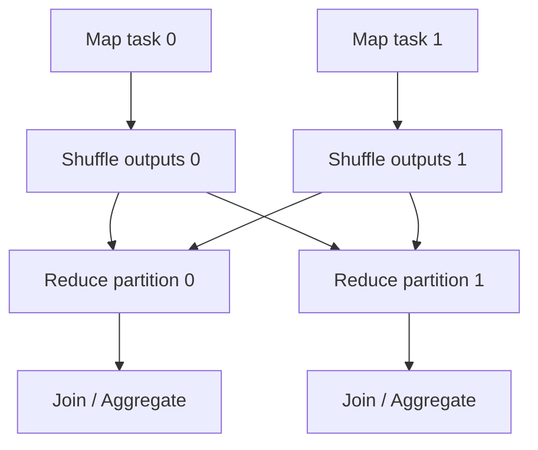
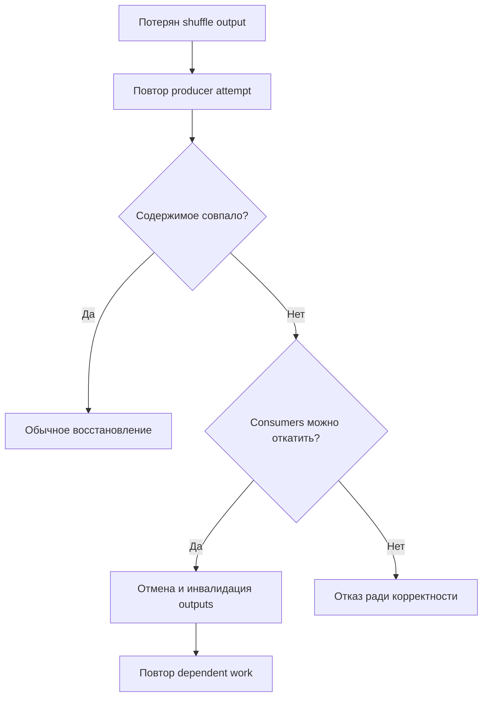
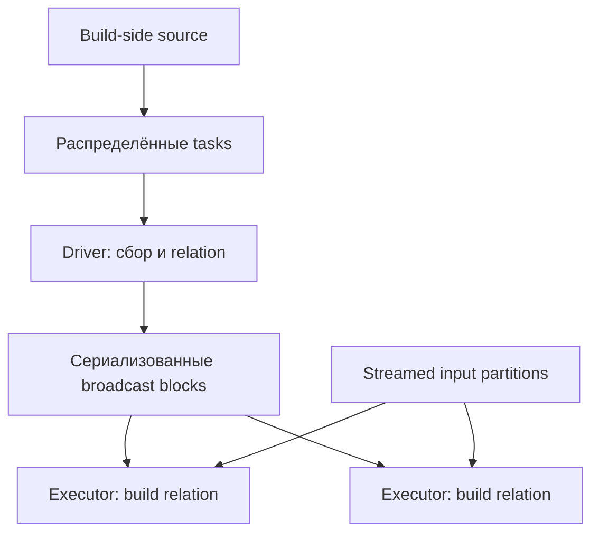
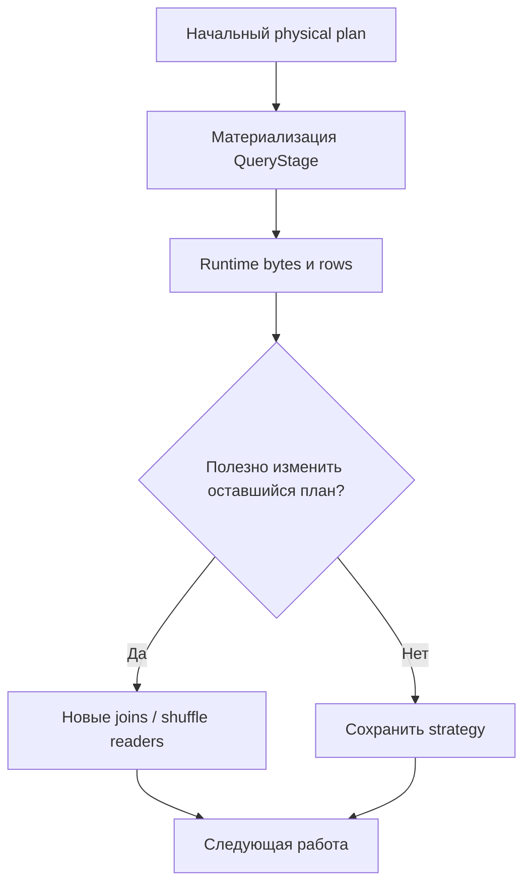
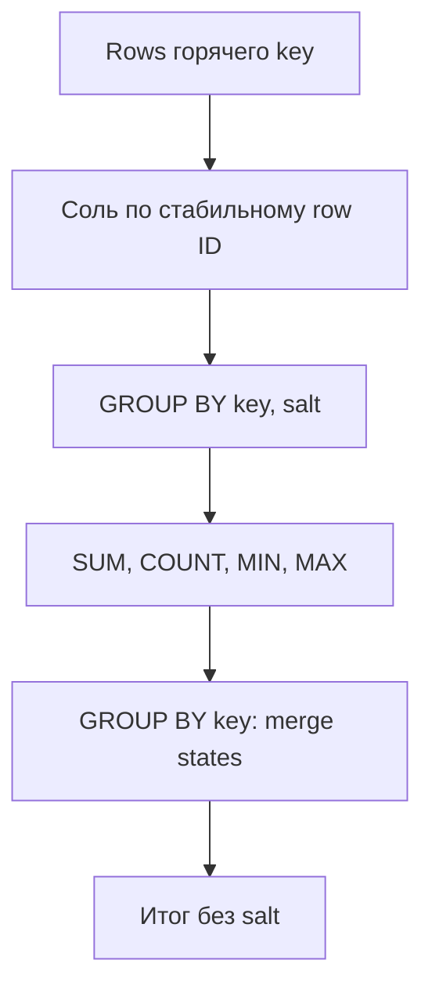
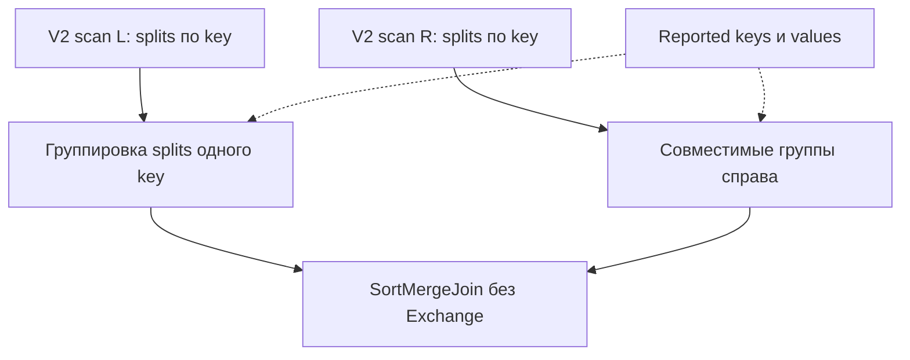

# 12. Партиционирование, shuffle и оптимизация запросов

Основной язык примеров — **Python / PySpark**. Учебное окружение: **Apache Spark 4.2.0, Python 3.12, JDK 17, Spark Classic**, режим `local[2]`. Для локального Storage Partition Join один Python-блок компилирует учебный Scala V2-reader compiler 2.13.18 из установленного Spark и запускает отдельное приложение.

Глава продолжает разбор планов из раздела 11: здесь распределение данных связывается с shuffle, join strategies, skew, storage layout и измерением эффекта оптимизации. Все **10 тем и 78 пунктов** сохранены из README в исходном порядке. Ровно три уровня заголовков: раздел → тема → пункт; практика и самопроверка размещены внутри пунктов.

**Содержание**

1. [Выбор партиционирования](#partition-choice)
2. [Перераспределение DataFrame](#dataframe-redistribution)
3. [Разбиение файлов при чтении](#file-input-splitting)
4. [Внутреннее устройство shuffle](#shuffle-internals)
5. [Стратегии физического join](#physical-join-strategies)
6. [Adaptive Query Execution](#adaptive-query-execution)
7. [Data skew и stragglers](#skew-stragglers)
8. [Оптимизация хранения для запросов](#storage-layout)
9. [Small files и размер выходных файлов](#small-output-files)
10. [Методика оптимизации](#optimization-method)

**Как выполнить примеры**

Нужны доступный `java` JDK 17 и полный PySpark 4.2.0. Базовая установка в отдельном Python-окружении:

```bash
python -m venv .venv
# Linux/macOS/WSL:
source .venv/bin/activate
# Windows PowerShell вместо предыдущей команды:
# .venv\Scripts\Activate.ps1
python -m pip install pyspark==4.2.0
```

Python-блоки выполняй сверху вниз в **одной чистой сессии**. Первый блок создаёт тестовые DataFrame, `spark`, временный каталог `lab` и helpers. Объекты из раздела 11 не требуются. Для запуска как приложения скопируй Python-блоки в `chapter12_lab.py` в исходном порядке и выполни `python chapter12_lab.py`.

`sql_conf` временно меняет SQL-настройки и восстанавливает исходные значения. Общая лабораторная сессия начинает с AQE off, чтобы исходные counts и algorithms были наблюдаемы; отдельные опыты включают AQE. `spark.python.use.daemon=false` выбран для воспроизводимого локального запуска Python workers, а не как SQL tuning advice.

Полный пакет PySpark содержит JVM/Scala JARs для примера V2-reader. Он не требует Maven downloads, Iceberg/Delta или external services. Дочерний процесс использует тот же Python и отдельный JVM gateway; созданные class/JAR/plan файлы остаются в `lab`. Все файловые пути главы локальные и предназначены для `local[2]`; кластеру нужны распределённо доступные storage/checkpoint paths.

`collect`/Counter и локальные file-size проверки применяются только к ограниченным учебным результатам. Такие проверки нельзя переносить на большие таблицы без изменения способа потребления результата. Некоторые эксперименты создают дополнительную работу ради наблюдения, а tiny broadcast limit намеренно вызывает ожидаемую ошибку.

**Как читать доказательства.** Plan подтверждает strategy/distribution, values — correctness, runtime metrics — стоимость. Малый пример не доказывает production speedup. Внутренние настройки/API отмечены отдельно; deployment-specific mechanisms и failure recovery имеют явные границы проверки в конце главы.

Официальная документация: [Spark 4.2.0](https://spark.apache.org/docs/4.2.0/), [Performance tuning](https://spark.apache.org/docs/4.2.0/sql-performance-tuning.html), [Configuration](https://spark.apache.org/docs/4.2.0/configuration.html).


<a id="partition-choice"></a>

## Выбор партиционирования


### Input, shuffle и output partitions

В Spark слово **partition** используется в нескольких смыслах. Разделяй вычислительные партиции на разных этапах и разделы хранения вроде `date=2026-10-12/`.

| Вид | Откуда берётся | Что выполняет task |
| --- | --- | --- |
| Input partition | Reader, `range`, исходный RDD | Читает назначенные файлы/диапазоны/блоки |
| Shuffle partition | Exchange и partitioner | Читает данные своего reduce-раздела |
| Output partition | Последний вычислительный участок | Передаёт строки writer или следующему operator |
| Directory partition | `write.partitionBy`, table layout | Организует данные в каталоги/разделы хранения |

Числа не обязаны совпадать. Один task может читать несколько файлов, один большой файл — несколько tasks, один writer task — записать файлы в несколько directory partitions. После AQE число reduce partitions может отличаться от исходного shuffle count.

**Общее окружение главы.** Выполни этот блок первым в новой Python-сессии. Примеры независимы от объектов раздела 11. `events` содержит 1000 строк, горячий ключ 0, редкие ключи и 20 `NULL`-ключей; суммы включают пропуски, чтобы проверка salting не была формальной.

```python
import contextlib
import io
import json
import tempfile
from collections import Counter
from pathlib import Path
from time import perf_counter

from pyspark.sql import SparkSession, functions as F

lab = Path(tempfile.mkdtemp(prefix="spark-ch12-"))
spark = (
    SparkSession.builder.master("local[2]")
    .appName("spark-zero-to-hero-ch12")
    .config("spark.sql.warehouse.dir", (lab / "warehouse").as_uri())
    .config("spark.default.parallelism", "4")
    .config("spark.sql.shuffle.partitions", "8")
    .config("spark.sql.adaptive.enabled", "false")
    .config("spark.python.use.daemon", "false")
    .config("spark.sql.session.timeZone", "UTC")
    .getOrCreate()
)
spark.sparkContext.setLogLevel("WARN")
sc = spark.sparkContext
assert spark.version == "4.2.0", spark.version

@contextlib.contextmanager
def sql_conf(**values):
    saved = {key: spark.conf.get(key, None) for key in values}
    try:
        for key, value in values.items():
            spark.conf.set(key, str(value))
        yield
    finally:
        for key, value in saved.items():
            if value is None:
                spark.conf.unset(key)
            else:
                spark.conf.set(key, value)

def explain_text(frame, mode="formatted"):
    out = io.StringIO()
    with contextlib.redirect_stdout(out):
        frame.explain(mode=mode)
    return out.getvalue()

def partition_counts(frame):
    # PID фиксируется до диагностической группировки, которая сама запускает shuffle.
    return (
        frame.select(F.spark_partition_id().alias("pid"))
        .groupBy("pid").count().orderBy("pid").collect()
    )

def assert_same_rows(left, right):
    # Только для маленького результата; сохраняет дубликаты и NULL.
    assert left.columns == right.columns
    assert Counter(tuple(r) for r in left.collect()) == Counter(tuple(r) for r in right.collect())

events = spark.range(0, 1000, 1, 4).select(
    F.col("id").alias("event_id"),
    F.when(F.col("id") >= 980, F.lit(None).cast("long"))
     .when(F.col("id") < 700, F.lit(0))
     .otherwise(F.col("id") % 10).alias("key"),
    F.when(F.col("id") % 17 == 0, F.lit(None).cast("long"))
     .otherwise(F.col("id") % 100).alias("amount_cents"),
    F.concat(F.lit("region-"), (F.col("id") % 3).cast("string")).alias("region"),
    F.repeat(F.lit("payload-"), 10).alias("payload"),
)
dim = spark.range(10).select(
    F.col("id").alias("key"),
    F.concat(F.lit("category-"), F.col("id").cast("string")).alias("category"),
)
assert events.count() == 1000
assert events.rdd.getNumPartitions() == 4
assert events.filter("key = 0").count() == 728
assert events.filter("key IS NULL").count() == 20
print("INPUT PARTITIONS:", events.rdd.getNumPartitions())
```

`.rdd.getNumPartitions()` — диагностический Classic API; при AQE подготовка RDD-представления может инициировать работу. Он не заменяет final plan/UI и не является универсальным API Spark Connect. `partition_counts` не показывает пустые партиции, поскольку у них нет строк.


### spark.default.parallelism и spark.sql.shuffle.partitions

`spark.default.parallelism` задаёт default parallelism Spark Core и влияет на некоторые источники/операции без явного count. Он не является единым числом партиций всех DataFrame. `spark.sql.shuffle.partitions` задаёт исходный SQL shuffle count для операций вроде joins и агрегатов, если count не определён иначе.

```python
print("DEFAULT PARALLELISM:", sc.defaultParallelism)
print("SQL SHUFFLE:", spark.conf.get("spark.sql.shuffle.partitions"))
with sql_conf(**{"spark.sql.shuffle.partitions": "6"}):
    grouped = events.groupBy("key").count()
    plan6 = explain_text(grouped)
    print(plan6)
    assert "hashpartitioning" in plan6.lower()
    assert grouped.rdd.getNumPartitions() == 6
    assert sum(r["count"] for r in grouped.collect()) == 1000
```

Здесь AQE выключен, чтобы увидеть шесть reduce partitions без adaptive coalescing. Изменение SQL-настройки не меняет число source partitions `events`, явно заданное в `range`. Настройки SparkContext устанавливай до его создания; динамические SQLConf — в нужной сессии до построения нового запроса.

Для файлового scan используются собственные правила reader, включая `spark.sql.leafNodeDefaultParallelism`, `files.minPartitionNum` и размеры split. У RDD `reduceByKey` и SQL `groupBy` не обязан быть один механизм defaults.

**Самопроверка:** почему изменение shuffle count не обязано менять число tasks чтения? Что произойдёт со значением 6 при включённом AQE?


### Размер партиции, длительность task и доступный параллелизм

Выбирать count нужно по размеру **конкретного этапа**, памяти task и доступным task slots. Слишком мало крупных партиций создаёт memory pressure и простаивающие executors; слишком много маленьких — scheduling overhead, мелкие shuffle blocks и короткие tasks.

Учебная отправная точка:

$$
N \approx \left\lceil\frac{B_{stage}}{B_{target}}\right\rceil.
$$

Это эвристика, а не настройка по универсальному нормативу. `B_stage` должен относиться к нужному представлению: bytes shuffle, decoded rows и сжатые bytes файлов различаются. Целевой размер зависит от operators, ширины строк, GC, skew и ресурсов.

```python
import math
stage_bytes = 30 * 1024**3
candidate_counts = {
    target_mib: math.ceil(stage_bytes / (target_mib * 1024**2))
    for target_mib in (64, 128, 256)
}
assert candidate_counts == {64: 480, 128: 240, 256: 120}
print("STARTING COUNTS:", candidate_counts)
```

Count больше числа slots означает несколько волн tasks, что нормально. Но распределение неравномерно: одна партиция 4 ГБ и сто по 10 МБ не эквивалентны ста одинаковым. Длительность важна отдельно от bytes: сложный разбор JSON может быть CPU-bound при небольшом входе.

**Практика:** для одного этапа сохрани median/max bytes и median/max duration, затем предложи count. Объясни, почему размер всего data lake не подходит как `B_stage`.


### Партиционирование по хэшу и по диапазону

**Hash partitioning** направляет одинаковый ключ в одну вычислительную партицию по hash expression и count. **Range partitioning** распределяет значения по границам диапазонов; полезно для некоторых сортировок и диапазонных workload.

```python
by_hash = events.repartition(8, "key")
by_range = events.repartitionByRange(8, "event_id")
print("HASH COUNTS:", partition_counts(by_hash))
print("RANGE COUNTS:", partition_counts(by_range))
assert_same_rows(by_hash, events)
assert_same_rows(by_range, events)
```

Hash не гарантирует равного объёма: ключ 0 из 728 строк целиком попадёт в одну hash partition, а несколько разных ключей могут столкнуться в одном bucket. Range по почти равномерному `event_id` может балансировать этот пример, но range по skewed `key` сохранит тяжёлое значение.

Range partitioning само по себе не сортирует строки внутри каждой партиции. Hash/range — не обещание закрепить ключ за конкретным физическим сервером: scheduling и локальность меняются между jobs.

**Вопрос:** что лучше распределяет вычисление этого набора — `key` или `event_id`? Почему распределение по `event_id` не удовлетворяет напрямую требованию `groupBy("key")`?


### Ключи распределения и число уникальных значений

Число уникальных ключей ограничивает полезный параллелизм операций, которым нужно собирать одинаковый ключ вместе. Если групп пять, увеличение hash count с 100 до 1000 не разделит каждую группу на 200 независимых финальных агрегатов.

```python
key_stats = events.agg(
    F.countDistinct("key").alias("ndv"),
    F.sum(F.col("key").isNull().cast("long")).alias("null_rows"),
).first()
assert (key_stats.ndv, key_stats.null_rows) == (10, 20)
by_key_pids = by_hash.select("key", F.spark_partition_id().alias("pid"))
assert by_key_pids.groupBy("key").agg(F.countDistinct("pid").alias("n")).filter("n > 1").count() == 0
```

`countDistinct` не считает `NULL`, но groupBy образует отдельную NULL-группу. Множество ключей также не равно множеству занятых partitions: hash collisions объединяют разные значения. Composite key может повышать cardinality, но менять ключ группировки ради баланса нельзя без восстановления исходной семантики.

**Практика:** сравни count=8 и count=32 по `key`. Найди пустые/занятые partitions и размер самого тяжёлого. Предложи предагрегацию или salting, если финальная логическая группа не меняется.


### Почему одинаковое число партиций не гарантирует совместное размещение ключей

Два DataFrame с восемью partitions могут использовать round-robin, разные hash keys, разный порядок composite keys или разные range boundaries. Поэтому одного равенства count недостаточно, чтобы убрать shuffle перед join.

```python
left_rr = events.repartition(8).hint("MERGE")
right_rr = dim.repartition(8).hint("MERGE")
rr_join = left_rr.join(right_rr, "key")
rr_plan = explain_text(rr_join)
print(rr_plan)
assert "hashpartitioning" in rr_plan.lower()
assert rr_join.count() == 980
```

Merge join требует согласованного clustered distribution по join keys, а round-robin его не сообщает. Catalyst учитывает **reported partitioning** и совместимость expressions, а не только физическую удачу, что нужные строки сейчас оказались рядом.

Если оба входа имеют совместимое hash partitioning по тем же ключам, planner может использовать это свойство. Но предварительный `repartition` уже сам оплачивает shuffle; отсутствие **дополнительного** Exchange не доказывает отсутствие сетевого обмена вообще.

**Практика по теме:** сравни `repartition(8)` и `repartition(8, "key")` перед одним join. Подпиши source, shuffle и output partitions, найди требования финального operator и сравни результат. Объясни разницу совместной вычислительной партиции и нахождения на одном executor.


<a id="dataframe-redistribution"></a>

## Перераспределение DataFrame


### repartition по числу партиций и по столбцам

`repartition(n)` меняет количество вычислительных partitions через exchange без заданного ключа; `repartition(n, "key")` задаёт hash distribution. В обоих случаях Spark может увеличивать или уменьшать число partitions, но за перераспределение платит shuffle.

```python
round_robin = events.repartition(6)
key_partitioned = events.repartition(6, F.col("key"))
assert round_robin.rdd.getNumPartitions() == 6
assert key_partitioned.rdd.getNumPartitions() == 6
assert_same_rows(round_robin, key_partitioned)
print(explain_text(round_robin))
print(explain_text(key_partitioned))

with sql_conf(**{"spark.sql.shuffle.partitions": "5"}):
    implicit_count = events.repartition("key")
    assert implicit_count.rdd.getNumPartitions() == 5
```

В плане ищи `RoundRobinPartitioning` или `hashpartitioning`. Передача нескольких columns задаёт составной ключ, а `repartition(n)` не обещает одинаковую стоимость всех tasks. `repartition` не обновляет исходный DataFrame на месте и не гарантирует сохранение общего порядка строк.

Повторяющийся `repartition` перед каждой операцией может добавить лишние exchanges. Сначала выясни distribution requirement следующего join/aggregate и какие свойства уже предоставляет вход.

API: [DataFrame.repartition](https://spark.apache.org/docs/4.2.0/api/python/reference/pyspark.sql/api/pyspark.sql.DataFrame.repartition.html).


### repartitionByRange и выбор границ по выборке

`repartitionByRange` выбирает границы диапазонов по выборке, чтобы избежать полного предварительного знания распределения. Значения одного диапазона попадают в одну partition, но выбранные boundaries могут отличаться между выполнениями.

```python
range_q = events.repartitionByRange(4, F.col("event_id").asc_nulls_last())
range_bounds = (
    range_q.select("event_id", F.spark_partition_id().alias("pid"))
    .groupBy("pid").agg(
        F.min("event_id").alias("lo"), F.max("event_id").alias("hi"),
        F.count("*").alias("rows"),
    ).orderBy("pid").collect()
)
print("RANGE BOUNDS:", range_bounds)
assert sum(r.rows for r in range_bounds) == 1000
assert all(a.hi <= b.lo for a, b in zip(range_bounds, range_bounds[1:]))
```

Последняя проверка относится к диапазонам уникального `event_id` этого примера. Не закрепляй конкретные boundaries или count каждой partition в общем тесте. Размер выборки регулирует `spark.sql.execution.rangeExchange.sampleSizePerPartition`; увеличение улучшает сведения о distribution, но добавляет подготовительную работу.

Без явного order expression API подразумевает ascending/nulls first. Несколько columns задают лексикографический диапазон; это не независимые диапазоны по каждой колонке. Один популярный identical key не разделяется автоматически так, чтобы сохранить обычное range partitioning по этому ключу.

API: [DataFrame.repartitionByRange](https://spark.apache.org/docs/4.2.0/api/python/reference/pyspark.sql/api/pyspark.sql.DataFrame.repartitionByRange.html).


### coalesce и уменьшение параллелизма без полного shuffle

`coalesce(n)` обычно объединяет существующие partitions узкой зависимостью без полного shuffle. Он подходит для уменьшения числа partitions после заметного сокращения объёма, если остаётся достаточный параллелизм и текущие partitions не слишком skewed.

```python
reduced = by_hash.coalesce(2)
assert reduced.rdd.getNumPartitions() == 2
assert by_hash.coalesce(20).rdd.getNumPartitions() == 8
print(explain_text(reduced))
assert_same_rows(reduced, events)
```

Увеличить число с 8 до 20 таким способом нельзя. Уменьшение не распределяет строки каждой исходной partition заново: горячий кусок может остаться горячим и объединиться с другими. Отсутствие нового Exchange у `Coalesce` не удаляет Exchange в его upstream lineage.

`DataFrame.coalesce` и `functions.coalesce` имеют разные назначения. Первый управляет partitions, второй выбирает первое ненулевое SQL-значение. Контекст API важнее совпадающего имени.

**Вопросы:** почему `coalesce(2)` может оказаться хуже `repartition(2)` при skew? Когда shuffle ради баланса оправдан?

API: [DataFrame.coalesce](https://spark.apache.org/docs/4.2.0/api/python/reference/pyspark.sql/api/pyspark.sql.DataFrame.coalesce.html).


### Риск coalesce(1) и концентрации работы

`coalesce(1)` концентрирует финальную обработку в одном task. Если выше нет materialized boundary, узкая цепочка может заставить этот task последовательно вычислять больше parent partitions. Финальная сериализация/запись также станет ограничена ресурсами одного исполнителя.

```python
one_coalesced = events.filter("event_id >= 0").coalesce(1)
one_shuffled = events.repartition(1)
assert one_coalesced.rdd.getNumPartitions() == 1
assert one_shuffled.rdd.getNumPartitions() == 1
print("COALESCE PLAN:\n", explain_text(one_coalesced))
print("REPARTITION PLAN:\n", explain_text(one_shuffled))
assert_same_rows(one_coalesced, one_shuffled)
```

`repartition(1)` сохраняет распределённую upstream работу до shuffle, но последний reduce/writer task всё равно один. Он не решает фундаментальное ограничение большого single-file output.

Один файл может быть уместен для маленького выгружаемого отчёта с заранее ограниченным размером. Для большой таблицы полезнее согласовать диапазон размеров файлов и downstream reader, чем всегда сводить output к одному task. Часто потребителю нужен каталог с несколькими файлами или специальная финальная выгрузка небольшого результата.

**Практика:** объясни, какая часть двух планов может выполняться параллельно. Не делай вывод о больших наборах по времени обработки 1000 строк.


### sortWithinPartitions и отсутствие глобальной сортировки

`sortWithinPartitions` упорядочивает строки **внутри** существующих вычислительных partitions и сам по себе не задаёт глобальный порядок. Для global order нужна согласованная range distribution/подготовка, которую обычно организует `orderBy`.

```python
locally_sorted = events.repartition(4).sortWithinPartitions("event_id")
local_sort_plan = explain_text(locally_sorted)
print(local_sort_plan)

def check_partition_order(rows):
    ids = [r.event_id for r in rows]  # В учебном примере не более 1000 строк суммарно.
    yield (len(ids), all(a <= b for a, b in zip(ids, ids[1:])))

checks = locally_sorted.select("event_id").rdd.mapPartitions(check_partition_order).collect()
assert sum(n for n, _ in checks) == 1000
assert all(ok for _, ok in checks)
assert [r.event_id for r in events.orderBy("event_id").collect()] == list(range(1000))
```

RDD/Python используется только для проверки локального порядка; рабочую сортировку выполняет встроенный JVM SQL operator. При одинаковых sort keys относительный порядок ties без дополнительного key не гарантирован. В плане локальный `Sort` часто помечен `false` в параметре global sorting.

Range repartition + local sort может создавать полезный layout, но порядок чтения файлов следующей программой всё равно не следует из имён partitions. Сохранённая таблица требует своих metadata/ordering contracts.

API: [DataFrame.sortWithinPartitions](https://spark.apache.org/docs/4.2.0/api/python/reference/pyspark.sql/api/pyspark.sql.DataFrame.sortWithinPartitions.html).


### Rebalance hints и адаптивная балансировка результата

`REBALANCE` hint просит подобрать разумные размеры output partitions, в том числе разрезать слишком большие и объединить слишком маленькие части. Это adaptive best-effort механизм; при выключенном AQE он игнорируется.

```python
with sql_conf(**{
    "spark.sql.adaptive.enabled": "true",
    "spark.sql.adaptive.coalescePartitions.parallelismFirst": "false",
    "spark.sql.adaptive.advisoryPartitionSizeInBytes": "1MB",
}):
    rebalance = events.hint("REBALANCE", 8, "key")
    rebalance_rows = rebalance.collect()
    rebalance_final = explain_text(rebalance)
    print(rebalance_final)
    assert len(rebalance_rows) == 1000
    assert "isFinalPlan=true" in rebalance_final
```

Вариант с числом и именем key проверен на Spark 4.2.0. Название hint и параметры передаются отдельно. В final plan ищи rebalance exchange/adaptive shuffle read, а при записи — распределение размеров файлов.

`REBALANCE` не является эквивалентом hash bucketing на годы вперёд и не обещает ровно восемь файлов. На маленьком наборе AQE может объединить почти всё. Для batch output важно изучать plan конкретной записи, а не только ранее выполненного `collect()`.

**Практика по теме:** сравни repartition, coalesce, range, local sort и rebalance. Для каждого запиши требования к distribution/order, наличие нового shuffle, число partitions и доказательство сохранения строк. Объясни, какую задачу решает выбранный приём.

Источник: [SQL partitioning hints](https://spark.apache.org/docs/4.2.0/sql-ref-syntax-qry-select-hints.html).


<a id="file-input-splitting"></a>

## Разбиение файлов при чтении


### spark.sql.files.maxPartitionBytes и openCostInBytes

File-based scan собирает input partitions из доступных split с учётом размера файла, допустимости разбиения и оценённой цены открытия. `spark.sql.files.maxPartitionBytes` задаёт ориентир упаковки bytes в одну input partition; `openCostInBytes` выражает цену открытия файла в условных bytes чтения.

Это не обещание, что после декомпрессии каждая partition займёт столько же памяти. Parquet row groups, gzip и широкие rows создают разные соотношения физических bytes и workload.

```python
many_path = lab / "many-input-files"
events.repartition(16).write.mode("overwrite").parquet(str(many_path))
many_files = sorted(many_path.glob("part-*.parquet"))
assert len(many_files) == 16

with sql_conf(**{
    "spark.sql.files.maxPartitionBytes": str(16 * 1024**2),
    "spark.sql.files.openCostInBytes": str(4 * 1024**2),
    "spark.sql.files.minPartitionNum": "1",
}):
    packed_scan = spark.read.parquet(str(many_path))
    print("FILES:", len(many_files), "SCAN PARTITIONS:", packed_scan.rdd.getNumPartitions())
    assert packed_scan.count() == 1000
```

Увеличение open cost может уменьшить число файлов, назначаемых одному task, и увеличить параллелизм чтения мелких файлов. Он не изменяет скорость object storage и не заменяет compaction. Настройки относятся к поддерживающим file-based sources, а не автоматически к JDBC/Kafka.

**Вопрос:** почему 16 маленьких файлов не обязаны создать 16 tasks? Почему target physical bytes нельзя считать лимитом heap task?


### minPartitionNum и maxPartitionNum при поддержке версии

`files.minPartitionNum` — предлагаемое минимальное число file partitions, а `files.maxPartitionNum` — предлагаемое максимальное при поддержке версии. Это рекомендации planner при rescaling, а не универсальные жёсткие bounds для неделимых источников.

| Параметр | Версия появления | Смысл |
| --- | --- | --- |
| `spark.sql.files.minPartitionNum` | 3.1.0 | Рекомендовать больше input partitions |
| `spark.sql.files.maxPartitionNum` | 3.5.0 | При превышении пересчитать упаковку ближе к максимуму |

```python
with sql_conf(**{
    "spark.sql.files.maxPartitionBytes": "1024",
    "spark.sql.files.openCostInBytes": "0",
    "spark.sql.files.minPartitionNum": "1",
    "spark.sql.files.maxPartitionNum": "3",
}):
    capped_scan = spark.read.parquet(str(many_path))
    print("RESCALED INPUT PARTITIONS:", capped_scan.rdd.getNumPartitions())
    assert capped_scan.count() == 1000
```

Для этого опыта target намеренно мал. Точное число tasks не является assertion: packing, file split и reader constraints могут приводить к отклонению от рекомендации. Если настройка неизвестна старой версии, принятие произвольной строки через `conf.set` ещё не доказывает, что reader её использует.

Настройки сверены с [официальным разделом Tuning Partitions](https://spark.apache.org/docs/4.2.0/sql-performance-tuning.html#tuning-partitions).


### Объединение небольших файлов в input partition

Несколько маленьких файлов могут читаться одним task. Это уменьшает scheduling overhead, но каждый файл всё равно может требовать listing, open, footer read и закрытие. Упаковка input partitions **не переписывает файлы** и не убирает их число в хранилище.

```python
with sql_conf(**{
    "spark.sql.files.maxPartitionBytes": str(64 * 1024**2),
    "spark.sql.files.openCostInBytes": "0",
    "spark.sql.files.minPartitionNum": "1",
}):
    grouped_files_scan = spark.read.parquet(str(many_path))
    grouped_file_partitions = grouped_files_scan.rdd.getNumPartitions()
    print("GROUPED FILE PARTITIONS:", grouped_file_partitions)
    assert grouped_file_partitions < len(many_files)
    assert grouped_files_scan.count() == 1000
```

Проверка `< 16` относится к контролируемому набору этой главы. В реальном объектном хранилище input packing может сократить tasks, но большое число open requests останется узким местом. При достаточно редком чтении full compaction может не окупиться; при ежедневных scans часто выгоднее изменить writer.

**Практика:** сравни число файлов, scan partitions и metadata latency. Раздели выигрыш от упаковки и выигрыш от физического объединения файлов.


### Несжимаемые и неделимые файлы как ограничение параллелизма

**Несжатый/несжимаемый** и **неделимый** файл — разные свойства. Несжимаемость данных описывает эффективность codec; splittability описывает возможность начать корректное чтение с отдельного диапазона. Обычный line-oriented text может делиться; стандартный gzip stream обычно нельзя независимо разделить на произвольные чтения.

```python
import gzip
plain_path = lab / "lines.txt"
gzip_path = lab / "lines.txt.gz"
text = "".join(f"record-{i:05d}\n" for i in range(4000))
plain_path.write_text(text, encoding="utf-8")
with gzip.open(gzip_path, "wt", encoding="utf-8") as stream:
    stream.write(text)

with sql_conf(**{
    "spark.sql.files.maxPartitionBytes": "1024",
    "spark.sql.files.openCostInBytes": "0",
    "spark.sql.files.minPartitionNum": "1",
}):
    plain_scan = spark.read.text(str(plain_path))
    gzip_scan = spark.read.text(str(gzip_path))
    print("TEXT/GZIP PARTITIONS:", plain_scan.rdd.getNumPartitions(), gzip_scan.rdd.getNumPartitions())
    assert plain_scan.rdd.getNumPartitions() > 1
    assert gzip_scan.rdd.getNumPartitions() == 1
    assert plain_scan.count() == gzip_scan.count() == 4000
```

Это конкретный пример text reader и gzip, а не классификация всех codecs. Parquet читает row groups и compressed columns другим способом; нельзя объявить любой compressed Parquet неделимым. Режимы whole-file/multiline у некоторых readers также могут ограничивать split.

Если один неделимый файл огромен, добавление executors не создаст ему независимые splits. Возможные решения — изменить upstream segmentation/codec/format, а не только shuffle count.


### Параллельный listing и стоимость метаданных

Listing и чтение метаданных — работа до основной обработки rows. У большого числа путей driver может проводить существенное время в каталогах, object storage requests и чтении footers. Для ряда file sources Spark поддерживает parallel partition discovery.

```python
with sql_conf(**{
    "spark.sql.sources.parallelPartitionDiscovery.threshold": "2",
    "spark.sql.sources.parallelPartitionDiscovery.parallelism": "8",
}):
    listed_scan = spark.read.schema(events.schema).parquet(*[str(p) for p in many_files])
    assert listed_scan.count() == 1000
    print("LISTING INPUT PATHS:", len(many_files))
```

Переданы 16 **входных путей**; это отличает опыт от чтения одного корневого каталога. Threshold оценивается в соответствующей точке discovery, а не как «в любом каталоге больше двух files». Измерять нужно build/read preparation и UI/jobs/logs конкретного reader.

Parallel listing не отменяет оплату requests и может увеличить одновременную нагрузку на metadata service. Explicit schema уменьшает часть работы вывода схемы, но не гарантирует полное отсутствие footer reads или file planning.

**Самопроверка:** почему медленный старт до tasks нельзя сразу лечить увеличением shuffle partitions?


### Отличие разбиения файлов от количества файлов на выходе

Read splitting и write layout относятся к разным executions. После записи 16 Parquet-файлов следующий scan способен создать одно, несколько или больше 16 input partitions. Writer count тоже зависит от output partitions, directory partitioning и ограничения records per file.

```python
read_back = spark.read.parquet(str(many_path))
print("OUTPUT FILES:", len(many_files), "NEXT READ PARTITIONS:", read_back.rdd.getNumPartitions())
assert_same_rows(read_back.select(*events.columns), events)
```

Равенство значений проверяется без требования одинакового порядка. Схема чтения обычно отражает nullable поля иначе, чем исходный `range`; сравнение rows не является полной schema-contract проверкой.

**Практика по теме:** создай одинаковые данные в 1, 4 и 16 файлах. Сравни file count, input partition count и длительность preparation/action. Затем измени только packing-настройку и объясни, почему файлы на диске остались прежними. Не оптимизируй число read tasks через слепое изменение writer count.


<a id="shuffle-internals"></a>

## Внутреннее устройство shuffle


### Shuffle map tasks и reduce tasks

Shuffle переносит данные от producer tasks к consumer tasks согласно новому распределению. **Shuffle map task** вычисляет выходы для reduce partitions; **reduce task** читает назначенные ему блоки от разных map tasks. Эти названия относятся к роли в обмене, а не к использованию Hadoop MapReduce.



Если map tasks четыре, а reduce partitions восемь, логически возможно до 4 × 8 блоков, включая пустые. Это не означает 32 отдельных физических файлов и не равно числу одновременно выполняемых tasks. Map и reduce phases обычно разделены scheduler stage boundary.

```python
shuffle_demo = events.groupBy("key").agg(F.sum("amount_cents").alias("total"))
shuffle_demo.explain(mode="formatted")
assert shuffle_demo.count() == 11  # 10 значений key и NULL-группа.
```

**Самопроверка:** чем map output partition отличается от source partition? Почему слово reduce встречается и в join, где пользователь не вызывал RDD `reduce`?


### Sort-based shuffle и shuffle blocks

Стандартная shuffle-система Spark использует sort-based инфраструктуру с несколькими путями записи: sorting, serialized/unsafe path и bypass merge при соответствующих условиях. Выбранный writer зависит от dependency, serializer, map-side combine и числа reduce partitions.

У map attempt обычно есть data file и index, позволяющий найти диапазон нужного reduce block; бывают дополнительные checksum/служебные файлы. Детали зависят от shuffle manager. Файл не создаётся обязательно отдельно для каждой пары map/reduce.

**Sort-based shuffle не означает, что output DataFrame отсортирован по пользовательскому ключу.** Внутренняя организация shuffle по partition ID и сортировка SQL `Sort` — разные обязанности. Sort-merge join может требовать свой local sort после hash exchange.

| Уровень | Что организует | Где смотреть |
| --- | --- | --- |
| Partitioner | К какому reduce partition относится строка | Exchange arguments |
| Shuffle writer | Как сохраняются blocks/index | Версия shuffle manager и logs |
| Fetcher | Как читаются блоки producer attempts | Shuffle read metrics |
| SQL `Sort` | Порядок по expressions | Physical operator и sort metrics |

Не выбирай internal writer вручную до определения узкого места. Поведение sort-based shuffle описано в [RDD guide, Shuffle operations](https://spark.apache.org/docs/4.2.0/rdd-programming-guide.html#shuffle-operations).


### Map-side aggregation и уменьшение передаваемого объёма

Map-side aggregation объединяет локальные значения до обмена. Для `SUM` можно отправить промежуточную сумму на ключ вместо каждой строки. SQL partial aggregation и RDD map-side combine — родственные идеи, но не один API.

```python
combined = events.groupBy("key").agg(
    F.sum("amount_cents").alias("s"), F.count("amount_cents").alias("n"),
)
combined_plan = explain_text(combined)
print(combined_plan)
assert "partial_sum" in combined_plan.lower()
assert "partial_count" in combined_plan.lower()
assert sum(r.n for r in combined.collect()) == 941
```

В исходных 1000 строках 59 сумм `NULL` (`id % 17 == 0`), поэтому `count(amount_cents)=941`. `count(*)` дал бы 1000. Partial aggregate не устраняет skew последнего финального ключа, но часто уменьшает его вход в сотни раз.

При почти уникальных ключах объединять мало что; при `collect_list` buffer может расти почти как вход. RDD `groupByKey` для суммы передаёт значения, тогда как `reduceByKey`/`aggregateByKey` могут уменьшить объём до shuffle. Корректность требует объединяемого состояния; нельзя складывать локальные медианы и получать глобальную медиану.

**Практика:** найди partial/final operators, сравни число входных rows и выходных buffers. Объясни, почему salting для простого `count` может проиграть уже существующей partial aggregation.


### Shuffle write, fetch, merge и десериализация

Shuffle состоит из нескольких расходов: producer вычисляет и сериализует output, writer сохраняет его, metadata сообщает locations, consumer fetches blocks, выполняет merge/decompression/deserialization и передаёт строки operator.

| Часть | Типичный расход | Полезная метрика |
| --- | --- | --- |
| Write | CPU сериализации, compression, disk I/O | Shuffle bytes/records written, write time |
| Fetch | Сеть, локальные диски, ожидание доступных блоков | Remote/local bytes, fetch wait |
| Merge/decode | CPU, buffers и spill | Read/merge metrics, CPU, spill |
| Downstream operator | Join/aggregate/sort | Output rows, peak memory, operator time |

Local blocks могут читаться без remote network, но не бесплатно. Fetch wait не является чистым измерением сетевой полосы: возможны задержки producer, disk, retries и backpressure. Размер shuffle зависит от serializer/compression и не равен несжатой таблице.

**Задание:** для `shuffle_demo` найди SQL execution, map/reduce stages и их bytes. Укажи, какие расходы относятся к shuffle, а какие к сортировке/агрегации после него. Не приписывай всё время reduce task одному `Exchange`.


### Shuffle service, shuffle tracking и сохранность файлов

После завершения producer его shuffle files нужны consumer stages. Если executor исчезает, а файлов больше нет, Spark может получать fetch failures и пересчитывать producer. При dynamic allocation недостаточно просто освободить все idle executors: необходимо сохранить нужные shuffle outputs или восстановить их.

Возможные механизмы: external shuffle service на узле, shuffle tracking, decommission с переносом blocks и поддерживающая external shuffle storage. Их доступность зависит от deploy mode и cluster configuration. Tracking удерживает executors с необходимыми данными; external service может обслуживать файлы независимо от executor-процесса, но не делает диск узла бессмертным.

```python
for key, fallback in (
    ("spark.shuffle.service.enabled", "false"),
    ("spark.dynamicAllocation.enabled", "false"),
    ("spark.dynamicAllocation.shuffleTracking.enabled", "true"),
    ("spark.shuffle.manager", "sort"),
):
    print("SHUFFLE INFRA:", key, sc.getConf().get(key, fallback))
```

Этот блок показывает установленное значение или явно подписанный fallback, а не доказывает существование внешнего сервиса. У SQLConf и SparkConf разная область действия; `spark.conf.set` не запускает shuffle service на всех узлах.

**Вопрос:** почему сохранение executor-independent shuffle files отличается от долговременного хранения бизнес-результата?


### Order-independent shuffle checksums: обнаружение различий между повторными вычислениями недетерминированных stages (добавлено по проверке полноты)

Повторное вычисление одного map partition может вернуть те же строки в другом порядке. Для восстановления это не обязательно проблема. Но если попытки возвращают **разные значения или multiplicities**, частично завершённые consumers могут смешать данные старой и новой попытки.

**Order-independent shuffle checksum** помогает обнаружить изменение содержимого между attempts без ложного mismatch только из-за перестановки rows. Spark вычисляет сведения о shuffle output и передаёт их driver. Это отличается от `spark.shuffle.checksum.enabled`: checksum bytes файла помогает диагностировать corruption и зависит от физического порядка/кодирования.

Следующая чистая Python-иллюстрация показывает принцип коммутативного fingerprint; **она не воспроизводит алгоритм checksum Spark**:

```python
import hashlib

def illustrative_fingerprint(rows):
    hashes = [
        int.from_bytes(hashlib.blake2b(json.dumps(row).encode(), digest_size=8).digest(), "big")
        for row in rows
    ]
    return len(hashes), sum(hashes) % (1 << 64)

original = [(1, 10), (2, 20), (1, 10)]
assert illustrative_fingerprint(original) == illustrative_fingerprint(list(reversed(original)))
assert illustrative_fingerprint(original) != illustrative_fingerprint([(1, 10), (2, 21), (1, 10)])
assert illustrative_fingerprint(original) != illustrative_fingerprint([(1, 10), (2, 20)])
```

Дубликаты существенны: SQL/RDD передают multiset, а не множество без повторов. Fingerprint остаётся конечным и допускает collisions; он не заменяет доказательство детерминированности, snapshot источника или exactly-once внешних эффектов. Изменяемая база, небезопасная UDF и случайная логика по partition order могут менять результаты retries.


### Повторное выполнение зависимых stages при несовпадении checksum; условия отказа, если безопасный откат невозможен (добавлено по проверке полноты)

При обнаруженном mismatch недостаточно пересчитать только failed reduce task. Другие успешно выполненные tasks могли уже использовать старое содержимое. В поддерживаемом пути Spark инвалидирует соответствующие зависимые outputs и повторяет consumers согласованно, чтобы не смешивать generations данных.



Откат имеет границы: completed result stages, результаты уже отданные caller или внешние side effects нельзя автоматически «стереть». Активные attempts необходимо согласованно отменить; если tasks не удаётся остановить либо recovery protocol не поддерживает нужный rollback, выполнение может завершиться ошибкой. Старый shuffle fetch protocol также ограничивает некоторые indeterminate-recovery paths.

В Spark 4.2 есть отдельный **internal** query-level rollback switch, по умолчанию `false`; его нельзя путать с `enableFullRetryOnMismatch`. В реализации есть отказ при невозможности откатить result stage. Конкретный recovery branch зависит от graph, состояния stages и версии.

**Практика:** нарисуй producer → два consumers → result stage. Отметь, какие результаты пришлось бы инвалидировать при изменении producer. В этой главе executor failure/checksum mismatch намеренно не инжектировались; локальные success-тесты не доказывают весь recovery protocol.


### spark.sql.shuffle.orderIndependentChecksum.enabled и spark.sql.shuffle.orderIndependentChecksum.enableFullRetryOnMismatch: поведение и включение order-independent checksum по умолчанию с Spark 4.2 (добавлено по проверке полноты)

Для Spark 4.2.0 проверены следующие значения:

| Настройка | Default 4.2.0 | Обязанность |
| --- | --- | --- |
| `spark.sql.shuffle.orderIndependentChecksum.enabled` | `true` | Вычислять order-independent сведения о shuffle content |
| `spark.sql.shuffle.orderIndependentChecksum.enableFullRetryOnMismatch` | `true` | Разрешать полное повторение consumer tasks при mismatch |
| `spark.sql.shuffle.orderIndependentChecksum.enableQueryLevelRollbackOnMismatch` | `false` | Internal: более широкий query-level rollback |

```python
for key in (
    "spark.sql.shuffle.orderIndependentChecksum.enabled",
    "spark.sql.shuffle.orderIndependentChecksum.enableFullRetryOnMismatch",
    "spark.sql.shuffle.orderIndependentChecksum.enableQueryLevelRollbackOnMismatch",
):
    print("CHECKSUM CONFIG:", key, spark.conf.get(key))
assert spark.conf.get("spark.sql.shuffle.orderIndependentChecksum.enabled") == "true"
assert spark.conf.get("spark.sql.shuffle.orderIndependentChecksum.enableFullRetryOnMismatch") == "true"
```

Название пункта README сохраняет акцент на включении checksum по умолчанию с 4.2. В source SQLConf двух основных flags указана версия **появления** 4.1.0, что не следует читать как историю всех defaults. Для другой patch/minor версии проверяй её source/release notes и фактическую конфигурацию платформы.

Выключение checksum не является исправлением недетерминированного computation. Детерминируй преобразование, фиксируй входной snapshot и используй оправданную durable materialization/checkpoint до нестабильной границы. Cache способен исчезнуть и пересчитаться, поэтому не является универсальной фиксацией данных.

Настройки сверены с [SQLConf Spark 4.2.0](https://raw.githubusercontent.com/apache/spark/v4.2.0/sql/catalyst/src/main/scala/org/apache/spark/sql/internal/SQLConf.scala). **Самопроверка:** чем обнаружение corruption отличается от обнаружения изменившегося logical output?


### Сетевые, дисковые и CPU-затраты shuffle

Стоимость shuffle определяется одновременно CPU, дисками, сетью и memory buffers. Compression уменьшает передаваемые bytes, но расходует CPU; большие blocks уменьшают request overhead, но усиливают memory pressure; множество мелких blocks увеличивает metadata/fetch overhead.

| Симптом | Возможное объяснение | Что проверить |
| --- | --- | --- |
| Много remote bytes и fetch wait | Большой обмен или медленное обслуживание blocks | Сеть, диски producer, размер запросов |
| Много write time | Диск или serialization/compression | Disk throughput, CPU и format |
| Высокий spill | Operator buffers/крупные partitions | Distribution и memory task |
| Thousands коротких tasks | Count слишком велик для объёма | Scheduler time и sizes |
| Один очень долгий reduce | Skew либо дорогая группа | Max/median bytes, keys, function cost |

Самая сильная оптимизация часто уменьшает данные **до** shuffle: projection/filter pushdown, предагрегация, выбор более подходящего join. Изменение сетевых buffers после передачи ненужных гигабайт — более поздний шаг.

**Задание:** для одного join распиши источники расходов по этапам. Объясни, когда добавление памяти не уменьшит network-bound время, а когда уменьшение ширины строки улучшит сразу несколько ресурсов.


### Push-based shuffle и внешние shuffle-системы как специальные варианты

**Push-based shuffle** пытается заранее объединять/передавать части shuffle output к merger endpoints и уменьшать fragmented fetching. **External shuffle systems** могут менять размещение, сохранность и чтение shuffle data, например хранить их вне обычных executor-local disks.

Это специальные варианты инфраструктуры, а не универсальный SQL hint. Нужны совместимые версии, deploy mode, shuffle service/manager и configuration. Нельзя обещать, что `spark.shuffle.push.enabled=true` в локальной сессии создаст production merger service.

```python
print("PUSH SHUFFLE REQUESTED:", sc.getConf().get("spark.shuffle.push.enabled", "false"))
print("SHUFFLE MANAGER REQUESTED:", sc.getConf().get("spark.shuffle.manager", "sort"))
```

В этой главе используются штатный local shuffle и обычные successful attempts. Push-based shuffle, внешний manager и node loss здесь не развёрнуты. Для выбранного external plugin проверь compatibility, block lifecycle, authentication и реальный workload; API/метрики могут отличаться от стандартного Spark.

**Практика по теме:** объясни жизненный цикл одного shuffle block, его восстановление и стоимость. Раздели алгоритм partitioning, внутренний writer, сервис хранения и SQL operator. Укажи, какие свойства доказывает `explain`, а какие требуют logs/metrics/recovery test.

Источник инфраструктурных параметров: [Spark configuration](https://spark.apache.org/docs/4.2.0/configuration.html).


<a id="physical-join-strategies"></a>

## Стратегии физического join


### Broadcast Hash Join

**Broadcast Hash Join (BHJ)** строит hashed relation малой стороны и делает её доступной исполнителям. Большая streamed side ищет совпадения по equi-key локально, поэтому ей обычно не нужен shuffle по join key.

```python
bhj = events.join(F.broadcast(dim), "key", "inner")
bhj_plan = explain_text(bhj)
print(bhj_plan)
assert "BroadcastHashJoin" in bhj_plan
assert "BroadcastExchange" in bhj_plan
bhj_rows = bhj.collect()
assert len(bhj_rows) == 980
```

Это exact inner join: 20 `NULL`-ключей не совпадают обычным равенством. Broadcast-сторона здесь имеет десять ключей; при дубликатах в ней matched rows умножаются. Не заменяй её множеством ключей, если нужны multiplicities и attributes.

BHJ требует подходящего equi-key и допустимой build side. Другие expensive operators перед build relation тоже выполняются: маленький финальный справочник может долго вычисляться. Broadcast устраняет подходящий shuffle большой стороны, но добавляет подготовку, передачу и память replicated relation.

**Вопрос:** когда broadcast малой таблицы полезен, а когда её дорогой upstream уже делает запрос медленным?


### Sort Merge Join

**Sort Merge Join (SMJ)** требует clustered distribution по equi-key и порядка входов по ключам. После получения этих свойств operator последовательно сравнивает отсортированные группы. Новые exchanges/sorts не нужны, если совместимые свойства уже обеспечены источником.

```python
smj = events.hint("MERGE").join(dim.hint("MERGE"), "key")
smj_plan = explain_text(smj)
print(smj_plan)
assert "SortMergeJoin" in smj_plan
assert_same_rows(smj, bhj)
```

Преимущества SMJ проявляются на больших входах, когда broadcast невозможен и hash table крупной build partition опасна. Но сортировка и shuffle имеют цену; длинная группа одинакового ключа всё равно может стать тяжёлой. SMJ не гарантирует глобальный порядок output DataFrame как пользовательский контракт.

**Практика:** подпиши два distribution requirements, local sorts и join keys в плане. Объясни, какие дополнительные operators исчезнут при совместимом bucketed/storage-partitioned входе.


### Shuffled Hash Join

**Shuffled Hash Join (SHJ)** перераспределяет входы по equi-key, затем строит hash relation build side **для каждой соответствующей partition**. Он может избежать двух sorts, но требует памяти для build partition и подходит не для всех сочетаний типов/стратегий.

```python
shj = events.join(dim.hint("SHUFFLE_HASH"), "key")
shj_plan = explain_text(shj)
print(shj_plan)
assert "ShuffledHashJoin" in shj_plan
assert_same_rows(shj, bhj)
```

Оценивай не только суммарный размер малой таблицы, но и её **максимальную** partition. Skew может сделать один build buffer значительно больше среднего. Увеличение count распределяет разные ключи, но одинаковый hot key без дополнительной стратегии остаётся вместе.

AQE способен выбрать SHJ по фактическим partition sizes при соответствующих настройках. Явный `SHUFFLE_HASH` hint и adaptive conversion — разные основания выбора. Не сравнивай SMJ и SHJ только по наличию/отсутствию `Sort`: нужны CPU, memory, spill и task distributions.


### Broadcast Nested Loop Join

**Broadcast Nested Loop Join (BNLJ)** используется для поддерживаемых joins без подходящего equi-key либо как fallback. Broadcast small side остаётся локальной, но streamed rows могут проверяться со многими её rows. Работа может расти примерно как произведение размеров даже при небольшом output.

```python
small_e = events.filter("event_id < 4").alias("e")
small_d = dim.filter("key < 3").alias("d")
bnlj = small_e.join(
    F.broadcast(small_d), F.col("e.event_id") > F.col("d.key"), "inner"
).select(F.col("e.event_id"), F.col("d.key").alias("dim_key"))
print(explain_text(bnlj))
assert "BroadcastNestedLoopJoin" in explain_text(bnlj)
assert Counter(tuple(r) for r in bnlj.collect()) == Counter([
    (1, 0), (2, 0), (2, 1), (3, 0), (3, 1), (3, 2),
])
```

Здесь всего 4 × 3 потенциальных пары. Для миллионов rows тот же condition требует пересмотра алгоритма: добавить настоящую selective equi-часть, использовать допустимое range-binning с точным residual predicate либо подходящий specialised operator. Любое преобразование должно сохранять interval boundaries, duplicates и NULL semantics.

**Самопроверка:** почему hint `BROADCAST` не гарантирует именно BHJ? Что ограничивает число сравнений в BNLJ?


### Cartesian product и non-equi joins

`crossJoin` создаёт все комбинации строк. Inner join с non-equi condition может использовать `CartesianProduct` с condition или nested-loop вариант; логическая форма не обещает эффективный lookup.

```python
cross = events.filter("event_id < 3").crossJoin(dim.filter("key < 3"))
assert cross.count() == 9
cross.explain(mode="formatted")
```

Для левой стороны `L` и правой `R` полный product имеет `L × R` rows. При этом `count()` может применять специальные оптимизации, поэтому его время не показывает стоимость материализации всех wide rows. Фильтр после product иногда переносится planner, но отсутствие equi-key ограничивает выбор.

Не путай product с неправильным результатом: он может быть бизнес-требованием, например tiny grid параметров. Опасно не само имя operator, а несоответствие числа пар ожидаемой workload. Для генерации небольшого календаря × категорий указывай верхние bounds явно.

**Практика:** предскажи размер product перед выполнением. Затем добавь condition и объясни, уменьшает ли он только output или также алгоритмическую работу.


### Build side, тип join и ограничения выбора стратегии

**Build side** — вход, для которого создаётся lookup structure или broadcast relation; **streamed side** — вход, проходящий через неё. Правила зависят от конкретного физического algorithm и join type.

| Join type | Допустимая build side стандартного BHJ |
| --- | --- |
| Inner | Левая или правая |
| Left outer | Правая |
| Right outer | Левая |
| Left semi / left anti | Правая |
| Full outer | Обычный BHJ не поддерживает этот тип |

```python
left_bhj = events.join(F.broadcast(dim), "key", "left")
assert left_bhj.count() == 1000
assert left_bhj.filter("category IS NULL").count() == 20
full_hint = events.join(dim.hint("BROADCAST"), "key", "full")
full_hint_plan = explain_text(full_hint)
print(full_hint_plan)
assert "BroadcastHashJoin" not in full_hint_plan
assert full_hint.count() == 1000
```

В full join все десять dimension keys уже представлены слева, поэтому здесь нет дополнительных right-only rows; null rows слева сохраняются. Hint не изменяет join semantics и не делает unsupported BHJ возможным. Для SHJ/BNLJ поддержка build side шире/иначе в некоторых версиях, поэтому таблицу нельзя переносить на все join algorithms.

**Вопрос:** почему возможность hash lookup по ключу не решает автоматически задачу сохранения unmatched rows обеих сторон?


### BroadcastExchange: подготовка build relation на драйвере и доставка сериализованного результата исполнителям

`BroadcastExchange` сначала выполняет build-side query распределённо, затем собирает представление на **driver**, подготавливает hashed/другую relation и публикует сериализованный broadcast. Executors получают её через broadcast infrastructure; они не обязаны каждый независимо перечитывать исходную таблицу.



Driver тоже может стать узким местом по памяти, CPU и времени. Сериализация перед передачей и materialization после неё создают несколько представлений. Память build relation потребуется на каждом использующем executor, но не следует считать её обязательной полной копией для каждого task: lifecycle/reuse зависит от реализации.

В метриках `BroadcastExchange` ищи collect/build/broadcast times, data size и число output rows. Время upstream join/aggregate/filter справочника является частью подготовки, а не network broadcast time.

**Практика:** у `bhj` найди exchange и build side. Объясни, почему увеличение executor memory не исправит driver OOM при подготовке broadcast.


### Размер исходных файлов, оценка sizeInBytes, размер broadcast relation в памяти и отличие этих величин от broadcast threshold

При оценке broadcast различай четыре величины:

| Величина | Что описывает | Почему может отличаться |
| --- | --- | --- |
| Размер исходных файлов | Bytes в storage | Compression, лишние поля, metadata |
| `sizeInBytes` | Estimate relation в logical plan | Неполные/stale statistics и selectivity |
| Materialized relation size | Данные/структуры выбранного build path | Hash capacity, decoded values, representation |
| Automatic threshold | Политика предварительного выбора | Не является разрешённой памятью процесса |

```python
print("DIM COST PLAN:\n", explain_text(dim, "cost"))
dim_disk_path = lab / "dim-parquet"
dim.write.mode("overwrite").parquet(str(dim_disk_path))
physical_file_bytes = sum(p.stat().st_size for p in dim_disk_path.glob("part-*.parquet"))
print("DIM FILE BYTES:", physical_file_bytes)
assert spark.read.parquet(str(dim_disk_path)).count() == 10
```

Bytes файла не обязаны совпасть с size estimate или SQL exchange metric. Маленькая compressed file может разворачиваться в крупные strings/hash structures. Если статистик нет, автоматический выбор может отказаться от полезного broadcast, а hint — заставить planner рассмотреть его без хорошей оценки.

**Самопроверка:** какие из этих величин доступны до выполнения? Почему threshold 10 MiB не означает, что executor выделит ровно 10 MiB heap?


### Порог автоматического broadcast, внутренние лимиты BroadcastExchange и зависимость от версии Spark

`spark.sql.autoBroadcastJoinThreshold` задаёт автоматический порог (default 4.2.0 — 10 MiB). В Spark 4.2.0 также есть `spark.sql.maxBroadcastTableSize` с default 8 GiB, появившийся как configurable limit в 4.1.0. Это разные настройки: первая предлагает algorithm, вторая ограничивает materialized broadcast path.

Кроме bytes существуют внутренние ограничения числа rows/capacity и concrete relation types. Они зависят от версии и build representation; нельзя свести все ограничения к одному threshold. Повышение hard limit не создаёт память и не убирает пределы структур.

Следующий опыт намеренно устанавливает tiny limit для маленьких учебных данных, чтобы проверить отличие limit от hint:

```python
print("AUTO THRESHOLD:", spark.conf.get("spark.sql.autoBroadcastJoinThreshold"))
print("MAX BROADCAST SIZE:", spark.conf.get("spark.sql.maxBroadcastTableSize"))
with sql_conf(**{"spark.sql.maxBroadcastTableSize": "1b"}):
    tiny_limit_join = events.join(F.broadcast(dim), "key")
    failed_as_expected = False
    try:
        tiny_limit_join.collect()
    except Exception as error:
        failed_as_expected = True
        assert "broadcast" in str(error).lower()
        print("EXPECTED BROADCAST SIZE LIMIT:", type(error).__name__)
    assert failed_as_expected
```

Это проверка ограничителя, а не OOM-тест: большой allocation здесь не создаётся. В другом runtime настройка/лимит могут отличаться; source classes `BroadcastExchangeExec` и hashed relations относятся к internal implementation.

Источник значения configurable limit: [Spark configuration](https://spark.apache.org/docs/4.2.0/configuration.html).


### spark.sql.autoBroadcastJoinThreshold=-1: границы отключения автоматического выбора и приоритет явного BROADCAST hint

`autoBroadcastJoinThreshold=-1` отключает **автоматический** выбор по этому порогу. Он не запрещает явный `BROADCAST` hint и не отключает все broadcast operations приложения. Включённый AQE имеет свой adaptive threshold; для запрета его автоматического решения нужно проверить и его.

```python
with sql_conf(**{
    "spark.sql.autoBroadcastJoinThreshold": "-1",
    "spark.sql.adaptive.autoBroadcastJoinThreshold": "-1",
}):
    automatic_off = events.join(dim, "key")
    explicit_on = events.join(F.broadcast(dim), "key")
    assert "BroadcastHashJoin" not in explain_text(automatic_off)
    assert "BroadcastHashJoin" in explain_text(explicit_on)
    assert_same_rows(automatic_off, explicit_on)
```

AQE в общем окружении выключен; оба значения указаны, чтобы принцип не потерялся при дальнейшем включении. При non-equi/fallback choices возможен broadcast nested-loop path даже без обычного automatic BHJ threshold: это не глобальная блокировка любых broadcast exchanges.

**Вопрос:** почему имя настройки говорит о выборе strategy, а не о возможности транспортировки небольшого объекта?


### spark.sql.adaptive.autoBroadcastJoinThreshold: отдельный порог AQE, наследование настройки и проверка итогового плана

`spark.sql.adaptive.autoBroadcastJoinThreshold` применяется при AQE и может быть задан независимо. Если значение не установлено, используется fallback к обычному threshold. В `conf.get` unset optional может возвращать `None`; это не означает нулевой разрешённый размер.

```python
with sql_conf(**{
    "spark.sql.adaptive.enabled": "true",
    "spark.sql.autoBroadcastJoinThreshold": "-1",
    "spark.sql.adaptive.autoBroadcastJoinThreshold": "1MB",
    "spark.sql.adaptive.nonEmptyPartitionRatioForBroadcastJoin": "0.0",
}):
    adaptive_join = events.join(dim, "key")
    adaptive_join_before = explain_text(adaptive_join)
    adaptive_join_rows = adaptive_join.collect()
    adaptive_join_after = explain_text(adaptive_join)
    print("INITIAL:\n", adaptive_join_before)
    print("FINAL:\n", adaptive_join_after)
    assert len(adaptive_join_rows) == 980
    assert "SortMergeJoin" in adaptive_join_before
    assert "BroadcastHashJoin" in adaptive_join_after
    assert "isFinalPlan=true" in adaptive_join_after
```

Для воспроизводимости маленького опыта дополнительно изменён internal non-empty partition ratio: при почти пустой build side этот criterion способен блокировать adaptive conversion. Это учебная настройка, не рекомендация на все jobs. Hints, join type и другие требования тоже ограничивают conversion.

Перед adaptive broadcast часть shuffle могла уже выполниться: выигрыш не равен стоимости идеального BHJ, выбранного сразу. Изучай final plan вместе с query stages и реально выполненной работой.

[Adaptive broadcast conversion](https://spark.apache.org/docs/4.2.0/sql-performance-tuning.html#converting-sort-merge-join-to-broadcast-join).


### Broadcast timeout и нехватка памяти драйвера или executor

`spark.sql.broadcastTimeout` ограничивает ожидание broadcast exchange, но длительная подготовка может включать чтение и вычисление build side, сбор на driver, relation build и передачу. Увеличение timeout не уменьшает размер данных и не исправляет OOM.

```python
print("BROADCAST TIMEOUT SECONDS:", spark.conf.get("spark.sql.broadcastTimeout"))
```

| Симптом | Возможное место проблемы | Следующий шаг |
| --- | --- | --- |
| Долгое collect/build time | Upstream query, driver CPU/memory | Проверить build-side plan и bytes |
| Долгое broadcast time | Передача blocks, сеть, executor readiness | Сопоставить metrics/logs |
| Driver OOM | Сбор/структура relation | Сократить build или сменить strategy |
| Executor OOM | Relation + concurrent operator state | Проверить per-executor budget и skew |
| Timeout | Любой медленный участок подготовки | Найти участок до изменения timeout |

**Практика по теме:** сравни BHJ, SMJ, SHJ и BNLJ на проверяемом маленьком входе; затем объясни их resource requirements для большого. Найди build side и обе группы thresholds. Укажи, какая метрика нужна для доказательства реального выигрыша, и почему explicit hint может ухудшить запрос при росте данных.


<a id="adaptive-query-execution"></a>

## Adaptive Query Execution


### spark.sql.adaptive.enabled: включение AQE, проверка фактической конфигурации и изменение defaults между версиями

`spark.sql.adaptive.enabled` — общий switch AQE. В обычных batch workload AQE включён по умолчанию начиная со Spark 3.2; в 4.2.0 stock default тоже `true`. Учебное окружение главы временно выключает его для однозначного изучения исходных exchanges и включает в конкретных опытах.

```python
print("LAB AQE:", spark.conf.get("spark.sql.adaptive.enabled"))
with sql_conf(**{"spark.sql.adaptive.enabled": "true"}):
    aqe_sum = events.groupBy("key").agg(F.sum("amount_cents").alias("s"))
    aqe_sum.collect()
    print(explain_text(aqe_sum))
    assert "AdaptiveSparkPlan" in explain_text(aqe_sum)
```

Фактическое значение важнее общих defaults: cluster policy, session settings и provider runtime могут его менять. Установленный switch не гарантирует adaptive root для любого trivially simple query. Некоторые планы не содержат materialization boundary, а определённые operators/modes имеют ограничения.

**Самопроверка:** почему `conf.get=true` и presence `AdaptiveSparkPlan` — две разные проверки? Чем umbrella switch отличается от включения отдельной adaptive optimization?


### Runtime statistics и QueryStage

**QueryStage** — materializable участок SQL-плана, после завершения которого AQE получает фактические сведения. Shuffle query stage сообщает map output sizes; broadcast query stage — сведения подготовленного broadcast. Это не то же самое, что scheduler stage, чей ID виден в Stages UI.

```python
print("ADAPTIVE JOIN FINAL:\n", adaptive_join_after)
assert "QueryStage" in adaptive_join_after
```

Runtime statistics позволяют оценивать промежуточные входы после фильтров/агрегатов, а не только исходную таблицу. Но их получение уже стоило scan, CPU, shuffle или broadcast preparation. Scheduler может запускать несколько jobs внутри одного SQL execution; materialization и replanning взаимодействуют.



**Вопрос:** почему переход на BHJ после shuffle не имеет той же стоимости, что BHJ, выбранный ещё до materialization?


### Coalescing shuffle partitions

AQE coalescing объединяет **соседние** shuffle partitions для чтения, используя фактические map output sizes. Оно снижает число маленьких reduce tasks, но не отменяет уже записанные blocks и не выполняет произвольное hash repartition всех строк заново.

```python
with sql_conf(**{
    "spark.sql.adaptive.enabled": "true",
    "spark.sql.shuffle.partitions": "32",
    "spark.sql.adaptive.coalescePartitions.enabled": "true",
    "spark.sql.adaptive.coalescePartitions.parallelismFirst": "false",
    "spark.sql.adaptive.advisoryPartitionSizeInBytes": "1MB",
}):
    coalesced_agg = events.groupBy("key").count()
    coalesced_agg.collect()
    coalesced_plan = explain_text(coalesced_agg)
    print(coalesced_plan)
    assert "AQEShuffleRead" in coalesced_plan
    assert "coalesced" in coalesced_plan.lower()
```

Исходный shuffle count 32 выбран, чтобы small-result опыт показывал coalescing. Для explicit user repartition count, специфичных distribution requirements или другого path оптимизация может вести себя иначе; не обещай уменьшение любого Exchange.

Уменьшение числа downstream tasks может повысить эффективность, но при слишком агрессивном объединении потеряется parallelism. Сравни stage duration, а не только count. Нельзя полагаться на coalescing как на исправление одной гигантской hot-key partition.


### Преобразование стратегии join во время выполнения

AQE может преобразовать SMJ в BHJ по runtime size малой стороны либо выбрать SHJ, если условия по local hash-map sizes выполнены. Join semantics, key support, hints и distribution constraints сохраняются.

Пример `adaptive_join` из предыдущей темы уже выполнил переход: automatic static threshold был `-1`, adaptive threshold — `1MB`. Final output содержит те же 980 rows, а plan — broadcast hash join.

```python
assert "SortMergeJoin" in adaptive_join_before
assert "BroadcastHashJoin" in adaptive_join_after
print("ADAPTIVE CONVERSION VERIFIED")
```

Для SHJ важна `spark.sql.adaptive.maxShuffledHashJoinLocalMapThreshold`: он относится к размеру отдельной local map, а не общему объёму таблицы. В сочетании с advisory size и фактическими partition sizes AQE может предпочесть SHJ независимо от исходного предпочтения SMJ.

**Практика:** сравни initial/final, отмечая operators и уже завершённые QueryStages. Измерь затраты материализации. Не приписывай экономию устранению shuffle, если shuffle outputs уже были произведены.


### Local shuffle reader

**Local shuffle reader** позволяет читать подходящие materialized blocks ближе к месту их создания, когда прежнее hash distribution больше не требуется. Типичный случай — conversion SMJ → BHJ, после которого большая сторона не обязана оставаться распределённой по join key.

```python
print("LOCAL READER:", spark.conf.get("spark.sql.adaptive.localShuffleReader.enabled"))
local_markers = [line.strip() for line in adaptive_join_after.splitlines() if "local" in line.lower()]
print("LOCAL READER MARKERS:", local_markers)
```

В plan можно встретить `AQEShuffleRead local`. Это не утверждение, что любая передача исчезла: shuffle был записан, broadcast ещё доставляется, а реальная executor locality и scheduler placement имеют ограничения. Отсутствие marker не доказывает неисправность AQE — конкретный path мог не требовать такого reader.

**Вопрос:** чем локальное чтение уже созданных blocks отличается от предотвращения shuffle до выполнения? Почему block placement не означает постоянный executor для ключа?


### Разбиение skewed shuffle partitions

Для поддерживаемого skew join path AQE может разделить чтение большой shuffle partition на части и повторить нужные blocks другой стороны. Это сохраняет logical join, но уменьшает нагрузку одного reduce task ценой replication и иногда дополнительной подготовки.

В standard policy partition считается skewed при выполнении **обоих** условий: больше factor × median size и больше absolute byte threshold. Defaults 4.2.0: factor 5 и threshold 256 MiB. Используется размер, а не просто число rows.

```python
for key in (
    "spark.sql.adaptive.skewJoin.enabled",
    "spark.sql.adaptive.skewJoin.skewedPartitionFactor",
    "spark.sql.adaptive.skewJoin.skewedPartitionThresholdInBytes",
    "spark.sql.adaptive.forceOptimizeSkewedJoin",
):
    print("SKEW CONFIG:", key, spark.conf.get(key))
```

Учебные 1000 rows недостаточны для демонстрации split при штатных thresholds; флаг здесь проверяется, а реальный skew split не заявляется как выполненный. `forceOptimizeSkewedJoin` не делает любой operator поддерживаемым и может добавлять shuffle.

У aggregate hot key и у skew join разные проблемы: split join partitions не является универсальным разбиением состояния `collect_list` одной группы. **Практика:** для большого контролируемого join сравни median/max shuffle bytes и final skew markers; отдельно измерь replication cost.


### Advisory partition size и минимальный параллелизм

`spark.sql.adaptive.advisoryPartitionSizeInBytes` — ориентир размера adaptive partitions (default 64 MiB), а не жёсткий лимит памяти. Политика coalescing учитывает также minimum size и parallelism.

| Параметр | Назначение |
| --- | --- |
| `advisoryPartitionSizeInBytes` | Ориентир размеров при coalesce/skew operations |
| `coalescePartitions.parallelismFirst` | Предпочитать parallelism вместо буквального advisory target |
| `coalescePartitions.minPartitionSize` | Нижний размер, учитываемый coalescing policy |
| `coalescePartitions.initialPartitionNum` | Начальный count; при unset — обычный shuffle count |

```python
for key in (
    "spark.sql.adaptive.advisoryPartitionSizeInBytes",
    "spark.sql.adaptive.coalescePartitions.parallelismFirst",
    "spark.sql.adaptive.coalescePartitions.minPartitionSize",
    "spark.sql.adaptive.coalescePartitions.initialPartitionNum",
):
    print("COALESCE CONFIG:", key, spark.conf.get(key))
```

Default `parallelismFirst=true` может приводить к target меньше advisory size ради параллелизма. Deprecated `coalescePartitions.minPartitionNum` не стоит использовать как единственный современный рецепт; его наличие в старой заметке требует проверки версии.

**Самопроверка:** почему 64 MiB serialized shuffle bytes не гарантируют 64 MiB hash-map memory? Когда уменьшение reduce tasks ухудшит время?


### Начальный и окончательный план

Initial plan описывает первоначальное решение; current plan меняется по мере materialization; final plan относится к завершённому adaptive execution. Одного `explain` до action недостаточно для утверждения «этот запрос выполнился SMJ».

```python
with sql_conf(**{"spark.sql.adaptive.enabled": "true"}):
    finalization_q = events.groupBy("region").count()
    initial = explain_text(finalization_q)
    rows = finalization_q.collect()
    final = explain_text(finalization_q)
    assert "isFinalPlan=false" in initial
    assert "isFinalPlan=true" in final
    assert sum(r["count"] for r in rows) == 1000
```

Выполнен **тот же** объект. `finalization_q.count()` создал бы отдельный count-query и не гарантировал финализацию объясняемого DataFrame. Для production write final plan смотри в SQL execution записи; ранее выполненный `collect` не является её execution.

Final output может показывать также initial plan для сравнения. Не считай операторы из обоих разделов как одновременно выполненные два независимых pipelines. Проверяй какие QueryStages materialized и какие были заменены.


### Ограничения AQE и отличие batch от streaming

AQE не снимает все проблемы: reader уже мог прочитать лишние данные, expensive UDF остаётся expensive, broadcast имеет пределы, final operator всё ещё обязан соблюсти semantics. Runtime replanning ограничено поддерживаемыми operators и boundaries.

**Streaming зависит от версии и типа query.** Старую фразу «AQE не работает со streaming» нельзя безусловно переносить на Spark 4.2. В source 4.2 есть internal `spark.sql.adaptive.streaming.stateless.enabled` (появился в 4.1.0, default `true`), работающий вместе с umbrella AQE для поддерживаемых stateless streaming paths. Это не обещание произвольного adaptive изменения state partitions любого stateful query.

```python
print("STATELESS STREAMING AQE:", spark.conf.get("spark.sql.adaptive.streaming.stateless.enabled"))
with sql_conf(**{"spark.sql.adaptive.enabled": "true"}):
    streaming_frame = (
        spark.readStream.schema(events.schema).parquet(str(many_path))
        .select("event_id", "key", "amount_cents").repartition(8)
    )
    stream_query = (
        streaming_frame.writeStream.format("memory")
        .queryName("ch12_stateless")
        .option("checkpointLocation", str(lab / "stream-checkpoint"))
        .trigger(availableNow=True).start()
    )
    try:
        assert stream_query.awaitTermination(30)
        assert spark.table("ch12_stateless").count() == 1000
        print("STATELESS STREAM PROGRESS:", stream_query.lastProgress)
    finally:
        stream_query.stop()
```

Этот bounded file/memory пример проверяет stateless micro-batch execution и доступную configuration. Он **не** доказывает конкретный adaptive conversion каждого micro-batch: для этого нужны plan/metrics соответствующего streaming execution. Memory sink — учебный, checkpoint — локальный. Stateful joins/aggregates имеют state distribution, checkpoint и recovery contracts; их parallelism нельзя менять как у произвольного batch intermediate.

**Практика по теме:** сравни static estimate с runtime statistics, count до/после coalescing, initial/final join и stateless/stateful границы. Укажи уже оплаченную работу и отдельно подтверждённый adaptive эффект.

Источники: [SQLConf 4.2.0](https://raw.githubusercontent.com/apache/spark/v4.2.0/sql/catalyst/src/main/scala/org/apache/spark/sql/internal/SQLConf.scala), [Structured Streaming](https://spark.apache.org/docs/4.2.0/streaming/getting-started.html).


<a id="skew-stragglers"></a>

## Data skew и stragglers


### Перекос по числу строк, байтам и стоимости обработки

**Data skew** — неравномерная нагрузка между partitions/tasks из-за distribution данных. Она бывает по rows, bytes и CPU cost. Две partitions по миллиону rows могут сильно различаться, если одна содержит длинные JSON, большие arrays или expensive UDF.

| Вид перекоса | Пример | Проверка |
| --- | --- | --- |
| По rows | Один key занимает 70% records | Key counts, task input records |
| По bytes | У некоторых keys широкий payload | Bytes/partition, размеры values |
| По cost | Редкий key запускает тяжёлую функцию | CPU time, duration при сходных bytes |
| По output cardinality | Дубликаты с обеих сторон join | Rows после join и multiplicities |

```python
skew_layout = partition_counts(events.repartition(8, "key"))
print("SKEWED HASH PARTITIONS:", skew_layout)
assert max(r["count"] for r in skew_layout) >= 728
```

Count=8 не разделяет горячий key 0. При этом не всякий медленный task означает skew: возможны плохой узел, disk/network issue, GC или retry. Оптимизация должна отвечать на наблюдаемую причину.

**Вопрос:** почему одинаковые row counts не гарантируют одинаковое время, а одинаковые bytes не гарантируют одинаковый объём join output?


### Поиск горячих ключей и сравнение p50/p95/max задач

Начни с heavy hitters, затем сопоставь их с task distributions. Median/p50 показывает типичный task, p95 — хвост, max — самый медленный. Огромный max при нормальном p95 может означать одну проблемную partition; большой p95 — более широкую проблему.

```python
hot_keys = events.groupBy("key").count().orderBy(F.desc("count")).collect()
assert hot_keys[0].key == 0 and hot_keys[0]["count"] == 728
print("HOT KEYS:", hot_keys)

# Условные durations, не измерения этого Spark-запуска.
durations = [1.0] * 10 + [1.5] * 8 + [2.0, 80.0]
ordered = sorted(durations)
p50 = ordered[math.ceil(0.50 * len(ordered)) - 1]
p95 = ordered[math.ceil(0.95 * len(ordered)) - 1]
assert (p50, p95, max(ordered)) == (1.0, 2.0, 80.0)
```

В реальном execution используй Spark UI/event logs с числами attempts, locality, bytes, spill и GC. Ошибки/retries могут увеличивать duration без изменения logical key distribution. Percentiles нужно считать для сопоставимой стадии и понятного набора attempts, а не смешивать scan, shuffle и result tasks.

**Практика:** для одной reduce stage выпиши p50/p95/max duration и bytes. Проверь, совпадают ли самые долгие tasks с крупнейшими partitions.


### NULL-ключ и популярные значения

`NULL`, пустая строка, `UNKNOWN`, 0 или default UUID могут стать горячими значениями. Для обычного equi-join NULL-ключи не совпадают, но группировка по key собирает их в отдельную группу; `eqNullSafe` меняет семантику соединения.

```python
assert events.groupBy("key").count().filter("key IS NULL").first()["count"] == 20
assert events.join(dim, "key", "inner").count() == 980
assert events.join(dim, "key", "left").count() == 1000
```

Заполнение всех NULL одним sentinel меняет результат join, если справа есть такой sentinel. Удаление NULL ради баланса тоже должно соответствовать бизнес-правилу; для left outer оно может потерять сохраняемые rows.

**Задание:** добавь NULL-key в dimension и сравни обычное равенство с `eqNullSafe`. Предскажи multiplicity при двух NULL-rows справа. Объясни, почему data-quality исправление и physical distribution — разные решения.


### Salting и корректное последующее объединение результатов; двухэтапный salted GROUP BY с агрегацией по ключу и соли и слиянием частичных состояний

**Salting** добавляет вспомогательный ключ к горячим groups, чтобы разделить их partial work. После обработки нужно **восстановить исходный ключ** и правильно объединить состояния. Для GROUP BY это обычно два уровня: `(key, salt)` → `key`.

Соль должна различать rows одного hot key. `hash(key) % N` не поможет: одинаковый key получит одну соль. В примере используется стабильный `event_id` и `pmod`, который корректно обрабатывает отрицательный hash.

```python
N_SALTS = 8
salted_input = events.withColumn(
    "salt",
    F.when(
        (F.col("key") == 0) | F.col("key").isNull(),
        F.pmod(F.xxhash64("event_id"), F.lit(N_SALTS)),
    ).otherwise(F.lit(0)).cast("int"),
)
partials = salted_input.groupBy("key", "salt").agg(
    F.sum("amount_cents").alias("partial_sum"),
    F.count("amount_cents").alias("partial_valid"),
    F.count("*").alias("partial_rows"),
    F.min("amount_cents").alias("partial_min"),
    F.max("amount_cents").alias("partial_max"),
)
salted_result = partials.groupBy("key").agg(
    F.sum("partial_sum").alias("sum_cents"),
    F.sum("partial_valid").alias("valid_values"),
    F.sum("partial_rows").alias("rows"),
    F.min("partial_min").alias("minimum"),
    F.max("partial_max").alias("maximum"),
).withColumn(
    "mean", F.when(F.col("valid_values") > 0, F.col("sum_cents") / F.col("valid_values"))
)
baseline_stats = events.groupBy("key").agg(
    F.sum("amount_cents").alias("sum_cents"),
    F.count("amount_cents").alias("valid_values"),
    F.count("*").alias("rows"),
    F.min("amount_cents").alias("minimum"),
    F.max("amount_cents").alias("maximum"),
    F.avg("amount_cents").alias("mean"),
)
assert_same_rows(salted_result.select(*baseline_stats.columns), baseline_stats)
salted_result.explain(mode="formatted")
```



Финальная hot group остаётся одной, но получает несколько компактных partial states. Для простых SUM/COUNT Spark уже делает map-side partial aggregation, поэтому дополнительные exchanges salting могут не окупиться. Измеряй выигрыш; не вводи соль автоматически в каждый aggregate.


### Корректное слияние SUM, COUNT, MIN/MAX и вычисление AVG через частичные SUM и COUNT

Сливай **состояния**, а не произвольные финальные значения:

| Исходный aggregate | Partial state | Final merge |
| --- | --- | --- |
| SUM | Частичная сумма с NULL semantics | SUM частичных сумм |
| COUNT(*) | Число rows | SUM counts |
| COUNT(value) | Число non-NULL values | SUM counts |
| MIN / MAX | Частичный экстремум | MIN / MAX |
| AVG(value) | SUM(value) + COUNT(value) | Общая сумма / общий valid count |

`AVG(partial_avg)` неверен при разных размерах salted groups. NULL-values не должны попасть в denominator AVG. Группа с одними NULL должна получить SUM/AVG=`NULL`, valid count=0 и row count>0.

```python
all_null = spark.sql("""
    SELECT * FROM VALUES
      (1L, 42L, CAST(NULL AS BIGINT)),
      (2L, 42L, CAST(NULL AS BIGINT))
    AS t(event_id, key, amount_cents)
""")
null_parts = all_null.withColumn("salt", F.col("event_id") % 2).groupBy("key", "salt").agg(
    F.sum("amount_cents").alias("s"), F.count("amount_cents").alias("n"),
    F.count("*").alias("rows"),
)
null_merge = null_parts.groupBy("key").agg(
    F.sum("s").alias("s"), F.sum("n").alias("n"), F.sum("rows").alias("rows"),
).withColumn("avg", F.when(F.col("n") > 0, F.col("s") / F.col("n"))).first()
assert (null_merge.s, null_merge.n, null_merge.rows, null_merge.avg) == (None, 0, 2, None)
```

Для float results сравнивай с допустимой численной точностью, если порядок merge меняется. Для integral/decimal учитывай overflow и precision: безопасная математическая формула сама по себе не гарантирует отсутствие переполнения buffer.

**Самопроверка:** что именно должно храниться для AVG? Почему COUNT(*) и COUNT(amount) нельзя смешивать?


### Ограничения salting для DISTINCT, медиан и агрегатов без объединяемого состояния

Некоторые aggregates не допускают слияния финальных значений. Частичные distinct counts могут учитывать одно значение в нескольких salt groups; partial medians не содержат достаточно информации о всей distribution.

```python
distinct_example = spark.sql("""
    SELECT * FROM VALUES (1, 42, 10), (2, 42, 10)
    AS t(event_id, key, value)
""")
wrong_distinct = (
    distinct_example.withColumn("salt", F.col("event_id") % 2)
    .groupBy("key", "salt").agg(F.countDistinct("value").alias("n"))
    .groupBy("key").agg(F.sum("n").alias("n")).first().n
)
correct_distinct = distinct_example.agg(F.countDistinct("value").alias("n")).first().n
assert (wrong_distinct, correct_distinct) == (2, 1)
```

Точный DISTINCT может требовать глобальной дедупликации `(key, value)` или объединяемого множества с соответствующим memory cost. Если соль определяется только distinct value, дубликаты попадут в одну salted group, но hot value снова не разделится; это отдельный tradeoff.

Для median/percentile нужны подходящие mergeable sketches или распределённые exact algorithms, а не среднее локальных percentile. Приближённый sketch меняет accuracy contract. `collect_list` формально можно объединить списки, но final list по-прежнему огромен; salting не убирает обязанность хранить весь результат одной группы.

**Вопрос:** какую информацию теряет частичный distinct count и локальная median? Где должен быть согласован approximate result?


### Разделение горячих и холодных ключей

Если горячих keys мало, полезно обрабатывать hot и cold branches разными стратегиями. Branches должны быть **полными и непересекающимися**, иначе данные потеряются или продублируются. SQL `NULL` требует явного включения в выбранную ветку.

```python
hot = events.filter((F.col("key") == 0) | F.col("key").isNull())
cold = events.filter((F.col("key") != 0) & F.col("key").isNotNull())
assert_same_rows(hot.unionByName(cold), events)
assert hot.count() == 748 and cold.count() == 252
branch_counts = hot.groupBy("key").count().unionByName(cold.groupBy("key").count())
assert_same_rows(branch_counts, events.groupBy("key").count())
```

Второе равенство корректно, потому что branches имеют разные key domains. Если domains пересекаются, потребуется дополнительный merge. Hot branch может использовать salting или иной join, cold — простой план. Два reads исходного источника могут оказаться дороже выигрыша, поэтому учитывай input reuse/materialization.

**Практика:** выбери hot keys по предыдущему профилю, а затем проверь их распределение на новой загрузке. Объясни, что будет при появлении нового hot key.


### Предагрегация и изменение алгоритма

Предагрегация часто уменьшает данные для join сильнее, чем перераспределение. Она допустима, если сохраняет нужные keys, predicates, attributes и multiplicities, а функция downstream умеет объединять partial state.

```python
raw_category_sum = events.join(dim, "key").groupBy("category").agg(
    F.sum("amount_cents").alias("sum_cents")
)
pre_category_sum = (
    events.groupBy("key").agg(F.sum("amount_cents").alias("partial_sum"))
    .join(dim, "key").groupBy("category")
    .agg(F.sum("partial_sum").alias("sum_cents"))
)
assert_same_rows(raw_category_sum, pre_category_sum)
```

Dimension этого примера уникальна по key. При другом контракте нельзя незаметно дедуплицировать её rows. Для AVG нужно передавать sum/count, для row-level predicate по утраченной колонке такой preaggregate может быть непригоден. Time windows, order-sensitive expressions и joins на дополнительные attributes требуют отдельного доказательства.

**Задание:** добавь filter по event attribute и реши, до или после предагрегации он должен выполняться. Затем добавь duplicate dimension key и проверь multiplicities, сохранив бизнес-семантику.


### Репликация небольшой стороны join при salting

Для salted **inner join** каждая строка большой стороны получает одну соль, а small-side row горячего key реплицируется по всем его соли. Обычный exact join выполняется по `(key, salt)`; затем соль удаляется. Если независимо salted обе стороны без replication, часть совпадений потеряется.

```python
dim_salted = dim.withColumn(
    "salt", F.explode(
        F.when(F.col("key") == 0, F.sequence(F.lit(0), F.lit(N_SALTS - 1)))
         .otherwise(F.array(F.lit(0)))
    ),
)
assert dim_salted.count() == 17  # 8 копий hot row и 9 cold rows.
salted_join = salted_input.join(dim_salted, ["key", "salt"], "inner").drop("salt")
assert_same_rows(salted_join.select(*bhj.columns), bhj)
```

Дубликаты dimension должны реплицироваться как отдельные rows, если исходный join обязан их сохранять. Salt domains и типы одинаковы с обеих сторон. Для ordinary equality NULL-keys не match; null-safe join потребует собственной согласованной схемы replication.

Outer/right/full/anti joins нельзя механически salted так же: replication способна умножить unmatched rows либо нарушить условия сохранения. Для них нужно проектировать branches и final reconciliation отдельно. Даже для inner join увеличивается small-side volume; если таблица уже безопасно broadcastable, BHJ может быть проще salting.

**Практика:** проверь duplicate keys, hot key без matching dimension и пустые inputs. Докажи multiset равенство до измерения времени.


### Speculation как помощь при stragglers, а не универсальное решение skew

**Speculation** запускает дополнительную попытку unusually slow task, рассчитывая на временно плохой executor/ресурс. Она полезна для части stragglers, но не уменьшает объём горячей partition: вторая попытка получает тот же большой вход.

```python
print("SPECULATION REQUESTED:", sc.getConf().get("spark.speculation", "false"))
```

Если task медленный из-за hardware issue, другая попытка может закончить раньше. Если из-за 70% данных в одном key, обе попытки остаются тяжёлыми; кроме того, расходуются дополнительные CPU/network resources. Настройка application/cluster-level, а не динамический SQL hint.

Повторное выполнение task вновь подчёркивает требование к чистым transformations и внешним side effects. Speculation не даёт exactly-once API для записи в сторонний сервис из UDF.

**Практика по теме:** локализуй hot key, выбери предагрегацию, AQE path, salting или branch strategy и докажи правильность для NULL/duplicates/all-NULL amounts. Сравни shuffle bytes, tail duration и количество tasks. Объясни, почему салтинг не заменяет диагностику и иногда увеличивает стоимость.


<a id="storage-layout"></a>

## Оптимизация хранения для запросов


### Directory partitioning и выбор низкой или средней cardinality

Directory partitioning создаёт разделы хранения вроде `region=region-0/`. Выбор key начинается с типичных predicates и размеров разделов: слишком высокая cardinality создаёт множество каталогов и мелких files; слишком низкая — гигантские partitions, которые плохо pruned по другим условиям.

```python
directory_path = lab / "events-by-region"
events.write.mode("overwrite").partitionBy("region").parquet(str(directory_path))
region_scan = spark.read.parquet(str(directory_path)).filter("region = 'region-0'")
region_plan = explain_text(region_scan)
print(region_plan)
assert "PartitionFilters" in region_plan
assert region_scan.count() == 334
```

У id 0..999 значение `id % 3 = 0` встречается 334 раза. Predicate может исключить другие directory partitions; это не распределение executor tasks навсегда. Cardinality нужно рассматривать вместе с загрузкой: 365 дней обычно разумнее миллиона event IDs, но sparse daily data и частые append могут всё равно создать small files.

Partition key иногда не хранится внутри data file и восстанавливается reader из metadata/path. Проверяй тип и schema evolution; строковый день и `DATE` — разные contracts. Для object storage directory означает prefix/metadata organization, а не обязательно физический каталог POSIX.

API: [DataFrameWriter.partitionBy](https://spark.apache.org/docs/4.2.0/api/python/reference/pyspark.sql/api/pyspark.sql.DataFrameWriter.partitionBy.html).


### Bucketing, сортировка бакетов и условия bucket join

**Bucketing** устойчиво раскладывает rows по hash buckets, а catalog metadata сообщает keys и count planner. **Sort внутри buckets** дополнительно помогает ordering-sensitive operators, но не гарантирует global ordering всех output files.

```python
with sql_conf(**{
    "spark.sql.sources.bucketing.enabled": "true",
    "spark.sql.sources.bucketing.autoBucketedScan.enabled": "false",
    "spark.sql.autoBroadcastJoinThreshold": "-1",
}):
    (events.write.mode("overwrite").format("parquet")
        .bucketBy(8, "key").sortBy("key").saveAsTable("ch12_bucket_events"))
    (dim.write.mode("overwrite").format("parquet")
        .bucketBy(8, "key").sortBy("key").saveAsTable("ch12_bucket_dim"))
    bucket_join = spark.table("ch12_bucket_events").hint("MERGE").join(
        spark.table("ch12_bucket_dim").hint("MERGE"), "key"
    )
    bucket_plan = explain_text(bucket_join)
    print(bucket_plan)
    assert "SortMergeJoin" in bucket_plan
    assert "Bucketed: true" in bucket_plan
    assert "Exchange" not in bucket_plan
    assert bucket_join.count() == 980
```

Это локальные catalog tables с одинаковыми keys/types/count; API `bucketBy` используется вместе с `saveAsTable`. Простое `spark.read.parquet(path)` не обязано восстановить bucket contract из имён files. Dataset с восемью arbitrary files тоже не является bucketed relation.

Даже при bucket join sorts могут остаться: несколько files одного bucket не дают автоматически общего local order. Совместимость числа buckets, hash implementation, join keys и настроек зависит от source/version; Spark bucketing нельзя считать универсально идентичным Hive bucketing.

**Самопроверка:** почему directory partitioning и bucketing — разные механизмы? Какие metadata потеряются при чтении таблицы только как каталога files?

API: [DataFrameWriter.bucketBy](https://spark.apache.org/docs/4.2.0/api/python/reference/pyspark.sql/api/pyspark.sql.DataFrameWriter.bucketBy.html).


### Storage Partition Join: использование reported partitioning совместимого V2 source и проверка отсутствия shuffle Exchange

**Storage Partition Join (SPJ)** использует распределение, которое сообщает совместимый **V2 source**, чтобы убрать ненужный shuffle перед join. Источник должен не только назвать ключи, но и корректно сообщить значения каждой InputPartition. Spark может группировать несколько physical splits одного key в согласованную logical partition.



Ключевые SPI: `SupportsReportPartitioning`, `KeyGroupedPartitioning`, `HasPartitionKey`. Если connector сообщил ложный partition key, Spark не обязан перепроверять каждую row — это может испортить результат. Обычная Parquet directory layout без соответствующего reported contract сама по себе не доказывает SPJ.

**Полностью локальный опыт без внешнего table format.** Следующий Python-блок компилирует маленький Scala V2-reader из compiler JARs установленного Spark и запускает отдельное `local[2]` приложение. Родительская учебная сессия продолжает работать. Источник содержит фиксированные in-memory partitions по key; он демонстрирует SPI и planning, а не производительность настоящего storage.

```python
import os
import subprocess
import sys
import zipfile
import pyspark

spj_dir = lab / "v2-reader"
classes_dir = spj_dir / "classes"
classes_dir.mkdir(parents=True, exist_ok=True)
scala_source = r"""package ch12demo

import java.util.{Map => JMap, Set => JSet, EnumSet}
import org.apache.spark.sql.catalyst.InternalRow
import org.apache.spark.sql.catalyst.expressions.GenericInternalRow
import org.apache.spark.sql.connector.catalog.{Table, TableCapability, TableProvider, SupportsRead}
import org.apache.spark.sql.connector.expressions.{Expression, Expressions, Transform}
import org.apache.spark.sql.connector.read._
import org.apache.spark.sql.connector.read.partitioning.{KeyGroupedPartitioning, Partitioning}
import org.apache.spark.sql.types._
import org.apache.spark.sql.util.CaseInsensitiveStringMap
import org.apache.spark.unsafe.types.UTF8String

class KeyedSource extends TableProvider {
  override def inferSchema(options: CaseInsensitiveStringMap): StructType = KeyedSource.schema
  override def getTable(schema: StructType, transforms: Array[Transform], props: JMap[String, String]): Table =
    new KeyedTable(Option(props.get("side")).getOrElse("L"))
}
object KeyedSource {
  val schema = new StructType().add("key", LongType, false).add("value", StringType, false)
}
class KeyedTable(side: String) extends Table with SupportsRead {
  override def name(): String = s"keyed-$side"
  override def schema(): StructType = KeyedSource.schema
  override def capabilities(): JSet[TableCapability] = EnumSet.of(TableCapability.BATCH_READ)
  override def newScanBuilder(options: CaseInsensitiveStringMap): ScanBuilder = new ScanBuilder {
    override def build(): Scan = new KeyedScan(side)
  }
}
case class KeyPart(key: Long, values: Array[String]) extends InputPartition with HasPartitionKey {
  override def partitionKey(): InternalRow = new GenericInternalRow(Array[Any](key))
}
class KeyedScan(side: String) extends Scan with Batch with SupportsReportPartitioning {
  override def readSchema(): StructType = KeyedSource.schema
  override def toBatch(): Batch = this
  override def outputPartitioning(): Partitioning =
    new KeyGroupedPartitioning(Array[Expression](Expressions.column("key")), 2)
  override def planInputPartitions(): Array[InputPartition] =
    if (side == "L") Array(KeyPart(0L, Array("L0a", "L0b")), KeyPart(1L, Array("L1")))
    else Array(KeyPart(0L, Array("R0")), KeyPart(1L, Array("R1a", "R1b")))
  override def createReaderFactory(): PartitionReaderFactory = new PartitionReaderFactory {
    override def createReader(part: InputPartition): PartitionReader[InternalRow] = {
      val p = part.asInstanceOf[KeyPart]
      new PartitionReader[InternalRow] {
        private var position = -1
        override def next(): Boolean = { position += 1; position < p.values.length }
        override def get(): InternalRow = new GenericInternalRow(
          Array[Any](p.key, UTF8String.fromString(p.values(position))))
        override def close(): Unit = ()
      }
    }
  }
}
"""
source_file = spj_dir / "KeyedSource.scala"
source_file.write_text(scala_source, encoding="utf-8")
spark_package = Path(pyspark.__file__).parent
compiler = subprocess.run([
    "java", "-cp", str(spark_package / "jars" / "*"),
    "scala.tools.nsc.Main", "-usejavacp", "-d", str(classes_dir), str(source_file),
], capture_output=True, text=True, timeout=120)
if compiler.returncode:
    raise RuntimeError(compiler.stderr)
connector_jar = spj_dir / "keyed-source.jar"
with zipfile.ZipFile(connector_jar, "w") as archive:
    for compiled in classes_dir.rglob("*.class"):
        archive.write(compiled, compiled.relative_to(classes_dir))

child_code = r"""import contextlib, io, sys
from pathlib import Path
from collections import Counter
from pyspark.sql import SparkSession, functions as F
jar, output = sys.argv[1:]
s = (SparkSession.builder.master("local[2]").appName("ch12-local-v2-spj")
     .config("spark.jars", jar).config("spark.ui.enabled", "false")
     .config("spark.sql.adaptive.enabled", "false")
     .config("spark.sql.autoBroadcastJoinThreshold", "-1")
     .config("spark.sql.shuffle.partitions", "4").getOrCreate())
s.sparkContext.setLogLevel("WARN")
outputs = []
try:
    for enabled in ("false", "true"):
        s.conf.set("spark.sql.sources.v2.bucketing.enabled", enabled)
        l = s.read.format("ch12demo.KeyedSource").option("side", "L").load().alias("l")
        r = s.read.format("ch12demo.KeyedSource").option("side", "R").load().alias("r")
        q = l.hint("MERGE").join(r.hint("MERGE"), F.col("l.key") == F.col("r.key")).select(
            F.col("l.key").alias("key"), F.col("l.value").alias("l_value"),
            F.col("r.value").alias("r_value"),
        )
        text = io.StringIO()
        with contextlib.redirect_stdout(text):
            q.explain(mode="formatted")
        plan = text.getvalue()
        assert "SortMergeJoin" in plan
        assert ("Exchange" in plan) == (enabled == "false")
        actual = Counter(tuple(row) for row in q.collect())
        expected = Counter([(0, "L0a", "R0"), (0, "L0b", "R0"),
                            (1, "L1", "R1a"), (1, "L1", "R1b")])
        assert actual == expected
        outputs.append(actual)
        Path(output, f"spj-{enabled}-plan.txt").write_text(plan)
        print("SPJ MODE:", enabled, "EXCHANGE:", "Exchange" in plan, "ROWS:", sum(actual.values()))
    assert outputs[0] == outputs[1]
    print("LOCAL_V2_SPJ_PASSED")
finally:
    s.stop()
"""
child_env = os.environ.copy()
# Отдельный Python-процесс создаёт собственный JVM gateway.
for variable in ("PYSPARK_GATEWAY_PORT", "PYSPARK_GATEWAY_SECRET"):
    child_env.pop(variable, None)
child_env["SPARK_LOCAL_IP"] = "127.0.0.1"
result = subprocess.run([
    sys.executable, "-c", child_code, str(connector_jar), str(spj_dir),
], env=child_env, capture_output=True, text=True, timeout=120)
if result.returncode:
    raise RuntimeError(result.stdout + result.stderr)
print(result.stdout)
assert "LOCAL_V2_SPJ_PASSED" in result.stdout
```

Проверяется один и тот же multiset из четырёх matched pairs: без SPJ присутствуют shuffle Exchanges, со SPJ остаётся `SortMergeJoin` без них. Это доказывает применение reported distribution на контролируемом reader. Размеры, parallelism и metadata настоящего lakehouse надо измерять отдельно.

Для совместимого lakehouse принцип тот же: compare final physical plans при том же результате и проверь конкретные `BatchScan` и Exchanges. Отсутствие Exchange из-за broadcast не является доказательством SPJ; поэтому в опыте automatic broadcast и AQE отключены, а strategy — MERGE.

API: [SupportsReportPartitioning](https://spark.apache.org/docs/4.2.0/api/java/org/apache/spark/sql/connector/read/SupportsReportPartitioning.html), [KeyGroupedPartitioning](https://spark.apache.org/docs/4.2.0/api/java/org/apache/spark/sql/connector/read/partitioning/KeyGroupedPartitioning.html), [HasPartitionKey](https://spark.apache.org/docs/4.2.0/api/java/org/apache/spark/sql/connector/read/HasPartitionKey.html).


### spark.sql.sources.v2.bucketing.enabled и связанные SPJ-настройки: поддержка connector, совместимость partition transforms и изменения defaults между версиями Spark и connector

SPJ-настройки разрешают planner использовать возможности connector, но не создают эти возможности. Некоторые options взаимозависимы, а transforms должны быть совместимы с join/distribution requirements.

| Параметр | Default 4.2.0 | Область |
| --- | --- | --- |
| `sources.v2.bucketing.enabled` | `true` | Разрешить использование reported partitioning |
| `sources.v2.bucketing.pushPartValues.enabled` | `true` | Согласовать наборы partition values |
| `requireAllClusterKeysForCoPartition` | `true` | Более строгие co-partition key requirements |
| `sources.v2.bucketing.partiallyClusteredDistribution.enabled` | `false` | Разделение/replication при подходящем skew path |
| `sources.v2.bucketing.allowJoinKeysSubsetOfPartitionKeys.enabled` | `false` | Допустить subset keys при дополнительных условиях |
| `sources.v2.bucketing.allowCompatibleTransforms.enabled` | `false` | Допустить совместимые, но не идентичные transforms |
| `sources.v2.bucketing.shuffle.enabled` | `false` | При подходящих условиях shuffle только одной стороны |

Все имена в таблице имеют префикс `spark.sql.`.

```python
spj_keys = [
    "spark.sql.sources.v2.bucketing.enabled",
    "spark.sql.sources.v2.bucketing.pushPartValues.enabled",
    "spark.sql.requireAllClusterKeysForCoPartition",
    "spark.sql.sources.v2.bucketing.partiallyClusteredDistribution.enabled",
    "spark.sql.sources.v2.bucketing.allowJoinKeysSubsetOfPartitionKeys.enabled",
    "spark.sql.sources.v2.bucketing.allowCompatibleTransforms.enabled",
    "spark.sql.sources.v2.bucketing.shuffle.enabled",
]
for key in spj_keys:
    print("SPJ CONFIG:", key, spark.conf.get(key))
```

У subset-key режима есть дополнительные требования, включая `spark.sql.requireAllClusterKeysForDistribution`; compatible-transforms режим зависит от pushPartValues и не комбинируется произвольно с partially clustered optimization. Connector обязан поддерживать нужные transforms/functions. Например, два bucket transforms разных sizes совместимы не просто потому, что оба называются bucket.

Spark 4.2 добавляет options сохранения ordering при coalescing source partitions; они не включают произвольную сортировку storage автоматически. Defaults могли меняться между ветками Spark, а connector имеет собственные switches. Проверяй полный набор по [документации SPJ](https://spark.apache.org/docs/4.2.0/sql-performance-tuning.html#storage-partition-join) и конфигурации нужного connector.


### Clustered layout и локальность связанных значений

**Clustered layout** группирует связанные значения рядом в files/row groups и может улучшать min/max skipping, compression и locality. Он не обязан быть жёстким hash bucket contract и не гарантирует absence shuffle join.

```python
clustered_path = lab / "events-clustered"
(events.repartitionByRange(4, "key", "event_id")
    .sortWithinPartitions("key", "event_id")
    .write.mode("overwrite").parquet(str(clustered_path)))
clustered_read = spark.read.parquet(str(clustered_path))
assert_same_rows(clustered_read.select(*events.columns), events)
```

Упражнение физически группирует rows перед записью, но reader не обещает восстановить sort order или reported range distribution. Clustered files могут иметь более узкие bounds по key; реальную экономию покажут selective scan metrics, а не только writer plan.

Table formats/platforms предоставляют собственные clustering/ordering/compaction features. Их команды не являются универсальным встроенным PySpark API. Выбирай layout по predicates и join patterns: clustering по колонке, которую запросы не используют, добавляет обслуживание без очевидной пользы.

**Вопрос:** чем улучшение file skipping отличается от co-partitioning contract для join?


### Цена обслуживания layout и выгода реальной нагрузки

Хороший layout требует затрат: initial shuffle/sort, новые metadata, переписывание files, обслуживание append/updates и достаточный storage budget. Его польза определяется частотой и селективностью workload, а не фактом наличия partitioned/bucketed label.

| Решение | Потенциальная польза | Основная цена |
| --- | --- | --- |
| Directory partitioning | Pruning по выбранным keys | Каталоги/metadata, small files |
| Bucketing | Устойчивое distribution для части joins | Writer constraints, bucket compatibility |
| Clustered files | Selective skipping/compression | Sort/rewrite, поддержание distribution |
| SPJ-compatible V2 layout | Исключение части shuffle | Connector contracts и metadata planning |

**Практика по теме:** сравни plain Parquet, directory partitioning, bucketing и reported V2 source. Для каждого отдельно назови storage organization, distribution contract и operators плана. Учти стоимость записи и повторного обслуживания, затем оцените выгоду серии реальных queries, включая joins с другим key.

**Самопроверка:** почему оптимальный layout для daily scan может проиграть join workload? Почему после обновления connector нужно проверить планы заново? Какие metadata reader обязан получить, прежде чем отсутствие Exchange станет безопасным?


<a id="small-output-files"></a>

## Small files и размер выходных файлов


### Накладные расходы метаданных и открытия файлов

Small files создают непропорциональные расходы: listing, metadata, file open/close, footer read, object storage requests и scheduling. Объём data bytes может быть небольшим, но количество объектов — большим.

```python
sizes = sorted(p.stat().st_size for p in many_files)
print("SMALL FILE PROFILE:", {
    "files": len(sizes), "total_bytes": sum(sizes),
    "minimum": min(sizes), "maximum": max(sizes),
})
assert len(sizes) == 16
```

Этот набор показывает профиль files, а не измеренное замедление большого data lake. Для оценки проблемы сохраняй metadata latency, requests и число files на выбранный query. Нельзя получить стоимость хранения только из sum(bytes): важны операции и pattern чтения.

**Вопрос:** почему input packing уменьшает число tasks, но не убирает все footer/open расходы? Почему selective queries иногда читают мало bytes, но всё равно стартуют долго?


### Связь output partitions, partitionBy и количества файлов

Output partition — единица работы writer task, а `partitionBy` распределяет rows этой работы по directory partitions. Один task, содержащий три region values, может записать три files. Несколько tasks могут записать каждый свой файл в одну region directory.

```python
mixed_output = lab / "mixed-region-output"
(events.repartition(4).write.mode("overwrite")
    .partitionBy("region").parquet(str(mixed_output)))
mixed_files = list(mixed_output.rglob("part-*.parquet"))
print("MIXED DIRECTORY FILES:", len(mixed_files))
assert len(mixed_files) > 4
assert spark.read.parquet(str(mixed_output)).count() == 1000
```

В контролируемом наборе все три regions присутствуют в разных output tasks, поэтому files больше четырёх. Общее приближение — число непустых сочетаний `(writer task, directory value)` с поправкой на rollover и commit behavior. Это не универсальное точное произведение counts.

Empty partitions, `maxRecordsPerFile`, writer implementation и retries меняют число физических объектов. Table-format writers дополнительно применяют свои target sizes и rewrite policies. **Самопроверка:** почему `repartition(100).partitionBy("day")` может дать значительно больше 100 files?


### Repartition перед записью и предотвращение горячих партиций

Перераспределение по directory key уменьшает число tasks, пишущих один раздел, но может сконцентрировать горячий раздел в одном task. Composite routing key или adaptive output rebalance способен разделить его, ценой более многочисленных files.

```python
aligned_output = lab / "aligned-region-output"
(events.repartition(4, "region").write.mode("overwrite")
    .partitionBy("region").parquet(str(aligned_output)))
aligned_files = list(aligned_output.rglob("part-*.parquet"))
assert len(aligned_files) == 3

spread_output = lab / "spread-region-output"
spread_writer = events.withColumn("writer_salt", (F.col("event_id") % 4).cast("int"))
(spread_writer.repartition(8, "region", "writer_salt").drop("writer_salt")
    .write.mode("overwrite").partitionBy("region").parquet(str(spread_output)))
assert_same_rows(spark.read.parquet(str(spread_output)).select(*events.columns), events)
print("ALIGNED/SPREAD FILES:", len(aligned_files), len(list(spread_output.rglob("part-*.parquet"))))
```

`writer_salt` не сохраняется в business schema и не меняет directory key. Это распределение rows для записи; оно не является salted join и не требует post-aggregate merge. При одинаковом region разные salts могут столкнуться в одном compute partition, поэтому баланс всё равно проверяется.

**Практика:** создай strongly skewed directory value и сравни writer duration distribution. Оцени и уменьшение хвоста, и рост количества files. Не выбирай count только ради минимального количества files.


### maxRecordsPerFile и непостоянный размер строк

`maxRecordsPerFile` ограничивает **число rows**, а не bytes. Размер строк меняется, compression зависит от распределения, а Parquet row-group/metadata overhead добавляется отдельно. Один лимит rows не гарантирует одинакового размера files для разных таблиц.

```python
limited_output = lab / "records-limited-output"
(events.repartition(4).write.mode("overwrite")
    .option("maxRecordsPerFile", 50).parquet(str(limited_output)))
limited_scan = spark.read.parquet(str(limited_output))
rows_per_file = (
    limited_scan.select(F.input_file_name().alias("file"))
    .groupBy("file").count().collect()
)
assert sum(r["count"] for r in rows_per_file) == 1000
assert max(r["count"] for r in rows_per_file) <= 50
print("LIMITED FILES:", len(rows_per_file))
```

Проверка относится к штатному Parquet writer этого примера. Новая file создаётся при достижении лимита, поэтому один task может записать несколько files. Writer option может иметь приоритет над соответствующим session default; external table formats не обязаны использовать этот API как единственную sizing policy.

**Вопрос:** почему одинаковое `maxRecordsPerFile=1_000_000` даст разные physical bytes у narrow integers и wide strings?


### Compaction и объединение файлов по политике таблицы

**Compaction** переписывает маленькие files в более подходящие по размеру, сохраняя data contract. Для plain Parquet это можно реализовать read → repartition → write в новый путь; для transactional table format используй его поддерживаемую atomic rewrite/maintenance policy.

```python
compacted_output = lab / "compacted-output"
(spark.read.parquet(str(limited_output)).repartition(2)
    .write.mode("overwrite").parquet(str(compacted_output)))
compacted_files = list(compacted_output.glob("part-*.parquet"))
assert len(compacted_files) == 2
assert_same_rows(spark.read.parquet(str(compacted_output)).select(*events.columns), events)
```

Здесь новый путь отделён от входа. Overwrite того же plain path, который одновременно читается, может удалить вход раньше завершения computation; production swap требует отдельного lifecycle и согласованного reader view. Простая запись не добавляет транзакционность произвольным files.

Compaction расходует read/write/shuffle и может временно требовать дополнительное место. При partitioned tables её часто ограничивают выбранными partitions и запускают после накопления достаточного количества мелких files. Учти snapshots, retention и concurrent writes конкретного format.

**Практика:** после compaction проверь rows, schema и metadata/layout, затем измерь типичный scan. Стоимость maintenance должна учитываться рядом со снижением read cost.


### Почему один большой файл также может ухудшить обработку

Один очень большой file может ограничить writer parallelism, повысить recovery cost и ухудшить selective access. Но утверждение «один file всегда читается одним task» тоже неверно: splittable formats, включая поддерживаемые Parquet paths, позволяют создавать несколько input splits.

| Ситуация | Основной риск |
| --- | --- |
| Один gzip text stream | Неделимость чтения |
| Один огромный Parquet | Writer bottleneck, layout/recovery tradeoffs; reader может делить |
| Тысячи tiny Parquet | Metadata/open overhead |
| Несколько умеренных files | Потенциальный баланс, который всё равно зависит от workload |

**Практика по теме:** сравни file count, physical size distribution, records/file, writer tasks и следующую scan workload. Установи policy диапазона размеров и частоты compaction. **Вопросы:** что гарантирует rows limit? Что гарантирует repartition count? Почему правильный output layout определяется следующим чтением и обновлениями, а не только сегодняшней записью?


<a id="optimization-method"></a>

## Методика оптимизации


### Фиксация baseline и корректности результата

Оптимизацию начинай с **baseline**: input snapshot/размер, schema, logical query, значимые settings, cluster resources и результат. Иначе невозможно понять, улучшился algorithm или просто изменились данные/ресурсы.

```python
baseline_category = events.join(dim, "key").groupBy("category").agg(
    F.sum("amount_cents").alias("sum_cents"),
    F.count("*").alias("rows"),
)
baseline_snapshot = Counter(tuple(r) for r in baseline_category.collect())
assert sum(row[2] * multiplicity for row, multiplicity in baseline_snapshot.items()) == 980
print("BASELINE RESULT:", baseline_snapshot)
```

Correctness включает duplicates, NULL, empty inputs, overflow/precision и join semantics. `set(rows)` скрывает изменения multiplicities; plain count скрывает неправильные значения. Для больших outputs используй проверяемые invariant samples/aggregates и отдельные tests, а не uncontrolled driver collect.

**Задание:** добавь duplicate dimension key, unmatched key и all-NULL amount group. Опиши expected result до изменения physical strategy. Не принимай «job зелёный» за доказательство правильности оптимизации.


### Определение CPU-bound, IO-bound, memory-bound и network-bound нагрузки

Найди dominant resource: CPU, source/disk I/O, memory pressure либо network. Один job может менять характер между stages: scan — I/O-bound, parsing — CPU-bound, join — memory/network-bound.

| Наблюдение | Гипотеза | Проверка |
| --- | --- | --- |
| Высокий CPU при умеренных bytes | Expensive expressions/serialization/decompression | CPU time, профили, codegen/Python boundary |
| Большой input latency при низком CPU | Source/metadata bottleneck | Scan/listing metrics, requests, source limits |
| GC/spill и крупные partitions | Memory-bound operator | Peak execution memory, spill, max/median partition |
| Remote shuffle + fetch wait | Сеть или обслуживание blocks | Network/disk throughput и producer health |
| Длинный хвост одной stage | Skew, node issue либо retry | Keys, task sizes, attempts, locality |

Не лечи все гипотезы одним увеличением executor memory. Дополнительные cores могут увеличить concurrent buffers и усугубить memory pressure; увеличение executors может перегрузить внешнюю базу. Metric correlations — основание для следующего опыта, а не автоматическое доказательство причины.

**Практика:** для конкретной stage сформулируй одну гипотезу и укажи metric, которая способна её опровергнуть.


### Уменьшение читаемых данных до настройки низкоуровневых параметров

Сначала сократи unnecessary data: выбирай нужные поля, filter/prune по поддерживаемым keys, проверяй nested pruning и preaggregation. Это может одновременно уменьшить scan, network, state size и CPU, тогда как low-level tuning улучшает только один участок.

```python
lean_category = (
    events.select("key", "amount_cents")
    .join(dim.select("key", "category"), "key")
    .groupBy("category").agg(
        F.sum("amount_cents").alias("sum_cents"), F.count("*").alias("rows"),
    )
)
assert_same_rows(lean_category, baseline_category)
print(explain_text(lean_category, "extended"))
```

Catalyst уже мог убрать `payload` из baseline. Поэтому более компактный пользовательский код не доказывает physical improvement: сравни optimized/read schema и actual bytes. Проталкивание filter после outer join требует сохранения NULL-expanded rows; нельзя менять meaning ради уменьшения scan.

**Самопроверка:** когда early `select` улучшает читаемость, но не меняет план? Чем filter на driver после collect отличается от reader-level pruning?


### Изменение одного существенного фактора за эксперимент

Один эксперимент должен менять один существенный фактор: join strategy, shuffle count, layout, enabled adaptive rule или input width. Остальные условия фиксируй. Если одновременно изменены table snapshot, cluster size и hints, причинный вывод будет слабым.

```python
# Только иллюстрация структуры A/B: один и тот же query, меняется SQL shuffle count.
small_sweep = []
for n in (4, 8):
    with sql_conf(**{"spark.sql.shuffle.partitions": str(n)}):
        candidate = events.groupBy("region").agg(F.sum("amount_cents").alias("s"))
        started = perf_counter()
        result = Counter(tuple(r) for r in candidate.collect())
        elapsed = perf_counter() - started
        small_sweep.append({"shuffle_partitions": n, "seconds": elapsed, "result": result})
assert small_sweep[0]["result"] == small_sweep[1]["result"]
print("ILLUSTRATIVE SWEEP:", [(x["shuffle_partitions"], x["seconds"]) for x in small_sweep])
```

Один замер на 1000 rows **не** считается benchmark и не доказывает, что 4 быстрее 8 в production. JVM warm-up, caching, source cache, adaptive preparation и соседняя нагрузка создают noise. Для реального сравнения делай обоснованный прогрев, повторения и смену порядка вариантов; считай статистику сопоставимых executions.

**Вопрос:** почему второй вариант может выиграть просто из-за прогрева? Какие данные нужно фиксировать рядом с time?


### Сравнение длительности, стоимости, shuffle, spill и количества задач

Сравнивай duration и resource cost вместе. Быстрый вариант с удвоенным числом executors может быть дороже; меньший shuffle count может сократить overhead, но увеличить tail/peak memory.

| Показатель | Что помогает оценить |
| --- | --- |
| End-to-end duration | Укладывается ли pipeline в срок |
| Preparation/listing time | Driver и metadata overhead |
| Input/shuffle bytes | Уменьшение объёма работы |
| Spill/GC/peak memory | Resource pressure и устойчивость |
| Tasks/attempts + p50/p95/max | Parallelism, skew и recovery cost |
| CPU/resource time или platform cost | Цена результата, а не только wall time |
| Output rows/files | Correctness и последующая workload |

Связывай метрики с **одним SQL execution** и соответствующими stages. `count()` может не выполнить projection и сортировку, которые нужны реальной записи; benchmark должен потреблять нужный output. `collect` больших данных может сделать bottleneck driver вместо настоящего writer.

**Практика:** создай таблицу A/B с end-to-end time, shuffle read/write, spill, tasks и source bytes. Объясни каждый выигрыш и ухудшение. Отсутствие метрики в UI не заменяй придуманным нулём.


### Проверка на реальном распределении данных и росте объёма

Равномерный toy dataset проверяет API и values, но плохо предсказывает production performance. Нужны actual heavy hitters, длинные rows, NULL/sentinels, duplicates, realistic source latency и рост объёма. Распределение важнее случайной равномерной выборки нескольких тысяч records.

```python
empty_events = events.limit(0)
assert empty_events.join(dim, "key", "inner").count() == 0
assert empty_events.groupBy("key").count().count() == 0
assert events.filter("key IS NULL").join(dim, "key", "left").count() == 20
```

Представительная тестовая выборка должна сохранять критические proportions и oversized values. Hint, безопасный при 1 МБ, может стать опасным при 1 ГБ; статические salt domains могут устареть при появлении новых hot keys. Layout также требует проверки на append/update и новых predicates.

**Задание:** составь growth tests для 1×, 5× и 20× объёма с увеличением доли hot key. Укажи ожидаемый failure mode, resource boundary и сигнал для изменения policy. Не запускай arbitrary OOM ради доказательства — проверяй размеры и controlled limits.


### Фиксация причин, условий и ограничений оптимизации

Оставь воспроизводимую запись решения: наблюдение, выбранная гипотеза, изменение, проверка semantics, измеренный эффект и границы применимости. Она полезнее универсального совета «всегда repartition на 200».

```python
optimization_note = {
    "spark_version": spark.version,
    "mode": "Spark Classic local[2]",
    "input_rows": 1000,
    "hot_key_rows": 728,
    "change": "two-stage salted aggregation for hot keys",
    "correctness": "multiset comparison with baseline; NULL and all-NULL checks",
    "performance_claim": None,
    "limits": "toy input; production shuffle, spill and tail metrics not benchmarked",
}
print(json.dumps(optimization_note, ensure_ascii=False, indent=2))
```

**Сквозное практическое задание:** подготовь daily fact + dimension, сохрани baseline result и plan. Найди dominant cost, предложи одну оптимизацию, проверь NULL/duplicates/empty input, сравни final plan и metrics. Проверь рост данных и стоимость output layout. Прими изменение только с объяснимым эффектом.

**Вопросы для самопроверки:**

1. Чем input, shuffle, output и directory partitions отличаются?
2. Почему same partition count не гарантирует co-partitioning?
3. Когда coalesce экономит работу, а когда концентрирует её?
4. Что уже оплачено к моменту adaptive broadcast conversion?
5. Почему broadcast threshold, relation memory и file size — разные величины?
6. Что требуется для корректного salted AVG и DISTINCT?
7. Какие metadata нужны для bucket join и SPJ?
8. Когда small-files проблема относится к writer, а когда к scan planning?
9. Чем corruption checksum отличается от order-independent output fingerprint?
10. Какие условия baseline обязательны для достоверного performance сравнения?

**Выполненная проверка и её границы.** Исполняемые Python-блоки проверены в Spark 4.2.0 Classic, Python 3.12.14, OpenJDK 17.0.20, `local[2]`. Проверены rows/NULL/duplicates, hash/range/coalesce/local sort, file packing и gzip, join operators/size limit, AQE conversion/coalescing, stateless file streaming, salted aggregates/join, bucket join, локальный V2 SPJ-reader и file output. Его Scala-код скомпилирован compiler 2.13.18 из того же Spark. Mermaid-схемы и порядок заголовков проверены отдельно.

Executor/node failures, checksum mismatch rollback, real spill/skew split, push-based/external shuffle, production network и performance ускорение здесь не инжектировались/не измерялись. Connector SPI проверен на учебном reader; Iceberg/Delta и управляемые платформы не развёрнуты. Их compatibility и metadata contracts проверяют отдельно.

В конце сессии освободи ресурсы:

```python
for table in ("ch12_bucket_events", "ch12_bucket_dim"):
    spark.sql(f"DROP TABLE IF EXISTS {table}")
spark.catalog.dropTempView("ch12_stateless")
spark.stop()
```

Временный каталог `lab` оставлен для изучения files, checkpoint и V2-reader JAR; удалить его можно после завершения упражнений. API других версий сравнивай с документацией именно этих versions, особенно для defaults AQE, shuffle recovery и SPJ.
