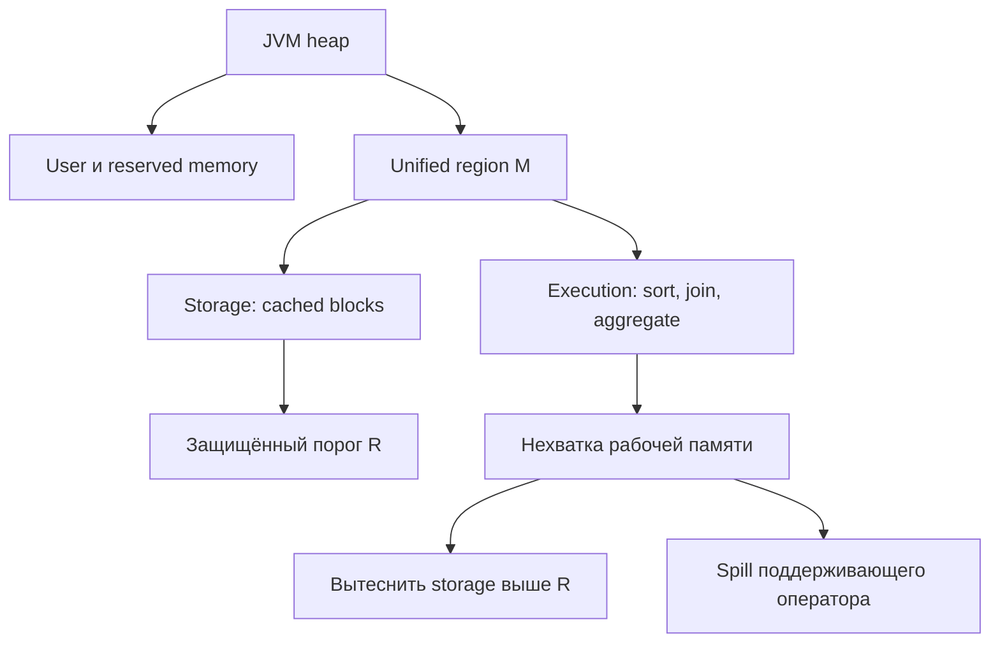
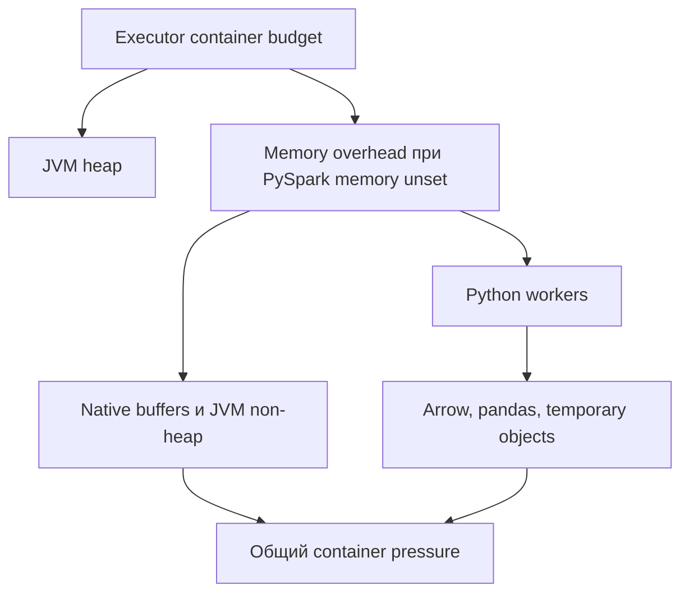
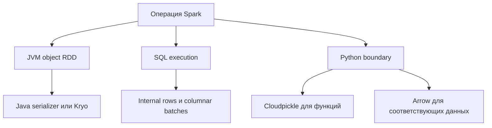
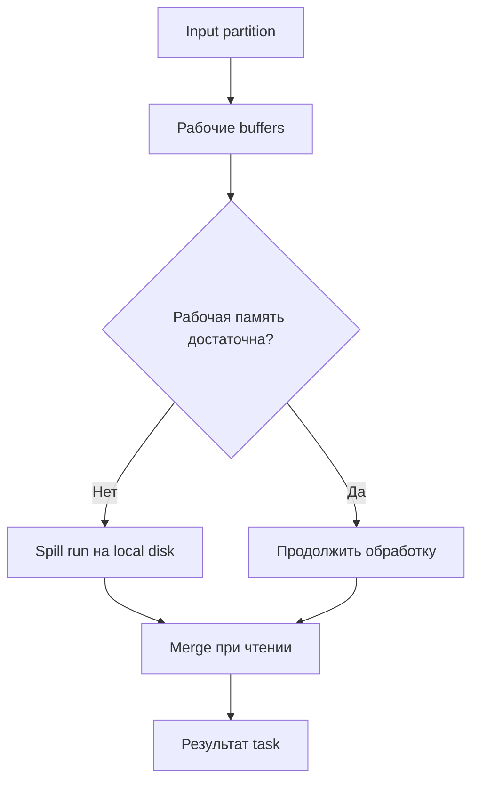
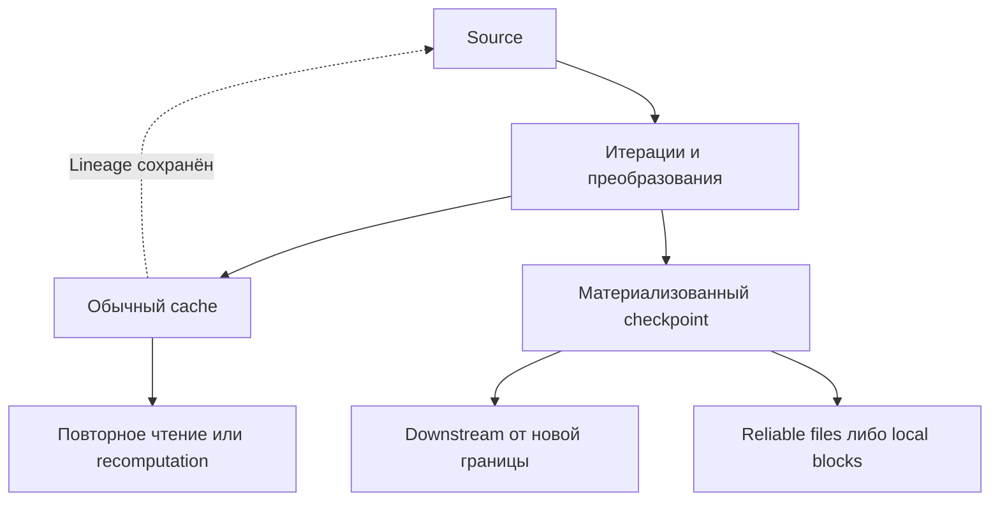
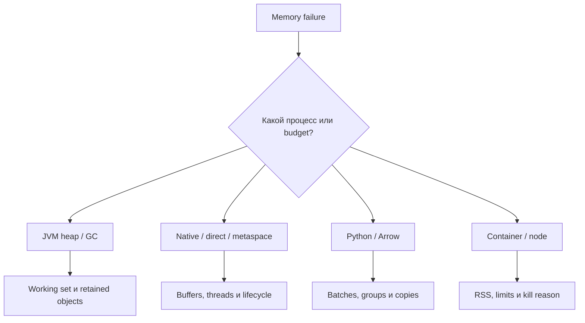

# 13. Память, сериализация, кэширование и checkpoint

Основной язык примеров — **Python / PySpark**. Проверенное окружение: **Apache Spark 4.2.0, Python 3.12.14, OpenJDK 17.0.20, pandas 2.2.3, PyArrow 26.0.0, Spark Classic**, режим `local[2]`. Один Python-блок компилирует Scala-проверку сериализаторов compiler JARs из установленного полного PySpark.

Глава связывает модель памяти с реальными потребителями: SQL execution, JVM/Python objects, Arrow, cache, checkpoint и driver results. Сохранены все **9 тем и 62 пункта README в исходном порядке**. Ровно три уровня заголовков: раздел → тема → пункт. Практика, вопросы и краткие ответы расположены внутри пунктов.

**Содержание**

1. [Память процессов Spark](#spark-process-memory)
2. [Сериализация](#serialization)
3. [Garbage collection и размещение объектов](#garbage-collection)
4. [Spill и внешняя обработка](#spill-external-processing)
5. [cache и persist](#cache-persist)
6. [Выбор стратегии кэширования](#cache-strategy)
7. [Checkpoint для batch-вычислений](#batch-checkpoint)
8. [Память драйвера и сбор результата](#driver-result-memory)
9. [Диагностика нехватки памяти](#memory-diagnostics)

**Как выполнить примеры**

Нужен доступный `java` из JDK 17. Проверка выполнена на Linux; примеры с комплектным `spark-submit` рассчитаны на Linux/macOS/WSL. Нативный Windows требует адаптации запуска к `spark-submit.cmd` и имеет описанные ниже ограничения resource API. Установка в отдельное Python-окружение:

```bash
python -m venv .venv
# Linux/macOS/WSL:
source .venv/bin/activate
python -m pip install pyspark==4.2.0 pandas==2.2.3 pyarrow==26.0.0
```

Python-блоки выполняй сверху вниз в **одной чистой сессии**. Первый создаёт `spark`, fixture `events`, временный каталог `lab` и helpers. Для запуска файлом скопируй Python-блоки в `chapter13_lab.py` в исходном порядке и выполни `python chapter13_lab.py`. Bash с `spark-submit app.py` — отдельный шаблон cluster launch; это не готовый файл приложения.

Полный пакет PySpark включает JVM/Scala JARs. Serializer probe компилирует Scala-код, не скачивая Maven dependencies. GC, spill и result-size guard запускаются в отдельных процессах через комплектный `spark-submit`, чтобы startup-настройки действовали до запуска JVM. Логи и промежуточные files остаются в `lab` до финального cleanup.

Лаборатория использует AQE off для стабильной исходной distribution и `spark.python.use.daemon=false` для локального запуска workers. Это условия воспроизводимости, а не универсальные tuning defaults. `sql_conf` временно меняет SQL-настройки; startup heap/serializer/resource parameters действуют иначе и задаются при запуске приложения.

Все file/checkpoint paths локальны и подходят для `local[2]`. Cluster checkpoint/output paths должны быть доступны нужным процессам с подходящей долговечностью. Linux `/proc`, Python `resource` и container limits имеют платформенные границы, указанные рядом с примерами.

**Как читать проверки.** Значения проверяются assertions, SQL strategy/cache path — plan, materialization — cached partitions, spill — настоящие event-log task counters. Расчётные budgets и условные break-even числа обозначены явно. Forced spill использует внутреннюю диагностическую настройку; JVM serializer overflow и maxResultSize abort ожидаемы и проверяются. Реальное исчерпание RAM и принудительная потеря executor не вызываются.

Малые `collect`, pandas conversion, file listings и Python lists используются только для ограниченных учебных данных. Производительность и надёжность при node loss требуют соответствующей workload и cluster environment. В конце последнего пункта есть сквозная практика, ответы для самопроверки и точные границы выполненных проверок.

Официальные ссылки: [Spark 4.2.0](https://spark.apache.org/docs/4.2.0/), [Configuration](https://spark.apache.org/docs/4.2.0/configuration.html), [Tuning](https://spark.apache.org/docs/4.2.0/tuning.html), [PySpark installation requirements](https://spark.apache.org/docs/4.2.0/api/python/getting_started/install.html). Ссылки на конкретные APIs размещены рядом с обсуждением.


<a id="spark-process-memory"></a>

## Память процессов Spark


### Driver heap и executor heap

Driver управляет приложением: строит планы, хранит scheduler metadata, запускает jobs, принимает результаты. Executors выполняют tasks, держат cache и shuffle buffers. **Heap принадлежит конкретной JVM**, а не всему приложению сразу. `spark.driver.memory` и `spark.executor.memory` задают разные бюджеты; сумма памяти executors не увеличивает память driver.

В PySpark Classic рядом с JVM существуют Python-процессы. Python driver может исчерпать память, хотя JVM driver ещё имеет свободный heap. Аналогично Python worker может завершиться при вполне здоровом executor heap.

| Где находится память | Типичные владельцы | Что измерять |
| --- | --- | --- |
| Driver JVM heap | Планы, metadata, JVM-представление результатов | Heap used, GC, driver logs |
| Executor JVM heap | Операторы, JVM-объекты, часть cached blocks | Task metrics, heap, GC |
| Python driver | Python Row, pandas DataFrame, локальные коллекции | RSS Python-процесса |
| Python workers | UDF, Python RDD, pandas и Arrow | RSS отдельных workers и контейнера |
| Native/non-heap | Direct buffers, metaspace, stacks, native libraries | RSS, native metrics, container usage |

В `local[2]` tasks выполняются в JVM локального driver: двух отдельных executor JVM здесь нет. Поэтому лабораторные результаты нельзя интерпретировать как проверку YARN/Kubernetes memory limits.

**Лабораторная сессия.** Примеры используют 1 000 строк и четыре входные партиции. Никакие предыдущие главы не нужны.

```python
import contextlib
import io
import json
import os
import shutil
import subprocess
import sys
import tempfile
import textwrap
import time
from pathlib import Path

import pandas as pd
import pyarrow as pa
import pyspark
from pyspark import StorageLevel
from pyspark.sql import SparkSession, functions as F

lab = Path(tempfile.mkdtemp(prefix="spark_ch13_"))
spark = (
    SparkSession.builder.master("local[2]")
    .appName("Spark Zero to Hero - Chapter 13")
    .config("spark.sql.shuffle.partitions", "4")
    .config("spark.sql.adaptive.enabled", "false")
    .config("spark.python.use.daemon", "false")
    .config("spark.ui.showConsoleProgress", "false")
    .config("spark.local.dir", str(lab / "scratch"))
    .getOrCreate()
)
sc = spark.sparkContext
sc.setLogLevel("ERROR")
assert spark.version == "4.2.0", spark.version

events = (
    spark.range(0, 1000, 1, numPartitions=4)
    .withColumn("key", (F.col("id") % 10).cast("int"))
    .withColumn("amount_cents", (F.col("id") * 7).cast("long"))
    .withColumn("payload", F.repeat(F.lit("x"), 64))
)

@contextlib.contextmanager
def sql_conf(**settings):
    previous = {k: spark.conf.get(k, None) for k in settings}
    try:
        for k, v in settings.items():
            spark.conf.set(k, str(v).lower() if isinstance(v, bool) else str(v))
        yield
    finally:
        for k, v in previous.items():
            if v is None:
                spark.conf.unset(k)
            else:
                spark.conf.set(k, v)

def plan_text(df, mode="formatted"):
    output = io.StringIO()
    with contextlib.redirect_stdout(output):
        df.explain(mode=mode)
    return output.getvalue()

def storage_snapshot():
    # Внутренний JVM API: только диагностика в Spark Classic.
    return {
        int(x.id()): {
            "name": x.name(),
            "partitions": int(x.numPartitions()),
            "cached": int(x.numCachedPartitions()),
            "memory": int(x.memSize()),
            "disk": int(x.diskSize()),
        }
        for x in sc._jsc.sc().getRDDStorageInfo()
    }

def run_child(name, source, submit_options=()):
    # Новый процесс и JVM нужны для startup-настроек, не меняемых в текущем sc.
    script = lab / (name + ".py")
    script.write_text(textwrap.dedent(source), encoding="utf-8")
    spark_submit = Path(pyspark.__file__).parent / "bin" / "spark-submit"
    env = os.environ.copy()
    for k in ("PYSPARK_GATEWAY_PORT", "PYSPARK_GATEWAY_SECRET"):
        env.pop(k, None)
    env["SPARK_LOCAL_IP"] = "127.0.0.1"
    result = subprocess.run(
        [str(spark_submit), "--master", "local[2]",
         "--conf", "spark.ui.showConsoleProgress=false",
         "--conf", "spark.python.use.daemon=false",
         *submit_options, str(script)],
        env=env, text=True, capture_output=True, timeout=120,
    )
    (lab / (name + ".log")).write_text(result.stdout + result.stderr)
    if result.returncode != 0:
        raise RuntimeError((result.stdout + result.stderr)[-6000:])
    print(result.stdout.strip())
    return result.stdout

runtime = sc._jvm.java.lang.Runtime.getRuntime()
print({
    "Spark": spark.version,
    "Python": sys.version.split()[0],
    "Java": sc._jvm.java.lang.System.getProperty("java.version"),
    "heap_max_MiB": runtime.maxMemory() // (1024**2),
    "heap_used_MiB": (runtime.totalMemory() - runtime.freeMemory()) // (1024**2),
})
assert events.count() == 1000
```

Heap values зависят от запуска; здесь проверяется доступ к фактической JVM, а не фиксированное число. Heap задавай **до старта JVM**, обычно через `spark-submit --driver-memory ... --executor-memory ...`. Изменение `spark.conf` после запуска не расширяет существующий heap.

**Практика.** Для ошибки в `toPandas()` назови два процесса driver, чью память нужно проверить. **Самопроверка:** почему добавление executor при driver OOM может вообще не помочь?


### Execution memory, storage memory и unified memory management

Execution memory нужна сортировкам, hash aggregation, join и другим управляемым потребителям. Storage memory обслуживает cached blocks и некоторые связанные с хранением структуры. В on-heap unified memory management они делят область `M`.

Это **динамическое разделение**, а не два навсегда изолированных массива. Storage может занять свободную execution memory. Execution может вытеснить storage, занявший область выше защищённого порога `R`. Storage не может вытеснить уже используемую execution memory. Вытеснение cached block не означает потерю исходных данных: обычный cache можно восстановить по lineage.



Не всё, что создал task, управляется unified manager. Произвольный Java `HashMap`, Python list или pandas group могут жить вне этих правил. Поэтому «Spark умеет spill» не гарантирует, что любой алгоритм выдержит произвольный объём данных.

**Пример.** Executor с cache на 2 GiB запускает сортировку. Если cache занимает заимствованную часть `M`, Spark может освободить некоторые его blocks для sorter. Следующий потребитель cache прочитает дисковый block или пересчитает partition. Издержки cache и execution здесь связаны.

**Самопроверка:** может ли storage отобрать память у активной сортировки? Ответ: нет; увеличение cache не должно пониматься как приоритет над execution.


### Reserved memory и user memory

В стандартной on-heap модели Spark оставляет **300 MiB reserved memory** и применяет `spark.memory.fraction` к оставшемуся heap. Это внутренний запас для инфраструктуры; отдельного контейнера на 300 MiB не создаётся.

Остаток после reserved и unified region часто называют **user memory**. В нём могут находиться пользовательские JVM-объекты, metadata и структуры, не учитываемые управляемыми потребителями. Это удобная модель бюджета, а не точная карта всех объектов JVM.

Для heap `H`, reserved `V`, fraction `f`:

`M = (H − V) × f`; `user ≈ (H − V) × (1 − f)`.

```python
MiB = 1024**2
GiB = 1024**3
def heap_budget(heap_bytes, fraction=0.6, storage_fraction=0.5):
    reserved = 300 * MiB  # Стандартная модель Spark 4.2.0.
    assert heap_bytes > reserved
    unified = (heap_bytes - reserved) * fraction
    return {
        "heap": heap_bytes, "reserved": reserved,
        "unified": unified,
        "user": (heap_bytes - reserved) * (1 - fraction),
        "protected_storage": unified * storage_fraction,
    }

budget = heap_budget(4 * GiB)
assert round(budget["unified"] / MiB, 1) == 2277.6
assert round(budget["user"] / MiB, 1) == 1518.4
assert sum(budget[k] for k in ("reserved", "unified", "user")) == 4 * GiB
print({k: round(v / MiB, 1) for k, v in budget.items()})
```

Числа описывают **планирование JVM heap**, а не RSS и не размер input files. Protected storage входит в unified region, поэтому его нельзя ещё раз прибавлять к heap. Аналогично reserved и user не прибавляются к `memoryOverhead`.

**Практика.** Повтори расчёт для 8 GiB. **Самопроверка:** почему результат «4 GiB heap + user memory + reserved» считает одни и те же байты дважды?


### spark.memory.fraction и spark.memory.storageFraction

В Spark 4.2.0 defaults: `spark.memory.fraction=0.6`, `spark.memory.storageFraction=0.5`. Первая настройка меняет размер unified region относительно heap после reserved; вторая задаёт защищённую от eviction execution-потребителями долю storage **внутри** `M`.

`storageFraction=0.5` не запрещает cache занимать больше половины `M`, если execution свободна. `fraction=0.8` не делает executor на 20% «больше»: оно оставляет меньше места пользовательским структурам и может усилить GC/OOM вне unified region.

```python
for f in (0.6, 0.8):
    b = heap_budget(4 * GiB, fraction=f)
    print(f, "unified_MiB", round(b["unified"] / MiB, 1),
          "user_MiB", round(b["user"] / MiB, 1))
assert heap_budget(4 * GiB, 0.8)["user"] < budget["user"]
assert heap_budget(4 * GiB, storage_fraction=0.25)["unified"] == budget["unified"]
```

Настройки относятся к SparkContext и создаваемому memory manager. Их следует задавать при запуске приложения; попытка `spark.conf.set(...)` не является способом перераспределить уже работающий executor.

**Порядок решения.** Сначала определи потребителя и largest partition, убери лишний cache, сократи ширину строк или число одновременных tasks. Изменение fraction обосновано, когда измерения показывают неправильный баланс регионов, а не просто факт ошибки памяти.

**Самопроверка:** что меняется при снижении `storageFraction`, если heap и `fraction` прежние? Ответ: защищённый storage-порог; общий размер `M` прежний.


### Off-heap memory и native buffers

Off-heap в Spark — управляемая память вне Java heap для поддерживающих её внутренних операций. Для её использования нужны `spark.memory.offHeap.enabled=true` и положительный `spark.memory.offHeap.size`. Default enabled — `false`, size — `0`.

Отдельно существуют direct byte buffers, metaspace, thread stacks, JNI allocations, компрессоры и другие native allocations. Они могут использовать память при **выключенном** Spark off-heap. Python и Arrow также не становятся частью Spark off-heap только потому, что находятся вне JVM heap.

| Память | Управляется `spark.memory.offHeap.size`? | Может увеличить RSS вне Java heap? |
| --- | --- | --- |
| Spark managed off-heap | Да, для соответствующих потребителей | Да |
| JVM direct buffers | Не как общий лимит всех direct buffers | Да |
| Metaspace и stacks | Нет | Да |
| Arrow/Python native allocations | Нет | Да |

Учебный расчёт: 4 GiB heap + 1 GiB managed off-heap не превращаются в heap 5 GiB. JVM GC видит прежде всего Java-объекты и ссылки; освобождение native buffers зависит от их lifecycle и реализации. Меньше Java-объектов может снизить GC, но общий RSS и container pressure всё равно надо измерять.

`StorageLevel.OFF_HEAP` — отдельный уровень хранения. Его имя не означает, что весь DataFrame, UDF и любая библиотека автоматически переместились из heap. Проверять нужно конкретный API и фактическое размещение blocks.

**Практика.** Опиши, какие два бюджета надо пересмотреть при включении 1 GiB managed off-heap в Kubernetes. **Самопроверка:** почему `Direct buffer memory` возможно при `offHeap.enabled=false`?


### Python workers, Arrow buffers и память вне JVM heap

Python UDF запускает отдельный worker; pandas UDF добавляет columnar interchange через Arrow. Один task может одновременно держать входной Arrow batch, pandas-представление, временные результаты вычисления и выходной batch. Конверсия не всегда zero-copy, особенно для строк, nullable/object columns и преобразований типов.

Стандартный scalar pandas UDF работает batches. `spark.sql.execution.arrow.maxRecordsPerBatch` ограничивает число строк batch, а не гарантированный размер в байтах. Широкая строка может сделать даже 100 строк дорогими. Для grouped `applyInPandas` общий размер группы требует отдельного внимания: нельзя считать обычный batch limit защитой всей группы; iterator-вариант — другой контракт обработки.

```python
from pyspark.sql.functions import pandas_udf

@pandas_udf("long")
def add_one(series: pd.Series) -> pd.Series:
    return series + 1

with sql_conf(**{"spark.sql.execution.arrow.maxRecordsPerBatch": 64}):
    arrow_result = events.select(add_one("amount_cents").alias("v"))
    # count() мог бы исключить вычисление v: проверяем сами значения через sum.
    actual = arrow_result.agg(F.sum("v")).first()[0]
    assert actual == 7 * (999 * 1000 // 2) + 1000
    assert "ArrowEvalPython" in plan_text(arrow_result)

arrow_array = pa.array(list(range(1000)), type=pa.int64())
assert arrow_array.nbytes == 8000
print("array bytes", arrow_array.nbytes, "Arrow pool bytes", pa.total_allocated_bytes())
del arrow_array
```

`pa.total_allocated_bytes()` относится к default Arrow memory pool **текущего Python-процесса**. Это не RSS, не сумма workers и не суммарная память pandas. Освобождение ссылки не обязано немедленно уменьшать RSS: allocator может оставить страницы для повторного использования.

**Практика.** Добавь широкую строковую колонку и объясни, почему одинаковое число строк batch не означает одинаковую память. **Самопроверка:** уменьшает ли Arrow необходимость собрать весь результат при `toPandas()`? Ответ: нет, весь pandas result всё равно оказывается на driver.


### spark.python.worker.memory: порог spill при Python-агрегации и отличие от общего лимита процесса

`spark.python.worker.memory` по умолчанию `512m` — порог, применяемый Python-агрегацией к её spill-механизму. При превышении соответствующий aggregator может выгружать промежуточные данные на диск. Это не глобальная квота RSS Python worker.

```python
python_pairs = sc.parallelize([(i % 10, i) for i in range(100)], 4)
python_sums = dict(python_pairs.reduceByKey(lambda a, b: a + b, 4).collect())
assert python_sums == {k: sum(range(k, 100, 10)) for k in range(10)}
print("Python aggregation result", python_sums)
```

Этот маленький `reduceByKey` проверяет Python aggregation и правильность результата. Он **не вызывает и не доказывает spill**. Для проверки порога нужны достаточный объём данных, соответствующий Python-путь и metrics/logs, а не просто изменение настройки.

Настройка не ограничивает list, созданный внутри обычной UDF, и не устанавливает предел pandas DataFrame внутри `applyInPandas`. Grouped UDF может упасть раньше, чем какой-либо Spark spiller сможет вмешаться.

**Контрпример для анализа:** worker читает partition и выполняет `rows = list(iterator)`. Все элементы материализуются в Python; нельзя ожидать, что значение `512m` автоматически превратит list в внешнюю коллекцию.

**Самопроверка:** какое обещание нарушает фраза «каждый Python worker ограничен 512 MiB»? Ответ: она подменяет порог конкретной spill-capable операции лимитом всего процесса.


### spark.executor.pyspark.memory: ограничение памяти Python, запрос ресурсов и ограничения платформы

`spark.executor.pyspark.memory` по умолчанию не задан. В YARN/Kubernetes явно заданное значение добавляется к ресурсному бюджету executor для Python. В реализации Spark Classic 4.2.0 worker пытается применить Python `resource`-limit.

Нужно различать **описанный бюджет PySpark на executor** и механизм ограничения: `setup_memory_limits` использует `resource.RLIMIT_AS`, то есть address space конкретного worker-процесса, а не монитор суммы RSS всех workers. Каждый worker получает настройку; несколько одновременно работающих workers всё равно требуют суммарного бюджета контейнера.

На Windows resource limiting не поддерживается; на macOS документация предупреждает об отсутствии фактического ограничения ресурса. Даже на Linux виртуальное address space и resident memory — разные величины: большие mappings native libraries могут приблизить процесс к `RLIMIT_AS`, не заняв столько физической памяти.

```python
# Читаем собственные лимиты driver, ничего не ограничиваем и не меняем.
try:
    import resource
except ImportError:
    print("resource module unavailable on this platform")
else:
    print("Python driver RLIMIT_AS", resource.getrlimit(resource.RLIMIT_AS))
    print("This is the driver's limit, not an executor worker measurement.")
```

`spark.executor.pyspark.memory=2g` нельзя понимать как гарантию, что сумма четырёх workers всегда останется в 2 GiB RSS. Проверь число одновременных Python tasks, фактические limits, платформу и container usage. Ограничение worker не заменяет общий cgroup/container limit.

**Официальные основания:** [Configuration](https://spark.apache.org/docs/4.2.0/configuration.html), [реализация worker limits Spark 4.2.0](https://github.com/apache/spark/blob/v4.2.0/python/pyspark/worker_util.py), [Python resource](https://docs.python.org/3.12/library/resource.html).

**Самопроверка:** почему Linux worker может получить `MemoryError` при RSS меньше указанного числа? Ответ: ограничивается address space, и allocation зависит также от mappings и allocator.


### Container memory limit и memory overhead: расчёт бюджета из executor heap, overhead, off-heap и отдельно заданной PySpark memory

Для executor в YARN/Kubernetes удобно считать планируемый контейнерный бюджет как:

`executor heap + memory overhead + enabled managed off-heap + separately configured PySpark memory`.

Это ресурсный расчёт Spark; фактические requests/limits и дополнительные процессы нужно сверить с cluster manager. Для driver действует собственная конфигурация: нельзя автоматически переносить на него executor-формулу.

```python
def executor_container_mib(heap, overhead=None, offheap=0, pyspark_memory=None,
                           overhead_factor=0.10, min_overhead=384):
    # Аргументы в MiB. offheap — только реально включённый managed off-heap.
    effective_overhead = (overhead if overhead is not None
                          else max(heap * overhead_factor, min_overhead))
    return heap + effective_overhead + offheap + (pyspark_memory or 0)

assert executor_container_mib(4096, overhead=1024, offheap=512,
                              pyspark_memory=2048) == 7680
assert executor_container_mib(4096, overhead=1024) == 5120
assert executor_container_mib(1024) == 1408
print("explicit Python budget:", 7680, "MiB")
```

| Компонент учебного executor | MiB | Пояснение |
| --- | ---: | --- |
| Heap | 4096 | Включает reserved, user и on-heap unified region |
| Overhead | 1024 | JVM non-heap/native и прочий запас |
| Managed off-heap | 512 | Только если включён |
| PySpark memory | 2048 | Отдельно заданная настройка |
| Итого | 7680 | 7.5 GiB, а не 4 GiB |

Если overhead не указан явно, стандартная формула использует factor и минимум: в Spark 4.2.0 минимум executor overhead — `384m`, обычный factor — `0.10`; для Kubernetes non-JVM jobs предусмотрен default `0.40`. При явно заданном overhead factor игнорируется.

**Практика.** Для heap 8 GiB, overhead 2 GiB и Python 4 GiB посчитай бюджет без off-heap. **Самопроверка:** нужно ли прибавлять protected storage отдельно? Ответ: нет, он уже внутри heap.


### Память Python при незаданном spark.executor.pyspark.memory и её конкуренция за memory overhead

Если `spark.executor.pyspark.memory` не задан, Spark не выделяет отдельное слагаемое Python memory и не устанавливает через эту настройку worker limit. Python конкурирует за memory overhead с direct buffers, JVM non-heap, native libraries и другими процессами в контейнере.

Пример: heap 4 GiB, overhead 1 GiB, два Python workers по 700 MiB RSS. Уже Python даёт 1.4 GiB; увеличение heap до 8 GiB при прежнем explicit overhead не устраняет конкуренцию за этот бюджет. Фактическое потребление — сумма resident memory и учёта cgroup, а не только использованные Java-объекты.



Помогают сокращение batch/группы, stream processing внутри UDF, меньше одновременно работающих Python tasks и правильный overhead. Уменьшение executor cores иногда снижает пик, хотя общий объём работы остаётся прежним. Цель — измеренный запас для одновременно живых данных, а не «heap побольше».

**Практика.** Executor имеет четыре cores и запускает по одному worker на task. Оцени бюджет при 600 MiB на worker и ещё 500 MiB native/non-heap. **Самопроверка:** почему показатель Storage Memory в Spark UI не доказывает, что весь контейнер далёк от OOM?


<a id="serialization"></a>

## Сериализация


### Java serialization и Kryo для соответствующих операций

Сериализация превращает объект в bytes для передачи или хранения. Цена состоит из объёма bytes, CPU на encode/decode, временных allocations и совместимости формата. Она важна для JVM RDD shuffle и serialized persistence, но Spark использует несколько разных путей.

Default `spark.serializer` — `org.apache.spark.serializer.JavaSerializer`. Для поддерживающих этот выбор JVM-операций можно включить `org.apache.spark.serializer.KryoSerializer`. Kryo часто создаёт более компактное представление пользовательских JVM-объектов, однако конкретный выигрыш нужно измерять. Он не заменяет все внутренние SQL encodings.

**Выполняемый JVM-опыт.** Следующий Python-блок компилирует маленькое Scala-приложение JARs из полного PySpark. Оно проверяет round trip Java/Kryo, required registration и ограниченный Kryo buffer. Здесь измеряется размер одного объекта, а не производительность shuffle.

```python
import zipfile

scala_source = r'''
import org.apache.spark.SparkConf
import org.apache.spark.serializer.{JavaSerializer, KryoSerializer, Serializer}
import scala.util.control.NonFatal

case class Packet(id: Long, label: String, values: Array[Long]) extends Serializable

object SerializationLab {
  def main(args: Array[String]): Unit = {
    val sample = Packet(7L, "sample", Array(1L, 2L, 3L))
    def roundTrip(serializer: Serializer): Int = {
      val instance = serializer.newInstance()
      val bytes = instance.serialize(sample)
      val size = bytes.remaining()
      val restored = instance.deserialize[Packet](bytes)
      require(restored.id == 7L && restored.label == "sample")
      require(restored.values.sameElements(Array(1L, 2L, 3L)))
      size
    }
    val javaSize = roundTrip(new JavaSerializer(new SparkConf(false)))
    val kryoSize = roundTrip(new KryoSerializer(new SparkConf(false)))
    println(s"JAVA_BYTES=$javaSize KRYO_BYTES=$kryoSize")

    val strict = new SparkConf(false).set("spark.kryo.registrationRequired", "true")
    var rejected = false
    try { new KryoSerializer(strict).newInstance().serialize(sample) }
    catch {
      case NonFatal(e) =>
        rejected = e.toString.contains("not registered")
    }
    require(rejected, "Unregistered Packet should be rejected")
    val registered = strict.clone().registerKryoClasses(Array(classOf[Packet]))
    require(roundTrip(new KryoSerializer(registered)) > 0)
    println("REGISTRATION_CHECK=PASS")

    val bounded = new SparkConf(false)
      .set("spark.kryoserializer.buffer", "64k")
      .set("spark.kryoserializer.buffer.max", "1m")
    var overflow = false
    try {
      new KryoSerializer(bounded).newInstance()
        .serialize(Packet(8L, "x" * (2 * 1024 * 1024), Array(1L)))
    } catch {
      case NonFatal(e) =>
        overflow = e.toString.toLowerCase.contains("buffer overflow")
    }
    require(overflow, "Single large object should exceed the buffer")
    println("BUFFER_LIMIT_CHECK=PASS")
  }
}
'''
scala_dir = lab / "serialization"
classes_dir = scala_dir / "classes"
classes_dir.mkdir(parents=True)
scala_file = scala_dir / "SerializationLab.scala"
scala_file.write_text(scala_source)
jars_dir = Path(pyspark.__file__).parent / "jars"
classpath = os.pathsep.join(str(p) for p in sorted(jars_dir.glob("*.jar")))
compile_result = subprocess.run(
    ["java", "-cp", classpath, "scala.tools.nsc.Main",
     "-classpath", classpath, "-d", str(classes_dir), str(scala_file)],
    capture_output=True, text=True, timeout=120,
)
assert compile_result.returncode == 0, compile_result.stderr
serialization_jar = scala_dir / "serialization-lab.jar"
with zipfile.ZipFile(serialization_jar, "w") as jar:
    for file in classes_dir.rglob("*.class"):
        jar.write(file, file.relative_to(classes_dir).as_posix())
serialized_run = subprocess.run(
    [str(Path(pyspark.__file__).parent / "bin" / "spark-submit"),
     "--class", "SerializationLab", str(serialization_jar)],
    text=True, capture_output=True, timeout=120,
)
assert serialized_run.returncode == 0, serialized_run.stderr[-6000:]
serialization_output = serialized_run.stdout
assert "JAVA_BYTES=" in serialization_output and "KRYO_BYTES=" in serialization_output
assert "REGISTRATION_CHECK=PASS" in serialization_output
assert "BUFFER_LIMIT_CHECK=PASS" in serialization_output
print(serialization_output.strip())
```

Java serialization требует соответствующего контракта Serializable. Closure serialization, SQL rows, Python functions и Arrow transport имеют свои ограничения; изменение общего serializer не устраняет произвольный `Task not serializable`.

**Самопроверка:** какие три независимых показателя стоит сравнить до выбора Kryo? Ответ: bytes, encode/decode CPU и allocation/GC при реальной workload.


### Регистрация классов и spark.kryo.registrationRequired

Регистрация связывает JVM-класс с Kryo registration metadata и позволяет не передавать полное имя класса каждый раз. Настройки: `spark.kryo.classesToRegister`, `spark.kryo.registrator`; Scala/Java `SparkConf.registerKryoClasses` — удобный программный вариант.

`spark.kryo.registrationRequired=false` по умолчанию допускает незарегистрированные классы. Значение `true` делает пропущенную регистрацию ошибкой. Это помогает выявить непредусмотренные типы и зафиксировать правила приложения; само по себе оно не означает лучший layout объектов.

```python
from pyspark import SparkConf

registration_conf = (
    SparkConf(loadDefaults=False)
    .set("spark.serializer", "org.apache.spark.serializer.KryoSerializer")
    .set("spark.kryo.registrationRequired", "true")
    .set("spark.kryo.classesToRegister", "com.example.Event,com.example.Metadata")
)
assert registration_conf.get("spark.kryo.registrationRequired") == "true"
assert "REGISTRATION_CHECK=PASS" in serialization_output
```

`com.example.*` здесь показывает форму конфигурации: таких классов в лаборатории нет, и этот `SparkConf` не передаётся работающему приложению. Реальная проверка регистрации выполнена выше для скомпилированного `Packet`.

Зарегистрируй фактические JVM-классы графа объектов, включая вложенные пользовательские типы. Их JARs должны быть доступны driver и executors. Имя Python dataclass в `classesToRegister` не превращает его в JVM-класс; Python pickling регулируется отдельно.

Registration IDs и serializer implementation не являются обещанием долговечного межверсионного формата. Не используй Kryo bytes как договор хранения данных между разными приложениями/версиями; для такого договора выбирай schema-aware формат.

**Практика.** Добавь в `Packet` вложенный пользовательский класс и повтори strict mode. **Самопроверка:** чем регистрация класса отличается от доставки JAR executors?


### Kryo buffer и слишком большие объекты

`spark.kryoserializer.buffer` — начальный buffer, default `64k`; `spark.kryoserializer.buffer.max` — предел его роста, default `64m`. Buffer должен вмещать сериализуемый объект соответствующего пути. Для максимума действует ограничение документации ниже 2048 MiB; это не общий лимит памяти executor.

Большой объект — например, одна коллекция со всеми значениями ключа — может переполнить buffer, даже если общий dataset скромный. Увеличение числа partitions не разделяет автоматически содержимое одной записи.

В JVM-опыте объект с label размером 2 MiB получает ожидаемый overflow при максимуме 1 MiB:

```python
assert "BUFFER_LIMIT_CHECK=PASS" in serialization_output
```

**Варианты решения:** нормализовать коллекцию в строки, агрегировать компактное состояние, делить payload на разумные единицы, отказаться от формирования мегазаписи. Поднять maximum можно после измерения крупнейшего объекта и количества одновременных buffers: разрешить большой объект — значит разрешить соответствующие allocations.

Buffer overflow — конкретная причина. Она отличается от `Java heap space`, direct-buffer OOM и Python `MemoryError`. Не лечи её настройкой Arrow batch без доказательства, что ошибка относится к Arrow.

**Самопроверка:** почему объект в 200 MiB остаётся проблемой при 10 000 partitions? Ответ: partition count не меняет гранулярность этой отдельной записи.


### Encoders и внутренний бинарный формат Spark SQL

DataFrame имеет схему. Spark SQL работает с внутренними rows и columnar representations; многие операторы используют `UnsafeRow` и другие compact structures. Typed `Dataset[T]` Scala/Java применяет encoders для преобразования JVM-объектов в SQL-представление и обратно. У PySpark DataFrame нет идентичного публичного пользовательского `Encoder[T]` API.

Compact representation уменьшает pointer overhead и позволяет SQL выполнять операции без создания Python-объекта на каждую строку. Но не всякий SQL-оператор обязательно `UnsafeRow`: columnar readers, cache, codegen, UDF и output conversion могут выбирать разные структуры.

```python
native_query = events.groupBy("key").agg(F.sum("amount_cents").alias("total"))
native_totals = {r.key: r.total for r in native_query.collect()}
assert native_totals == {
    k: 7 * sum(range(k, 1000, 10)) for k in range(10)
}
native_plan = plan_text(native_query)
assert "HashAggregate" in native_plan
assert "Python" not in native_plan
```

Python здесь строит выражения и получает десять результатов; сами суммы вычисляются в JVM. `collect()` создаёт Python Row на границе результата, но это не означает Python Row внутри каждого SQL task.

`events.rdd` меняет API-путь: строки преобразуются для Python RDD. После этого Python map может создавать dict/list и терять часть преимуществ schema-aware SQL исполнения. Выбирай built-in expressions, когда ими выражается требуемая операция.

**Самопроверка:** следует ли из отсутствия Python UDF отсутствие любых сериализаций? Ответ: нет; shuffle, storage и получение результата всё равно требуют представления/передачи данных.


### Pickle/cloudpickle и передача Python-функций

Python-функции и closures PySpark обычно передаёт с помощью cloudpickle; стандартный pickle применяется в некоторых других путях, включая Python broadcast values. Cloudpickle умеет сериализовать многие функции, определённые интерактивно, вместе с захваченными значениями.

Closure может незаметно захватить большой объект. Это создаёт bytes команды и allocations в workers, даже если функция выполняет простое сложение. Захват `SparkSession`, открытого connection или файла — ещё и проблема допустимости сериализации/использования ресурса.

```python
from pyspark.serializers import CloudPickleSerializer

function_serializer = CloudPickleSerializer()
def make_adder(offset):
    return lambda value: value + offset

encoded = function_serializer.dumps(make_adder(5))
restored_function = function_serializer.loads(encoded)
assert restored_function(10) == 15

lookup = sc.broadcast({0: "even", 1: "odd"})
try:
    classified = sc.parallelize(range(10), 2).map(
        lambda x: lookup.value[x % 2]
    ).countByValue()
    assert dict(classified) == {"even": 5, "odd": 5}
finally:
    lookup.destroy(blocking=True)
```

Broadcast уменьшает повторную передачу значения, но не превращает огромный Python dict в бесплатную shared memory. Workers могут десериализовать собственные копии. `destroy()` удаляет broadcast data и metadata; обращаться к уничтоженному broadcast нельзя.

Для подключения к БД создавай client внутри обработки partition с корректным lifecycle. Не пересылай открытый client из driver через closure. Для справочника, который выражается как таблица, сначала оцени SQL join: Python broadcast и SQL broadcast relation — разные механизмы.

**Практика.** Сравни размер cloudpickle bytes для функции с большим захваченным list и функции с одним числом. **Самопроверка:** почему маленькое тело lambda не доказывает маленький closure?


### Почему настройка Kryo не меняет все пути сериализации DataFrame и Python

Одна операция может проходить через несколько представлений. Например, PySpark строит SQL plan, JVM выполняет native operators, pandas UDF получает Arrow batch, а конечный `collect()` создаёт Python rows. Один `spark.serializer` не управляет всеми этими границами.

| Путь | Типичный механизм | Включение Kryo меняет его целиком? |
| --- | --- | --- |
| Поддерживающие настройку JVM RDD shuffle/storage | Java serialization или Kryo | Да, для соответствующих объектов/операций |
| SQL internal rows/columnar operators | Внутреннее SQL-представление | Нет |
| Python function/closure | Cloudpickle | Нет |
| Python broadcast value | Python pickle | Нет |
| pandas/Arrow interchange | Arrow format и conversion | Нет |
| Parquet output | Parquet encoding/compression | Нет |



Выполненный `Packet` round trip подтверждает JVM serializer; выполненный pandas UDF — ArrowEvalPython; выполненный Python RDD — Python closure execution. Это разные проверки, и результаты одной не заменяют другую.

**Практика.** Для shuffle DataFrame, Python broadcast dict и scalar pandas UDF запиши, какая граница сериализации обсуждается. **Самопроверка:** почему совет «включи Kryo, чтобы уменьшить память pandas» неполон?


<a id="garbage-collection"></a>

## Garbage collection и размещение объектов


### Young/old generations и давление на GC

Garbage collector освобождает память недостижимых Java-объектов. Короткоживущие allocations часто обслуживаются young collections; долго живущие структуры продвигаются или размещаются в old regions. В G1 heap разделён на regions, но различие young/old по возрасту объектов сохраняет смысл.

Большое число временных boxed values, collections и wrappers повышает allocation rate. Большой cache из объектов увеличивает количество live objects, которые GC должен учитывать. Освобождение cached blocks влияет на storage, но не означает немедленное завершение GC или возврат всех страниц ОС.

| Наблюдение | Возможная причина | Следующий шаг |
| --- | --- | --- |
| Частые короткие young GC | Высокая скорость allocations | Проверить objects/row и промежуточные коллекции |
| Old occupancy растёт | Live cache, metadata, большая workload либо удержание ссылок | Сравнить одинаковые циклы и lifecycle |
| Длинные mixed/full pauses | Высокая live set, давление на old regions | Изучить GC logs и рабочую нагрузку |
| RSS растёт без роста heap | Native/Python/allocator memory | Измерить процессы вне Java heap |

Нельзя переводить Python `gc.collect()` в «очистить Spark executor»: это другой runtime. Аналогично `System.gc()` не заменяет исправление алгоритма, а принудительный GC может увеличить паузы.

**Самопроверка:** почему cache JVM-объектов может ухудшить latency даже при отсутствии spill? Ответ: растёт live object graph и работа collector.


### G1GC и выбор GC для поддерживаемой JVM

Для JDK 17 G1 — обычный выбор server JVM. Он сочетает stop-the-world evacuation с concurrent phases и старается учитывать целевой pause time. Это целевой режим, а не гарантия максимальной длительности каждой паузы. Большой heap сам по себе не гарантирует короткий GC.

Выбор collector должен учитывать **поддерживаемую Spark JVM**, версию JDK, vendor, latency/throughput цели и container CPU. Не переноси старые настройки CMS или Parallel GC в G1 автоматически: layout и допустимые flags различаются.

```python
gc_probe_path = lab / "jdk-gc-probe.log"
gc_probe = subprocess.run(
    ["java", "-XX:+UseG1GC",
     f"-Xlog:gc*:file={gc_probe_path}:time,uptime,level,tags",
     "-version"],
    capture_output=True, text=True, timeout=30,
)
assert gc_probe.returncode == 0, gc_probe.stderr
assert "Using G1" in gc_probe_path.read_text()
print(gc_probe.stderr.strip())
```

Опыт проверяет принятие flags и создание GC log установленным JDK. Он не сравнивает collectors по производительности. Default collector зависит от JVM ergonomics и среды, поэтому фактический выбор проверяй по logs/VM flags, а не по предположению.

**Официальная документация:** [G1 в JDK 17](https://docs.oracle.com/en/java/javase/17/gctuning/garbage-first-g1-garbage-collector1.html).

**Практика.** Сравни throughput и tail latency на одной workload с неизменным ресурсным бюджетом. **Самопроверка:** почему смена collector не спасает алгоритм, который должен одновременно удержать больше данных, чем доступно?


### GC logs, паузы и доля времени сборки мусора

GC logs показывают причины collections, occupancy до/после и pauses. Рассматривай окно stage или запроса, а не одну строку лога. Spark UI task GC time полезен для корреляции, но GC происходит на уровне JVM: при нескольких одновременных tasks нельзя суммировать их GC time и объявлять результат точным wall-clock downtime executor.

Дополнительный взгляд даёт JMX `GarbageCollectorMXBean`. Значения накопительные с момента старта JVM; `-1` означает недоступный показатель. Collection time не обязательно равно времени, когда все tasks были остановлены, особенно у collectors с concurrent phases.

```python
gc_beans = sc._jvm.java.lang.management.ManagementFactory.getGarbageCollectorMXBeans()
gc_counters = [
    {"collector": b.getName(), "count": b.getCollectionCount(),
     "time_ms": b.getCollectionTime()}
    for b in gc_beans
]
assert gc_counters
print(gc_counters)

# Арифметика для условного измеренного окна; числа не взяты из Spark UI.
window_ms = 20_000
stop_the_world_ms = 1500
assert stop_the_world_ms / window_ms == 0.075
```

Для условных 1.5 s stop-the-world в окне 20 s pause share — 7.5%. Сначала убедись, что выбранный источник действительно считает **pauses**, а не elapsed time concurrent GC phases и не дублированные task counters.

**Практика.** Сопоставь timestamps GC с медленными tasks, output rows и input bytes. **Самопроверка:** почему один executor с высокой GC time может быть следствием skew, а не неправильного выбора collector?


### spark.driver.extraJavaOptions и spark.executor.extraJavaOptions: раздельная настройка GC и GC logs с учётом версии JDK

Driver и executor — разные JVM и разные настройки. `spark.driver.extraJavaOptions` действует при запуске driver; `spark.executor.extraJavaOptions` — при запуске executor. В client mode driver options передавай через `--driver-java-options`/конфигурацию запуска: уже запущенная JVM не применит их задним числом.

Для JDK 17 используй unified logging `-Xlog`, а не механически копируй старые `PrintGCTimeStamps`. Размер heap задавай `--driver-memory` и `spark.executor.memory`, не `-Xmx` внутри extraJavaOptions: документация Spark запрещает такой способ.

```bash
# Шаблон запуска существующего приложения на кластере; пути локальны для JVM.
spark-submit \
  --driver-memory 4g \
  --executor-memory 8g \
  --driver-java-options '-XX:+UseG1GC -Xlog:gc*:file=/tmp/driver-gc-%p-%t.log:time,uptime,level,tags:filecount=5,filesize=10M' \
  --conf 'spark.executor.extraJavaOptions=-XX:+UseG1GC -Xlog:gc*:file=/tmp/executor-gc-%p-%t.log:time,uptime,level,tags:filecount=5,filesize=10M' \
  app.py
```

`%p` и `%t` — подстановки JVM для PID и времени запуска. Каталог должен существовать и быть доступен на соответствующих узлах/в контейнерах; логи нужно собирать до удаления executor.

**Проверка реального driver startup:**

```python
driver_gc_log = lab / "spark-driver-gc.log"
run_child("gc_startup", '''
    from pyspark.sql import SparkSession, functions as F
    s = SparkSession.builder.appName("gc-startup").getOrCreate()
    s.sparkContext.setLogLevel("ERROR")
    assert s.range(10000).agg(F.sum("id")).first()[0] == 49_995_000
    print("GC_STARTUP_CHECK=PASS")
    s.stop()
''', submit_options=(
    "--driver-java-options",
    f"-XX:+UseG1GC -Xlog:gc*:file={driver_gc_log}:time,uptime,level,tags",
))
assert "Using G1" in driver_gc_log.read_text()
```

В `local[2]` проверена driver JVM. Отдельный executor flag на кластере здесь не исполнен: там его проверяют по executor logs и Environment tab. [JDK 17 java command](https://docs.oracle.com/en/java/javase/17/docs/specs/man/java.html) описывает точный синтаксис logging и rotation.

**Самопроверка:** почему успешное `spark.conf.set("spark.driver.extraJavaOptions", ...)` после старта не является проверкой collector?


### Множество мелких объектов и крупные коллекции

Логические bytes и стоимость object graph различаются. Миллион записей в `Map[Long, List[Long]]` может создать wrappers, nodes, pointers и boxed numbers. Компактные arrays/SQL columns уменьшают число объектов, но одна гигантская array тоже может стать проблемой contiguous allocation и lifecycle.

Исторические оценки «объект минимум N bytes» или «каждый String — char array» не универсальны. Object alignment, compressed references, Compact Strings, JDK и encoding меняют картину. Измеряй конкретные структуры, не складывай Python `getsizeof()` с JVM heap как одну величину.

```python
import array

boxed_numbers = list(range(1000))
compact_numbers = array.array("q", boxed_numbers)
assert list(compact_numbers) == boxed_numbers
assert compact_numbers.itemsize == 8
print("compact payload bytes", len(compact_numbers) * compact_numbers.itemsize)
print("list shallow bytes", sys.getsizeof(boxed_numbers))
```

Этот Python-опыт показывает representation и **shallow** размер list. Он не измеряет Java object overhead и не доказывает точную суммарную стоимость Python graph. Для JVM используй профилирование/heap dump на представительной выборке; для SQL — storage/task metrics и сравнение representations.

**Практика.** Замени UDF, строящую dict для каждой строки, built-in SQL expressions, если семантика позволяет. **Самопроверка:** почему меньший serialized size не гарантирует меньший live object graph после deserialize?


### Влияние числа cores на конкуренцию за память

Число executor cores влияет на число одновременно выполняющихся tasks. При стандартном `spark.task.cpus=1` executor с шестью cores может выполнять шесть tasks, и каждый имеет свой working set, buffers и иногда Python worker. Одни и те же bytes heap теперь делятся между большим числом активных потребителей.

Удобная грубая модель: `peak ≈ shared live data + concurrent tasks × peak per task + native/Python reserve`. Это оценка одновременности, а не фиксированная доля memory manager на task. Tasks могут заимствовать память, а operator allocations и lifetimes неодинаковы.

```python
shared_mib = 1024
per_task_mib = 600
assert shared_mib + 2 * per_task_mib == 2224
assert shared_mib + 6 * per_task_mib == 4624
print("illustrative live set:", 2224, "MiB with 2 tasks;", 4624, "MiB with 6")
```

Меньше cores на executor может снизить pressure и GC; больше executors с меньшими heaps меняет network/shuffle/metadata стоимость. Выбор требует сравнения throughput, failures, p95 task duration и utilisation при одинаковом общем ресурсе.

`spark.executor.cores` не заменяет управление input partitions: одна огромная partition остаётся огромной при одном core. Для Python также учитывай reuse workers и RSS уже запущенных процессов.

**Самопроверка:** почему увеличение cores без изменения heap может увеличить spill, хотя input dataset тот же?


### Различие утечки памяти и роста рабочей нагрузки

Рост памяти не обязательно утечка. Более крупный input, больше одновременно активных queries, заполнение cache, больший broadcast или рост plan metadata увеличивают **необходимую live set**. Allocator может удерживать освобождённые страницы, и RSS не обязан возвращаться к стартовому уровню.

Утечку подозревают, когда одинаковые завершённые циклы с корректным cleanup оставляют всё больше достижимых объектов/незавершённых ресурсов. Сравни одинаковый объём данных, число tasks, cache contents и peak versus post-cycle baseline. Heap after GC, allocation profiles и retained references информативнее одного RSS снимка.

| Сценарий | Что проверять |
| --- | --- |
| Первый action заполнил cache | Cached partitions/bytes и последующее плато |
| Каждый цикл делает новый cache | Вызовы unpersist и оставшиеся cached plans |
| RSS растёт, heap стабилен | Python/native buffers, allocator, mappings |
| После одинаковых циклов растёт old live set | Retained references, listeners, collections |
| Рост связан с input/cardinality | Размер working set и алгоритм |

Не запускай периодический full GC как замену расследованию. Он может временно изменить график и скрыть pattern, не устранив удерживаемые ссылки.

**Практика.** Спланируй 10 одинаковых прогонов с одинаковым input и lifecycle; фиксируй cache bytes, RSS и post-cycle heap. **Самопроверка:** почему сравнение прогона на 1 млн и 10 млн строк не подтверждает утечку?


<a id="spill-external-processing"></a>

## Spill и внешняя обработка


### Memory spill и disk spill

Spill — временная выгрузка данных memory-capable оператора на локальный диск, когда его working set нельзя удержать целиком. Позже данные читаются и объединяются. Это часть внешней обработки; spill сам по себе не означает неправильный результат.

`Memory Bytes Spilled` обычно отражает оценённый размер данных в памяти, освобождённых spill; `Disk Bytes Spilled` — bytes записанного представления. Они не обязаны совпадать: serialization/compression и memory layout меняют размер. Эти counters — не текущая свободная память и не RSS.

| Показатель | Полезный смысл | Ошибочное толкование |
| --- | --- | --- |
| Memory bytes spilled | Объём memory representation, прошедшего spill | Столько RAM постоянно отсутствует |
| Disk bytes spilled | Объём disk representation spill | Точный размер Java object graph |
| Peak execution memory | Пик учтённых execution structures task | Пик всего executor/Python RSS |
| Shuffle write bytes | Выход shuffle | То же самое, что spill |

**Пример интерпретации.** Условные memory spill 900 MiB и disk spill 120 MiB совместимы с компактной disk serialization. Они не доказывают, что executor имел 900 MiB свободного heap или что disk spill «потерял» данные.

**Самопроверка:** почему `Shuffle Write > 0` не означает, что sorter обязательно spilled?


### Сортировка и агрегирование с ограниченной памятью

Внешняя сортировка формирует отсортированные runs, выгружает их при необходимости и merge-читает позже. Агрегация может уменьшать объём map-side, но её state растёт с cardinality и размером значения. Некоторые operators поддерживают fallback/spill; пользовательские коллекции и whole-group Python processing могут его не поддерживать.



**Наблюдаемый spill.** Для маленького воспроизводимого опыта отдельный процесс использует внутреннюю настройку принудительного spill каждые 100 элементов. Это диагностический способ получить событие, **не рекомендация для production**. Event log сохраняет реальные task counters.

```python
event_dir = lab / "spill-events"
event_dir.mkdir()
run_child("forced_spill", '''
    from pyspark.sql import SparkSession, functions as F
    s = SparkSession.builder.appName("forced-spill-lab").getOrCreate()
    s.sparkContext.setLogLevel("ERROR")
    data = s.range(5000, numPartitions=2).select(
        "id", F.sha2(F.col("id").cast("string"), 256).alias("token")
    )
    result = data.orderBy("token").collect()
    assert len(result) == 5000
    assert [r.token for r in result] == sorted(r.token for r in result)
    print("EXTERNAL_SORT_RESULT=PASS")
    s.stop()
''', submit_options=(
    "--conf", "spark.eventLog.enabled=true",
    "--conf", f"spark.eventLog.dir={event_dir.as_uri()}",
    "--conf", "spark.eventLog.compress=false",
    "--conf", "spark.sql.adaptive.enabled=false",
    "--conf", "spark.sql.shuffle.partitions=2",
    "--conf", "spark.shuffle.spill.numElementsForceSpillThreshold=100",
))
task_metrics = []
for file in event_dir.rglob("*"):
    if file.is_file() and file.name.startswith("events_"):
        for line in file.read_text().splitlines():
            event = json.loads(line)
            if event.get("Event") == "SparkListenerTaskEnd":
                task_metrics.append(event.get("Task Metrics", {}))
assert task_metrics
spill_totals = {
    k: sum(m.get(k, 0) for m in task_metrics)
    for k in ("Memory Bytes Spilled", "Disk Bytes Spilled")
}
assert spill_totals["Disk Bytes Spilled"] > 0, spill_totals
print("actual spill totals", spill_totals)
```

Результат сортировки проверен по значениям; ненулевой disk counter подтверждает фактический spill. Количество bytes зависит от версии, partitions и реализации. Здесь нет benchmark speedup и нет искусственного OOM.

**Практика.** Повтори без внутреннего threshold и сравни counters. **Самопроверка:** чем forced spill отличается от естественного недостатка памяти?


### Размер working set одной задачи

Working set — одновременно живые данные task, необходимые текущему алгоритму. Он зависит от bytes partition, ширины строк, cardinality hash table, размера групп, временных copies и operator pipeline. Размер файла на диске — слабый proxy: decompression и объектное представление могут увеличить объём в разы.

```python
partition_sizes = (
    events.select(F.spark_partition_id().alias("pid"))
    .groupBy("pid").count().orderBy("pid").collect()
)
assert [r["count"] for r in partition_sizes] == [250, 250, 250, 250]
print([(r.pid, r["count"]) for r in partition_sizes])
```

Эта проверка считает rows по входным partitions; она не измеряет пик bytes sorter. Для реальной оценки добавь representative row size, operator state и peak metrics. Partition с 250 длинными arrays может быть тяжелее partition с миллионом узких чисел.

Для `sum` по одному ключу можно хранить компактный partial state; для `collect_list` state растёт с числом элементов. Увеличение shuffle partitions помогает обычной распределяемой нагрузке, но один hot key всё равно поступает одному final aggregator, если алгоритм не изменён.

**Практика.** Сравни fixed-size partial aggregation и материализацию всех значений группы. **Самопроверка:** почему крупнейшая partition полезнее средней для оценки OOM?


### Локальные диски, spark.local.dir и скорость временного хранения

`spark.local.dir` задаёт scratch paths для shuffle, spill и disk-persisted blocks. Для этой работы нужны быстрые **локальные** диски и достаточный свободный объём. Это не checkpoint directory и не место долговременного Parquet output.

Можно задать несколько directories на разных дисках. В Standalone/YARN cluster manager может переопределить настройку через `SPARK_LOCAL_DIRS`/`LOCAL_DIRS`. Проверяй фактические paths на worker узлах; `SparkConf` сам по себе не доказывает, что manager использовал именно их.

```python
scratch_path = lab / "scratch"
scratch_path.mkdir(exist_ok=True)
usage = shutil.disk_usage(scratch_path)
assert usage.total > 0 and usage.free >= 0
print({"total_GiB": round(usage.total / GiB, 2),
       "free_GiB": round(usage.free / GiB, 2)})
print("configured local dir", sc.getConf().get("spark.local.dir"))
```

Здесь проверен локальный filesystem driver в `local[2]`. На кластере считай budget для всех одновременных shuffle/spill/cache файлов на узле, учитывай конкурирующие приложения и ephemeral-storage limits. Высокий disk throughput одного процесса не гарантирует такую же скорость при десятках executor.

Не переносите `spark.local.dir` на общий удалённый storage в надежде получить reliable checkpoint. Эти две функции имеют разные требования и lifecycle.

**Самопроверка:** почему больший heap не исправит `No space left on device` при заполненном scratch volume?


### Нехватка места, inode и медленный диск

Диск может отказать по capacity, inode, permissions, I/O errors или длительной latency. Свободные GiB не исключают исчерпание inode; множество маленьких blocks может расходовать filesystem metadata. В Kubernetes отдельно проверяй ephemeral-storage usage/eviction: это может остановить pod без Java heap OOM.

```python
if hasattr(os, "statvfs"):
    fs = os.statvfs(scratch_path)
    print({"available_bytes": fs.f_bavail * fs.f_frsize,
           "free_inodes": fs.f_favail})
    assert fs.f_bavail >= 0 and fs.f_favail >= 0
else:
    print("statvfs unavailable; use platform filesystem tools")
```

| Симптом | Проверка |
| --- | --- |
| `No space left on device` | Bytes, inode, quotas, нужный mount |
| Permission denied | UID/GID и доступ к конкретному directory |
| Длинные spill/merge stages | I/O latency, utilisation, noisy neighbours |
| Fetch failures после потери узла | Executor/узел, disk/shuffle lifecycle |
| Pod eviction | Events, ephemeral storage, node pressure |

Удалять active shuffle/spill directories во время работы нельзя: scheduler всё ещё может ссылаться на эти файлы. Освобождай ненужный cache через API, меняй capacity и clean-up policy для завершённых приложений.

**Практика.** Для инцидента с 100 GiB free и ошибкой ENOSPC проверь inode и quota. **Самопроверка:** почему скрипт, измеряющий только `df -h`, даёт неполную картину?


### Когда spill ожидаем и когда свидетельствует о проблеме

Небольшой контролируемый spill — ожидаемая цена внешнего алгоритма, если tasks заканчиваются в разумное время, диск выдерживает нагрузку и retries отсутствуют. Проблемой он становится при многократной переработке больших объёмов, длительном merge, локальном disk pressure или резком разбросе tasks.

Сравни распределение spill по tasks, не только сумму stage. Один task с 20 GiB spill при остальных по 50 MiB указывает на крупную partition/hot key. Если все tasks тяжёлые, вероятнее общий working set, широкие строки, concurrency или неподходящий алгоритм.

**Измерительный порядок:** одинаковый input → correctness → task durations/peak/spill → изменение одной причины → повторная проверка. Иногда уменьшение concurrency снижает spill и ускоряет job; иногда маленькие partitions увеличивают scheduler overhead и ухудшают результат.

**Самопроверка темы:**

1. Почему уменьшение disk bytes spill не обязательно означает меньше peak heap?
2. Какие признаки отделяют ожидаемый external sort от skew?
3. Почему `collect_list` большого ключа не стоит лечить только числом partitions?

**Практика темы.** На представительной workload сравни baseline и вариант с более узким `select` перед shuffle. Сохрани equality результата, p95 task duration, memory/disk spill и свободный scratch space; не делай вывод по одному fastest run.


<a id="cache-persist"></a>

## cache и persist


### Ленивая материализация и первый action

`cache()`/`persist()` регистрируют намерение переиспользовать результат, а не сразу вычисляют dataset. Blocks появляются при action, который обращается к соответствующим partitions. Первый потребитель оплачивает upstream computation и создание cache; следующие могут читать уже сохранённые blocks.

```python
before_ids = set(storage_snapshot())
cached_events = events.select("id", "key", "amount_cents").cache()
assert cached_events.is_cached
assert "InMemoryTableScan" in plan_text(cached_events)
assert set(storage_snapshot()) == before_ids  # Регистрация ещё не создала blocks.
try:
    assert cached_events.count() == 1000
    entries = {k: v for k, v in storage_snapshot().items() if k not in before_ids}
    assert entries and sum(v["cached"] for v in entries.values()) == 4
    assert cached_events.agg(F.sum("amount_cents")).first()[0] == 3_496_500
    print("materialized cache", entries)
finally:
    cached_events.unpersist(blocking=True)
```

`InMemoryTableScan` подтверждает выбранный cache path, но до action не доказывает наличия всех blocks. `is_cached` и `storageLevel` также описывают регистрацию/уровень, а не заполненность. Spark UI Storage показывает число cached partitions и memory/disk bytes; helper использует внутренний Classic API для той же лабораторной проверки.

Materialization — не всегда отдельный `count()`. Если первый полезный consumer сам прочитает всё, отдельный warm-up добавит действие. Нужен ли он, зависит от latency первого запроса, диагностики и стоимости вычисления.

**Самопроверка:** почему вызов `df.cache()` может мгновенно закончиться для огромного dataset?


### StorageLevel и значения по умолчанию для разных API

`StorageLevel` описывает memory, disk, off-heap, serialization flag и replication. Defaults различаются по API: у PySpark RDD `cache()` и `persist()` — `MEMORY_ONLY`; у DataFrame `cache()` и `persist()` — `MEMORY_AND_DISK_DESER` в Spark 4.2.0.

| API | Default | Важное уточнение |
| --- | --- | --- |
| PySpark RDD.cache/persist | MEMORY_ONLY | Python records хранятся в сериализованном виде |
| PySpark DataFrame.cache/persist | MEMORY_AND_DISK_DESER | SQL cache с внутренними cached batches |
| Catalog.cacheTable | MEMORY_AND_DISK_DESER | Кэш SQL-плана таблицы в этом приложении |
| Явный persist(level) | Указанный level | Сначала снимай ранее установленный другой level |

```python
level_rdd = sc.parallelize(range(8), 2).cache()
level_df = events.select("id").persist()
try:
    assert level_rdd.getStorageLevel() == StorageLevel.MEMORY_ONLY
    assert level_df.storageLevel == StorageLevel.MEMORY_AND_DISK_DESER
    assert StorageLevel.MEMORY_ONLY.deserialized is False
    assert StorageLevel.MEMORY_AND_DISK_DESER.deserialized is True
    print("RDD:", level_rdd.getStorageLevel(), "DataFrame:", level_df.storageLevel)
finally:
    level_rdd.unpersist(blocking=True)
    level_df.unpersist(blocking=True)
```

Название DESER в DataFrame не означает хранение Python Row как живых Python-объектов на executor. SQL cache и Python RDD имеют разные representations. В Python StorageLevel нет полного повторения всех Scala-only `_SER` констант: используйте доступные PySpark constants, не копируйте название из Scala tutorial вслепую.

Default DataFrame level изменён на `MEMORY_AND_DISK_DESER` ещё в Spark 3.0. Проверяй target version. Повторный `persist()` не является надёжным способом заменить уже установленный level; `unpersist(blocking=True)` → `persist(new_level)` даёт явный lifecycle.

**Документация:** [DataFrame.persist](https://spark.apache.org/docs/4.2.0/api/python/reference/pyspark.sql/api/pyspark.sql.DataFrame.persist.html), [RDD.persist](https://spark.apache.org/docs/4.2.0/api/python/reference/api/pyspark.RDD.persist.html), [StorageLevel](https://spark.apache.org/docs/4.2.0/api/python/reference/api/pyspark.StorageLevel.html).

**Самопроверка:** совпадает ли смысл «deserialized object cache» для Scala RDD пользовательских объектов и PySpark DataFrame?


### Memory-only, memory-and-disk, disk-only и replication

Memory-only избегает disk persistence, но не вместившиеся или потерянные blocks могут потребовать recomputation. Memory-and-disk допускает сохранение blocks на локальный диск. Disk-only уменьшает занятую cache memory, оплачивая local I/O; небольшие metadata и buffers всё равно существуют.

Replication (`*_2`, `*_3`, либо заданный replication factor) хранит дополнительные копии на разных executors при доступных peers. Это потребляет память/диск/сеть и не превращает cache в durable dataset. В `local[2]` нет второго executor для проверки устойчивости двух копий.

```python
disk_cached = events.select("id", "amount_cents").persist(StorageLevel.DISK_ONLY)
known = set(storage_snapshot())
try:
    assert disk_cached.count() == 1000
    disk_entries = {k: v for k, v in storage_snapshot().items() if k not in known}
    assert disk_entries
    assert sum(v["disk"] for v in disk_entries.values()) > 0
    assert disk_cached.storageLevel == StorageLevel.DISK_ONLY
    print("disk persistence", disk_entries)
finally:
    disk_cached.unpersist(blocking=True)
```

| Выбор | Когда рассмотреть | Цена/ограничение |
| --- | --- | --- |
| MEMORY_ONLY | Компактный результат, recomputation приемлем | Потерянные blocks пересчитываются |
| MEMORY_AND_DISK | Дорогой результат и риск не вместить его | Local disk и eviction/recovery |
| DISK_ONLY | RAM нужна execution, reuse оправдывает I/O | Каждый reuse читает диск |
| Replication > 1 | Требуется снизить cache loss при executor loss | Дополнительные ресурсы, без durable гарантии |

Memory-only также не гарантирует отсутствие любых spill у upstream operators. Storage level относится к persisted result, а не ко всем временным сортировкам и join.

**Практика.** Сравни полезные повторные actions на DISK_ONLY и без cache, включая materialization. **Самопроверка:** почему диск executor не равен reliable checkpoint storage?


### Columnar cache DataFrame и object cache RDD

Spark SQL cache организован через cached columnar batches. Это позволяет читать нужные столбцы и использовать компактные encodings. `InMemoryRelation`/`InMemoryTableScan` в plan отражают эту границу. Source Parquet и SQL cache — разные форматы и разные lifecycle.

RDD cache хранит records без SQL column pruning. Scala/Java RDD может содержать deserialized JVM objects либо serialized bytes в зависимости от level. PySpark RDD records передаются и хранятся как serialized Python data; active Python processing всё равно десериализует их в worker.

```python
column_cache = events.select("id", "key", "payload").cache()
try:
    column_cache.count()
    narrow_consumer = column_cache.select("key").groupBy("key").count()
    assert len(narrow_consumer.collect()) == 10
    text = plan_text(narrow_consumer)
    assert "InMemoryTableScan" in text
    print(text)
finally:
    column_cache.unpersist(blocking=True)
```

Выбранный consumer не требует `payload`; в formatted plan проверь output scan. Это не удаляет payload из уже materialized cache: исходный cache по-прежнему хранит зарегистрированные columns. Если payload не нужен **никому**, лучше не включать его в cached plan.

**Самопроверка:** почему преобразование cached SQL DataFrame в Python RDD не означает, что Python получит zero-copy доступ к JVM columnar blocks?


### Сжатие кэша и размер cached batches

`spark.sql.inMemoryColumnarStorage.compressed=true` по умолчанию позволяет Spark выбирать compression для колонок cache. `spark.sql.inMemoryColumnarStorage.batchSize=10000` — default числа rows в cached batch. Более крупный batch может улучшить compression, но требует большего working set при построении и чтении.

Число строк не является лимитом bytes. Для длинных strings/arrays batch в 10 000 rows может быть очень большим. Arrow batch setting из первой темы регулирует другой механизм; эти настройки нельзя подменять друг другом.

```python
cache_sizes = {}
for compressed in (False, True):
    with sql_conf(**{
        "spark.sql.inMemoryColumnarStorage.compressed": compressed,
        "spark.sql.inMemoryColumnarStorage.batchSize": 128,
    }):
        ids_before = set(storage_snapshot())
        probe_cache = events.select("id", "key", "payload").cache()
        try:
            assert probe_cache.count() == 1000
            info = {k: v for k, v in storage_snapshot().items() if k not in ids_before}
            assert info
            cache_sizes[compressed] = sum(v["memory"] for v in info.values())
        finally:
            probe_cache.unpersist(blocking=True)
assert all(size > 0 for size in cache_sizes.values())
print("measured SQL cache memory bytes", cache_sizes)
```

Измерены реальные storage bytes двух representations. Не фиксируй универсальный compression ratio по этой выборке: repetition, nullable columns, batch size и implementation меняют результат. Stored memory bytes не равны всей памяти query, Python и allocator.

**Практика.** Повтори на случайных строках вместо одинакового payload. **Самопроверка:** почему сильное сжатие исходного Parquet не гарантирует такой же размер cache?


### Cache eviction и повторное вычисление

Cache сохраняет lineage. При eviction или executor loss обычный cached partition может быть вычислен снова из dependencies. Memory-and-disk может иметь disk copy; memory-only может пересчитать данные, которые не были сохранены. Storage manager принимает решения по blocks, а не обещает вечный snapshot.

```python
cached_rdd = sc.parallelize(range(20), 2).map(lambda x: x * 2).cache()
try:
    assert cached_rdd.sum() == 380
    debug = cached_rdd.toDebugString().decode("utf-8")
    assert "PythonRDD" in debug
    print(debug)
finally:
    cached_rdd.unpersist(blocking=True)
assert cached_rdd.sum() == 380  # Пересчёт допустим: lineage остался.
```

Пример проверяет сохранение lineage и результат после явного удаления cache. Он не имитирует eviction под memory pressure и не доказывает fault tolerance кластера.

Повторные вычисления могут повторно прочитать источник или повторить UDF. Поэтому side effects и nondeterministic/external state внутри computations нельзя считать однократно выполненными благодаря `cache()`. Cache — ускорение переиспользования, а не транзакция и не exactly-once execution.

**Практика.** Найди в UI dataset с неполным cached fraction и объясни, какой следующий action может вызвать recomputation. **Самопроверка:** чем потеря cache block отличается от потери local checkpoint block после обрезания lineage?


### unpersist и освобождение занятого хранения

`unpersist()` отменяет persistence и удаляет связанные memory/disk blocks. Default `blocking=False` возвращает управление, не ожидая полного завершения удаления; `blocking=True` удобен, когда следующая фаза должна стартовать после подтверждённого освобождения storage.

Он не удаляет source files, не уничтожает DataFrame object и не стирает lineage. Освобождение storage не гарантирует мгновенное снижение RSS процесса: JVM/Python allocators могут сохранять свободные страницы.

```python
to_release = events.select("id", "key").cache()
ids_before_release = set(storage_snapshot())
assert to_release.count() == 1000
owned_ids = set(storage_snapshot()) - ids_before_release
assert owned_ids
to_release.unpersist(blocking=True)
assert not to_release.is_cached
assert not (owned_ids & set(storage_snapshot()))
assert to_release.count() == 1000
```

Для shared cached plan в одном приложении unpersist может повлиять на других consumers этого cache. DataFrame cache зависит от SQL plan, а не исключительно от одной Python переменной. Прежде чем снимать shared cache, согласуй lifecycle фаз/потребителей.

`spark.catalog.clearCache()` очищает SQL caches приложения; это более широкий шаг, чем unpersist одного результата. Python RDD caches требуют своего lifecycle. Практический pattern для scoped computation: `persist` → `try: consumers` → `finally: unpersist`.

**Практика темы.** Проверь default levels, число materialized partitions, Storage UI bytes и поведение после `unpersist`. **Самопроверка:** почему наличие переменной `df` не доказывает, что её result всё ещё persisted?


<a id="cache-strategy"></a>

## Выбор стратегии кэширования


### Повторно используемый дорогой промежуточный результат

Хороший кандидат — промежуточный результат, который дорог в вычислении, достаточно компактен и многократно читается. Типичные примеры: нормализованный subset после expensive parse, join/aggregation, используемые несколькими отчётами, или features для нескольких итераций.

Caching исходной таблицы «на всякий случай» может не окупиться. Если каждый consumer фильтрует разные partitions source, общий cache может заставить читать намного больше данных и занять память, которую execution использовала бы полезнее.

```python
reusable = events.groupBy("key").agg(
    F.sum("amount_cents").alias("total_cents"),
    F.count("*").alias("n"),
).persist(StorageLevel.MEMORY_AND_DISK_DESER)
try:
    assert reusable.count() == 10
    total = reusable.agg(F.sum("total_cents")).first()[0]
    largest = reusable.orderBy(F.desc("total_cents")).first()
    assert total == 3_496_500 and largest.key == 9
    assert "InMemoryTableScan" in plan_text(reusable.filter("n = 100"))
finally:
    reusable.unpersist(blocking=True)
```

Показана correctness и cache reuse двух consumers. На 1 000 rows aggregate не обязан быть «дорогим»; здесь важна форма workflow. Решение для production требует measurement на представительном объёме.

**Самопроверка:** почему cache последнего одноразового result обычно не даёт выигрыша?


### Фильтрация и выбор нужных столбцов перед cache

Перед cache убери rows/columns, которые не нужны ни одному downstream consumer. Это сокращает stored bytes и стоимость materialization. Для source с pushdown/pruning такой порядок также может сохранить выгоду чтения только нужных данных.

```python
prepared = (
    events.filter(F.col("id") < 200)
    .select("id", "key", "amount_cents")
    .cache()
)
try:
    assert prepared.count() == 200
    assert "payload" not in prepared.columns
    assert prepared.agg(F.sum("amount_cents")).first()[0] == 139_300
finally:
    prepared.unpersist(blocking=True)
```

Выбор columns должен учитывать **всех** consumers. Если второму нужен payload, нельзя удалить его и считать семантику сохранённой. Возможен узкий общий cache плюс отдельное source чтение для редкого широкого запроса.

Cache boundary также ограничивает дальнейшие upstream optimizations: consumer filter над cache не обязательно позволит перечитать source с новым predicate. Поэтому иногда два selective source scans выгоднее полного общего materialization.

**Практика.** Нарисуй зависимости трёх consumers и найди минимальный общий набор columns/rows. **Самопроверка:** почему фильтр после cache не уменьшает уже materialized cache до размеров отфильтрованного результата?


### Цена materialization относительно повторного вычисления

В простом расчёте `C` — стоимость одного повторного вычисления, `M` — стоимость создания cache целиком, `R` — одного чтения cache, `N` — число consumers. Сравни `N × C` с `M + N × R`. Это упрощённая модель: actual execution может overlap, source cache/OS cache и eviction изменяют цены.

```python
def cache_is_cheaper(consumers, compute_s, materialize_s, read_s):
    without = consumers * compute_s
    with_cache = materialize_s + consumers * read_s
    return without, with_cache, with_cache < without

assert cache_is_cheaper(1, 8, 11, 1) == (8, 12, False)
assert cache_is_cheaper(3, 8, 11, 1) == (24, 14, True)
```

Числа учебные, не benchmark. `M` уже включает computation и создание blocks. Не прибавляй upstream cost дважды и не сравнивай «второй cached run» только с первым uncached run, игнорируя цену warm-up.

**Что измерять:** wall time всех useful consumers вместе, materialization, storage bytes, spill/GC upstream и downstream, cache misses/evictions и p95 latency. Полезные actions должны реально использовать нужные expressions: `count()` не всегда выполняет expensive column, если её можно prune.

**Практика.** Получи три repeated measurements обеих полных workflow на одинаковом input и сравни distributions. **Самопроверка:** что меняется в формуле, если каждый consumer попадает в другой cached subset?


### Частичное заполнение кэша и ограниченные actions

`take(1)`, `first()`, `show()` и limit-based actions часто читают только часть partitions. Поэтому один успешный action не гарантирует заполнения всего cache. В иных plans limit может быть ниже shuffle или другой глобальной операции и всё-таки потребовать широкое чтение; поведение определяется physical plan.

**Контролируемый опыт без shuffle перед cache:**

```python
ids_before_partial = set(storage_snapshot())
partial_cache = events.select("id", "amount_cents").cache()
try:
    assert len(partial_cache.take(1)) == 1
    partial_info = {k: v for k, v in storage_snapshot().items()
                    if k not in ids_before_partial}
    materialized_before = sum(v["cached"] for v in partial_info.values())
    total_before = sum(v["partitions"] for v in partial_info.values())
    assert 0 < materialized_before < total_before == 4
    assert partial_cache.count() == 1000
    full_info = {k: v for k, v in storage_snapshot().items()
                 if k not in ids_before_partial}
    assert sum(v["cached"] for v in full_info.values()) == 4
    print("cached partitions after take(1):", materialized_before, "of", total_before)
finally:
    partial_cache.unpersist(blocking=True)
```

На этой реализации `take(1)` материализует одну из четырёх partitions, затем count дочитывает остальные. Изменение upstream plan может изменить эту картину. После count blocks также могут позднее исчезнуть из-за eviction/executor loss.

**Самопроверка:** что именно доказывают `is_cached=True`, `InMemoryTableScan` и `cached partitions=4/4`? Ответ: соответственно registration, chosen scan path и текущую materialization данного storage result.


### Кэш разных планов и реальное попадание в cache

Spark SQL CacheManager сопоставляет plans по их нормализованной семантике. Cache не привязан к имени Python-переменной. Новый DataFrame с эквивалентным plan может использовать уже существующий cache; похожий по бизнес-смыслу, но отличающийся plan может не попасть в тот же cached result.

```python
def prefix_plan(bound):
    return events.filter(F.col("id") < bound).select("id", "amount_cents")

registered_prefix = prefix_plan(100).cache()
try:
    assert registered_prefix.count() == 100
    rebuilt_same = prefix_plan(100)
    different_prefix = prefix_plan(101)
    assert rebuilt_same.sameSemantics(registered_prefix)
    assert "InMemoryTableScan" in plan_text(rebuilt_same)
    assert "InMemoryTableScan" not in plan_text(different_prefix)
    assert rebuilt_same.count() == 100 and different_prefix.count() == 101
finally:
    registered_prefix.unpersist(blocking=True)
```

В этом опыте cache зарегистрирован **после** filter `<100`; `<101` не может целиком брать такой prefix. Если бы cached plan находился раньше filter, оба consumers могли бы использовать общий upstream cache. Поэтому «один consumer не использует этот cache» не означает, что любые cache fragments во всём plan отсутствуют.

`sameSemantics()` — полезная проверка plan equivalence, а не универсальный доказатель равенства результатов произвольных программ. `explain` показывает scan path; Storage UI/task metrics показывают реальные blocks/recomputation.

**Практика.** Перенеси cache до filter и сравни оба consumers. **Самопроверка:** почему Python identity `a is b` не определяет SQL cache hit?


### Устаревшие данные, invalidation и внешнее изменение таблицы

Cache — не универсальный механизм freshness и не durable snapshot. Изменение source через Spark может вызывать invalidation/refresh в соответствующем API, но внешняя система не обязана уведомлять уже работающий Spark CacheManager. File listing, table metadata, datasource и версия участвуют в поведении.

Для file-backed источника используют `spark.catalog.refreshByPath(path)`, для таблицы — `refreshTable(name)`, либо явные `uncacheTable`/`unpersist` и новый read. Refresh обновляет связанные metadata/cache; он не добавляет транзакционную изоляцию к произвольным файлам.

```python
source_path = lab / "refresh-source"
spark.range(10).write.mode("overwrite").parquet(str(source_path))
old_read = spark.read.parquet(str(source_path)).cache()
try:
    assert old_read.count() == 10
    # Изменение через Spark, затем явный refresh: не полагаемся на implicit policy.
    spark.range(20).write.mode("overwrite").parquet(str(source_path))
    spark.catalog.refreshByPath(str(source_path))
    fresh_read = spark.read.parquet(str(source_path))
    assert fresh_read.count() == 20
finally:
    old_read.unpersist(blocking=True)
```

Опыт подтверждает чтение нового результата после явного refresh в локальном Parquet workflow. Он не утверждает, что любой внешне изменённый dataset обязательно вернёт старые rows, и не проверяет concurrent writers.

Если чтение должно соответствовать воспроизводимой версии, применяй versioned/immutable input либо snapshot-aware table format и явно выбранный snapshot. Замена активных source files может привести не только к stale results, но и к file-not-found при чтении сохранённого listing.

**Официальный API:** [refreshByPath](https://spark.apache.org/docs/4.2.0/api/python/reference/pyspark.sql/api/pyspark.sql.Catalog.refreshByPath.html), [refreshTable](https://spark.apache.org/docs/4.2.0/api/python/reference/pyspark.sql/api/pyspark.sql.Catalog.refreshTable.html).

**Самопроверка:** почему cache нельзя использовать как замену versioned source для аудируемого расчёта?


### Ненужный cache как источник давления на execution memory

Ненужный cache удерживает storage и увеличивает live set. Execution может вытеснять заимствованный storage, но защищённая часть и стоимость eviction/recomputation остаются. Слишком много cached intermediates конкурируют также за local disk, metadata и GC.

Типичный дефект — цикл, который каждый раз создаёт новый cached plan и не снимает предыдущий. Результат не обязательно проявится как немедленный OOM: сначала растут spill и GC, cache fraction падает, повторные actions пересчитывают blocks.

**Обоснованная стратегия:** назначь владельца cache и точку завершения reuse; materialize только если это нужно workflow; после последнего consumer вызови unpersist. Для зависимых фаз сначала убедись, что следующая действительно сохранила нужный результат, затем освобождай предыдущую.

**Практика темы.** Для двух consumers сравни три полных workflow: без cache, cache полного source и cache узкого общего subset. Проверь значения и запиши materialization + reuse time, cached bytes, spill и lifecycle.

**Самопроверка темы:**

1. Как выявить cache, который зарегистрирован, но ни разу не использован?
2. Почему больше cached bytes может уменьшить общую производительность?
3. В какой ситуации explicit unpersist важнее увеличение heap?


<a id="batch-checkpoint"></a>

## Checkpoint для batch-вычислений


### Reliable checkpoint и checkpoint directory

Reliable checkpoint сохраняет partitions на настроенном checkpoint filesystem и после успешной материализации заменяет длинные dependencies чтением checkpoint. Для Classic batch используют `sc.setCheckpointDir(path)`. На кластере это должен быть доступный executors filesystem с нужной долговечностью, например подходящий HDFS/storage URI.

Локальный directory в примере подходит **только для local mode**. Само слово reliable не делает одиночный laptop disk распределённым и отказоустойчивым.

У RDD `checkpoint()` помечает RDD и возвращает `None`; данные пишутся после action. У DataFrame `checkpoint(eager=True)` возвращает **новый DataFrame** и по умолчанию сразу materialize result. Результат надо присвоить переменной.

```python
checkpoint_root = lab / "batch-checkpoints"
checkpoint_root.mkdir()
sc.setCheckpointDir(checkpoint_root.as_uri())

reliable_rdd = sc.parallelize(range(20), 4).map(lambda x: x * 3).persist(
    StorageLevel.MEMORY_AND_DISK
)
assert reliable_rdd.checkpoint() is None
assert not reliable_rdd.isCheckpointed()
assert reliable_rdd.getCheckpointFile() is None
assert reliable_rdd.sum() == 570
assert reliable_rdd.isCheckpointed()
assert reliable_rdd.getCheckpointFile() is not None
assert "ReliableCheckpointRDD" in reliable_rdd.toDebugString().decode()
reliable_rdd.unpersist(blocking=True)
assert reliable_rdd.sum() == 570  # Чтение checkpoint после снятия cache.

reliable_df = events.select("id", "amount_cents").checkpoint(eager=True)
assert reliable_df is not events
assert reliable_df.count() == 1000
assert "LogicalRDD" in reliable_df._jdf.queryExecution().analyzed().toString()
print("RDD checkpoint", reliable_rdd.getCheckpointFile())
```

Persist перед RDD checkpoint может избежать повторного upstream вычисления, когда checkpoint-writing выполняется после основного action. Это вспомогательный cache, а не замена checkpoint. После успешного checkpoint его можно снять, если reuse strategy этого не требует.

**Документация:** [RDD.checkpoint](https://spark.apache.org/docs/4.2.0/api/python/reference/api/pyspark.RDD.checkpoint.html), [DataFrame.checkpoint](https://spark.apache.org/docs/4.2.0/api/python/reference/pyspark.sql/api/pyspark.sql.DataFrame.checkpoint.html).

**Самопроверка:** почему `df.checkpoint()` без присваивания не укорачивает переменную `df` для следующих операций?


### localCheckpoint и зависимость от сохранности executors

`localCheckpoint` обрезает lineage, сохраняя результат через executor-local storage. Он может сократить стоимость записи на reliable filesystem, но зависит от сохранности локальных blocks. При потере необходимого block прежние dependencies уже не могут восстановить результат.

RDD `localCheckpoint()` возвращает `None` и не требует checkpoint directory. DataFrame `localCheckpoint(eager=True, storageLevel=None)` возвращает новый DataFrame. Параметр `storageLevel` добавлен в Spark 4.0; API остаётся experimental.

```python
local_df = events.select("id", "key").localCheckpoint(
    eager=True, storageLevel=StorageLevel.DISK_ONLY
)
assert local_df.count() == 1000
assert "LogicalRDD" in local_df._jdf.queryExecution().analyzed().toString()

local_rdd = sc.parallelize(range(8), 2).map(lambda x: x + 1).persist(
    StorageLevel.MEMORY_AND_DISK
)
assert local_rdd.localCheckpoint() is None
assert local_rdd.isLocallyCheckpointed()  # Отметка, ещё не completion.
assert local_rdd.sum() == 36
assert local_rdd.isCheckpointed()
assert "LocalCheckpointRDD" in local_rdd.toDebugString().decode()
assert local_rdd.getCheckpointFile() is None
```

Перед local checkpoint Python RDD явно persisted: это фиксирует границу PySpark pipelining для subsequent transformations и даёт storage lifecycle. `isLocallyCheckpointed()` проверяет отметку (API exposed for testing), а `isCheckpointed()` после action — завершённую materialization. Проверка только первой функции не подтверждает обрезание lineage.

DISK_ONLY здесь — **локальный** диск executor, не reliable shared storage. Replication или graceful decommission могут уменьшить отдельные риски, но не меняют контракт local checkpoint на durable restart mechanism.

Dynamic allocation и потеря executors особенно важны: lifecycle локальных checkpoint blocks должен пережить все зависимые computations. Документация RDD предупреждает об использовании localCheckpoint вместе с dynamic allocation.

Не проверяй надёжность localCheckpoint через успешный повторный action в одном `local[2]`: это доказывает доступность blocks сейчас, а не recovery после node loss. Лаборатория не убивает workers.

**Документация:** [DataFrame.localCheckpoint](https://spark.apache.org/docs/4.2.0/api/python/reference/pyspark.sql/api/pyspark.sql.DataFrame.localCheckpoint.html), [RDD.localCheckpoint](https://spark.apache.org/docs/4.2.0/api/python/reference/api/pyspark.RDD.localCheckpoint.html).

**Самопроверка:** чем `localCheckpoint(storageLevel=DISK_ONLY)` отличается от reliable checkpoint на распределённом filesystem?


### Обрезание lineage и сокращение сложного плана

Итеративные алгоритмы могут наращивать RDD dependencies и SQL plans. Checkpoint создаёт вычислительную границу: downstream plan начинается от checkpointed result. Cache сохраняет связи с upstream и не решает ту же задачу сокращения lineage.



```python
iterative = events.select("id").withColumn("value", F.col("id"))
for _ in range(30):
    iterative = iterative.withColumn("value", F.col("value") + 1)

# Внутренний Classic API для сравнения analyzed plans.
before_plan = iterative._jdf.queryExecution().analyzed().toString()
shortened = iterative.checkpoint(eager=True)
after_plan = shortened._jdf.queryExecution().analyzed().toString()
assert before_plan.count("Project") >= 30
assert "LogicalRDD" in after_plan and "Project" not in after_plan
assert len(after_plan) < len(before_plan)
assert shortened.agg(F.sum("value")).first()[0] == 529_500
print("analyzed plan chars:", len(before_plan), "->", len(after_plan))
```

Здесь сравнивается analyzed plan: optimizer может самостоятельно объединить эти простые projections и получить короткий optimized plan даже без checkpoint. Поэтому пример не доказывает ускорение Catalyst, но надёжно показывает **обрезание исходной plan history**.

Checkpoint сам вычисляет и записывает данные. Делать его после каждого projection обычно дороже, чем дать optimizer работать. Интервал выбирают по росту plan/lineage, цене materialization и требованиям recovery.

**Самопроверка:** почему короткий optimized plan и короткий lineage — разные наблюдения?


### Eager и lazy checkpoint

Для DataFrame `eager=True` означает materialization во время вызова checkpoint; `eager=False` откладывает её до потребления. Это касается reliable и local DataFrame checkpoint. RDD APIs не имеют такого `eager` параметра: они ставят отметку, затем action запускает работу.

```python
parts_before = set(checkpoint_root.rglob("part-*"))
lazy_df = events.filter("id < 50").select("id").checkpoint(eager=False)
assert set(checkpoint_root.rglob("part-*")) == parts_before
assert lazy_df.count() == 50
parts_after = set(checkpoint_root.rglob("part-*"))
assert parts_after - parts_before
print("new reliable checkpoint partition files", len(parts_after - parts_before))
```

Смена logical boundary при создании lazy DataFrame ещё не означает, что файлы уже записаны. До completion нельзя считать checkpoint recovery point готовым. Для nondeterministic/external inputs разные вычисления до materialization могут иметь разные значения; если нужна явная моментальная фиксация результата, eager помогает определить границу выполнения, но source consistency всё равно отдельное требование.

**Практика.** Замерь call latency и subsequent action latency для eager/lazy на одинаковом pipeline. **Самопроверка:** что должен подтвердить scheduler/storage, прежде чем предыдущую фазу можно считать восстановимой из checkpoint?


### Отличие checkpoint, cache и записи промежуточной таблицы

Cache ускоряет reuse. Checkpoint сокращает вычислительную историю. Промежуточная таблица/Parquet — явный data product с выбранными schema, format, path, lifecycle и правилами чтения. Они могут сочетаться, но не являются взаимозаменяемыми.

| Механизм | Lineage после материализации | Основная цель | Использование другим приложением |
| --- | --- | --- | --- |
| Cache/persist | Сохраняется | Повторные computations | Обычно cache текущего приложения |
| Reliable batch checkpoint | Обрезается | Ограничить lineage и получить checkpoint-backed recovery | Внутренний формат, не публичный table contract |
| Local checkpoint | Обрезается | Быстрая локальная граница | Зависит от локальных blocks |
| Write + новый read | Новый read-plan | Явно сохранённый dataset | Да, при доступном path/catalog и формате |

```python
intermediate_path = lab / "intermediate-table"
events.select("id", "key", "amount_cents").write.mode("overwrite").parquet(
    str(intermediate_path)
)
reread = spark.read.parquet(str(intermediate_path))
assert reread.count() == 1000
assert reread.agg(F.sum("amount_cents")).first()[0] == 3_496_500
assert "FileScan" in plan_text(reread, mode="simple")
```

Checkpoint files не надо читать через `spark.read.parquet`: их формат не обещает быть Parquet. Если нужен restart нового приложения с документированным dataset, предпочтителен explicit write/read, либо предусмотренный алгоритмом RDD recovery API с учётом внутренних форматов и совместимости.

«Reliable» означает надёжность storage-backed checkpoint в его вычислительном контракте; оно не восстанавливает автоматически весь driver, Python variables, catalog session и side effects после перезапуска приложения.

**Самопроверка:** какой механизм выбрать для передачи результата другой команде завтра? Ответ: явный dataset/table с lifecycle и schema contract.


### Жизненный цикл файлов checkpoint

Checkpoint files имеют lifecycle отдельно от SQL cache. `unpersist()` освобождает persisted blocks и не является универсальной командой удаления reliable checkpoint directory. Очистка зависит от API, Spark cleaner settings, references и storage policy; нельзя считать, что application stop гарантированно удалит все durable files.

В Spark есть настройка `spark.cleaner.referenceTracking.cleanCheckpoints` (default `false`) для reference-tracking cleaner. Её нельзя считать retention policy проекта: asynchronous cleanup, eligibility и ownership требуют проверки. При необходимости задавай application-specific directory и контролируемый TTL после завершения consumers.

```python
checkpoint_files = sorted(p for p in checkpoint_root.rglob("part-*") if p.is_file())
assert checkpoint_files
print("local lab checkpoint files", len(checkpoint_files))
print("local lab bytes", sum(p.stat().st_size for p in checkpoint_files))
```

Не удаляй checkpoint, пока downstream RDD/DataFrame живёт и может читать его. После обрезания dependencies восстановление upstream больше не является fallback. Это особенно опасно для localCheckpoint: снятие/удаление его supporting storage может сделать результат невосстановимым.

В конце главы сначала останавливается Spark, затем удаляется **только созданный этой лабораторией временный каталог**. Production directory с чужими checkpoints таким cleanup не охватывается.

**Практика.** Определи owner, срок хранения и condition «больше нет readers» для каждого checkpoint path. **Самопроверка:** почему удаление файлов сразу после первого успешного action небезопасно?


### Batch checkpoint и streaming checkpoint как разные механизмы

Batch checkpoint фиксирует вычисленный dataset и сокращает lineage. Structured Streaming checkpoint хранит progress/recovery metadata: offsets, commits, state store и другую query-specific информацию. Его задают через `writeStream.option("checkpointLocation", ...)`, а не заменяют `sc.setCheckpointDir(...)`.

Streaming checkpoint принадлежит конкретной query. Нельзя делить directory между независимыми queries или без проверки совместимости перезапускать там произвольно изменённую stateful topology. Гарантии delivery зависят также от source/sink; сам path не обещает exactly-once любых внешних side effects.

**Маленькая проверка streaming restart с file source и file sink:**

```python
stream_input = lab / "stream-input"
stream_output = lab / "stream-output"
stream_checkpoint = lab / "stream-checkpoint"
spark.range(10).write.mode("overwrite").json(str(stream_input))

def run_file_stream():
    source = spark.readStream.schema("id long").json(str(stream_input))
    query = (
        source.writeStream.format("parquet")
        .option("path", str(stream_output))
        .option("checkpointLocation", str(stream_checkpoint))
        .trigger(availableNow=True).start()
    )
    completed = query.awaitTermination(60)
    if not completed:
        query.stop()
        raise TimeoutError("file stream did not finish")
    assert query.exception() is None

run_file_stream()
assert spark.read.parquet(str(stream_output)).count() == 10
spark.range(10, 15).write.mode("append").json(str(stream_input))
run_file_stream()  # Та же query definition, checkpoint и sink path.
assert spark.read.parquet(str(stream_output)).count() == 15
assert (stream_checkpoint / "offsets").exists()
assert (stream_checkpoint / "commits").exists()
```

Проверен остановленный/повторно запущенный query в одной локальной сессии: old input не добавляется вторично, новые файлы обрабатываются. Не проверены process crash, executor loss, stateful migration и сторонние sinks. Две отдельные директории batch/streaming не должны смешиваться.

**Документация:** [Structured Streaming](https://spark.apache.org/docs/4.2.0/streaming/index.html), [AvailableNow trigger](https://spark.apache.org/docs/4.2.0/streaming/apis-on-dataframes-and-datasets.html#triggers).

**Практика темы.** Составь таблицу для cache, reliable checkpoint, local checkpoint и streaming checkpoint: где лежит результат/metadata, что обрезается и какой loss допустим. **Самопроверка:** почему streaming checkpoint нельзя заменить Parquet checkpoint batch DataFrame?


<a id="driver-result-memory"></a>

## Память драйвера и сбор результата


### collect и toPandas на большом наборе данных

`collect()` возвращает все rows в Python list на driver. `toPandas()` создаёт pandas DataFrame там же. На границе одновременно могут существовать JVM results, serialized buffers, Arrow buffers и Python/pandas objects. Размер результата на диске не задаёт точный RAM requirement этой конверсии.

Arrow ускоряет interchange и иногда уменьшает conversion overhead, но не делает pandas распределённым. Даже если result меньше `spark.driver.maxResultSize` в serialized form, его deserialized представление и временные копии могут вызвать OOM.

```python
bounded_result = events.filter("id < 20").select("id", "amount_cents").orderBy("id")
small_rows = bounded_result.collect()
assert len(small_rows) == 20 and small_rows[-1].id == 19

with sql_conf(**{
    "spark.sql.execution.arrow.pyspark.enabled": True,
    "spark.sql.execution.arrow.pyspark.fallback.enabled": False,
}):
    small_pdf = bounded_result.toPandas()
assert len(small_pdf) == 20
assert small_pdf["amount_cents"].sum() == 1330
print("pandas final object bytes", int(small_pdf.memory_usage(deep=True).sum()))
```

Здесь ограничение `id < 20` даёт известную верхнюю границу. Обычный `limit(20)` без ordering не гарантирует выбор определённых rows; limit также не отменяет дорогой upstream join/sort, если plan требует его до ограничения результата.

Для exploration сначала агрегируй распределённо, затем собирай компактную summary или ограниченную sample. `pdf.memory_usage(deep=True)` измеряет pandas object, но не peak всех buffers в момент conversion.

**Документация:** [collect](https://spark.apache.org/docs/4.2.0/api/python/reference/pyspark.sql/api/pyspark.sql.DataFrame.collect.html), [toPandas](https://spark.apache.org/docs/4.2.0/api/python/reference/pyspark.sql/api/pyspark.sql.DataFrame.toPandas.html).

**Самопроверка:** почему `toPandas()` на 100 млн rows остаётся проблемой после включения Arrow?


### toLocalIterator и размер крупнейшей партиции

`toLocalIterator(prefetchPartitions=False)` позволяет потреблять rows по мере выдачи. Согласно API, memory requirement связан с крупнейшей partition; prefetch может потребовать до двух крупнейших partitions. Для Spark Connect `prefetchPartitions` не оказывает эффекта. Это не гарантия «в памяти находится ровно одна строка».

Если consumer выполняет `list(df.toLocalIterator())`, преимущество исчезает: весь результат снова накапливается на driver. Очень крупная partition также остаётся опасной. SQL tasks и source metadata не становятся бесплатными из-за iterator.

```python
iterated_count = 0
iterated_sum = 0
for row in events.select("id", "amount_cents").toLocalIterator(
    prefetchPartitions=False
):
    iterated_count += 1
    iterated_sum += row.amount_cents
assert iterated_count == 1000 and iterated_sum == 3_496_500
```

Consumer хранит два scalars, а не list. Порядок rows не обещан без ordering. Иногда увеличение числа partitions уменьшает крупнейшую порцию driver consumption, но добавляет scheduler overhead; распределение, width и upstream skew нужно проверять.

**Документация:** [toLocalIterator](https://spark.apache.org/docs/4.2.0/api/python/reference/pyspark.sql/api/pyspark.sql.DataFrame.toLocalIterator.html).

**Практика.** Измерь крупнейшую partition до export и избегай общего накопления rows. **Самопроверка:** почему prefetch=True может увеличить peak memory даже при неизменном dataset?


### spark.driver.maxResultSize и ограничения защиты

`spark.driver.maxResultSize` ограничивает размер serialized results всех partitions одного action в соответствующем result path; default `1g`, `0` выключает ограничение. Это защита, а не расширение driver memory и не строгий предел deserialized Python/pandas RSS.

Ограничение не задаёт memory cap одного Python process, не ограничивает metadata/plan и не гарантирует безопасность broadcast build. Конкретные actions/transport paths имеют свои buffers и checks; нельзя считать, что любой способ получить данные гарантированно упирается сначала именно в этот guard.

**Реальный отказ без OOM.** Отдельное приложение с `maxResultSize=1m` пытается собрать 50 000 SHA-256 строк. Объём умеренный, но намеренно выше guard; ожидается контролируемый abort, затем проверяется, что приложение продолжает выполнять маленький job.

```python
guard_output = run_child("max_result_guard", '''
    from pyspark.sql import SparkSession, functions as F
    s = SparkSession.builder.appName("result-size-guard").getOrCreate()
    s.sparkContext.setLogLevel("ERROR")
    result = s.range(50000, numPartitions=1).select(
        F.sha2(F.col("id").cast("string"), 256).alias("token")
    )
    guarded = False
    try:
        result.collect()
    except Exception as error:
        assert "maxResultSize" in str(error), str(error)
        guarded = True
    assert guarded
    assert s.range(5).count() == 5
    print("MAX_RESULT_GUARD=PASS")
    s.stop()
''', submit_options=("--conf", "spark.driver.maxResultSize=1m"))
assert "MAX_RESULT_GUARD=PASS" in guard_output
```

Не повышай limit до unlimited как первое действие. Определи зачем собирается result, преобразуй его в summary либо distributed write, оцени final object footprint и transient peak. Если результат действительно нужен на driver, настрой весь driver/container budget и оставь разумный guard.

**Самопроверка:** что защищает 1 GiB serialized cap и чего он не защищает при deserialization в Python?


### Много файлов, партиций и большой query plan на драйвере

Driver хранит metadata files/partitions, logical/physical plans, scheduler state и task results. Десятки миллионов маленьких files/partitions могут перегрузить driver до обработки существенного объёма строк. Большой nested query plan тоже занимает память и время анализа.

```python
many_files_path = lab / "file-metadata-demo"
events.select("id").repartition(16).write.mode("overwrite").parquet(
    str(many_files_path)
)
file_df = spark.read.parquet(str(many_files_path))
listed_files = file_df.inputFiles()  # Только маленький учебный directory.
assert len(listed_files) == 16
assert file_df.count() == 1000
print("listed data files", len(listed_files))
```

`inputFiles()` сам собирает список в driver; использовать его для перечисления миллионов files без оценки бюджета — воспроизведение проблемы. Parallel listing может ускорить discovery, но не устраняет окончательный metadata footprint автоматически.

Для сложных plans избегай бесконтрольного наращивания `withColumn`/unions в цикле, анализируй plan structure и применяй meaningful checkpoint/write boundaries. Не делай checkpoint только потому, что строка `explain()` длинная: она может включать harmless descriptive text, а optimized plan быть простым.

**Практика.** Раздели инцидент «driver OOM перед первым task» на file listing, plan analysis и scheduler metadata. **Самопроверка:** почему input размером 5 GiB в миллионе files может быть тяжелее для driver, чем 50 GiB в сотне files?


### Большие broadcast relations и metadata

SQL broadcast relation обычно строится на driver и передаётся executors, где используется build side join. Source bytes, serialized broadcast bytes и in-memory hashed relation различаются. Во время подготовки могут одновременно существовать input rows, преобразованная relation и transport blocks.

```python
dimension = spark.range(10).select(
    F.col("id").cast("int").alias("key"),
    (F.col("id") + 100).alias("category"),
)
broadcast_query = events.join(F.broadcast(dimension), "key")
assert broadcast_query.count() == 1000
broadcast_plan = plan_text(broadcast_query)
assert "BroadcastHashJoin" in broadcast_plan
assert "BroadcastExchange" in broadcast_plan
```

Hint не делает relation маленькой и безопасной. Если build side выросла, forced broadcast может оказаться хуже shuffle join или привести к driver/executor OOM. Проверяй projected columns, cardinality, stats и actual broadcast metrics.

Python broadcast dict — другой путь: pickle, Python allocations и копии в workers. Оба механизма требуют driver budget, но их представления/метрики нельзя считать идентичными.

Metadata тоже может расти независимо от row result: тысячи broadcast variables, retained query objects и cache registrations требуют lifecycle. Для RDD broadcast используй `unpersist`/`destroy` согласно стадии reuse; SQL broadcast управляется SQL execution, без аналогичного ручного `destroy()` у DataFrame hint.

**Самопроверка:** почему размер dimension Parquet 100 MiB не гарантирует broadcast relation 100 MiB?


### Потоковая выгрузка либо распределённая запись вместо полной сборки

Для полной выгрузки предпочитай distributed write: Spark tasks пишут partitions на доступный storage, driver управляет операцией и не держит весь output как Python list. Если нужен последовательный driver consumer, используй iterator с bounded state, принимая ограничения largest partition и одного consumer.

```python
distributed_output = lab / "distributed-output"
events.select("id", "key", "amount_cents").write.mode("overwrite").parquet(
    str(distributed_output)
)
assert spark.read.parquet(str(distributed_output)).count() == 1000

# Локальный последовательный export: только для ограниченного учебного dataset.
jsonl_path = lab / "iterator-export.jsonl"
with jsonl_path.open("w", encoding="utf-8") as output:
    for row in events.select("id", "amount_cents").toLocalIterator():
        output.write(json.dumps(row.asDict()) + "\n")
with jsonl_path.open(encoding="utf-8") as input_file:
    assert sum(1 for _ in input_file) == 1000
```

Distributed write обычно создаёт directory с part-files и metadata, а не один готовый локальный CSV. Требование «один файл» часто добавляет узкое место. `coalesce(1)` переносит весь output одному task и не исправляет unlimited working set algorithms; выбирай такую форму только для действительно небольшого результата.

Iterator export не имеет автоматического transaction/restart contract внешнего sink. Для retry-safe выгрузки в API/БД нужны idempotency, staging/commit или соответствующий connector. Простая Python loop может повторить side effects при ручном перезапуске.

**Практика темы.** Выгрузи full result распределённо, а на driver собери только manifest/summary с count и schema. **Самопроверка:** чем «весь dataset записан» отличается от «весь dataset собран в driver»?


<a id="memory-diagnostics"></a>

## Диагностика нехватки памяти


### Java heap space, GC overhead и direct buffer memory

Начни с точного process и error message. `Java heap space` означает failed allocation в JVM heap; `GC overhead limit exceeded` — соответствующий collector/runtime check чрезмерных GC затрат; direct-buffer allocation error указывает на другой бюджет. Не все collectors используют одинаковые сообщения/guards.

| Ошибка/симптом | Где смотреть | Что сначала менять/проверять |
| --- | --- | --- |
| `Java heap space` | Driver или executor JVM stack, heap/GC | Live set, largest partition, cache, algorithm |
| `GC overhead limit exceeded` | GC logs и версия/collector | Allocation rate и retained objects |
| `Cannot reserve ... direct buffer memory` | Direct/native buffers, JVM flags и RSS | Buffer lifecycle, concurrency, native budget |
| `OutOfMemoryError: Metaspace` | Class loading/code generation, metaspace | Class count/lifecycle, plan generation |
| `unable to create native thread` | Thread count, OS limits, stack/native memory | Thread proliferation и process limits |

Heap dump полезен для heap retained objects, но не описывает Python heap и все native allocations. Native Memory Tracking JVM требует startup configuration и тоже не становится полным профилем всех сторонних libraries; учитывай overhead самого профилирования.



Стек driver из `collect()` может содержать executor failure, пересланный обратно. Не приписывай driver OOM только потому, что исключение показано в notebook. Первичный executor log и task/stage timeline определяют место ошибки.

**Практика.** Для каждой строки таблицы укажи хотя бы одну метрику, которую увеличение heap не измеряет. **Самопроверка:** почему direct-buffer OOM возможно при свободном Java heap?


### Python MemoryError и ошибки Arrow allocation

`MemoryError` — неуспешная Python allocation; Arrow может выдавать `ArrowMemoryError` и сообщения об allocation failures. Возможны process/address-space limits, exhausted RAM/container budget, allocator issues и большие contiguous allocations. Уничтоженный worker может вместо явной allocation error оставить только unexpected exit/EOF/socket error.

Смотри worker stderr и последний выполнявшийся UDF/group. Маленький Java heap usage не исключает Python pressure. Параметр `spark.python.worker.memory` не spill-обрабатывает произвольный pandas object, а `arrow.maxRecordsPerBatch` не уменьшает автоматически whole-group `applyInPandas`.

**Проверяемый алгоритмический контраст:** сумма требует одного scalar state, а список всех значений требует state пропорционально группе.

```python
python_input = list(range(1000))  # Только ограниченная учебная выборка.
running_total = 0
for value in python_input:
    running_total += value
assert running_total == 499_500
assert events.agg(F.sum("id")).first()[0] == running_total
```

Для большого input list из примера сам по себе уже хранит всё; production вариант должен получать iterator/stream и не предварительно создавать list. Built-in SQL sum переносит aggregation в engine и допускает compact partial state.

Если необходим pandas group, сократи columns, проверь крупнейшую группу и возможность алгоритма с incrementally mergeable state. При выборе iterator API проверь, что весь computation действительно обрабатывается частями и не накапливает batches в list.

**Самопроверка:** почему замена `collect_list` на `sum` может устранить OOM сильнее, чем удвоение memory overhead?


### Container killed, exit code 137 и OOMKilled

В Linux exit code `137` обычно соответствует `128 + SIGKILL(9)`. Это свидетельство принудительного завершения, **не уникальное доказательство OOM**: процесс может быть убит administrator, supervisor или другим механизмом. Kubernetes `reason: OOMKilled`, container status/events и cgroup/узловые logs дают более конкретное основание.

| Наблюдение | Что уже известно | Чего ещё не известно |
| --- | --- | --- |
| Exit 137 | Процесс завершён SIGKILL в типичном Unix-сценарии | Кто и почему послал signal |
| Kubernetes OOMKilled | Runtime сообщил OOM termination | Какой memory consumer вызвал рост |
| Pod Evicted | Pod удалён из-за указанной pressure/policy | Был ли Java heap исчерпан |
| YARN memory-limit diagnostic | Контейнер превысил контролируемый budget | Доля Python/native/heap |

```python
assert 128 + 9 == 137  # Только схема представления exit code, не kill experiment.
```

Проверь configured container limit, actual RSS/working set, число workers, managed off-heap и overhead. В Kubernetes также различай resource request и limit: request участвует в placement, memory limit задаёт runtime constraint. Node pressure и соседние workloads могут влиять на outcome отдельно от application-level heap.

Обычно `OutOfMemoryError` JVM позволяет получить Java stack, а cgroup SIGKILL может оборвать процесс без Java exception и heap dump. Это объясняет «executor внезапно исчез»; отсутствие Java OOM не доказывает достаточность общего бюджета.

**Документация:** [Kubernetes container memory](https://kubernetes.io/docs/concepts/configuration/manage-resources-containers/).

**Практика.** Сопоставь terminated reason, last logs и memory graph одного контейнера. **Самопроверка:** достаточно ли одного exit 137 для решения «увеличить executor heap»?


### Большой broadcast, большая группа и skewed partition

Три частые причины требуют разных исправлений. Большой broadcast создаёт крупную build relation и copies. Большая группа создаёт state/whole-group object. Skewed partition перегружает один task, хотя средние размеры выглядят безопасными.

```python
skew_sample = spark.range(1000, numPartitions=4).withColumn(
    "key", F.when(F.col("id") < 900, F.lit(0)).otherwise(F.col("id"))
)
largest_groups = skew_sample.groupBy("key").count().orderBy(F.desc("count")).limit(3)
assert largest_groups.first()["count"] == 900

# Измеряем распределение после hash redistribution, до диагностического groupBy.
partition_counts = (
    skew_sample.repartition(4, "key")
    .select(F.spark_partition_id().alias("pid"))
    .groupBy("pid").count().collect()
)
assert max(r["count"] for r in partition_counts) >= 900
assert sum(r["count"] for r in partition_counts) == 1000
print("skewed partition row counts", [(r.pid, r["count"]) for r in partition_counts])
```

Один ключ с 900 rows остаётся в одной hash partition. Это наблюдение о распределении, не OOM experiment. В зависимости от operator AQE может разбивать skewed join partitions, но не превращает произвольный whole-key UDF в mergeable aggregation.

| Причина | Возможное исправление | Что сохранить |
| --- | --- | --- |
| Слишком большой broadcast | Projection/filter build side, shuffle join | Join cardinality и semantics |
| Огромная группа | Compact/partial state, нормализация, algorithm change | Точный договор результата |
| Skewed join partition | Подходящий AQE/skew handling либо корректный salting | Распределение matches и duplicates |
| Широкая record | Удаление лишних columns/payload | Columns, нужные consumers |

Salting работает, только если операция допускает правильное разбиение/объединение. Для arbitrary ordered list или nonlinear model нельзя просто суммировать результаты salted groups.

**Самопроверка:** почему 1 000 shuffle partitions могут оставить одну группу опасной?


### Отслеживание peak execution memory и процесса RSS

`Peak Execution Memory` — task metric для учтённых execution structures. Это не весь JVM heap, не storage bytes и не Python/native RSS. Summing peaks нескольких tasks не даёт точный одновременный peak executor: их максимумы могли приходиться на разные моменты.

RSS — resident memory процесса. Для PySpark нужен взгляд на JVM, Python driver, workers и весь container/cgroup. Сумма process RSS может double-count shared pages; cgroup working set также имеет собственные правила учёта. В отчёте всегда называй измеряемую величину и scope.

```python
def linux_process_memory(pid):
    status = Path(f"/proc/{pid}/status")
    if not status.exists():
        return None
    result = {}
    for line in status.read_text().splitlines():
        if line.startswith(("VmRSS:", "VmSize:")):
            key, value = line.split(":", 1)
            result[key] = int(value.strip().split()[0]) * 1024
    return result

jvm_pid = int(sc._jvm.java.lang.management.ManagementFactory.getRuntimeMXBean()
              .getName().split("@")[0])
print("Python driver memory", linux_process_memory(os.getpid()))
print("JVM driver memory", linux_process_memory(jvm_pid))
print("JVM heap used bytes", runtime.totalMemory() - runtime.freeMemory())
print("current Python Arrow pool bytes", pa.total_allocated_bytes())

peak_execution = max(m.get("Peak Execution Memory", 0) for m in task_metrics)
assert peak_execution >= 0
print("max measured task Peak Execution Memory from spill lab", peak_execution)
```

В Linux local mode `/proc` читает процессы в доступном PID namespace. На другой ОС helper вернёт `None`; на кластере нужны executor/process metrics там, где действительно работают workers. Java PID extraction и `_jvm` — Classic diagnostic details, не Spark Connect API.

Executor metrics/Prometheus/event log помогают сопоставить время allocations, heap, Python/native RSS и task phases. Process-tree metrics Spark требуют соответствующей настройки `spark.executor.processTreeMetrics.enabled`; default выключен и поддержка зависит от `/proc`. Включать overhead измерения нужно осмысленно.

**Документация:** [Monitoring and instrumentation](https://spark.apache.org/docs/4.2.0/monitoring.html).

**Практика.** Запиши четыре разных значения: task execution peak, cache bytes, JVM heap used и container usage. **Самопроверка:** почему их нельзя назвать четырьмя измерениями одной и той же памяти?


### Уменьшение working set, изменение алгоритма и настройка ресурсов

Исправляй причину по порядку: конкретный consumer → размер его одновременно живых данных → algorithm/layout/concurrency → измеренный resource budget. Это часто дешевле и устойчивее, чем разрешить всем allocations расти до следующего лимита.

| Шаг | Пример | Проверка эффекта |
| --- | --- | --- |
| Сократить rows/width | Filter и select перед join/cache/UDF | Equality результата и input/state bytes |
| Изменить state | `sum` вместо materialized list, partial aggregate | Корректность merge и peak |
| Исправить distribution | Уменьшить largest partition, обработать skew | Task-size/duration distribution |
| Ограничить concurrency | Меньше одновременных тяжёлых tasks | Throughput, peak RSS и spill |
| Убрать лишний cache | Scoped persist/unpersist | Cached blocks и downstream execution |
| Настроить ресурсы | Heap, overhead, off-heap, Python budget | Полный container budget и utilization |

**Сквозное практическое задание.** Есть три отчёта по одной таблице, широкий payload, hot key и требование выгрузки результата. Подготовь baseline и обоснованный вариант:

1. Выбери общий узкий reusable result и проверь реальный cache hit.
2. Измерь частичную/полную materialization и затем unpersist.
3. Выяви largest group/partition; выбери aggregation с ограниченным state.
4. Сократи lineage checkpoint только в meaningful boundary.
5. Запиши full result распределённо; в driver собери bounded summary.
6. Сравни correctness, total workflow time, peak metrics, spill, GC и resource budget.

**Вопросы для самопроверки всей главы с краткими ориентирами:**

| Вопрос | Ориентир ответа |
| --- | --- |
| Свободный JVM heap, но OOMKilled: что проверить? | Python/native RSS, container limit, concurrency, overhead |
| Чем отличаются два Python memory settings? | Spill threshold конкретной aggregation versus resource budget/worker address-space limit |
| Почему Kryo не уменьшил pandas memory? | Другой serialization/execution path |
| Почему `cache()` не доказал наличие blocks? | Lazy registration, нужны action и materialization metrics |
| Почему `take(1)` не прогрел всё? | Consumer прочитал только часть partitions данного plan |
| Что позволяет восстановить обычный потерянный cache block? | Сохранённый lineage и доступные dependencies |
| Почему local checkpoint рискованнее cache при loss? | Lineage уже обрезан, local blocks могут быть единственным результатом |
| Почему streaming checkpoint не равен batch checkpoint? | Progress/state recovery versus dataset/lineage boundary |
| Чем collect отличается от iterator по памяти? | Весь result versus крупнейшие partitions плюс состояние consumer |
| Почему maxResultSize не гарантирует отсутствие OOM? | Serialized bytes guard не равен deserialized/native/process budget |
| Как трактовать ненулевой spill? | Внешняя обработка; оценивать distribution, duration и disk pressure |
| Когда увеличить ресурсы всё-таки разумно? | После измерения necessary live set и проверки алгоритма, concurrency и общего бюджета |

**Завершение лаборатории.** Освобождаем Spark resources, останавливаем приложение и удаляем только его временные файлы:

```python
spark.catalog.clearCache()
local_rdd.unpersist(blocking=True)  # После этого больше не используем local checkpoint.
sc.stop()
shutil.rmtree(lab)
assert not lab.exists()
```

**Границы проверки.** Выполнены Python-блоки в Spark Classic `local[2]`, pandas/Arrow UDF и conversion, JVM serializer round trips/registration/overflow, GC startup/logging, controlled real spill с event log, SQL/RDD storage levels, частичный/full cache, cache matching/refresh, reliable/local checkpoint, lineage cutoff, file-stream restart и maxResultSize guard. Проверены значения, plans, cache partitions и реальные spill counters. Числа бюджетов и break-even помечены как расчётные.

Лаборатория не вызывает реальный heap/native/Python OOM и не убивает executor/container; YARN/Kubernetes enforcement, eviction under pressure, node loss, collector performance и production speedup требуют отдельной cluster workload. Малые correctness probes не подменяют такие измерения.
