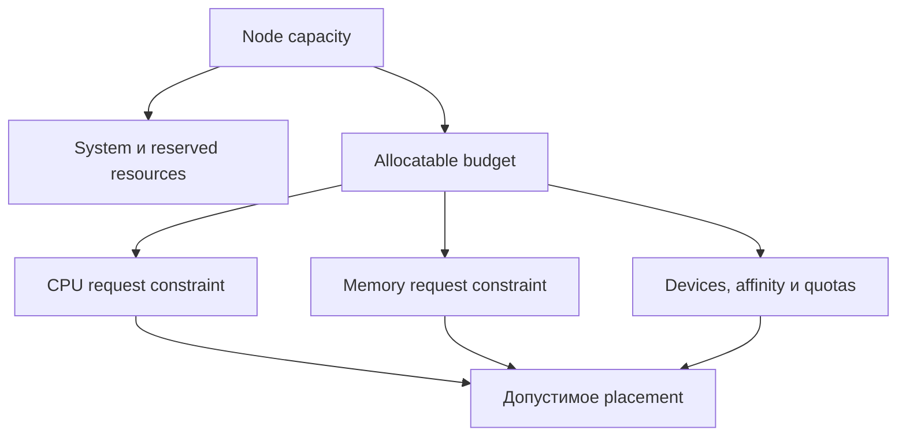
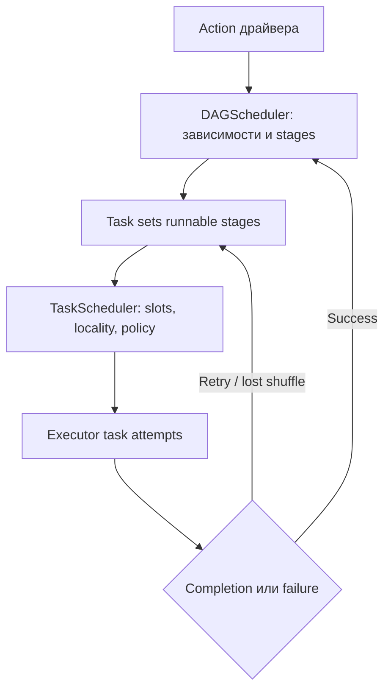
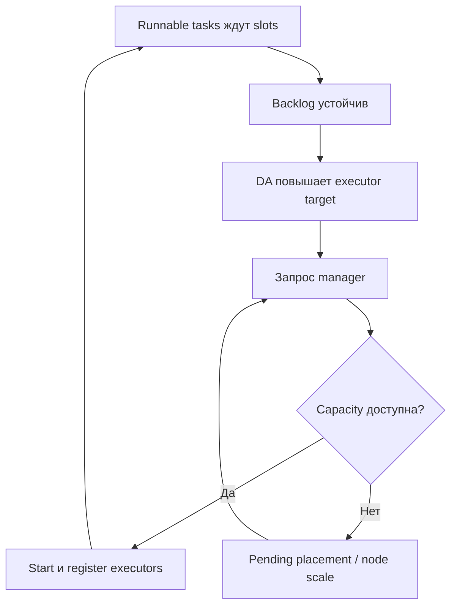
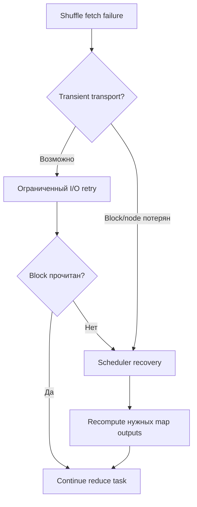
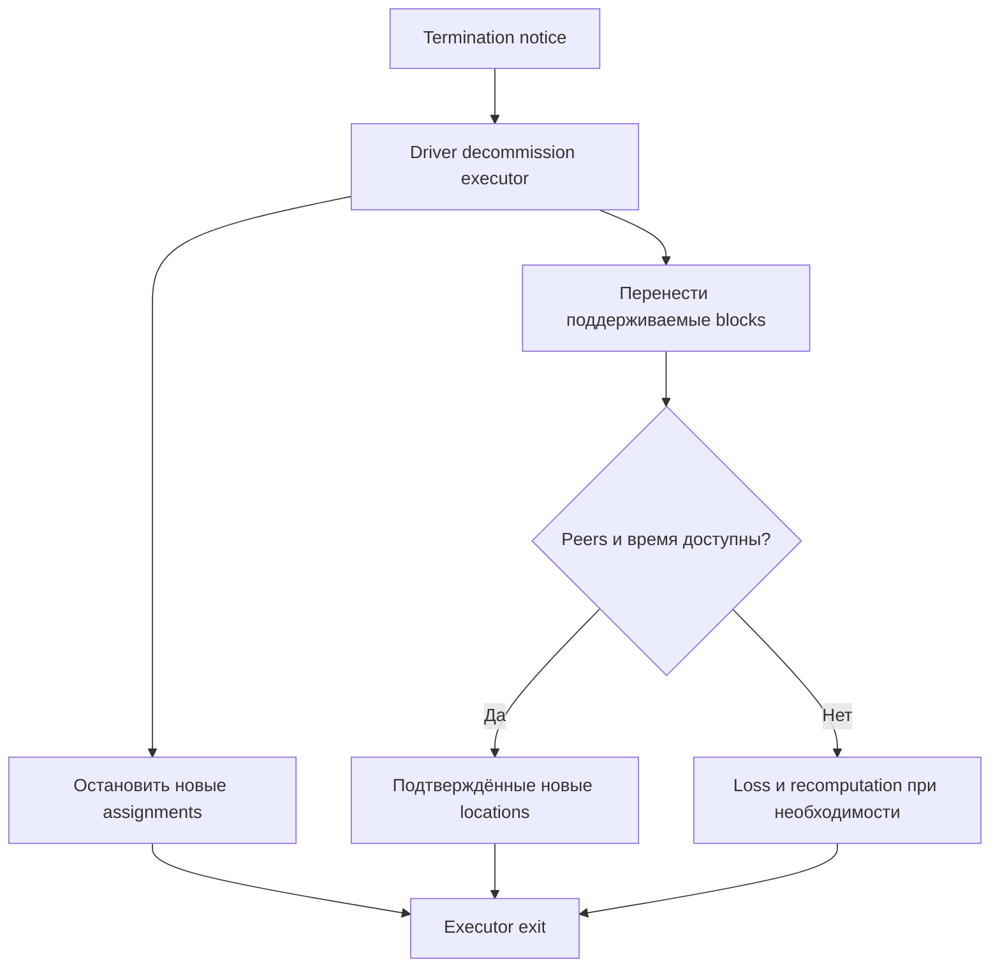
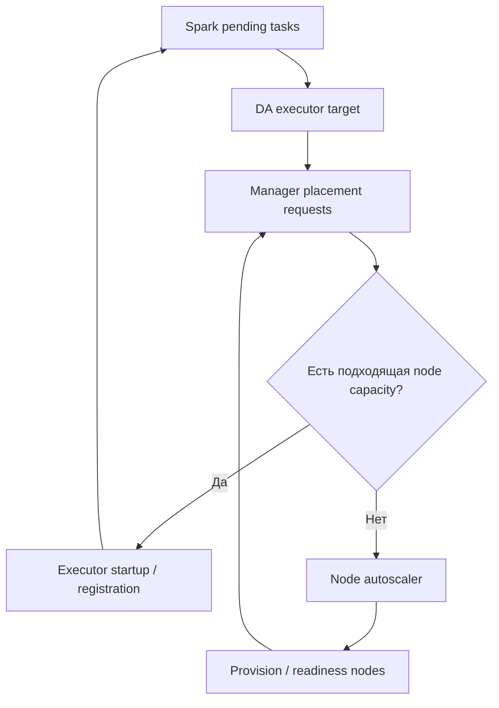

# 14. Конфигурация, ресурсы и планирование

Основной язык примеров — **Python / PySpark**. Проверенное окружение: **Apache Spark 4.2.0, Python 3.12.14, OpenJDK 17.0.20, Spark Classic**, Linux, `local[2]`. Для startup-настроек запускаются отдельные локальные приложения; task CPU probe использует `local[4]`, а controlled retry — `local[2,2]`.

Глава связывает конфигурацию с тем, что действительно происходит при запуске: resources, executor placement, task scheduling, concurrent jobs, Dynamic Allocation и recovery. Все **8 тем и 53 пункта README сохранены в исходном порядке**, включая формулировки в скобках про проверку полноты. Ровно три уровня заголовков: раздел → тема → пункт; практика и вопросы находятся внутри пунктов.

**Содержание**

1. [Источники конфигурации](#configuration-sources)
2. [Sizing драйвера и исполнителей](#driver-executor-sizing)
3. [Task scheduling](#task-scheduling)
4. [Dynamic Allocation](#dynamic-allocation)
5. [Ресурсные профили и специальные ресурсы](#resource-profiles)
6. [Повторные попытки и speculative execution](#retries-speculation)
7. [Decommission и прерываемые ресурсы](#decommission-interruptions)
8. [Capacity planning и стоимость](#capacity-cost)

**Как выполнить примеры**

Нужны доступный `java` JDK 17 и полный PySpark 4.2.0. Локальные subprocess examples рассчитаны на Linux/macOS/WSL; для нативного Windows требуется адаптация launcher к `spark-submit.cmd`.

```bash
python -m venv .venv
source .venv/bin/activate
python -m pip install pyspark==4.2.0
export PYSPARK_PIN_THREAD=true
# После копирования Python-блоков из главы:
python chapter14_lab.py
```

Все Python-блоки выполняй сверху вниз в **одной чистой сессии**. Первый создаёт SparkContext с FAIR scheduler, pools XML, fixture `data`, helpers и временный `lab`. Последний останавливает Spark, проверяет pool/group properties в event log и удаляет только `lab`. Отдельные Bash/properties snippets — deployment templates; они требуют своего приложения и инфраструктуры.

`PYSPARK_PIN_THREAD=true` задаётся до создания bridge. Пример явно проверяет pinned mode, поскольку local properties/job groups относятся к JVM submitting thread. `spark.python.use.daemon=false` используется для воспроизводимого локального worker startup; AQE off позволяет наблюдать заданное число shuffle partitions. Эти условия лаборатории не являются универсальными production defaults.

`sql_conf` временно меняет SQL-настройки и восстанавливает их. Heap, JVM options, scheduler mode и cluster resources имеют другие моменты применения; для таких опытов `run_child` использует новый `spark-submit` процесс и JVM. Child logs лежат в `lab` до cleanup. Все datasets, collects и lists ограничены учебными объёмами.

**Что здесь проверяется.** Реально выполняются precedence, static/runtime config, JVM startup heap/flag, concurrent submissions, pinned thread mapping, inheritance/cleanup, cancellation, CPU assignment, barrier synchronization, task retry и event-log context verification. ResourceProfile construction отделена от применения: local mode ожидаемо отклоняет cluster profile. GPU discovery shape проверяется на mock data, а hardware не эмулируется.

DA/node scaling, manager placement, shuffle migration, spot loss и cloud cost — части cluster planning. Их formulas и illustrative timelines помечены как расчётные; settings сверены по официальной документации. Локальный successful action не считается доказательством remote allocation, fault recovery или SLA speedup. Точные границы выполнения перечислены в конце главы.

Официальные отправные страницы: [Configuration](https://spark.apache.org/docs/4.2.0/configuration.html), [Submitting applications](https://spark.apache.org/docs/4.2.0/submitting-applications.html), [Job scheduling](https://spark.apache.org/docs/4.2.0/job-scheduling.html), [PySpark API](https://spark.apache.org/docs/4.2.0/api/python/reference/index.html).


<a id="configuration-sources"></a>

## Источники конфигурации


### spark-defaults.conf, spark-env.sh и SparkConf

У Spark несколько источников конфигурации, потому что настройки принадлежат разным моментам и процессам: запуску JVM, созданию SparkContext, SQL-сессии, worker environment и cluster manager. Для каждой настройки полезны четыре вопроса: **кто читает, когда читает, в каком scope действует и как проверить применение**.

| Источник | Что содержит | Кто/когда использует |
| --- | --- | --- |
| `spark-defaults.conf` | Spark properties: `spark.*` | Submission/initialization приложения |
| `spark-env.sh` | Shell environment: Java/Python paths, worker environment | Скрипты запуска на соответствующей машине |
| `SparkConf` | Программная конфигурация SparkContext | Создание контекста и зависящих от него компонентов |
| SQL RuntimeConfig | SQL settings сессии | Планирование/исполнение поддерживающих runtime change операций |
| Cluster configuration | Queues, quotas, devices, node policies | Resource manager и infrastructure |

`spark-env.sh` — shell script, а `spark-defaults.conf` — properties file: строка `spark.executor.memory 4g` не является shell assignment. `SPARK_CONF_DIR` позволяет выбрать отдельный config directory. На Windows есть `spark-env.cmd`; лаборатория с подпроцессами рассчитана на Linux/macOS/WSL.

**Учебная сессия.** FAIR включён до создания SparkContext. XML задаёт два pools; основной event log позволит проверить job properties после завершения.

```python
import contextlib
import io
import json
import math
import os
import shutil
import subprocess
import sys
import tempfile
import textwrap
import threading
import time
from pathlib import Path

import pyspark
from pyspark import SparkConf, InheritableThread, TaskContext, BarrierTaskContext
from pyspark.sql import SparkSession, functions as F
from py4j.clientserver import ClientServer

lab = Path(tempfile.mkdtemp(prefix="spark_ch14_"))
event_dir = lab / "events"
event_dir.mkdir()
pool_file = lab / "fairscheduler.xml"
pool_file.write_text('''<?xml version="1.0"?>
<allocations>
  <pool name="interactive">
    <schedulingMode>FAIR</schedulingMode>
    <weight>2</weight><minShare>1</minShare>
  </pool>
  <pool name="batch">
    <schedulingMode>FAIR</schedulingMode>
    <weight>1</weight><minShare>0</minShare>
  </pool>
</allocations>
''')

spark = (
    SparkSession.builder.master("local[2]")
    .appName("Spark Zero to Hero - Chapter 14")
    .config("spark.scheduler.mode", "FAIR")
    .config("spark.scheduler.allocation.file", str(pool_file))
    .config("spark.sql.shuffle.partitions", "4")
    .config("spark.sql.adaptive.enabled", "false")
    .config("spark.python.use.daemon", "false")
    .config("spark.ui.showConsoleProgress", "false")
    .config("spark.eventLog.enabled", "true")
    .config("spark.eventLog.compress", "false")
    .config("spark.eventLog.dir", event_dir.as_uri())
    .getOrCreate()
)
sc = spark.sparkContext
sc.setLogLevel("ERROR")
assert spark.version == "4.2.0"
assert isinstance(sc._gateway, ClientServer), "Run with PYSPARK_PIN_THREAD=true"

data = spark.range(1000, numPartitions=4).withColumn(
    "key", (F.col("id") % 10).cast("int")
)
assert data.count() == 1000

@contextlib.contextmanager
def sql_conf(**settings):
    previous = {k: spark.conf.get(k, None) for k in settings}
    try:
        for k, v in settings.items():
            spark.conf.set(k, str(v).lower() if isinstance(v, bool) else str(v))
        yield
    finally:
        for k, v in previous.items():
            if v is None:
                spark.conf.unset(k)
            else:
                spark.conf.set(k, v)

def plan_text(df, mode="formatted"):
    output = io.StringIO()
    with contextlib.redirect_stdout(output):
        df.explain(mode=mode)
    return output.getvalue()

def run_child(name, source, submit_options=(), master="local[2]"):
    script = lab / (name + ".py")
    script.write_text(textwrap.dedent(source), encoding="utf-8")
    env = os.environ.copy()
    for k in ("PYSPARK_GATEWAY_PORT", "PYSPARK_GATEWAY_SECRET"):
        env.pop(k, None)
    env["SPARK_LOCAL_IP"] = "127.0.0.1"
    env["PYSPARK_PIN_THREAD"] = "true"
    result = subprocess.run(
        [str(Path(pyspark.__file__).parent / "bin" / "spark-submit"),
         "--master", master,
         "--conf", "spark.ui.showConsoleProgress=false",
         "--conf", "spark.python.use.daemon=false",
         *submit_options, str(script)],
        env=env, capture_output=True, text=True, timeout=120,
    )
    (lab / (name + ".log")).write_text(result.stdout + result.stderr)
    if result.returncode != 0:
        raise RuntimeError((result.stdout + result.stderr)[-7000:])
    print(result.stdout.strip())
    return result.stdout

print({"Spark": spark.version, "Python": sys.version.split()[0],
       "JDK": sc._jvm.java.lang.System.getProperty("java.version"),
       "scheduler": sc.getConf().get("spark.scheduler.mode")})
```

`spark-env.sh` на submitting host не гарантирует ту же environment в удалённом driver/executor. Например, YARN cluster driver использует соответствующие `spark.yarn.appMasterEnv.*`, executors — `spark.executorEnv.*`. Доставку Python/JAR/config paths нужно проверить на стороне исполняющего процесса.

**Практика.** Для executor memory, Java path и SQL shuffle partitions выбери источник и момент чтения. **Самопроверка:** почему одно имя `spark.*` ещё не означает runtime изменяемость?


### Параметры spark-submit и --conf

`spark-submit` задаёт master/deploy mode, ресурсы и доставку приложения. Для распространённых параметров есть flags (`--driver-memory`, `--executor-memory`, `--executor-cores`, `--num-executors` для поддерживающих manager); произвольные Spark properties задаются `--conf key=value`.

```bash
# Шаблон YARN submission; app.py должен существовать в твоём проекте.
spark-submit \
  --master yarn --deploy-mode cluster \
  --driver-memory 2g \
  --executor-memory 4g --executor-cores 2 --num-executors 4 \
  --conf spark.sql.shuffle.partitions=32 \
  --conf spark.executor.memoryOverhead=1g \
  app.py
```

Flags перед path приложения обрабатывает Spark; аргументы после него получает само приложение. `--conf spark.executor.instances=4` не означает, что manager уже выдал четыре executor. Включённая Dynamic Allocation меняет дальнейшее число executors и взаимодействует с initial count.

`--properties-file` читает явный file. В Spark 4.2.0 при таком выборе default `spark-defaults.conf` не загружается автоматически; для совместного чтения существует `--load-spark-defaults`. Не предполагай, что отсутствующее значение пришло из привычного общего file.

```python
submit_help = subprocess.run(
    [str(Path(pyspark.__file__).parent / "bin" / "spark-submit"), "--help"],
    capture_output=True, text=True, timeout=30,
)
help_text = submit_help.stdout + submit_help.stderr
assert "--conf" in help_text and "--properties-file" in help_text
assert "--load-spark-defaults" in help_text
```

Это проверка поддерживаемых flags установленного launcher. YARN-команда выше — deployment template, локальная лаборатория не обращается к YARN.

**Самопроверка:** почему `--executor-memory 4g` не равен container memory limit 4 GiB? Ответ: есть overhead и другие настроенные компоненты бюджета.


### SparkSession.builder.config и runtime configuration

`SparkSession.builder.config` используется при создании сессии и, когда необходимо, контекста. `spark.conf` — SQL RuntimeConfig текущей сессии. Значение, добавленное через builder, может относиться к startup SparkContext, SQL или быть просто arbitrary property; результат зависит от того, существует ли контекст и когда потребитель прочитал настройку.

`getOrCreate()` может вернуть уже существующую сессию. Он не пересоздаёт JVM и executor с новым heap только потому, что builder содержит другой `spark.executor.memory`.

```python
original_shuffle = spark.conf.get("spark.sql.shuffle.partitions")
with sql_conf(**{"spark.sql.shuffle.partitions": 7}):
    grouped = data.groupBy("key").count()
    assert grouped.rdd.getNumPartitions() == 7
    assert sum(r["count"] for r in grouped.collect()) == 1000
assert spark.conf.get("spark.sql.shuffle.partitions") == original_shuffle

separate_sql_session = spark.newSession()
separate_sql_session.conf.set("spark.sql.shuffle.partitions", "9")
assert separate_sql_session.sparkContext is sc
assert separate_sql_session.conf.get("spark.sql.shuffle.partitions") == "9"
assert spark.conf.get("spark.sql.shuffle.partitions") == original_shuffle
```

`newSession()` даёт отдельные SQL settings/temporary views при общем SparkContext и связанных shared-state компонентах. Это не отдельный executor fleet и не изоляция физических ресурсов. Для запросов параллельных клиентов отдельные сессии уменьшают конфликт SQL settings, но scheduler resources по-прежнему общие.

Перед изменением runtime config создай/перепроверь соответствующий query и physical plan. Уже начатый action не следует считать гарантированно перепланированным из-за setter в другом driver thread.

**Документация:** [RuntimeConfig](https://spark.apache.org/docs/4.2.0/api/python/reference/pyspark.sql/api/pyspark.sql.conf.RuntimeConfig.html), [newSession](https://spark.apache.org/docs/4.2.0/api/python/reference/pyspark.sql/api/pyspark.sql.SparkSession.newSession.html).

**Самопроверка:** почему две SQL sessions с одним `sc` не получают каждая свои 2 cores в `local[2]`?


### Приоритеты настроек и фактически применённые значения

Для обычных Spark properties общий порядок: **программный SparkConf → submission flags/explicit properties file → defaults file → встроенный default**, с деталями конкретного launcher. Deployment settings дополнительно должны успеть повлиять на запуск процесса: приоритет значения и момент применения — разные вопросы.

**Проверка нескольких слоёв.** В properties file shuffle partitions равен 3, CLI задаёт 5, приложение задаёт 7 до создания сессии. Отдельное значение без programmatic override показывает CLI priority.

```python
priority_file = lab / "priority.conf"
priority_file.write_text(
    "spark.sql.shuffle.partitions 3\n"
    "spark.sql.autoBroadcastJoinThreshold 12345\n"
)
priority_output = run_child("priority", '''
    import json
    from pyspark.sql import SparkSession
    s = (SparkSession.builder.appName("priority-lab")
         .config("spark.sql.shuffle.partitions", "7").getOrCreate())
    s.sparkContext.setLogLevel("ERROR")
    assert s.conf.get("spark.sql.shuffle.partitions") == "7"
    assert s.conf.get("spark.sql.autoBroadcastJoinThreshold") == "54321"
    print("PRIORITY_CHECK=PASS")
    s.stop()
''', submit_options=(
    "--properties-file", str(priority_file),
    "--conf", "spark.sql.shuffle.partitions=5",
    "--conf", "spark.sql.autoBroadcastJoinThreshold=54321",
))
assert "PRIORITY_CHECK=PASS" in priority_output
```

`sc.getConf()` показывает context configuration, `spark.conf.get(...)` — session value; defaults могут не присутствовать в `sc.getConf().getAll()`. Spark UI Environment тоже прежде всего показывает явно заданные Spark properties, а не полный каталог defaults. Для heap проверяй JVM maxMemory, для executor count — registered/allocated executor metrics, для SQL — фактический plan.

**Практика.** Создай небольшой allowlist report: requested value, observed config, observed behavior и scope. Не выгружай все settings/environment в открытый log: в них могут быть credentials.

**Самопроверка:** чем «в Environment tab записано 8g» отличается от «JVM действительно запущена с heap 8 GiB»?


### Static и dynamic SQL configuration

SQL configurations делятся на static и runtime-modifiable. Static settings относятся к session/shared-state initialization и не меняются обычным runtime setter. Dynamic здесь означает возможность изменить SQL config, **а не Dynamic Allocation** executors.

```python
assert spark.conf.isModifiable("spark.sql.shuffle.partitions")
assert not spark.conf.isModifiable("spark.sql.warehouse.dir")
warehouse_before = spark.conf.get("spark.sql.warehouse.dir")
static_rejected = False
try:
    spark.conf.set("spark.sql.warehouse.dir", str(lab / "another-warehouse"))
except Exception as error:
    static_rejected = True
    print("static SQL setting rejected:", type(error).__name__)
assert static_rejected
assert spark.conf.get("spark.sql.warehouse.dir") == warehouse_before
```

`isModifiable()` позволяет проверить конкретный ключ. Он не обещает, что изменение будет полезно текущему query: optimizer may already have generated its plan, cached state или connector может читать parameter на другом этапе.

Не обходи отказ static setter через internal APIs в production. Если нужны разные static choices, создай правильно настроенную application/session boundary согласно документации конкретной настройки.

**Документация:** [Static SQL configuration](https://spark.apache.org/docs/4.2.0/configuration.html#static-sql-configuration), [RuntimeConfig API, включая isModifiable](https://spark.apache.org/docs/4.2.0/api/python/reference/pyspark.sql/api/pyspark.sql.conf.RuntimeConfig.html).

**Самопроверка:** почему произвольный accepted custom key в RuntimeConfig не доказывает, что engine использует его?


### Параметры, которые нужно задать до старта JVM

JVM heap, GC flags, некоторые classpaths и native library paths должны быть заданы до запуска соответствующей JVM. Scheduler mode, serializer и memory-manager choices также обычно задаются при создании SparkContext, а не через late SQL setter.

| Настройка | Безопасная точка задания | Как подтвердить |
| --- | --- | --- |
| Driver heap в client mode | `--driver-memory` до launcher | JVM maxMemory |
| Driver JVM flags | `--driver-java-options` до launcher | System properties/GC logs |
| Executor heap/options | Submission до запуска executors | Executor logs/JVM metrics |
| FAIR mode/allocation file | До SparkContext | Scheduler mode/pools |
| SQL shuffle partitions | Runtime перед нужным query | Session config и exchange partition count |

```python
startup_output = run_child("startup", '''
    from pyspark.sql import SparkSession
    s = SparkSession.builder.appName("startup-lab").getOrCreate()
    jvm = s.sparkContext._jvm
    assert jvm.java.lang.System.getProperty("chapter14.marker") == "before-jvm"
    max_heap = jvm.java.lang.Runtime.getRuntime().maxMemory()
    assert max_heap == 768 * 1024**2, max_heap
    assert s.range(10).count() == 10
    print("STARTUP_CHECK=PASS", "heap_MiB", max_heap // 1024**2)
    s.stop()
''', submit_options=(
    "--driver-memory", "768m",
    "--driver-java-options", "-Dchapter14.marker=before-jvm",
))
assert "STARTUP_CHECK=PASS" in startup_output
```

Проверен startup driver JVM. В local mode нет отдельных executor JVM с собственными heaps; `spark.executor.memory` здесь не создаёт дополнительные процессы. `-Xmx` внутри extraJavaOptions не является поддерживаемой заменой memory flags.

**Самопроверка:** почему после `getOrCreate()` изменение `spark.driver.memory` может поменять запись config, но не расширить heap процесса?


### Конфигурация по окружениям и проверка обязательных параметров

Разделяй базовые defaults, environment overlay и job-specific settings. Обязательные параметры проверяй **до дорогого action**: URI, формат, executor bounds, task resource ratios, checkpoint/output contract. Не смешивай business options приложения со Spark properties без явного mapping.

```python
base_options = {"shuffle_partitions": 8, "min_executors": 1, "max_executors": 8}
environment_options = {
    "dev": {"max_executors": 2},
    "prod": {"shuffle_partitions": 64, "max_executors": 12},
}

def resolved_options(environment, overrides=None):
    if environment not in environment_options:
        raise ValueError("unknown environment")
    options = base_options | environment_options[environment] | (overrides or {})
    if options["shuffle_partitions"] < 1:
        raise ValueError("shuffle_partitions must be positive")
    if not 0 <= options["min_executors"] <= options["max_executors"]:
        raise ValueError("invalid executor bounds")
    return options

assert resolved_options("dev")["max_executors"] == 2
assert resolved_options("prod", {"shuffle_partitions": 32})["shuffle_partitions"] == 32
try:
    resolved_options("prod", {"min_executors": 20})
except ValueError:
    pass
else:
    raise AssertionError("invalid options were accepted")
```

Это application-level merge/validation, не копия внутреннего Spark resolver. Сохраняй рядом с run identity версию кода, Spark/JDK, input snapshot, allowlisted effective settings и resource observations. Тогда изменение latency можно связать с конкретным экспериментом.

Credentials передавай предусмотренным manager/connector secret mechanism; не хардкодь их в публичный Markdown/defaults и не печатай полный environment. Version control хранит воспроизводимые non-secret choices.

**Практика темы.** Для dev/prod создай config contract, проверь bounds и продемонстрируй precedence на трёх уровнях. **Самопроверка:** почему централизованный конфиг полезен только при проверке фактически применённых значений?


<a id="driver-executor-sizing"></a>

## Sizing драйвера и исполнителей


### executor-memory, executor-cores и число executors

Размер executor задаётся количеством cores, heap и дополнительной памятью. Число executors определяет общую параллельность и распределение state. Один большой executor и несколько малых при той же сумме ресурсов имеют разные GC, concurrency, shuffle и failure behavior.

`--executor-memory` соответствует `spark.executor.memory`, `--executor-cores` — `spark.executor.cores`; static count обычно задают `spark.executor.instances`/поддерживаемый `--num-executors`. В Standalone также важен `spark.cores.max`; default cores и packing отличаются от YARN/Kubernetes.

```python
def cpu_slots(executors, executor_cores, task_cpus=1):
    if min(executors, executor_cores, task_cpus) < 1:
        raise ValueError("positive resources required")
    return executors * (executor_cores // task_cpus)

assert cpu_slots(4, 3) == 12
assert cpu_slots(4, 3, task_cpus=2) == 4
assert cpu_slots(4, 4, task_cpus=2) == 8
```

Это **CPU-based верхняя оценка task slots** без GPU/barrier/manager constraints. Реальная параллельность ограничена также числом runnable partitions, data locality, ресурсными профилями и доступными executors. Twelve slots не ускорят stage с одной partition в 12 раз.

| Изменение | Возможная выгода | Цена/риск |
| --- | --- | --- |
| Больше executors | Больше slots и распределённого state | Startup, shuffle peers, node/queue demand |
| Больше cores/executor | Меньше JVM на тот же CPU budget | Больше simultaneous working sets |
| Больше heap/executor | Больше live set | GC, packing, больший loss impact |
| Меньше executor | Лучше packing и локальный failure scope | Больше overhead JVM/metadata/network |

**Практика.** Сравни две конфигурации при одинаковом суммарном requested CPU/RAM. **Самопроверка:** почему одинаковая сумма heap не гарантирует одинаковый throughput?


### Driver memory и driver cores

Driver строит plans, хранит scheduler metadata, обрабатывает task completions и SQL broadcast preparation. `collect`/pandas добавляют result footprint. Недостаточный driver может ограничивать приложение, даже если executors почти idle.

`spark.driver.memory` относится к driver JVM heap. `spark.driver.cores` задаёт driver cores в cluster mode для поддерживающего manager; оно не меняет executor task slots. В client mode ресурсы driver определяются submitting host/process limits и deployment окружением.

```python
runtime = sc._jvm.java.lang.Runtime.getRuntime()
print({"driver_heap_max_MiB": runtime.maxMemory() // 1024**2,
       "driver_heap_used_MiB": (runtime.totalMemory() - runtime.freeMemory()) // 1024**2,
       "default_parallelism": sc.defaultParallelism})
assert sc.defaultParallelism == 2
```

`local[2]` использует два task threads в локальной JVM; это не следствие `spark.driver.cores=2`. Не пытайся использовать local experiment для проверки manager CPU requests driver.

CPU driver нагружают очень короткие многочисленные tasks, file listing, code generation, large plans и частые streaming micro-batches. Решение может быть сокращением metadata/task count и plan complexity, а не только добавлением driver cores.

**Практика.** При «executors idle, driver busy» раздели submission/analysis, scheduling и collection phases. **Самопроверка:** почему upgrade executor memory не исправляет нехватку памяти Python driver в `toPandas()`?


### Memory overhead, PySpark memory и off-heap size

Для YARN/Kubernetes executor budget складывается из heap, overhead, включённой managed off-heap memory и отдельно заданной PySpark memory. Это продолжение модели раздела 13: reserved/user/storage/execution **уже находятся внутри heap** и второй раз не прибавляются.

```python
def executor_budget_mib(heap, overhead, offheap=0, pyspark_memory=0):
    if any(v < 0 for v in (heap, overhead, offheap, pyspark_memory)):
        raise ValueError("negative memory budget")
    return heap + overhead + offheap + pyspark_memory

assert executor_budget_mib(4096, 1024, 512, 2048) == 7680
assert executor_budget_mib(4096, 1024) == 5120
```

Если `spark.executor.pyspark.memory` не задан, Python делит overhead с другими non-JVM/native consumers. Если задан, resource budget дополняется отдельным значением, но process-level enforcement зависит от platform/resource implementation. Его нельзя считать точным aggregate RSS monitor всех workers.

Driver имеет собственные overhead settings и container formula; executor formula не переносится на него автоматически. Не используй footprint cached dataset как полный memory request: нужны active tasks, transport buffers, Python/native allocations и запас.

**Практика.** Рассчитай node placement для executor с 4 GiB heap, 1 GiB overhead и двумя одновременно работающими Python workers. **Самопроверка:** где будут учитываться workers, если отдельная PySpark memory не задана?


### Task concurrency и память на одну задачу

Количество simultaneous tasks примерно определяется cores/task.cpus и дополнительными ресурсами. У каждой задачи есть working set: input batch, hash/sort state, временные copies, иногда Python worker. Простая оценка `execution budget / active tasks` полезна для первого анализа, но memory manager не гарантирует одинаковую фиксированную долю каждому task.

```python
heap_mib = 4096
managed_region_mib = (heap_mib - 300) * 0.6
approx_two_tasks = managed_region_mib / 2
approx_six_tasks = managed_region_mib / 6
assert approx_two_tasks == 3 * approx_six_tasks
print("illustrative managed region per active task:",
      round(approx_two_tasks, 1), "vs", round(approx_six_tasks, 1), "MiB")
```

Выражение игнорирует cache competition, shared structures и memory вне managed region; оно **не является task memory cap**. Largest group/partition может исчерпать память даже при хорошем среднем размере.

Больше concurrency может увеличить peak, GC и spill; меньше concurrency иногда ускоряет job за счёт снижения этих затрат. Но слишком мало tasks может оставить CPU/disk idle. Выбирай по p95 task duration, throughput, GC/spill и process/container peaks.

`spark.task.cpus=2` резервирует scheduler slots, а не автоматически делает обычный task multithreaded. Для threaded native library отдельно согласуй её parallelism и лимиты process threads.

**Самопроверка:** почему увеличение executor cores с 2 до 6 без изменения памяти может ухудшить устойчивость?


### Ресурсы узла, системный запас и размещение executors

Сначала вычти ресурсы ОС, agents, daemon services, filesystem cache requirements и другие reserved allocations. Executor placement определяется **полным** memory request, CPU requests, devices и scheduler rules. Число JVM, помещающихся по heap, может существенно превышать число реально допустимых containers.

```python
def node_executor_capacity(node_cpu, node_memory_mib, system_cpu, system_memory_mib,
                           executor_cpu, executor_memory_mib):
    usable_cpu = node_cpu - system_cpu
    usable_memory = node_memory_mib - system_memory_mib
    if min(usable_cpu, usable_memory) < 0:
        raise ValueError("reserve exceeds node capacity")
    return min(usable_cpu // executor_cpu, usable_memory // executor_memory_mib)

capacity = node_executor_capacity(
    node_cpu=16, node_memory_mib=64 * 1024,
    system_cpu=2, system_memory_mib=8 * 1024,
    executor_cpu=4, executor_memory_mib=12 * 1024,
)
assert capacity == 3  # CPU: 14//4=3; memory: 56//12=4.
```

Это packing estimate, не обещание manager. Fragmentation, affinity, queue quotas, device availability, pod overhead и existing workloads могут уменьшить capacity. Два nodes со свободными 2 cores каждый не вместят executor с request 4 cores на одном node.



**Практика.** Найди limiting resource и оставшийся stranded resource в примере. **Самопроверка:** почему отдельный GPU-node pool может иметь много free CPU, но не принять ещё один GPU executor?


### Различие requested, allocated и фактически использованных ресурсов

Requested — то, что приложение попросило. Allocated/registered — что manager выдал и что действительно вошло в приложение. Used — фактические CPU/RAM/I/O в выбранном scope/time window. Эти величины различаются по единицам и смыслу.

| Величина | Пример | Проверка |
| --- | --- | --- |
| Requested | 10 executors × 4 CPU, 8 GiB request | Submission/resource specs |
| Allocated | Пока выданы 6 containers/pods | Manager UI/API |
| Registered | 5 executors подключились к driver | Spark UI Executors/metrics |
| Used | CPU utilisation, RSS, disk/network rate | Process/container/node telemetry |

Pending pod/container может быть allocated concept в одном отчёте и ещё не running/registered в другом; явно фиксируй definition. CPU usage — core-seconds/rate, memory usage — bytes, executor count — количество: их нельзя сравнивать как один процент.

В Kubernetes `spark.executor.cores` влияет на Spark task parallelism, а `spark.kubernetes.executor.request.cores` и `...limit.cores` позволяют отдельно задавать scheduler request и runtime CPU limit. Spark slots могут оказаться больше доступного effective CPU, что ведёт к throttling и misleading concurrency expectations.

**Практика темы.** Для одного run собери requested, pending, registered и peak used timeline. **Самопроверка:** почему idle requested resources не доказывают, что приложение могло заказать меньший peak и сохранить SLA?


<a id="task-scheduling"></a>

## Task scheduling


### DAGScheduler и TaskScheduler: распределение ответственности

DAGScheduler разбирает dependencies вычисления, выделяет stages по shuffle boundaries, отслеживает завершённые stages/map outputs и организует повторное вычисление при потерях. TaskScheduler получает task sets stages и назначает attempts доступным executor slots с учётом ресурсов, locality и scheduling policy.

Driver не отправляет «весь DataFrame одному executor». Он организует execution graph; каждая partition соответствующего stage получает task attempt. Job, stage, task и attempt — разные уровни учёта.



```python
scheduling_query = data.groupBy("key").agg(F.sum("id").alias("total"))
assert "Exchange" in plan_text(scheduling_query)
actual_totals = {r.key: r.total for r in scheduling_query.collect()}
assert actual_totals == {k: sum(range(k, 1000, 10)) for k in range(10)}
```

Exchange показывает distribution boundary; Spark UI/event log показывает фактически выполненные stages/tasks. AQE, reuse и cached results могут менять runtime graph. Количество SQL operators не равно количеству stages.

**Самопроверка:** кто принимает решение пересчитать lost shuffle dependencies, а кто запускает конкретный task attempt на executor?


### FIFO и FAIR внутри Spark-приложения

FIFO — default внутри SparkContext. Более ранний job получает приоритет при назначении runnable tasks. Это не означает, что позже поданный job всегда ждёт полного завершения первого: если есть free slots и первый не использует их, другие jobs могут выполняться.

FAIR распределяет доступные slots между активными jobs/pools по fair policy. Он удобен для приложения с несколькими consumers, но не создаёт CPU и не гарантирует SLA. Обычно уже running task не вытесняется только потому, что появился высокоприоритетный job; тот ждёт свободного slot.

```python
assert sc.getConf().get("spark.scheduler.mode") == "FAIR"
fifo_output = run_child("fifo", '''
    from pyspark.sql import SparkSession
    s = SparkSession.builder.appName("fifo-lab").getOrCreate()
    assert s.sparkContext.getConf().get("spark.scheduler.mode", "FIFO") == "FIFO"
    assert s.range(20).count() == 20
    print("FIFO_CONFIG_CHECK=PASS")
    s.stop()
''', submit_options=("--conf", "spark.scheduler.mode=FIFO"))
assert "FIFO_CONFIG_CHECK=PASS" in fifo_output
```

Проверены два startup modes и correctness. Это не latency benchmark политики. Для сравнения нужны одновременно активные workloads с одинаковыми resources, partition sizes и arrival pattern; измеряют response time каждого consumer, а не только throughput.

**Практика.** Рассмотри long tasks, занявшие все slots до прихода short job: почему FAIR не обещает мгновенный запуск? **Самопроверка:** отличается ли FIFO Spark-приложения от FIFO manager queue?


### Scheduling pools, веса и минимальные доли

Pools группируют jobs внутри одного SparkContext. `weight` влияет на относительную долю при конкуренции; `minShare` задаёт желаемый минимум активного pool; `schedulingMode` внутри pool определяет FIFO/FAIR между его jobs. Само включение application FAIR не делает каждый pool внутри FAIR: default pool mode — FIFO.

В setup `interactive` имеет weight 2 и minShare 1, `batch` — weight 1 и minShare 0; оба явно FAIR внутри. Это policy preferences при доступных runnable tasks, а не reservation отдельных machines и не точное соотношение wall times 2:1.

```python
import xml.etree.ElementTree as ET

pools = {p.attrib["name"]: p for p in ET.parse(pool_file).getroot().findall("pool")}
assert pools["interactive"].findtext("weight") == "2"
assert pools["batch"].findtext("minShare") == "0"
sc.setLocalProperty("spark.scheduler.pool", "interactive")
try:
    assert sc.getLocalProperty("spark.scheduler.pool") == "interactive"
    assert data.filter("id < 100").count() == 100
finally:
    sc.setLocalProperty("spark.scheduler.pool", None)
assert sc.getLocalProperty("spark.scheduler.pool") is None
```

Property назначается в **submitting thread**. Указать pool в основном thread и потом запустить jobs из unrelated threads недостаточно без передачи context. Необъявленные pools получают defaults, поэтому опечатка в имени может тихо создать другую policy group.

Веса не являются security boundary или cluster quota. Ten jobs в одном pool конкурируют за долю этого pool; десять новых pools могут изменить распределение. Pool naming и admission control должны соответствовать модели пользователей приложения.

**Документация:** [Fair scheduler pools](https://spark.apache.org/docs/4.2.0/job-scheduling.html#fair-scheduler-pools).

**Практика.** Предскажи поведение единственного active pool и двух competing pools. **Самопроверка:** получает ли pool с weight 2 всегда ровно два cores из каждых трёх?


### Одновременный запуск jobs из нескольких потоков драйвера

Jobs запускаются action calls. Две последовательные строки `a.count(); b.count()` выполняются последовательно на driver. Для concurrent submissions нужны несколько driver threads или другие механизмы asynchronous orchestration. Работу tasks выполняют executors; Python driver GIL не превращает эти JVM jobs в одно распределённое вычисление.

```python
parallel_results = {}
parallel_errors = []
result_lock = threading.Lock()
start_gate = threading.Event()

def run_report(name, bound):
    try:
        start_gate.wait(timeout=10)
        value = spark.range(bound, numPartitions=4).agg(F.sum("id")).first()[0]
        with result_lock:
            parallel_results[name] = value
    except Exception as error:
        with result_lock:
            parallel_errors.append(error)

reports = [InheritableThread(target=run_report, args=("a", 1000)),
           InheritableThread(target=run_report, args=("b", 2000))]
for t in reports:
    t.start()
start_gate.set()
for t in reports:
    t.join(timeout=60)
    assert not t.is_alive()
assert not parallel_errors, parallel_errors
assert parallel_results == {"a": 499_500, "b": 1_999_000}
```

Пример проверяет корректные independent concurrent submissions. Он не утверждает, что tasks обязательно overlap всё время: setup, planning и slots определяют реальную timeline. Если оба reports создают большие broadcasts/caches, совокупный peak memory может вырасти.

Не разделяй между параллельными queries mutable business lists/connections без синхронизации. Session-wide SQL setters в разных threads тоже могут конфликтовать; используй отдельные SQL sessions или неизменную explicit query configuration.

**Самопроверка:** почему parallel submission не увеличивает суммарное число task slots `local[2]`?


### Соответствие Python-потоков и JVM-потоков при запуске jobs из драйвера (добавлено по проверке полноты)

Python и JVM — разные runtimes. Spark local properties хранятся на JVM submitting thread. Без подходящего bridge режима произвольные Python threads не обязательно имеют соответствующие отдельные JVM threads, и ожидания о job groups/pools могут нарушиться.

Spark Classic 4.2.0 использует pinned-thread bridge при `PYSPARK_PIN_THREAD=true`; в установленной реализации это default при отсутствии override. Его нужно проверять в конкретном launcher/environment. Старые версии/настройки и Spark Connect требуют собственного подхода.

```python
assert isinstance(sc._gateway, ClientServer)  # Внутренний диагностический check Classic.
driver_thread_ids = {}

def record_thread_identity(name):
    java_id = sc._jvm.java.lang.Thread.currentThread().getId()
    with result_lock:
        driver_thread_ids[name] = (threading.get_ident(), int(java_id))

identity_threads = [InheritableThread(target=record_thread_identity, args=(name,))
                    for name in ("first", "second")]
for t in identity_threads:
    t.start()
for t in identity_threads:
    t.join(timeout=10)
    assert not t.is_alive()
assert len({pair[1] for pair in driver_thread_ids.values()}) == 2
print("Python/JVM thread identity observations", driver_thread_ids)
```

Проверены две разные JVM submitting thread identities в pinned mode. Python OS thread IDs могут переиспользоваться после завершения короткого thread, поэтому не делаем ненужное требование их уникальности в этом опыте.

Pinned mapping и **наследование** properties — разные задачи: отдельный JVM thread не гарантирует получение нужных parent properties без соответствующего wrapper/explicit setting. Для Spark Connect `sc` и `_jvm` отсутствуют; tags/session APIs не надо смешивать с Classic internals.

**Самопроверка:** почему одинаковый Python function target не означает одинаковый или корректно настроенный JVM execution context?


### pyspark.InheritableThread и наследование контекста запуска (добавлено по проверке полноты)

`pyspark.InheritableThread` предназначен для наследования context при pinned-thread execution. В Spark Classic 4.2.0 local properties parent клонируются при `start()`, а target получает их перед выполнением. API experimental; когда pinned mode выключен, он действует как обычный Python Thread.

```python
inherited_properties = {}
sc.setLocalProperty("chapter14.request", "at-construction")

def inspect_inherited_context():
    inherited_properties["value"] = sc.getLocalProperty("chapter14.request")
    sc.setLocalProperty("chapter14.request", "child-only")

inherited = InheritableThread(target=inspect_inherited_context)
sc.setLocalProperty("chapter14.request", "at-start")
try:
    inherited.start()
    inherited.join(timeout=10)
    assert not inherited.is_alive()
    assert inherited_properties["value"] == "at-start"
    assert sc.getLocalProperty("chapter14.request") == "at-start"
finally:
    sc.setLocalProperty("chapter14.request", None)
```

Child change не меняет parent local properties. Это помогает изоляции submission labels, но не изолирует SQL config, executor memory или arbitrary shared Python objects. Один `InheritableThread` нельзя start второй раз, как и обычный Thread.

Если используется reusable thread pool, передача request context требует специального wrapper на каждый submitted callable: inheritance при создании worker thread не равен актуальному request context при очередной задаче. Не переноси пример с новым Thread на pool без этой поправки.

**Документация:** [InheritableThread](https://spark.apache.org/docs/4.2.0/api/python/reference/api/pyspark.InheritableThread.html). Поддержка Connect не делает Classic context APIs автоматически переносимыми; в Connect наследуются соответствующие session tags.

**Практика.** Измени property между construction и start и объясни результат. **Самопроверка:** почему context должен иметь clear lifecycle даже при inheritance?


### Local properties, scheduling pools, job groups и cancellation: передача и очистка контекста для параллельных запусков PySpark (дополнено по проверке полноты)

Local properties привязывают pool, job group и description к submitting thread. Group позволяет `cancelJobGroup(group_id)` отменить связанные **active jobs**. Это не rollback записанных side effects и не вечный запрет будущих jobs с таким именем.

Scoped helper сохраняет прежние значения и восстанавливает их в `finally`, чтобы следующий request не получил чужой context. В PySpark используем конкретные documented local-property keys; не предполагаем существование одинаковых Scala и Python cleanup methods.

```python
@contextlib.contextmanager
def submission_context(pool, group, description):
    keys = ("spark.scheduler.pool", "spark.jobGroup.id", "spark.job.description",
            "spark.job.interruptOnCancel")
    previous = {k: sc.getLocalProperty(k) for k in keys}
    try:
        sc.setLocalProperty("spark.scheduler.pool", pool)
        sc.setJobGroup(group, description, interruptOnCancel=False)
        yield
    finally:
        for k, v in previous.items():
            sc.setLocalProperty(k, v)

group_results = {}
group_errors = []
def grouped_report(pool, group, bound):
    try:
        with submission_context(pool, group, "bounded report " + group):
            value = spark.range(bound, numPartitions=4).agg(F.sum("id")).first()[0]
            group_results[group] = value
        assert sc.getLocalProperty("spark.jobGroup.id") is None
    except Exception as error:
        group_errors.append(error)

group_threads = [
    InheritableThread(target=grouped_report, args=("interactive", "report-interactive", 100)),
    InheritableThread(target=grouped_report, args=("batch", "report-batch", 200)),
]
for t in group_threads:
    t.start()
for t in group_threads:
    t.join(timeout=60)
    assert not t.is_alive()
assert not group_errors, group_errors
assert group_results == {"report-interactive": 4950, "report-batch": 19900}
assert sc.statusTracker().getJobIdsForGroup("report-interactive")
assert sc.statusTracker().getJobIdsForGroup("report-batch")
assert sc.getLocalProperty("spark.scheduler.pool") is None
```

**Контролируемая cancellation:** создаём bounded slow tasks, ждём регистрацию active job и отменяем группу. Task sleep служит только воспроизведению cancellation; это не пример эффективной обработки.

```python
cancel_state = {}
cancel_group = "cancel-demo"

def bounded_slow_partition(rows):
    import time
    time.sleep(5)
    return rows

def cancellable_job():
    try:
        with submission_context("batch", cancel_group, "cancellation lab"):
            sc.parallelize(range(100), 4).mapPartitions(bounded_slow_partition).count()
        cancel_state["completed"] = True
    except Exception as error:
        cancel_state["error"] = str(error)

cancel_thread = InheritableThread(target=cancellable_job)
cancel_thread.start()
deadline = time.monotonic() + 20
while time.monotonic() < deadline:
    ids = sc.statusTracker().getJobIdsForGroup(cancel_group)
    if any(sc.statusTracker().getJobInfo(j).status == "RUNNING"
           for j in ids if sc.statusTracker().getJobInfo(j) is not None):
        break
    time.sleep(0.05)
else:
    raise TimeoutError("cancellable job did not register")
sc.cancelJobGroup(cancel_group)
cancel_thread.join(timeout=20)
assert not cancel_thread.is_alive()
assert "error" in cancel_state and "cancel" in cancel_state["error"].lower()
assert "completed" not in cancel_state
assert sc.getLocalProperty("spark.jobGroup.id") is None
assert spark.range(5).count() == 5
```

Cancellation may not immediately interrupt любой native/library call. `interruptOnCancel=True` влияет на interruption, но требует понимания конкретного I/O; default False выбран явно. Успешный abort не отменяет ранее отправленные внешние HTTP requests или commits.

В конце главы event log проверит, что два report jobs имеют **свои** pools/group IDs. Это сильнее проверки только parent Python variables. Для service workflows добавь уникальный request ID, admission limit и корректное propagated exception handling.

**Документация:** [setJobGroup](https://spark.apache.org/docs/4.2.0/api/python/reference/api/pyspark.SparkContext.setJobGroup.html), [cancelJobGroup](https://spark.apache.org/docs/4.2.0/api/python/reference/api/pyspark.SparkContext.cancelJobGroup.html), [setLocalProperty](https://spark.apache.org/docs/4.2.0/api/python/reference/api/pyspark.SparkContext.setLocalProperty.html).

**Самопроверка:** почему clearing pool в parent thread не является cleanup properties reusable child worker?


### Очереди cluster manager и отличие от Spark FAIR scheduler

Spark FAIR управляет tasks **внутри приложения**, cluster manager — ресурсами **между приложениями**. YARN queues задают capacity/policy, Kubernetes quotas/priority/scheduling и Standalone resource limits действуют на другом уровне. Одинаковое слово «fair» не делает эти уровни одним scheduler.

| Уровень | Объект решения | Пример |
| --- | --- | --- |
| Spark pool | Какой job/task получит свободный slot приложения | interactive versus batch |
| Cluster manager queue/quota | Какому приложению выделить container/pod/resources | ETL queue versus research queue |
| Node scheduler/runtime | Где разместить и как ограничить процессы | CPU request/limit, GPU, affinity |

Если manager выдал приложению только два executor, pool weight не позволит использовать двадцать. Если один application занял всю queue capacity, изменение FAIR внутри другого application не расширит эту capacity.

**Практика темы.** Для interactive report и backfill выбери application boundary, manager queue и Spark pool. Объясни, где нужен hard resource limit, а где preference. **Самопроверка:** почему хороший pool policy не заменяет контроль количества одновременных пользовательских запросов?


<a id="dynamic-allocation"></a>

## Dynamic Allocation


### Начальное, минимальное и максимальное число executors

Dynamic Allocation (DA) меняет количество executors приложения по runtime demand. Default `spark.dynamicAllocation.enabled=false`. Bounds задаются `minExecutors`, `initialExecutors`, `maxExecutors`; manager всё равно решает, есть ли реальные ресурсы для запроса.

Initial count по умолчанию следует min. Если `spark.executor.instances`/`--num-executors` больше initial, оно учитывается как более высокий initial count. Нужно проверять согласованность bounds: явно заданный max слишком низкий относительно initial не является разумным production config.

```python
def validate_da(minimum, initial, maximum, instances=None):
    start = max(minimum, initial, instances or 0)
    if not 0 <= minimum <= start <= maximum:
        raise ValueError("inconsistent dynamic allocation bounds")
    return start

assert validate_da(1, 2, 8) == 2
assert validate_da(1, 2, 8, instances=4) == 4
try:
    validate_da(1, 2, 3, instances=4)
except ValueError:
    pass
else:
    raise AssertionError("invalid bounds accepted")

da_config = (SparkConf(loadDefaults=False)
    .set("spark.dynamicAllocation.enabled", "true")
    .set("spark.dynamicAllocation.minExecutors", "1")
    .set("spark.dynamicAllocation.initialExecutors", "2")
    .set("spark.dynamicAllocation.maxExecutors", "8")
    .set("spark.dynamicAllocation.shuffleTracking.enabled", "true"))
assert da_config.get("spark.dynamicAllocation.maxExecutors") == "8"
```

Это валидация и сборка **cluster configuration**, не запуск autoscaling в `local[2]`. Default min — 0, max — infinity, но для shared production cluster обычно полезен явный бюджетный upper bound. Bounds и warm baseline выбирай по SLA, startup cost и capacity политики.

**Самопроверка:** почему initial=2 в config не доказывает появление двух registered executor к первому action?


### Scheduler backlog и запрос новых ресурсов

DA реагирует на backlog **runnable pending tasks**, а не только на средний CPU utilisation. Когда backlog сохраняется дольше schedulerBacklogTimeout, driver запрашивает additional executors; sustained timeout регулирует subsequent rounds. Standard policy наращивает request rounds, но ограничивается target/bounds и implementation details.

Наличие CPU-bound tasks ещё не обязательно означает backlog: все partitions могут уже выполняться. Один giant task не станет параллельным от добавления executor. Pending tasks из-за GPU/profile или placement тоже могут оставаться unschedulable, даже если запросов много.

```python
def illustrative_request_rounds(initial, maximum, rounds):
    # Иллюстрация роста 1,2,4... при устойчивом спросе, не DA implementation.
    current = initial
    timeline = []
    for n in range(rounds):
        added = min(2**n, maximum - current)
        current += added
        timeline.append((n + 1, added, current))
    return timeline

assert illustrative_request_rounds(2, 10, 4) == [
    (1, 1, 3), (2, 2, 5), (3, 4, 9), (4, 1, 10)
]
```

Timeline — расчётная картинка, не наблюдение remote executors. Для реальной проверки сопоставь pending tasks, executor target, outstanding requests, pod/container states и registration timestamps. `executorAllocationRatio` может уменьшать target parallelism, особенно когда startup дороже очень коротких tasks.



**Самопроверка:** почему CPU usage 20% одновременно с backlog может указывать на resource/placement bottleneck, а не на отсутствие работы?


### Idle timeout и удаление неиспользуемых executors

`spark.dynamicAllocation.executorIdleTimeout` по умолчанию 60s. Executor, не выполняющий работу, может стать кандидатом на removal, но cache/shuffle state и механизмы его защиты меняют eligibility. Низкий timeout освобождает ресурсы быстрее, но может вызвать churn: teardown → новый запрос → повторный startup.

```python
def idle_candidates(last_active_s, now_s, timeout_s, protected=()):
    protected = set(protected)
    return sorted(e for e, ts in last_active_s.items()
                  if now_s - ts > timeout_s and e not in protected)

assert idle_candidates({"e1": 10, "e2": 70, "e3": 20}, 100, 60,
                       protected=("e3",)) == ["e1"]
```

Это упрощённая model eligibility, не точная DA state machine. Actual idle tracking зависит от tasks и storage references, а removal — от manager/decommission. «Пять минут idle» в host CPU dashboard не обязательно равны Spark executor idle condition.

Для repeated workloads сравни idle resource price с restart overhead и потребностью rewarm cache. Если пауза между этапами 30s, timeout 10s может уничтожать полезный fleet перед следующей фазой. С другой стороны, бесконечно удерживать большой fleet в shared queue тоже дорого.

**Практика.** Построй timeline burst → pause → burst с разными idle timeouts. **Самопроверка:** почему удаление idle executor может увеличить latency следующего report?


### Cached executors и политика их удержания

`spark.dynamicAllocation.cachedExecutorIdleTimeout` по умолчанию infinity: cached blocks могут удерживать executor. Это разумно для дорого пересчитываемого cache, но меняет ожидание «после jobs всё автоматически сожмётся до min».

Cache lifecycle из раздела 13 становится resource policy. `unpersist()` после последнего consumer может снять причину удержания; сохранённый cache иногда намеренно оставляют для интерактивного сервиса. Оба решения требуют измерения reuse и cost.

При finite cached timeout ordinary cached blocks могут быть потеряны и пересчитаны. LocalCheckpoint рискованнее: lineage уже обрезан, поэтому loss локальных blocks не равен дешёвому cache miss. Его использование с DA требует особого lifecycle и учитывает предупреждение RDD API.

Исключение некоторых disk-persisted blocks возможно при подходящем External Shuffle Service и `spark.shuffle.service.fetch.rdd.enabled=true`: это конкретная поддерживаемая комбинация, не гарантия сохранности всех Python/SQL caches при loss узла.

**Практика.** На кластере compare executor count после query с cache, после unpersist и после idle interval. **Самопроверка:** почему minExecutors=0 не обещает ноль executors при retained cache/shuffle dependencies?


### External shuffle service, shuffle tracking и другие поддерживаемые механизмы

Удаление executor не должно бесконтрольно разрушать активный shuffle. Spark 4.2.0 поддерживает несколько способов согласовать DA и shuffle lifecycle: внешний shuffle service, tracking, decommission shuffle migration либо compatible reliable ShuffleDataIO plugin. Выбери механизм, который действительно поддерживает environment.

| Механизм | Что делает | Граница гарантии |
| --- | --- | --- |
| External Shuffle Service | Служит files независимо от executor process | Node/local disk всё ещё могут исчезнуть |
| Shuffle tracking | Удерживает executor с нужным active shuffle state | Это retention, а не перенос bytes |
| Decommission migration | Пытается перенести blocks до exit | Требует peers, времени, capacity и config |
| Reliable ShuffleDataIO plugin | Реализация может хранить shuffle вне обычного executor lifecycle | Контракт конкретного plugin |

Shuffle tracking default enabled — `true`, но DA itself default disabled. Tracking timeout default infinity позволяет удерживать state до освобождения соответствующих references; finite timeout меняет этот баланс.

Внешний shuffle service не является reliable checkpoint filesystem и не хранит arbitrary application state. Даже с ним node loss может потребовать map-side recomputation. `spark.shuffle.service.enabled=true` в submit не устанавливает daemon на узлах автоматически.

**Документация:** [DA configuration/setup](https://spark.apache.org/docs/4.2.0/job-scheduling.html#configuration-and-setup).

**Самопроверка:** почему shuffle tracking может сохранить executors, хотя CPU уже idle?


### Различия настройки Standalone, YARN и Kubernetes

DA доступна Standalone, YARN и Kubernetes, но настройка infrastructure различается. Local mode не имеет этого executor fleet lifecycle. Standalone default cores packing особенно важно задать явно; YARN external shuffle service устанавливает administrator; Kubernetes встроенную схему ESS, используемую YARN/Standalone, не поддерживает.

| Environment | Основные проверки |
| --- | --- |
| Standalone | Worker capacity, executor cores, application cores limit, shuffle service/alternative |
| YARN | Queue headroom, container requests, auxiliary shuffle service либо tracking, AM/driver |
| Kubernetes | Requests/limits, pending reasons, shuffle tracking/migration/plugin, nodes/devices |
| Local | Только локальные task threads, без cluster DA experiment |

**Шаблон Kubernetes settings** без actual submission:

```python
k8s_da = {
    "spark.dynamicAllocation.enabled": "true",
    "spark.dynamicAllocation.minExecutors": "1",
    "spark.dynamicAllocation.initialExecutors": "2",
    "spark.dynamicAllocation.maxExecutors": "10",
    "spark.dynamicAllocation.shuffleTracking.enabled": "true",
    "spark.executor.cores": "2",
    "spark.kubernetes.executor.request.cores": "2",
    "spark.executor.memory": "4g",
    "spark.executor.memoryOverhead": "1g",
}
assert validate_da(1, 2, 10) == 2
assert "spark.shuffle.service.enabled" not in k8s_da
```

Image, credentials, API server, namespace, service account и storage нужны отдельно по deployment. Dictionary проверяет spelling/shape выбранных settings; он не доказывает запуск executor pods или scale-down.

**Документация:** [Standalone](https://spark.apache.org/docs/4.2.0/spark-standalone.html), [YARN](https://spark.apache.org/docs/4.2.0/running-on-yarn.html), [Kubernetes](https://spark.apache.org/docs/4.2.0/running-on-kubernetes.html).

**Самопроверка:** почему копирование YARN `shuffle.service.enabled=true` в Kubernetes не создаёт ту же infrastructure?


### Взаимодействие с автомасштабированием узлов кластера

DA выбирает **сколько executors нужно приложению**. Node autoscaler выбирает **сколько machines нужны кластеру** по своей policy. Между ними есть manager placement и startup delay; ни один из этих controllers не читает мысли будущего batch workload.

Spark увеличивает target → manager видит недостаток capacity/pending requests → node controller, если это поддерживается, расширяет node pool → новые nodes проходят readiness → executors стартуют и регистрируются. Каждый шаг может иметь independent bound, quota и failure.

При scale-down обратная зависимость не обязана мгновенно сработать: node может содержать другие pods, local state или constraints. Агрессивный executor timeout и медленный node startup дают колебания и долгий cold start.

**Практика темы.** Измерь backlog-to-registered delay отдельно от pending-to-node-ready и node-ready-to-executor-ready. **Самопроверка:** какой controller менять, если Spark target вырос, но pods Pending из-за отсутствия нужного GPU node type?


<a id="resource-profiles"></a>

## Ресурсные профили и специальные ресурсы


### ResourceProfile и требования отдельных stages

ResourceProfile описывает требования executor и task для вычисления RDD, которые scheduler применяет на уровне stages. Пример мотивации: обычная CPU ETL-фаза и отдельная GPU training-фаза. Разные profiles позволяют запрашивать подходящие executors по мере необходимости при поддерживаемом manager/режиме.

Profile задаёт **ресурсные требования**, а не алгоритм: GPU request не переписывает pandas UDF в GPU kernel. API evolving/experimental; в PySpark builder `.build` — property, не метод `.build()`.

```python
from pyspark.resource import (
    ExecutorResourceRequests, TaskResourceRequests, ResourceProfileBuilder,
)

executor_requests = ExecutorResourceRequests().cores(2).memory("2g").memoryOverhead("1g")
task_requests = TaskResourceRequests().cpus(1)
cpu_profile = ResourceProfileBuilder().require(executor_requests).require(task_requests).build
assert cpu_profile.executorResources["cores"].amount == 2
assert cpu_profile.executorResources["memory"].amount == 2048  # MiB в request API.
assert cpu_profile.taskResources["cpus"].amount == 1
print("constructed resource profile", cpu_profile.id)

# Local mode не поддерживает применение такого stage resource profile.
profile_rejected = False
try:
    sc.parallelize(range(10), 2).withResources(cpu_profile)
except Exception as error:
    profile_rejected = "ResourceProfile" in str(error) and "supported" in str(error)
assert profile_rejected
```

Проверены public builder, request values и ожидаемая граница local support. Мы не утверждаем, что profile был использован реальным GPU/remote executor. Требования полного executor profile при cluster execution обсуждаются ниже вместе с DA.

Profiles задают на meaningful stage boundaries. Если narrow dependencies сходятся с разными profiles в одном stage, возможны конфликты; default — не разрешать произвольные conflicting profiles, а настройка merge conflicts использует определённую implementation strategy, не smart hardware optimisation.

**Документация:** [ResourceProfileBuilder](https://spark.apache.org/docs/4.2.0/api/python/reference/api/pyspark.resource.ResourceProfileBuilder.html), [RDD.withResources](https://spark.apache.org/docs/4.2.0/api/python/reference/api/pyspark.RDD.withResources.html).

**Самопроверка:** почему успешное построение profile не доказывает, что manager способен его выделить?


### spark.task.cpus и CPU на задачу

`spark.task.cpus` default 1 — scheduler CPU allocation на task. При четырёх executor cores и двух CPU на task базовая CPU capacity — два simultaneous tasks. TaskContext сообщает фактически назначенный CPU count.

```python
cpu_output = run_child("task_cpus", '''
    from pyspark.sql import SparkSession
    from pyspark import TaskContext
    s = SparkSession.builder.appName("task-cpus-lab").getOrCreate()
    s.sparkContext.setLogLevel("ERROR")
    def inspect_partition(rows):
        ctx = TaskContext.get()
        values = list(rows)  # Всего 20 учебных чисел в partition.
        yield (ctx.partitionId(), ctx.cpus(), len(values))
    result = s.sparkContext.parallelize(range(80), 4).mapPartitions(inspect_partition).collect()
    assert len(result) == 4 and sum(x[2] for x in result) == 80
    assert {x[1] for x in result} == {2}
    print("TASK_CPUS_CHECK=PASS", sorted(result))
    s.stop()
''', submit_options=("--conf", "spark.task.cpus=2"), master="local[4]")
assert "TASK_CPUS_CHECK=PASS" in cpu_output
assert cpu_slots(1, 4, 2) == 2
```

Проверено назначение двух CPU каждому task; experiment не измеряет точный overlap и CPU utilisation. Ordinary Python code не получил автоматически два Python threads. Native ML/BLAS library может запускать свои threads независимо, поэтому resource reservation и library thread settings нужно согласовать.

CPU limit Kubernetes тоже отдельный constraint: four Spark slots при фактическом limit one CPU могут приводить к throttling. При росте task.cpus снижаются slots; проверь, что barrier stages по-прежнему помещаются одновременно.

**Практика.** Для 12 executor cores и task.cpus=5 рассчитай два slots и два stranded cores. **Самопроверка:** почему `.cpus(2)` не делает single-threaded алгоритм вдвое быстрее?


### GPU discovery и назначение ресурсов executor/task

Для accelerator scheduler нужны executor resource amount, discovery device addresses и task resource amount. Manager должен реально выделить устройства и сделать их видимыми процессу. Discovery сообщает доступные **назначенные** addresses, а не создаёт GPU.

Пример properties для поддерживающего Kubernetes GPU deployment:

```properties
spark.executor.resource.gpu.amount 1
spark.executor.resource.gpu.vendor nvidia.com
spark.executor.resource.gpu.discoveryScript /opt/spark/discover-gpus.sh
spark.task.resource.gpu.amount 0.25
```

Script должен быть доставлен в image/container, иметь execute permission и вернуть JSON вида `{"name":"gpu","addresses":["0"]}` для действительно доступного device. Vendor/device plugin, quotas, selectors, drivers и CUDA-compatible application нужны отдельно.

```python
# Проверка формы mock discovery output; accelerator в local mode не назначается.
mock_discovery = {"name": "gpu", "addresses": ["EXAMPLE-DEVICE"]}
decoded_discovery = json.loads(json.dumps(mock_discovery))
assert decoded_discovery["name"] == "gpu"
assert len(set(decoded_discovery["addresses"])) == 1

def assigned_resources(rows):
    context = TaskContext.get()
    yield {name: resource.addresses for name, resource in context.resources().items()}

local_resources = sc.parallelize(range(4), 2).mapPartitions(assigned_resources).collect()
assert local_resources == [{}, {}]  # Здесь специальных устройств нет.
```

На реальном executor `TaskContext.resources()["gpu"].addresses` показывает назначения task. Далее application/library должна использовать именно эти devices: scheduler не выбирает CUDA device за arbitrary library автоматически. Не публикуй hardcoded discovery IDs от чужого node.

**Документация:** [Custom resource scheduling](https://spark.apache.org/docs/4.2.0/configuration.html#custom-resource-scheduling-and-configuration-overview), [TaskContext.resources](https://spark.apache.org/docs/4.2.0/api/python/reference/api/pyspark.TaskContext.resources.html).

**Самопроверка:** почему найденный `nvidia-smi` device ещё не доказывает принадлежность task этому device?


### Stage-level scheduling и поддержка cluster manager

Базовый механизм, описанный configuration guide, — RDD API Scala/Java/Python (`withResources`). Поддерживаемые cluster managers — YARN, Kubernetes и Standalone; local mode не поддерживает применение таких stage profiles. У конкретных PySpark DataFrame APIs `mapInPandas` и `mapInArrow` в Spark 4.2.0 также есть параметр `profile`: он задаёт требования соответствующего Python-processing stage.

Наличие этих параметров или ResourceProfile API в Connect не означает, что arbitrary SQL/DataFrame operator автоматически получает stage GPU requirements. Проверяй contract конкретного метода и manager support. В этой лаборатории проверены signatures и RDD builder/rejection; исполнение DataFrame с custom profile на удалённом executor не выполняется.

Нужно различать два случая:

| Случай | Роль Dynamic Allocation | Executors |
| --- | --- | --- |
| Меняется executor resource profile между stages | Нужна для acquisition соответствующих fleets в описанном guide режиме | Новые executors для соответствующего profile |
| Меняются только task requirements при фиксированном default executor profile | Guide 4.2 допускает без DA на поддерживаемых managers | Existing default-profile executors |
| Local execution | Не поддерживает применение таких profiles | Только local task threads |

API reference `RDD.withResources` содержит общее предупреждение про DA; configuration guide точнее описывает task-only вариант без DA. Для deployment ориентируйся на оба источника и manager-specific requirements target version.

При DA implementation сопоставляет task/executor profiles, а не автоматически запускает любую CPU-only task на любом GPU executor. Недостаточно посчитать общие free cores: нужны ресурсы **правильного profile**. Несколько profiles могут привести к idle fleet и дополнительной памяти JVM.

**Документация:** [Stage-level scheduling overview](https://spark.apache.org/docs/4.2.0/configuration.html#stage-level-scheduling-overview), [mapInPandas](https://spark.apache.org/docs/4.2.0/api/python/reference/pyspark.sql/api/pyspark.sql.DataFrame.mapInPandas.html), [mapInArrow](https://spark.apache.org/docs/4.2.0/api/python/reference/pyspark.sql/api/pyspark.sql.DataFrame.mapInArrow.html).

**Практика.** Спланируй CPU ETL → GPU training → CPU write, учитывая executor startup и возможность reuse. **Самопроверка:** почему отдельные profile counts важнее одной суммы executor count?


### Barrier tasks и одновременная доступность ресурсов

Barrier execution запускает tasks stage совместно: алгоритму может требоваться communication между всеми workers. Resource requirement должен позволять одновременное размещение всех barrier tasks. Если slots/devices меньше, stage не превращается в обычное исполнение «по две задачи за раз».

`BarrierTaskContext.barrier()` синхронизирует участников; `allGather()` собирает сообщения. Все tasks должны вызывать collectives согласованно. Conditional вызов только одним partition может заблокировать stage до timeout.

```python
def barrier_partition(rows):
    context = BarrierTaskContext.get()
    values = list(rows)  # Ограниченная учебная partition.
    context.barrier()
    peers = sorted(context.allGather(str(context.partitionId())))
    assert peers == ["0", "1"]
    yield (context.partitionId(), len(values), sum(values), peers)

barrier_result = (
    sc.parallelize(range(8), 2).barrier().mapPartitions(barrier_partition).collect()
)
assert len(barrier_result) == 2
assert sum(r[1] for r in barrier_result) == 8
assert sum(r[2] for r in barrier_result) == 28
print("barrier peers", barrier_result)
```

Здесь ровно два tasks и два local slots; выполнена реальная synchronization. Это не distributed GPU training и не проверка resource acquisition на кластере.

Failure barrier task требует координированного recovery stage, а не независимой бесконечной попытки одного worker. Startup checks ресурсов и collective timeouts — разные вещи. Настраивай deadlines осознанно: default sync timeout очень велик и не служит хорошим SLA guard для собственной ML workload.

**Практика.** Рассчитай capacity barrier stage из 8 tasks по 2 CPU на executor fleet 2×4 cores. **Самопроверка:** почему суммарные 8 cores не позволяют одновременно разместить такие 8 tasks?


### Дробное выделение GPU и ограничения конкретного ускорителя

Fractional GPU allocation регулирует scheduler sharing addresses. `task.resource.gpu.amount=0.25` допускает четыре task slots на один GPU address при достаточных CPU slots. Оно не резервирует автоматически четверть GPU VRAM, compute units или независимый device partition.

В Spark 4.2.0 допустимые fractional values имеют ограничения: fractions не больше 0.5; число slots вычисляется с flooring. Например, `0.2222` даёт четыре slots на address, а не пять. Whole-number requests имеют другой смысл: task может требовать несколько addresses.

```python
def fractional_gpu_slots(gpus, fraction):
    if not 0 < fraction <= 0.5:
        raise ValueError("Spark fractional amount must be in (0, 0.5]")
    return gpus * math.floor(1 / fraction)

assert fractional_gpu_slots(1, 0.25) == 4
assert fractional_gpu_slots(2, 0.5) == 4
assert fractional_gpu_slots(1, 0.2222) == 4
assert min(cpu_slots(1, 2), fractional_gpu_slots(1, 0.25)) == 2

gpu_executor = ExecutorResourceRequests().cores(4).memory("4g").resource(
    "gpu", 1, "/opt/spark/discover-gpus.sh", "nvidia.com"
)
gpu_task = TaskResourceRequests().cpus(1).resource("gpu", 0.25)
gpu_profile = ResourceProfileBuilder().require(gpu_executor).require(gpu_task).build
assert gpu_profile.taskResources["gpu"].amount == 0.25
assert gpu_profile.executorResources["gpu"].amount == 1
```

Profile построен, hardware не выделен. Четыре training tasks могут каждый попытаться занять всю VRAM и получить OOM. MIG/vGPU/MPS, library memory limits и vendor/device-plugin sharing policies — отдельные механизмы, совместимость которых проверяют для конкретного accelerator.

**Практика темы.** Для GPU с 24 GiB VRAM и tasks с peak 10 GiB объясни, почему scheduler fraction 0.25 не гарантирует безопасность четырёх tasks. **Самопроверка:** какая из CPU slots, GPU addresses и VRAM constraints станет bottleneck?


<a id="retries-speculation"></a>

## Повторные попытки и speculative execution


### Лимиты task failures и stage attempts

Task attempt — одна попытка вычисления partition. `spark.task.maxFailures` default 4 означает предел последовательных failures конкретного task, то есть обычно до трёх повторов после первой неудачи. Это не глобальная сумма failures всех partitions. Не каждое aborted/killed attempt считается как ordinary failure: scheduler классифицирует причины.

Stage retries относятся к другой границе, например восстановлению потерянного shuffle. `spark.stage.maxConsecutiveAttempts` default 4 ограничивает consecutive stage attempts. Для failures при decommission есть отдельные правила учёта; не складывай два limits как гарантированное число executions любого UDF.

**Воспроизводимый task retry.** В local master явно задаём `local[2,2]`: второй параметр позволяет два failures attempts в локальном scheduler. Это local-specific override; один `spark.task.maxFailures=2` при `local[2]` не служит такой же проверкой.

```python
retry_output = run_child("task_retry", '''
    from pyspark.sql import SparkSession
    from pyspark import TaskContext
    s = SparkSession.builder.appName("task-retry-lab").getOrCreate()
    s.sparkContext.setLogLevel("ERROR")
    def fail_once(index, rows):
        ctx = TaskContext.get()
        if index == 0 and ctx.attemptNumber() == 0:
            raise RuntimeError("expected first-attempt failure")
        for value in rows:
            yield (value, ctx.partitionId(), ctx.attemptNumber())
    result = (s.sparkContext.parallelize(range(20), 2)
              .mapPartitionsWithIndex(fail_once).collect())
    assert sorted(x[0] for x in result) == list(range(20))
    assert {x[2] for x in result if x[1] == 0} == {1}
    assert {x[2] for x in result if x[1] == 1} == {0}
    print("TASK_RETRY_CHECK=PASS")
    s.stop()
''', submit_options=("--conf", "spark.task.maxFailures=2"), master="local[2,2]")
assert "TASK_RETRY_CHECK=PASS" in retry_output
```

Ошибка первой попытки ожидаема и остаётся в child log; final dataset правильный. Retry test не доказывает exactly-once внешних side effects. Task мог успешно записать часть данных во внешнюю систему до failure, затем повторить её.

**Практика.** Сделай exception постоянным и предскажи момент abort без запуска разрушительных внешних действий. **Самопроверка:** почему task attempt number нельзя использовать как business deduplication ID?


### Fetch retries и повторное вычисление shuffle

Shuffle fetch retry пытается повторить чтение block после transient transport error. `spark.shuffle.io.maxRetries` default 3 и `spark.shuffle.io.retryWait` default 5s относятся к соответствующему shuffle I/O path. Это не то же самое, что повтор task или stage.

Если node/disk с единственным shuffle block исчез, ожидание не создаст отсутствующие bytes. DAGScheduler может инвалидировать map output и пересчитать необходимые dependencies; fetch failures могут повлечь новые stage attempts. Успех зависит от доступности source/lineage и поддерживаемого shuffle recovery mechanism.



Repeated retries увеличивают latency и network/disk demand. При проблемном node/data locality снижение failure rate может помочь больше повышения retry limits. Проверяй primary disk/network/node reason, а не только final `FetchFailed` на driver.

**Практика.** Для transient reset и lost local volume составь разные recovery hypotheses. **Самопроверка:** почему exponential retry внешнего API внутри task плюс Spark task retry может многократно усилить нагрузку на сервис?


### Speculation, пороги и дублирование выполнения

Speculation запускает дополнительный attempt медленной task, когда scheduler считает его straggler. Кто успел успешно закончить, может предоставить result; другая попытка отменяется. Это помогает при случайной деградации executor/node, но не устраняет deterministic skew или одинаково дорогой алгоритм.

Defaults **Spark 4.2.0**: `spark.speculation=false`, multiplier `3`, quantile `0.9`, minTaskRuntime `100ms`. Старые tutorials часто приводят другие multiplier/quantile — сверяй target version. Efficiency checks и duration threshold дополнительно влияют на eligibility.

```python
def simple_speculation_candidate(duration_ms, successful_durations_ms,
                                  finished, total, multiplier=3, quantile=0.9,
                                  minimum_ms=100):
    # Только базовая иллюстрация условий; без efficiency/locality/attempt policy.
    import statistics
    if not successful_durations_ms or finished / total < quantile:
        return False
    threshold = max(minimum_ms, multiplier * statistics.median(successful_durations_ms))
    return duration_ms > threshold

assert simple_speculation_candidate(1000, [100] * 9, 9, 10)
assert not simple_speculation_candidate(1000, [100] * 8, 8, 10)
assert not simple_speculation_candidate(200, [100] * 9, 9, 10)
```

Model не проверяет actual speculative launch. В local mode нет альтернативного executor/node для representative speculation behavior; настоящий опыт нужен на кластере с соответствующей workload и attempts timeline.

Side effects теперь могут выполняться **одновременно** в двух attempts. File output commit protocol/connector semantics, идемпотентность и business deduplication важнее уверенности, что «обычно task запускается один раз». Speculation также потребляет additional resources и может усилить перегрузку.

**Практика.** Сравни случайно медленный node и один hot key: поможет ли second attempt? **Самопроверка:** почему finished-task median плохой предсказатель для partition, объём которой в 100 раз больше остальных?


### Исключение проблемных executors и узлов

Exclusion on failure временно убирает проблемные executors/nodes из кандидатов на назначение tasks. Это policy, зависящая от количества failures, scope и timeout. В Spark 4.2.0 используй `spark.excludeOnFailure.*`; старые `blacklist` names встречаются в legacy конфигурациях.

| Scope | Что ограничивает | Возможный риск |
| --- | --- | --- |
| Task/executor | Повтор неудачного task на том же executor | Недостаток candidates для locality |
| Stage/executor или node | Назначения внутри stage после failures | Stage может стать unschedulable |
| Application/executor или node | Использование до timeout/recovery policy | Сокращение fleet/capacity |

Exclusion не исправляет deterministic invalid record или bug, который падает на любом executor. При таком pattern «плохими» могут стать все nodes, и повышение limits лишь отложит abort. Сначала классифицируй причины и корреляцию по node/task/input.

На shared nodes device/disk failure может затронуть несколько executors. Проверка health infrastructure должна согласовываться с application exclusion, decommission и manager replacement. Kill excluded executor имеет самостоятельные последствия для cached/shuffle state.

**Практика.** Из event log grouped failures выдели failures по executor и по input partition. **Самопроверка:** какие данные отличают неисправный node от плохой строки dataset?


### Timeouts, heartbeat interval и сетевые задержки

Heartbeats подтверждают связь executor с driver и передают metrics. `spark.executor.heartbeatInterval` default 10s; `spark.network.timeout` default 120s служит fallback для ряда network timeouts. Heartbeat interval должен быть существенно меньше network timeout.

`spark.network.timeoutInterval` определяет период проверки истёкших executors, а `spark.rpc.askTimeout`, shuffle connection timeouts и connector-specific deadlines относятся к своим операциям. Один общий timeout не описывает все ожидания приложения.

```python
def validate_heartbeat(heartbeat_s, timeout_s):
    if heartbeat_s <= 0 or timeout_s <= heartbeat_s:
        raise ValueError("heartbeat must be shorter than timeout")
    return timeout_s / heartbeat_s

assert validate_heartbeat(10, 120) == 12
try:
    validate_heartbeat(120, 60)
except ValueError:
    pass
else:
    raise AssertionError("invalid heartbeat accepted")
```

Это arithmetic validation, не network fault injection. GC pauses, CPU throttling, saturated driver, event-loop stalls и network failures могут мешать heartbeat. Выбор timeout — баланс false-positive removal и времени обнаружения реального loss.

Проверь logs обоих endpoints и timestamps. «Driver не получил heartbeat» не означает, что первична сеть: executor мог находиться в длительном pause или уже быть убит container runtime.

**Самопроверка:** почему heartbeatInterval=100s и network.timeout=120s дают слишком мало запаса?


### Почему повышение таймаутов не устраняет первопричину зависания

Timeout определяет **когда ожидание считается неудачным**, а не сколько памяти/CPU/I/O доступно. Увеличение timeout может снизить false positives, но также задержать recovery реального failure и увеличить SLA violation.

| Симптом | Возможная причина | Проверка перед изменением timeout |
| --- | --- | --- |
| Heartbeat loss | GC/CPU throttling/network/driver stall | Pause timeline и container CPU |
| Shuffle fetch hangs | Disk latency, connection pressure, missing blocks | Block source и node/disk health |
| UDF не возвращается | External service, deadlock, unbounded work | Worker stack, service deadline |
| Barrier collective waits | Participants не достигли одной collective | Code path, required slots, attempts |

Для внешнего сервиса задавай bounded connect/read/total deadline и retry budget, согласованные с Spark retry. Cancellation driver job не гарантирует interruption всех native operations, поэтому runaway tasks могут продолжать удерживать ресурсы до завершения/обработки interrupt.

**Практика темы.** Для incident timeline «GC 90s → heartbeat loss → executor replacement → lost shuffle» сформулируй primary fix и отдельный timeout tradeoff. **Самопроверка:** почему timeout 1 час способен сделать job «стабильнее» по числу retries, но хуже по SLA?


<a id="decommission-interruptions"></a>

## Decommission и прерываемые ресурсы


### Graceful decommission executor и узла

Decommission — согласованный вывод executor из эксплуатации. Driver прекращает назначать ему новые tasks, а поддерживаемый lifecycle может дать время завершить работу и перенести storage state. Это отличается от внезапного SIGKILL, power-off или потери local volume.

Для Spark decommission нужен `spark.decommission.enabled=true`; перенос storage дополнительно управляется storage-decommission settings. Само наличие flags не создаёт notification от infrastructure: manager/node termination handler должны своевременно инициировать соответствующий процесс.

```python
decommission_conf = (SparkConf(loadDefaults=False)
    .set("spark.decommission.enabled", "true")
    .set("spark.storage.decommission.enabled", "true")
    .set("spark.storage.decommission.shuffleBlocks.enabled", "true")
    .set("spark.storage.decommission.rddBlocks.enabled", "true"))
assert decommission_conf.get("spark.decommission.enabled") == "true"
assert decommission_conf.get("spark.storage.decommission.enabled") == "true"
```

Config собран без actual decommission local JVM. На Kubernetes нужно учитывать поддерживаемые hooks/scripts, pod lifecycle и node drain; на Standalone/YARN — свои manager mechanisms. При node loss могут исчезнуть сразу несколько executors и общий local disk.

Graceful не означает бесконечное ожидание. External kill deadline и `spark.executor.decommission.forceKillTimeout` при задании ограничивают доступное время; слишком короткий budget прерывает migration, слишком длинный мешает освобождению capacity. Настройки проверяй по executor/manager logs.

**Практика.** Опиши, кто получает infrastructure notice, кто вызывает Spark decommission и кто решает окончательный kill. **Самопроверка:** почему executor flag не заменяет integration с node termination lifecycle?


### Миграция shuffle blocks и cached blocks при поддержке

Storage decommission может переносить cached RDD blocks и shuffle blocks на другие executors, если mechanism поддерживается. Для этого нужны peers с capacity, доступная сеть/диск и достаточное время. Потеря source executor до completion может оставить missing blocks.



**Расчёт migration budget, без аппаратного benchmark:**

```python
def migration_fits(data_gib, effective_gib_per_s, setup_s, notice_s):
    if effective_gib_per_s <= 0:
        raise ValueError("positive transfer rate required")
    required = setup_s + data_gib / effective_gib_per_s
    return required, required < notice_s

assert migration_fits(10, 0.2, 15, 90) == (65.0, True)
assert migration_fits(30, 0.2, 15, 90) == (165.0, False)
```

Effective rate включает source reads, network и destination writes, а concurrent executor drains делят bottleneck. Не подставляй advertised NIC bandwidth как guaranteed application transfer rate. Migration сама увеличивает disk/network load и может ухудшить текущие queries.

Fallback storage для shuffle — отдельная configuration/implementation возможность; storage path, доступ, стоимость и TTL должны быть согласованы. Он не сохраняет arbitrary Python objects и не становится streaming checkpoint вместо query recovery metadata.

**Документация:** [Storage decommission settings](https://spark.apache.org/docs/4.2.0/configuration.html#application-properties), [Kubernetes lifecycle](https://spark.apache.org/docs/4.2.0/running-on-kubernetes.html).

**Самопроверка:** почему migration всех executors одного уходящего node может быть невозможна даже при свободном CPU elsewhere?


### Spot/preemptible instances и предупреждения об отключении

Spot/preemptible ресурсы дешевле при определённых provider conditions, но могут быть изъяты. Замена fleet может занять время, а отдельный availability pool может исчезнуть массово. Планируй не только ожидаемое число единичных failures, но и correlated loss.

Notice window зависит от provider и действия. Например, AWS документирует best-effort Spot interruption notices обычно за две минуты; hibernation отличается и не даёт такой предварительный двухминутный интервал. Нельзя строить correctness на предположении, что notice обязательно придёт и что migration успеет.

| Workload/state | Отношение к interruption |
| --- | --- |
| Stateless/recomputable partition | Повтор обычно возможен при доступном input |
| Большой local shuffle | Потеря может добавить дорогой map recomputation |
| Local checkpoint | Loss единственных blocks может быть невосстановимым |
| External side effects | Нужны idempotency/commit semantics |
| Driver без recovery contract | Loss может остановить всё приложение |

Сочетание стабильной baseline capacity и прерываемых executors часто снижает peak price без полного отказа от recovery budget, но proportion выбирается по собственным measurements/SLA. Это архитектурный вариант, не рекомендация купить конкретный instance type.

**Документация:** [AWS Spot interruption notices](https://docs.aws.amazon.com/AWSEC2/latest/UserGuide/spot-instance-termination-notices.html).

**Практика.** Для workload с 150 GiB shuffle объясни, что произойдёт при потере половины nodes одновременно. **Самопроверка:** чем best-effort notice отличается от гарантированного graceful shutdown?


### Потери ресурсов во время shuffle и записи

При executor loss shuffle обычно можно пересчитать из upstream dependencies, если input остаётся доступным. Но recomputation может вызвать повторные source reads/UDF/external requests. Если data source изменился или history уже удалена, correctness/replay contract требует дополнительной защиты.

Write recovery зависит от commit protocol и sink. Built-in file writer использует task/job coordination; arbitrary UDF, `foreachPartition` HTTP requests и JDBC semantics не автоматически получают exactly-once. Speculative/retried attempts усиливают риск duplicates.

```python
published_path = lab / "published-summary"
summary = data.groupBy("key").agg(F.sum("id").alias("total"))
summary.write.mode("overwrite").parquet(str(published_path))
published = spark.read.parquet(str(published_path))
published_totals = {r.key: r.total for r in published.collect()}
assert published_totals == actual_totals
```

Проверена distributed write/read bounded result; здесь не прерывается процесс во время commit. Успешное чтение подтверждает этот completed output, а не универсальную transactional guarantee любого filesystem/sink.

Для durable business publication часто нужен run-specific staging/result version, validation и согласованный commit/pointer update. `mode("overwrite")` на произвольном path не следует объявлять multi-table transaction. Для replay используй business keys и connector guarantees, а не task attempt ID.

**Практика.** Отдельно опиши восстановление lost shuffle и восстановление partially completed external write. **Самопроверка:** почему retry безопасной чистой суммы и retry POST без idempotency имеют разные последствия?


### Сохранение driver и контроль времени восстановления

Driver — coordinator и владелец application state. Executor replacement не является replacement driver. Для длительного приложения обычно полезно выбрать driver placement и restart/recovery strategy отдельно от spot executor policy.

Batch restart может заново запустить job из immutable input и explicit intermediate tables/checkpoints, если application code умеет использовать их. Reliable batch checkpoint сам по себе не восстанавливает Python variables и весь SparkContext. Streaming checkpoint имеет отдельный query recovery contract, который развивается в следующих разделах.

```python
def recovery_budget_s(detect_s, allocate_s, start_s, recompute_s, recommit_s):
    return detect_s + allocate_s + start_s + recompute_s + recommit_s

assert recovery_budget_s(20, 45, 30, 120, 15) == 230
assert recovery_budget_s(20, 45, 30, 120, 15) > 180  # Условный recovery SLA нарушен.
```

Это model суммарной задержки; real steps могут перекрываться и иметь distributions. Фиксируй **recovery completion**, а не только время появления replacement executor. Если input replay/history заканчивается раньше восстановления, долгий retry не поможет.

Driver memory/CPU, credentials, durable progress и orchestration restart policy участвуют в recovery. Mechanisms supervisor/manager имеют manager-specific support; нельзя назвать `spark.driver.supervise` общим restart switch для всех deployments.

**Практика.** Спланируй отдельно executor loss и driver loss, включая allowed replay и публикацию результата. **Самопроверка:** почему «новый driver pod Running» не означает «старый job продолжился с того же места»?


### Выбор баланса экономии и допустимого риска пересчёта

Сравни total expected cost и risk выполнения SLA, а не только hourly rate. Дешёвый fleet может чаще пересчитывать данные, платить за cold starts и занимать queue после retries. При тяжёлом shuffle correlated interruption может сделать saving отрицательным.

```python
def expected_run_cost(base_cost, interruption_probability, recovery_extra_cost):
    # Упрощённая single-interruption expectation, условные денежные единицы.
    return base_cost + interruption_probability * recovery_extra_cost

assert expected_run_cost(6, 0.2, 10) == 8
assert expected_run_cost(6, 0.7, 10) == 13
assert expected_run_cost(6, 0.7, 10) > 10  # Условная стоимость stable run.
```

Здесь нет live provider tariffs и probability estimate из реальных наблюдений. Для решения нужны история interruption, объём recomputation, retries, output semantics, SLA penalties и confidence интервал. Multiple/correlated interruptions требуют более богатой модели.

**Практика темы.** Для двух workloads — короткий stateless batch и многочасовой shuffle-heavy job — сравни saving и worst-case recovery. **Самопроверка:** почему средняя цена completed job не описывает вероятность уложиться в deadline?


<a id="capacity-cost"></a>

## Capacity planning и стоимость


### SLA, длительность batch и нагрузка streaming

Capacity planning начинается с **результата для потребителя**: batch должен завершиться к deadline, streaming — удерживать допустимый lag/freshness при peak input. Задай workload scope, input volume/cardinality, percentile цели и допустимое recovery window.

Batch budget включает queue delay, startup, analysis/listing, useful computation, commit и retries. Streaming steady-state throughput должен покрывать arrival rate, но average недостаточен: нужны burst capacity и возможность догнать backlog. Длительность micro-batch больше trigger interval означает lag pressure, а не автоматическое появление новых cores.

```python
def end_to_end_minutes(queue, startup, compute, commit, recovery_reserve=0):
    return queue + startup + compute + commit + recovery_reserve

assert end_to_end_minutes(3, 2, 14, 1, 5) == 25
assert end_to_end_minutes(3, 2, 14, 1, 5) > 20  # SLA 20 min не достигнут.

arrival_per_s = 10_000
service_per_s = 12_000
backlog = 600_000
catchup_s = backlog / (service_per_s - arrival_per_s)
assert catchup_s == 300
```

Catch-up formula предполагает постоянные rates и доступный запас capacity. При service rate равном arrival backlog не уменьшается. Реальная streaming state/cardinality и connector throughput могут ухудшать rate по мере роста workload.

**Практика.** Для SLA «данные свежие не старше пяти минут» отдели source lag, processing lag и sink visibility. **Самопроверка:** почему Spark job duration 14 min не доказывает end-to-end SLA 20 min?


### Профиль CPU, RAM, disk и network

Определи bottleneck прежде, чем заказывать больше CPU. Workload может ограничиваться execution state/RAM, local shuffle I/O, remote storage requests, network, source throughput или driver coordination. Разные фазы одного job могут иметь разные профили.

| Resource | Полезные признаки | Возможное действие |
| --- | --- | --- |
| CPU | High utilisation, низкий I/O wait, compute-heavy tasks | Больше usable cores/лучше expressions |
| RAM | GC/spill/OOM, крупные groups/batches | Меньше working set/concurrency, memory budget |
| Local disk | Spill/merge latency, full scratch, I/O saturation | Faster/capacious disks, меньше shuffle/state |
| Network | Shuffle transfer и connection pressure | Distribution/join strategy, topology |
| Remote storage/source | Request throttling, listing/read latency | Layout, request control, source limits |
| Driver | Plan/listing/scheduler bottleneck | Metadata/task count и driver sizing |

```python
# Объём учебного диагностического результата ограничен четырьмя partitions.
partition_profile = (
    data.select(F.spark_partition_id().alias("pid"))
    .groupBy("pid").count().orderBy("pid").collect()
)
assert [r["count"] for r in partition_profile] == [250] * 4
print("input partition row counts", [(r.pid, r["count"]) for r in partition_profile])
```

Row count — лишь distribution observation; он не измеряет bytes или CPU cost. Representative benchmark сохраняет schema, value distribution, skew, file count и expensive expressions, иначе профиль small test не переносится на production.

**Самопроверка:** почему CPU upgrade почти не изменит job, который ждёт throttled source API?


### Конкурирующие приложения и ограничения очередей

Сумма requests одновременно активных приложений должна помещаться в capacity и политики очередей. Max executor count одного job безопасен только в контексте shared demand. Нельзя рассчитывать, что три приложения каждое одновременно получит всю queue capacity.

```python
application_cpu_requests = {"daily-etl": 24, "reports": 12, "backfill": 20}
queue_cpu_budget = 48
assert sum(application_cpu_requests.values()) == 56
assert sum(application_cpu_requests.values()) > queue_cpu_budget

constrained_backfill = queue_cpu_budget - 24 - 12
assert constrained_backfill == 12
```

Это static budget example, не полноценный queue scheduler. Memory, GPU и placement ограничения могут закончиться раньше CPU. FAIR pools внутри одного приложения не ограничивают DA max другого приложения; queue/quota/admission control нужны на своём уровне.

Согласуй arrival pattern и backfill windows. Если несколько jobs имеют один deadline, schedule staggering может уменьшить peak requests; если источники/таблицы конфликтуют по writes, ресурсного ограничения недостаточно для correctness.

**Практика.** Составь timeline overlapping applications с min/typical/max demand. **Самопроверка:** почему queue headroom сейчас не гарантирует такое же headroom завтра в deadline window?


### Минимальная стоимость при достижении SLA

Минимизируй стоимость **среди вариантов, которые достигают SLA и correctness**. Самый маленький fleet может работать слишком долго; самый большой — быстро, но иметь большой startup/idle footprint и poor scaling efficiency. Дешевле не всегда меньше, быстрее не всегда дороже.

```python
# Условные результаты workload и условные тарифы, не цены cloud provider.
capacity_options = [
    {"name": "small", "nodes": 2, "minutes": 35},
    {"name": "medium", "nodes": 4, "minutes": 18},
    {"name": "large", "nodes": 8, "minutes": 12},
]
price_per_node_hour = 1.5
sla_minutes = 20
for option in capacity_options:
    option["cost"] = option["nodes"] * price_per_node_hour * option["minutes"] / 60
feasible = [o for o in capacity_options if o["minutes"] <= sla_minutes]
cheapest = min(feasible, key=lambda o: o["cost"])
assert cheapest["name"] == "medium"
assert math.isclose(cheapest["cost"], 1.8)
```

| Учебный вариант | Nodes | Полная длительность, min | Условная стоимость | SLA ≤20 min |
| --- | ---: | ---: | ---: | --- |
| small | 2 | 35 | 1.75 | Нет |
| medium | 4 | 18 | 1.80 | Да |
| large | 8 | 12 | 2.40 | Да |

Числа illustrate choice, не подтверждают measured scaling curve Spark. Для реального решения включи p95/p99 latency, retry risk, node billing granularity, storage/egress и practical operational constraints.

**Практика.** Добавь scenario failure/recovery и проверь, меняется ли feasible set. **Самопроверка:** почему small с меньшей absolute price нельзя назвать оптимальным при заданном SLA?


### Autoscaling nodes и Dynamic Allocation как разные уровни

Node autoscaling управляет infrastructure fleet, DA — executor fleet приложения. Pending tasks, pending pods/containers и pending nodes — три разных queues с разными controllers. Dashboard должен позволять различить их, иначе tuning направляется не на тот слой.



```python
scale_up_stages_s = {"backlog_detection": 1, "manager_queue": 5,
                     "node_provisioning": 90, "executor_startup": 20}
assert sum(scale_up_stages_s.values()) == 116
assert scale_up_stages_s["node_provisioning"] > scale_up_stages_s["backlog_detection"]
```

Уменьшить Spark backlog detection с 1s до 0.5s почти не изменит условную total latency 116s, если bottleneck node provisioning 90s. Warm node baseline, image caching или другой supported placement choice могут влиять на этот слой, но их cost/SLA tradeoff нужно измерять.

Scale-down одного уровня не гарантирует scale-down другого. Idle nodes могут удерживаться из-за других workloads, storage, disruption budgets и autoscaler policy.

**Самопроверка:** какой metric покажет, что DA уже сделала свою работу, а проблема остаётся в placement/provisioning?


### Стоимость startup, idle time, storage requests и data egress

Compute — только часть цены. Учитывай startup и image/download/init, idle intervals, repeated source reads, listing/GET/PUT, local/persistent volumes, checkpoints, shuffle plugin storage и data egress между zones/regions/services.

```python
def illustrative_total_cost(compute, startup, idle, storage_requests, storage_bytes, egress):
    return compute + startup + idle + storage_requests + storage_bytes + egress

total_cost = illustrative_total_cost(8, 1, 2, 0.5, 0.75, 1.25)
assert total_cost == 13.5
assert 8 / total_cost < 0.6
```

Это условные units, не current tariffs. Runtime short tasks при cold fleets могут расходовать больше startup/idle, чем useful compute. Нужный shuffle/read distribution может иметь дорогую topology; улучшение joins/layout уменьшает стоимость сразу нескольких компонентов.

Cache иногда снижает source requests, но удерживает billed executors. Durable intermediate write добавляет storage cost, зато сокращает repeated expensive reads/recomputation. Сравни полный workflow, включая cleanup/retention, а не один query timer.

**Практика.** Для hourly report с 5 min compute и 55 min retained executors оцени idle fraction и варианты reuse policy. **Самопроверка:** почему уменьшение job duration на 20% может почти не изменить общий monthly bill?


### Планирование запаса для backfill и роста объёма

Запас capacity нужен для peak input, роста cardinality/state, late/backfill processing, recovery и конкурирующих applications. Backfill часто существенно шире ежедневного batch и может иметь другой skew, file count и source pressure.

```python
daily_volume_gib = 100
growth_factor = 1.3
backfill_days = 7
projected_daily_gib = daily_volume_gib * growth_factor
backfill_volume_gib = projected_daily_gib * backfill_days
assert projected_daily_gib == 130 and backfill_volume_gib == 910

steady_cpu = 24
recovery_cpu_reserve = 8
interactive_cpu_reserve = 12
assert steady_cpu + recovery_cpu_reserve + interactive_cpu_reserve == 44
```

Volume scaling не обязательно linear runtime scaling: state, skew, new distinct keys, shuffle topology и source limits могут меняться нелинейно. Не умножай 1-day measurement на 30 без проверки representative multi-day workload.

**Сквозная практика раздела.** Спроектируй daily ETL и interactive report в shared cluster с backfill:

1. Создай config contract dev/prod с validation и precedence report.
2. Рассчитай полный executor budget, task slots и node packing.
3. Выбери application/queue/pool boundaries; передавай job context и очищай его.
4. Настрой DA bounds и поддерживаемый shuffle lifecycle mechanism.
5. Опиши task retry, speculation side effects, cancellation и decommission recovery.
6. Измерь requested → allocated → registered → used timeline и stage bottlenecks.
7. Выбери минимум total cost среди вариантов, достигающих deadline с recovery reserve.

**Самопроверка всей главы:**

| Вопрос | Ориентир ответа |
| --- | --- |
| Что важнее config priority для driver heap? | Значение должно попасть в launcher до JVM startup |
| Зачем сравнивать SparkConf и RuntimeConfig? | Context scope и SQL session scope различаются |
| Почему `getOrCreate()` не масштабирует JVM? | Existing context/process не пересоздаётся |
| Почему FAIR не даёт extra CPU? | Распределяет уже доступные slots приложения |
| Зачем InheritableThread вместе с pinned mode? | Mapping и inheritance local properties — отдельные задачи |
| Когда Classic inheritance фиксируется? | В этом API local properties копируются при start |
| Что делает cancelJobGroup? | Отменяет active jobs группы, не rollback side effects |
| Почему DA min=0 не гарантирует zero executors? | Cache/shuffle retention и другие eligibility constraints |
| Чем shuffle tracking отличается от migration? | Удерживает existing state, не переносит bytes |
| Почему task.cpus не ускоряет Python автоматически? | Это scheduler resource reservation |
| Почему GPU fraction не равен VRAM quota? | Address sharing и hardware isolation — разные контракты |
| Что требуется barrier stage? | Одновременные slots/resources и согласованные collectives |
| Почему speculation опасна для POST без idempotency? | Две attempts могут выполнить side effects одновременно |
| Почему timeout tuning не лечит GC? | Меняет detection deadline, не working set/CPU |
| Почему notice не гарантирует migration? | Нужны время, peers, capacity и best-effort infrastructure integration |
| Чем nodes autoscaling отличается от DA? | Infrastructure capacity versus application executor demand |
| Что минимизировать при costing? | Полную цену успешного SLA-compliant workflow с риском recovery |

**Проверка фактического submission context и завершение лаборатории:**

```python
spark.catalog.clearCache()
spark.stop()  # Завершаем запись event log перед его анализом.

job_events = []
for file in event_dir.rglob("*"):
    if file.is_file() and file.name.startswith("events_"):
        for line in file.read_text().splitlines():
            event = json.loads(line)
            if event.get("Event") == "SparkListenerJobStart":
                job_events.append(event)
assert job_events

observed_groups = {}
for event in job_events:
    props = event.get("Properties", {}) or {}
    group = props.get("spark.jobGroup.id")
    if group in ("report-interactive", "report-batch"):
        observed_groups.setdefault(group, set()).add(props.get("spark.scheduler.pool"))
assert observed_groups == {
    "report-interactive": {"interactive"},
    "report-batch": {"batch"},
}, observed_groups
print("actual event-log job contexts", observed_groups)

shutil.rmtree(lab)  # Удаляем только directory, созданный этой лабораторией.
assert not lab.exists()
```

Event-log check подтверждает, что engine получил правильный pool/group для двух независимых reports, а не только то, что Python code выставил свои labels.

**Границы выполнения.** В Spark Classic `local[2]` выполнены SQL runtime/static checks, properties/CLI/programmatic precedence, отдельный JVM startup heap/flag probe, FAIR/FIFO initialization, concurrent driver jobs, pinned JVM thread identities, InheritableThread inheritance/isolation, pool/group cleanup и real cancellation. Выполнены CPU assignment probe `local[4]`, public ResourceProfile construction и ожидаемый отказ local application, real two-task barrier collective, контролируемый task retry `local[2,2]`, distributed write/read и event-log properties verification.

Resource/cost formulas, DA rounds, migration/timeout/packing models помечены как учебные расчёты. Здесь не запущены YARN/Kubernetes/Standalone fleets, GPU kernels, actual Dynamic Allocation, node autoscaler, remote shuffle recovery, speculative copies или termination/migration. Их настройки сверены с official target-version documentation; runtime guarantees проверяют отдельным cluster experiment и metrics.
