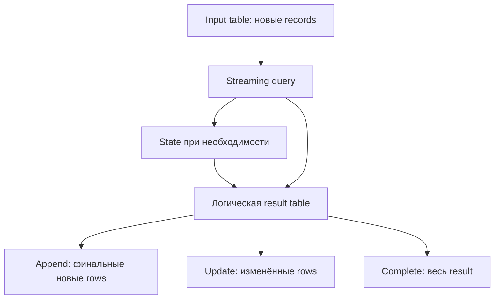
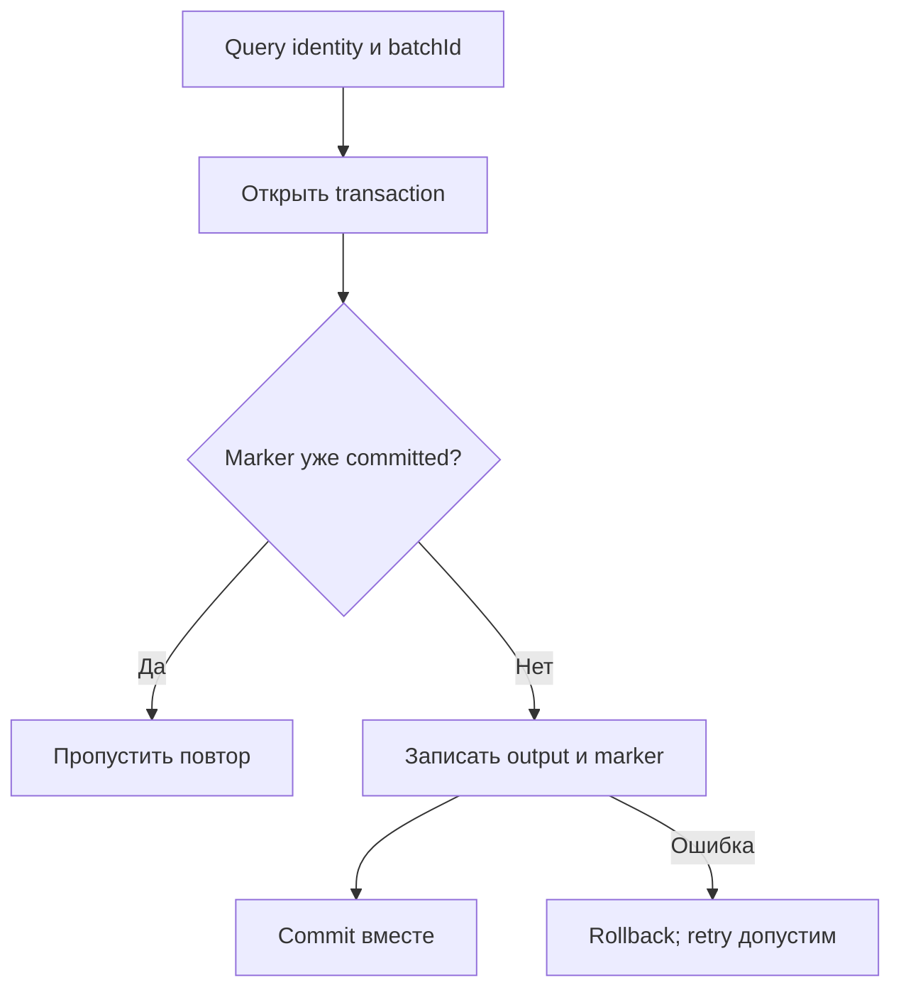
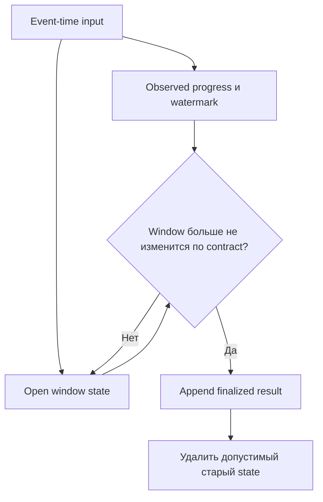
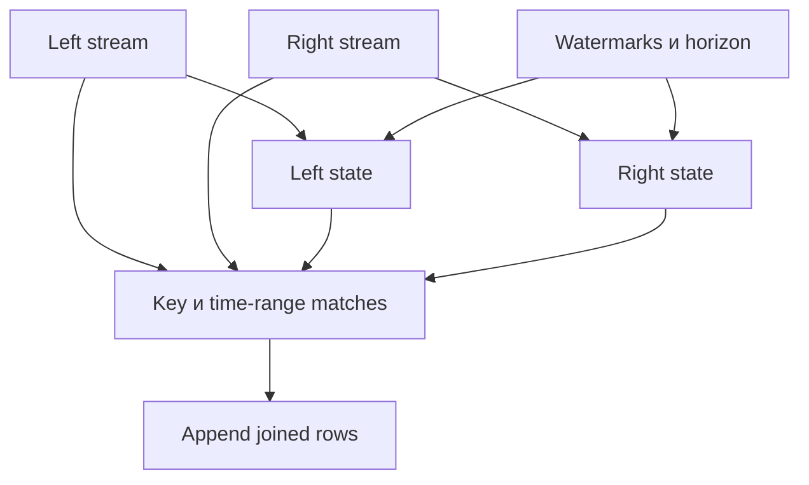
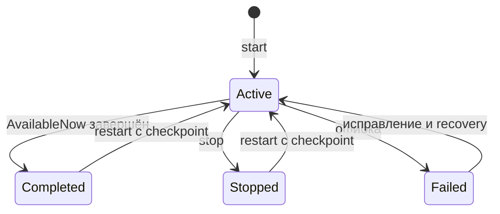

# 15. Основы Structured Streaming

Основной язык примеров — **Python / PySpark**. Проверенное окружение: **Apache Spark 4.2.0, Python 3.12.14, OpenJDK 17.0.20, Spark Classic**, Linux, `local[2]`. Версия зафиксирована: доступность trigger, источников и stateful operations нужно проверять для своего Spark и connector.

Глава объясняет, как запустить поток, выбрать источник и приёмник, управлять временем событий и состоянием, восстановить query из checkpoint и корректно остановить приложение. Все **9 тем и 62 пункта README сохранены в исходном порядке**, включая формулировки в скобках. Используются три уровня заголовков: раздел → тема → пункт; задания и вопросы находятся внутри пунктов.

**Содержание**

1. [Модель потоковой обработки](#streaming-model)
2. [Первый streaming query](#first-query)
3. [Источники потока](#stream-sources)
4. [Приёмники и режимы вывода](#sinks-output-modes)
5. [Triggers](#triggers)
6. [Время событий и watermark](#event-time-watermark)
7. [Оконные агрегаты потока](#stream-windows)
8. [Потоковые join и дедупликация](#joins-deduplication)
9. [Управление несколькими queries](#multiple-queries)

**Как выполнить примеры**

Установи JDK 17, проверь доступность `java` и используй полный PySpark, который запускает локальную JVM. Нужны права на создание временного каталога и локальных файлов. Для лаборатории достаточно одного компьютера; Kafka broker и внешние таблицы не требуются.

```bash
java -version
python -m venv .venv
source .venv/bin/activate
python -m pip install pyspark==4.2.0
# Скопируй Python-блоки главы в файл в порядке появления:
python chapter15_lab.py
```

Команды активации окружения рассчитаны на Linux/macOS/WSL. Выполняй все Python-блоки сверху вниз в **одной чистой сессии**, без существующего SparkContext и queries. Первый блок создаёт `spark`, схему событий, временный каталог `lab` и helpers. Последний останавливает приложение и удаляет только этот каталог. Проверки через `assert` фиксируют ожидаемые результаты; не запускай лабораторию с `python -O`.

File source выбран для управляемых опытов: мы публикуем новые immutable JSON-файлы и сами задаём event time. Большинство queries используют AvailableNow и завершаются. Запросы с default/ProcessingTime trigger останавливаются через `finally`; `finish` ограничивает ожидание завершения. `rate` проверяется с ограниченным ожиданием, без обещания точного числа строк за секунду.

Настройки `local[2]`, двух shuffle partitions, UTC, FAIR scheduler, отключённого AQE и `spark.python.use.daemon=false` служат воспроизводимости лаборатории. Они не являются универсальным набором production defaults. Локальные `collect()` и SQLite используются только для маленьких, явно ограниченных fixtures; переносить такой sink на большой поток без переработки нельзя.

**Что проверено.** Выполнены локальные streaming queries и проверки результата, состояния, watermark, restart и query lifecycle. Шаблоны Kafka и внешних таблиц помечены отдельно: их определения и схемы проверяются, но они требуют установленного connector и инфраструктуры для фактического read/write. Для Continuous и Real-time Mode проверены API и указанные ограничения; поддерживаемый production pipeline этих режимов здесь не запускается. Полные границы проверки перечислены в последнем пункте.

Официальные отправные страницы: [Structured Streaming](https://spark.apache.org/docs/4.2.0/streaming/index.html), [Programming guide](https://spark.apache.org/docs/4.2.0/streaming/apis-on-dataframes-and-datasets.html), [Kafka integration](https://spark.apache.org/docs/4.2.0/streaming/structured-streaming-kafka-integration.html), [PySpark API](https://spark.apache.org/docs/4.2.0/api/python/reference/index.html).


<a id="streaming-model"></a>

## Модель потоковой обработки


### Ограниченные и неограниченные наборы данных

Batch DataFrame описывает конечный набор: можно выполнить action и получить итог всех его строк. Streaming DataFrame описывает источник, который может продолжать пополняться. У него есть схема и преобразования, но «собрать весь бесконечный результат» нельзя.

Неограниченность относится к модели источника, а не к тому, что приложение обязано работать вечно. `AvailableNow` обрабатывает доступную к началу запуска часть потока и завершает query, сохраняя progress для следующего запуска.

| Свойство | Batch | Streaming |
| --- | --- | --- |
| Input boundary | Заданный конечный dataset/snapshot | Продолжающийся источник с progress |
| Запуск | Action | `writeStream.start()` |
| Результат | Итог выбранного input | Обновляющаяся result table/output |
| Recovery | Новый запуск по договору приложения | Source progress, checkpoint, state и sink contract |

**Лабораторная основа.** File source позволяет точно задавать новые данные, event time и моменты их публикации. Все paths локальны и предназначены для `local[2]`.

```python
import contextlib
import datetime as dt
import inspect
import io
import json
import os
import shutil
import sys
import tempfile
import time
import uuid
from pathlib import Path

import pyspark
from pyspark.sql import SparkSession, functions as F, types as T, Window
from pyspark.sql.streaming import DataStreamWriter, StreamingQuery

lab = Path(tempfile.mkdtemp(prefix="spark_ch15_"))
staging = lab / "staging"
staging.mkdir()
spark = (
    SparkSession.builder.master("local[2]")
    .appName("Spark Zero to Hero - Chapter 15")
    .config("spark.scheduler.mode", "FAIR")
    .config("spark.sql.shuffle.partitions", "2")
    .config("spark.sql.session.timeZone", "UTC")
    .config("spark.sql.adaptive.enabled", "false")
    .config("spark.python.use.daemon", "false")
    .config("spark.ui.showConsoleProgress", "false")
    .getOrCreate()
)
sc = spark.sparkContext
sc.setLogLevel("ERROR")
assert spark.version == "4.2.0"

event_schema = T.StructType([
    T.StructField("event_id", T.StringType()),
    T.StructField("key", T.StringType()),
    T.StructField("value", T.LongType()),
    T.StructField("event_time", T.TimestampType()),
])
base_time = dt.datetime(2026, 1, 1, tzinfo=dt.timezone.utc)

def event(event_id, minute, key="a", value=1):
    timestamp = base_time + dt.timedelta(minutes=minute)
    return {"event_id": event_id, "key": key, "value": value,
            "event_time": timestamp.isoformat()}

def new_input(name):
    path = lab / "inputs" / name
    path.mkdir(parents=True)
    return path

def publish(path, filename, records):
    # Atomic rename в пределах одного локального filesystem.
    destination = path / filename
    assert not destination.exists(), "Input files are immutable"
    temporary = staging / (uuid.uuid4().hex + ".json")
    temporary.write_text("".join(json.dumps(r) + "\n" for r in records), encoding="utf-8")
    os.replace(temporary, destination)
    return destination

def file_stream(path, schema=event_schema, max_files=None):
    reader = spark.readStream.schema(schema)
    if max_files is not None:
        reader = reader.option("maxFilesPerTrigger", max_files)
    return reader.json(str(path))

def checkpoint(name):
    return lab / "checkpoints" / name

def finish(query, timeout=60):
    try:
        if not query.awaitTermination(timeout):
            raise TimeoutError("Streaming query did not finish")
        error = query.exception()
        if error is not None:
            raise error
        return query
    finally:
        if query.isActive:
            query.stop()

def start_file(df, name, output=None, cp=None, trigger="availableNow"):
    output = output or (lab / "outputs" / name)
    cp = cp or checkpoint(name)
    writer = (df.writeStream.format("parquet").outputMode("append")
              .queryName(name).option("path", str(output))
              .option("checkpointLocation", str(cp)))
    if trigger == "availableNow":
        writer = writer.trigger(availableNow=True)
    elif trigger == "once":
        writer = writer.trigger(once=True)
    elif trigger != "default":
        writer = writer.trigger(processingTime=trigger)
    return writer.start(), output, cp

def run_file(df, name, output=None, cp=None):
    query, output, cp = start_file(df, name, output, cp)
    finish(query)
    return query, output, cp

def read_output(path, schema):
    # Явная схема позволяет прочитать и output с пока нулевым числом rows.
    return spark.read.schema(schema).parquet(str(path))

def progress_records(query):
    return [json.loads(p.json) for p in query.recentProgress]

@contextlib.contextmanager
def sql_conf(**settings):
    previous = {k: spark.conf.get(k, None) for k in settings}
    try:
        for k, v in settings.items():
            spark.conf.set(k, str(v).lower() if isinstance(v, bool) else str(v))
        yield
    finally:
        for k, v in previous.items():
            if v is None:
                spark.conf.unset(k)
            else:
                spark.conf.set(k, v)

basic_input = new_input("basic")
basic_records = [event("e1", 1, "a", 10), event("e2", 2, "a", 20),
                 event("e3", 11, "b", 30)]
publish(basic_input, "batch-001.json", basic_records)
batch_events = spark.read.schema(event_schema).json(str(basic_input))
stream_events = file_stream(basic_input)
assert not batch_events.isStreaming and stream_events.isStreaming
assert batch_events.count() == 3
print({"Spark": spark.version, "Python": sys.version.split()[0],
       "session_timezone": spark.conf.get("spark.sql.session.timeZone")})
```

`publish` создаёт новый immutable file и атомарно помещает его в input directory. На object storage atomic rename может иметь другой контракт: production publication выполняется по правилам конкретного storage/connector.

**Практика.** Назови границу input для batch и для одного AvailableNow запуска. **Самопроверка:** становится ли streaming DataFrame batch DataFrame только потому, что query автоматически завершилась?


### Поток как непрерывно пополняемая таблица

Удобная модель Structured Streaming: input — постоянно пополняющаяся таблица, query — преобразование этой таблицы, result table — её логический результат. Sink публикует выбранную часть изменений result table в соответствии с output mode.

Result table не обязана существовать как физическая таблица в catalog. Stateless projection может выпускать новые строки сразу; running aggregation хранит state и обновляет прежние ключи; Append event-time aggregation может ждать финализации окна.



Представим e1=10 и e2=20 для key=a. Running sum после e1 равна 10, после e2 — 30. Update отправляет изменённое значение 30, Complete может отправить весь текущий набор ключей; это не «добавить 30 к прошлому 10» на стороне потребителя. Sink должен понимать форму результата.

**Самопроверка:** почему append в Kafka/файл не означает автоматически append semantics бизнес-таблицы с агрегатами?


### Incremental execution поверх Spark SQL

Spark строит incremental execution plan: новые input ranges обрабатываются вместе с необходимым state, вместо полного повторного чтения всей истории на каждом trigger. Built-in SQL expressions, projection, filter, aggregation и поддерживаемые joins используют тот же SQL engine, но streaming adds progress/state constraints.

```python
incremental_counts = stream_events.groupBy("key").count()
assert incremental_counts.isStreaming
query = (incremental_counts.writeStream.format("memory")
         .queryName("incremental_counts").outputMode("complete")
         .option("checkpointLocation", str(checkpoint("incremental_counts")))
         .trigger(availableNow=True).start())
finish(query)
assert {r.key: r["count"] for r in spark.table("incremental_counts").collect()} == {
    "a": 2, "b": 1,
}
assert any(p["stateOperators"] for p in progress_records(query))
```

Выполнена реальная streaming aggregation и проверены result/state metrics. Memory sink — только учебное наблюдение, не durable publication. State может расти с числом ключей даже при компактном output.

Incremental не означает «любая batch-функция автоматически поддерживается». Global sorting всех будущих rows и immediate `collect()` бесконечного DataFrame требуют другой семантики. Unsupported operations проверяются analyzer/stream execution.

**Самопроверка:** чем running `groupBy().count()` отличается от вызова `stream_events.count()`?


### Micro-batch и Continuous Processing

Default micro-batch engine делит progress на batches: фиксирует source ranges, выполняет computation, публикует результат и сохраняет progress/state. При подходящих replayable source и sink contract он может обеспечить exactly-once result semantics, но внешние side effects требуют собственного договора.

Continuous Processing — отдельный experimental режим с long-running tasks и асинхронным checkpointing. Интервал `continuous="5 seconds"` означает checkpoint interval, а не обычный micro-batch trigger interval. Поддерживаемые operations/sources/sinks существенно уже; documented guarantee — at-least-once.

| Свойство | Micro-batch | Continuous Processing |
| --- | --- | --- |
| Execution boundary | Последовательность batches | Long-running processing tasks |
| Trigger interval | Планирование batch | Checkpoint interval |
| Stateful SQL | Широкий поддерживаемый набор | Сильные ограничения |
| Guarantee | Зависит от source/sink, possible exactly-once | At-least-once по контракту режима |

```python
assert "continuous" in inspect.signature(DataStreamWriter.trigger).parameters
continuous_trigger = sc._jvm.org.apache.spark.sql.streaming.Trigger.Continuous("5 seconds")
assert "Continuous" in continuous_trigger.getClass().getSimpleName()
```

Проверен trigger API, Continuous execution здесь не запускается. Большинство лабораторных stateful examples относятся к micro-batch; нельзя менять trigger и ожидать ту же support matrix.

**Документация:** [Continuous Processing](https://spark.apache.org/docs/4.2.0/streaming/apis-on-dataframes-and-datasets.html#continuous-processing).

**Самопроверка:** почему маленький processingTime interval не превращает micro-batch в Continuous Processing?


### Real-time Mode и Trigger.RealTime: модель исполнения, отличие от других triggers и первоначальная поддержка в Spark 4.1 (добавлено по проверке полноты)

Real-time Mode использует свой execution path для уменьшения latency: данные могут продвигаться через pipeline внутри batch, а не только после закрытия обычного короткого micro-batch. `Trigger.RealTime` задаёт **batch duration** этого режима; это не synonym Continuous Processing checkpoint interval.

JVM `Trigger.RealTime` присутствует в официальном API Spark 4.1, где он отмечен experimental. PySpark параметр главы относится к 4.2. Для используемой версии ниже проверяем фактический JVM API. Поддержка конкретных plans/source/sink проверяется отдельно: наличие constructor не гарантирует поддержку произвольной query.

```python
real_time_trigger = sc._jvm.org.apache.spark.sql.streaming.Trigger.RealTime("5 seconds")
assert "RealTime" in real_time_trigger.getClass().getSimpleName()
print("JVM RealTime trigger", real_time_trigger.toString())
```

Не выбирай Real-time Mode только по названию. Сравни поддерживаемые operators, number of simultaneously required task slots, state/recovery, source/sink implementation и необходимую latency. Resource requirements pipeline могут отличаться от short micro-batches.

В этой лаборатории проверяется trigger construction; real-time query с поддерживаемыми внешними источниками не исполняется. Main streaming guide и API reference могут различаться полнотой описания нового режима; ориентируйся на target-version APIs и проверку конкретного plan.

**Документация:** [JVM Trigger 4.2](https://spark.apache.org/docs/4.2.0/api/java/org/apache/spark/sql/streaming/Trigger.html), [JVM Trigger 4.1](https://spark.apache.org/docs/4.1.0/api/java/org/apache/spark/sql/streaming/Trigger.html), [PySpark trigger](https://spark.apache.org/docs/4.2.0/api/python/reference/pyspark.ss/api/pyspark.sql.streaming.DataStreamWriter.trigger.html).

**Самопроверка:** какое именно время задаёт RealTime duration и почему оно не обещает такую же end-to-end latency каждой строки?


### Throughput, latency и свежесть результата

Throughput — records/bytes в единицу времени; latency — задержка обработки выбранного события/результата; freshness — насколько опубликованные данные отстают от нужного consumer reference time. Эти показатели связаны, но не совпадают.

```python
input_rate = 1000
processing_capacity = 1400
backlog_records = 12000
assert backlog_records / (processing_capacity - input_rate) == 30
assert processing_capacity > input_rate
```

Это условный steady-rate catch-up calculation, не измерение Spark. Высокий throughput может сочетаться с большим accumulated backlog. Окно в Append mode может иметь хорошую processing latency, но ждать watermark перед публикацией и давать большую result freshness delay.

`inputRowsPerSecond` и `processedRowsPerSecond` в progress имеют engine-specific расчёт и не заменяют end-to-end event latency. Для SLA полезны source lag, ingestion-to-sink delay, event-time delay, watermark lag, state size и sink commit duration.

**Практика.** Раздели SLA «событие видно в отчёте через минуту» на source, processing, finalization и sink visibility. **Самопроверка:** почему рост processedRowsPerSecond не обязательно улучшает freshness?


### Различия streaming и периодического batch

Periodic batch обычно каждый раз сам выбирает input interval/snapshot и управляет воспроизведением. Streaming query сохраняет источник progress и state по своему checkpoint contract. AvailableNow позволяет организовать периодические streaming runs, не превращая их в обычные независимые batch reads.

| Workflow | Что сохраняется между запусками | Основной вопрос |
| --- | --- | --- |
| Независимый batch | То, что приложение явно запишет | Как выбран interval/snapshot и исключены duplicates? |
| Long-running streaming | Checkpoint, offsets/state/commits | Как удерживаются latency и state budget? |
| Периодический AvailableNow | Тот же streaming checkpoint | Как догнать новые available inputs и завершиться? |

Если каждый hourly run удаляет checkpoint и перечитывает source, он теряет эту streaming continuity и может повторить output. Если ordinary batch сам ведёт transactional progress, у него может быть корректный свой recovery contract — сравни механизмы, а не названия.

**Практика темы.** Выбери long-running или scheduled AvailableNow для источника файлов, приходящих раз в час. **Самопроверка:** почему наличие расписания не определяет batch/streaming semantics?


<a id="first-query"></a>

## Первый streaming query


### readStream, writeStream и isStreaming

`spark.readStream` создаёт streaming DataFrame, `df.writeStream` — writer, `start()` — running query. `isStreaming` — свойство DataFrame в PySpark; вызов `isStreaming()` относится к другим API, здесь он неверен.

```python
assert stream_events.isStreaming is True
assert isinstance(stream_events.writeStream, DataStreamWriter)
first_query, first_output, first_cp = run_file(stream_events, "first_stream")
assert not first_query.isActive
assert read_output(first_output, event_schema).count() == 3
```

Writer ещё не выполняет query. Планы можно строить и проверять до запуска; несколько writer chains от одного DataFrame создают **отдельные queries** при start, со своими progress и sinks.

**Документация:** [DataStreamReader](https://spark.apache.org/docs/4.2.0/api/python/reference/pyspark.ss/api/pyspark.sql.streaming.DataStreamReader.html), [DataStreamWriter](https://spark.apache.org/docs/4.2.0/api/python/reference/pyspark.ss/api/pyspark.sql.streaming.DataStreamWriter.html).

**Самопроверка:** что из reader, DataFrame, writer и StreamingQuery соответствует уже запущенной работе?


### Явная схема потокового источника

File streaming обычно требует явную схему: future files должны обрабатываться по стабильному договору, а не менять типы из-за другой выборки. В лаборатории `event_time` — TimestampType, `value` — LongType, event ID и key — strings.

```python
assert stream_events.schema == event_schema
assert isinstance(stream_events.schema["event_time"].dataType, T.TimestampType)
typed_rows = batch_events.orderBy("event_id").collect()
assert typed_rows[0].value == 10
assert batch_events.filter("event_id = 'e1'").select(
    F.date_format("event_time", "yyyy-MM-dd HH:mm:ss")
).first()[0] == "2026-01-01 00:01:00"
```

Collected timestamp в Classic может быть naive Python datetime; его conversion также зависит от Python/OS timezone. Для воспроизводимой проверки выше время форматируется SQL expression в явно заданной UTC session. Не приписывай naive datetime timezone только по настройке SQL session.

Malformed records, missing fields и parsing mode нужно обрабатывать явно. Nullable schema не доказывает, что ключ/время фактически заполнены. Schema evolution поддерживает connector/table format, а checkpoint state schema имеет отдельные ограничения совместимости.

**Практика.** Определи действие для null event_id, неверной даты и отсутствующего value. **Самопроверка:** почему inference по первому file не является полноценным schema contract будущего потока?


### Трансформации streaming DataFrame

Поддерживаемые stateless transformations включают filter, select и built-in expressions. Здесь сохраняем положительные values и переводим их в другой числовой scale. Такие operations не требуют хранить всю прошлую историю.

```python
transformed_stream = (stream_events.filter(F.col("value") > 0)
    .select("event_id", "key", "event_time", (F.col("value") * 2).alias("scaled")))
transformed_query, transformed_output, _ = run_file(transformed_stream, "transformed")
actual_scaled = {r.event_id: r.scaled
                 for r in read_output(transformed_output, transformed_stream.schema).collect()}
assert actual_scaled == {"e1": 20, "e2": 40, "e3": 60}
```

Use SQL expressions вместо row UDF, когда семантика выражается ими: engine видит schema и operations. UDF side effects/ nondeterminism не получают exactly-once только потому, что writer имеет checkpoint.

Filter event_time до stateful operation влияет на максимальный observed event time и watermark. Projection должна сохранить event-time column/metadata там, где downstream stateful operator использует watermark.

**Самопроверка:** почему «state отсутствует у filter» не означает отсутствие checkpoint/progress в query?


### queryName, start и StreamingQuery

`queryName` задаёт человекочитаемое имя, уникальное среди active queries соответствующей session; memory sink использует его также как имя учебной SQL table. `start()` возвращает `StreamingQuery`, у которой есть ID, runId, status, progress и lifecycle methods.

```python
named_query, named_output, _ = start_file(stream_events, "named_query")
assert isinstance(named_query, StreamingQuery)
assert named_query.name == "named_query"
assert named_query.id and named_query.runId
finish(named_query)
assert named_query.exception() is None
assert isinstance(named_query.status, dict)
assert read_output(named_output, event_schema).count() == 3
```

Имя не заменяет checkpoint identity. Query ID сохраняется при корректном restart с тем же checkpoint, runId меняется; это проверяется в последней теме. Path checkpoint не выбирается автоматически из queryName в наших examples.

**Самопроверка:** можно ли дважды использовать одно имя после завершения первого query и почему это не означает продолжение его state?


### awaitTermination, stop и обработка ошибки

`awaitTermination(timeout)` ждёт completion и возвращает bool при заданном timeout; error query может вызвать StreamingQueryException. `stop()` просит остановить active query. Обрабатывай ошибки и всегда освобождай query при timeout/выходе из scope.

**Ожидаемая ошибка callback:**

```python
def intentional_failure(batch_df, batch_id):
    raise RuntimeError("expected streaming callback failure")

failed_query = (stream_events.writeStream.foreachBatch(intentional_failure)
                .option("checkpointLocation", str(checkpoint("expected_failure")))
                .trigger(availableNow=True).start())
failure_observed = False
try:
    failed_query.awaitTermination(30)
except Exception as error:
    failure_observed = "expected streaming callback failure" in str(error)
finally:
    if failed_query.isActive:
        failed_query.stop()
assert failure_observed
assert failed_query.exception() is not None
assert spark.range(5).count() == 5
```

Ошибка deliberate и локальная; она проверяет propagation/lifecycle, не имитирует container loss. Работа остальных computations в SparkSession продолжается. Orchestrator должен трактовать такой termination как failure, не просто как «await finished».

Не оставляй query running после notebook exception. Для bounded AvailableNow helper `finish` делает cleanup; для long-running service устанавливай остановку через собственный signal/lifecycle и recovery policy.

**Самопроверка:** почему returned True и успешно завершённое бизнес-вычисление — не одно и то же без exception/result checks?


### Тестовый поток rate и проверка результата

`rate` генерирует timestamp/value с ориентиром на wall-clock rate. Он удобен для smoke test и throughput experiments, но точное количество rows за две секунды зависит от startup, trigger scheduling и текущей нагрузки.

```python
rate_df = (spark.readStream.format("rate").option("rowsPerSecond", 5)
           .option("numPartitions", 1).load())
rate_seen = []
def inspect_rate_batch(batch_df, batch_id):
    rows = batch_df.select("value").collect()  # Только маленький тестовый rate.
    rate_seen.extend(r.value for r in rows)

rate_query = (rate_df.writeStream.foreachBatch(inspect_rate_batch)
              .option("checkpointLocation", str(checkpoint("rate_smoke")))
              .trigger(processingTime="1 second").start())
try:
    deadline = time.monotonic() + 30
    while not rate_seen and time.monotonic() < deadline:
        if rate_query.exception() is not None:
            raise rate_query.exception()
        time.sleep(0.1)
    assert rate_seen and all(isinstance(v, int) for v in rate_seen)
    assert len(set(rate_seen)) == len(rate_seen)
finally:
    rate_query.stop()
assert not rate_query.isActive
```

Проверяются наличие records, типы и uniqueness, а не brittle «ровно 10 rows через 2s». `processAllAvailable()` для постоянно генерирующего источника не следует понимать как гарантированно быстрый bounded action. Для точных values/row count используется file source или rate-micro-batch.

**Практика темы.** Запусти bounded file query, проверь values/schema/progress и stop. **Самопроверка:** почему assertions по wall-clock rate должны учитывать startup и timing variability?


<a id="stream-sources"></a>

## Источники потока


### File source и требования к публикации новых файлов

File source отслеживает **новые files**, а не tail каждой строки уже открытого file. Публикуй законченный файл атомарно по контракту filesystem и затем не изменяй его. Append в старый CSV/JSON не является корректным способом поступления новых events.

```python
file_input = new_input("file_source")
publish(file_input, "001.json", [event("f1", 1)])
publish(file_input, "002.json", [event("f2", 2), event("f3", 3)])
limited_file_stream = file_stream(file_input, max_files=1)
file_query, file_output, _ = run_file(limited_file_stream, "file_source")
assert read_output(file_output, event_schema).count() == 3
data_batches = [p for p in progress_records(file_query) if p["numInputRows"] > 0]
assert len(data_batches) == 2
assert sorted(p["numInputRows"] for p in data_batches) == [1, 2]
```

`maxFilesPerTrigger` ограничивает число files, а не rows. Один огромный file всё равно может создать тяжёлую работу. В Spark 4.2 есть также `maxBytesPerTrigger`; эти два limits нельзя одновременно задавать для file source, а один file может быть прочитан даже сверх bytes limit ради progress.

`latestFirst`, file age и cleanSource меняют discovery/retention; не включай их без понимания replay. Deletion/archive source после processing может лишить другого reader истории. Publication, checkpoint и sink paths должны быть разными.

**Самопроверка:** почему overwriting прочитанного `001.json` не является новым event batch?


### Kafka source и подключение отдельного модуля

Kafka source требует отдельный Spark connector и его JVM dependencies. Для Spark 4.2.0/Scala 2.13 coordinate — `org.apache.spark:spark-sql-kafka-0-10_2.13:4.2.0`; Python package `kafka-python` не устанавливает этот datasource в Spark.

```bash
# Deployment template: нужны broker, topic, connector dependencies и kafka_app.py.
spark-submit \
  --packages org.apache.spark:spark-sql-kafka-0-10_2.13:4.2.0 \
  kafka_app.py
```

```python
def kafka_input(session, bootstrap_servers, topic):
    # Шаблон для окружения с connector и broker; в local lab не вызывается.
    return (session.readStream.format("kafka")
            .option("kafka.bootstrap.servers", bootstrap_servers)
            .option("subscribe", topic)
            .option("startingOffsets", "earliest").load())

def decode_kafka(raw):
    return (raw.withColumn("event", F.from_json(F.col("value").cast("string"), event_schema))
            .select(F.col("topic").alias("kafka_topic"),
                    F.col("partition").alias("kafka_partition"),
                    F.col("offset").alias("kafka_offset"), "event.*"))

# Проверяем parsing Kafka payload/metadata на bounded native SQL fixture.
raw_fixture = spark.range(1).select(
    F.lit(json.dumps(event("k1", 1, "a", 7))).cast("binary").alias("value"),
    F.lit("events").alias("topic"), F.lit(0).cast("int").alias("partition"),
    F.lit(42).cast("long").alias("offset"),
)
decoded = decode_kafka(raw_fixture).first()
assert decoded.event_id == "k1" and decoded.value == 7
assert decoded.kafka_offset == 42
```

Kafka key/value в source — binary; topic/partition/offset полезны для диагностики и transport identity. Broker timestamp не обязательно равен business event time payload. `startingOffsets` влияет на новый query; restart с checkpoint обычно продолжает сохранённые offsets.

Source checkpoint не управляет Kafka retention: удалённые offsets нельзя вернуть только восстановлением checkpoint. `failOnDataLoss=false` не восстанавливает потерянные records; оно меняет reaction на обнаруженную проблему.

| Поле Kafka source | Тип | Назначение |
| --- | --- | --- |
| key/value | binary | Transport payload; decoding задаёт приложение |
| topic/partition/offset | string/int/long | Position и диагностика replay |
| timestamp | timestamp | Kafka timestamp по broker/producer contract |
| timestampType | int | Тип Kafka timestamp |
| headers при includeHeaders | array | Дополнительные message attributes |

**Проверка:** parsing выполнен; Kafka reader definition не подключается к broker. **Документация:** [Kafka integration 4.2](https://spark.apache.org/docs/4.2.0/streaming/structured-streaming-kafka-integration.html).

**Самопроверка:** почему `(topic, partition, offset)` и business event_id отвечают на разные вопросы deduplication?


### rate и rate-micro-batch для тестирования

`rate` зависит от elapsed time и ориентируется на rowsPerSecond. `rate-micro-batch` выдаёт согласованный набор values на batch, задаваемый `rowsPerBatch`, независимо от скорости выполнения. Он удобен для deterministic API tests, но не является реалистичной моделью source retention/late data.

```python
rate_micro = (spark.readStream.format("rate-micro-batch")
              .option("rowsPerBatch", 8).option("numPartitions", 2)
              .option("startTimestamp", 0).option("advanceMillisPerBatch", 1000).load())
rate_micro_values = []
def capture_rate_micro(batch_df, batch_id):
    rate_micro_values.extend(r.value for r in batch_df.select("value").collect())

micro_query = (rate_micro.writeStream.foreachBatch(capture_rate_micro)
               .option("checkpointLocation", str(checkpoint("rate_micro")))
               .trigger(once=True).start())
finish(micro_query)
assert sorted(rate_micro_values) == list(range(8))
```

Once использован намеренно для одного bounded batch источника, который продолжает генерировать данные. AvailableNow support зависит от source; fallback может иметь иной batching behavior. Основные exact input tests этой главы используют file source, у которого граница available files известна.

**Практика.** Сравни value ranges rate-micro-batch для двух consecutive batches. **Самопроверка:** почему синтетический rate не проверяет Kafka lag, offsets retention и duplicate delivery?


### Socket source и отсутствие production-гарантий

Socket source читает текст с TCP endpoint и предназначен для разработки. У него нет production replay/fault-tolerance contract: bytes из живого socket нельзя гарантированно перечитать после failure по Spark checkpoint.

```python
socket_preview = (spark.readStream.format("socket")
                  .option("host", "127.0.0.1").option("port", 9999).load())
assert socket_preview.isStreaming
assert socket_preview.schema.simpleString() == "struct<value:string>"
```

Проверено создание reader/schema; socket query не запускается и не требует local server. Для ручного smoke test запусти TCP text server, направь writer в console и останови query. Такое упражнение демонстрирует API, а не проверяет recovery.

TCP delivery guarantees отдельной connection не равны replayable source guarantees между query runs. Потеря connection, restart producer и duplicate sends требуют application-level protocol, которого test datasource не предоставляет.

**Самопроверка:** почему checkpoint не превращает socket source в Kafka-like журнал?


### Табличные streaming sources конкретного table format

Табличный streaming source зависит от table format/connector. Возможны append-only incremental reads, changelog/CDC, snapshot semantics, schema evolution и собственные правила удаления истории. Нельзя переносить file-directory semantics на любой catalog table.

`spark.readStream.table(name)` существует как public API, но конкретная table должна поддерживать streaming read. Возможность batch read через `spark.table` не доказывает streaming capability, а file V1 table может вести себя иначе, чем V2 snapshot-aware connector.

```python
assert callable(spark.readStream.table)
table_reader_signature = inspect.signature(type(spark.readStream).table)
assert "tableName" in table_reader_signature.parameters
```

Проверен API signature, external table format не установлен. При выборе source уточни, как представлены deletes/updates, что считается position/offset, как долго доступны snapshots/change records и какие changes можно сделать при restart.

Для reproducible pipeline document connector version, table identity, initial position и checkpoint compatibility. Renaming/recreating таблицы с тем же display name может означать другой source identity.

**Практика.** Составь source contract для append-only table и CDC table. **Самопроверка:** почему column `operation='delete'` не удаляет automatically ранее опубликованный row в arbitrary sink?


### Replayable sources и доступность истории для восстановления

Replayable source позволяет снова получить тот же диапазон input по сохранённой position, пока история доступна. Checkpoint хранит progress references, а actual data живут в source/storage. Удалённый file или expired Kafka offsets могут сделать recovery невозможным.

**Повторный AvailableNow с тем же checkpoint:**

```python
replay_input = new_input("replay")
publish(replay_input, "001.json", [event("r1", 1)])
replay_df = file_stream(replay_input)
replay_q1, replay_output, replay_cp = run_file(replay_df, "replay_first")
assert read_output(replay_output, event_schema).count() == 1
publish(replay_input, "002.json", [event("r2", 2)])
replay_q2, _, _ = run_file(replay_df, "replay_second", replay_output, replay_cp)
assert sorted(r.event_id for r in read_output(replay_output, event_schema).collect()) == [
    "r1", "r2",
]
assert replay_q1.id == replay_q2.id and replay_q1.runId != replay_q2.runId
```

Проверен query restart в одной SparkSession: ранее committed file не публикуется второй раз. Это не process-crash test и не доказательство гарантий external sink.

Retention должен покрывать downtime + detection + recovery + catch-up. Запас streaming state/checkpoint без доступного source history недостаточен. Убедись также, что parsing/transformations воспроизводимы для повторённого input.

| Source | Progress/история | Основная граница |
| --- | --- | --- |
| Immutable files | Discovery/checkpoint и сохранённые files | Удаление/изменение прочитанных данных нарушает replay |
| Kafka | Topic-partition offsets и retained log | Retention/удаление topic может лишить истории |
| rate | Synthetic progress | Проверяет APIs, не production business source |
| rate-micro-batch | Детерминированные synthetic batches | Не моделирует настоящий duplicate/late/replay поток |
| Socket | Живая TCP connection | Не имеет recovery replay contract |
| Table connector | Snapshot/change position конкретного format | Требует собственного read/retention договора |

**Практика темы.** Рассчитай минимальную source retention для worst-case outage и catch-up. **Самопроверка:** почему exactly-once computation невозможна только одним offsets file, если input был физически удалён?


<a id="sinks-output-modes"></a>

## Приёмники и режимы вывода


### Append, Update и Complete

Output mode определяет, какие rows логической result table выпускаются: Append — новые rows, которые больше не должны изменяться; Update — изменённые rows; Complete — весь текущий result. Sink должен поддерживать выбранный mode и понимать его значение.

**Контраст Complete/Update на двух micro-batches:**

```python
mode_snapshots = {}
for mode in ("complete", "update"):
    mode_input = new_input("mode_" + mode)
    publish(mode_input, "001.json", [event("m1", 1, "a")])
    publish(mode_input, "002.json", [event("m2", 2, "b")])
    snapshots = []
    def capture_counts(batch_df, batch_id):
        rows = {r.key: r["count"] for r in batch_df.collect()}
        if rows:
            snapshots.append((batch_id, rows))
    mode_query = (file_stream(mode_input, max_files=1).groupBy("key").count()
                  .writeStream.foreachBatch(capture_counts).outputMode(mode)
                  .option("checkpointLocation", str(checkpoint("mode_" + mode)))
                  .trigger(availableNow=True).start())
    finish(mode_query)
    mode_snapshots[mode] = snapshots
assert mode_snapshots["complete"][-1][1] == {"a": 1, "b": 1}
assert all(len(rows) == 1 for _, rows in mode_snapshots["update"])
upserted = {}
for _, rows in mode_snapshots["update"]:
    upserted.update(rows)
assert upserted == {"a": 1, "b": 1}
```

Порядок чтения двух файлов не фиксируется в assertions: независимо от него Complete последний раз имеет оба keys, Update передаёт только изменённый key каждого batch. Потребитель Update применяет replacement/upsert, а не суммирует повторно running counts.

**Самопроверка:** почему два output records `count=1` и `count=2` для одного key обычно не означают итоговую count=3?


### Совместимость output mode с операцией и sink

Stateless map/filter обычно совместим с Append. Running aggregation без watermark не имеет конечного момента для прежнего key, поэтому Append обычно запрещён. Watermarked event-time aggregation может выпускать final windows в Append; Update отдаёт промежуточные изменения; Complete сохраняет всю result table.

| Операция | Append | Update | Complete |
| --- | --- | --- | --- |
| Projection/filter | Да | Возможен, обычно как новые rows | Нет без aggregation |
| Aggregation без event-time finalization | Нет для изменяемого result | Да | Да |
| Watermarked fixed windows | Final windows после watermark | Изменения окон | Весь result без той же eviction semantics |
| Stream-stream join | Поддерживаемый Append path | Не поддерживается | Не поддерживается |

File sink поддерживает Append, console/memory имеют свои mode rules, Kafka writer принимает records и не выполняет semantic upsert бизнес-таблицы автоматически.

| Sink | Публикация | Что проверить для recovery |
| --- | --- | --- |
| Parquet/file sink | Append part-files и commit metadata | Filesystem/metadata/checkpoint contract |
| Kafka | Messages, возможные повторы | Downstream idempotency/business ID |
| Console | Driver logs | Debug output не является durable result |
| Memory | Driver-memory result table | Driver capacity и ограничения восстановления |
| foreach | Side effects отдельных rows | Worker lifecycle, retries и business dedup |
| foreachBatch | Batch callback/writes | Атомарность output/marker и stable batch identity |
| Table connector | Append/upsert/transaction по реализации | Version, isolation, keys и streaming commit semantics |

```python
def expect_start_error(df, name, output_mode, reason=None):
    query = None
    error_seen = False
    try:
        query = (df.writeStream.format("memory").queryName(name)
                 .outputMode(output_mode)
                 .option("checkpointLocation", str(checkpoint(name)))
                 .trigger(availableNow=True).start())
        finish(query)
    except Exception as error:
        message = str(error).lower()
        error_seen = (reason.lower() in message if reason is not None else
                      any(fragment in message for fragment in
                          ("not supported", "unsupported", "not_support")))
    finally:
        if query is not None and query.isActive:
            query.stop()
    assert error_seen, "Expected an unsupported streaming plan/mode"

expect_start_error(stream_events.groupBy("key").count(), "bad_append_aggregate", "append")
```

Это проверка ожидаемого rejection, не отказ корректного production job. При проектировании output сначала сформулируй semantic contract consumer, затем выбирай mode/connector.

**Самопроверка:** почему accepted outputMode не доказывает idempotent behavior внешнего sink?


### File sink и его metadata log

File sink пишет part-files и metadata log `_spark_metadata` с committed output files. CheckpointLocation хранит query progress/state отдельно. Для поддерживаемого file-sink workflow это позволяет читателю учитывать committed output, а не arbitrary files, случайно оказавшиеся рядом.

```python
assert (first_output / "_spark_metadata").is_dir()
assert (first_cp / "offsets").is_dir()
assert (first_cp / "commits").is_dir()
assert read_output(first_output, event_schema).count() == 3
```

Не удаляй metadata log и checkpoint в попытке «почистить мусор» active query. Чтение того же output через разные filesystem listings/tools может иметь разные правила учёта metadata; raw glob не обязательно равен Spark file-sink-aware read.

Append file sink не обновляет прошлый aggregate row в месте. Для mutable business table нужен другой sink/upsert/transaction contract. Event-time Append windows здесь создают immutable finalized records.

**Практика.** Раздели source directory, checkpoint и sink data/metadata в структуре проекта. **Самопроверка:** чем `_spark_metadata` отличается от `checkpoint/offsets`?


### Kafka sink и гарантии доставки

Kafka sink требует key/value как string/binary и routing topic. Поддерживаемый connector writer может повторно отправить records при retries: документированная guarantee Kafka sink — at-least-once. Kafka producer internals не делают весь Spark query автоматически exactly-once для consumer бизнеса.

```python
def kafka_records(df):
    return df.select(
        F.col("event_id").cast("string").alias("key"),
        F.to_json(F.struct("event_id", "key", "value", "event_time")).alias("value"),
    )

kafka_ready = kafka_records(batch_events)
assert kafka_ready.schema.simpleString() == "struct<key:string,value:string>"
assert json.loads(kafka_ready.orderBy("key").first().value)["event_id"] == "e1"

def write_kafka(stream_df, servers, topic, cp_path):
    # Deployment template; нужен внешний broker и connector JARs.
    return (kafka_records(stream_df).writeStream.format("kafka")
            .option("kafka.bootstrap.servers", servers).option("topic", topic)
            .option("checkpointLocation", str(cp_path)).start())
```

Выполнена output projection/serialization, broker write не запускается. Stable event_id позволяет downstream дедупликацию/идемпотентность; key лишь влияет на Kafka partition routing и не удаляет повторное сообщение автоматически.

**Документация:** [Kafka writing](https://spark.apache.org/docs/4.2.0/streaming/structured-streaming-kafka-integration.html#writing-data-to-kafka).

**Самопроверка:** почему одинаковый Kafka key у двух messages не обещает ровно одну обработку их consumer?


### Console и memory sink для разработки

Console sink показывает bounded portion batch output в driver logs; memory sink держит result в driver memory для SQL inspection. Они полезны для smoke tests и объяснения output modes, но не являются production durable storage.

```python
console_query = (stream_events.select("event_id", "value").writeStream.format("console")
                 .option("numRows", 5).option("truncate", False)
                 .option("checkpointLocation", str(checkpoint("console_demo")))
                 .trigger(availableNow=True).start())
finish(console_query)
assert console_query.exception() is None
assert spark.table("incremental_counts").count() == 2
```

Ограничение console numRows относится к отображению, не к объёму вычисления/source read. Memory sink на большом результате может исчерпать driver RAM. Его restart/fault contract не равен file sink; для reliable лабораторных comparisons используется Parquet output.

**Самопроверка:** почему красивый console output не доказывает, что все input rows были опубликованы в durable sink?


### foreach и ForeachWriter

`writeStream.foreach` принимает Python row function либо object с `open(partition_id, epoch_id)`, `process(row)`, `close(error)`. В Scala/Java это соответствует ForeachWriter API; в PySpark не нужно импортировать несуществующий одинаковый base class.

Соединение/ресурс создавай внутри `open`, а не сериализуй открытый client с driver. `process` выполняется в workers. Calls могут повторяться; `(partition_id, epoch_id)` не является универсальным business dedup key, поскольку partitions/results могут измениться при повторе.

```python
foreach_dir = lab / "foreach-output"
foreach_dir.mkdir()

class LocalRowWriter:
    def __init__(self, directory):
        self.directory = directory
    def open(self, partition_id, epoch_id):
        self.target = Path(self.directory) / f"p{partition_id}-e{epoch_id}.jsonl"
        self.temp = Path(self.directory) / (uuid.uuid4().hex + ".tmp")
        self.handle = self.temp.open("w", encoding="utf-8")
        return True
    def process(self, row):
        self.handle.write(json.dumps(row.asDict(), default=str) + "\n")
    def close(self, error):
        self.handle.close()
        if error is None:
            os.replace(self.temp, self.target)
        else:
            self.temp.unlink(missing_ok=True)

foreach_query = (stream_events.writeStream.foreach(LocalRowWriter(str(foreach_dir)))
                 .option("checkpointLocation", str(checkpoint("foreach_demo")))
                 .trigger(availableNow=True).start())
finish(foreach_query)
written_events = [json.loads(line) for path in foreach_dir.glob("*.jsonl")
                  for line in path.read_text().splitlines()]
assert sorted(r["event_id"] for r in written_events) == ["e1", "e2", "e3"]
```

Этот writer использует общий local filesystem `local[2]` и показывает lifecycle. На кластере `/tmp` разных workers не является общим output. Перезапись per-epoch file здесь не считается доказательством exactly-once; production sink требует собственного transaction/idempotency contract.

**Документация:** [foreach](https://spark.apache.org/docs/4.2.0/api/python/reference/pyspark.ss/api/pyspark.sql.streaming.DataStreamWriter.foreach.html).

**Самопроверка:** почему append в Python list driver из process worker не является надёжным сбором результата foreach?


### foreachBatch и использование batch API внутри потока

`foreachBatch` вызывается для micro-batch на driver и получает bounded batch DataFrame плюс batchId. Можно применять batch APIs и connector writes. Default guarantee callback side effects — at-least-once; idempotency можно построить по стабильной identity query и batchId в transactional sink.

**Учебный SQLite sink с атомарным commit output и batch marker:**

```python
import sqlite3

sqlite_path = lab / "foreach_batch.sqlite"
with sqlite3.connect(sqlite_path) as connection:
    connection.execute("CREATE TABLE events (event_id TEXT PRIMARY KEY, key TEXT, value INTEGER)")
    connection.execute("CREATE TABLE commits (query_key TEXT, batch_id INTEGER, PRIMARY KEY(query_key,batch_id))")

def sqlite_batch_sink(batch_df, batch_id):
    query_key = "chapter15-sqlite"
    with sqlite3.connect(sqlite_path) as connection:
        connection.execute("BEGIN IMMEDIATE")
        exists = connection.execute(
            "SELECT 1 FROM commits WHERE query_key=? AND batch_id=?",
            (query_key, batch_id),
        ).fetchone()
        if exists:
            return
        rows = [(r.event_id, r.key, r.value) for r in batch_df.collect()]
        connection.executemany("INSERT OR IGNORE INTO events VALUES (?,?,?)", rows)
        connection.execute("INSERT INTO commits VALUES (?,?)", (query_key, batch_id))

sqlite_query = (stream_events.writeStream.foreachBatch(sqlite_batch_sink)
                .option("checkpointLocation", str(checkpoint("sqlite_sink")))
                .trigger(availableNow=True).start())
finish(sqlite_query)
with sqlite3.connect(sqlite_path) as connection:
    before_count = connection.execute("SELECT COUNT(*) FROM events").fetchone()[0]
    batch_ids = [r[0] for r in connection.execute("SELECT batch_id FROM commits")]
assert before_count == 3 and batch_ids
sqlite_batch_sink(batch_events, batch_ids[0])  # Повтор уже committed batch.
with sqlite3.connect(sqlite_path) as connection:
    assert connection.execute("SELECT COUNT(*) FROM events").fetchone()[0] == 3
```

Rows и commit marker пишутся одной SQLite transaction; повтор marker пропускается. `collect` подходит только трём учебным rows: production batch writes должны быть распределёнными либо иметь обоснованный bounded driver budget. Stable query_key здесь part of sink contract; новый checkpoint/reset batch numbering требует отдельной identity/migration policy.



Для нескольких actions/writes из одного callback persist/unpersist batch может избежать повторного computation; stateful batch надо полностью consume. Callback не поддерживается в Continuous Processing, поскольку нет обычной micro-batch boundary.

**Документация:** [foreachBatch](https://spark.apache.org/docs/4.2.0/api/python/reference/pyspark.ss/api/pyspark.sql.streaming.DataStreamWriter.foreachBatch.html).

**Самопроверка:** почему output write и commit marker в двух независимых transactions оставляют окно для duplicates или missing data?


### Табличные sinks и гарантии конкретного connector

Табличный sink может предоставлять append, upsert/MERGE, schema evolution, transaction и streaming commit semantics. Эти capabilities принадлежат конкретному catalog/table format/connector и его версии. `toTable` — API входа, а не гарантия identical behavior любой таблицы.

```python
assert callable(stream_events.writeStream.toTable)
assert "tableName" in inspect.signature(DataStreamWriter.toTable).parameters
```

External table connector в лаборатории не установлен. Для production проверь output mode, primary/event keys, deduplication commit ID, concurrent writers, isolation, partition/schema changes и restart compatibility. Micro-batch callback с MERGE должен иметь определённую бизнес-семантику updates/deletes и retry.

**Практика темы.** Для append audit log, running aggregate table и external HTTP endpoint опиши разные sink contracts. **Самопроверка:** почему transactional table commit не делает произвольный внешний API call рядом с ним частью той же transaction?


<a id="triggers"></a>

## Triggers


### Запуск micro-batch без заданного интервала

Если trigger не задан, micro-batch query запускает следующий batch после завершения предыдущего настолько быстро, насколько есть работа и позволяет engine. Это не «batch на каждую строку» и не отсутствие commit/checkpoint overhead.

```python
default_query, default_output, _ = start_file(stream_events, "default_trigger", trigger="default")
try:
    default_query.processAllAvailable()  # Конечный текущий набор immutable files.
    assert default_query.isActive
    assert read_output(default_output, event_schema).count() == 3
finally:
    default_query.stop()
assert not default_query.isActive
```

`processAllAvailable` здесь допустим для фиксированных файлов. Query при этом не завершилась сама: она могла бы принимать следующие files. В long-running source граница доступности и непрерывное поступление делают такой call неподходящим универсальным bounded wait.

**Самопроверка:** почему отсутствие trigger не обещает sub-millisecond event latency?


### ProcessingTime trigger

`trigger(processingTime="2 seconds")` задаёт интервал планирования micro-batches. Первый batch не обязан ждать полные две секунды. Если предыдущий batch выполнялся дольше интервала, следующий начинается после его завершения; engine не запускает неограниченное число параллельных batches одной query.

```python
timed_query, timed_output, _ = start_file(stream_events, "processing_time", trigger="2 seconds")
try:
    timed_query.processAllAvailable()
    assert read_output(timed_output, event_schema).count() == 3
    assert any(p["numInputRows"] == 3 for p in progress_records(timed_query))
finally:
    timed_query.stop()
```

Проверен реальный ProcessingTime query и input/result, но timing не сравнивается с точными wall-clock границами. Для performance измеряй batch duration distributions и backlog при representative input.

**Самопроверка:** что произойдёт с trigger interval 1s и batches duration 3s?


### AvailableNow для ограниченной обработки накопившихся данных

AvailableNow фиксирует доступные input positions при начале запуска, обрабатывает их в одном или нескольких micro-batches с учётом поддерживаемых source limits и останавливается. Progress/checkpoint можно продолжить в следующем запуске.

```python
available_input = new_input("available_now")
for i in range(3):
    publish(available_input, f"{i:03}.json", [event(f"av{i}", i)])
available_df = file_stream(available_input, max_files=1)
available_q1, available_output, available_cp = run_file(available_df, "available_first")
assert read_output(available_output, event_schema).count() == 3
assert len([p for p in progress_records(available_q1) if p["numInputRows"] > 0]) == 3
publish(available_input, "003.json", [event("av3", 3)])
available_q2, _, _ = run_file(available_df, "available_second", available_output, available_cp)
assert read_output(available_output, event_schema).count() == 4
```

Actual data boundary проверена последовательными runs. Водяные знаки могут продвигаться по batches; extra no-data batch может финализировать state/output после последнего input batch. Source без соответствующей AvailableNow support может переключиться на fallback behavior; сверяй конкретный connector.

**Документация:** [AvailableNow Trigger](https://spark.apache.org/docs/4.2.0/api/java/org/apache/spark/sql/streaming/Trigger.html#AvailableNow()).

**Самопроверка:** почему scheduled AvailableNow с сохранённым checkpoint отличается от удаления checkpoint перед каждым запуском?


### Once как legacy-вариант и ограничения

Once выполняет один batch и завершается. API deprecated с Spark 3.4; AvailableNow предпочитают для ограниченной обработки с несколькими batches, source admission limits и более постепенным watermark progress.

В третьей теме Once намеренно использован с rate-micro-batch для точного одного synthetic batch из восьми rows. Этот test не является рекомендацией для production catch-up. Поддержка/игнорирование source limits в Once также зависит от source execution contract.

```python
assert not micro_query.isActive
assert sorted(rate_micro_values) == list(range(8))
assert "OneTime" in sc._jvm.org.apache.spark.sql.streaming.Trigger.Once().getClass().getSimpleName()
```

Большой single batch может иметь дорогой state/shuffle/commit peak. Для backfill важны не только ending trigger, но и limits, state compatibility и source history.

**Самопроверка:** почему разбиение catch-up на несколько batches может быть полезнее одного огромного batch?


### Continuous trigger и ограничения режима

Continuous trigger задаёт checkpoint interval Continuous Processing. Поддержка источников, sink и transformations уже, чем в micro-batch. Обычные aggregations, event-time windows и stream-stream joins нельзя механически перенести сменой trigger.

```python
continuous_error = False
continuous_query = None
try:
    continuous_query = (stream_events.writeStream.format("memory")
        .queryName("unsupported_continuous_file")
        .option("checkpointLocation", str(checkpoint("unsupported_continuous_file")))
        .trigger(continuous="1 second").start())
    finish(continuous_query, timeout=10)
except Exception as error:
    continuous_error = "continuous" in str(error).lower()
finally:
    if continuous_query is not None and continuous_query.isActive:
        continuous_query.stop()
assert continuous_error
```

Проверен expected rejection file-source query для этого режима. Это не execution benchmark поддерживаемого Continuous pipeline. Для реального запуска нужны поддерживаемая source/sink pair и достаточно одновременно доступных resources для long-running tasks.

**Самопроверка:** почему Continuous checkpoint interval не является event-time window duration?


### PySpark .trigger(realTime=...): поддержка с Spark 4.2 и настройка интервала Real-time Mode (добавлено по проверке полноты)

В PySpark 4.2.0 `DataStreamWriter.trigger` принимает `realTime="5 seconds"`. Этот параметр выбирает Real-time Mode и задаёт batch duration; один call не должен задавать несколько trigger choices.

```python
assert "realTime" in inspect.signature(DataStreamWriter.trigger).parameters
realtime_writer = stream_events.writeStream.trigger(realTime="5 seconds")
assert isinstance(realtime_writer, DataStreamWriter)
single_trigger_rejected = False
try:
    stream_events.writeStream.trigger(processingTime="1 second", realTime="5 seconds")
except Exception as error:
    single_trigger_rejected = "ONLY_ALLOW_SINGLE_TRIGGER" in str(error)
assert single_trigger_rejected
```

Проверены Python keyword, setter и mutually-exclusive validation. Writer не запущен: file source этой лаборатории не используется как доказательство поддержки Real-time Mode. У разных modes одна и та же duration string имеет разный смысл: ProcessingTime — scheduling interval, Continuous — checkpoint interval, RealTime — batch duration.

| Trigger | Значение duration | Завершение |
| --- | --- | --- |
| Не задан | Следующий micro-batch настолько быстро, насколько возможно | До stop/error |
| ProcessingTime | Scheduling interval micro-batches | До stop/error |
| AvailableNow | Admission limits source; фиксированная available boundary | После обработки границы |
| Once | Один batch, legacy/deprecated | После batch |
| Continuous | Checkpoint interval отдельного режима | До stop/error |
| RealTime | Batch duration Real-time Mode | До stop/error |

**Документация:** [PySpark trigger API](https://spark.apache.org/docs/4.2.0/api/python/reference/pyspark.ss/api/pyspark.sql.streaming.DataStreamWriter.trigger.html).

**Самопроверка:** почему изменение `processingTime` на `realTime` требует новой проверки source, sink, plan и resource requirements?


### Длительность batch относительно trigger interval

Если обработка медленнее поступления, backlog растёт. Сравни duration batch с trigger interval, source admission limits и arrival rate. Уменьшение interval может только увеличить coordination/commit overhead, если существующие batches уже длинные.

```python
trigger_ms = 1000
batch_ms = 1600
assert batch_ms / trigger_ms == 1.6
arrival_rows_s = 1000
capacity_rows_s = 800
assert (arrival_rows_s - capacity_rows_s) * 60 == 12000
```

Числа условные: за минуту дефицит 200 rows/s накапливает 12 000 rows. Actual progress rates зависят от engine расчёта. Сократить skew/state/expensive expressions или ограничить source demand иногда полезнее увеличить cores без оценки bottleneck.

**Самопроверка:** почему trigger interval 100ms не гарантирует freshness 100ms при overloaded query?


### Event time как время данных, а не отдельный тип trigger

Event time — timestamp данных; trigger работает в execution/processing time. `window(event_time, ...)` группирует по смысловому времени, `withWatermark` помогает state lifecycle, `trigger` выбирает запуск. Это три разных настройки.

```python
with_processing_time = stream_events.withColumn("processing_time", F.current_timestamp())
time_query, time_output, _ = run_file(with_processing_time, "processing_timestamp")
time_rows = read_output(time_output, with_processing_time.schema)
assert time_rows.filter("processing_time IS NULL OR event_time IS NULL").count() == 0
assert time_rows.select("event_time").distinct().count() == 3
```

`current_timestamp()` в micro-batch имеет batch-consistent semantics; оно не измеряет точный ingress instant каждой записи. Business event time должен прийти из source/payload или быть определён договором, а не заменяться текущим временем ради удобной watermark.

**Практика темы.** Для 10-minute business window, lateness 5 minutes и report latency 30s отдельно выбери window/watermark/trigger. **Самопроверка:** почему изменения trigger interval не меняют автоматически membership event в окне?


<a id="event-time-watermark"></a>

## Время событий и watermark


### Event time, processing time и ingestion time

Event time — когда произошло событие в предметной области. Ingestion time — когда оно принято определённым ingest layer. Processing time — когда выбранный processing layer его обрабатывает. Для backfill эти значения могут отличаться на дни.

| Время | Где задаётся | Для чего полезно |
| --- | --- | --- |
| Event time | Producer/business payload | Окна, порядок по смыслу, lateness |
| Ingestion time | Broker/landing/ingestion service | Source delivery lag |
| Processing time | Processing engine/consumer | Scheduling, операционная latency |

Broker timestamp может соответствовать producer create time или log append time по конфигурации, поэтому его нельзя автоматически назвать ingestion либо business event time. У каждой timestamp column нужен явно записанный contract и timezone.

**Практика.** Для replay прошлого дня назови event_time и processing_time сегодня. **Самопроверка:** почему замена event_time на now искажает event-time aggregation?


### withWatermark и допустимое опоздание

`withWatermark("event_time", "10 minutes")` отмечает колонку и delay threshold для поддерживающего stateful operator. Оно само по себе не фильтрует DataFrame как `event_time > now-10m` и не задаёт timer wall clock.

**Контролируемая лаборатория окон:** сначала events в минуты 1 и 2, затем событие в минуту 31. Append result должен дождаться finalization старого 10-minute window.

```python
wm_input = new_input("watermark")
publish(wm_input, "001.json", [event("w1", 1), event("w2", 2)])
wm_source = file_stream(wm_input)
wm_windows = (wm_source.withWatermark("event_time", "10 minutes")
              .groupBy(F.window("event_time", "10 minutes"), "key").count())
wm_output = lab / "outputs" / "watermark"
wm_cp = checkpoint("watermark")
wm_history = []

def advance_watermark(name):
    q, _, _ = run_file(wm_windows, name, wm_output, wm_cp)
    wm_history.extend(progress_records(q))
    return q

wm_q1 = advance_watermark("wm_first")
assert read_output(wm_output, wm_windows.schema).count() == 0
publish(wm_input, "002.json", [event("w3", 31)])
wm_q2 = advance_watermark("wm_advance")
finalized = read_output(wm_output, wm_windows.schema).collect()
assert len(finalized) == 1 and finalized[0]["count"] == 2
assert finalized[0].key == "a"
```

Выход без новых финальных rows после первого run нормален. Query успешно обработала events, но result window ещё может измениться поздними данными. State и output mode объясняют результат лучше, чем один inputRows counter.

**Документация:** [withWatermark](https://spark.apache.org/docs/4.2.0/api/python/reference/pyspark.sql/api/pyspark.sql.DataFrame.withWatermark.html).

**Самопроверка:** почему watermark 10 minutes не равен «держать state десять wall-clock минут»?


### Watermark как оценка продвижения времени событий

Упрощённая идея watermark — observed maximum event time минус delay. Engine применяет её с batch boundaries, координацией partitions/sources и monotonic progress; watermark, вычисленная после input batch, используется для cleanup последующей обработки.

```python
watermark_values = [p.get("eventTime", {}).get("watermark") for p in wm_history]
watermark_values = [v for v in watermark_values if v]
assert watermark_values
assert watermark_values == sorted(watermark_values)
assert any("2026-01-01T00:21:00" in value for value in watermark_values)
print("observed watermarks", watermark_values)
```

В fixture max event time 00:31 и delay 10m дают ориентир 00:21. Progress содержит реальные watermark values, а не значения, вычисленные Python вручную. Точный initial sentinel/число empty batches не фиксируются.

Событие с ошибочным timestamp далеко в будущем может ускорить watermark и сделать корректные старые records late. Валидируй timestamp диапазоны до соответствующего stateful operator и отслеживай event-time distribution.

**Самопроверка:** почему один future-dated event может быть опаснее временного отсутствия input?


### Условия очистки состояния и выпуска результата

Для aggregation cleanup нужен поддерживаемый event-time grouping, watermark на соответствующей колонке **до aggregation** и output mode, позволяющий удалить старый state. Для фиксированного окна finalization зависит от того, что watermark пересекла его end boundary.



Complete mode сохраняет всю result table и не следует той же eviction логике финальных Append windows. Watermark над другой timestamp column или после stateful operation может не давать ожидаемого cleanup.

```python
wm_state_metrics = [operator for p in wm_history for operator in p["stateOperators"]]
assert wm_state_metrics
assert any(m.get("numRowsRemoved", 0) > 0 for m in wm_state_metrics)
assert any(p["numInputRows"] == 0 and p["stateOperators"] for p in wm_history)
```

Проверены actual state removal и no-data execution на доступном микро-потоке. Metric counts относятся к этому operator; state partition count и representation не равны числу business windows автоматически.

**Самопроверка:** почему наличие `withWatermark` в code не доказывает bounded state любой aggregation?


### Поздние события и отсутствие симметричной гарантии отбрасывания

Watermark даёт одностороннюю гарантию: данные с допустимым опозданием не должны отбрасываться из-за lateness в поддерживаемом contract. Более старые records **могут** быть отброшены; нельзя обещать универсально симметричное правило для всех операторов и execution timing.

**Фактический late drop этого window operator:**

```python
publish(wm_input, "003.json", [event("too_late", 1)])
wm_late_query = advance_watermark("wm_late")
assert read_output(wm_output, wm_windows.schema).count() == 1
late_metrics = [operator for p in progress_records(wm_late_query)
                for operator in p["stateOperators"]]
assert sum(m.get("numRowsDroppedByWatermark", 0) for m in late_metrics) >= 1
```

В этой query late event в 00:01 пришла после применённой watermark около 00:21, не изменила уже опубликованный result и отражена в metrics. Это observed behavior конкретного fixture, а не расширение guarantee «любые older records обязательно dropped во всех plans».

Если бизнес требует точного late audit/reconciliation, спроектируй landing/audit source и отдельную политику корректировок. Watermark не заменяет хранение raw input и не создаёт автоматически quarantine table отброшенных rows.

**Самопроверка:** что гарантировано для within-delay data и что не гарантировано симметрично для beyond-delay data?


### Несколько входных потоков и global watermark policy

У нескольких input streams engine отслеживает их watermarks и формирует global watermark. Default `spark.sql.streaming.multipleWatermarkPolicy=min` движется по самому медленному input, снижая риск premature drop. `max` ускоряет progress ценой более агрессивного отбрасывания slow-side data.

```python
observed_watermarks_minutes = {"fast": 30, "slow": 12}
assert min(observed_watermarks_minutes.values()) == 12
assert max(observed_watermarks_minutes.values()) == 30
assert spark.conf.get("spark.sql.streaming.multipleWatermarkPolicy") == "min"
```

Это illustration policy, не fake runtime join metric. Реальный two-stream stateful join выполняется ниже с default min. Изменение watermark policy при restart существующего checkpoint может нарушить assumptions о state; выбирай policy как часть query contract.

**Практика.** Fast stream продолжает данные, slow остановился: объясни latency/state последствия min и risk max. **Самопроверка:** почему max policy может ускорить output ценой completeness?


### Watermark, остановившийся вход и no-data batches

Watermark не продвигается просто от elapsed wall clock без нового observed event-time progress. Micro-batch engine может выполнить no-data batch, чтобы применить **уже вычисленную** watermark и очистить state/выпустить results. Это не генерация будущей event time из воздуха.

```python
before_idle_watermark = watermark_values[-1]
idle_q = advance_watermark("wm_no_new_files")
idle_values = [p.get("eventTime", {}).get("watermark") for p in progress_records(idle_q)]
idle_values = [v for v in idle_values if v]
assert not idle_values or max(idle_values) <= before_idle_watermark
```

В этой стадии новых files нет: дальнейшая event-time watermark не появляется. Число progress notifications/empty batches implementation-dependent. AvailableNow делает полезные no-data batches при необходимости, а long-running query может задерживать outer outputs/cleanup, если input progress остановился.

**Практика темы.** Объясни первый zero-output window run, продвижение watermark после future input, cleanup batch и late drop по progress/state metrics. **Самопроверка:** почему добавление processingTime trigger не решает навсегда остановившийся event-time input?


<a id="stream-windows"></a>

## Оконные агрегаты потока


### Tumbling windows

Tumbling window имеет неперекрывающиеся фиксированные интервалы, например [00:00,00:10), [00:10,00:20). Event на start входит, на end принадлежит следующему окну. `window` возвращает struct со start/end для grouping.

```python
def run_memory(df, name, mode="complete"):
    q = (df.writeStream.format("memory").queryName(name).outputMode(mode)
         .option("checkpointLocation", str(checkpoint(name)))
         .trigger(availableNow=True).start())
    finish(q)
    return q, spark.table(name)

tumbling = stream_events.groupBy(F.window("event_time", "10 minutes"), "key").count()
tumbling_q, tumbling_table = run_memory(tumbling, "tumbling_demo")
tumbling_rows = tumbling_table.select(
    F.date_format("window.start", "HH:mm").alias("start"),
    F.date_format("window.end", "HH:mm").alias("end"), "key", "count",
).collect()
assert {(r.start, r.end, r.key, r["count"]) for r in tumbling_rows} == {
    ("00:00", "00:10", "a", 2), ("00:10", "00:20", "b", 1),
}
```

Для маленькой fixture Complete показывает все текущие windows; при бесконечной истории такой result/state растёт. Для final Append output нужна watermark/finalization из предыдущей темы.

**Документация:** [window](https://spark.apache.org/docs/4.2.0/api/python/reference/pyspark.sql/api/pyspark.sql.functions.window.html).

**Самопроверка:** какому 10-minute окну принадлежит event ровно в 00:10:00?


### Sliding windows

Sliding window имеет duration и slide: при duration 10m и slide 5m одно событие может попасть в два перекрывающихся окна. Эта multiplicity важна для результата, state size и нагрузки; суммарная count по всем sliding windows не равна числу input events.

```python
sliding = stream_events.groupBy(
    F.window("event_time", "10 minutes", "5 minutes"), "key"
).count()
sliding_q, sliding_table = run_memory(sliding, "sliding_demo")
sliding_counts = [r["count"] for r in sliding_table.collect()]
assert sorted(sliding_counts) == [1, 1, 2, 2]
assert sum(sliding_counts) == 6  # Три events, по два window memberships.
```

Ранний event в 00:01 попадает также в окно, начинающееся 23:55 предыдущего дня. Window start alignment важен на границах суток. Если duration/slide не кратны, number of memberships и boundaries требуют точного расчёта, не слепой формулы integer ratio.

**Практика.** Для duration 15m и slide 5m вычисли memberships события 00:07. **Самопроверка:** почему consumer sliding output не должен суммировать counts как count уникальных events?


### Session windows и динамический gap при поддержке

Session window группирует близкие events по inactivity gap и business key. Новое событие может продлить session либо соединить две прежние sessions; result отличается от fixed grid. В streaming grouping должен включать key помимо session window; Update mode для session-window aggregation не поддерживается.

```python
sessions = stream_events.groupBy(
    F.session_window("event_time", "5 minutes").alias("session"), "key"
).count()
sessions_q, sessions_table = run_memory(sessions, "sessions_demo")
session_rows = sessions_table.select(
    "key", "count", F.date_format("session.start", "HH:mm").alias("start"),
    F.date_format("session.end", "HH:mm").alias("end"),
).collect()
assert {(r.key, r["count"], r.start, r.end) for r in session_rows} == {
    ("a", 2, "00:01", "00:07"), ("b", 1, "00:11", "00:16"),
}

dynamic_gap = F.when(F.col("key") == "a", F.lit("2 minutes")).otherwise(F.lit("5 minutes"))
dynamic_sessions = stream_events.groupBy(
    F.session_window("event_time", dynamic_gap).alias("session"), "key"
).count()
dynamic_q, dynamic_table = run_memory(dynamic_sessions, "dynamic_sessions")
assert dynamic_table.filter("key = 'a'").select(
    F.date_format("session.end", "HH:mm")
).first()[0] == "00:04"
expect_start_error(sessions, "unsupported_session_update", "update")
```

Выполнены static/dynamic gap APIs и actual session boundaries. Negative/zero gap и null timestamps требуют явной validation; dynamic gap expression задаёт interval для каждой записи, а resulting session объединяет соответствующие overlapping ranges.

Session finalization в Append нуждается в watermark. Late bridging event может поменять ещё открытую session; потребитель Update-подобной ручной реализации должен учитывать merge semantics, а не просто counters fixed windows.

**Документация:** [session_window](https://spark.apache.org/docs/4.2.0/api/python/reference/pyspark.sql/api/pyspark.sql.functions.session_window.html).

**Самопроверка:** почему gap 5m не означает session duration всегда ровно 5m?


### Окно event time и аналитический Window API как разные механизмы

Event-time `functions.window` создаёт time buckets для aggregate. Аналитический `Window.partitionBy(...).orderBy(...)` задаёт ordered row frame для rank/lag/running calculations. Одинаковое слово не означает одинаковую поддержку на бесконечном input.

```python
ordered_spec = Window.partitionBy("key").orderBy("event_time", "event_id")
batch_ranked = batch_events.withColumn("rn", F.row_number().over(ordered_spec))
assert batch_ranked.filter("rn = 1").count() == 2
stream_ranked = stream_events.withColumn("rn", F.row_number().over(ordered_spec))
expect_start_error(stream_ranked, "unsupported_stream_rank", "append")
```

Batch rank выполнен; unrestricted streaming rank отвергнут. Для аналитики внутри foreachBatch данные конечны, но rank там относится к **этому batch**, а не ко всей истории key. Для history-aware semantics нужен поддерживаемый stateful алгоритм.

**Практика.** Отдели «events за последние 10m» от «последние 10 rows на key». **Самопроверка:** почему row-based lag при произвольном late input требует определения порядка и history retention?


### Append/Update/Complete для оконной агрегации

Append fixed-window aggregation отдаёт result после finalization watermark; Update может отдавать intermediate changes; Complete публикует всю current result table и сохраняет history state. Выбор меняет freshness, state retention и consumer contract.

В этой главе реально выполнены все три формы: Append window lab с watermark, Update snapshots через foreachBatch и Complete tumbling/session memory tables. Они используют разные fixture stages, поэтому не трактуй их counts как performance comparison одного workload.

```python
assert read_output(wm_output, wm_windows.schema).count() == 1
assert tumbling_table.count() == 2
assert upserted == {"a": 1, "b": 1}
```

Published Append window immutable по выбранной lateness policy. Если после этого бизнес хочет принимать новые исправления, нужен reconciliation/correction contract за пределами plain Append finalization.

**Самопроверка:** почему Complete плохо подходит для бесконечно растущего числа окон, даже если каждое окно имеет конечную duration?


### Выбор window duration, slide и watermark delay

Duration выбирается по business resolution, slide — по частоте пересчёта overlapping report, watermark delay — по допустимому опозданию. Larger delay удерживает state дольше и откладывает final Append output. Small slide увеличивает multiplicity и CPU/state demand.

```python
duration_minutes = 10
slide_minutes = 5
lateness_minutes = 20
memberships_for_aligned_case = duration_minutes // slide_minutes
rough_open_window_horizon = duration_minutes + lateness_minutes
assert memberships_for_aligned_case == 2
assert rough_open_window_horizon == 30
```

Это rough sizing illustration, не exact memory formula. Реальная state size зависит от keys/cardinality, value state, event-time progression и number of operators/partitions. Session windows могут держать длинные активные sessions при continuous activity.

**Практика.** Для report resolution 1m, slide 10s и late events до 30m оцени number of open memberships и подумай о state budget. **Самопроверка:** что потеряется, если уменьшить watermark delay ради RAM без согласования completeness?


### Календарные интервалы, UTC и границы окна

Session timezone определяет parsing/display/calendar operations. Fixed `window` durations выражают интервалы фиксированной длины, а не calendar month: «1 day» как fixed duration не обязан совпадать с local civil day при DST. Month-based grouping проектируют календарными expressions и отдельным state/finalization contract.

```python
assert spark.conf.get("spark.sql.session.timeZone") == "UTC"
boundary_batch = spark.range(1).select(F.lit("2026-01-01T00:10:00Z").cast("timestamp").alias("t"))
boundary_result = boundary_batch.select(
    F.date_format(F.window("t", "10 minutes").getField("start"), "HH:mm").alias("start")
).first()
assert boundary_result.start == "00:10"

month_rejected = False
try:
    boundary_batch.select(F.window("t", "1 month")).collect()
except Exception as error:
    month_rejected = "month" in str(error).lower()
assert month_rejected
```

Проверены half-open boundary и rejection month duration. Для inputs с offset сохраняй instant и документируй business timezone отдельно; timezone suffix в source и session timezone не одно и то же.

**Практика темы.** Нарисуй membership трёх событий для tumbling/sliding/session, выбери output mode и объясни когда result final. **Самопроверка:** почему UTC simplification учебного теста нельзя без проверки переносить на календарный день Moscow/New York?


<a id="joins-deduplication"></a>

## Потоковые join и дедупликация


### Stream-static join и ограничения направления соединения

Stream-static join обогащает новые events конечным справочником. Supported directions зависят от join type: streaming left + static right поддерживает inner/left outer/left semi, но не общий full outer; static left + streaming right имеет соответствующую другую direction matrix.

```python
dimension = spark.range(2).select(
    F.when(F.col("id") == 0, F.lit("a")).otherwise(F.lit("b")).alias("key"),
    (F.col("id") + 100).alias("category"),
)
enriched = stream_events.join(F.broadcast(dimension), "key", "left")
enriched_q, enriched_output, _ = run_file(enriched, "stream_static")
enriched_rows = read_output(enriched_output, enriched.schema).collect()
assert {r.event_id: r.category for r in enriched_rows} == {"e1": 100, "e2": 100, "e3": 101}
expect_start_error(stream_events.join(dimension, "key", "full"), "bad_static_full", "append")
```

Static side не хранится как join history state incoming stream, но its read/caching/broadcast имеет обычные resource/freshness costs. External изменения dimension и restart semantics зависят от source/connector; не объявляй static read immutable snapshot без конкретного договора.

**Самопроверка:** почему full outer должен уметь определить, что static row никогда не получит match в будущем потоке?


### Stream-stream join и сохранение состояния обеих сторон

Stream-stream join хранит данные обеих сторон, чтобы future input мог найти matches с прежними records. Equi-key плюс event-time range позволяют определить, когда старые rows больше не нужны. Output поддерживаемых joins — Append, а emitted matches могут появляться раньше закрытия всего horizon.

```python
left_input = new_input("join_left")
right_input = new_input("join_right")
publish(left_input, "001.json", [event("L1", 1, "match"), event("L2", 2, "missing")])
publish(right_input, "001.json", [event("R1", 3, "match")])
left_stream = file_stream(left_input).withWatermark("event_time", "10 minutes").alias("l")
right_stream = file_stream(right_input).withWatermark("event_time", "10 minutes").alias("r")
join_condition = (
    (F.col("l.key") == F.col("r.key"))
    & (F.col("r.event_time") >= F.col("l.event_time"))
    & (F.col("r.event_time") <= F.col("l.event_time") + F.expr("INTERVAL 5 MINUTES"))
)
inner_join = left_stream.join(right_stream, join_condition, "inner").select(
    F.col("l.event_id").alias("left_id"), F.col("r.event_id").alias("right_id")
)
inner_q, inner_output, _ = run_file(inner_join, "stream_stream_inner")
assert [(r.left_id, r.right_id) for r in read_output(inner_output, inner_join.schema).collect()] == [
    ("L1", "R1"),
]
assert any(p["stateOperators"] for p in progress_records(inner_q))
```

Проверены actual match и stateful execution. Multiple matches для одного key могут создавать multiple output rows; join не является автоматически deduplication. State size зависит от rates обеих сторон, retention horizons и key distribution.



**Самопроверка:** почему только одинаковый key без time range может удерживать history неограниченно?


### Time-range condition и ограничение роста состояния

Time range определяет business match, например right event от left до left+5m. Watermarks определяют допустимый late progress; together они позволяют eviction старых rows. Bound на opposite side важен: left row нужно сохранять, пока right ещё способен дать допустимый match.

```python
assert inner_join.isStreaming
join_state = [operator for p in progress_records(inner_q) for operator in p["stateOperators"]]
assert join_state and any(m.get("numRowsTotal", 0) > 0 for m in join_state)
```

Inner join может быть accepted без watermarks/range, но это не bounded-state guarantee. Range без advancing event time также не обеспечивает немедленную очистку. Для skewed key одна state partition может стать bottleneck.

**Практика.** Если right может опоздать на 10m и matches находятся в пределах 5m после left, объясни retention left state и latency unmatched output. **Самопроверка:** почему watermark только на левой стороне не всегда достаточна для нужной left-outer финализации?


### Outer join и задержка вывода отсутствующего соответствия

Left outer stream-stream join выпускает unmatched left row с NULL right, когда engine может считать, что future допустимого match уже не будет. Это требует watermark на соответствующей стороне и time constraints. Null output может задерживаться при idle input/global watermark.

```python
outer_join = left_stream.join(right_stream, join_condition, "leftOuter").select(
    F.col("l.event_id").alias("left_id"), F.col("r.event_id").alias("right_id")
)
outer_output = lab / "outputs" / "outer_join"
outer_cp = checkpoint("outer_join")
outer_q1, _, _ = run_file(outer_join, "outer_first", outer_output, outer_cp)
outer_first_rows = read_output(outer_output, outer_join.schema).collect()
assert {(r.left_id, r.right_id) for r in outer_first_rows} == {("L1", "R1")}

# Продвигаем обе стороны, чтобы default global min watermark смогла вырасти.
publish(left_input, "002.json", [event("L_tick", 31, "left_tick")])
publish(right_input, "002.json", [event("R_tick", 31, "right_tick")])
outer_q2, _, _ = run_file(outer_join, "outer_advance", outer_output, outer_cp)
outer_rows = read_output(outer_output, outer_join.schema).collect()
assert ("L2", None) in {(r.left_id, r.right_id) for r in outer_rows}
assert ("L1", "R1") in {(r.left_id, r.right_id) for r in outer_rows}
```

Test фактически проверяет delayed unmatched output после event-time progress; clock sleep не нужен. Tick rows — обычные новые events с другими keys, а не production «служебный способ чинить watermark». Их нельзя добавлять в реальные business streams без согласованной semantics.

**Документация:** [Streaming join support matrix](https://spark.apache.org/docs/4.2.0/streaming/apis-on-dataframes-and-datasets.html#support-matrix-for-joins-in-streaming-queries).

**Самопроверка:** почему отсутствие right match сейчас не позволяет сразу выпустить окончательный NULL?


### dropDuplicates в потоке

Streaming `dropDuplicates` хранит seen keys между batches. Без watermark history может расти бесконечно. С watermark на event_time и включением времени в dedup keys Spark может очищать старое state, но records с тем же ID и другим timestamp будут разными keys.

```python
duplicates_input = new_input("duplicates")
publish(duplicates_input, "001.json", [event("d1", 1), event("d1", 1)])
publish(duplicates_input, "002.json", [event("d2", 2), event("d1", 1)])
deduplicated = file_stream(duplicates_input, max_files=1).dropDuplicates(["event_id"])
dedup_q, dedup_output, _ = run_file(deduplicated, "dedup_unbounded")
assert sorted(r.event_id for r in read_output(dedup_output, event_schema).collect()) == ["d1", "d2"]
assert any(p["stateOperators"] for p in progress_records(dedup_q))
```

Выполнена cross-batch deduplication, но этот ID-only plan без watermark не обещает bounded memory. Добавление `withWatermark` не автоматически исправляет любую комбинацию keys; для bounded ID-only semantics используйте соответствующий WithinWatermark API.

**Самопроверка:** как отличить identical business event от двух законных events с одинаковой category/key?


### dropDuplicatesWithinWatermark при наличии в версии

`dropDuplicatesWithinWatermark(subset)` доступен с Spark 3.5 и требует watermark streaming DataFrame. Он позволяет дедупликацию ID, даже если duplicates имеют несколько отличающиеся event_time. Delay должен покрывать допустимые timestamp differences duplicates; horizon не является eternal uniqueness guarantee.

```python
within_input = new_input("dedup_within")
publish(within_input, "001.json", [event("same", 1), event("same", 2)])
within_df = (file_stream(within_input).withWatermark("event_time", "10 minutes")
             .dropDuplicatesWithinWatermark(["event_id"]))
within_output = lab / "outputs" / "dedup_within"
within_cp = checkpoint("dedup_within")
within_q1, _, _ = run_file(within_df, "within_first", within_output, within_cp)
assert read_output(within_output, event_schema).count() == 1
publish(within_input, "002.json", [event("advance", 31)])
within_q2, _, _ = run_file(within_df, "within_advance", within_output, within_cp)
publish(within_input, "003.json", [event("same", 61)])
within_q3, _, _ = run_file(within_df, "within_after_horizon", within_output, within_cp)
within_ids = [r.event_id for r in read_output(within_output, event_schema).collect()]
assert within_ids.count("same") == 2 and within_ids.count("advance") == 1
```

В fixture duplicate ID подавлен внутри horizon, старое state затем evicted, и later occurrence допустима как новая. Exactly which duplicate row survives не фиксируется: plain dedup не выбирает guaranteed latest record для ID.

**Документация:** [dropDuplicatesWithinWatermark](https://spark.apache.org/docs/4.2.0/api/python/reference/pyspark.sql/api/pyspark.sql.DataFrame.dropDuplicatesWithinWatermark.html).

**Самопроверка:** почему API не подходит для требования «один ID за всю вечную историю» без дополнительного durable uniqueness store?


### Выбор event ID и временного горизонта дедупликации

Event ID задаёт business identity, timestamp — временной договор, dedup horizon — допустимый replay/duplicate delay. Transport key или Kafka offset не заменяют ID, если одно событие может попасть в несколько partitions/topics либо быть повторно опубликовано с новым offset.

```python
business_identity = ("producer-a", "order-42", "event-7")
transport_positions = [("topic-a", 0, 10), ("topic-a", 0, 18)]
assert len(set(transport_positions)) == 2
assert business_identity == ("producer-a", "order-42", "event-7")
```

Это illustration identity, не правило derivation ID из payload. Для updates/deletes различай entity ID и event/version ID. Два updates одного order обычно не duplicate events. Hash payload может ошибочно схлопнуть разные events либо не совпасть из-за изменившейся serialization.

**Практика темы.** Определи IDs для order-created, order-updated и producer retry; выбери watermark delay по наблюдаемому duplicate/replay lag. **Самопроверка:** как обработать duplicate, пришедший после допустимого state horizon, если бизнес требует eternal uniqueness?


<a id="multiple-queries"></a>

## Управление несколькими queries


### StreamingQueryManager и активные запросы

`spark.streams` — StreamingQueryManager с active queries, lookup по ID и общим wait. Несколько queries одного приложения имеют независимые progress/state, но делят SparkContext/resources. Их lifecycle надо хранить явно, чтобы ошибка или stop одной не оставили другие незаметно работающими.

```python
manager = spark.streams
manager.resetTerminated()  # Сбрасываем память о ранее завершённых/failed учебных queries.
multi_a, multi_output_a, multi_cp_a = start_file(stream_events, "multi_a", trigger="default")
multi_b, multi_output_b, multi_cp_b = start_file(stream_events, "multi_b", trigger="default")
try:
    active_ids = {q.id for q in manager.active}
    assert {multi_a.id, multi_b.id} <= active_ids
    assert manager.get(multi_a.id).runId == multi_a.runId
    assert manager.awaitAnyTermination(0.1) is False
    multi_a.processAllAvailable()
    multi_b.processAllAvailable()
    assert read_output(multi_output_a, event_schema).count() == 3
    assert read_output(multi_output_b, event_schema).count() == 3
    multi_a.stop()
    assert manager.awaitAnyTermination(5) is True
    assert multi_b.isActive
finally:
    for q in (multi_a, multi_b):
        if q.isActive:
            q.stop()
    manager.resetTerminated()
assert not manager.active
```

`awaitAnyTermination` запоминает termination/error после прошлого ожидания; `resetTerminated` нужен, чтобы новое ожидание имело ожидаемую границу. Оно не запускает заново queries и не очищает checkpoints. Для supervision проверяй каждый query.exception, а не только bool общего wait.

**Документация:** [awaitAnyTermination](https://spark.apache.org/docs/4.2.0/api/python/reference/pyspark.ss/api/pyspark.sql.streaming.StreamingQueryManager.awaitAnyTermination.html).

**Самопроверка:** почему без resetTerminated manager wait может сразу вернуться после старого завершения?


### Query ID, run ID и batch ID

Query ID идентифицирует checkpoint-backed query и сохраняется при корректном restart. Run ID идентифицирует конкретный запуск и меняется. Batch ID — progress внутри query; он не уникален глобально для всех приложений и после checkpoint reset.

```python
assert replay_q1.id == replay_q2.id
assert replay_q1.runId != replay_q2.runId
first_batch_ids = [p["batchId"] for p in progress_records(replay_q1) if p["numInputRows"] > 0]
second_batch_ids = [p["batchId"] for p in progress_records(replay_q2) if p["numInputRows"] > 0]
assert first_batch_ids and second_batch_ids
assert min(second_batch_ids) > max(first_batch_ids)
```

При retries batch ID может повторяться, что полезно для idempotency sink с query namespace. Run ID не подходит как единственный dedup ID replayed batch: restart изменит его и снимет такую защиту.



Это conceptual lifecycle; query status/progress APIs имеют свои поля. При restart сохраняется допустимая checkpoint identity, но состояние Active соответствует новому run.

**Самопроверка:** какую пару identity/batch key использовать для durable marker, если несколько независимых queries пишут в один sink?


### Независимые checkpointLocation для запросов

У каждой query должен быть свой checkpointLocation. Один directory не является shared coordinator двух outputs. Concurrent usage может вызвать conflicts/corruption или mixed offsets/state. Для sink fan-out существуют несколько запросов либо один callback с согласованным multi-sink contract.

```python
assert multi_cp_a != multi_cp_b
assert (multi_cp_a / "offsets").exists() and (multi_cp_b / "offsets").exists()
assert multi_a.id != multi_b.id
```

Нельзя переносить checkpoint на другой output path/source/topology произвольно. Compatible changes определяет engine/connector contract; state keys/schema и multiple-watermark policy особенно важны. Для несовместимого изменения планируй migration/backfill/новую query identity и idempotency публикации.

**Практика.** Назначь directories двум consumers source и одной staging-to-final pipeline. **Самопроверка:** почему одинаковый queryName не является разрешением разделять checkpoint?


### Конкуренция за executors и fair scheduling

Queries конкурируют за executors, driver CPU, state store, source requests и sink bandwidth. FAIR scheduler может распределять slots между jobs/pools одного приложения, но не увеличивает capacity. Micro-batch/long-running mode и task duration влияют на возможность справедливого распределения.

```python
assert sc.getConf().get("spark.scheduler.mode") == "FAIR"
sc.setLocalProperty("spark.scheduler.pool", "streaming_demo")
try:
    assert sc.getLocalProperty("spark.scheduler.pool") == "streaming_demo"
finally:
    sc.setLocalProperty("spark.scheduler.pool", None)
```

Проверен startup mode и scoped setter, а не measured fair-share ratio queries. Для реального pool assignment передавай context при submission/start согласно Classic thread model раздела 14 и проверяй jobs properties в UI/event log. SQL settings одной mutable session также могут конфликтовать.

Две queries от одинакового source DataFrame не означают единственный общий source read и shared state. Оцени duplicate compute/I/O, checkpoint cost и необходимость отдельных failure/SLA boundaries. Streaming caching и multi-consumer topology требуют конкретного договора.

**Самопроверка:** почему запуск второго query может увеличить latency первого даже при неизменном source volume?


### Graceful shutdown приложения

Graceful shutdown останавливает запуск новой работы, корректно завершает/останавливает active queries, проверяет errors и только затем закрывает Spark. `stop` не обещает обработать всё, что когда-либо поступило в source: для drain нужен известный boundary и выбранный механизм, например scheduled AvailableNow.

```python
def stop_active_queries():
    errors = []
    for q in list(spark.streams.active):
        try:
            q.stop()
        except Exception as error:
            errors.append((q.id, str(error)))
    if errors:
        raise RuntimeError(errors)

stop_active_queries()
assert not spark.streams.active
```

Checkpoint и source history должны сохраняться после application shutdown для recovery. Во временной лаборатории они удаляются лишь в последнем cleanup; production cleanup не копирует этот TTL автоматически. Orchestrator restart должен учитывать query failure, output semantics и completed commit boundaries.

**Практика.** Определи sequence shutdown при SIGTERM и при timeout одного sink. **Самопроверка:** почему kill process сразу после stop request может не быть graceful completion?


### Ограничения неподдерживаемых операций и нескольких stateful operators

Проверяй поддержку конкретной комбинации operation, mode, source, sink и версии. Immediate `collect/count/show` не получает конечный результат streaming DataFrame; arbitrary analytic Window и raw global sort требуют иной семантики. Stateful composition может быть supported в одном Append plan и rejected в Update/Complete или из-за watermark correctness.

```python
batch_action_rejected = False
try:
    stream_events.count()
except Exception as error:
    batch_action_rejected = "stream" in str(error).lower()
assert batch_action_rejected
expect_start_error(stream_events.orderBy("event_time"), "unsupported_raw_sort", "append")

two_aggregations = stream_events.groupBy("key").count().groupBy().agg(F.sum("count").alias("total"))
expect_start_error(two_aggregations, "unsupported_two_aggregations_update", "update", reason="correctness")
```

Проверены expected rejections именно этих plans. Для двух агрегаций analyzer сообщает риск correctness из-за global watermark: upstream operator может выпускать rows, которые downstream сочтёт late. Не выводи из этого правило «любой chain stateful operators всегда запрещён»: поддерживаемые Append combinations существуют. Отключение correctness checker не исправляет query semantics и может допустить потерю данных.

**Сквозная практика главы:**

1. Определи schema, event ID/time и timezone input; публикуй immutable files.
2. Выполни stateless AvailableNow query и restart с сохранённым checkpoint.
3. Проверь Complete/Update snapshots и idempotent micro-batch sink.
4. Построй watermark Append windows; продвинь event time, проверь state removal и late drop.
5. Сравни tumbling/sliding/session memberships по значениям.
6. Выполни stream-static enrichment и stream-stream bounded join с delayed NULL.
7. Выбери dedup horizon и проверь поведение ID после eviction.
8. Управляй двумя queries, раздельными checkpoints, errors и shutdown.

**Самопроверка всей главы:**

| Вопрос | Ориентир ответа |
| --- | --- |
| Что запускает stream? | `writeStream.start`, не construction DataFrame |
| Может ли stream завершиться? | Да, например AvailableNow обрабатывает свою input boundary |
| Почему нельзя собрать весь бесконечный result? | Нет заданного конечного action boundary |
| Что передаёт Update consumer? | Изменённые result rows, не обязательно deltas для сложения |
| Что хранит checkpoint? | Progress/state/commits, а source data остаются в source |
| Какой contract у Kafka sink? | At-least-once; бизнес-дедупликация отдельно |
| Где работает foreach и foreachBatch? | Worker row processing versus driver callback с bounded batch DataFrame |
| Для чего processingTime/continuous/realTime duration? | Scheduling interval / checkpoint interval / batch duration соответствующего режима |
| Почему watermark не равна now минус delay? | Основана на observed event-time progress |
| Зачем no-data batch? | Применить уже вычисленную watermark/state finalization |
| Почему late guarantee односторонняя? | Within-delay protected; beyond-delay behavior не универсально симметрично |
| Почему sliding count sum больше input count? | Событие принадлежит нескольким windows |
| Чем session gap отличается от duration? | Activity может продлевать/соединять sessions |
| Почему left outer NULL задерживается? | Engine ждёт окончания допустимого match horizon |
| Дедуплицирует ли watermark ID навсегда? | Нет, bounded horizon позволяет удалить history |
| Что сохраняется при restart? | Query ID/checkpoint continuity; runId меняется |
| Почему каждому query свой checkpoint? | Независимые progress/state и commit contract |

**Завершение лаборатории:**

```python
stop_active_queries()
spark.catalog.clearCache()
spark.stop()
shutil.rmtree(lab)  # Только временный directory этой лаборатории.
assert not lab.exists()
```

**Границы проверки.** Выполнены локальные file-stream queries, projection, stateful counts, rate smoke test, rate-micro-batch, Append/Update/Complete, Parquet metadata/checkpoint, Python foreach lifecycle, transactional SQLite foreachBatch example, default/ProcessingTime/AvailableNow/Once triggers и ожидаемый Continuous rejection. Проверены реальные watermarks, state removal/no-data batches/late-drop metrics, fixed/sliding/session windows, analytic-window rejection, stream-static и stateful stream-stream joins, delayed outer NULL, dedup horizon eviction, restart IDs/batches, manager lifecycle и unsupported-plan checks.

Continuous/Real-time execution, Kafka broker read/write и external table connectors не запущены: проверены соответствующие APIs/документация, trigger construction или bounded serialization fixtures. Definition-only deployment functions помечены как templates. Не проверены process/node crashes, production performance и внешние exactly-once contracts. Raw input/source retention и durable production checkpoint нельзя удалять как temporary lab.
