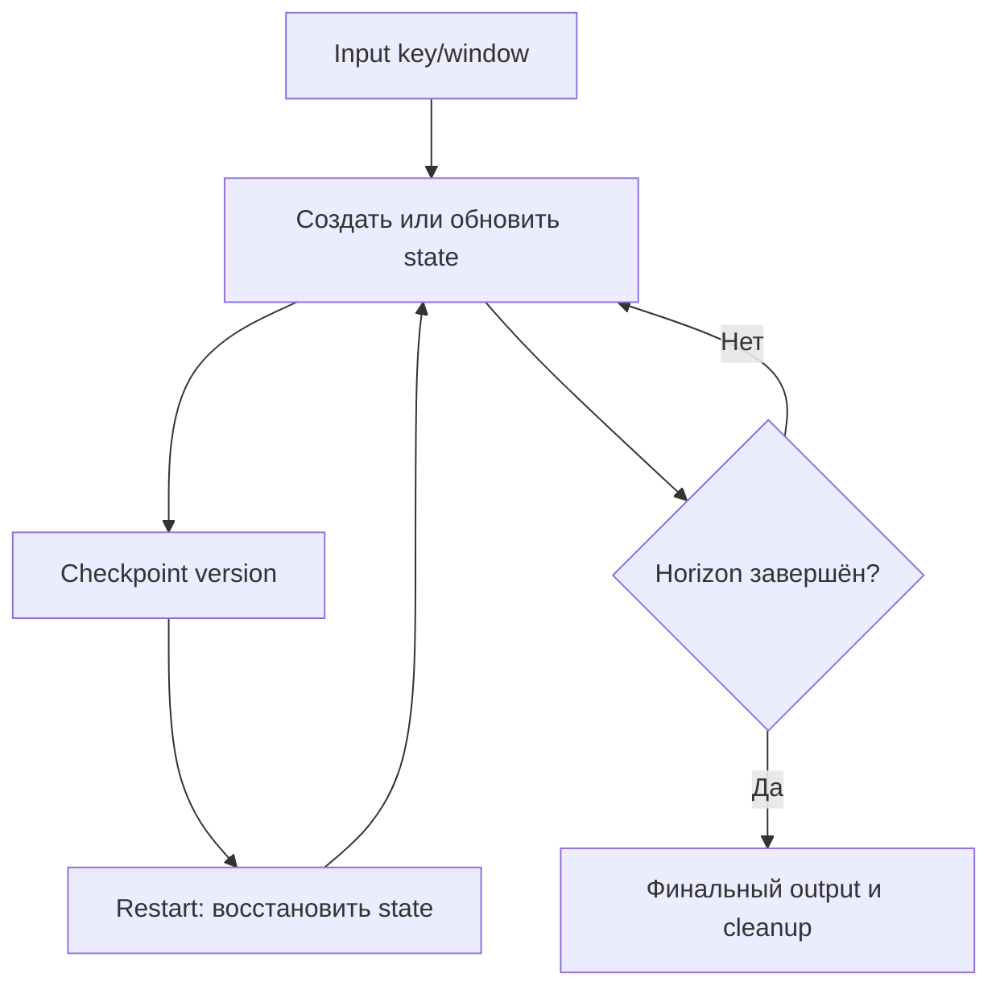
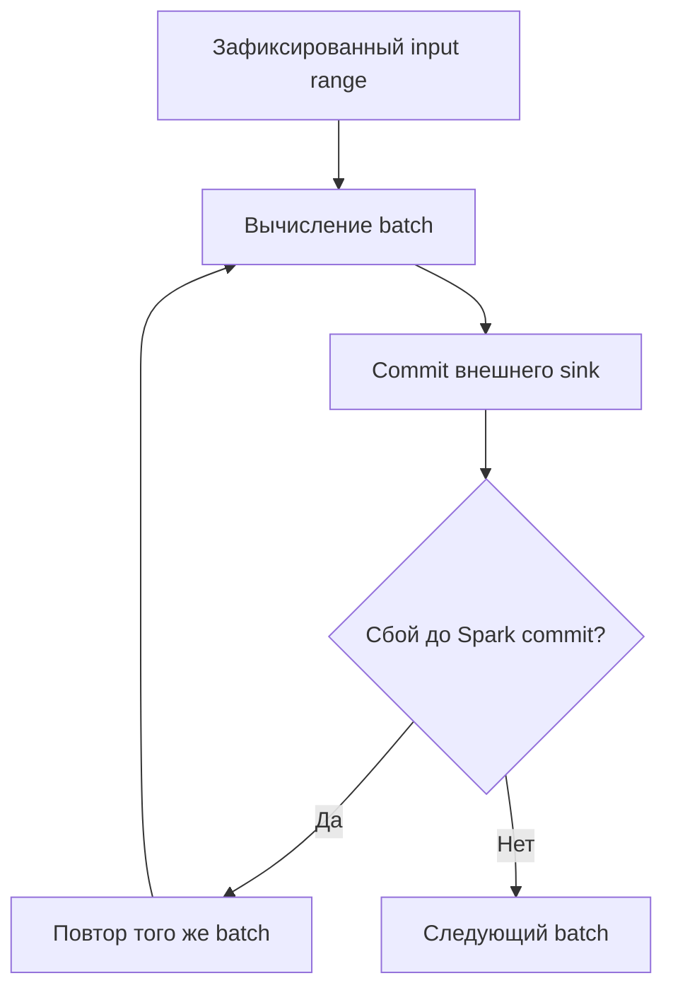
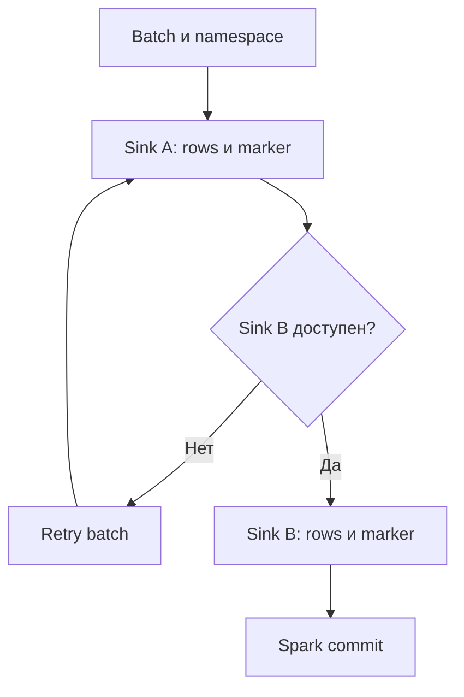
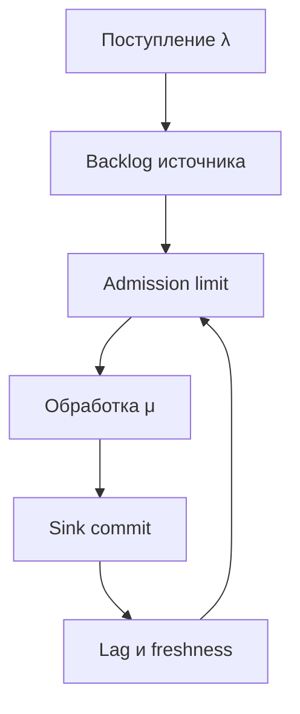
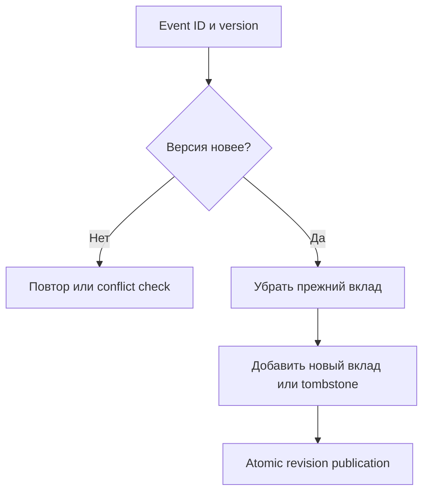
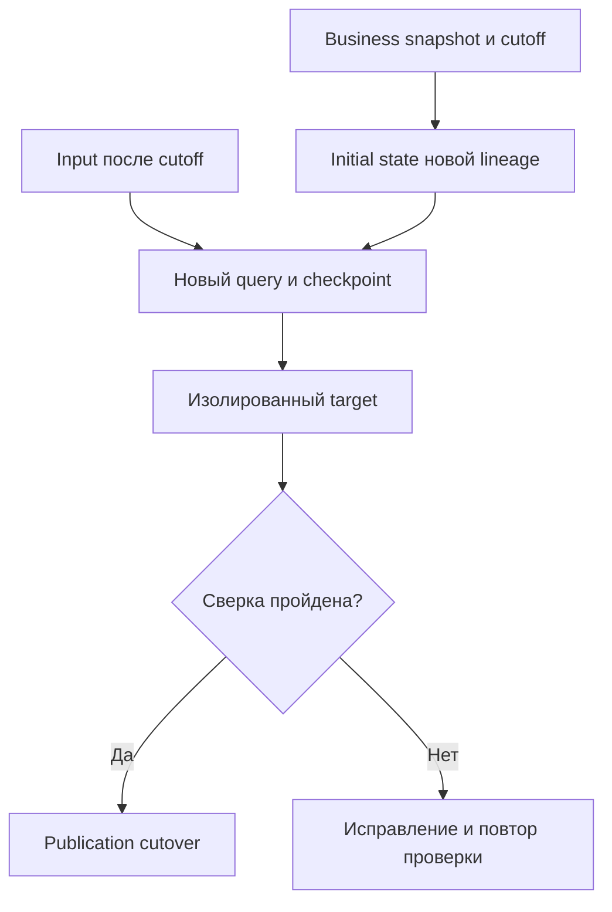

# 16. Состояние, гарантии и эксплуатация потоков

Основной язык примеров — **Python / PySpark**; для JVM stateful API есть отдельная Scala-лаборатория. Проверенное окружение: **Apache Spark 4.2.0, Spark Classic, Python 3.12.14, OpenJDK 17.0.20, Scala 2.13.18, pandas 2.2.3, PyArrow 26.0.0, protobuf 6.33.5**, Linux, `local[2]`. Версии зафиксированы для воспроизводимости.

Раздел продолжает основы Structured Streaming: жизненный цикл state, старые и новые stateful API, HDFS/RocksDB state stores, guarantees, transactional foreachBatch, checkpoint recovery, admission control, performance и runbook. **Все 10 тем и 73 пункта README сохранены дословно и в исходном порядке**, включая уточнения в скобках. Заголовки имеют ровно три уровня: раздел → тема → пункт. Практика и вопросы находятся внутри пунктов.

**Содержание**

1. [Stateful processing](#stateful-processing)
2. [API произвольного состояния](#arbitrary-state-api)
3. [State Store](#state-store)
4. [Гарантии доставки и обработки](#processing-guarantees)
5. [foreachBatch и несколько приёмников](#foreachbatch-sinks)
6. [Streaming checkpoint и восстановление](#checkpoint-recovery)
7. [Backpressure и управление поступлением](#admission-backpressure)
8. [Производительность потоков](#streaming-performance)
9. [Управление поздними и некорректными событиями](#late-invalid-events)
10. [Runbook потокового приложения](#streaming-runbook)

**Как выполнить примеры**

Нужны полный PySpark package со всеми Spark JARs, Java 17 и нативные библиотеки Arrow/RocksDB для своей платформы. Для Python stateful APIs устанавливаются pandas, Arrow и protobuf; SQLite входит в стандартную библиотеку Python и в этой главе использует UPSERT (SQLite 3.24+).

```bash
java -version
python -m venv .venv
source .venv/bin/activate
python -m pip install pyspark==4.2.0 pandas==2.2.3 pyarrow==26.0.0 protobuf==6.33.5
# Скопируй Python-блоки главы в порядке появления в один файл:
SPARK_LOCAL_IP=127.0.0.1 python chapter16_lab.py
```

Команды рассчитаны на Linux/macOS/WSL. Выполняй все Python-блоки сверху вниз в **одной чистой session** без существующего SparkContext. Первый блок создаёт `spark`, схемы, helpers и ограниченные fixtures; последний останавливает Spark и удаляет только созданный временный каталог `lab`. Не используй `python -O`: assertions проверяют результат. Scala-блок выполняется отдельно через `spark-shell`, как указано в соответствующем пункте.

Основные опыты используют реальные file-source Structured Streaming queries и checkpoint на локальном диске. State Data Source читает эти checkpoints после остановки writer. Маленькие driver collections служат проверке результатов; Python list, локальные файлы и SQLite здесь не являются схемой production deployment. Settings `local[2]`, UTC, две shuffle partitions, AQE off и `spark.python.use.daemon=false` выбраны для учебной воспроизводимости.

**Важные границы.** Kafka/remote-storage functions, async Kafka writer, schema-migration processor и Continuous/Real-time builders показаны как templates/API checks; удалённые services не подключались. Повторная обработка проверяется реальным callback failure после external commit, а не kill ОС/driver. Timers проверяются управляемым clock и чтением сохранённой регистрации; latency и automatic TTL требуют отдельного integration test. Числовые capacity/memory расчёты помечены как модели.

**Версионные уточнения.** Experimental `DataStreamReader.name` требует включённой source-evolution feature в проверенном build. JVM Classic имеет writer `name`, PySpark writer не имеет одноимённого public метода; SQL identity forms и Real-time support требуют проверки своего dialect/build. Названия пунктов README сохранены, а API availability уточнена непосредственно в тексте.

Официальные отправные страницы: [Structured Streaming guide](https://spark.apache.org/docs/4.2.0/streaming/apis-on-dataframes-and-datasets.html), [TransformWithState](https://spark.apache.org/docs/4.2.0/streaming/structured-streaming-transform-with-state.html), [State Data Source](https://spark.apache.org/docs/4.2.0/streaming/structured-streaming-state-data-source.html), [Performance tips](https://spark.apache.org/docs/4.2.0/streaming/performance-tips.html). Ссылки относятся к Apache Spark 4.2.0; capabilities другого runtime проверяются отдельно.


<a id="stateful-processing"></a>

## Stateful processing


### Состояние по ключу и его жизненный цикл

Stateful operator использует не только текущий micro-batch, но и информацию из предыдущих. Состояние привязано к grouping key и operator: running sum хранит итог ключа, join — ожидающие matches, dedup — историю идентификаторов, пользовательский processor — выбранные бизнес-поля.

Жизненный цикл state включает создание, чтение, обновление, checkpoint commit, восстановление и удаление. Пустой batch не означает пустое state. Один и тот же key в разных stateful operators не является общей переменной приложения.

| Задача | State по ключу | Условие завершения/удаления |
| --- | --- | --- |
| Running sum | Текущая сумма | Явная business boundary либо state остаётся |
| Event-time window | Агрегат окна | Watermark и поддерживаемый output mode |
| Stream-stream join | Rows, которые ещё могут найти match | Watermarks и time-range condition |
| Dedup | Уже встреченные IDs | Выбранный временной horizon |
| Custom processor | Объявленные state variables | remove/clear, TTL или timer logic |

**Лабораторная основа.** Используем immutable JSON files с управляемым временем событий. Маленькие результаты собираются только для assertions; для production sink требуется свой durable protocol.

```python
import contextlib
import datetime as dt
import inspect
import json
import math
import os
import shutil
import sqlite3
import sys
import tempfile
import time
import uuid
from pathlib import Path

import pandas as pd
import pyarrow as pa
import google.protobuf
import pyspark
from pyspark.sql import SparkSession, Row, functions as F, types as T
from pyspark.sql.group import GroupedData
from pyspark.sql.streaming import (
    DataStreamReader, DataStreamWriter, StatefulProcessor, StatefulProcessorHandle, TwsTester,
)
from pyspark.sql.streaming.state import GroupStateTimeout

lab = Path(tempfile.mkdtemp(prefix="spark_ch16_"))
staging = lab / "staging"
staging.mkdir()
HDFS_STATE = "org.apache.spark.sql.execution.streaming.state.HDFSBackedStateStoreProvider"
ROCKS_STATE = "org.apache.spark.sql.execution.streaming.state.RocksDBStateStoreProvider"
spark = (SparkSession.builder.master("local[2]")
    .appName("Spark Zero to Hero - Chapter 16")
    .config("spark.sql.shuffle.partitions", "2")
    .config("spark.sql.session.timeZone", "UTC")
    .config("spark.sql.adaptive.enabled", "false")
    .config("spark.sql.streaming.stateStore.providerClass", HDFS_STATE)
    .config("spark.python.use.daemon", "false")
    .config("spark.ui.showConsoleProgress", "false")
    .getOrCreate())
spark.sparkContext.setLogLevel("ERROR")
assert spark.version == "4.2.0"
jvm = spark.sparkContext._jvm

event_schema = T.StructType([
    T.StructField("event_id", T.StringType()), T.StructField("key", T.StringType()),
    T.StructField("value", T.LongType()), T.StructField("event_time", T.TimestampType()),
    T.StructField("seq", T.LongType()),
])
base_time = dt.datetime(2026, 1, 1, tzinfo=dt.timezone.utc)

def event(event_id, key, value, minute=1, seq=1):
    return {"event_id": event_id, "key": key, "value": value,
            "event_time": (base_time + dt.timedelta(minutes=minute)).isoformat(), "seq": seq}

def new_input(name):
    path = lab / "inputs" / name
    path.mkdir(parents=True)
    return path

def publish(path, filename, records):
    destination = path / filename
    assert not destination.exists(), "Published input is immutable"
    temporary = staging / (uuid.uuid4().hex + ".json")
    temporary.write_text("".join(json.dumps(r) + "\n" for r in records), encoding="utf-8")
    os.replace(temporary, destination)

def file_stream(path, max_files=1, source_name=None):
    reader = spark.readStream.schema(event_schema).option("maxFilesPerTrigger", max_files)
    if source_name is not None:
        reader = reader.name(source_name)
    return reader.json(str(path))

def checkpoint(name):
    return lab / "checkpoints" / name

def finish(query, timeout=90):
    try:
        if not query.awaitTermination(timeout):
            raise TimeoutError("Streaming query did not finish")
        if query.exception() is not None:
            raise query.exception()
        return query
    finally:
        if query.isActive:
            query.stop()

def progress_records(query):
    return [json.loads(p.json) for p in query.recentProgress]

def capture_into(target):
    def consume(batch_df, batch_id):
        target.append((batch_id, [row.asDict(recursive=True) for row in batch_df.collect()]))
    return consume

def run_capture(df, name, mode="update", cp=None, target=None):
    target = [] if target is None else target
    cp = checkpoint(name) if cp is None else cp
    q = (df.writeStream.foreachBatch(capture_into(target)).outputMode(mode)
         .queryName(name).option("checkpointLocation", str(cp))
         .trigger(availableNow=True).start())
    finish(q)
    return q, target, cp

def run_file(df, name, output=None, cp=None):
    output = lab / "outputs" / name if output is None else output
    cp = checkpoint(name) if cp is None else cp
    q = (df.writeStream.format("parquet").outputMode("append").queryName(name)
         .option("path", str(output)).option("checkpointLocation", str(cp))
         .trigger(availableNow=True).start())
    finish(q)
    return q, output, cp

@contextlib.contextmanager
def sql_conf(**settings):
    previous = {k: spark.conf.get(k, None) for k in settings}
    try:
        for key, value in settings.items():
            spark.conf.set(key, str(value).lower() if isinstance(value, bool) else str(value))
        yield
    finally:
        for key, value in previous.items():
            if value is None:
                spark.conf.unset(key)
            else:
                spark.conf.set(key, value)

basic_input = new_input("basic")
basic_records = [event("e1", "a", 1, 1, 1), event("e2", "a", 2, 2, 2),
                 event("e3", "b", 5, 11, 1)]
publish(basic_input, "001.json", basic_records)
basic_stream = file_stream(basic_input)
basic_batch = spark.read.schema(event_schema).json(str(basic_input))
running_sum = basic_stream.groupBy("key").agg(F.sum("value").alias("total"))
base_query, base_batches, base_cp = run_capture(running_sum, "baseline_sum")
assert {r["key"]: r["total"] for _, rows in base_batches for r in rows} == {"a": 3, "b": 5}
base_progress = progress_records(base_query)
assert any(p["stateOperators"] for p in base_progress)
print({"Spark": spark.version, "Python": sys.version.split()[0],
       "pandas": pd.__version__, "Arrow": pa.__version__, "protobuf": google.protobuf.__version__})
```

Сумма вычислена реальной stateful query. `capture_into` — только наблюдение в этом процессе: Python list не является production durable sink и не переживает driver loss. Atomic rename helper относится к одному local filesystem; publication в object storage проверяется по его отдельному contract.

**Практика.** Для user session, running balance и dedup перечисли state key и условие окончания lifecycle. **Самопроверка:** почему маленький output не доказывает, что operator хранит мало state?


### Размер состояния, число ключей и cardinality

State size зависит от числа активных ключей, количества entries на ключ, schema/encoding, timers, indexes и storage overhead. Cardinality input key может расти даже при стабильном числе событий в секунду. Для sliding windows один event участвует в нескольких state keys; для join сохраняются rows, а не только один агрегат ключа.

```python
state_metrics = [s for p in base_progress for s in p["stateOperators"]]
assert max(s["numRowsTotal"] for s in state_metrics) == 2
assert all(s["memoryUsedBytes"] >= 0 for s in state_metrics)
active_keys, payload_bytes, illustrative_overhead = 500_000, 64, 3
estimated_bytes = active_keys * payload_bytes * illustrative_overhead
assert estimated_bytes == 96_000_000
```

Первые assertions читают реальные progress metrics. Последняя формула условная: коэффициент overhead не является Spark константой. RocksDB memory, JVM memory, serialized checkpoint bytes и number of state rows — разные величины; нельзя заменить все одной метрикой memoryUsedBytes.

| Рост | Что проверить |
| --- | --- |
| Новые уникальные keys | Business key/cardinality и retention |
| Больше windows/key | Duration, slide, watermark horizon |
| Больше buffered join rows | Input rates, time range, watermarks |
| Длиннее list/map в processor | Явные bounds, TTL и remove logic |

**Самопроверка:** как изменится state, если каждый event получает новый случайный grouping key?


### Обновление, удаление и TTL

Update меняет state, remove/clear удаляет выбранную сущность, TTL задаёт срок хранения по правилам API. Watermark управляет event-time lifecycle поддерживаемых operators и не является универсальным TTL любого произвольного state. Удаление state не удаляет уже опубликованные rows из внешнего sink.

**Реальный опыт удаления оконного state:**

```python
wm_input = new_input("watermark_cleanup")
publish(wm_input, "001.json", basic_records)
wm_aggregate = (file_stream(wm_input).withWatermark("event_time", "10 minutes")
                .groupBy(F.window("event_time", "10 minutes"), "key").count())
wm_query_1, wm_output, wm_cp = run_file(wm_aggregate, "wm_first")
assert spark.read.schema(wm_aggregate.schema).parquet(str(wm_output)).count() == 0
publish(wm_input, "002.json", [event("advance", "c", 1, 31, 1)])
wm_query_2, _, _ = run_file(wm_aggregate, "wm_advance", wm_output, wm_cp)
wm_result = spark.read.schema(wm_aggregate.schema).parquet(str(wm_output))
assert {(r.key, r["count"]) for r in wm_result.collect()} == {("a", 2), ("b", 1)}
wm_progress = progress_records(wm_query_2)
assert sum(s["numRowsRemoved"] for p in wm_progress for s in p["stateOperators"]) >= 2
```

Новые события продвинули event time; дополнительные batches применили watermark и финализировали старые windows. Само ожидание wall clock не создаёт такую новую watermark. TTL TransformWithState обсуждается ниже: его не нужно подменять этой window cleanup логикой.



**Практика.** Сравни window cleanup, dedup horizon и retention business balance. **Самопроверка:** почему clear state не эквивалентен DELETE прежнего результата в SQL-таблице sink?


### Event-time и processing-time timers

Event-time timer срабатывает по продвижению watermark, processing-time timer — по engine processing time. Оба требуют выполнения operator: обещание «ровно в указанную миллисекунду» обычно неверно. Timer может быть сохранён в state/checkpoint и пережить restart по contract API.

```python
processing_deadline_ms = 1000 + 5000
assert 5999 < processing_deadline_ms <= 6000
event_deadline_ms = 6000
observed_watermarks = [4000, 5500, 7000]
assert [w for w in observed_watermarks if w > event_deadline_ms] == [7000]
```

Это модель clock domains, не измерение timer engine. Детерминированные timer tests через TwsTester и реальные stateful API приведены в следующей теме. Timer callback и TTL eviction различаются: timer позволяет выпустить business output/выполнить переход; automatic TTL не надо считать гарантированным вызовом твоего handler.

**Самопроверка:** почему event-time timer может долго не срабатывать при остановившемся входе, несмотря на работающий driver?


### Детерминированность переходов состояния

Для recovery один input range и предыдущий state должны давать определённый результат. Input iterator по ключу не обязан иметь бизнес-порядок. Если transition зависит от очередности, используй source sequence и детерминированный tie/conflict contract; суммы целых чисел могут быть order-independent, а floating-point reductions имеют другие свойства.

```python
def versioned_transition(state, incoming):
    if incoming["seq"] <= state["seq"]:
        return dict(state)
    return {"seq": incoming["seq"], "value": incoming["value"]}

initial_model = {"seq": 0, "value": 0}
ordered_model = [{"seq": 1, "value": 10}, {"seq": 2, "value": 20}]
s1 = initial_model
for item in ordered_model:
    s1 = versioned_transition(s1, item)
s2 = initial_model
for item in reversed(ordered_model):
    s2 = versioned_transition(s2, item)
assert s1 == s2 == {"seq": 2, "value": 20}
assert versioned_transition(s1, ordered_model[0]) == s1
```

Модель использует уникальные seq. Equal version с различным payload требует явного conflict handling; функция здесь не является полным CDC sink. HTTP lookup, random values и текущая внешняя таблица могут менять результат retry. Если внешний ответ нужен для business state, фиксируй его version/snapshot либо отдельный durable input.

**Практика.** Найди недетерминированные зависимости своего processor. **Самопроверка:** почему сортировка только по business timestamp не решает tie и out-of-order source changes?


### Бизнес-состояние и состояние инфраструктуры checkpoint

Business state хранит смысловую информацию: текущий balance, session, IDs или buffered events. Checkpoint infrastructure хранит execution progress, commit coordination, schemas и размещение state. Они связаны, но не взаимозаменяемы: прочитанные offsets без нужного business state не позволяют продолжить running sum корректно.

```python
assert (base_cp / "metadata").exists()
assert (base_cp / "offsets").is_dir() and (base_cp / "commits").is_dir()
assert (base_cp / "state").is_dir()
```

| Сущность | Смысл |
| --- | --- |
| State key/value | Данные конкретного stateful operator |
| Offsets log | Запланированные source ranges batches |
| Commit log | Завершённые batches query по engine protocol |
| Query metadata | Identity и execution metadata |
| External sink ledger | Собственный durable протокол бизнес-эффектов |

Streaming checkpoint отличается от batch `DataFrame.checkpoint()` раздела 13. Временный local path подходит лаборатории; production path должен переживать потерю процесса/узла и быть доступным нужным participants.

**Практика темы.** Нарисуй отдельно data path и recovery metadata для running sum → таблица. **Самопроверка:** почему копирование только папки offsets не является полноценным backup stateful query?


<a id="arbitrary-state-api"></a>

## API произвольного состояния


### mapGroupsWithState и flatMapGroupsWithState в JVM API

В JVM typed Dataset API `mapGroupsWithState` возвращает ровно один output record на invocation ключа, а `flatMapGroupsWithState` — iterator из нуля или нескольких records. Оба получают key, iterator input и GroupState; callback не вызывается для каждого отсутствующего key в каждом batch без предусмотренной timeout logic.

Python не имеет typed Dataset API этих методов. Ниже один отдельный опыт для `spark-shell` Spark 4.2: две настоящие streaming queries проверяют оба JVM API. Его не нужно вставлять в Python laboratory file. Сохрани Scala-блок в `chapter16_jvm.scala`, запусти shell командой ниже и выполни `:load chapter16_jvm.scala`. Ожидаемый marker после assertions — `JVM_STATE_LAB_PASS`; затем выйди через `:quit`.

```bash
SPARK_LOCAL_IP=127.0.0.1 spark-shell --master 'local[2]' --conf spark.sql.shuffle.partitions=2
```

```scala
{
  import java.nio.charset.StandardCharsets.UTF_8
  import java.nio.file.Files
  import java.util.Comparator
  import org.apache.spark.sql.Dataset
  import org.apache.spark.sql.streaming.{GroupStateTimeout, OutputMode, Trigger}
  import spark.implicits._

  val jvmLab = Files.createTempDirectory("spark_ch16_jvm_")
  val input = Files.createDirectory(jvmLab.resolve("input"))
  Files.write(input.resolve("001.txt"), "a\na\nb\n".getBytes(UTF_8))
  val words = spark.readStream.schema("value STRING").text(input.toString).as[String]
  val expected = Map("a" -> 2L, "b" -> 1L)
  try {
    val mapped = words.groupByKey((word: String) => word)
      .mapGroupsWithState[Long, (String, Long)](GroupStateTimeout.NoTimeout()) {
        (key, values, state) =>
          val total = state.getOption.getOrElse(0L) + values.size.toLong
          state.update(total)
          (key, total)
      }
    val q1 = mapped.writeStream.outputMode("update")
      .foreachBatch((batch: Dataset[(String, Long)], batchId: Long) => {
        assert(batch.collect().toMap == expected)
      })
      .option("checkpointLocation", jvmLab.resolve("map_cp").toString)
      .trigger(Trigger.AvailableNow()).start()
    assert(q1.awaitTermination(90000L))

    val flattened = words.groupByKey((word: String) => word)
      .flatMapGroupsWithState[Long, (String, Long)](
        OutputMode.Update(), GroupStateTimeout.NoTimeout()) {
        (key, values, state) =>
          val total = state.getOption.getOrElse(0L) + values.size.toLong
          state.update(total)
          Iterator((key, total))
      }
    val q2 = flattened.writeStream.outputMode("update")
      .foreachBatch((batch: Dataset[(String, Long)], batchId: Long) => {
        assert(batch.collect().toMap == expected)
      })
      .option("checkpointLocation", jvmLab.resolve("flat_cp").toString)
      .trigger(Trigger.AvailableNow()).start()
    assert(q2.awaitTermination(90000L))
    println("JVM_STATE_LAB_PASS")
  } finally {
    val paths = Files.walk(jvmLab)
    try paths.sorted(Comparator.reverseOrder()).forEach(path => Files.delete(path))
    finally paths.close()
  }
}
```

Операторы требуют shuffle по grouping key и имеют отдельные state/output encoders. Input iterator не упорядочен; его размер и стоимость state зависят от key cardinality. Здесь сумма counts коммутативна, inputs конечные и timers не включены.

**Документация:** [KeyValueGroupedDataset](https://spark.apache.org/docs/4.2.0/api/java/org/apache/spark/sql/KeyValueGroupedDataset.html), [GroupState](https://spark.apache.org/docs/4.2.0/api/java/org/apache/spark/sql/streaming/GroupState.html).

**Самопроверка:** какой API выбрать, если один key может закрыть несколько sessions и выпустить несколько output rows?


### GroupState, initial state и timeout modes

GroupState предоставляет exists/get/update/remove, processing time, watermark и timeout setters. В Python старого pandas API `exists`, `get`, `hasTimedOut` — properties; в JVM names имеют свои Scala/Java forms. State value обновляется целиком и не должен быть null state object.

Timeout mode задаётся для operator, а deadline/duration — для конкретного ключа. ProcessingTimeTimeout требует `setTimeoutDuration`; EventTimeTimeout — watermark и `setTimeoutTimestamp`; NoTimeout не удаляет state автоматически. Timeout invocation получает пустой input и hasTimedOut=true, поэтому эту ветку надо обрабатывать явно.

```python
assert GroupStateTimeout.NoTimeout == "NoTimeout"
assert GroupStateTimeout.ProcessingTimeTimeout == "ProcessingTimeTimeout"
assert GroupStateTimeout.EventTimeTimeout == "EventTimeTimeout"
from pyspark.sql.streaming.state import GroupState
assert isinstance(GroupState.exists, property)
assert isinstance(GroupState.get, property)
assert "durationMs" in inspect.signature(GroupState.setTimeoutDuration).parameters
```

Это проверка Python API shape, не таймера конкретного live query. Timeout не имеет строгой верхней границы срабатывания; каждый invocation требует правильно обновить timeout. Initial state в JVM старых APIs задаётся соответствующим overload, но Python `applyInPandasWithState` в этой версии не имеет initialState parameter. Bootstrap не надо выдавать за повторную обработку snapshot при каждом restart.

**Практика.** Определи переход при пустом timeout invocation и явном remove. **Самопроверка:** почему state.get после remove требует проверки exists?


### applyInPandasWithState и Python stateful processing

`applyInPandasWithState` доступен с Spark 3.4. Callback принимает tuple grouping key, iterator pandas chunks и GroupState, возвращает iterator pandas DataFrames. State schema и output schema задаются явно. Один большой key не становится маленьким только потому, что input разбит на Arrow batches.

```python
total_state_schema = T.StructType([T.StructField("total", T.LongType())])
total_output_schema = T.StructType([
    T.StructField("key", T.StringType()), T.StructField("total", T.LongType()),
])

def legacy_sum(key, pdfs, state):
    if state.hasTimedOut:
        state.remove()
        return
    total = int(state.get[0]) if state.exists else 0
    for pdf in pdfs:
        total += int(pdf["value"].sum())
    state.update((total,))
    yield pd.DataFrame({"key": [str(key[0])], "total": [total]})

legacy_stream = basic_stream.groupBy("key").applyInPandasWithState(
    legacy_sum, outputStructType=total_output_schema, stateStructType=total_state_schema,
    outputMode="Update", timeoutConf=GroupStateTimeout.NoTimeout,
)
legacy_query, legacy_batches, legacy_cp = run_capture(legacy_stream, "legacy_state")
assert {r["key"]: r["total"] for _, rows in legacy_batches for r in rows} == {"a": 3, "b": 5}
```

Выполнен настоящий Python stateful operator с Arrow transfer и checkpoint. Функция последовательно потребляет chunks, а не `list(pdfs)` всего ключа. NoTimeout здесь означает сохранение running totals; ветка hasTimedOut оставлена для явного lifecycle при другом корректно настроенном режиме.

**Документация:** [applyInPandasWithState](https://spark.apache.org/docs/4.2.0/api/python/reference/pyspark.sql/api/pyspark.sql.GroupedData.applyInPandasWithState.html).

**Самопроверка:** почему iterator может содержать больше одного pandas DataFrame для того же grouping key?


### transformWithState и StateProcessor

Новый operator TransformWithState предоставляет именованные managed variables, timers и initial state. Публичный processor class называется **StatefulProcessor**. `init` объявляет variables, `handleInputRows` выполняет transitions, `handleExpiredTimer` обрабатывает timers, `handleInitialState` — bootstrap, `close` — cleanup.

В PySpark Row-интерфейс `GroupedData.transformWithState` появился с 4.1. Он работает с iterator Row, но также имеет Python/JVM state protocol dependencies. В данной лаборатории новые operators запускаются с RocksDB provider.

```python
class RowSumProcessor(StatefulProcessor):
    def init(self, handle):
        self.total = handle.getValueState("total", total_state_schema)

    def handleInputRows(self, key, rows, timerValues):
        total = int(self.total.get()[0]) if self.total.exists() else 0
        for row in rows:
            total += int(row.value)
        self.total.update((total,))
        yield Row(key=str(key[0]), total=total)

    def handleInitialState(self, key, initialState, timerValues):
        self.total.update((int(initialState.seed),))

with sql_conf(**{"spark.sql.streaming.stateStore.providerClass": ROCKS_STATE}):
    row_stream = basic_stream.groupBy("key").transformWithState(
        RowSumProcessor(), total_output_schema, outputMode="Update", timeMode="None",
    )
    row_query, row_batches, row_cp = run_capture(row_stream, "row_state")
assert {r["key"]: r["total"] for _, rows in row_batches for r in rows} == {"a": 3, "b": 5}
```

State не хранится в обычном Python instance field `self.counter`: instance/worker lifetime не определяет durable grouping-key state. `self.total` здесь — handle managed variable, который работает с текущим implicit grouping key. В handler нельзя вызывать SparkSession/SparkContext для вложенных jobs.

**Документация:** [TransformWithState guide](https://spark.apache.org/docs/4.2.0/streaming/structured-streaming-transform-with-state.html).

**Самопроверка:** почему init объявляет variable, а не создаёт глобальную сумму всех ключей?


### transformWithStateInPandas при поддержке версии

`transformWithStateInPandas` доступен с Spark 4.0 и использует тот же processor lifecycle, но input/output — pandas DataFrames. Выбирай интерфейс по измеренной стоимости chunks/key cardinality и удобству logic; имя pandas не гарантирует векторизацию state calls.

```python
class PandasSumProcessor(StatefulProcessor):
    def init(self, handle):
        self.total = handle.getValueState("total", total_state_schema)

    def handleInputRows(self, key, rows, timerValues):
        total = int(self.total.get()[0]) if self.total.exists() else 0
        for pdf in rows:
            total += int(pdf["value"].sum())
        self.total.update((total,))
        yield pd.DataFrame({"key": [str(key[0])], "total": [total]})

with sql_conf(**{"spark.sql.streaming.stateStore.providerClass": ROCKS_STATE}):
    pandas_stream = basic_stream.groupBy("key").transformWithStateInPandas(
        PandasSumProcessor(), total_output_schema, outputMode="Update", timeMode="None",
    )
    pandas_query, pandas_batches, pandas_cp = run_capture(pandas_stream, "pandas_state")
assert {r["key"]: r["total"] for _, rows in pandas_batches for r in rows} == {"a": 3, "b": 5}
```

Row и pandas operators реально выполнили одинаковую business sum на отдельных checkpoints. Совпадение output не делает их checkpoint encodings автоматически взаимозаменяемыми. Iterator cardinality и nullable/type handling проверяются отдельно.

**Документация:** [transformWithStateInPandas](https://spark.apache.org/docs/4.2.0/api/python/reference/pyspark.sql/api/pyspark.sql.GroupedData.transformWithStateInPandas.html).

**Самопроверка:** почему conversion cost может быть существенен при множестве ключей с одним-двумя events?


### ValueState, ListState и MapState

ValueState хранит один tuple value, ListState — последовательность values, MapState — mapping user key → value внутри grouping key. Schema каждого variable объявляется отдельно. Managed MapState не является общим driver dictionary; один variable name работает независимо для каждого grouping key.

```python
recent_schema = T.StructType([
    T.StructField("seq", T.LongType()), T.StructField("value", T.LongType()),
])
id_schema = T.StructType([T.StructField("event_id", T.StringType())])
value_schema = T.StructType([T.StructField("value", T.LongType())])

class CompositeProcessor(StatefulProcessor):
    def init(self, handle):
        self.total = handle.getValueState("total", total_state_schema)
        self.recent = handle.getListState("recent", recent_schema)
        self.seen = handle.getMapState("seen", id_schema, value_schema)

    def handleInputRows(self, key, rows, timerValues):
        total = int(self.total.get()[0]) if self.total.exists() else 0
        recent = list(self.recent.get()) if self.recent.exists() else []
        for row in rows:
            event_key = (row.event_id,)
            if self.seen.containsKey(event_key):
                if self.seen.getValue(event_key)[0] != row.value:
                    raise ValueError("Event ID conflict")
                continue
            self.seen.updateValue(event_key, (int(row.value),))
            total += int(row.value)
            recent = sorted(recent + [(int(row.seq), int(row.value))])[-2:]
        self.total.update((total,))
        self.recent.put(recent)
        yield Row(key=str(key[0]), total=total)

with sql_conf(**{"spark.sql.streaming.stateStore.providerClass": ROCKS_STATE}):
    composite_stream = basic_stream.groupBy("key").transformWithState(
        CompositeProcessor(), total_output_schema, outputMode="Update", timeMode="None",
    )
    composite_query, composite_batches, composite_cp = run_capture(composite_stream, "composite_state")
assert {r["key"]: r["total"] for _, rows in composite_batches for r in rows} == {"a": 3, "b": 5}
```

Recent list ограничена двумя `(seq,value)` tuples; input обрабатывается поэлементно, без материализации всего ключа. Seen map в этой конечной fixture содержит все IDs: для бесконечного потока нужен обоснованный horizon/TTL/удаление. В реальном identity contract конфликт должен учитывать всё значимое содержимое event, не только value.

**Практика.** Выбери variable type для последнего статуса, top-2 readings и event dedup. **Самопроверка:** почему bounded recent list не ограничивает размер отдельной seen map?


### Timers, TTL, initial state и ограничения выбранного API

Timers регистрируются через handle в допустимой lifecycle phase, например handleInputRows; в init регистрация timer не разрешена. TTL задаётся при объявлении variable, поддержка time modes и eviction зависит от версии/оператора. Initial state передаётся как grouped **batch** DataFrame и применяется один раз за query lineage, а не каждый restart.

**Реальная проверка bootstrap и restart:**

```python
initial_input = new_input("initial_state")
publish(initial_input, "001.json", basic_records)
initial_stream = file_stream(initial_input)
initial_grouped = spark.createDataFrame([("a", 100), ("z", 50)], "key STRING, seed BIGINT").groupBy("key")
with sql_conf(**{"spark.sql.streaming.stateStore.providerClass": ROCKS_STATE}):
    seeded_stream = initial_stream.groupBy("key").transformWithState(
        RowSumProcessor(), total_output_schema, outputMode="Update", timeMode="None",
        initialState=initial_grouped,
    )
    seeded_query_1, seeded_batches_1, seeded_cp = run_capture(seeded_stream, "seeded_first")
    publish(initial_input, "002.json", [event("e4", "a", 4, 3, 3)])
    seeded_query_2, seeded_batches_2, _ = run_capture(seeded_stream, "seeded_second", cp=seeded_cp)
assert {r["key"]: r["total"] for _, rows in seeded_batches_1 for r in rows} == {"a": 103, "b": 5}
assert any(r["key"] == "a" and r["total"] == 107 for _, rows in seeded_batches_2 for r in rows)
assert seeded_query_1.id == seeded_query_2.id and seeded_query_1.runId != seeded_query_2.runId

class TimerProcessor(StatefulProcessor):
    def init(self, handle):
        self.handle = handle
        self.count = handle.getValueState("count", total_state_schema)

    def handleInputRows(self, key, rows, timerValues):
        count = sum(1 for _ in rows)
        self.count.update((count,))
        self.handle.registerTimer(5000)
        return iter([])

    def handleExpiredTimer(self, key, timerValues, expiredTimerInfo):
        count = self.count.get()[0]
        self.count.clear()
        yield Row(key=str(key[0]), total=count, expiry=expiredTimerInfo.getExpiryTimeInMs())

processing_tester = TwsTester(TimerProcessor(), timeMode="ProcessingTime")
assert processing_tester.test("a", [Row(value=1), Row(value=2)]) == []
assert processing_tester.setProcessingTime(4999) == []
timer_rows = processing_tester.setProcessingTime(6000)
assert [(r.key, r.total, r.expiry) for r in timer_rows] == [("a", 2, 5000)]
assert processing_tester.peekValueState("count", "a") is None
event_tester = TwsTester(TimerProcessor(), timeMode="EventTime", eventTimeExtractor=lambda row: 1000)
assert event_tester.test("a", [Row(value=1)]) == []
assert event_tester.setWatermark(4000) == []
assert event_tester.setWatermark(6000)[0].expiry == 5000
assert "ttlDurationMs" in inspect.signature(StatefulProcessorHandle.getValueState).parameters
```

Query действительно проверила initial state/restart. Timers проверены **TwsTester** с контролируемым временем; tester не моделирует automatic watermark, TTL или checkpoint recovery engine. `registerTimer(5000)` — фиксированный учебный deadline для его simulated clock, не production epoch timestamp. TTL declaration API проверен, но автоматическая TTL eviction этим tester не доказана.

**Документация:** [TransformWithState / TwsTester](https://spark.apache.org/docs/4.2.0/streaming/structured-streaming-transform-with-state.html#testing-statefulprocessor-with-twstester).

**Самопроверка:** почему seed 100 должен дать после restart сумму 107, а не 207?


### Миграция от старых stateful API к новым

Migration stateful API — изменение execution/state contract, а не переименование функции. Legacy GroupState tuple и набор named variables нового processor имеют разные структуры. До перехода опиши schemas, grouping keys, output semantics, time modes и side-effect identity.

| Шаг migration | Проверка |
| --- | --- |
| Сравнить transitions | Одинаковые inputs, duplicates, timers, empty groups |
| Определить bootstrap | Как построить initial state на согласованной boundary |
| Выбрать lineage | Совместимый restart или новая query/checkpoint |
| Согласовать publication | Staging, event/version guards и consumer cutover |
| Проверить recovery | Restart target version с реальным checkpoint |

```python
legacy_answer = {r["key"]: r["total"] for _, rows in legacy_batches for r in rows}
row_answer = {r["key"]: r["total"] for _, rows in row_batches for r in rows}
pandas_answer = {r["key"]: r["total"] for _, rows in pandas_batches for r in rows}
assert legacy_answer == row_answer == pandas_answer == {"a": 3, "b": 5}
assert len({legacy_cp, row_cp, pandas_cp}) == 3
```

Сравнён output разных implementations, а checkpoint migration между ними не выполнялась. Новая lineage может начать с verified initial state и последующих source ranges; side effects до/после cutover должны быть согласованы. Нельзя менять schema stored tuples вслепую и ждать, что старое state автоматически преобразуется.

**Практика темы.** Напиши migration plan для legacy session processor, включая timer semantics и boundary initial state. **Самопроверка:** почему output equality на трёх событиях не доказывает совместимость checkpoint format?


<a id="state-store"></a>

## State Store


### Версионирование состояния между micro-batches

State Store сохраняет версии state между micro-batches. Tasks читают state, соответствующее исходной batch boundary, и готовят следующую версию. Retry должен снова применить те же input ranges к правильному предыдущему state, а не прибавить данные к уже изменённому произвольному Python object.

```python
def numeric_log_ids(directory):
    return sorted(int(path.name) for path in Path(directory).iterdir() if path.name.isdigit())

base_commits = numeric_log_ids(base_cp / "commits")
base_offsets = numeric_log_ids(base_cp / "offsets")
assert base_commits and set(base_commits) <= set(base_offsets)
assert any(path.is_file() for path in (base_cp / "state").rglob("*"))
```

Batch ID и state version связаны engine protocol, но не обязаны быть одинаковым номером: первый batch 0 обычно готовит последующее state version. Не используй имена физических files как универсальный внешний API. Для инспекции ниже применяется State Data Source, который учитывает metadata и version selection.

**Самопроверка:** почему наличие state files новой версии ещё не доказывает завершённый внешний sink commit?


### HDFS-backed state store и память JVM

HDFSBackedStateStoreProvider хранит рабочую state map в JVM memory и обеспечивает durability через filesystem files. Название HDFS-backed не требует настоящего HDFS для local lab: нужен совместимый filesystem contract. Большая cardinality увеличивает объём объектов и может вызывать JVM GC pauses.

```python
assert spark.conf.get("spark.sql.streaming.stateStore.providerClass") == HDFS_STATE
base_state_metrics = [s for p in base_progress for s in p["stateOperators"]]
assert max(s["numRowsTotal"] for s in base_state_metrics) == 2
assert (base_cp / "state").exists()
```

JVM heap, execution buffers, cached state versions и file snapshots конкурируют за resources. Контроль heap/GC и state retention нужен даже при маленьком output. Оптимизация HDFS provider не сводится к «увеличить driver RAM»: stateful tasks выполняются на executors.

**Документация:** [State Store](https://spark.apache.org/docs/4.2.0/streaming/apis-on-dataframes-and-datasets.html#state-store).

**Самопроверка:** почему GC pressure может появиться на executor, хотя callback foreachBatch находится на driver?


### RocksDB state store и native memory

RocksDB provider использует native memory и local disk для рабочего state, а Spark checkpoint обеспечивает durability. Это снижает определённые JVM-object costs, но добавляет block cache, memtables, SST files, compaction и JNI overhead. Native memory остаётся частью общего process/container budget.

```python
rocks_input = new_input("rocks_running")
publish(rocks_input, "001.json", basic_records)
rocks_sum = file_stream(rocks_input).groupBy("key").agg(F.sum("value").alias("total"))
rocks_settings = {
    "spark.sql.streaming.stateStore.providerClass": ROCKS_STATE,
    "spark.sql.streaming.stateStore.rocksdb.changelogCheckpointing.enabled": True,
    "spark.sql.streaming.stateStore.rocksdb.boundedMemoryUsage": True,
    "spark.sql.streaming.stateStore.rocksdb.maxMemoryUsageMB": 64,
}
with sql_conf(**rocks_settings):
    rocks_query_1, rocks_batches_1, rocks_cp = run_capture(rocks_sum, "rocks_first")
    publish(rocks_input, "002.json", [event("r4", "a", 4, 3, 3)])
    rocks_query_2, rocks_batches_2, _ = run_capture(rocks_sum, "rocks_second", cp=rocks_cp)
assert {r["key"]: r["total"] for _, rows in rocks_batches_1 for r in rows} == {"a": 3, "b": 5}
assert any(r["key"] == "a" and r["total"] == 7 for _, rows in rocks_batches_2 for r in rows)
assert rocks_query_1.id == rocks_query_2.id
```

Выполнены RocksDB stateful queries и restart с сохранённым state. Локальный успешный результат не измеряет преимущество RocksDB над HDFS provider на миллионах keys. Default и требуемый provider проверяются для конкретного operator; новые state APIs имеют свои ограничения backend.

**Самопроверка:** почему уменьшение JVM heap после перехода на RocksDB без оценки memoryOverhead может привести к container OOM?


### Checkpointing состояния и changelog checkpointing

Snapshot checkpointing сохраняет описание state и нужные файлы; changelog checkpointing RocksDB сохраняет изменения между versions, а snapshots создаёт периодически для восстановления и trimming. Это **внутренний state changelog**, который отличается от business CDC источника раздела 17.

```python
rocks_progress = progress_records(rocks_query_2)
rocks_custom_metrics = [s.get("customMetrics", {}) for p in rocks_progress for s in p["stateOperators"]]
assert rocks_custom_metrics
assert any(any("rocksdb" in key.lower() for key in metrics) for metrics in rocks_custom_metrics)
assert (rocks_cp / "state").exists()
```

Changelog flag реально использован в предыдущих queries. Для поддерживаемых версий переключение snapshot/changelog checkpointing RocksDB предусмотрено provider contract; это не разрешение произвольно переключить providerClass или schema. Измеряй upload/commit, recovery и disk usage: более быстрый commit может иметь другую цену восстановления.

**Документация:** [RocksDB changelog checkpointing](https://spark.apache.org/docs/4.2.0/streaming/apis-on-dataframes-and-datasets.html#rocksdb-state-store-changelog-checkpointing).

**Самопроверка:** почему внутренний changelog state store не является журналом всех исходных бизнес-событий?


### Настройка памяти, write buffers и локального диска

RocksDB memory делится между memtables/write buffers, block cache и filter/index blocks; local disk хранит SST/WAL и временные данные. BoundedMemoryUsage управляет общим budget instances на node по описанному Spark contract, но не ограничивает весь RSS executor и не является строгим hardware partition.

| Настройка | Что меняет | Что проверить |
| --- | --- | --- |
| boundedMemoryUsage / maxMemoryUsageMB | Shared RocksDB memory budget | Native usage и peaks |
| writeBufferSizeMB / maxWriteBufferNumber | Memtables отдельных instances | Flush/compaction, commit и disk I/O |
| blockCacheSizeMB | Read cache при применимой конфигурации | Cache hits/misses и shared budget |
| compactOnCommit | Compaction при commit | Commit latency и subsequent reads |
| maxOpenFiles | File handles | Open-file limits и cache/I/O tradeoff |

```python
budget_mb = rocks_settings["spark.sql.streaming.stateStore.rocksdb.maxMemoryUsageMB"]
illustrative_write_ratio = 0.5
assert budget_mb * illustrative_write_ratio == 32
assert spark.conf.get("spark.sql.streaming.stateStore.providerClass") == HDFS_STATE
```

Последний assert показывает восстановление session setting после лабораторного scope. 32MB — только иллюстрация доли budget, не измерение memtable usage. Поддерживаемый bounded limit soft: pinned blocks/служебные структуры могут дать превышение. Provider не устраняет необходимость ограничить business state.

**Самопроверка:** почему увеличение write buffers может ускорить steady-state и одновременно увеличить memory/disk/restart costs?


### State locality и стоимость перемещения на другой executor

State locality помогает повторно использовать загруженный state на том же executor между batches. Preferred locations — предпочтение scheduler, а не обещание постоянного размещения. Потеря executor, scaling или rebalance заставляют другой executor загрузить state из durable checkpoint.

```python
state_bytes = 2 * 1024 ** 3
illustrative_restore_bytes_s = 100 * 1024 ** 2
assert state_bytes / illustrative_restore_bytes_s == 20.48
```

Формула оценивает только последовательное чтение: реальное RTO включает scheduling, metadata, network, deserialization, RocksDB initialization/replay и warm-up. Выделение большего числа executors не означает мгновенный перенос state без I/O и cold-cache latency.

**Практика.** Определи metrics до/после planned executor replacement. **Самопроверка:** почему локальный restart query в прежней JVM не является полноценным тестом потери всего executor node?


### Метрики state size, updates, removals и commit time

StreamingQueryProgress/stateOperators показывает state rows, updates/removals, memory и commit-related durations. Custom metrics зависят от provider и версии. `numRowsUpdated` — число затронутых state entries по contract operator, а не гарантированно число input records или business keys.

```python
summary_metrics = [{
    "batch_id": p["batchId"], "operator": s["operatorName"],
    "rows": s["numRowsTotal"], "updated": s["numRowsUpdated"],
    "removed": s["numRowsRemoved"], "memory": s["memoryUsedBytes"],
    "commit_ms": s.get("commitTimeMs"),
} for p in rocks_progress for s in p["stateOperators"]]
assert summary_metrics and all(s["rows"] >= 0 for s in summary_metrics)
assert any(s["updated"] > 0 for s in summary_metrics)
```

Смотри distributions/skew по partitions/tasks вместе с aggregate metrics. Отключение RocksDB trackTotalNumberOfRows меняет наблюдаемость и может дать reported zero rows; такой zero не доказывает пустое состояние. Если memoryUsedBytes и process RSS расходятся, это повод уточнить scope, а не объявить одну метрику ошибочной.

**Практика.** Построй trends rows/updated/removed/commit и сопоставь их с arrivals и watermark. **Самопроверка:** почему стабильное число active keys не гарантирует стабильный размер list/map state?


### spark.read.format("statestore") и state-metadata: чтение состояния и метаданных checkpoint; experimental batch API с Spark 4.0 (добавлено по проверке полноты)

С Spark 4.0 State Data Source предоставляет experimental **batch read** checkpoint state. `statestore` читает key/value/partition_id, `state-metadata` — operators, stores, partitions и доступные ranges. Их schema/options могут меняться; сначала изучи schema и metadata, затем делай точный select.

```python
state_metadata = spark.read.format("state-metadata").load(str(base_cp))
metadata_rows = state_metadata.collect()
assert metadata_rows and any(r.operatorId == 0 for r in metadata_rows)
assert all(r.numPartitions == 2 for r in metadata_rows)
base_state = spark.read.format("statestore").option("operatorId", 0).load(str(base_cp))
assert base_state.columns == ["key", "value", "partition_id"]
assert {r.key.key: r.value[0] for r in base_state.collect()} == {"a": 3, "b": 5}
print("State schema:", base_state.schema.simpleString())
```

Прочитан реальный checkpoint после завершения writer. Production inspection лучше выполнять на остановленном query либо согласованном read-only snapshot: current latest/min batch могут меняться из-за commits/cleanup. Возможность чтения не является поддержкой ручного редактирования state files.

**Документация:** [State Data Source](https://spark.apache.org/docs/4.2.0/streaming/structured-streaming-state-data-source.html).

**Самопроверка:** почему statestore path указывает на root checkpoint, а не на произвольный файл `.delta`?


### Выбор batch/operator, join-side, state variable и timers при поддержке конкретного stateful API (добавлено по проверке полноты)

`batchId` выбирает сохранённый committed batch, `operatorId` — operator, `joinSide` — сторону stream-stream join. Для TransformWithState нужны `stateVarName` либо `readRegisteredTimers`; list/map можно читать flattened или как collection. Варианты metadata scope должны соответствовать реально использованному API.

```python
base_batch_id = max(numeric_log_ids(base_cp / "commits"))
historical_state = (spark.read.format("statestore").option("batchId", base_batch_id)
                    .option("operatorId", 0).load(str(base_cp)))
assert historical_state.count() == 2
with sql_conf(**{"spark.sql.streaming.stateStore.providerClass": ROCKS_STATE}):
    seeded_state = spark.read.format("statestore").option("stateVarName", "total").load(str(seeded_cp))
    assert {r.key.key: r.value[0] for r in seeded_state.collect()} == {"a": 107, "b": 5, "z": 50}
    recent_flat = spark.read.format("statestore").option("stateVarName", "recent").load(str(composite_cp))
    recent_nested = (spark.read.format("statestore").option("stateVarName", "recent")
                     .option("flattenCollectionTypes", False).load(str(composite_cp)))
    assert recent_flat.count() == 3 and recent_nested.count() == 2
    assert "array" in recent_nested.schema.simpleString()

class PendingTimerProcessor(StatefulProcessor):
    def init(self, handle):
        self.handle = handle
        self.count = handle.getValueState("count", total_state_schema)

    def handleInputRows(self, key, rows, timerValues):
        self.count.update((sum(1 for _ in rows),))
        self.handle.registerTimer(timerValues.getCurrentProcessingTimeInMs() + 60_000_000)
        return iter([])

    def handleExpiredTimer(self, key, timerValues, expiredTimerInfo):
        count = self.count.get()[0]
        self.count.clear()
        yield Row(key=str(key[0]), total=count)

with sql_conf(**{"spark.sql.streaming.stateStore.providerClass": ROCKS_STATE}):
    pending_stream = basic_stream.groupBy("key").transformWithState(
        PendingTimerProcessor(), total_output_schema, outputMode="Update", timeMode="ProcessingTime",
    )
    pending_cp = checkpoint("pending_timers")
    # Только инспекция одного committed batch. Once deprecated с 3.4;
    # здесь он намеренно не ждёт наступления будущих processing-time timers.
    pending_query = (pending_stream.writeStream.foreachBatch(capture_into([]))
        .outputMode("update").option("checkpointLocation", str(pending_cp))
        .trigger(once=True).start())
    finish(pending_query)
    registered_timers = (spark.read.format("statestore").option("readRegisteredTimers", True)
                         .load(str(pending_cp)))
    assert registered_timers.count() == 2
    print("Timer schema:", registered_timers.schema.simpleString())

join_left_input, join_right_input = new_input("join_left"), new_input("join_right")
publish(join_left_input, "001.json", [event("left", "a", 1, 1)])
publish(join_right_input, "001.json", [event("right", "a", 2, 2)])
join_l = file_stream(join_left_input).withWatermark("event_time", "10 minutes").alias("l")
join_r = file_stream(join_right_input).withWatermark("event_time", "10 minutes").alias("r")
join_condition = ((F.col("l.key") == F.col("r.key"))
    & (F.col("r.event_time") >= F.col("l.event_time"))
    & (F.col("r.event_time") <= F.col("l.event_time") + F.expr("INTERVAL 5 MINUTES")))
joined = join_l.join(join_r, join_condition).select(
    F.col("l.event_id").alias("left_id"), F.col("r.event_id").alias("right_id"),
)
join_query, join_output, join_cp = run_file(joined, "join_inspection")
assert spark.read.parquet(str(join_output)).count() == 1
assert spark.read.format("statestore").option("joinSide", "left").load(str(join_cp)).count() == 1
assert spark.read.format("statestore").option("joinSide", "right").load(str(join_cp)).count() == 1
```

Прочитаны реальные named variables, зарегистрированные timers и join state обеих сторон. Pending timers настроены далеко в будущем, поэтому этот опыт проверяет сохранение/инспекцию, а не точность expiry. Flattening увеличивает rows на коллекцию; collection representation может потребовать больше памяти при чтении.

**Практика.** Выбери operator по metadata и сопоставь snapshot с output batch. **Самопроверка:** почему чтение total variable не показывает автоматически содержимое recent и seen?


### readChangeFeed: изменения состояния между batches для тестирования и расследования инцидентов; ограничения поддерживаемых операций и отсутствие произвольного редактирования checkpoint (добавлено по проверке полноты)

`readChangeFeed=true` показывает state updates/deletes между batches. Нужно задать `changeStartBatchId`, ending range можно ограничить `changeEndBatchId`. Это state mutation feed для диагностики, а не producer business CDC и не поддержанный write-back API.

```python
state_changes = (spark.read.format("statestore").option("readChangeFeed", True)
                 .option("changeStartBatchId", 0).option("changeEndBatchId", base_batch_id)
                 .load(str(base_cp)))
assert {"batch_id", "change_type", "key", "value", "partition_id"} <= set(state_changes.columns)
assert state_changes.count() == 2
assert {r.change_type for r in state_changes.collect()} == {"update"}
assert {r.key.key for r in state_changes.collect()} == {"a", "b"}
```

Feed реально прочитан для простого aggregation checkpoint. Range deletions и некоторые другие state operations нельзя представить individual key-value changes; reader может отклонить такую операцию. Несовместимые options, например joinSide и readChangeFeed, не надо комбинировать. Наличие feed не возвращает уже очищенную state history.

**Практика темы.** Сравни state snapshot и changes того же batch; сохрани read-only evidence инцидента отдельно от checkpoint. **Самопроверка:** почему исправление checkpoint bytes вручную может нарушить recovery даже при видимом «правильном» key/value?


<a id="processing-guarantees"></a>

## Гарантии доставки и обработки


### At-most-once, at-least-once и exactly-once

Гарантию задают относительно конкретного события и наблюдаемого результата. At-most-once допускает потерю при сбое; at-least-once допускает повтор; exactly-once означает однократный **логический эффект** в согласованных границах системы. Один task может запускаться много раз при exactly-once результате.

| Гарантия | Повторы | Потери из-за протокола recovery | Типичная цена |
| --- | --- | --- | --- |
| At-most-once | Не повторяют уже признанное обработанным | Возможны | Простота, потеря данных |
| At-least-once | Возможны | Протокол стремится избежать | Дедупликация эффектов |
| Exactly-once в заданных границах | Физические попытки возможны | Исключены при выполнении условий | Durable logs, replay, atomic/idempotent commit |

Это не обещание бесконечной доступности, отсутствия повреждения источника или корректности бизнес-кода. Два разных Kafka records с одним business ID тоже требуют бизнес-дедупликации.

```python
# Модель повторной попытки, не тест распределённого сбоя.
attempts = ["e1", "e2", "e2"]
assert len(attempts) == 3 and len(set(attempts)) == 2
assert sum({"e1": 10, "e2": 20}[x] for x in attempts) == 50
assert sum({"e1": 10, "e2": 20}[x] for x in set(attempts)) == 30
```

**Практика.** Назови boundary: source → state, source → table или source → email. **Самопроверка:** почему число task attempts не является числом бизнес-эффектов?


### Exactly-once computation и exactly-once external effects

Exactly-once computation означает восстановление согласованного state/output по зафиксированным input ranges. Exactly-once external effects дополнительно требует, чтобы внешний приёмник распознавал уже применённую попытку или атомарно координировал свой commit с протоколом обработки.

Отправка HTTP POST из UDF не становится exactly-once от наличия state checkpoint: Spark может повторить task. Даже driver `foreachBatch` может быть вызван повторно после того, как внешняя операция завершилась. Для платёжного API нужен durable idempotency key; для таблицы — transaction/merge protocol; для уведомлений часто подходит transactional outbox с отдельным доставщиком.



В точке между двумя commits результат уже может быть видим пользователям, а Spark ещё считает batch незавершённым. Следующая тема реализует защиту именно этой границы.

**Самопроверка:** какое durable evidence позволяет sink отличить retry от нового события?


### Replayable source, checkpoint и transactional либо idempotent sink

Для micro-batch recovery нужны: воспроизводимый input по сохранённым offsets, сохранённый checkpoint и приёмник с подходящим протоколом. File source требует сохранения immutable файлов; Kafka — доступности исходных partitions/offset ranges в пределах retention. Checkpoint хранит позиции, но не архив всей входной истории.

| Компонент | Проверяемое условие | Если условие нарушено |
| --- | --- | --- |
| Source | Сохранённый range можно прочитать снова | Recovery не воспроизводит исходный batch |
| Compute | State и transformations совместимы, переход воспроизводим | Возможен другой результат/отказ |
| Checkpoint | Durable, согласованный, один активный writer | Потеря continuation или конфликт |
| Sink | Retry даёт тот же логический эффект | Дубликаты/частичная запись |

В лаборатории input files остаются на месте; external sink — SQLite transaction на driver. Это позволяет выполнить failure/retry protocol без Kafka или table-format connector.

**Документация:** [Fault tolerance и recovery](https://spark.apache.org/docs/4.2.0/streaming/apis-on-dataframes-and-datasets.html#recovering-from-failures-with-checkpointing).

**Практика.** Запиши retention budget: максимальная остановка + restart + catch-up + запас. **Самопроверка:** почему durable offsets без доступных данных недостаточны?


### Повторная обработка micro-batch после сбоя

Batch имеет ID внутри checkpoint lineage. Перед обработкой Spark фиксирует input range; после успешного завершения — commit. Если offsets batch есть, а commit отсутствует, recovery может повторить этот batch. Output/state оператора должны соответствовать recovery-протоколу; самостоятельное редактирование файлов logs его нарушает.

```python
# Уже выполненный успешный aggregation: его input и completion зафиксированы.
base_offset_ids = numeric_log_ids(base_cp / "offsets")
base_commit_ids = numeric_log_ids(base_cp / "commits")
assert base_commit_ids and set(base_commit_ids) <= set(base_offset_ids)
```

В следующей теме будет **реальный** сбой callback после external commit, затем restart того же stateful query с тем же checkpoint. Он отличается от kill driver/node: проверяется конкретное окно неопределённости внешней записи, а не все типы инфраструктурного отказа.

**Самопроверка:** почему retry должен использовать идентичный batch protocol даже после успешной записи в sink?


### Недетерминированные функции и внешние обращения

Детерминированный переход зависит от прошлого state и упорядоченно интерпретируемого input. Не полагайся на порядок iterator/shuffle rows. Сумма целых воспроизводима; выбор «первой строки» без ordering — нет; floating-point суммы могут различаться из-за порядка сложения.

Случайность, wall clock и изменяемые внешние справочники могут дать разные эффекты при retry. Некоторые Spark expressions получают стабильные значения на уровне query/batch благодаря engine metadata, но это не распространяется автоматически на `time.time()`, случайность Python или HTTP-ответ. Для enrichment фиксируй version snapshot, сохраняй исходный ответ либо используй воспроизводимую lookup-версию.

```python
# Fixture lookup закреплён версией; повтор не читает mutable service.
lookup_v1 = {"a": "tier_1", "b": "tier_2"}
def enrich_fixed(records):
    return [(r["event_id"], lookup_v1[r["key"]], "lookup_v1") for r in records]
assert enrich_fixed([event("x", "a", 1)]) == enrich_fixed([event("x", "a", 1)])
```

**Практика.** Найди источник недетерминированности в processor и замени его versioned input. **Самопроверка:** почему idempotency key не исправляет несовпадающий payload повторной попытки?


### Гарантии Continuous Processing

Continuous Processing — отдельный execution mode с at-least-once guarantees и ограниченным набором поддерживаемых операций. `trigger(continuous="1 second")` задаёт checkpoint interval, а не обычный micro-batch interval. Stateful aggregation и `foreachBatch` нельзя произвольно переносить в этот режим.

```python
# Проверка builder API; start() намеренно отсутствует.
continuous_writer = basic_stream.writeStream.format("console").trigger(continuous="1 second")
assert isinstance(continuous_writer, DataStreamWriter)
```

Этот builder не доказывает поддержку file source или успешное выполнение Continuous query. Нужны source/sink/operator support конкретной версии. Real-time Mode рассматривается отдельно ниже: наличие двух низколатентных механизмов не делает их гарантии взаимозаменяемыми.

**Документация:** [Continuous Processing](https://spark.apache.org/docs/4.2.0/streaming/performance-tips.html#continuous-processing).

**Самопроверка:** почему изменение trigger может менять допустимый query plan и guarantees?


### Почему checkpoint сам по себе не гарантирует однократную запись в любой sink

Checkpoint координирует Spark progress и state. Внешний HTTP service, JDBC table или два независимых sinks не обязаны участвовать в его commit. Простое `INSERT` при retry может добавить те же rows снова; append в Kafka допускает дубликаты.

Нужна проверяемая граница атомарности: либо sink protocol поддерживает engine retries, либо эффект и marker применения записываются в одной внешней transaction. Marker отдельно от эффекта оставляет два опасных окна: marker есть без данных или данные есть без marker. «Проверить marker, затем записать» без блокировки/unique constraint также допускает гонку.

**Практика темы.** Нарисуй сбой до и после каждого commit и укажи поведение retry. **Самопроверка:** какой эффект изменится, если удалить checkpoint, но оставить dedup markers?


<a id="foreachbatch-sinks"></a>

## foreachBatch и несколько приёмников


### At-least-once поведение foreachBatch по умолчанию

`foreachBatch(func)` получает конечный DataFrame текущего micro-batch и `batch_id`; callback может повториться. Он поддерживает batch write APIs, но сам не обеспечивает exactly-once external effects. Исключение из callback завершает query ошибкой; проглатывание исключения может ошибочно подтвердить незаписанный результат.

Создадим sink для маленькой лаборатории. Он хранит **абсолютную** running sum из Update output, а не повторно прибавляет её к предыдущему итогу.

```python
@contextlib.contextmanager
def database(path):
    connection = sqlite3.connect(str(path), timeout=30, isolation_level=None)
    try:
        yield connection
    finally:
        connection.close()

def init_sink(path):
    with database(path) as c:
        c.execute("CREATE TABLE totals (key TEXT PRIMARY KEY, total INTEGER NOT NULL, last_batch INTEGER NOT NULL)")
        c.execute("CREATE TABLE applied (query_key TEXT, batch_id INTEGER, PRIMARY KEY(query_key, batch_id))")

def sink_snapshot(path):
    with database(path) as c:
        return dict(c.execute("SELECT key, total FROM totals ORDER BY key"))

def apply_snapshot(path, query_key, batch_id, rows):
    with database(path) as c:
        c.execute("BEGIN IMMEDIATE")
        try:
            if c.execute("SELECT 1 FROM applied WHERE query_key=? AND batch_id=?",
                         (query_key, int(batch_id))).fetchone():
                c.execute("COMMIT")
                return False
            for row in rows:
                c.execute("""INSERT INTO totals VALUES (?, ?, ?)
                    ON CONFLICT(key) DO UPDATE SET total=excluded.total, last_batch=excluded.last_batch""",
                    (row["key"], int(row["total"]), int(batch_id)))
            c.execute("INSERT INTO applied VALUES (?, ?)", (query_key, int(batch_id)))
            c.execute("COMMIT")
            return True
        except Exception:
            c.execute("ROLLBACK")
            raise

failure_input = new_input("external_failure")
publish(failure_input, "001.json", [event("f1", "a", 1), event("f2", "a", 2), event("f3", "b", 5)])
failure_stream = file_stream(failure_input).groupBy("key").agg(F.sum("value").alias("total"))
failure_cp = checkpoint("external_failure")
failure_db = lab / "external.sqlite"
init_sink(failure_db)
query_key = "totals_lineage_v1"  # Durable namespace, закреплён за этой lineage.
callback_attempts, fail_once = [], {"remaining": True}

def durable_callback(batch_df, batch_id):
    batch_df.persist()
    try:
        rows = [r.asDict() for r in batch_df.collect()]  # Полностью потребляем маленький batch.
        applied = apply_snapshot(failure_db, query_key, batch_id, rows)
        callback_attempts.append((int(batch_id), applied))
        if fail_once["remaining"]:
            fail_once["remaining"] = False
            raise RuntimeError("Injected failure after external commit")
    finally:
        batch_df.unpersist()

def start_durable():
    return (failure_stream.writeStream.foreachBatch(durable_callback).outputMode("update")
            .queryName("durable_totals").option("checkpointLocation", str(failure_cp))
            .trigger(availableNow=True).start())
```

Здесь нет collect большого production batch. SQLite на локальном driver — учебная граница транзакции; распределённая запись требует durable shared sink и собственного протокола partition retries.

**Самопроверка:** что случится, если callback вернётся успешно после частичной записи?


### Batch ID как часть протокола дедупликации

`batch_id` уникален **внутри lineage**, а не среди всех приложений и всех новых checkpoints. Durable namespace должен включать идентичность pipeline/lineage и sink. `query.runId` меняется при restart и поэтому непригоден как стабильный namespace. `query.id` сохраняется с checkpoint, но удобно заранее закрепить свой namespace в deployment manifest.

```python
# Проверяем atomic marker и повтор без изменения результата на отдельном sink.
marker_db = lab / "marker.sqlite"
init_sink(marker_db)
fixture_rows = [{"key": "a", "total": 3}]
assert apply_snapshot(marker_db, "lineage_A", 0, fixture_rows)
assert not apply_snapshot(marker_db, "lineage_A", 0, fixture_rows)
assert sink_snapshot(marker_db) == {"a": 3}
with database(marker_db) as c:
    assert c.execute("SELECT COUNT(*) FROM applied").fetchone()[0] == 1
```

Marker retention должен покрывать допустимый replay. Слишком ранняя очистка markers превращает старую повторную попытку в новую. Новая lineage с другим batch grouping не должна слепо применять старый batch-ID namespace; для backfill лучше business ID/version guards.

**Практика.** Определи срок хранения markers и уникальный namespace для каждого sink. **Самопроверка:** почему `(runId, batchId)` пропустит duplicate после restart?


### Transactional merge и идемпотентная запись

Идемпотентная запись повторно устанавливает тот же результат; transactional merge защищает от частичного применения. Для Update aggregation это обычно replacement по key, для CDC — upsert/delete с проверкой версии, для append events — уникальность event ID. Уникальный marker и rows должны commit вместе.

```python
failed_query = start_durable()
try:
    finish(failed_query)
    raise AssertionError("Failure injection did not fire")
except Exception as exc:
    assert "Injected failure after external commit" in str(exc)
assert sink_snapshot(failure_db) == {"a": 3, "b": 5}
assert 0 in numeric_log_ids(failure_cp / "offsets")
assert 0 not in numeric_log_ids(failure_cp / "commits")

recovered_query = start_durable()
finish(recovered_query)
assert callback_attempts[:2] == [(0, True), (0, False)]
assert sink_snapshot(failure_db) == {"a": 3, "b": 5}
assert 0 in numeric_log_ids(failure_cp / "commits")

publish(failure_input, "002.json", [event("f4", "a", 4)])
next_query = start_durable()
finish(next_query)
assert sink_snapshot(failure_db) == {"a": 7, "b": 5}
with database(failure_db) as c:
    assert c.execute("SELECT COUNT(*) FROM applied").fetchone()[0] == 2
```

Фактический результат: batch 0 вызван дважды, внешний эффект применён один раз, restart восстановил state, следующий batch получил `a=7`. Проверен callback failure после SQLite commit; не проверены crash ОС, удалённая БД и межрегиональный failover.

Для catalog MERGE синтаксис и guarantees задаёт table-format connector. В source batch сначала разрешают duplicate business keys/version conflicts. `WHEN MATCHED THEN total = total + incoming.total` для absolute Update output здесь ошибочен.

**Самопроверка:** почему одновременно нужны атомарность и воспроизводимый payload?


### Повторное использование batch DataFrame и persist/unpersist

Повторные actions на batch DataFrame могут повторно вычислять upstream plan. `persist()` полезен перед несколькими sinks/actions; `unpersist()` должен выполняться в `finally`. Это уменьшает повторное чтение и обработку, но не заменяет durable commit protocol и не превращает cache в checkpoint.

```python
cached_checks = []
def consume_twice(batch_df, batch_id):
    batch_df.persist()
    try:
        count = batch_df.count()  # Materialize всех partitions.
        rows = batch_df.collect()
        assert len(rows) == count
        cached_checks.append((batch_id, count))
    finally:
        batch_df.unpersist()

cached_query = (running_sum.writeStream.foreachBatch(consume_twice).outputMode("update")
    .option("checkpointLocation", str(checkpoint("cached_batch")))
    .trigger(availableNow=True).start())
finish(cached_query)
assert sum(count for _, count in cached_checks) == 2
```

Cache может вытесниться; sink обязан выдерживать повтор даже при cache hit. В реальном приложении вместо collect используются writes/actions с распределённым исполнением.

**Самопроверка:** почему persist не исправляет частичный успех нескольких sinks?


### Полное потребление stateful batch при требованиях оператора

Некоторые stateful operators требуют полного потребления batch, чтобы завершить работу по всем partitions/state keys. `show(2)`, `take(2)` или ранний `return` по marker не гарантируют полного прохода. Если нужен sample, после него выполняют action, потребляющий оставшийся plan, либо заранее материализуют весь cached batch.

В `durable_callback` collect проходит весь ограниченный fixture **до** marker check. Для большого batch вариант полного потребления — `batch_df.count()` после persist; затем проверка marker и запись. Даже empty output может быть результатом важного state cleanup, поэтому не нужно автоматически пропускать весь callback до consumption.

**Практика.** Замени sink callback на sample-only вариант в отдельной учебной копии и сравни query behavior; не меняй рабочий checkpoint. **Самопроверка:** почему «в sink писать нечего» не всегда означает «оператору нечего выполнять»?


### Последовательная запись в несколько sinks и частичный успех

Две последовательные записи оставляют окно частичного успеха: A commit прошёл, B не прошёл. Retry должен распознать A и завершить B. Он не отменяет уже опубликованный результат A и не гарантирует одновременную видимость.

```python
sink_a, sink_b = lab / "sink_a.sqlite", lab / "sink_b.sqlite"
init_sink(sink_a)
init_sink(sink_b)
partial_failure = {"remaining": True}

def two_sinks(batch_df, batch_id):
    batch_df.persist()
    try:
        rows = [r.asDict() for r in batch_df.collect()]
        apply_snapshot(sink_a, "dual_v1", batch_id, rows)
        if partial_failure["remaining"]:
            partial_failure["remaining"] = False
            raise RuntimeError("Injected failure before sink B")
        apply_snapshot(sink_b, "dual_v1", batch_id, rows)
    finally:
        batch_df.unpersist()

dual_cp = checkpoint("dual_sinks")
def start_dual():
    return (running_sum.writeStream.foreachBatch(two_sinks).outputMode("update")
        .option("checkpointLocation", str(dual_cp)).trigger(availableNow=True).start())

try:
    finish(start_dual())
    raise AssertionError("Expected partial failure")
except Exception as exc:
    assert "Injected failure before sink B" in str(exc)
assert sink_snapshot(sink_a) == {"a": 3, "b": 5}
assert sink_snapshot(sink_b) == {}
finish(start_dual())
assert sink_snapshot(sink_a) == sink_snapshot(sink_b) == {"a": 3, "b": 5}
```

**Самопроверка:** какую картину увидят consumers между первой записью A и recovery B?


### Отсутствие общей транзакции между независимыми приёмниками

Независимые sink transactions не образуют общую transaction от того, что запускаются в одном callback. Отдельные streaming queries могут параллелить sinks и развязать скорость/отказы, но имеют собственные progress и всё равно не дают global atomic commit.



Если бизнес требует общей публикации, рассмотрите единый transactional store с outbox, staging + общую manifest/version pointer либо transaction coordinator с реальной поддержкой участников. Это отдельная архитектура. Для двух независимо видимых tables в лаборатории гарантируется eventual convergence после успешного retry, а не atomic visibility.

**Практика темы.** Добавь failure после B commit и до callback return: обе marker checks должны распознать retry. **Самопроверка:** какое дополнительное условие требуется читателю для согласованного чтения двух sinks?


<a id="checkpoint-recovery"></a>

## Streaming checkpoint и восстановление


### Offsets log, commit log, metadata и state

Root checkpoint содержит идентичность query, offsets выбранного input, completion records, source-specific metadata и state. Это взаимосвязанный протокол; один файл не заменяет весь каталог. Файлы `.crc` и временные файлы не являются batch IDs.

```python
checkpoint_inventory = {name: sorted(p.name for p in (failure_cp / name).iterdir())
                        for name in ["offsets", "commits", "state"]}
query_metadata = json.loads((failure_cp / "metadata").read_text())
assert query_metadata["id"] == str(recovered_query.id)
assert str(failed_query.id) == str(recovered_query.id) == str(next_query.id)
assert str(failed_query.runId) != str(recovered_query.runId)
assert set(numeric_log_ids(failure_cp / "commits")) == {0, 1}
```

| Часть | Назначение | Чего в ней нет |
| --- | --- | --- |
| metadata | Durable identity query | Полного business input |
| offsets | Input boundaries и batch metadata | Подтверждения каждого external effect |
| commits | Успешное завершение engine batch | Общей transaction с любой БД |
| sources | Source-specific progress/metadata | Бесконечного source archive |
| state | Версии stateful operators | Универсальной переносимой business table |

**Самопроверка:** почему копия только `state/` недостаточна для restart?


### CheckpointLocation на надёжном общем хранилище

Production checkpoint должен переживать потерю driver/node и быть доступен всем нужным executors. Выбери supported shared filesystem/object store, проверь connector commit/rename semantics, доступность и permissions. Локальный `file:/tmp` пригоден для этой лаборатории, но не для recovery после исчезновения машины.

Каждый независимый query получает отдельный checkpoint. Два активных writers на один path недопустимы. Не размещай checkpoint в input/output glob и в каталоге с автоматическим TTL cleanup. Шифрование и доступ к нему имеют значение: state может содержать чувствительные business values.

```python
assert failure_cp != dual_cp != base_cp
assert failure_cp.resolve().is_relative_to(lab.resolve())
# Deployment template: URI выбирается под реально настроенный storage connector.
def deployment_writer(df, checkpoint_uri, consume):
    return (df.writeStream.foreachBatch(consume).outputMode("update")
            .option("checkpointLocation", checkpoint_uri).trigger(processingTime="10 seconds"))
assert isinstance(deployment_writer(running_sum, "hdfs:///apps/totals/v1/checkpoint", durable_callback),
                  DataStreamWriter)
```

Builder проверен; удалённый HDFS не подключался. **Практика.** Проверь checkpoint access из driver и executor service accounts. **Самопроверка:** чем durable sink отличается от durable checkpoint?


### Восстановление после потери driver или executor

Executor failure обычно ведёт к retry tasks и восстановлению локального state из durable checkpoint; driver failure требует перезапуска приложения scheduler/operator с тем же code/config и checkpoint. `StreamingQuery` object не переживает процесс, а durable query ID переживает restart. Local RocksDB directories — ускоряющая рабочая копия, не единственный recovery source.

В этой лаборатории восстановление уже выполнено: RocksDB суммировал `a=3`, после restart получил `a=7`; callback retry распознал уже применённый external batch. Потеря целого узла не симулировалась. Production drill должен включать restart driver, потерю executor с state, sink timeout и проверку результатов/lag.

**Практика.** В изолированном кластере измерь время download state и catch-up отдельно. **Самопроверка:** почему успешный task retry ещё не подтверждает business correctness sink?


### Совместимость схемы состояния и числа state partitions

State partitioning, keys и value schema определяют чтение прежнего state. Изменение grouping keys, stateful operator topology или legacy state schema обычно требует новой lineage. Нельзя считать совместимым plan лишь потому, что output columns имеют те же имена.

`spark.sql.shuffle.partitions` для stateful recovery нельзя использовать как произвольный способ repartition существующего state. Engine сохраняет соответствующие settings в checkpoint и может восстановить прежнее значение; изменение текущего session setting не означает миграцию.

```python
with sql_conf(**{"spark.sql.shuffle.partitions": "4"}):
    same_plan_query, _, _ = run_capture(running_sum, "same_partition_restart", cp=base_cp)
    partition_metadata = spark.read.format("state-metadata").load(str(base_cp)).collect()
    assert partition_metadata and all(r.numPartitions == 2 for r in partition_metadata)
```

Реально проверено: restart прежнего aggregation checkpoint сохраняет две state partitions. Для увеличения их числа проектируют новую checkpoint lineage и пересборку/seed state. TransformWithState имеет специальные возможности named-variable/value evolution; это не разрешение менять keys и любой оператор.

**Самопроверка:** почему больше executors и больше state partitions — разные изменения?


### Допустимые изменения источника, sink и плана запроса: изменение состава и порядка именованных источников при восстановлении, ограничения checkpoint и поддержка Spark 4.2+ (дополнено по проверке полноты)

Recovery compatibility проверяют по **source identity, source contract, stateful operators и sink**, а не только по queryName. Изменения limits/trigger обычно допустимы при поддержке выбранного режима; смена source path/topic subscription, sink location или state plan требует отдельной проверки. В Spark 4.2 explicit source names дают стабильную привязку вместо зависимости только от позиции. В этом build feature выключена по умолчанию: до создания named source требуется `spark.sql.streaming.queryEvolution.enableSourceEvolution=true`; без него анализ отклоняет input с `SOURCE_NAMING_NOT_SUPPORTED`.

```python
spark.conf.set("spark.sql.streaming.queryEvolution.enableSourceEvolution", "true")
named_a, named_b = new_input("named_a"), new_input("named_b")
publish(named_a, "001.json", [event("na1", "a", 1)])
publish(named_b, "001.json", [event("nb1", "b", 1)])
source_a = file_stream(named_a, source_name="source_a")
source_b = file_stream(named_b, source_name="source_b")
named_union = source_a.unionByName(source_b)
named_q1, named_output, named_cp = run_file(named_union, "named_sources")
publish(named_a, "002.json", [event("na2", "a", 2)])
publish(named_b, "002.json", [event("nb2", "b", 2)])
named_q2, _, _ = run_file(source_b.unionByName(source_a), "named_sources_reordered",
                         output=named_output, cp=named_cp)
assert {r.event_id for r in spark.read.parquet(str(named_output)).collect()} == {"na1", "na2", "nb1", "nb2"}
assert named_q1.id == named_q2.id

# Проверяем ограничения изменения состава на изолированных копиях.
named_c = new_input("named_c")
publish(named_c, "001.json", [event("nc1", "c", 1)])
source_c = file_stream(named_c, source_name="source_c")

def expect_source_count_rejection(candidate, test_name):
    test_cp, test_output = checkpoint(test_name), lab / "outputs" / test_name
    shutil.copytree(named_cp, test_cp)
    shutil.copytree(named_output, test_output)
    try:
        run_file(candidate, test_name, output=test_output, cp=test_cp)
        raise AssertionError("Expected incompatible source-count rejection")
    except Exception as exc:
        assert "sources in the checkpoint offsets" in str(exc) and "Cannot continue" in str(exc)

expect_source_count_rejection(source_a.unionByName(source_b).unionByName(source_c), "source_added_rejected")
expect_source_count_rejection(source_a, "source_removed_rejected")
assert spark.read.parquet(str(named_output)).count() == 4

```

**Результат проверки exact build:** перестановка двух именованных file sources в stateless union прошла. Добавление третьего и удаление одного source при recovery этого checkpoint **отклонены**: engine обнаруживает несовпадение числа sources в offsets log. Наличие name и experimental feature flag здесь не даёт полной поддержки изменения состава. Проверки выполнены на отдельных копиях checkpoint/output; рабочая учебная lineage не изменена.

Для составных изменений проверяй точную Spark/connector version и заявленный support, а при отсутствии поддержки используй новую lineage с согласованными starting positions/seed. Stateful joins имеют дополнительные ограничения topology/state даже там, где source evolution реализована. Не обещай автоматическое сохранение semantics при замене source path/topic: имя сохраняет identity, но не воспроизводит прежние данные.

**Документация:** [Recovery semantics](https://spark.apache.org/docs/4.2.0/streaming/apis-on-dataframes-and-datasets.html#recovery-semantics-after-changes-in-a-streaming-query), [Reader.name](https://spark.apache.org/docs/4.2.0/api/python/reference/pyspark.ss/api/pyspark.sql.streaming.DataStreamReader.name.html).

**Самопроверка:** почему stable source name не делает изменение stateful topology безопасным?


### DataStreamReader.name() / IDENTIFIED BY и DataStreamWriter.name(): стабильная идентификация источников и sinks в Spark 4.2+ (добавлено по проверке полноты)

**Уточнение формулировки README.** В проверенном Apache Spark 4.2.0 есть experimental `DataStreamReader.name(source_name)`. В PySpark `DataStreamWriter.name()` отсутствует. В проверенной JVM Classic implementation метод `name(String)` существует, хотя открытая публичная JavaDoc страница не перечисляет его. Это различие проверено runtime reflection; не надо подменять sink name методом `queryName()`. Для JVM sink evolution существует отдельная настройка `spark.sql.streaming.queryEvolution.enableSinkEvolution`; фактический sink restart/evolution здесь не выполнялся и требует проверки exact build/config. Через private Py4J bridge этот API не предлагается как public PySpark implementation.

```python
assert callable(getattr(DataStreamReader, "name", None))
assert not hasattr(DataStreamWriter, "name")
jvm_writer_methods = {m.getName() for m in basic_stream.writeStream._jwrite.getClass().getMethods()}
assert "name" in jvm_writer_methods
assert "queryName" in jvm_writer_methods

# SQL grammar probe без обращения к catalog: фиксируем, что принимает этот parser.
parser = spark._jsparkSession.sessionState().sqlParser()
sql_identity_probes = {}
for statement in ["SELECT * FROM STREAM(events) IDENTIFIED BY source_a",
                  "SELECT * FROM events IDENTIFIED BY source_a",
                  "SELECT * FROM STREAM(events) IDENTIFIED BY 'source_a'"]:
    try:
        sql_identity_probes[statement] = parser.parsePlan(statement).toString()
    except Exception as exc:
        sql_identity_probes[statement] = "REJECTED: " + next((line for line in str(exc).splitlines() if line.strip()), type(exc).__name__)
assert "NamedStreamingRelation" in sql_identity_probes["SELECT * FROM STREAM(events) IDENTIFIED BY source_a"]
assert sql_identity_probes["SELECT * FROM events IDENTIFIED BY source_a"].startswith("REJECTED")
assert sql_identity_probes["SELECT * FROM STREAM(events) IDENTIFIED BY 'source_a'"].startswith("REJECTED")
print(sql_identity_probes)
```

В parser этого build принимается `FROM STREAM(events) IDENTIFIED BY source_a` (также форма `FROM STREAM events`); name — SQL identifier, не строковый literal. Без STREAM и с quoted string name показанные формы отклоняются. `IDENTIFIED BY` нельзя считать универсальным SQL alias: parser probe не запускает query и не подтверждает catalog streaming support. Исполняемые source-recovery примеры выше используют документированный `reader.name()`. Source evolution требует именования всех sources этого query; для последующих обычных опытов feature снова выключается. Source names должны быть непустыми, уникальными в query и состоять из ASCII letters/digits/underscore; закрепи их в manifest и сохраняй при совместимом restart.

**Документация:** [Reader.name](https://spark.apache.org/docs/4.2.0/api/python/reference/pyspark.ss/api/pyspark.sql.streaming.DataStreamReader.name.html), [JVM Writer](https://spark.apache.org/docs/4.2.0/api/java/org/apache/spark/sql/streaming/DataStreamWriter.html).

**Самопроверка:** почему успешный parse ещё не доказывает правильную checkpoint identity?


### Отличие имени источника или sink от queryName (добавлено по проверке полноты)

Source name идентифицирует **входной узел** при evolution/recovery. `queryName` — имя query для мониторинга и управления, уникальное среди активных queries в session; memory sink использует его как table name. Durable `query.id` и изменяющийся `runId` — ещё две отдельные сущности.

| Имя/ID | Scope | Сохранение |
| --- | --- | --- |
| Reader.name | Source внутри query | Стабилен по deployment contract |
| queryName | Query в monitoring/session | Задаётся writer, может меняться при совместимом restart |
| query.id | Checkpoint lineage | Восстанавливается из checkpoint |
| query.runId | Один запуск | Меняется при restart |
| Sink namespace | Внешний write protocol | Задаётся приложением/connector |

```python
assert named_q1.name == "named_sources"
assert named_q2.name == "named_sources_reordered"
assert named_q1.id == named_q2.id and named_q1.runId != named_q2.runId
```

В опыте queryName изменился, identity источников оставалась `source_a/source_b`. **Самопроверка:** почему одинаковый queryName не соединяет две разные checkpoint lineages?


### Почему удаление checkpoint меняет семантику продолжения

Удаление checkpoint создаёт новую continuation: IDs/batch numbering меняются, source starting options снова применяются, state начинается заново или из initial state. File input может прочитаться повторно; Kafka `startingOffsets=latest` может пропустить историю. Это операционная смена семантики, а не стандартный repair.

```python
spark.conf.set("spark.sql.streaming.queryEvolution.enableSourceEvolution", "false")
fresh_q, fresh_batches, fresh_cp = run_capture(failure_stream, "fresh_lineage")
fresh_totals = {r["key"]: r["total"] for _, rows in fresh_batches for r in rows}
assert fresh_totals == {"a": 7, "b": 5}
assert fresh_q.id != next_query.id and fresh_cp != failure_cp
assert fresh_batches[0][0] == 0
```

Исходный checkpoint сохранён. Новая lineage пересчитала те же files; её batch 0 не равен старому batch 0. Для реального backfill отдели output/staging и примени business dedup/version policy.

**Самопроверка:** что произойдёт при новом checkpoint и прежнем `(query_key, batch_id)` namespace?


### Backup, retention и защита checkpoint от случайной очистки

Backup checkpoint требует согласованного snapshot. Простое копирование живого каталога может смешать offsets/state/commits разных моментов. Останови query или используй storage snapshot с проверяемой согласованностью; сохраняй code/config/source contracts и sink markers вместе с recovery manifest.

```python
assert not next_query.isActive
backup_cp = lab / "backup" / "external_failure"
shutil.copytree(failure_cp, backup_cp)
backup_metadata = json.loads((backup_cp / "metadata").read_text())
assert backup_metadata["id"] == query_metadata["id"]
assert numeric_log_ids(backup_cp / "commits") == numeric_log_ids(failure_cp / "commits")
```

Это согласованная локальная копия **остановленного** query. Restoration drill выполняется в последней теме. Backup не продлевает Kafka retention и не делает новую source history доступной. Retention политики должны согласовывать state history, source archive, output и marker horizon. Защищай каталог от lifecycle cleanup, случайного `rm`, параллельного writer и неподдержанной ручной правки.

**Практика темы.** Составь manifest: Spark/connector versions, source names/URIs, sink namespace, state partition count, state schemas, snapshot time и доступная source history. **Самопроверка:** почему backup checkpoint без backup sink protocol может дать дубликаты при rollback?


<a id="admission-backpressure"></a>

## Backpressure и управление поступлением


### maxOffsetsPerTrigger для Kafka

Kafka `maxOffsetsPerTrigger` ограничивает количество offsets, принимаемых в **один trigger**, с распределением по topic partitions. Это не bytes limit, не records/sec и не остановка producers. Kafka продолжает накапливать данные; длительный backlog должен помещаться в retention.

```python
# Deployment template: функция не вызывается без Kafka connector/brokers.
def kafka_limited(bootstrap_servers, topic, limit):
    return (spark.readStream.format("kafka")
        .option("kafka.bootstrap.servers", bootstrap_servers).option("subscribe", topic)
        .option("maxOffsetsPerTrigger", str(limit)).load())

# Условная оценка средней скорости: 100k offsets за 10 секунд.
assert 100_000 / 10 == 10_000
```

Фактический batch может иметь иной размер из-за доступности input и source admission policy. `minOffsetsPerTrigger` и `maxTriggerDelay` относятся к ожиданию достаточно большого range; они не увеличивают compute capacity. `startingOffsets` не переопределяет сохранённую continuation при restart того же checkpoint.

**Документация:** [Kafka source options](https://spark.apache.org/docs/4.2.0/streaming/structured-streaming-kafka-integration.html).

**Практика.** Выбери limit по измеренному batch duration и проверь lag каждой partition. **Самопроверка:** почему одинаковый offsets limit может давать разную memory нагрузку?


### maxFilesPerTrigger и maxBytesPerTrigger при поддержке источника

File source поддерживает `maxFilesPerTrigger`; в Spark 4.2 также документирован `maxBytesPerTrigger`. Эти options взаимоисключающие. Bytes limit мягкий: хотя бы один file читается для продвижения, даже если он больше максимума. Размер сжатого файла не равен объёму decoded rows или state updates.

```python
limited_input = new_input("limits")
for i in range(3):
    publish(limited_input, f"{i:03}.json", [event(f"limit_{i}", "a", i)])
files_q, files_batches, files_cp = run_capture(file_stream(limited_input, max_files=1),
                                             "files_limit", mode="append")
assert [len(rows) for _, rows in files_batches] == [1, 1, 1]
bytes_stream = (spark.readStream.schema(event_schema).option("maxBytesPerTrigger", 1)
                .json(str(limited_input)))
bytes_q, bytes_batches, bytes_cp = run_capture(bytes_stream, "bytes_limit", mode="append")
assert [len(rows) for _, rows in bytes_batches] == [1, 1, 1]
assert all(p.stat().st_size > 1 for p in limited_input.glob("*.json"))
```

AvailableNow обрабатывает конечный input несколькими batches с учётом limits. Эксперимент показывает admission control, а не benchmark throughput. Не комбинируй limits и не включай `latestFirst` без понимания порядка и starvation старых files.

**Практика.** Сравни три одинаковых файла и один крупный. **Самопроверка:** почему bytes limit не является строгим memory cap?


### Приём входной нагрузки быстрее доступной обработки

Если поступление λ превышает устойчивую обработку μ, backlog растёт со скоростью λ − μ. Ограничение input снижает нагрузку batch, но переносит ожидание к source. Input rate в query progress может отражать **admitted/observed input**, а не все новые records у producers; измеряй source lag независимо.

```python
# Модель при постоянных скоростях; единицы records и seconds.
def backlog_after(initial, arrival_rate, service_rate, seconds):
    return max(0, initial + (arrival_rate - service_rate) * seconds)
assert backlog_after(0, 12_000, 10_000, 60) == 120_000
```



Backpressure budget должен учитывать downstream saturation: увеличение executors не поможет sink с фиксированным пределом writes/sec. **Самопроверка:** как отличить нехватку CPU от ограничения скорости sink?


### Размер micro-batch и компромисс throughput/latency

Маленький batch снижает ожидание формирования range, но платит scheduler/commit overhead чаще. Большой amortizes overhead и может дать throughput, но увеличивает peak memory, время recovery и tail latency. ProcessingTime trigger не запускает batches параллельно в одном обычном micro-batch query: если предыдущий не успел, следующий стартует после него.

```python
# Условная модель: overhead 0.2s + 0.00005s на record.
def batch_cost(n):
    return 0.2 + 0.00005 * n
assert batch_cost(1_000) == 0.25
assert math.isclose(batch_cost(10_000), 0.7)
assert 10_000 / batch_cost(10_000) > 1_000 / batch_cost(1_000)
```

| Batch | Модель compute duration | Throughput модели | Что ещё измерить |
| --- | --- | --- | --- |
| 1 000 | 0.25 s | 4 000/s | Commit overhead, latency |
| 10 000 | 0.70 s | ≈14 286/s | Peak memory, retry time |

В таблице вымышленные coefficients; реальные p95/p99 снимаются на representative workload. Event-to-visible latency включает source waiting, batch compute и sink visibility, а не только trigger duration.

**Практика.** Проведи sweep limit/trigger interval и построй throughput против p99 latency. **Самопроверка:** почему trigger 1s не гарантирует freshness 1s?


### Рост backlog и время его погашения

Чтобы погасить backlog B при продолжающемся input, нужна μ > λ. При постоянных скоростях время catch-up равно B/(μ−λ); деление только на μ ошибочно, если producers продолжают работать. Это approximation: skew, restore time, state growth и sink throttling меняют μ.

```python
def catchup_seconds(backlog, arrival_rate, service_rate):
    if service_rate <= arrival_rate:
        return math.inf
    return backlog / (service_rate - arrival_rate)
assert catchup_seconds(600_000, 10_000, 12_000) == 300
assert math.isinf(catchup_seconds(600_000, 12_000, 12_000))
```

Offset lag суммируется по partitions в offsets, age lag — в seconds; sparse/compacted offsets и unequal message sizes мешают переводить одно в другое напрямую. Для SLO freshness полезен возраст последнего **бизнес-результата**, а для retention risk — earliest recoverable position и самые старые pending events.

**Самопроверка:** как изменится catch-up time, если restore state занял ещё пять минут и input не остановился?


### Ограничения autoscaling для stateful нагрузки

Stateful autoscaling ограничено числом state partitions, skew, locality и стоимостью state restore. Новые executors сначала получают state с durable storage, прогревают native cache и могут увеличить storage traffic. Scale-in переносит state и вызывает временное ухудшение latency. Пилообразный scaling может быть хуже стабильного resource floor.

Не меняй checkpoint state partition count каждым autoscaling cycle. Подбирай достаточный минимум памяти/локального диска, cooldown длиннее типичного restore, измеряй sink/storage limits. Сначала проверь μ после steady-state прогрева; стартовые секунды не характеризуют устойчивую capacity.

**Практика темы.** Составь scaling policy с resource floor, cooldown, lag trigger и rollback condition; проверь scale-out на state размером, близким production. **Самопроверка:** почему добавление восьми executors не ускорит единственный горячий state key в восемь раз?


<a id="streaming-performance"></a>

## Производительность потоков


### Durations разных фаз micro-batch

`durationMs` содержит измеренные engine phases; набор keys зависит от версии, режима и plan. Обычно интересны offset discovery/logging, query planning, batch execution, state commit и completion commit. Вложенные timings могут перекрываться: сумма всех полей не обязательно равна wall-clock duration.

```python
actual_durations = [{"batchId": p["batchId"], "numInputRows": p["numInputRows"],
                     "durationMs": p.get("durationMs", {})}
                    for p in progress_records(next_query)]
assert actual_durations and all(x["durationMs"]["triggerExecution"] >= 0 for x in actual_durations)
print("Measured durations:", actual_durations)
```

| Наблюдение | Возможная причина | Следующая проверка |
| --- | --- | --- |
| Offset/listing медленный | Broker/storage listing latency | Source metrics и network |
| addBatch медленный | Compute, shuffle или sink | Tasks, skew, sink timings |
| State commit растёт | State volume, storage latency | State customMetrics |
| Driver planning overhead велик | Plan/UDF metadata, частые batches | Driver CPU, batching |

`addBatch` для foreachBatch включает работу callback. Нельзя целиком назвать его CPU compute. **Практика.** Сопоставь engine timings с собственными sink spans одного batch ID. **Самопроверка:** почему timestamps API progress не доказывают момент видимости результата потребителю?


### Shuffle и skew в stateful операторах

Группировка stateful query требует стабильного распределения key к state partition. Горячий key не делится между executors простым увеличением их числа; один partition становится tail bottleneck. Диагностируй распределение rows, bytes, state size и task duration, а не только общий throughput.

```python
skew_fixture = spark.createDataFrame(
    [("hot", i) for i in range(100)] + [("cold_1", 1), ("cold_2", 1)],
    "key STRING, value BIGINT",
)
key_load = {r.key: r["count"] for r in skew_fixture.groupBy("key").count().collect()}
assert key_load["hot"] / sum(key_load.values()) > 0.98
partition_load = (skew_fixture.repartition(2, "key").withColumn("partition", F.spark_partition_id())
                  .groupBy("partition").count().collect())
assert sum(r["count"] for r in partition_load) == 102
```

Это batch диагностика synthetic skew, не изменение partitioning существующего stream state. Salting применим только когда business operation можно корректно разложить и собрать; sequence-sensitive state machine и order-level timers часто нельзя разделить так же, как сумму. Двухступенчатая агрегация также требует проверки streaming operator/output-mode support.

**Самопроверка:** какие поля нужно сохранить для корректного merge salted state?


### Рост state store и ограничение времени хранения

Без state eviction множество уникальных keys может расти без границ. У running sum нет автоматического watermark cleanup только от наличия event_time в input. Для windows/dedup/join важны placement watermark, time condition и output mode; для custom processor — clear/remove, TTL или timers.

```python
all_wm_progress = progress_records(wm_query_1) + progress_records(wm_query_2)
assert any(op.get("numRowsRemoved", 0) > 0
           for p in all_wm_progress for op in p.get("stateOperators", []))
assert any(op["numRowsTotal"] == 2 for p in base_progress for op in p["stateOperators"])
```

TTL — processing-time policy удаления state, watermark — event-time completeness policy. Ни одна не сохраняет бесконечную business history. Полезны лимиты на размер list/map **внутри key**, отдельные от числа keys. State cleanup может нуждаться в очередном trigger/no-data batch; остановленный stream не выполняет business timers фоновым daemon.

**Практика.** Покажи на графике arrivals, watermark, rowsTotal, rowsRemoved и disk usage. **Самопроверка:** почему TTL на seen IDs ограничивает horizon дедупликации?


### Избыточно частые commits и мелкие выходные файлы

Частые micro-batches увеличивают commits, storage requests и мелкие выходные files. Даже при малом input фиксированная стоимость metadata может доминировать. File count зависит также от partitions и partitionBy cardinality; чрезмерный coalesce уменьшает parallelism и увеличивает один крупный task.

```python
output_files = list(named_output.rglob("*.parquet"))
assert output_files and all(p.stat().st_size > 0 for p in output_files)
output_summary = {"files": len(output_files), "bytes": sum(p.stat().st_size for p in output_files)}
assert output_summary["bytes"] > 0
```

Увеличение trigger interval и admission batch снижает частоту commits ценой latency. Compaction output table — отдельная batch maintenance operation с connector guarantees; нельзя удалять маленькие files из streaming sink без согласования metadata log/table transaction.

**Самопроверка:** почему уменьшение file count через coalesce(1) может ухудшить catch-up?


### Асинхронное отслеживание progress при поддержке и изменение гарантий

`asyncProgressTrackingEnabled=true` переносит offset/completion logging в асинхронную работу. По официальной документации Spark 4.2 это ограничено **stateless query с Kafka sink**. Stateful totals и foreachBatch из этой главы не являются подходящими кандидатами. Async progress tracking — не RocksDB changelog checkpointing: они оптимизируют разные части протокола.

```python
# Template для уже созданного Kafka-compatible stateless DataFrame (value column).
def async_kafka_writer(df, servers, topic, cp):
    return (df.writeStream.format("kafka").option("kafka.bootstrap.servers", servers)
        .option("topic", topic).option("checkpointLocation", cp)
        .option("asyncProgressTrackingEnabled", "true")
        .option("asyncProgressTrackingCheckpointIntervalMs", "1000"))
```

Функция проверена как Python definition, удалённая запись не выполнялась. При failure batch offset ranges могут измениться, поэтому exactly-once end-to-end и generic batch-ID dedup нельзя обещать. Kafka sink и сам имеет at-least-once semantics.

Отключение async setting без нужных logs может нарушить recovery. Официальная процедура: временно снова включить feature, установить `asyncProgressTrackingCheckpointIntervalMs=0`, успешно обработать **как минимум два micro-batches**, затем отключить и restart. Не удаляй offsets вручную как обычный tuning step.

**Документация:** [Asynchronous Progress Tracking](https://spark.apache.org/docs/4.2.0/streaming/performance-tips.html#asynchronous-progress-tracking).

**Самопроверка:** почему более редкие progress checkpoints меняют окно replay?


### Влияние настройки RocksDB на restart и steady-state

RocksDB tuning оценивают отдельно в steady-state и restart. Большой cache может уменьшить reads, но увеличивает native memory; changelog уменьшает upload work на commit, но recovery всё равно зависит от snapshots и logs. Compact-on-commit добавляет работу commit; более быстрый один batch не означает лучший p99 и restart.

```python
rocks_durations = [p.get("durationMs", {}) for p in rocks_progress]
assert rocks_durations
rocks_commits = [op.get("commitTimeMs", 0)
                 for p in rocks_progress for op in p.get("stateOperators", [])]
assert all(t >= 0 for t in rocks_commits)
```

Эти timings реально измерены, но tiny local fixture не является benchmark сравнения HDFS/RocksDB. Representative test фиксирует state volume, key skew, disk type, storage latency, executor memory, compaction и restore cache warm-up. Memory budget должен включать native allocations, Python/Arrow и JVM, а не только heap.

**Практика.** Сравни changelog on/off на одинаковом snapshot и отдельно измерь restart. **Самопроверка:** какое улучшение commit может увеличить recovery time?


### Отличия оптимизаций streaming от batch AQE

Обычный streaming micro-batch не получает все batch AQE optimizations автоматически. Stateful partition mapping и recovery требуют стабильности; нельзя рассчитывать на автоматический skew splitting/state repartition при каждом trigger. В лаборатории `spark.sql.adaptive.enabled=false` выставлен явно.

```python
assert spark.conf.get("spark.sql.adaptive.enabled") == "false"
stream_plan_text = running_sum._jdf.queryExecution().logical().toString()
assert "Aggregate" in stream_plan_text
```

В `foreachBatch` DataFrame конечный: downstream batch computation может использовать поддерживаемый AQE, если он включён в соответствующем execution. Это не меняет state partitioning upstream stream. Настраивай source admission, shuffle partitions **до новой lineage**, state provider, locality, sink protocol и resource floor на основе streaming metrics.

**Самопроверка:** почему adaptive optimization batch write не разрешает менять ключ stateful aggregation при restart?


### Real-time Mode: поддерживаемые источники, sinks, операторы и режимы вывода; измерение фактической задержки и стоимости ресурсов по версии Spark (добавлено по проверке полноты)

В Apache Spark 4.2.0 существует `Trigger.RealTime` в JVM и `DataStreamWriter.trigger(realTime=...)` в PySpark. Batch duration этого режима не нужно интерпретировать как per-record latency. Он отличается от `continuous=...` и обычного `processingTime=...`.

```python
assert "realTime" in inspect.signature(DataStreamWriter.trigger).parameters
realtime_builder = basic_stream.writeStream.format("console").trigger(realTime="5 seconds")
assert isinstance(realtime_builder, DataStreamWriter)
assert jvm.org.apache.spark.sql.streaming.Trigger.RealTime("5 seconds") is not None
```

**Граница проверки:** реально проверены API signature и constructors. Real-time query с Kafka не запускался. Главный Structured Streaming guide 4.2 не содержит полной актуальной матрицы Real-time operators/source/sink support; поэтому нельзя перенести туда весь micro-batch plan или матрицу из документации vendor runtime.

| Часть candidate plan | Что должно быть подтверждено для точного Apache Spark build |
| --- | --- |
| Source | Поддержка Real-time чтения и replay, connector/version |
| Sink | Поддержка Real-time write и его commit guarantees |
| Stateless projection/filter | Анализ и успешное выполнение конкретного plan |
| Aggregation/join/custom state | Поддержка именно operator/API, state/time/output mode |
| Output mode | Совместимость mode с operator и sink |
| Python/UDF | Поддержка языка и функции в выбранном execution path |
| Ресурсы | Task concurrency, CPU floor, native/Python memory, failure behavior |

Production proof включает startup validation, тест ordering/late data, failure/recovery и measurement из независимого consumer. Измеряй timestamps: producer event/ingest, sink commit/visibility и consumer read; сообщай p50/p95/p99, clock skew, dropped/duplicate count, core-hours и storage cost. Сравни при одинаковом input и SLO; не выводи latency из trigger constructor.

**Документация:** [Trigger JavaDoc](https://spark.apache.org/docs/4.2.0/api/java/org/apache/spark/sql/streaming/Trigger.html), [PySpark trigger](https://spark.apache.org/docs/4.2.0/api/python/reference/pyspark.ss/api/pyspark.sql.streaming.DataStreamWriter.trigger.html).

**Практика темы.** Сделай support manifest с результатами integration tests для каждого узла candidate plan. **Самопроверка:** почему успешный builder не доказывает поддержку режима источником?


<a id="late-invalid-events"></a>

## Управление поздними и некорректными событиями


### Слишком старое или будущее event time

Проверяй plausibility event_time **до watermark**. Событие далеко в будущем может резко продвинуть watermark и привести к отбрасыванию нормальных событий; очень старое время может отражать backfill, часовой пояс, ошибочные units или реальную задержку. Правило validation должно быть business policy, а не скрытой настройкой Spark.

```python
validation_clock = base_time + dt.timedelta(minutes=40)  # Fixed ingest-time fixture.
validation_rows = [event("valid", "a", 1, 39), event("old", "a", 1, -24 * 60),
                   event("future", "a", 1, 24 * 60)]
validation_df = spark.createDataFrame(validation_rows).withColumn(
    "event_time", F.to_timestamp("event_time"))
classified_times = validation_df.withColumn("reason",
    F.when(F.col("event_time").isNull(), "missing_time")
     .when(F.col("event_time") > F.lit(validation_clock + dt.timedelta(minutes=5)), "future_time")
     .when(F.col("event_time") < F.lit(validation_clock - dt.timedelta(hours=1)), "too_old")
     .otherwise(F.lit(None).cast("string")))
assert {r.event_id: r.reason for r in classified_times.collect()} == {
    "valid": None, "old": "too_old", "future": "future_time"}
```

В production reference time лучше сохранять при durable ingest, чтобы retry не изменял classification просто из-за прошедшего wall clock. Не смешивай expected old backfill с live traffic без явной policy. Timestamp parsing, UTC и seconds/milliseconds contract должны быть частью schema agreement.

**Практика.** Добавь события с timezone offset и epoch milliseconds. **Самопроверка:** почему watermark нельзя использовать как единственный validation filter?


### Quarantine и dead letter queue

Quarantine хранит подозрительные records до расследования; DLQ содержит records, которые основной pipeline не может корректно обработать. Сохраняй raw payload, source coordinates, event ID, ingest time, schema/version, reason и pipeline version. PII access/retention задаются как для исходных данных.

```python
parse_schema = T.StructType(event_schema.fields + [T.StructField("_corrupt_record", T.StringType())])
raw_validation = spark.createDataFrame([
    (json.dumps(event("ok", "a", 1, 39)),), ("{broken",), ("null",),
    (json.dumps({"event_id": "no_time", "key": "a", "value": 1}),),
], "raw STRING")
parsed_validation = raw_validation.withColumn("parsed", F.from_json(
    "raw", parse_schema, {"mode": "PERMISSIVE", "columnNameOfCorruptRecord": "_corrupt_record"}))
routed_validation = parsed_validation.withColumn("reason",
    F.when(F.col("raw").isNull() | (F.trim("raw") == "null"), "null_envelope")
     .when(F.col("parsed").isNull() | F.col("parsed._corrupt_record").isNotNull(), "parse_error")
     .when(F.col("parsed.event_id").isNull(), "missing_id")
     .when(F.col("parsed.event_time").isNull(), "missing_time")
     .otherwise(F.lit(None).cast("string")))
quarantine_path = lab / "quarantine"
routed_validation.where("reason IS NOT NULL").select("raw", "reason").write.parquet(str(quarantine_path))
assert {r.reason for r in spark.read.parquet(str(quarantine_path)).collect()} == {
    "null_envelope", "parse_error", "missing_time"}
assert routed_validation.where("reason IS NULL").count() == 1
```

Выполнен batch routing и запись Parquet. В streaming варианте обе branches требуют durable retry-safe sinks; два writeStream/foreachBatch effects не дают общей transaction. JSON `null`, malformed payload и missing required field различаются; permissive parse сам не валидирует business contract.

**Самопроверка:** какая информация нужна для исправленного replay без повторной записи valid records?


### Поздние исправления за пределами watermark

После watermark horizon streaming operator может удалить старый state и больше не принять позднее исправление в этот агрегат. Увеличение delay при restart не восстанавливает удалённую history. Watermark не является business запретом исправлять данные: исправления обслуживает отдельный reconciliation/revision path.

```python
publish(wm_input, "003.json", [event("late_fix", "a", 10, 2, 2)])
late_q, _, _ = run_file(wm_aggregate, "wm_late", wm_output, wm_cp)
late_output = spark.read.schema(wm_aggregate.schema).parquet(str(wm_output))
assert {(r.key, r["count"]) for r in late_output.collect()} == {("a", 2), ("b", 1)}
late_metrics = [op for p in progress_records(late_q) for op in p["stateOperators"]]
assert sum(op.get("numRowsDroppedByWatermark", 0) for op in late_metrics) >= 1
```

Реальный опыт: record для финализированного окна не изменил streaming output. Здесь `late_fix` — дополнительное событие; replacement старого event требует version-aware reconciliation, которое приведено ниже.

**Практика.** Определи, кто получает revised aggregate и как отличает его от первоначального. **Самопроверка:** почему append file sink не перезаписывает автоматически старую финальную строку окна?


### Периодический batch reconciliation

Batch reconciliation пересчитывает выбранный horizon из durable raw/business history и сравнивает его с опубликованным результатом. Его boundary, cutoff, timezone и versions фиксируют в manifest. Это recovery/correction computation без streaming watermark удаления.

```python
raw_archive = spark.read.schema(event_schema).json(str(wm_input))
reconciled_windows = raw_archive.groupBy(F.window("event_time", "10 minutes"), "key").count()
reconciled_a = reconciled_windows.where(
    (F.col("key") == "a") & (F.col("window.start") == F.lit(base_time))).collect()
assert len(reconciled_a) == 1 and reconciled_a[0]["count"] == 3
streamed_a = late_output.where("key = 'a'").collect()[0]["count"]
assert streamed_a == 2 and reconciled_a[0]["count"] - streamed_a == 1
```

Raw input сохранён, поэтому обнаружена разница. Не запускай reconciliation append в ту же таблицу как ещё одну «новую» сумму: publish должен заменить aggregate revision или применить проверенную delta с idempotency key. Для CDC сначала выбери последнее состояние бизнес-события и обработай deletes, иначе архив версий даст завышенный count.

**Самопроверка:** почему scan raw history без разрешения versions не гарантирует правильного current aggregate?


### Replay и backfill без повторного учёта уже обработанных событий

Replay — повтор processing выбранной истории; backfill — загрузка дополнительного исторического диапазона. Новая lineage получает собственный checkpoint и изолированный staging output. Batch IDs новой lineage не дедуплицируют события старой. Для общего target нужны business IDs/versions и явный cutover/publication contract.

```python
replay_archive = raw_archive.unionByName(raw_archive)  # Физический replay того же input.
replay_unique = replay_archive.dropDuplicates(["event_id"])
assert replay_archive.count() == 2 * raw_archive.count()
assert replay_unique.count() == raw_archive.count()
replay_stage = lab / "replay_stage"
replay_unique.write.parquet(str(replay_stage))
assert spark.read.parquet(str(replay_stage)).count() == raw_archive.count()
```

В этом fixture одинаковый ID имеет одинаковый payload. При conflicting payloads `dropDuplicates` не выбирает правильную версию: нужен deterministic version winner/conflict detection. Staging publication сравнивает counts, checksums/business totals и покрытие source ranges, затем выполняется по sink transaction/manifest protocol.

**Практика.** Выполни один replay дважды и докажи, что publication revision не удвоилось. **Самопроверка:** почему новый namespace решает collision batch IDs, но не business duplicates?


### Версии событий и корректировка опубликованных агрегатов

Коррекция события должна иметь business key и порядок версий. Текущий вклад события меняется по новой версии; повтор/устаревшая версия не прибавляется ещё раз. Delete обычно также сохраняет version tombstone, иначе старый replay воскресит удалённое событие.

```python
# Исполняемая модель publication: current versions + агрегат и idempotent revisions.
current_events, aggregate_values, revisions = {}, {}, {}
def apply_revision(event_id, key, version, amount):
    previous = current_events.get(event_id)
    if previous and version < previous["version"]:
        return False
    if previous and version == previous["version"]:
        assert (key, amount) == (previous["key"], previous["amount"]), "Same-version conflict"
        return False
    if previous:
        old_amount = 0 if previous["amount"] is None else previous["amount"]
        aggregate_values[previous["key"]] -= old_amount
    aggregate_values[key] = aggregate_values.get(key, 0) + (0 if amount is None else amount)
    current_events[event_id] = {"key": key, "version": version, "amount": amount}
    revisions[(event_id, version)] = dict(aggregate_values)
    return True

assert apply_revision("order_1", "a", 1, 10)
assert apply_revision("order_1", "a", 2, 15)
assert aggregate_values == {"a": 15}
assert not apply_revision("order_1", "a", 2, 15)
assert not apply_revision("order_1", "a", 1, 10)
assert apply_revision("order_1", "a", 3, None)
assert not apply_revision("order_1", "a", 2, 15)
assert aggregate_values == {"a": 0} and len(revisions) == 3
```

Модель проверяет transition; production current-events, aggregate delta и revision marker должны быть атомарны в durable store либо согласованы transactional publication. Key change требует удаления вклада из старого агрегата и добавления в новый. Пользователю публикуют aggregate key, revision, value и effective cutoff, чтобы cache/report мог принять новую версию.



**Практика темы.** Добавь исправление key и same-version conflict; докажи отсутствие повторного вклада. **Самопроверка:** сколько времени должны храниться version tombstones для разрешённого replay horizon?


<a id="streaming-runbook"></a>

## Runbook потокового приложения


### Контроль lag, freshness и состояния query

Runbook связывает сигнал, диагноз, действие и критерий восстановления. `isActive=true` означает запущенную query, но не доказывает freshness или продвижение offsets. Проверяй exception, age последнего успешного progress, source lag по partitions, age business output, state growth и sink availability вместе.

```python
def query_health(q):
    latest = None if q.lastProgress is None else json.loads(q.lastProgress.json)
    return {"id": str(q.id), "runId": str(q.runId), "name": q.name,
            "active": q.isActive, "status": q.status,
            "exception": None if q.exception() is None else str(q.exception()),
            "batchId": None if latest is None else latest["batchId"],
            "inputRows": None if latest is None else latest["numInputRows"],
            "eventTime": {} if latest is None else latest.get("eventTime", {})}
assert query_health(next_query)["exception"] is None
assert query_health(failed_query)["exception"] is not None
assert not query_health(next_query)["active"]  # AvailableNow завершился штатно.
```

| Сигнал | Диагноз/действие | Критерий выхода |
| --- | --- | --- |
| Query failed | Сохранить exception и batch ID; проверить source/sink/state | Restart без повторного эффекта |
| Active, lag растёт | Сопоставить μ, input, skew и sink saturation | Lag сокращается при текущем input |
| Watermark не движется | Проверить event-time quality и inputs | Completeness policy снова выполняется |
| State растёт без cleanup | Проверить horizon и key/list cardinality | State стабилизируется по модели |
| Sink success, batch retry | Проверить applied markers/protocol | Consistent engine/sink completion |

Порог age при пустом input должен учитывать отсутствие реальных событий, иначе будут ложные alarms. Progress listener/metrics export не должен блокировать processing callback. **Практика.** Запиши конкретные thresholds и владельца каждого alarm. **Самопроверка:** как отличить normal idle от stuck query?


### Плановая остановка и безопасный restart

Плановая остановка: зафиксировать deploy manifest и current progress, убедиться в отсутствии второго writer, остановить query через `stop()`, дождаться termination, проверить exception/последний committed batch и затем запускать совместимую версию. `stop()` может прервать текущую работу; protocol должен выдерживать replay незавершённого batch. Это не гарантия «все поступившие события записаны».

```python
def stop_and_check(q, timeout=30):
    if q.isActive:
        q.stop()
    assert q.awaitTermination(timeout)
    assert not q.isActive
    if q.exception() is not None:
        raise q.exception()
stop_and_check(next_query)
assert not spark.streams.active
```

`processAllAvailable()` полезен для ограниченных tests, но при непрерывном input может ждать долго. Для конечного catch-up используй AvailableNow с source support, сохраняя snapshot semantics «доступно на старте». Не запускай новый writer до остановки старого; orphan process проверяется на уровне cluster manager, а не только текущей Python session.

**Самопроверка:** почему отсутствие active query в новой session не доказывает остановку старого driver?


### Deployment совместимых и несовместимых изменений

Совместимый deployment сохраняет lineage, source identities, state key/value contract и sink protocol. Несовместимый создаёт новую lineage с rebuild/seed и согласованной публикацией. Rollback к старому binary тоже проверяют: state, записанный новой версией, может не читаться старой.

| Изменение | Исходное решение | Проверка |
| --- | --- | --- |
| Admission limit, micro-batch interval | Candidate reuse checkpoint | Connector/mode support, latency |
| Stateless projection/filter | Candidate reuse | Output/business semantics, sink schema |
| Перестановка named sources | Candidate reuse Spark 4.2+ | Exact connector/plan recovery test |
| Source composition/contract | Отдельный migration review | Identity, starting positions, state dependencies |
| Key/stateful topology | Новая lineage обычно необходима | Rebuild/seed и сравнение results |
| Named value state evolution | Только supported evolution | Encoding/schema rules, forward/rollback test |
| Sink/namespace | Отдельный publication protocol | Idempotency, atomic visibility |

Canary не должен случайно повторно писать в production sink. Дай ему copy checkpoint/read-only snapshot и isolated output, сохрани source ranges и сверяй expected results. Поддержка evolution не отменяет проверки business semantics.

**Практика.** Подготовь rollback plan до deployment, включая несовместимый state. **Самопроверка:** почему passing schema check не доказывает корректность нового алгоритма?


### Восстановление при потере истории источника

Если source уже удалил нужные offsets/files, старый checkpoint не может восстановить отсутствующий input. Для Kafka `failOnDataLoss=false` разрешает продолжение в некоторых ситуациях, но не восстанавливает потерянные events и не является data repair. Сначала зафиксируй gap, останови неконтролируемый publication, найди durable archive/snapshot и выбери reconciliation boundary.

Порядок действий: сохранить logs/checkpoint evidence; определить missing range по partitions; проверить archive и sink applied versions; восстановить диапазон в staging или новую lineage; сравнить business totals; публиковать по transactional revision policy. Если данных нигде нет, loss измеряют и отражают в RPO/report, а не заявляют exactly-once completeness.

```python
# Модель incident evidence: требуемая позиция ниже earliest retained.
required_offset, earliest_retained_offset, source_end_offset = 100, 150, 500
missing_range = (required_offset, earliest_retained_offset)
assert required_offset < earliest_retained_offset <= source_end_offset
assert missing_range == (100, 150)  # Half-open range, не число business events.
```

Offset gap не обязательно равен 50 бизнес-событиям из-за source semantics/compaction. **Самопроверка:** что нужно архивировать, чтобы доказать полноту restoration, а не только факт успешного restart?


### Обновление схемы состояния и стратегия новой checkpoint lineage

Для legacy arbitrary state нельзя просто поменять schema и открыть checkpoint. TransformWithState поддерживает controlled named-state evolution: добавить новый variable, удалить прежний через `deleteIfExists(name)` в init, изменить value schema по поддержанным правилам. Value-side schema evolution использует `spark.sql.streaming.stateStore.encodingFormat=avro`; key evolution не поддерживается этим механизмом. Rename/narrowing не нужно считать обычным widening.

```python
# Только definition migration processor; не запускается на существующем checkpoint.
class NextVersionProcessor(StatefulProcessor):
    def init(self, handle):
        handle.deleteIfExists("obsolete_counter")
        self.total = handle.getValueState("total", total_state_schema)
        self.audit_count = handle.getValueState("audit_count", total_state_schema)

    def handleInputRows(self, key, rows, timerValues):
        total = self.total.get()[0] if self.total.exists() else 0
        count = self.audit_count.get()[0] if self.audit_count.exists() else 0
        for row in rows:
            total += int(row.value)
            count += 1
        self.total.update((total,))
        self.audit_count.update((count,))
        yield Row(key=str(key[0]), total=total)
assert callable(StatefulProcessorHandle.deleteIfExists)
```

Это checked API template, не доказательство миграции живого state. Новый variable начинает свой lifecycle: `audit_count=0` не означает count всей истории. Для новой lineage используй explicit initial state из business snapshot/State Data Source при support API, затем обрабатывай только events после фиксированного cutoff. Source offset boundary и seed snapshot должны быть согласованы, иначе получится overlap или gap.



Initial-state execution в теме API реально проверено, но migration всей production lineage требует отдельного integration drill. **Документация:** [TransformWithState](https://spark.apache.org/docs/4.2.0/streaming/structured-streaming-transform-with-state.html).

**Практика.** Зафиксируй key/value schemas, cutoff и target revision; проверь replay обеих сторон cutoff. **Самопроверка:** почему seed и чтение всей истории с начала удвоят running balance?


### RPO, RTO и регулярная проверка восстановления

RPO — допустимая потеря данных относительно recovery point; RTO — допустимое время восстановления service/SLO. Наличие checkpoint само по себе не задаёт числовой RPO/RTO. Для replayable source и durable sink могут сохраниться все events, но outage/catch-up и freshness всё равно увеличатся.

Выполним restoration из ранее снятой копии остановленного query с теми же source files и external markers. Original writer не активен; backup writer также единственный. Запишем новое событие после snapshot и проверим продолжение state.

```python
publish(failure_input, "003.json", [event("f5", "a", 5)])
restore_started = time.perf_counter()
restored_q = (failure_stream.writeStream.foreachBatch(durable_callback).outputMode("update")
    .queryName("restored_from_backup").option("checkpointLocation", str(backup_cp))
    .trigger(availableNow=True).start())
finish(restored_q)
restore_seconds = time.perf_counter() - restore_started
assert restored_q.id == next_query.id and restored_q.runId != next_query.runId
assert sink_snapshot(failure_db) == {"a": 12, "b": 5}
assert max(numeric_log_ids(backup_cp / "commits")) == 2
assert restore_seconds > 0
print({"local_restore_and_processing_seconds": round(restore_seconds, 3),
       "expected_totals": sink_snapshot(failure_db)})

# Условный capacity budget: restart 30s + catch-up накопившегося input.
arrival_rate, service_rate, restart_seconds = 10_000, 12_000, 30
catchup_budget = catchup_seconds(arrival_rate * restart_seconds, arrival_rate, service_rate)
assert catchup_budget == 150
assert restart_seconds + catchup_budget == 180

verification_summary = {
    "spark": spark.version, "arrow": pa.__version__,
    "external_retry_attempts": callback_attempts,
    "restored_totals": sink_snapshot(failure_db),
    "named_source_sql_probes": sql_identity_probes,
    "actual_restore_seconds": round(restore_seconds, 3),
}
print(json.dumps(verification_summary, ensure_ascii=False, default=str))
for active_query in list(spark.streams.active):
    active_query.stop()
spark.stop()
assert lab.name.startswith("spark_ch16_")
shutil.rmtree(lab)
assert not lab.exists()
```

Измеренное время относится к tiny local snapshot и включает startup + processing нового файла; это не production RTO и не node-loss benchmark. Число 180s — модель с заданными rates, не измерение кластера. Регулярный recovery drill измеряет detection, scheduling, state restore, source replay, sink reconciliation и время возвращения **business freshness SLO**.

**Что выполнено для главы:** реальные micro-batch aggregations/window eviction, JVM map/flatMap state APIs, Python legacy/Row/Pandas state APIs, Value/List/Map state и initial state, controlled-clock timer tests, RocksDB restart/changelog, State Data Source snapshot/variables/timers/join sides/change feed, file admission limits, callback failure после external commit, partial multi-sink success и backup restoration. Batch validation/quarantine/reconciliation/replay и version transitions выполнены на fixtures. Counts и Mermaid/Markdown structure проверяются при сборке файла.

**Границы выполнения:** Kafka functions, remote filesystem builder, migration processor, Continuous/Real-time builders и async Kafka writer — templates/API checks; brokers/remote storage/production table connectors не запускались. Clock tests не доказывают реальную timer latency или automatic TTL eviction. Не симулировались kill driver/node, source retention loss и production scaling. Детали experimental APIs и отклонённые SQL формы приведены в соответствующих пунктах.

**Практика темы.** Проведи drill на isolated production-sized state, зафиксируй исходный/восстановленный source range и business results, затем пересмотри RPO/RTO. **Самопроверка:** когда query уже active, но восстановление по freshness SLO ещё не завершено?
