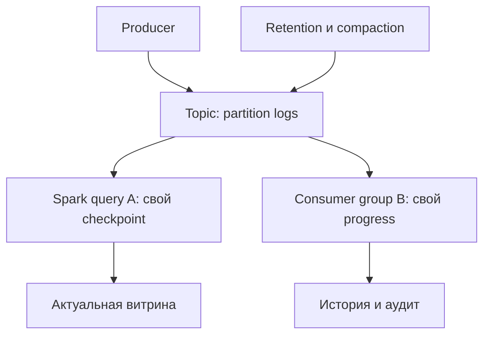
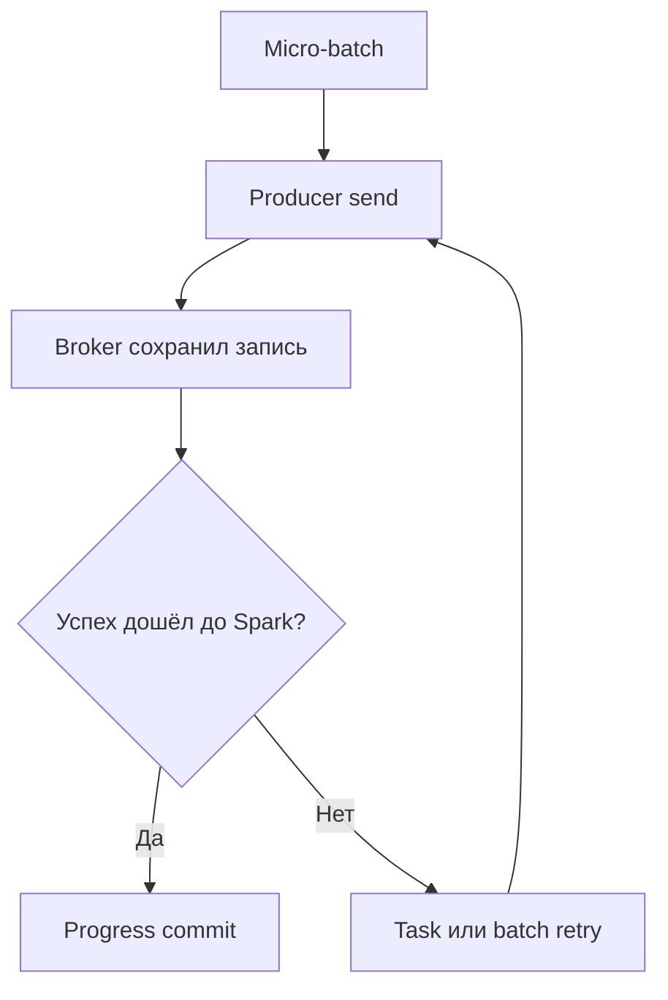
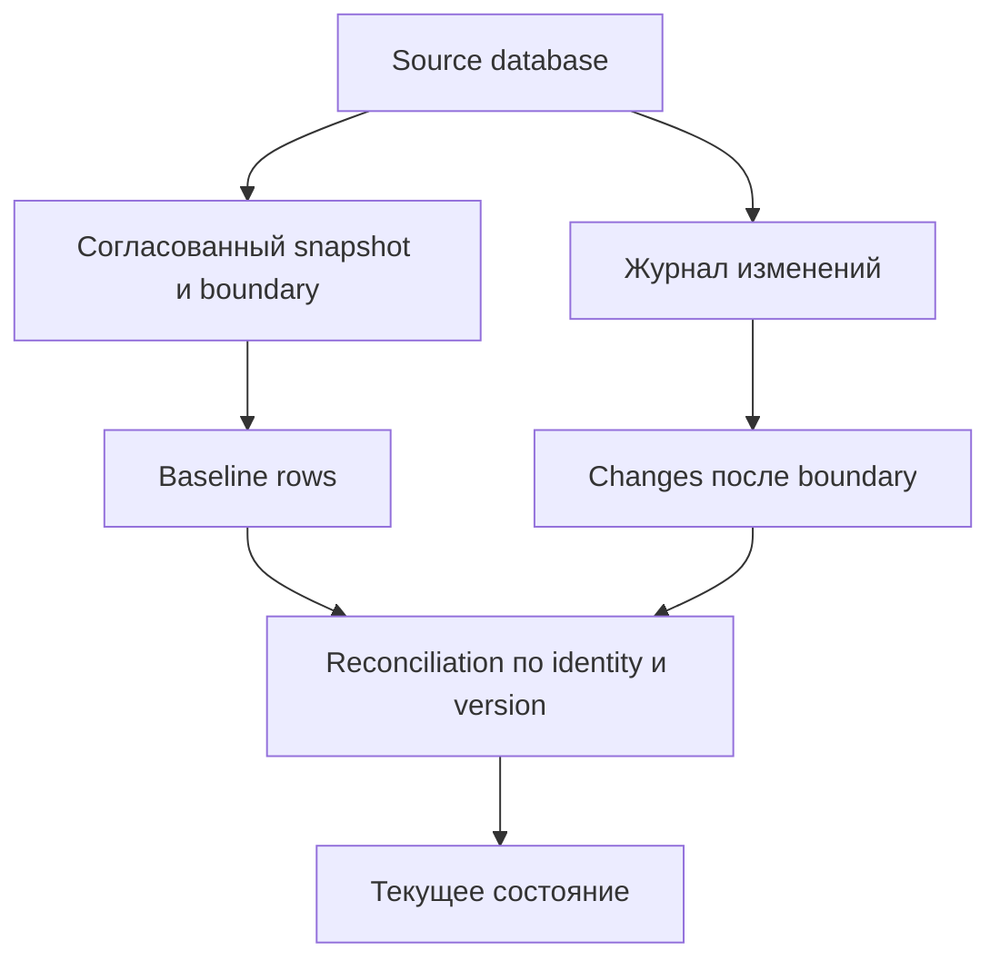
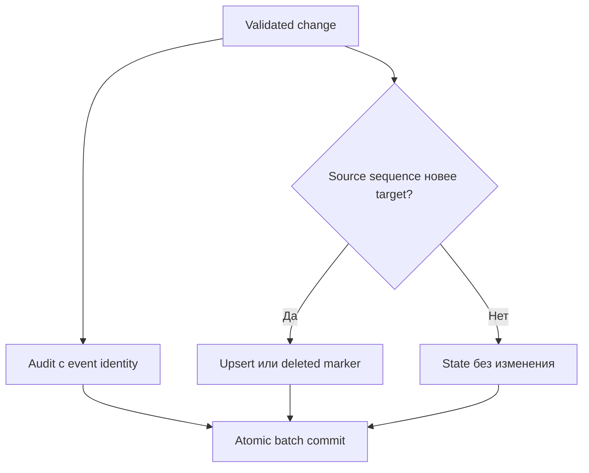
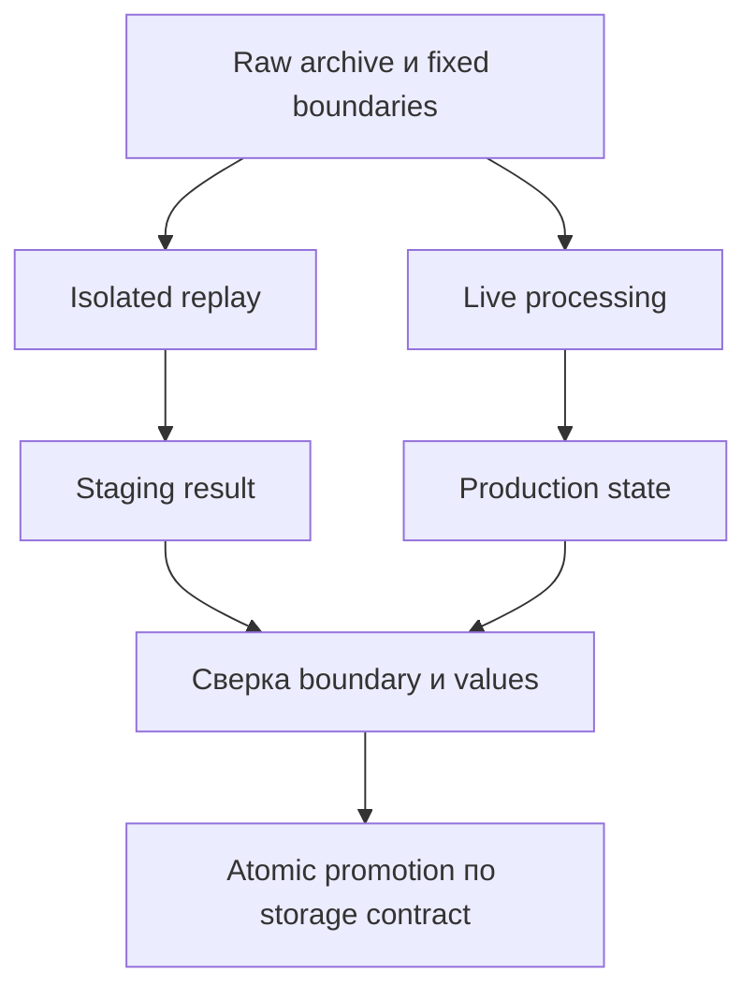

# 17. Kafka, события и Change Data Capture

Основной язык примеров — **Python / PySpark**. Проверенное окружение: **Apache Spark 4.2.0, Python 3.12.14, OpenJDK 17.0.20, Spark Classic**, Linux, `local[2]`, стандартный модуль `sqlite3`. Для Avro compatibility используется Apache Avro, доступный в JVM окружения Spark; Avro/Protobuf SQL decoding modules и Kafka connector имеют отдельные зависимости.

Глава связывает транспорт событий с корректностью данных: topics/partitions/offsets, retention и compaction, source/sink contracts, схемы и security, CDC ordering, upsert/delete и replay. Все **9 тем и 62 пункта README сохранены в исходном порядке**, включая формулировки в скобках. Ровно три уровня заголовков: раздел → тема → пункт; практика и вопросы находятся внутри пунктов.

**Содержание**

1. [Основы Kafka для Spark](#kafka-foundations)
2. [Kafka source](#kafka-source)
3. [Kafka sink](#kafka-sink)
4. [Схемы сообщений и Schema Registry](#schemas-registry)
5. [Защита подключения Kafka](#kafka-security)
6. [Модель CDC](#cdc-model)
7. [Нативное чтение CDC в Apache Spark (добавлено по проверке полноты)](#native-cdc)
8. [Применение CDC к таблице](#apply-cdc)
9. [Контракты событий и replay](#contracts-replay)

**Как выполнить примеры**

Нужны доступный `java` версии 17, полный PySpark 4.2.0 и Python 3.12. Для локального sink требуется SQLite с UPSERT support, версия 3.24 или новее. Установка pandas ниже соответствует проверенному окружению; Arrow computation здесь не используется.

```bash
java -version
python -m venv .venv
source .venv/bin/activate
python -m pip install pyspark==4.2.0 pandas==2.2.3
# Скопируй Python-блоки главы в порядке появления:
python chapter17_lab.py
```

Команды активации рассчитаны на Linux/macOS/WSL. Все Python-блоки выполняй сверху вниз в **одной чистой сессии** без существующего SparkContext. Первый создаёт `spark`, схемы, маленькие fixtures, helpers и временный каталог `lab`. Последний останавливает queries/Spark и удаляет только `lab`. Используются `assert` для проверки ожидаемых результатов; не запускай лабораторию с `python -O`.

В первых опытах `raw` — конечный DataFrame с формой Kafka source: binary key/value, topic, partition, offset, timestamp и headers. Он позволяет проверить transformations и message contracts без brokers. Затем реально выполняются file-source Structured Streaming, transactional `foreachBatch`, restart, version guards, quarantine и изолированный replay. Все driver collections ограничены учебным input.

Настройки `local[2]`, UTC, двух shuffle partitions, отключённого AQE и `spark.python.use.daemon=false` выбраны для локальной воспроизводимости. Это не готовый production tuning profile. Snapshot/LSN values и throughput calculations в fixtures условные и обозначены как модели.

**Внешние примеры.** Kafka read/write functions, Kafka CLI, TLS/SASL/Kerberos configuration и table-format MERGE показаны как deployment templates. Для их запуска нужны свои brokers, connectors/catalogs, permissions и инфраструктура. Python definitions/builders проверены, но внешняя операция не выполняется от одного определения функции. Обычный Parquet catalog в опыте с native CDC ожидаемо отклоняет `.changes()` и SQL CHANGES: так проверяется необходимость connector support.

Kafka concepts/options сверены с официальной документацией Kafka 4.1 и Spark 4.2; это зафиксированные references, а не утверждение о latest Kafka release или установленном broker. Debezium/Registry имеют собственные версии и wire contracts, которые надо фиксировать отдельно. Подробные границы выполнения приведены в последнем пункте.

Официальные отправные страницы: [Spark Kafka integration](https://spark.apache.org/docs/4.2.0/streaming/structured-streaming-kafka-integration.html), [Kafka design](https://kafka.apache.org/41/design/design/), [Debezium PostgreSQL](https://debezium.io/documentation/reference/stable/connectors/postgresql.html), [Spark Changelog API](https://spark.apache.org/docs/4.2.0/api/java/org/apache/spark/sql/connector/catalog/Changelog.html).


<a id="kafka-foundations"></a>

## Основы Kafka для Spark


### Message broker, queue и publish/subscribe: буферизация, развязка систем и независимые свойства порядка и доставки

Брокер сообщений принимает данные от producers и отдаёт consumers. Он помогает пережить кратковременную недоступность получателя и развязать скорости систем: база может публиковать изменения быстрее, чем витрина их применяет. Но буфер конечен, а доставка, порядок, хранение и подтверждение обработки — разные свойства.

В классической очереди несколько workers могут конкурировать за сообщения, а успешное подтверждение позволяет удалить сообщение. В publish/subscribe каждый независимый подписчик получает свою логическую последовательность. Конкретный брокер может поддерживать несколько моделей: по слову «queue» нельзя определить replay, порядок и exactly-once.

| Свойство | Что нужно определить в контракте |
| --- | --- |
| Буферизация | Сколько данных и как долго сохраняются при остановке consumer |
| Порядок | В пределах ключа, partition, очереди или всей системы |
| Доставка | Допустимы ли пропуски, повторы и повтор после восстановления |
| Подтверждение | Подтверждено получение брокером или применение бизнес-эффекта |
| Развязка | Может ли одна система читать независимо от другой |

**Лабораторная основа.** Сначала работаем с маленьким DataFrame, имеющим реальную форму Kafka source. Позже выполним локальный Structured Streaming → `foreachBatch` → transactional CDC sink. Этот набор моделирует сообщения, но не запускает Kafka broker.

```python
import contextlib
import datetime as dt
import inspect
import json
import math
import os
import shutil
import sqlite3
import struct
import sys
import tempfile
import uuid
from pathlib import Path

import pyspark
from pyspark.sql import SparkSession, functions as F, types as T, Window
from pyspark.sql import DataFrameReader
from pyspark.sql.streaming import DataStreamReader

lab = Path(tempfile.mkdtemp(prefix="spark_ch17_"))
spark = (SparkSession.builder.master("local[2]")
    .appName("Spark Zero to Hero - Chapter 17")
    .config("spark.sql.shuffle.partitions", "2")
    .config("spark.sql.session.timeZone", "UTC")
    .config("spark.sql.adaptive.enabled", "false")
    .config("spark.python.use.daemon", "false")
    .config("spark.ui.showConsoleProgress", "false")
    .getOrCreate())
spark.sparkContext.setLogLevel("ERROR")
assert spark.version == "4.2.0"

header_schema = T.StructType([
    T.StructField("key", T.StringType()),
    T.StructField("value", T.BinaryType()),
])
kafka_schema = T.StructType([
    T.StructField("key", T.BinaryType()),
    T.StructField("value", T.BinaryType()),
    T.StructField("topic", T.StringType()),
    T.StructField("partition", T.IntegerType()),
    T.StructField("offset", T.LongType()),
    T.StructField("timestamp", T.TimestampType()),
    T.StructField("timestampType", T.IntegerType()),
    T.StructField("headers", T.ArrayType(header_schema)),
])
order_schema = T.StructType([
    T.StructField("event_id", T.StringType()),
    T.StructField("entity_id", T.LongType()),
    T.StructField("status", T.StringType()),
    T.StructField("amount_cents", T.LongType()),
    T.StructField("schema_version", T.IntegerType()),
    T.StructField("source_version", T.LongType()),
    T.StructField("business_timestamp", T.TimestampType()),
])
base_time = dt.datetime(2026, 1, 1, tzinfo=dt.timezone.utc)

def order_event(event_id, entity_id, version, amount, schema_version=1):
    return {"event_id": event_id, "entity_id": entity_id, "status": "created",
            "amount_cents": amount, "schema_version": schema_version,
            "source_version": version, "business_timestamp": base_time.isoformat()}

def kafka_record(payload, offset, key=b"1", partition=0, headers=None):
    value = None if payload is None else json.dumps(payload).encode("utf-8")
    return (key, value, "orders.events", partition, offset, base_time, 0,
            headers if headers is not None else [("content-type", b"application/json")])

events = [order_event("e1", 1, 10, 100), order_event("e2", 1, 20, 120),
          order_event("e3", 2, 5, 200, schema_version=2)]
raw = spark.createDataFrame([
    kafka_record(events[0], 10), kafka_record(events[1], 11),
    kafka_record(events[2], 7, key=b"2", partition=1),
], kafka_schema)
parsed = raw.withColumn("body", F.from_json(F.col("value").cast("string"), order_schema))
assert parsed.count() == 3
assert parsed.filter("body.event_id IS NULL").count() == 0
print({"Spark": spark.version, "Python": sys.version.split()[0], "rows": raw.count()})

def checkpoint(name):
    return lab / "checkpoints" / name

def finish(query, timeout=60):
    try:
        if not query.awaitTermination(timeout):
            raise TimeoutError("Query did not terminate")
        if query.exception() is not None:
            raise query.exception()
    finally:
        if query.isActive:
            query.stop()

def publish_json(directory, filename, rows):
    directory = Path(directory)
    directory.mkdir(parents=True, exist_ok=True)
    destination = directory / filename
    assert not destination.exists()
    temporary = directory.parent / (uuid.uuid4().hex + ".tmp")
    temporary.write_text("".join(json.dumps(row) + "\n" for row in rows), encoding="utf-8")
    os.replace(temporary, destination)
```

`amount_cents` хранит деньги в целых минимальных единицах. Схемы nullable позволяют принять внешние данные и явно проверить обязательные поля; nullable в Spark не заменяет бизнес-валидацию.

**Практика.** Для события заказа перечисли отдельно требования к порядку, повторам и максимальному простою витрины. **Самопроверка:** означает ли подтверждение producer-у, что заказ уже виден в аналитической таблице?


### Kafka как распределённый append-only log: topics, partitions, offsets, независимые consumer groups, повторное чтение и отличие от удаления сообщения из очереди

Kafka хранит topic как набор partition logs. Запись получает offset внутри своей partition; чтение не удаляет её. В обычной модели consumer groups независимые группы читают журнал со своим progress, а consumers одной группы распределяют partitions между собой. В Spark Structured Streaming progress управляется Spark, поэтому его поведение нельзя свести к обычному group subscription клиента.

Offset — позиция транспорта, а не глобальный ID события. `(topic, partition, offset)` идентифицирует запись в конкретной инкарнации topic/кластера. После удаления и повторного создания topic либо переноса истории нужно учитывать эту дополнительную identity.

```python
positions = [(r.topic, r.partition, r.offset) for r in raw.collect()]
assert len(set(positions)) == 3
assert {p[1] for p in positions} == {0, 1}
# Два независимых readers могут обработать те же строки; read не удаляет журнал.
assert raw.count() == raw.count() == 3
```

Последний assert проверяет fixture, а не работу групп Kafka. Replay возможен только пока нужная история доступна: сохранённый offset не возвращает уже удалённые bytes. Для аудита и полного пересчёта часто нужен отдельный долговременный raw archive.



**Документация:** [Kafka design](https://kafka.apache.org/41/design/design/).

**Самопроверка:** почему offset 100 в partition 0 нельзя сравнивать как «новее» с offset 90 в partition 1?


### Брокеры, leader/follower replicas, репликация партиций и последствия потери лидера для Spark source

Брокер — процесс Kafka, обслуживающий partitions и requests. У partition есть leader и replicas на других брокерах. Leader принимает обычную запись, followers копируют журнал; in-sync replicas, ISR, отражают набор достаточно синхронизированных replicas. Replication factor — число копий, а не число одновременно доступных readers Spark.

При потере leader кластер выбирает нового по своим правилам. Spark clients обновляют metadata и повторяют допустимые операции. Во время election возможны задержки и ошибки; доступность и сохранность подтверждённых записей зависят от replication, ISR, `acks`, `min.insync.replicas`, правил election и состояния дисков.

| Ситуация | Что может увидеть Spark | Что проверить |
| --- | --- | --- |
| Кратковременная смена leader | Retry, рост latency | Metadata refresh, request timeout, broker health |
| Нет допустимого leader | Недоступная partition | Replicas, quorum/election и восстановление Kafka |
| Недостаточный ISR для записи | Producer error при строгом ack | `acks=all`, `min.insync.replicas` |
| Topic пересоздан или журнал потерян | Изменённые ranges, data-loss error | Topic identity и доступность старых offsets |

`failOnDataLoss=false` не чинит репликацию и не восстанавливает исчезнувшие события. Кластер с одной replica удобен для учебного запуска, но не демонстрирует отказоустойчивость production Kafka.

**Практика.** Объясни компромисс availability/durability при RF=3, `min.insync.replicas=2` и недоступности двух replicas. **Самопроверка:** почему успешный retry Spark task не доказывает, что потерянная брокером история восстановлена?


### Создание topics, auto-create и согласование partitions, replication и прав доступа до запуска Spark query

До запуска query согласуй имя topic, partitions, replication factor, cleanup policy, record size, владельца и ACL. Автосоздание зависит от broker/client settings и может дать нежелательные defaults либо быть запрещено. Spark Kafka sink не является системой управления topic lifecycle.

**Шаблон для существующего учебного Kafka-кластера из трёх брокеров; здесь команды не выполняются:**

```bash
bin/kafka-topics.sh --bootstrap-server localhost:9092 \
  --create --topic orders.events --partitions 6 --replication-factor 3 \
  --config cleanup.policy=delete --config retention.ms=604800000
bin/kafka-topics.sh --bootstrap-server localhost:9092 \
  --describe --topic orders.events
```

Для одноброкерной лаборатории replication factor должен быть 1; в защищённом кластере CLI дополнительно получает `--command-config` с client properties. Создание отдельного topic надо включить в deployment, а не полагаться на побочный эффект первой записи.

Увеличение partitions влияет на key routing и порядок будущих сообщений. Это не перенос уже записанных событий между partitions. Планируй migration, если потребитель считает partition частью identity или требует непрерывный порядок ключа.

**Документация:** [Kafka topic configurations](https://kafka.apache.org/41/configuration/topic-configs/).

**Самопроверка:** почему RF=3 нельзя успешно разместить на одном доступном брокере?


### Ключ сообщения и порядок внутри Kafka partition; выбор partition producer-ом по ключу, явному номеру или sticky/round-robin с учётом версии клиента

Kafka сохраняет порядок записи в одной partition, но не глобальный порядок topic. Producer может указать partition явно либо использовать partitioner. При заданном key стандартный алгоритм обычно стабильно распределяет одинаковые key bytes при неизменном числе partitions; null key использует другой путь. Sticky/adaptive/round-robin behavior зависит от клиента и конфигурации.

Spark shuffle, параллельные tasks, retries и несколько producers не сохраняют автоматически порядок бизнес-изменений. Даже правильно выбранный Kafka key не заменяет source sequence при применении CDC. Разные сериализации одного ID, например `b"42"` и `b"042"`, могут дать разную маршрутизацию.

```python
entity_keys = parsed.select("body.entity_id", F.col("key").cast("string").alias("routing_key"))
assert {(r.entity_id, r.routing_key) for r in entity_keys.collect()} == {(1, "1"), (2, "2")}
assert b"42" != b"042"
```

Договор key включает encoding, нормализацию составного ключа и изменение partition count. Python `hash()` и Spark `hash()` не надо выдавать за Kafka client partitioner: алгоритм и входные bytes должны совпасть буквально.

**Практика.** Выбери key для заказов и событий пользователя; объясни возможный hot key. **Самопроверка:** сохраняется ли бизнес-порядок одного заказа, если разные producers публикуют изменения параллельно без source version?


### Log segments: active segment, rollover, физические файлы и отличие Kafka segment от Spark partition

Partition log физически разбит на segments. В active segment идут новые records; rollover создаёт следующий segment при достижении настроенных ограничений. Segment имеет log и index files; имя обычно связано с base offset. Retention и cleaner работают с этим физическим устройством.

Kafka segment — файл хранения брокера. Kafka partition — упорядоченный лог. Spark partition — единица распределённой обработки. Spark task может читать диапазон offsets, пересекающий несколько segments, а одну Kafka partition engine может разделить на несколько диапазонов чтения.

| Объект | Где живёт | Для чего нужен |
| --- | --- | --- |
| Kafka partition | Kafka cluster | Порядок, offsets, replicas |
| Kafka segment | Диск broker/tiered storage по контракту | Физическое хранение и очистка |
| Spark input partition | План конкретного batch | Разделить чтение на tasks |
| Spark shuffle partition | Spark execution | Распределить данные после Exchange |

Большой `segment.bytes` не означает, что Spark получает DataFrame partition такого же размера. Уменьшение segments может ускорить гранулярность очистки, но увеличивает число файлов и операций; оценивать надо Kafka I/O, а не только Spark UI.

**Самопроверка:** почему число segment files не определяет максимальное число параллельных Spark tasks?


### Retention по времени и размеру: доступная история событий, topic overrides, broker defaults, очистка сегментов и ограничение размера на partition

`retention.ms` ограничивает возраст истории, а `retention.bytes` задаёт размер хранения **на partition** при delete policy. Topic overrides перекрывают соответствующие broker defaults. Это не TTL каждой строки с точностью до миллисекунды: очистка зависит от segments и работы фоновых механизмов.

Если заданы время и размер, consumer должен укладываться в оба ограничения. Для topic из 12 partitions лимит 10 GiB на partition даёт ориентир 120 GiB логических partition logs, а replication factor 3 увеличивает объём копий примерно втрое. Indexes, active segments, сжатие и storage policy меняют фактический размер.

```python
gib = 1024 ** 3
partitions_count, bytes_per_partition, replication = 12, 10 * gib, 3
assert partitions_count * bytes_per_partition == 120 * gib
assert partitions_count * bytes_per_partition * replication == 360 * gib
```

Это расчёт ёмкости, не измерение disk usage Kafka. Размер partition может оказаться неодинаковым из-за skew. Убедись, что самая нагруженная partition сохраняет нужный recovery horizon, а не ориентируйся только на среднюю скорость topic.

**Практика.** Рассчитай retention budget по максимальному простою, времени восстановления и catch-up. **Самопроверка:** гарантирует ли `retention.ms=7 days` семь дней истории, если partition раньше достигает `retention.bytes`?


### Log compaction: head/tail, log cleaner, удаление старых значений ключа, tombstones и сохранение offsets с пропусками

Compaction удаляет прежние значения одинакового key, сохраняя возможность получить актуальное состояние ключей. Cleaner работает в фоне; head содержит свежие записи, а tail может быть очищен. Compaction не обязана мгновенно оставить ровно одну запись ключа, не переупорядочивает оставшиеся записи и не перенумеровывает offsets.

Tombstone — запись с ненулевым key и Kafka value=`null`, означающая удаление ключа для compaction. Это не bytes `b"null"` и не JSON object с полем `deleted=true`. Сам tombstone также может быть удалён после предусмотренного периода; слишком отставший reader может пропустить удаление.

```python
toy_log = [(0, "a", "v1"), (1, "b", "v1"), (2, "a", "v2")]
latest_by_key = {key: (offset, key, value) for offset, key, value in toy_log}
idealized_tail = sorted(latest_by_key.values())
assert idealized_tail == [(1, "b", "v1"), (2, "a", "v2")]
assert [row[0] for row in idealized_tail] == [1, 2]  # Offset 0 не перенумерован.
assert None != b"null"
```

Код — идеализированная модель результата compaction, не реализация cleaner. Последнее значение означает последнее в partition log, а не максимальную source version: поздно опубликованное старое изменение может стать последней записью key. Для audit log, подсчёта всех событий и исторического replay compacted topic часто недостаточен.

**Документация:** [Log compaction](https://kafka.apache.org/41/design/design/#log-compaction).

**Самопроверка:** почему разность offsets после compaction не равна числу доступных records?


### cleanup.policy=delete/compact/compact,delete и влияние очистки истории на replay и восстановление Spark query

`cleanup.policy=delete` сохраняет историю до segment retention; `compact` очищает прежние значения ключей; `compact,delete` сочетает оба механизма. При сочетании delete может удалить и последнее значение давно не обновлявшегося ключа. Поэтому compacted topic с delete retention нельзя автоматически считать вечным снимком всего состояния.

| Политика | Подходящая цель | Ограничение replay |
| --- | --- | --- |
| delete | Журнал событий с конечной retention | Старые segments исчезают |
| compact | Восстановление последних значений key | Промежуточные изменения исчезают; tombstones не вечны |
| compact,delete | Ограниченный по времени/объёму changelog | Возможна потеря даже последнего значения старого key |

Checkpoint хранит positions/state, но не копирует Kafka history. `failOnDataLoss` не гарантирует обнаружение любой бизнес-потери от compaction: пропуски offsets являются допустимым свойством compacted log. Для полного CDC replay нужна история всех изменений либо согласованный snapshot плюс доступные изменения после него.

**Практика.** Выбери разные policies для audit events и materialized-key changelog. **Самопроверка:** почему восстановление из checkpoint после долгого простоя может быть невозможно при исправном самом checkpoint?


### Соответствие Kafka partitions и Spark tasks

По умолчанию Kafka source обычно планирует Spark input partitions по topic-partition ranges. Но соответствие не всегда 1:1: `minPartitions` и `maxRecordsPerPartition` позволяют делить крупные ranges. Tasks выполняются только в доступных slots; Kafka partitions, input partitions, shuffle partitions и output partitions — разные числа.

Увеличение `spark.sql.shuffle.partitions` меняет широкие преобразования после чтения, а не количество partitions Kafka topic. Увеличение `minPartitions` не делает Kafka partition независимыми logs и не создаёт глобального порядка результата.

```python
assert raw.select("partition").distinct().count() == 2
rebalanced_fixture = raw.repartition(4)
assert rebalanced_fixture.rdd.getNumPartitions() == 4
assert rebalanced_fixture.count() == 3
```

Выполнен реальный Spark repartition небольшой fixture. Это показывает независимость Spark partition count от поля `partition` в строке, а не измеряет Kafka source planner.

**Самопроверка:** может ли topic из двух Kafka partitions дать больше двух tasks чтения одного Spark batch?


### Подключение spark-sql-kafka и совместимость зависимостей

Kafka connector добавляется отдельно от базового PySpark. Для Spark 4.2.0 официальный artifact — `org.apache.spark:spark-sql-kafka-0-10_2.13:4.2.0`; нужны также его транзитивные зависимости. `_2.13` — бинарная версия Scala, а `0-10` в имени — семейство интеграции, не требование запускать именно broker 0.10.

**Шаблон запуска приложения с доступным Kafka; в локальной лаборатории этот deployment command не исполняется:**

```bash
spark-submit \
  --packages org.apache.spark:spark-sql-kafka-0-10_2.13:4.2.0 \
  kafka_orders_app.py
```

Version connector должна соответствовать Spark. Не подменяй произвольно `kafka-clients.jar` без проверки dependency graph: совместимость protocol с broker и binary compatibility зависимостей приложения — разные вопросы. Driver и executors должны иметь одинаково пригодный classpath.

```python
kafka_coordinate = "org.apache.spark:spark-sql-kafka-0-10_2.13:4.2.0"
assert kafka_coordinate.split(":")[2] == spark.version
assert "_2.13" in kafka_coordinate
```

Assert проверяет координаты шаблона, не наличие connector в JVM. Полный Kafka integration guide также описывает различия механизмов offset fetching и требования к brokers.

**Документация:** [Spark Kafka integration — Linking](https://spark.apache.org/docs/4.2.0/streaming/structured-streaming-kafka-integration.html#linking).

**Самопроверка:** почему установка Python Kafka client не добавляет Spark SQL Kafka provider?


### Отдельные настройки Kafka clients и Spark query

Spark query options, Kafka client properties и Kafka topic/broker settings имеют разные владельцы. Client properties в Spark передаются с префиксом `kafka.`, например `kafka.bootstrap.servers` или `kafka.security.protocol`; Spark options вроде `startingOffsets`, `maxOffsetsPerTrigger`, `includeHeaders` этого префикса не имеют.

| Настройка | Владелец | Для чего |
| --- | --- | --- |
| `maxOffsetsPerTrigger` | Spark Kafka source | Ограничить ranges batch |
| `checkpointLocation` | Spark streaming writer | Сохранить progress/state |
| `kafka.fetch.max.bytes` | Kafka consumer | Настроить fetch; не строгий общий бюджет Spark |
| `kafka.linger.ms` | Kafka producer | Подождать для группировки отправки |
| `retention.ms` | Kafka topic | Ограничить историю |
| `spark.sql.shuffle.partitions` | Spark SQL | Параллелизм shuffle |

```python
source_options = {
    "kafka.bootstrap.servers": "localhost:9092", "subscribe": "orders.events",
    "startingOffsets": "earliest", "includeHeaders": "true",
    "maxOffsetsPerTrigger": "10000", "failOnDataLoss": "true",
}
assert "kafka.maxOffsetsPerTrigger" not in source_options
assert sum(k in source_options for k in ("subscribe", "subscribePattern", "assign")) == 1
```

Некоторые client options Spark запрещает или контролирует сам, включая deserializers и auto-commit behavior. Не копируй весь consumer properties file в `.options()` без проверки integration guide.

**Практика темы.** Раздели deployment, topic management, source options и sink options в конфигурации проекта. **Самопроверка:** почему `.option("retention.ms", ...)` на Spark reader не является изменением retention topic?


<a id="kafka-source"></a>

## Kafka source


### subscribe, subscribePattern и assign

Задаётся ровно один способ выбора input: `subscribe` — список topics, `subscribePattern` — Java regex, `assign` — явные topic-partitions в JSON. Pattern может подхватывать новые подходящие topics; assign фиксирует указанный набор partitions и не является обычной динамической подпиской.

```python
def build_kafka_reader(options, streaming=True):
    selectors = [name for name in ("subscribe", "subscribePattern", "assign") if name in options]
    if len(selectors) != 1:
        raise ValueError("Choose exactly one Kafka selector")
    reader = spark.readStream if streaming else spark.read
    return reader.format("kafka").options(**options)

stream_reader = build_kafka_reader(source_options)
assert isinstance(stream_reader, DataStreamReader)
assigned_options = {
    "kafka.bootstrap.servers": "localhost:9092",
    "assign": json.dumps({"orders.events": [0, 1]}),
}
assert json.loads(assigned_options["assign"])["orders.events"] == [0, 1]
try:
    build_kafka_reader({**source_options, "assign": assigned_options["assign"]})
except ValueError:
    pass
else:
    raise AssertionError("Ambiguous subscription was accepted")

# Deployment template: .load() требует Kafka connector и доступных brokers.
def read_live_kafka(options=source_options):
    return build_kafka_reader(options).load()
```

Выполнены builder API и собственная проверка конфигурации; `read_live_kafka` здесь только определена. Регулярное выражение надо экранировать по правилам Java regex, например `orders\\.events\\..*`; слишком широкий pattern может включить внутренние/DLQ topics и создать feedback loop.

**Практика.** Выбери subscribe для двух известных topics, pattern для контролируемого семейства и assign для фиксированного replay. **Самопроверка:** почему нельзя смешать subscribe и assign «для надёжности»?


### key, value, topic, partition, offset, timestamp и headers

Kafka source отдаёт `key`/`value` как binary. Topic, partition и offset — transport metadata; timestamp имеет смысл CreateTime или LogAppendTime по Kafka contract. Для headers требуется `includeHeaders=true`; headers представлены array of structs `key:string,value:binary`. Одинаковые имена headers могут повторяться, поэтому превращение в map может потерять информацию.

| Поле | Тип Spark | Использование |
| --- | --- | --- |
| key / value | binary | Bytes для выбранного deserializer |
| topic | string | Источник записи |
| partition / offset | int / long | Позиция в transport log |
| timestamp / timestampType | timestamp / int | Kafka timestamp и его тип |
| headers | array of structs, при включении | Trace, encoding, schema metadata |

```python
decoded = parsed.select(
    F.col("key").cast("string").alias("key_text"), "topic", "partition", "offset",
    "timestamp", "timestampType", "headers", "body.*",
)
assert decoded.filter("event_id = 'e1'").first().amount_cents == 100
assert raw.schema["value"].dataType == T.BinaryType()
duplicate_headers = raw.withColumn("headers", F.array(
    F.struct(F.lit("trace").alias("key"), F.lit(b"a").alias("value")),
    F.struct(F.lit("trace").alias("key"), F.lit(b"b").alias("value")),
))
assert duplicate_headers.select(F.size("headers")).first()[0] == 2
```

Сохраняй metadata рядом с результатом разбора, особенно для quarantine/replay. Kafka timestamp не надо автоматически использовать как время бизнес-действия или source sequence.

**Самопроверка:** какие данные понадобятся для расследования ошибки, если raw value оказался некорректным JSON?


### startingOffsets, endingOffsets и чтение batch

Batch Kafka read задаёт конечный диапазон: start включается, end исключается. Для batch default start — earliest, end — latest; streaming default start — latest. Streaming `startingOffsets` применяется только к новой query, а при восстановлении progress берётся из checkpoint. `endingOffsets` — option batch reader, не способ остановить бесконечную streaming query.

```python
batch_options = {
    "kafka.bootstrap.servers": "localhost:9092", "subscribe": "orders.events",
    "startingOffsets": json.dumps({"orders.events": {"0": 10, "1": 7}}),
    "endingOffsets": json.dumps({"orders.events": {"0": 12, "1": 8}}),
}
assert isinstance(build_kafka_reader(batch_options, streaming=False), DataFrameReader)

# Проверка half-open ranges на bounded Kafka-shaped fixture.
bounded = raw.filter(
    ((F.col("partition") == 0) & (F.col("offset") >= 10) & (F.col("offset") < 12))
    | ((F.col("partition") == 1) & (F.col("offset") >= 7) & (F.col("offset") < 8))
)
assert bounded.count() == 3

def read_live_kafka_batch(options=batch_options):
    return build_kafka_reader(options, streaming=False).load()  # External template.
```

В JSON `-2` означает earliest, `-1` latest с ограничениями конкретной option: batch start не допускает latest, batch end не допускает earliest. Для воспроизводимого replay лучше сохранить числовые boundaries всех partitions; latest определяется во время планирования и при следующем запуске может измениться.

**Самопроверка:** входит ли record с offset 12 в диапазон `[10,12)`?


### Начальные offsets по timestamp при поддержке

Для выбора start существуют `startingTimestamp` — один epoch milliseconds timestamp для всех partitions, и `startingOffsetsByTimestamp` — JSON per partition. Precedence: startingTimestamp → startingOffsetsByTimestamp → startingOffsets. Spark передаёт запрос Kafka `offsetsForTimes`; он не разбирает business timestamp из value.

```python
start_ms = int(base_time.timestamp() * 1000)
timestamp_options = {
    "kafka.bootstrap.servers": "localhost:9092", "subscribe": "orders.events",
    "startingTimestamp": str(start_ms),
    "startingOffsetsByTimestampStrategy": "error",
}
assert start_ms == 1767225600000
assert isinstance(build_kafka_reader(timestamp_options), DataStreamReader)
```

Результат Kafka — подходящая позиция по timestamp partition. При отсутствии совпадения стартовая стратегия `error` останавливает запуск, `latest` начинает с конца; это осознанный выбор возможной потери ожидаемой истории. Batch имеет также endingTimestamp/endingOffsetsByTimestamp с их собственной fallback semantics.

Timestamp boundary удобна для поиска периода, но для строгого воспроизводимого replay зафиксируй полученные offsets. Поздние события с business time вчера могут иметь Kafka timestamp сегодня.

**Самопроверка:** можно ли таким start гарантированно получить все business events после полуночи, если Kafka хранит время приёма брокером?


### Checkpoint offsets и отличие от consumer group committed offsets

Structured Streaming хранит обработанные Kafka ranges в checkpoint, а не использует consumer group committed offsets как единственный progress ledger. Поэтому `kafka-consumer-groups` lag/commits могут не отражать истинную границу Spark query. Spark также управляет deserializers и auto-commit; `kafka.auto.offset.reset` не заменяет startingOffsets.

```python
checkpoint_progress = {("orders.events", 0): 12, ("orders.events", 1): 8}
illustrative_group_commits = {("orders.events", 0): 0, ("orders.events", 1): 0}
assert checkpoint_progress != illustrative_group_commits
assert "kafka.enable.auto.commit" not in source_options
```

Числа — иллюстрация двух разных ledgers, не запрос к broker. На restart новый startingOffsets не перематывает существующий checkpoint. Для replay создавай отдельный checkpoint и sink namespace; не удаляй production progress в надежде безопасно перечитать период.

Не разделяй один checkpoint между queries. Явный `kafka.group.id` может создавать взаимное влияние нескольких Spark sources/queries и требует отдельного обоснования; Spark по умолчанию генерирует собственные group identities.

**Самопроверка:** почему успешное восстановление query определяется её checkpoint и source retention, а не наличием committed offset обычной группы Kafka?


### failOnDataLoss и удалённые offsets

`failOnDataLoss=true` по умолчанию позволяет query остановиться при признаках недоступной истории, например удалённом topic или offset вне доступного диапазона. Ошибка требует расследования: может понадобиться raw archive, новый snapshot или backfill. `false` разрешает продолжить при некоторых случаях, но не реконструирует missing data.

```python
saved_next_offset, current_log_start = 12, 30
recovery_range_available = saved_next_offset >= current_log_start
assert not recovery_range_available
assert source_options["failOnDataLoss"] == "true"
```

Это модель риска retention, не моделирование Kafka client exceptions. Не проверяй data loss правилом «offsets обязаны быть подряд»: compaction, transactions и control records дают допустимые gaps. Для бизнес-полноты нужны counts/sequence checks и reconciliation, а не только отсутствие Spark exception.

**Практика.** Составь порядок действий при offset-out-of-range: остановка публикации, проверка log start и topic identity, выбор источника восстановления, сверка результатов. **Самопроверка:** каким документированным бизнес-решением должно сопровождаться отключение failOnDataLoss?


### Обнаружение новых partitions и изменение подписки

При динамической подписке query обнаруживает новые partitions. По Spark Kafka contract newly discovered partitions начинают читаться с earliest, даже если первоначальный start был latest. Для assign новый partition не входит автоматически в заданный JSON.

Изменение подписки существующей checkpoint-backed query требует проверки допустимых query changes и совместимости source topology. Pattern, включивший новый topic, может дать чужую схему, иную key semantics или большой backlog. Увеличение partition count также меняет producer routing будущих сообщений.

```python
initial_partitions = {0, 1}
discovered_partitions = {0, 1, 2}
assert discovered_partitions - initial_partitions == {2}
assert set(json.loads(assigned_options["assign"])["orders.events"]) == initial_partitions
```

Наборы иллюстративны; real discovery здесь не запускается. Наблюдай partition-level ranges/progress, а не только общий inputRowsPerSecond, чтобы новая или горячая partition не осталась незаметной.

**Самопроверка:** почему initial latest не гарантирует пропуск старых records у partition, созданной позже?


### minPartitions и ограничение объёма micro-batch

`maxOffsetsPerTrigger` ограничивает общий объём offsets micro-batch и распределяется по topic-partitions. `minOffsetsPerTrigger` вместе с `maxTriggerDelay` может отложить запуск ради достаточного input. `minPartitions` — hint на Spark splits чтения; `maxRecordsPerPartition` ограничивает размер такого split при поддержке версии.

```python
limited_options = {
    **source_options, "maxOffsetsPerTrigger": "1000", "minOffsetsPerTrigger": "100",
    "maxTriggerDelay": "30s", "minPartitions": "4", "maxRecordsPerPartition": "500",
}
assert isinstance(build_kafka_reader(limited_options), DataStreamReader)
assert int(limited_options["minOffsetsPerTrigger"]) <= int(limited_options["maxOffsetsPerTrigger"])
```

Limits не являются SLA. Один record может быть большим, один key — дорогим, state/shuffle/sink commit — медленными. Offset ranges после очистки не обязаны содержать столько же records, сколько их числовая длина. `minPartitions` приблизителен и может дать другое число tasks.

| Цель | Первый механизм | Что дополнительно измерить |
| --- | --- | --- |
| Уменьшить peak batch | maxOffsetsPerTrigger | Bytes, state, batch duration |
| Разделить горячее чтение | minPartitions / maxRecordsPerPartition | Skew splits и broker throughput |
| Сократить мелкие batches | minOffsetsPerTrigger + maxTriggerDelay | Freshness и backlog |
| Настроить aggregate/join | Spark shuffle settings | Shuffle/state metrics |

**Практика темы.** Определи catch-up budget для stopped query и обычный steady-state budget. **Самопроверка:** почему ограничение 1000 offsets не гарантирует одинаковые RAM и duration всех batches?


<a id="kafka-sink"></a>

## Kafka sink


### Схема key/value и выбор topic

Kafka sink требует `value` типа string или binary; `key` может быть string/binary и необязателен. Topic задаётся колонкой `topic` или writer option `topic`; option имеет приоритет над одноимённой колонкой. Если key отсутствует, получается null key, что влияет на partitioning и compaction.

```python
outgoing = parsed.select(
    F.col("body.entity_id").cast("string").alias("key"),
    F.to_json(F.col("body")).alias("value"),
    F.lit("orders.normalized").alias("topic"),
)
assert outgoing.columns == ["key", "value", "topic"]
assert outgoing.schema["value"].dataType == T.StringType()
assert outgoing.filter("key IS NULL OR value IS NULL").count() == 0

# Deployment templates: определения выполнены, публикация в Kafka не запускается.
def write_live_kafka_batch(df, brokers):
    df.write.format("kafka").option("kafka.bootstrap.servers", brokers).save()

def write_live_kafka_stream(df, brokers, cp):
    return (df.writeStream.format("kafka").outputMode("append")
        .option("kafka.bootstrap.servers", brokers)
        .option("checkpointLocation", str(cp)).start())
```

Здесь выполнена serialization projection и проверены типы. Production query должна явно выбирать output columns: наличие в DataFrame других business columns не заставляет Kafka sink сериализовать их автоматически. Если они не попали в value/headers, потребитель их не получит.

**Самопроверка:** куда попадёт запись, если column topic содержит `a`, а writer option topic задана как `b`?


### Передача partition и headers при поддержке

Необязательная колонка `partition` — integer номер целевой partition; `headers` — array of structs `key:string,value:binary`. Без явной partition выбирает Kafka producer. Номер source partition не надо механически переносить в target: topics могут иметь разные topology и количество partitions.

```python
outgoing_with_headers = outgoing.withColumn("headers", F.array(
    F.struct(F.lit("content-type").alias("key"), F.lit(b"application/json").alias("value")),
)).withColumn("partition", F.lit(0).cast("int"))
assert outgoing_with_headers.schema["partition"].dataType == T.IntegerType()
sink_header_fields = outgoing_with_headers.schema["headers"].dataType.elementType
assert sink_header_fields.fieldNames() == ["key", "value"]
assert sink_header_fields["key"].dataType == T.StringType()
assert sink_header_fields["value"].dataType == T.BinaryType()
assert outgoing_with_headers.select(F.size("headers")).first()[0] == 1
```

Nullability может влиять на прямое сравнение двух StructType; здесь проверены имена и типы header fields. Явная partition=0 только показывает форму schema, а не рекомендует концентрировать поток на одной partition. Headers functionality требует соответствующего Kafka client/broker contract, описанного в integration guide.

**Практика.** Размести trace ID и encoding в headers, а durable event ID — в payload; объясни возможность потерять headers во внешнем архиве. **Самопроверка:** почему копирование source partition может дать invalid partition error или нарушить целевую маршрутизацию?


### Сериализация сообщения и выбор бизнес-ключа

Сериализация — договор bytes, а key — договор identity/routing. Для JSON используй `to_json(struct(...))`, а не Python `str(dict)`: одинарные кавычки и локальное представление объектов не являются JSON contract. Для money, timezone, nullable values и nested fields заранее определи wire representation.

```python
serialized_events = outgoing.select(F.from_json("value", order_schema).alias("body"))
assert {r.body.event_id: r.body.amount_cents for r in serialized_events.collect()} == {
    "e1": 100, "e2": 120, "e3": 200,
}
assert json.loads(outgoing.filter("key = '2'").first().value)["entity_id"] == 2
```

Для entity changelog key часто равен primary key, а для immutable audit event identity хранится отдельным event_id. Несколько изменений одного entity_id должны иметь разные event IDs и source versions. Compaction по entity key сохраняет актуальное транспортное значение, а не все бизнес-действия.

Составной key кодируй однозначно: длины/структурированный формат/экранирование, а не неоднозначное склеивание через разделитель. Изменение key serialization — migration маршрутизации, а не только косметика JSON.

**Самопроверка:** почему `order_id` недостаточен как event ID для created и paid одного заказа?


### Producer options, acknowledgements и batching

Producer options передаются с `kafka.`. `acks=all` ждёт подтверждения ISR по broker contract; `min.insync.replicas` — настройка Kafka topic/broker, ограничивающая запись при недостаточной репликации. `acks=1` имеет более слабую устойчивость к потере leader, `acks=0` не подтверждает приём брокером.

```python
producer_options = {
    "kafka.acks": "all", "kafka.enable.idempotence": "true",
    "kafka.max.in.flight.requests.per.connection": "5",
    "kafka.linger.ms": "10", "kafka.batch.size": "65536",
    "kafka.compression.type": "lz4", "kafka.delivery.timeout.ms": "120000",
}
assert producer_options["kafka.acks"] == "all"
assert int(producer_options["kafka.max.in.flight.requests.per.connection"]) <= 5
```

Idempotent producer требует согласованных acks/retries/in-flight settings. Linger и batch.size помогают собирать producer requests, но не равны Spark micro-batch interval/size. Delivery timeout ограничивает клиентские retries; его надо согласовать с request timeout и linger по документации выбранного kafka-clients.

Сжатие снижает network/storage при цене CPU. Defaults зависят от client version: проверяй фактически разрешённые Maven dependencies, а не предполагаемый номер broker. Не задавай одинаковый `transactional.id` произвольным параллельным Spark writers: это не механизм подключения обычного sink к общей transaction.

**Документация:** [Kafka producer configurations](https://kafka.apache.org/41/configuration/producer-configs/).

**Самопроверка:** почему linger=10ms не обещает, что streaming result будет опубликован каждые 10ms?


### Повторная запись и at-least-once semantics

Обычный Spark Kafka sink имеет at-least-once write semantics. Task или micro-batch может быть повторён после неопределённого результата предыдущей попытки, и те же business events окажутся в log ещё раз. Kafka key не является unique constraint: брокер может хранить несколько записей с одинаковыми key и value.

```python
retried_output = outgoing.unionByName(outgoing)
assert retried_output.count() == 6
ids_after_retry = retried_output.select(F.from_json("value", order_schema).alias("body"))
assert ids_after_retry.select("body.event_id").distinct().count() == 3
```

Это fixture повторной публикации, не fault injection broker. Producer idempotence убирает определённые duplicates внутри producer protocol, но не делает повтор всей Spark task/query тем же самым producer send. Exactly-once Kafka transactions возможны в других integrations при их собственном commit protocol; обычный `.format("kafka")` не обещает такого end-to-end контракта.



**Документация:** [Spark — Writing data to Kafka](https://spark.apache.org/docs/4.2.0/streaming/structured-streaming-kafka-integration.html#writing-data-to-kafka).

**Самопроверка:** почему включение kafka.enable.idempotence не является доказательством однократного бизнес-эффекта у consumer?


### Дедупликация downstream по идентификатору события

Downstream deduplication использует стабильный event ID либо source identity+version, сохранённые в сообщении. Transport offset нового target topic меняется при повторной публикации, поэтому не объединяет два экземпляра одного события. Для change log entity key и event key имеют разную роль.

```python
downstream_events = ids_after_retry.select("body.*")
deduplicated_events = downstream_events.dropDuplicates(["event_id"])
assert deduplicated_events.count() == 3
assert deduplicated_events.select("entity_id").distinct().count() == 2
```

Batch fixture полностью ограничена, и dedup здесь конечная. В бесконечном stream ID-only dedup хранит state; watermark-based dedup имеет конечный horizon и после eviction может пропустить старый duplicate. Если duplicate с тем же ID имеет другой payload, это конфликт контракта, который нельзя незаметно разрешать случайным выбором строки.

Для durable side effect полезны unique event ID в sink, version guard, transactional commit или idempotency key внешнего API. Эти механизмы надо проверять вместе с replay/reset checkpoint policy.

**Практика темы.** Спроектируй consumer повторно опубликованного payment event и не допусти повторного списания. **Самопроверка:** почему правильная дедупликация событий ещё не выбирает последнюю версию состояния entity?


<a id="schemas-registry"></a>

## Схемы сообщений и Schema Registry


### JSON, Avro, Protobuf и формат envelope

Kafka переносит bytes и не заставляет producer выбирать определённую schema. JSON удобен для просмотра, но сам текстовый формат не проверяет обязательные поля и бизнес-смысл. Avro использует writer schema и binary encoding; Protobuf использует message descriptors и field numbers. Envelope описывает обёртку: version, operation, source metadata, payload.

| Формат | Что нужно decoder-у | Частая ошибка |
| --- | --- | --- |
| JSON | Ожидаемая структура и правила типов | Считать любой parsed JSON валидным событием |
| Avro datum | Writer schema, при необходимости reader schema | Читать Registry framing как Avro payload |
| Protobuf | Message type и descriptor | Перепутать field number/тип или message indexes |
| CDC envelope | Контракт op/before/after/source | Читать весь envelope как обычную строку таблицы |

```python
from pyspark.sql.avro.functions import from_avro
from pyspark.sql.protobuf.functions import from_protobuf

assert "jsonFormatSchema" in inspect.signature(from_avro).parameters
assert "messageName" in inspect.signature(from_protobuf).parameters
assert parsed.select("body.schema_version").distinct().count() == 2

# Template: raw_payload уже очищен от framing, модуль spark-avro установлен.
def decode_avro_payload(raw_payload, writer_schema_json, reader_schema_json):
    return from_avro(raw_payload, writer_schema_json, options={"avroSchema": reader_schema_json})
```

Spark Avro/Protobuf SQL modules подключаются отдельно по документации Spark. Сам import Python wrapper не доказывает наличие JVM implementation. Для Protobuf после schema ID может идти message-index framing; прямое срезание пяти bytes не является универсальным Protobuf deserializer.

**Документация:** [Spark Avro](https://spark.apache.org/docs/4.2.0/sql-data-sources-avro.html), [Spark Protobuf](https://spark.apache.org/docs/4.2.0/sql-data-sources-protobuf.html).

**Самопроверка:** почему JSON с правильным синтаксисом и amount=-100 может быть невалидным бизнес-событием?


### Schema ID и отделение wire framing от полезной нагрузки

Schema Registry хранит схемы и их версии/идентификаторы по своему API. Schema ID не равен field `schema_version` бизнес-envelope и не обязательно равен порядковому номеру version внутри subject. По ID определяется writer schema конкретного сообщения.

В распространённом Confluent payload-prefix framing v0 первый byte равен 0, следующие четыре — big-endian schema ID, дальше идёт форматная часть. Для Protobuf дополнительно учитываются message indexes. Это договор конкретного serializer, а не требование Apache Kafka. В новых вариантах Confluent schema GUID может передаваться в headers вместо prefix; decoder должен знать выбранный contract.

```python
def split_prefix_v0(value):
    if value is None:
        return None
    if len(value) < 5 or value[0] != 0:
        raise ValueError("Unsupported or truncated payload-prefix v0")
    return struct.unpack(">I", value[1:5])[0], value[5:]

payload_bytes = json.dumps(events[0]).encode("utf-8")
framed_fixture = b"\x00" + struct.pack(">I", 7) + payload_bytes
schema_id, extracted_payload = split_prefix_v0(framed_fixture)
assert schema_id == 7 and json.loads(extracted_payload)["event_id"] == "e1"
assert split_prefix_v0(None) is None
try:
    split_prefix_v0(b"\x01\x00")
except ValueError:
    pass
else:
    raise AssertionError("Malformed framing was accepted")
```

Проверен разбор prefix на JSON fixture, не вызов Registry/Avro decoder. Не применяй этот helper к сообщениям с GUID headers или любому неизвестному binary protocol. Key и value также могут использовать разные schemas/framing.

**Документация:** [Confluent wire format](https://docs.confluent.io/platform/current/schema-registry/fundamentals/serdes-develop/index.html#wire-format).

**Самопроверка:** почему `.cast("string")` всего framed Avro value не декодирует бизнес-данные?


### Reader/writer schema и правила совместимости

Writer schema описывает, как событие записано, reader schema — какие поля ожидает consumer. Backward compatibility обычно означает, что новый reader читает старые writers; forward — старый reader читает новый writer; full — оба направления. Transitive policy проверяет все предусмотренные прошлые версии, а не только последнюю.

Для Avro новый reader может добавить поле с default и читать старые записи. Удалённое reader field может игнорироваться; если writer удалил обязательное поле старого reader без default, направление совместимости меняется. Не переносите Avro rules на Protobuf или JSON Schema буквально.

```python
avro_v1 = {"type": "record", "name": "Order", "fields": [{"name": "id", "type": "int"}]}
avro_v2 = {"type": "record", "name": "Order", "fields": [
    {"name": "id", "type": "int"},
    {"name": "note", "type": ["null", "string"], "default": None},
]}
jvm = spark.sparkContext._jvm
writer_avro = jvm.org.apache.avro.Schema.Parser().parse(json.dumps(avro_v1))
reader_avro = jvm.org.apache.avro.Schema.Parser().parse(json.dumps(avro_v2))
compatibility = jvm.org.apache.avro.SchemaCompatibility.checkReaderWriterCompatibility(
    reader_avro, writer_avro,
)
assert compatibility.getType().toString() == "COMPATIBLE"
```

Это реальная проверка Apache Avro compatibility, а не регистрация subject в Registry. Wire compatibility не означает семантическую: изменение валюты, единиц измерения или смысла status может пройти schema check и испортить витрину.

**Документация:** [Avro specification](https://avro.apache.org/docs/1.12.0/specification/), [Registry compatibility](https://docs.confluent.io/platform/current/schema-registry/fundamentals/schema-evolution.html).

**Практика.** Для replay двухлетней истории выбери transitive policy и план reader rollout. **Самопроверка:** какая сторона в `checkReaderWriterCompatibility(reader, writer)` новая при backward migration?


### Кэширование схем и отказ Registry

Lookup schema на каждый record создаёт latency, сетевой bottleneck и зависимость от Registry availability. Схемы обычно кэшируют по ID/GUID и контексту Registry; serializer/client отвечает за конкретную cache policy. У executor JVM/Python worker и driver разные процессы и разные lifetime кэшей.

```python
schema_cache = {}
registry_fixture_calls = []

def fixture_schema_lookup(schema_id):
    registry_fixture_calls.append(schema_id)
    known = {7: avro_v1, 8: avro_v2}
    if schema_id not in known:
        raise KeyError(schema_id)
    return known[schema_id]

def cached_schema(schema_id):
    if schema_id not in schema_cache:
        schema_cache[schema_id] = fixture_schema_lookup(schema_id)
    return schema_cache[schema_id]

assert cached_schema(7) == cached_schema(7) == avro_v1
assert registry_fixture_calls == [7]
```

Это local cache model, не production Registry client. Определи лимит cache, timeout, retry/backoff, поведение при unknown ID и границы namespace. Cached known schemas могут позволить читать часть потока при outage; новое неизвестное ID всё равно требует lookup. Жёсткое удаление старых schemas способно сломать replay даже при сохранённых Kafka bytes.

**Самопроверка:** почему cache только на driver не обязательно помогает decoder-у, который работает на executors?


### Неизвестная версия схемы и quarantine

Неизвестную version/schema нельзя незаметно читать «как последнюю» и терять поля. Сохрани raw bytes, headers, transport position, reason и decoder version в quarantine. Различай недоступный Registry, неподдерживаемую известную schema и malformed payload: retry стратегии у них разные.

```python
unknown_schema_event = order_event("unknown-schema", 3, 1, 50, schema_version=99)
unknown_raw = spark.createDataFrame([kafka_record(unknown_schema_event, 20)], kafka_schema)
known_and_unknown = raw.unionByName(unknown_raw).withColumn(
    "body", F.from_json(F.col("value").cast("string"), order_schema),
)
unknown_versions = known_and_unknown.filter(~F.col("body.schema_version").isin(1, 2))
assert unknown_versions.count() == 1
assert unknown_versions.select("value", "topic", "partition", "offset", "headers").first().offset == 20
```

Здесь business schema_version используется для явной маршрутизации JSON fixture. Для framed formats аналогичный выбор начинается со schema ID/GUID. Unknown version — не то же самое, что null Kafka value: tombstone обрабатывается по своему контракту.

**Практика.** Определи метрики unknown-schema rate и backlog quarantine; добавь ручной/автоматический promotion после установки decoder. **Самопроверка:** почему filter «оставить только parsed rows» без записи rejected rows является потерей данных?


### Удалённые, необязательные и новые поля

При добавлении поля старые сообщения не начинают содержать его автоматически. Optional field, default и explicit null — разные понятия. В Spark `from_json` отсутствующее поле обычно даёт null согласно schema; default reader schema Avro — другой механизм. В Protobuf field numbers нельзя переиспользовать под иной смысл при миграции.

```python
evolved_schema = T.StructType(order_schema.fields + [T.StructField("coupon", T.StringType())])
old_with_new_reader = raw.withColumn("body", F.from_json(F.col("value").cast("string"), evolved_schema))
assert old_with_new_reader.filter("body.coupon IS NOT NULL").count() == 0
defaulted = old_with_new_reader.select(
    "body.event_id", F.coalesce("body.coupon", F.lit("NO_COUPON")).alias("coupon"),
)
assert {r.coupon for r in defaulted.collect()} == {"NO_COUPON"}
```

Coalesce сознательно объединяет missing и explicit null. Если бизнес различает эти состояния, сохраняй presence в envelope либо проверяй исходную структуру до нормализации. Не превращай unknown into zero для денег без договора: это может сделать ошибку похожей на корректный нулевой платёж.

**Практика темы.** Проверь старые/новые сообщения, explicit null, отсутствующее поле, новый enum и новый decimal scale. **Самопроверка:** почему успех from_json не равен подтверждению полной reader/writer compatibility?


<a id="kafka-security"></a>

## Защита подключения Kafka


### TLS/SSL и truststore/keystore

TLS шифрует соединение и позволяет проверять подлинность broker certificate. Truststore содержит доверенные CA/certificates, keystore — собственную identity с private key для client authentication, если кластер требует mTLS. Проверка hostname связывает certificate SAN с реальным адресом broker.

```python
# Configuration template: files должны существовать на driver и executors.
tls_options = {
    "kafka.security.protocol": "SSL",
    "kafka.ssl.truststore.type": "PKCS12",
    "kafka.ssl.truststore.location": "/etc/app/kafka/truststore.p12",
    "kafka.ssl.endpoint.identification.algorithm": "https",
}
assert tls_options["kafka.ssl.endpoint.identification.algorithm"] == "https"
assert Path(tls_options["kafka.ssl.truststore.location"]).is_absolute()
```

Это проверка формы template, не TLS handshake. Для mTLS добавляются keystore location/type/password и key password по client contract. Сам факт шифрования не выдаёт ACL на topic. Не отключай hostname verification как постоянное решение SAN/advertised address mismatch: исправляй certificate и адресацию.

**Документация:** [Kafka SSL](https://kafka.apache.org/41/security/encryption-and-authentication-using-ssl/).

**Самопроверка:** почему установка CA в truststore не доказывает, что broker разрешит читать orders.events?


### SASL mechanisms и настройки JAAS

SASL отвечает за authentication. Выбранный механизм должен совпадать с listener: PLAIN, SCRAM-SHA-256/512, GSSAPI или OAUTHBEARER имеют разные credentials и login modules. `SASL_SSL` сочетает SASL с TLS; `SASL_PLAINTEXT` не шифрует transport.

```python
def jaas_quoted(text):
    if any(c in text for c in ("\n", "\r", "\x00")):
        raise ValueError("Unexpected control character")
    return '"' + text.replace("\\", "\\\\").replace('"', '\\"') + '"'

def scram_jaas(username, password):
    return ("org.apache.kafka.common.security.scram.ScramLoginModule required "
            f"username={jaas_quoted(username)} password={jaas_quoted(password)};")

# Только вымышленные credentials для проверки escaping; строка не печатается.
demo_jaas = scram_jaas("demo-user", 'demo-"quoted"')
assert '\\"quoted\\"' in demo_jaas and demo_jaas.endswith(";")
sasl_template = {
    **tls_options, "kafka.security.protocol": "SASL_SSL",
    "kafka.sasl.mechanism": "SCRAM-SHA-512", "kafka.sasl.jaas.config": demo_jaas,
}
assert sasl_template["kafka.security.protocol"] == "SASL_SSL"
```

Реальные secrets доставляются из разрешённого secret provider/deployment механизма, не из committed Markdown/config. Настройка `sasl.jaas.config` хранит чувствительную строку; redaction UI/logs надо проверять. Для OAuth могут потребоваться callbacks/provider libraries и token refresh; одного названия OAUTHBEARER недостаточно.

**Документация:** [Kafka SASL](https://kafka.apache.org/41/security/authentication-using-sasl/).

**Самопроверка:** почему смена sasl.mechanism без смены JAAS login module обычно не исправляет authentication failure?


### Kerberos, credentials и delegation tokens при поддержке

Kerberos использует principal, keytab или credential cache, service name, realm/KDC и корректное время. В Spark Kafka integration delegation token provider может получить и продлевать token, затем передавать его executors. Возможность зависит от Kafka security configuration, Spark deployment и выбранной версии.

```python
# Template, не запрос token: cluster alias — произвольный уникальный идентификатор.
delegation_template = {
    "spark.kafka.clusters.orders.auth.bootstrap.servers": "broker-a:9093,broker-b:9093",
    "spark.kafka.clusters.orders.security.protocol": "SASL_SSL",
    "spark.kafka.clusters.orders.sasl.kerberos.service.name": "kafka",
    "spark.kafka.clusters.orders.sasl.token.mechanism": "SCRAM-SHA-512",
    "spark.kafka.clusters.orders.target.bootstrap.servers.regex": r"broker-[ab]:9093",
}
assert "spark.kafka.clusters.orders.auth.bootstrap.servers" in delegation_template
```

Для keytab launch используют `--principal`/`--keytab` по deployment contract. Credential renewal и distribution важны для long-running query: стартовая authentication может пройти, а через часы истечь. Не копируй delegation-token настройки как универсальную конфигурацию SCRAM с обычным паролем.

**Документация:** [Spark Kafka security](https://spark.apache.org/docs/4.2.0/streaming/structured-streaming-kafka-integration.html#security).

**Практика.** Определи, кто получает, обновляет и доставляет credentials при restart executor. **Самопроверка:** почему доступный keytab на ноутбуке driver не означает доступность credentials в cluster-mode executors?


### ACL на topics и consumer operations

Authentication определяет principal, authorization — разрешённые операции. ACL должны покрывать реально используемые topic, metadata requests и, когда требуются, group/transactional resources. Набор прав различается для чтения, записи, administration и механизма offset fetching.

| Участник | Основная операция | Что согласовать с администратором |
| --- | --- | --- |
| Spark driver Kafka AdminClient | Metadata/offset discovery | Describe нужных topics, доступ к brokers |
| Executors Kafka source | Fetch records | Read нужных topics и применимые group permissions |
| Executors Kafka sink | Produce | Write/Describe целевых topics, требования idempotent producer |
| Deployment topic admin | Create/alter | Отдельные административные права |
| Registry client | Schema lookup | Права Registry, отдельно от Kafka ACL |

В Spark 3.1+ новый offset fetching использует AdminClient; прежние схемы group-based authorization для driver не надо переносить без проверки. Успешный metadata lookup не подтверждает executor fetch, а возможность читать source не даёт права писать target/DLQ.

**Документация:** [Kafka ACLs](https://kafka.apache.org/41/security/authorization-and-acls/), [Spark offset fetching](https://spark.apache.org/docs/4.2.0/streaming/structured-streaming-kafka-integration.html#offset-fetching).

**Самопроверка:** почему TopicAuthorizationException после успешного login — другая проблема, чем SaslAuthenticationException?


### Доставка секретов на driver и executors

Kafka source/sink работает не только на driver: network clients, trust material и нужные credentials должны быть доступны там, где реально исполняется connector. Простое чтение local file на driver не делает его доступным на executors. Подходы — managed secret mounts, node/container credentials либо согласованная localization файлов.

```python
def redact_for_demo(options):
    sensitive = ("password", "secret", "token", "sasl.jaas.config")
    return {key: "<redacted>" if any(s in key.lower() for s in sensitive) else value
            for key, value in options.items()}

safe_demo = redact_for_demo(sasl_template)
assert safe_demo["kafka.sasl.jaas.config"] == "<redacted>"
assert safe_demo["kafka.sasl.mechanism"] == "SCRAM-SHA-512"
```

Это учебный redaction helper, не доказательство защиты Spark UI, event log и exception messages. Настраивай runtime redaction и проверяй её на вымышленных secrets. Передача JAAS через CLI/обычные logs может раскрыть credentials; секретная строка не должна попадать в DLQ reason или raw configuration dump.

**Практика.** Проверь credential delivery отдельно для driver, новой executor и restart application, включая rotation. **Самопроверка:** почему file path из SparkFiles.get на driver нельзя бездумно объявить абсолютным JVM client path всех executors?


### Диагностика network, authorization и authentication failures

Диагностируй подключение по слоям: DNS/network → advertised listeners → TLS → SASL → ACL → topic/partition metadata → data fetch/produce. Bootstrap servers нужны для первого контакта; дальше client использует адреса brokers из metadata. Поэтому доступный bootstrap address при недоступных advertised listeners даёт неполноценное соединение.

| Симптом | Вероятный слой | Следующий полезный шаг |
| --- | --- | --- |
| Connection timeout / DNS error | Network/address | Проверить маршрут с driver и executor |
| Certificate/hostname error | TLS | Проверить CA, SAN, listener hostname и срок certificate |
| SASL authentication failure | Credentials/mechanism | Проверить login module, principal и rotation |
| Topic/Group authorization failure | ACL | Сопоставить principal, resource и operation |
| Offset out of range | History/retention | Проверить log start/end и checkpoint |
| Decoder error после fetch | Message schema | Проверить framing/schema ID и raw bytes |

Timeout сам по себе не доказывает недостаточный executor heap. Повышение retries может скрыть постоянную ошибку маршрута и увеличить время отказа. Сохраняй идентификаторы query/task/topic и redacted error, но не секреты.

**Практика темы.** По трём разным ошибкам выбери слой диагностики и собери подтверждающее наблюдение. **Самопроверка:** почему успешный read с ноутбука не подтверждает доступ executor pods к advertised Kafka addresses?


<a id="cdc-model"></a>

## Модель CDC


### Snapshot и поток изменений после snapshot

CDC переносит изменения состояния источника, а не только новые строки аналитической таблицы. Начальный snapshot даёт baseline существующих rows; затем connector продолжает читать журнал изменений с согласованной позиции. Последовательность «обычный SELECT, потом начать Kafka» без границы источника может пропустить изменения между этими действиями.

Snapshot events обычно отличаются от обычных inserts; в Debezium `op=r` означает read snapshot. Incremental/ad hoc snapshots могут приходить при уже работающем change stream и требуют другого reconciliation contract. История базы до snapshot в CDC не появляется автоматически.



**Fixture следующего опыта:** Debezium-подобный JSON без внешней обёртки schema/payload. `event_id` добавлен нашим ingestion contract, не является обязательным стандартным полем Debezium.

```python
row_image_schema = T.StructType([
    T.StructField("id", T.LongType()), T.StructField("status", T.StringType()),
    T.StructField("amount_cents", T.LongType()),
])
cdc_source_schema = T.StructType([
    T.StructField("name", T.StringType()), T.StructField("db", T.StringType()),
    T.StructField("schema", T.StringType()), T.StructField("table", T.StringType()),
    T.StructField("lsn", T.LongType()), T.StructField("txId", T.LongType()),
    T.StructField("snapshot", T.StringType()),
])
cdc_schema = T.StructType([
    T.StructField("before", row_image_schema), T.StructField("after", row_image_schema),
    T.StructField("source", cdc_source_schema), T.StructField("op", T.StringType()),
    T.StructField("ts_ms", T.LongType()), T.StructField("event_id", T.StringType()),
    T.StructField("transaction", T.StructType([
        T.StructField("id", T.StringType()), T.StructField("total_order", T.LongType()),
    ])),
])

def cdc_event(op, entity_id, lsn, amount=None, before_amount=None, event_id=None, order=1):
    def image(value):
        return {"id": entity_id, "status": "active", "amount_cents": value}
    return {
        "before": image(before_amount) if op in ("u", "d") else None,
        "after": image(amount) if op in ("r", "c", "u") else None,
        "source": {"name": "pg-main", "db": "app", "schema": "public", "table": "orders",
                   "lsn": lsn, "txId": lsn, "snapshot": "true" if op == "r" else "false"},
        "op": op, "ts_ms": int(base_time.timestamp() * 1000),
        "event_id": event_id or f"pg-main-orders-{lsn}-{order}",
        "transaction": {"id": str(lsn), "total_order": order},
    }

cdc_payloads = [
    cdc_event("r", 1, 100, amount=100),
    cdc_event("u", 1, 110, amount=110, before_amount=100),
    cdc_event("c", 2, 120, amount=200),
    cdc_event("d", 1, 130, before_amount=110),
]
cdc_records = [kafka_record(p, i, key=json.dumps({"id": (p["after"] or p["before"])["id"]}).encode())
               for i, p in enumerate(cdc_payloads)]
cdc_records.append(kafka_record(None, 4, key=b'{"id": 1}'))
cdc_raw = spark.createDataFrame(cdc_records, kafka_schema).withColumn(
    "topic", F.lit("pg-main.public.orders"),
)
cdc_parsed = cdc_raw.withColumn("body", F.from_json(F.col("value").cast("string"), cdc_schema))
assert cdc_parsed.filter("body.op = 'r'").count() == 1
assert cdc_raw.count() == 5
```

Числовые lsn в fixture — согласованная учебная ordering domain одного source. Они не доказывают, что любой snapshot row можно сравнить с любым online event без отдельного baseline contract.

**Документация:** [Debezium PostgreSQL — snapshots](https://debezium.io/documentation/reference/stable/connectors/postgresql.html#postgresql-snapshots).

**Самопроверка:** какой boundary должен связывать snapshot с дальнейшим чтением журнала, чтобы не было blind interval?


### Insert, update, delete и tombstone

Insert/create добавляет row, update меняет её состояние, delete удаляет row из актуальной модели. Debezium delete event с `op=d` содержит envelope с ключом/доступной before image и after=null. Следующий tombstone с Kafka value=null нужен compaction и не является вторым полноценным бизнес-delete с собственной source version.

```python
delete_events = cdc_parsed.filter("body.op = 'd'")
tombstones = cdc_parsed.filter(F.col("value").isNull())
assert delete_events.count() == tombstones.count() == 1
assert delete_events.select("body.after").first()[0] is None
assert tombstones.select("key").first()[0] is not None
json_null_record = spark.createDataFrame([
    (b'{"id":1}', b"null", "pg-main.public.orders", 0, 5, base_time, 0, []),
], kafka_schema)
assert json_null_record.filter(F.col("value").isNull()).count() == 0
```

Здесь `b"null"` — ненулевой Kafka payload, даже если JSON decoder возвращает null. Если обработчик смотрит только на parsed body, он может спутать tombstone, JSON null и parse failure. Сначала проверь raw value, затем envelope.

Для current-state sink delete требует versioned removal/marker; иначе старый retry insert может вернуть уже удалённую row. Transport tombstone часто пропускают после применения полноценного CDC delete, сохраняя raw archive для аудита.

**Самопроверка:** почему after=null не означает «записать все business columns как NULL» для delete?


### Before/after images и source metadata

Before image помогает аудиту и сравнению, after image — построению нового состояния. Доступность полных images зависит от database/connector: PostgreSQL replica identity, TOAST/неизменённые поля и placeholders имеют отдельные ограничения. Schema не гарантирует, что каждый update содержит полную достоверную row.

```python
update_image = cdc_parsed.filter("body.op = 'u'").select("body.before", "body.after").first()
assert update_image.before.amount_cents == 100
assert update_image.after.amount_cents == 110
assert update_image.before.id == update_image.after.id == 1
```

Fixture использует полные after images. Поэтому позже можно схлопывать изменения одного ключа до последней row внутри batch. Для patch-only updates такой приём теряет предыдущие изменения других полей: patches надо применить в порядке source sequence либо предварительно восстановить full image.

Source metadata описывает database/table, позицию журнала, transaction и snapshot status. Connector processing timestamp обычно отличается от source commit timestamp и business timestamp. Сохраняй исходный envelope: normalization не должна уничтожить данные для расследования.

**Практика.** Проверь DELETE при default replica identity и UPDATE большого неизменённого поля. **Самопроверка:** почему отсутствие поля и before.amount=null не обязательно означают одинаковое изменение бизнеса?


### Debezium envelope и другие CDC-форматы

Debezium envelope содержит before/after, op, source и connector timestamp, а при соответствующей настройке transaction metadata. Kafka Connect JSON converter может включать schema/payload wrapper; SMT может преобразовать или удалить envelope. Поэтому decoder строится под фактически опубликованный wire contract, а не под название Debezium.

```python
def normalize_cdc(df):
    key_body = F.from_json(F.col("key").cast("string"), "id BIGINT")
    p = df.withColumn("body", F.from_json(F.col("value").cast("string"), cdc_schema))
    return p.filter(F.col("value").isNotNull()).select(
        F.concat_ws("/", "body.source.name", "body.source.db", "body.source.schema",
                    "body.source.table").alias("source_id"),
        "body.event_id",
        F.coalesce("body.after.id", "body.before.id", key_body["id"]).alias("entity_id"),
        F.col("body.source.lsn").alias("source_lsn"),
        F.col("body.transaction.total_order").alias("source_order"),
        F.col("body.op").alias("op"),
        F.col("body.after.amount_cents").alias("amount_cents"),
        F.col("value").cast("string").alias("envelope_json"),
    )

changes = normalize_cdc(cdc_raw)
assert changes.count() == 4
assert {r.op for r in changes.collect()} == {"r", "c", "u", "d"}
assert changes.filter("op = 'd'").first().entity_id == 1
```

Normalizer учебный и требует предварительной validation raw/envelope перед production sink. `concat_ws` может пропускать null, поэтому обязательность каждого source identity field проверяется отдельно; incomplete identity не должна попасть в target. Другие CDC formats могут давать отдельные before/after rows, operation headers или column masks — требуется adapter в нормализованный contract.

**Самопроверка:** что сломается, если incoming value содержит `{"schema":...,"payload":...}`, а schema decoder ожидает op на верхнем уровне?


### LSN, SCN, transaction ID и порядок событий источника

LSN в PostgreSQL и SCN/другие позиции в Oracle отражают source log domain. Transaction ID группирует события, но сам по себе не является универсальным monotonic row version. Для полного ordering key может понадобиться source epoch, log position и ordinal внутри transaction; одинаковая log position у нескольких изменений не должна разрешаться случайным event ID.

```python
def pg_lsn_to_int(text):
    high, low = text.split("/")
    return (int(high, 16) << 32) + int(low, 16)

assert pg_lsn_to_int("0/FF") < pg_lsn_to_int("1/0")
assert (110, 1) < (110, 2) < (120, 1)
```

Helper показывает numeric ordering PostgreSQL textual LSN; если connector уже выдаёт numeric lsn, повторно разбирать его как строку не нужно. Сравнение lexicographic strings `'100' < '20'` неверно для numeric versions. Независимые базы, failover epochs и неподконтрольные clocks не образуют один порядок автоматически.

**Документация:** [Debezium PostgreSQL](https://debezium.io/documentation/reference/stable/connectors/postgresql.html), [Debezium Oracle](https://debezium.io/documentation/reference/3.7/connectors/oracle.html).

**Самопроверка:** почему transaction ID либо ts_ms нельзя без проверки объявить единственным version guard всех CDC rows?


### Первичный ключ, ключ маршрутизации и изменения ключа

Primary key определяет identity строки источника. Kafka key выбирает маршрутизацию, event ID определяет identity изменения. Они часто связаны, но не взаимозаменяемы. При изменении primary key старую identity нужно удалить, новую — создать, а связи downstream — согласовать.

```python
key_change = [
    cdc_event("d", 2, 140, before_amount=200, order=1),
    cdc_event("c", 3, 140, amount=200, order=2),
]
assert key_change[0]["before"]["id"] == 2
assert key_change[1]["after"]["id"] == 3
assert key_change[0]["transaction"]["total_order"] < key_change[1]["transaction"]["total_order"]
```

Это модель двух событий переноса identity, не полный wire output Debezium primary-key update. Connector может публиковать delete/tombstone по старому key и create по новому, включая специальные headers. Смена Kafka partition для нового key также снимает предположение общего transport order старой и новой identity.

**Практика.** Определи поведение foreign keys, audit и dedup при изменении customer_id. **Самопроверка:** почему upsert новой identity без удаления старой оставляет лишнюю row?


### Транзакционные границы источника и ограничения их сохранения downstream

Транзакция базы может менять несколько rows/tables атомарно. Kafka records этой transaction распределяются по topics/partitions, а Spark micro-batches следуют source ranges и не обязаны совпадать с транзакцией базы. Readers нескольких sinks могут наблюдать промежуточное состояние, даже если каждая отдельная запись корректна.

```python
transaction_example = [
    ("tx-42", "orders", 1, 1), ("tx-42", "order_lines", 9, 2),
]
assert {row[0] for row in transaction_example} == {"tx-42"}
assert {row[1] for row in transaction_example} == {"orders", "order_lines"}
```

Пример только иллюстрирует scope transaction. Для сохранения atomic visibility надо получать transaction boundaries/counts, буферизовать полный набор и применять его атомарно в целевом storage. Отдельные Kafka transactions, database transactions и table-format commits не становятся общей transaction автоматически.

**Практика темы.** Для order + order_lines определи, допустимо ли временное расхождение. Если нет — опиши механизм completeness и atomic publication. **Самопроверка:** почему batchId Spark не является transaction ID исходной базы?


<a id="native-cdc"></a>

## Нативное чтение CDC в Apache Spark (добавлено по проверке полноты)


### SQL CHANGES и DataFrameReader.changes(): чтение row-level changes с Spark 4.2 при поддержке connector (добавлено по проверке полноты)

В Spark 4.2 появился общий API row-level changes: `spark.read.changes(tableName)` и `spark.readStream.changes(tableName)`. SQL использует changelog clause после table identifier, например `CHANGES FROM VERSION 10 TO VERSION 20`. Это API **Data Source V2 catalog**, который должен реализовать CDC contract; произвольные JDBC, Parquet и Kafka sources не получают CDC capability от одной смены метода.

```python
assert hasattr(DataFrameReader, "changes") and hasattr(DataStreamReader, "changes")
assert list(inspect.signature(DataFrameReader.changes).parameters) == ["self", "tableName"]
native_table = "ch17_native_" + uuid.uuid4().hex[:8]
native_location = lab / "native_table"
spark.sql(f"CREATE TABLE {native_table} (id BIGINT) USING parquet LOCATION '{native_location}'")

def expect_cdc_unsupported(action):
    try:
        action()
    except Exception as error:
        assert "UNSUPPORTED_FEATURE.CHANGE_DATA_CAPTURE" in str(error), str(error)
    else:
        raise AssertionError("Ordinary catalog unexpectedly accepted CDC")

expect_cdc_unsupported(lambda: spark.read.option("startingVersion", "10").changes(native_table))
expect_cdc_unsupported(lambda: spark.readStream.option("startingVersion", "10").changes(native_table))
native_sql = f"SELECT * FROM {native_table} CHANGES FROM VERSION 10 TO VERSION 20"
expect_cdc_unsupported(lambda: spark.sql(native_sql))
spark.sql(f"DROP TABLE {native_table}")
```

Выполнены три реальные API paths на существующей таблице: parser распознаёт CDC syntax, а analyzer отклоняет catalog без поддержки. Это содержательная проверка ограничения, не успешное чтение changelog. Форма `CHANGES(table)` разбирается как table-valued function и не заменяет этот changelog clause.

**Шаблон для установленного CDC-capable каталога:**

```sql
SELECT *
FROM cdc_catalog.app.orders
CHANGES FROM VERSION 10 TO VERSION 20;
```

Не путай native `.changes()` с `table_changes`/change-feed options конкретной платформы или StateStore changelog checkpoint: это разные интерфейсы и контракты.

**Документация:** [DataFrameReader.changes](https://spark.apache.org/docs/4.2.0/api/python/reference/pyspark.sql/api/pyspark.sql.DataFrameReader.changes.html), [TableCatalog](https://spark.apache.org/docs/4.2.0/api/java/org/apache/spark/sql/connector/catalog/TableCatalog.html).

**Самопроверка:** что необходимо помимо Spark 4.2, чтобы этот SELECT вернул данные, а не unsupported-feature exception?


### Контракт V2-каталога TableCatalog.loadChangelog и структура row-level changes; требования к поддержке changelog источником (добавлено по проверке полноты)

Публичный V2 contract — `TableCatalog.loadChangelog(Identifier, ChangelogContext, CaseInsensitiveStringMap)`, возвращающий `Changelog`. Default implementation не поддерживает CDC; connector переопределяет её и предоставляет scan. Spark получает описание range и выбранной post-processing semantics.

| Metadata column | Контракт |
| --- | --- |
| `_change_type` | insert, delete, update_preimage или update_postimage |
| `_commit_version` | LongType или StringType; natural ordering соответствует commit order |
| `_commit_timestamp` | Timestamp commit; одинаков внутри одной commit version |

```python
table_catalog_class = jvm.java.lang.Class.forName("org.apache.spark.sql.connector.catalog.TableCatalog")
changelog_method = [m for m in table_catalog_class.getMethods() if m.getName() == "loadChangelog"]
assert len(changelog_method) == 1
assert changelog_method[0].getReturnType().getSimpleName() == "Changelog"
assert jvm.org.apache.spark.sql.connector.catalog.Changelog.CHANGE_TYPE_INSERT == "insert"

native_change_schema = T.StructType([
    T.StructField("_change_type", T.StringType()), T.StructField("_commit_version", T.LongType()),
    T.StructField("_commit_timestamp", T.TimestampType()), T.StructField("id", T.LongType()),
    T.StructField("amount_cents", T.LongType()),
])
native_change_fixture = spark.createDataFrame([
    ("insert", 10, base_time, 1, 100),
    ("update_preimage", 20, base_time + dt.timedelta(minutes=1), 1, 100),
    ("update_postimage", 20, base_time + dt.timedelta(minutes=1), 1, 120),
], native_change_schema)
assert {r._change_type for r in native_change_fixture.collect()} == {
    "insert", "update_preimage", "update_postimage",
}
```

Проверены установленный interface и metadata-shaped fixture; это не реализация connector. `rowId()` описывает identity, `rowVersion()` помогает отличить реальное изменение от copy-on-write carry-over. `_commit_version` говорит, какой commit выпустил строку; rowVersion может остаться прежней при физической перезаписи без изменения content.

Connector flags сообщают о carry-over pairs, intermediate changes и representation updates. Если flags не соответствуют реальным данным, Spark post-processing может дать неверный результат. Одна лишь schema с `_change_type` не делает обычную таблицу корректным changelog source.

**Документация:** [Changelog interface](https://spark.apache.org/docs/4.2.0/api/java/org/apache/spark/sql/connector/catalog/Changelog.html).

**Самопроверка:** почему copy-on-write delete+insert прежней row не надо считать двумя бизнес-событиями?


### Диапазоны версий или временных меток, полные и net changes, batch и streaming чтение (добавлено по проверке полноты)

Reader options задают `startingVersion`/`endingVersion` либо `startingTimestamp`/`endingTimestamp`, а `startingBoundInclusive`/`endingBoundInclusive` уточняют boundaries. Не смешивай version range и timestamp range. Для рассмотренного default version range обе границы inclusive — это отличается от Kafka offset end exclusive.

```python
cdc_range_options = {
    "startingVersion": "10", "endingVersion": "20",
    "startingBoundInclusive": "true", "endingBoundInclusive": "true",
    "deduplicationMode": "netChanges", "computeUpdates": "true",
}
dedup_mode_class = jvm.java.lang.Class.forName(
    "org.apache.spark.sql.connector.catalog.ChangelogContext$DeduplicationMode",
)
mode_values = {m.value() for m in dedup_mode_class.getEnumConstants()}
assert mode_values == {"none", "dropCarryovers", "netChanges"}
assert native_change_fixture.filter("_commit_version >= 10 AND _commit_version <= 20").count() == 3

# Templates: нужен CDC-capable catalog; эти functions не вызываются в лаборатории.
def read_native_changes(table_name):
    return spark.read.options(**cdc_range_options).changes(table_name)

def stream_native_changes(table_name):
    return (spark.readStream.option("startingVersion", "10")
            .option("deduplicationMode", "dropCarryovers").changes(table_name))
```

`none` отдаёт raw change rows, `dropCarryovers` убирает неизменённые rewrite pairs, `netChanges` сворачивает промежуточные изменения identity до net effect. `computeUpdates` позволяет восстановить update pre/post images из подходящих delete+insert pairs. Для аудита всех изменений net result не подходит; он отвечает на другой вопрос.

В **batch** netChanges рассматривает конечный запрошенный range. В **streaming** результат буферизуется и выпускается по commit progress; cross-commit net computation ограничена вместе буферизованными изменениями, а не всей бесконечной историей. Для full-range collapse выбирай bounded batch.

Streaming post-processing имеет строгие требования: rows одной commit не должны разделяться между micro-batches, commit timestamps не-null, а timestamps следующего batch строго больше максимума предыдущих batches. Иначе zero-delay watermark path может признать данные поздними и потерять их. Это особый contract native changelog, не универсальная рекомендация watermark=0 для Debezium Kafka.

**Документация:** [ChangelogContext](https://spark.apache.org/docs/4.2.0/api/java/org/apache/spark/sql/connector/catalog/ChangelogContext.html), [ChangelogRange](https://spark.apache.org/docs/4.2.0/api/java/org/apache/spark/sql/connector/catalog/ChangelogRange.html), [DeduplicationMode](https://spark.apache.org/docs/4.2.0/api/java/org/apache/spark/sql/connector/catalog/ChangelogContext.DeduplicationMode.html).

**Практика темы.** На выбранном connector проверь boundaries, delete+insert carry-over, update detection, net effect и commit-aligned streaming batches. **Самопроверка:** почему несколько numeric-looking StringType versions должны иметь lexicographic order, действительно соответствующий commit order?


<a id="apply-cdc"></a>

## Применение CDC к таблице


### Выбор последнего изменения ключа внутри micro-batch

Перед upsert необходимо убрать несколько изменений одного target key внутри micro-batch: многие MERGE implementations не разрешают несколько source rows, одновременно обновляющих одну target row. Для полных after images оставляем последнее изменение по согласованной source sequence, включая delete. Для patches сначала восстанавливаем full state в правильном порядке.

```python
def latest_changes(batch_df):
    invalid = batch_df.filter(
        F.col("source_id").isNull() | (F.col("source_id") == "")
        | F.col("event_id").isNull() | (F.col("event_id") == "")
        | F.col("entity_id").isNull() | F.col("source_lsn").isNull()
        | F.col("source_order").isNull() | F.col("envelope_json").isNull()
        | F.col("op").isNull() | ~F.col("op").isin("r", "c", "u", "d")
        | ((F.col("op") != "d") & (F.col("amount_cents").isNull() | (F.col("amount_cents") < 0)))
    )
    if invalid.limit(1).count():
        raise ValueError("CDC input must be validated before apply")
    ambiguous = (batch_df.groupBy("source_id", "entity_id", "source_lsn", "source_order")
                 .agg(F.countDistinct("envelope_json").alias("variants"))
                 .filter("variants > 1"))
    if ambiguous.limit(1).count():
        raise ValueError("Conflicting changes have the same source sequence")
    order_window = Window.partitionBy("source_id", "entity_id").orderBy(
        F.col("source_lsn").desc(), F.col("source_order").desc(),
    )
    return (batch_df.withColumn("rn", F.row_number().over(order_window))
            .filter("rn = 1").drop("rn"))

latest_batch = latest_changes(changes)
assert {(r.entity_id, r.op, r.source_lsn) for r in latest_batch.collect()} == {
    (1, "d", 130), (2, "c", 120),
}
```

Выполнен batch analytic Window внутри bounded DataFrame. Такой `row_number` не переносится напрямую на бесконечный streaming DataFrame: здесь он будет применяться внутри `foreachBatch`.

При одинаковой source sequence и разных values нельзя выбирать «последний по event ID». В fixture conflict определяется по точному envelope_json; production сравнивает каноническое содержимое нужных полей, учитывая serialization и служебные metadata. Исключение на conflict лучше случайного overwrite.

**Практика.** Добавь два различных updates с одинаковой sequence и проверь fail/quarantine policy. **Самопроверка:** почему latest в одном batch не защищает от старого события в следующем?


### Сравнение source sequence вместо времени получения

Последнее по времени получения не обязательно последнее в источнике. После retry/backfill/replay старое изменение может прийти поздно, а clocks могут расходиться. В target нужен version guard: применять изменение только если его source sequence новее сохранённой для этой identity.

```python
source_versions = [(130, 1), (115, 1), (140, 1)]
arrival_order = list(range(len(source_versions)))
assert source_versions[max(arrival_order)] == (140, 1)
assert source_versions[1] < source_versions[0]  # Вторым прибыло более старое.
assert max(source_versions) == (140, 1)
assert "source_lsn" in latest_batch.columns
```

Это иллюстрация order, а реальные guards выполняются следующим sink. Domain сравнения включает source identity/epoch и key. Для нескольких изменений с одинаковым LSN нужен ordinal; для нескольких независимых sources — определённая стратегия конфликта, а не сравнение несопоставимых чисел.

Snapshot baseline также требует правила сравнения с live changes. Нельзя автоматически присвоить каждой snapshot row timestamp приёма и объявить её новой версией, которая перезапишет более свежий update.

**Самопроверка:** почему `max(ts_ms)` не является универсальным способом выбрать последнее состояние строки базы?


### Upsert и delete через возможности table format

Upsert/delete реализуются средствами target storage: MERGE, keyed writes, row-level operations или transactional database API. Обычный Append Parquet не обновляет существующие rows. В нашей текущей модели delete сохраняется как **versioned marker**, чтобы поздний insert старой версии не восстановил строку.

**Реальный учебный sink: SQLite с state, audit и batch marker в одной transaction.** Он обрабатывает только маленькие fixtures через driver `collect`; для больших batches нужен распределённый table-format/DB connector с эквивалентным contract.

```python
state_db = lab / "cdc_state.sqlite"

@contextlib.contextmanager
def db_connection(path):
    connection = sqlite3.connect(path)
    try:
        with connection:
            yield connection
    finally:
        connection.close()

def init_state_db(path):
    with db_connection(path) as connection:
        connection.execute("""CREATE TABLE state (
            source_id TEXT, entity_id INTEGER, source_lsn INTEGER, source_order INTEGER,
            event_id TEXT, amount_cents INTEGER, is_deleted INTEGER,
            PRIMARY KEY(source_id,entity_id))""")
        connection.execute("""CREATE TABLE audit (
            source_id TEXT, event_id TEXT, envelope_json TEXT,
            PRIMARY KEY(source_id,event_id))""")
        connection.execute("""CREATE TABLE commits (
            query_key TEXT, batch_id INTEGER, PRIMARY KEY(query_key,batch_id))""")

def read_state(path, active_only=False):
    with db_connection(path) as connection:
        connection.row_factory = sqlite3.Row
        where = " WHERE is_deleted=0" if active_only else ""
        return [dict(row) for row in connection.execute("SELECT * FROM state" + where)]

def apply_cdc_batch(batch_df, batch_id, db_path=state_db,
                    query_key="chapter17-direct", fail_before_commit=False):
    batch_df.persist()
    try:
        latest = latest_changes(batch_df)
        # Полностью consume bounded input; collect допустим только в этой лаборатории.
        all_rows = batch_df.collect()
        final_rows = latest.collect()
    finally:
        batch_df.unpersist()
    with db_connection(db_path) as connection:
        connection.execute("BEGIN IMMEDIATE")
        if connection.execute("SELECT 1 FROM commits WHERE query_key=? AND batch_id=?",
                              (query_key, batch_id)).fetchone():
            return "already_committed"
        for row in all_rows:
            previous_payload = connection.execute(
                "SELECT envelope_json FROM audit WHERE source_id=? AND event_id=?",
                (row.source_id, row.event_id),
            ).fetchone()
            if previous_payload is not None and previous_payload[0] != row.envelope_json:
                raise ValueError("Event ID reused with different content")
            connection.execute("INSERT OR IGNORE INTO audit VALUES (?,?,?)",
                               (row.source_id, row.event_id, row.envelope_json))
        for row in final_rows:
            previous = connection.execute("""SELECT source_lsn,source_order,event_id,
                amount_cents,is_deleted FROM state WHERE source_id=? AND entity_id=?""",
                (row.source_id, row.entity_id)).fetchone()
            deleted = int(row.op == "d")
            amount = None if deleted else row.amount_cents
            if previous is not None and (row.source_lsn, row.source_order) == previous[:2]:
                if (row.event_id, amount, deleted) != previous[2:]:
                    raise ValueError("Equal source version has conflicting content")
            connection.execute("""INSERT INTO state VALUES (?,?,?,?,?,?,?)
                ON CONFLICT(source_id,entity_id) DO UPDATE SET
                source_lsn=excluded.source_lsn, source_order=excluded.source_order,
                event_id=excluded.event_id, amount_cents=excluded.amount_cents,
                is_deleted=excluded.is_deleted
                WHERE excluded.source_lsn > state.source_lsn
                   OR (excluded.source_lsn = state.source_lsn
                       AND excluded.source_order > state.source_order)""",
                (row.source_id, row.entity_id, row.source_lsn, row.source_order,
                 row.event_id, amount, deleted))
        if fail_before_commit:
            raise RuntimeError("Injected failure before commit")
        connection.execute("INSERT INTO commits VALUES (?,?)", (query_key, batch_id))
    return "committed"

init_state_db(state_db)
assert apply_cdc_batch(changes, 0) == "committed"
assert {row["entity_id"] for row in read_state(state_db, active_only=True)} == {2}
assert {row["entity_id"]: row["is_deleted"] for row in read_state(state_db)} == {1: 1, 2: 0}

# Проверяем rollback после state/audit writes до marker commit.
rollback_db = lab / "cdc_rollback.sqlite"
init_state_db(rollback_db)
try:
    apply_cdc_batch(changes, 0, db_path=rollback_db, fail_before_commit=True)
except RuntimeError as error:
    assert "Injected" in str(error)
else:
    raise AssertionError("Expected injected failure")
assert read_state(rollback_db) == []
with db_connection(rollback_db) as connection:
    assert connection.execute("SELECT COUNT(*) FROM audit").fetchone()[0] == 0
    assert connection.execute("SELECT COUNT(*) FROM commits").fetchone()[0] == 0
assert apply_cdc_batch(changes, 0, db_path=rollback_db) == "committed"
```

Это реальная проверка transaction rollback/retry, но не process crash. Helper закрывает connection в finally: штатный SQLite connection context manager управляет transaction, но не закрывает соединение автоматически. Stable query_key задаёт namespace batch markers; новый checkpoint не должен случайно переиспользовать тот же batch numbering для другого input. SQLite BEGIN IMMEDIATE сериализует writers здесь; другой storage должен обеспечить свои concurrent version guards.

**Принцип table-format MERGE:** condition match включает source identity и primary key; update применяется только при более новой `(source_lsn, source_order)`. Deleted marker вставляется даже при отсутствии target row. Active view фильтрует `is_deleted=false`. Если нужен physical delete, sequence хранится в отдельном durable version ledger с согласованной atomicity.

**SQL template для установленного table-format connector с MERGE support:** `latest_cdc_batch` — заранее проверенная и схлопнутая source relation. Schema target соответствует семи колонкам примера; тип is_deleted здесь BOOLEAN.

```sql
MERGE INTO cdc_catalog.cur.orders AS t
USING latest_cdc_batch AS s
ON t.source_id = s.source_id AND t.entity_id = s.entity_id
WHEN MATCHED AND (
  s.source_lsn > t.source_lsn OR
  (s.source_lsn = t.source_lsn AND s.source_order > t.source_order)
) THEN UPDATE SET
  source_lsn = s.source_lsn, source_order = s.source_order,
  event_id = s.event_id,
  amount_cents = CASE WHEN s.op = 'd' THEN NULL ELSE s.amount_cents END,
  is_deleted = (s.op = 'd')
WHEN NOT MATCHED THEN INSERT (
  source_id, entity_id, source_lsn, source_order, event_id, amount_cents, is_deleted
) VALUES (
  s.source_id, s.entity_id, s.source_lsn, s.source_order, s.event_id,
  CASE WHEN s.op = 'd' THEN NULL ELSE s.amount_cents END, (s.op = 'd')
);
```

Этот statement не запускается без нужного connector/catalog/extensions. Аналогичный программный вход — `DataFrame.mergeInto` при поддержке целевого storage. У table formats различаются row-level write implementation, conflict detection и isolation: принятый SQL синтаксис не является доказательством concurrent correctness.

**Документация:** [SQLite UPSERT](https://www.sqlite.org/lang_upsert.html), [Python sqlite3 transactions](https://docs.python.org/3.12/library/sqlite3.html), [Spark mergeInto](https://spark.apache.org/docs/4.2.0/api/python/reference/pyspark.sql/api/pyspark.sql.DataFrame.mergeInto.html), [Iceberg Spark MERGE](https://iceberg.apache.org/docs/latest/spark-writes/#merge-into).

**Самопроверка:** почему запись batch marker до успешного изменения state может дать пропуск события после restart?


### Повторные и пришедшие не по порядку события

Есть два вида повторов: повтор того же micro-batch и повтор event в другом batch. Batch marker убирает первый в пределах одной query identity, event ID и version guard — второй. Version guard также защищает от перестановки разных событий одного key.

```python
state_before_retry = read_state(state_db)
assert apply_cdc_batch(changes, 0) == "already_committed"
assert read_state(state_db) == state_before_retry

late_payload = cdc_event("u", 1, 115, amount=105, before_amount=110)
late_raw = spark.createDataFrame([kafka_record(late_payload, 20, key=b'{"id":1}')], kafka_schema)
late_change = normalize_cdc(late_raw)
assert apply_cdc_batch(late_change, 1) == "committed"
entity_one = next(row for row in read_state(state_db) if row["entity_id"] == 1)
assert entity_one["source_lsn"] == 130 and entity_one["is_deleted"] == 1

conflicting_payload = cdc_event("c", 2, 120, amount=999)
conflicting_raw = spark.createDataFrame([
    kafka_record(conflicting_payload, 99, key=b'{"id":2}'),
], kafka_schema)
conflicting_change = normalize_cdc(conflicting_raw)
try:
    latest_changes(changes.unionByName(conflicting_change))
except ValueError as error:
    assert "same source sequence" in str(error)
else:
    raise AssertionError("Conflicting equal sequence was accepted")
state_before_conflict = read_state(state_db)
try:
    apply_cdc_batch(conflicting_change, 99)
except ValueError as error:
    assert "Event ID reused" in str(error)
else:
    raise AssertionError("Reused event ID with different content was accepted")
assert read_state(state_db) == state_before_conflict
```

Старый update сохранён в audit, но не изменил более новое deleted state. Это не означает «его не существовало»: для исторического анализа audit содержит исходные изменения, а current-state projection выбирает итог.



**Практика.** Проверь duplicate в новом batch, старый update после delete, одинаковую sequence с разным payload. **Самопроверка:** почему идемпотентность batchId недостаточна после reset checkpoint?


### Delete followed by insert и защита от восстановления старой версии

После delete новая insert более высокой source version может легально создать row снова. Старый delete не должен удалить новую row, а старый insert — вернуть удалённую. Для этого sequence сохраняется и у deleted identity; TTL marker должен учитывать полный допустимый replay horizon.

```python
reinsert_payload = cdc_event("c", 1, 140, amount=150)
reinsert_raw = spark.createDataFrame([kafka_record(reinsert_payload, 21, key=b'{"id":1}')], kafka_schema)
reinsert_change = normalize_cdc(reinsert_raw)
assert apply_cdc_batch(reinsert_change, 2) == "committed"
old_delete = changes.filter("op = 'd'")
assert apply_cdc_batch(old_delete, 3) == "committed"
entity_one = next(row for row in read_state(state_db) if row["entity_id"] == 1)
assert (entity_one["source_lsn"], entity_one["amount_cents"], entity_one["is_deleted"]) == (140, 150, 0)
```

Kafka tombstone может давно исчезнуть из compacted topic, поэтому нельзя полагаться на него как на единственный version ledger current-state sink. При физическом удалении row без durable marker следующий старый upsert увидит «target отсутствует» и восстановит неверное состояние.

**Самопроверка:** почему WHEN NOT MATCHED INSERT без version history опасен после физического DELETE?


### Snapshot reconciliation и сверка с источником

Сверка snapshot и target должна относиться к согласованному source boundary. Counts полезны, но одинаковое число rows не доказывает совпадение keys/values. Сравни identity sets, значения, aggregates и при необходимости hashes; timezone, decimals, deleted rows и snapshot isolation должны совпадать.

```python
source_snapshot = spark.createDataFrame([(1, 150), (3, 200)], "entity_id BIGINT, amount_cents BIGINT")

def reconciliation_diff(db_path, source_df):
    target_rows = [(r["entity_id"], r["amount_cents"]) for r in read_state(db_path, active_only=True)]
    target_df = spark.createDataFrame(target_rows, "entity_id BIGINT, target_amount BIGINT")
    return (source_df.withColumnRenamed("amount_cents", "source_amount")
            .join(target_df, "entity_id", "full")
            .filter(~F.col("source_amount").eqNullSafe(F.col("target_amount"))))

assert reconciliation_diff(state_db, source_snapshot).count() == 2  # Старый key 2, отсутствует 3.
migration_payloads = [
    cdc_event("d", 2, 150, before_amount=200, order=1),
    cdc_event("c", 3, 150, amount=200, order=2),
]
migration_raw = spark.createDataFrame([
    kafka_record(p, 30+i, key=json.dumps({"id": (p["after"] or p["before"])["id"]}).encode())
    for i, p in enumerate(migration_payloads)
], kafka_schema)
assert apply_cdc_batch(normalize_cdc(migration_raw), 4) == "committed"
assert reconciliation_diff(state_db, source_snapshot).count() == 0
```

Сравнены реальные локальные datasets; исходная база не читается. Для nullable business columns diff также должен проверять наличие key с каждой стороны: две missing/null values могут выглядеть равными. В fixture amount обязательный и non-null у active rows, поэтому такой неоднозначности нет.

Snapshot reconciliation — не «upsert все найденные rows»: нужно решить, что делать с keys, отсутствующими в baseline, и с concurrent changes после boundary. Без staging и reconciliation можно получить смесь разных моментов времени.

**Практика.** Добавь одинаковые counts при различных values и убедись, что сверка найдёт расхождение. **Самопроверка:** почему сравнение live SELECT с target во время активных updates может давать ложные mismatch?


### Отдельное хранение журнала изменений и актуального состояния

Raw change journal отвечает на вопрос «что приходило», normalized audit — «какие изменения распознаны», current-state table — «какое состояние актуально». Отделение этих моделей позволяет пересчитать logic, расследовать duplicates и восстановить утраченный target. Current-state compaction не заменяет историю.

**Сквозной streaming опыт с проверкой restart:**

```python
stream_state_db = lab / "cdc_stream.sqlite"
init_state_db(stream_state_db)
cdc_input = lab / "cdc_input"
publish_json(cdc_input, "001.json", [r.asDict() for r in changes.collect()])
cdc_stream = spark.readStream.schema(changes.schema).option("maxFilesPerTrigger", 1).json(str(cdc_input))
stream_cp = checkpoint("cdc_apply")

def cdc_callback(batch_df, batch_id):
    apply_cdc_batch(batch_df, batch_id, db_path=stream_state_db, query_key="chapter17-stream")

def run_cdc_stream():
    query = (cdc_stream.writeStream.foreachBatch(cdc_callback)
             .option("checkpointLocation", str(stream_cp)).trigger(availableNow=True).start())
    finish(query)
    return query

cdc_query_1 = run_cdc_stream()
publish_json(cdc_input, "002.json", [r.asDict() for r in late_change.collect()])
cdc_query_2 = run_cdc_stream()
assert cdc_query_1.id == cdc_query_2.id and cdc_query_1.runId != cdc_query_2.runId
assert next(r for r in read_state(stream_state_db) if r["entity_id"] == 1)["is_deleted"] == 1
publish_json(cdc_input, "003.json", [r.asDict() for r in reinsert_change.collect()])
cdc_query_3 = run_cdc_stream()
assert {r["entity_id"] for r in read_state(stream_state_db, active_only=True)} == {1, 2}
with db_connection(stream_state_db) as connection:
    assert connection.execute("SELECT COUNT(*) FROM commits").fetchone()[0] == 3
    assert connection.execute("SELECT COUNT(*) FROM audit").fetchone()[0] == 6
assert (stream_cp / "offsets").exists()
```

Выполнены реальные micro-batches, callback, transactions и restart с одним checkpoint. File source подаёт заранее нормализованные fixtures; Kafka/Debezium infrastructure этим опытом не эмулируется. Audit хранит всё валидное входное изменение, включая проигравший version guard update. Sink state получает только latest per key.

Несколько независимых таблиц/sinks обычно не участвуют в одной transaction. Production journal → state pipeline должна согласовать идемпотентность каждой границы и recovery; запись raw и target двумя несогласованными side effects может расходиться.

**Практика темы.** Выполни все stages, затем добавь старый insert, повтор event в новом batch и конфликт equal version. **Самопроверка:** почему отсутствие active row 1 после первого run является корректным результатом, хотя input содержит snapshot этой row?


<a id="contracts-replay"></a>

## Контракты событий и replay


### Event ID, source version и business timestamp

Event ID определяет конкретное изменение; source version задаёт его порядок в своей domain; business timestamp сообщает, когда произошло бизнес-действие. Kafka offset и broker timestamp — transport metadata. Если одно событие переопубликовали с новым offset, его event ID обычно должен остаться прежним.

| Identity/time | Для чего | Для чего не подходит автоматически |
| --- | --- | --- |
| Entity primary key | Найти текущую row | Отличить два обновления entity |
| Event ID | Dedup и audit | Выбрать последнюю source version |
| Source position + ordinal | Ordering/version guard | Сравнить независимые базы без общего contract |
| Business timestamp | Event-time analytics | Надёжно упорядочить source mutations |
| Topic-partition-offset | Transport replay/debug | Узнать повтор того же business event в новом log |

```python
assert events[0]["event_id"] != events[1]["event_id"]
assert events[0]["entity_id"] == events[1]["entity_id"] == 1
assert events[0]["source_version"] < events[1]["source_version"]
assert events[0]["business_timestamp"] == events[1]["business_timestamp"]
```

Fixture показывает, что одинаковое business time не мешает существованию двух различных ordered changes. Для составного event ID учитывай source/table/epoch, log position и ordinal; не используй только hash payload без анализа бизнес-идентичности.

**Самопроверка:** какие поля сохранятся при повторной публикации e1 в другой topic, а какие transport metadata изменятся?


### Immutable events и correction events

Immutable event не переписывается задним числом. Ошибка исправляется новым correction event со своей identity/version и ссылкой на исправляемое событие. Потребитель применяет установленную correction semantics: заменить факт, добавить adjustment либо отменить effect. Это не произвольная замена bytes у уже обработанного event ID.

```python
original_event = dict(events[1])
correction_event = {
    **original_event, "event_id": "e2-correction-1", "source_version": 21,
    "amount_cents": 125, "corrects_event_id": "e2",
}
assert original_event["amount_cents"] == 120
assert correction_event["event_id"] != original_event["event_id"]
assert correction_event["source_version"] > original_event["source_version"]
```

Здесь создана модель correction, не выполнено business ledger adjustment. Correction должна быть однозначно связана с original и сама быть идемпотентной. В CDC исправление row базы обычно создаёт новое source change; менять envelope старого LSN и публиковать его как новую истину нельзя.

**Практика.** Определи correction contract для суммы заказа и для уже проведённого платежа. **Самопроверка:** почему reuse event ID с иным amount конфликтует с consumer dedup/audit contract?


### DLQ для ошибок разбора и бизнес-валидации

DLQ/quarantine сохраняет rejected records и причины, позволяя расследовать и повторить обработку. Нужны raw value/key, headers, transport position, source identity, decoder version и status исправления. Parse errors, unknown schema, missing required fields и business validation — разные категории.

```python
validation_schema = T.StructType(order_schema.fields + [T.StructField("_corrupt_record", T.StringType())])

def classify_json_events(df):
    p = df.withColumn("body", F.from_json(F.col("value").cast("string"), validation_schema,
                     options={"mode": "PERMISSIVE", "columnNameOfCorruptRecord": "_corrupt_record"}))
    return p.withColumn("reject_reason",
        F.when(F.col("value").isNull(), "tombstone")
         .when(F.trim(F.col("value").cast("string")) == "null", "invalid_envelope")
         .when(F.col("body._corrupt_record").isNotNull(), "parse_error")
         .when(F.col("body.event_id").isNull() | (F.col("body.event_id") == "")
               | F.col("body.entity_id").isNull() | F.col("body.schema_version").isNull()
               | F.col("body.source_version").isNull() | F.col("body.business_timestamp").isNull()
               | F.col("body.amount_cents").isNull(), "missing_required")
         .when(~F.col("body.schema_version").isin(1, 2), "unknown_schema")
         .when(F.col("body.amount_cents") < 0, "negative_amount")
         .otherwise(F.lit(None).cast("string")))

malformed_record = (b"3", b"{not-json", "orders.events", 0, 40, base_time, 0, [])
negative_event = order_event("negative-amount", 4, 1, -50)
missing_id_event = order_event(None, 5, 1, 25)
invalid_raw = spark.createDataFrame([
    malformed_record, kafka_record(negative_event, 41, key=b"4"),
    kafka_record(missing_id_event, 42, key=b"5"), kafka_record(None, 43, key=b"6"),
    (b"7", b"null", "orders.events", 0, 44, base_time, 0, []),
], kafka_schema)
classified = classify_json_events(raw.unionByName(unknown_raw).unionByName(invalid_raw))
accepted = classified.filter(F.col("reject_reason").isNull())
quarantine = classified.filter(F.col("reject_reason").isNotNull() & (F.col("reject_reason") != "tombstone"))
quarantine = quarantine.withColumn("dlq_id", F.sha2(F.concat_ws("|",
    F.lit("chapter17-cluster-topic-instance"), "topic", F.col("partition").cast("string"),
    F.col("offset").cast("string"), F.base64("value")), 256)).select(
        "dlq_id", "topic", "partition", "offset", "key", "value", "headers", "reject_reason",
        F.lit("json-orders-decoder-v1").alias("decoder_version"),
    )
assert accepted.count() == 3
assert quarantine.count() == 5
assert classified.filter("reject_reason = 'tombstone'").count() == 1
dlq_path = lab / "dlq"
quarantine.write.parquet(str(dlq_path))
assert spark.read.parquet(str(dlq_path)).count() == 5
assert quarantine.filter("reject_reason = 'parse_error'").count() == 1
assert quarantine.filter("reject_reason = 'invalid_envelope'").count() == 1
```

Выполнены parser, validation, routing и durable local Parquet quarantine. Kafka null выделен отдельно, а ненулевой JSON `null` не становится compaction tombstone. Для StructType decoder Spark может помечать JSON null как corrupt record: здесь raw literal явно направлен в invalid_envelope до общей parse-error ветки. Hash DLQ ID включает namespace topic instance; production identity должна выдерживать deletion/recreation и migration.

Для streaming good output и DLQ output согласуй recovery/idempotency. Запись DLQ тоже может повториться. Не делай бесконечный feedback loop, когда subscribePattern подхватывает собственный DLQ или repaired topic без маршрутизации.

**Самопроверка:** почему PERMISSIVE mode не разрешает молча считать все некорректные поля бизнес-нулём?


### Повторная обработка исправленных событий

Reprocessing должен сохранять происхождение исправления: original DLQ ID, rule/decoder version, attempt и результат. Если исправлен decoder без изменения payload, business event ID обычно сохраняется. Если изменён сам business fact, применяются correction semantics с новой identity/version.

```python
origin = quarantine.filter("reject_reason = 'negative_amount'").first()
repaired_payload = json.loads(bytes(origin.value))
repaired_payload.update({
    "event_id": repaired_payload["event_id"] + "-correction-1",
    "source_version": repaired_payload["source_version"] + 1,
    "amount_cents": 50, "origin_dlq_id": origin.dlq_id,
})
repair_headers = [(h.key, bytes(h.value)) for h in origin.headers]
repair_headers.append(("origin-dlq-id", origin.dlq_id.encode("utf-8")))
repaired_raw = spark.createDataFrame([
    kafka_record(repaired_payload, 999, key=bytes(origin.key), partition=origin.partition,
                 headers=repair_headers),
], kafka_schema)
assert classify_json_events(repaired_raw).filter(F.col("reject_reason").isNull()).count() == 1
assert json.loads(bytes(origin.value))["amount_cents"] == -50
assert spark.read.parquet(str(dlq_path)).count() == 5
```

Здесь amount correction условна и разрешена только учебным сценарием: реальное бизнес-исправление требует подтверждённого значения, а не автоматического abs(amount). Original quarantine не переписана; repaired event с новой identity прошёл validation. Публикация repaired message в Kafka не выполняется.

**Практика.** Добавь controlled repair workflow для unknown schema и decoder bug без изменения business payload. **Самопроверка:** когда сохранять original event ID, а когда создавать correction ID?


### Изолированный replay и безопасная публикация пересчёта

Replay запускается в отдельном namespace с фиксированными input boundaries, новым checkpoint при streaming execution и staging sink. Его цель — пересчитать результат без конкуренции с production writer. До publication сравни counts, keys, values, deleted markers и boundary/logic version.

```python
all_changes_for_replay = (changes.unionByName(late_change).unionByName(reinsert_change)
                          .unionByName(normalize_cdc(migration_raw)))
replay_db = lab / "cdc_replay.sqlite"
init_state_db(replay_db)
assert replay_db != state_db
assert apply_cdc_batch(all_changes_for_replay, 0, db_path=replay_db,
                       query_key="chapter17-isolated-replay") == "committed"

def comparable_state(path):
    return sorted((r["source_id"], r["entity_id"], r["source_lsn"], r["source_order"],
                   r["amount_cents"], r["is_deleted"]) for r in read_state(path))

assert comparable_state(replay_db) == comparable_state(state_db)
staging_rows = [(r["entity_id"], r["amount_cents"]) for r in read_state(replay_db, active_only=True)]
staging_df = spark.createDataFrame(staging_rows, "entity_id BIGINT, amount_cents BIGINT")
staging_path = lab / "replay_staging"
staging_df.write.parquet(str(staging_path))
assert spark.read.parquet(str(staging_path)).count() == 2
```

Выполнен изолированный **batch** replay тех же восьми CDC events и запись staging. Проверен итог против последовательного incremental применения. В production promotion требует атомарной смены snapshot/view/commit по возможностям storage и coordination с live boundary; здесь production data не меняются.



Удаление production checkpoint для replay одновременно теряет progress identity и state continuity. Вместо этого фиксируй replay run ID, namespace event/batch markers и публикацию результата. Если replay должен восстановить историческое состояние на cutoff, история всех нужных changes должна быть сохранена.

**Самопроверка:** почему два writers, одновременно MERGE-ящие live и replay в одну таблицу, могут нарушить ожидаемый boundary результата?


### Достаточная retention для планируемого восстановления

Recovery horizon включает время простоя, диагностики/repair, catch-up и запас. Если processing capacity не превышает arrival rate, backlog не догоняется независимо от размера retention. Размер истории оценивай для самой нагруженной partition и по actual stored bytes, учитывая compression и topic policy.

```python
outage_hours, repair_hours, margin_hours = 24, 6, 8
arrival_rows_s, processing_rows_s = 5000, 20000
backlog_rows = (outage_hours + repair_hours) * 3600 * arrival_rows_s
catchup_hours = backlog_rows / (processing_rows_s - arrival_rows_s) / 3600
required_retention_hours = outage_hours + repair_hours + catchup_hours + margin_hours
assert catchup_hours == 10
assert required_retention_hours == 48
average_stored_bytes = 1024
partition_count, skew_factor = 64, 2
largest_partition_budget = math.ceil(
    required_retention_hours * 3600 * arrival_rows_s * average_stored_bytes
    / partition_count * skew_factor
)
assert largest_partition_budget > 25 * 1024 ** 3
```

Числа расчётные, не Kafka throughput benchmark. Здесь backlog накапливается 30 часов, catch-up занимает ещё 10, запас — 8. Это консервативный budget; real progress/cleanup и отдельные ограничения retention.bytes надо измерить. Для compacted history доступность intermediate changes дополнительно не гарантируется.

Продумай несколько retention layers: source DB WAL/binlog для connector recovery, Kafka для Spark recovery, raw archive для долгого replay, Registry schemas для deserialization и target markers для version safety. Увеличение Kafka retention не спасает утраченный WAL до публикации в Kafka.

**Практика.** Пересчитай budget при processing capacity 6000 rows/s и оцени последствия для catch-up. **Самопроверка:** почему 48-hour Kafka retention не гарантирует восстановление после удаления нужной writer schema из Registry?


### Другие брокеры и зависимость гарантий от внешнего connector

Другие brokers/managed services могут предоставлять похожие readStream interfaces, но source offsets, partitioning, acknowledgement, retention, replay и checkpoint compatibility принадлежат конкретному connector. Наличие слова streaming в API не доказывает identical Kafka semantics или поддержку Continuous/Real-time Mode.

| Проверка внешнего connector | Что требуется выяснить |
| --- | --- |
| Source identity/progress | Что представляет offset и как обнаруживается новая partition/shard |
| Replay | Какая история доступна и когда исчезает |
| Recovery | Можно ли воспроизвести диапазон после отказа |
| Schema/security | Где выполняется decode/auth и как доставляются dependencies/secrets |
| Sink guarantee | Как координируются retry, acknowledgement и external commit |
| Версии | Поддерживаемые Spark/Scala/JVM и query modes |

Подключение через Kafka-compatible endpoint также требует проверки реальной поддержки features и limits сервиса. Generic Data Source V2 interface задаёт integration points, а не одинаковую durability всех implementations.

**Сквозная практика главы:**

1. Опиши topic/partition/key/retention contract и connector dependencies.
2. Зафиксируй source start/end boundaries для batch replay и checkpoint identity для streaming.
3. Проверь serialization, framing, schema migration и unknown schema routing.
4. Раздели TLS, SASL, ACL и credential delivery; проверь с driver и executor.
5. Разбери CDC snapshot/update/delete/tombstone, metadata и sequence domain.
6. Проверь native CDC API на действительно поддерживающем catalog; не путай его с Kafka envelope.
7. Выполни versioned apply, rollback/retry, late update и delete→insert.
8. Сверь incremental state и изолированный replay, сохрани audit и rejected rows.

**Самопроверка всей главы:**

| Вопрос | Ориентир ответа |
| --- | --- |
| Удаляет ли Kafka обычную запись после чтения consumer? | Нет, хранение управляется retention/compaction |
| Где есть порядок? | В partition log; source business order требует отдельного договора |
| Что даёт compaction? | Последние transport values key, а не полную историю изменений |
| Что хранит Spark progress? | Checkpoint; обычные group commits не являются его единственным ledger |
| Каковы границы Kafka batch range? | Start inclusive, end exclusive |
| Что даёт failOnDataLoss=false? | Возможность продолжить часть сценариев, не восстановление bytes |
| Почему Kafka sink допускает повторы? | Task/query retry не равен одному producer send |
| Что нужно для framed Avro? | Framing contract, writer schema, payload decoder и JVM module |
| Почему нужны headers? | Encoding/schema/trace metadata; имя header может повторяться |
| Чем delete envelope отличается от tombstone? | Versioned business mutation против null value для compaction |
| Зачем сохранять source sequence после delete? | Предотвратить resurrection от старого insert/update |
| Где применять row_number для CDC batch? | На bounded batch, например внутри foreachBatch |
| Почему transaction ID не равен batchId? | Разные scopes source database и Spark execution |
| Что нужно native changes API? | Spark 4.2 и CDC-capable V2 catalog/connector |
| Заменяет ли current-state table audit? | Нет, она сворачивает историю |
| Почему replay изолирован? | Чтобы не смешать live mutation и пересчёт разных boundaries |

**Завершение лаборатории:**

```python
for query in list(spark.streams.active):
    query.stop()
assert not spark.streams.active
spark.catalog.clearCache()
spark.stop()
shutil.rmtree(lab)  # Только временные файлы этой лаборатории.
assert not lab.exists()
```

**Границы проверки.** Выполнены локальные DataFrame serialization/validation, headers schemas, offset-range fixtures, Avro compatibility через JVM, prefix parsing, cache model, CDC normalization, native API expected rejection, latest-per-key selection, transactional SQLite state/audit/markers, rollback injection, repeats/out-of-order/deleted-state guards, snapshot reconciliation, file-source foreachBatch restart, Parquet quarantine и изолированный batch replay.

Kafka broker read/write, producer failure/election/compaction, Registry service, TLS/SASL/Kerberos handshake, внешний CDC connector, database snapshot/WAL и CDC-capable native catalog здесь не запускались. Их deployment functions/commands и configuration examples обозначены как templates; синтаксис и contracts сверены с первичной документацией. Python function definition и accepted builder не считаются успешной внешней операцией. Process/node crash recovery, production performance и end-to-end exactly-once не доказаны локальной лабораторией.
