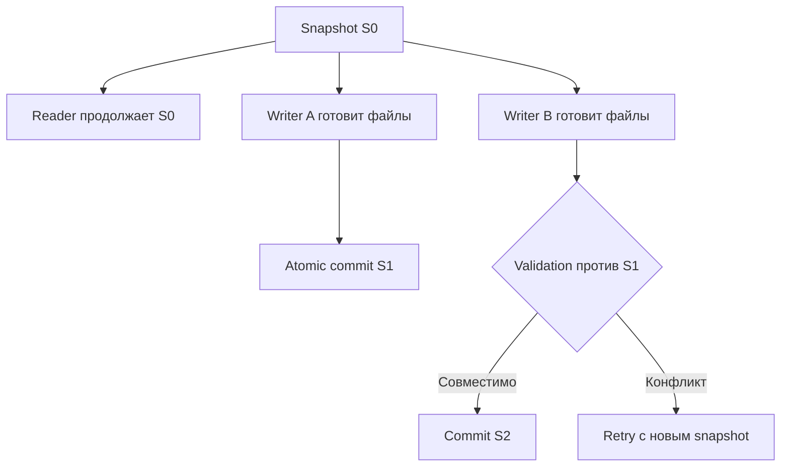
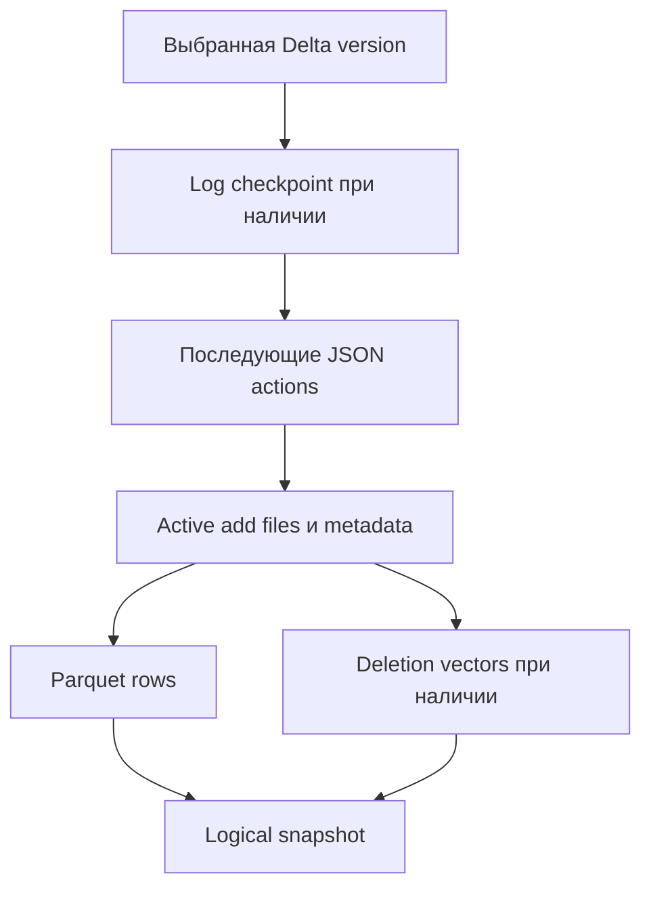
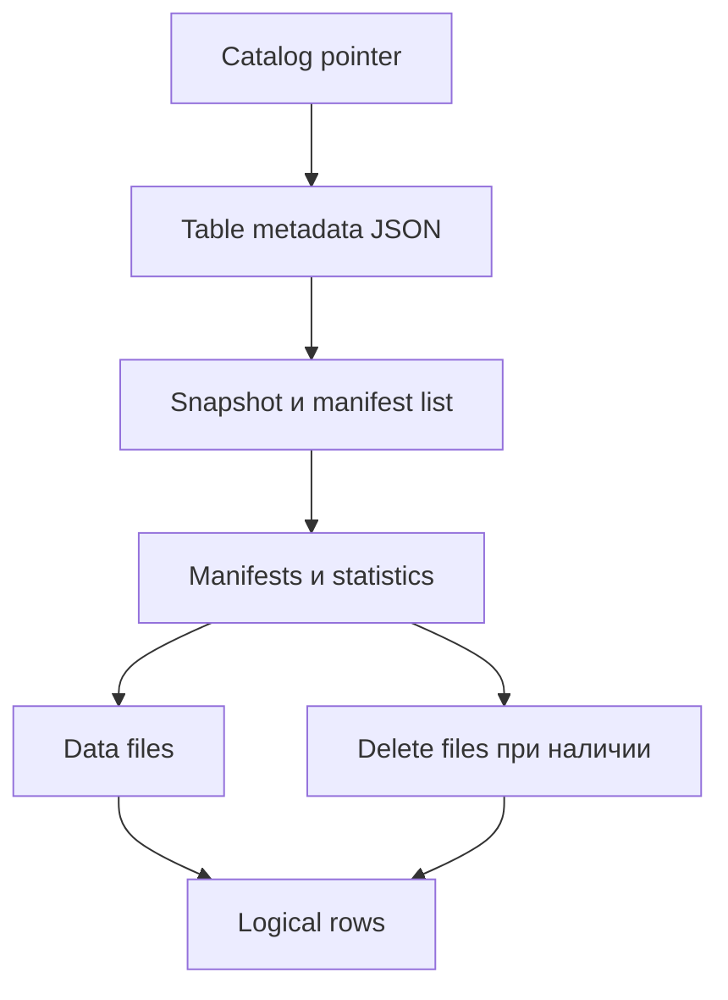
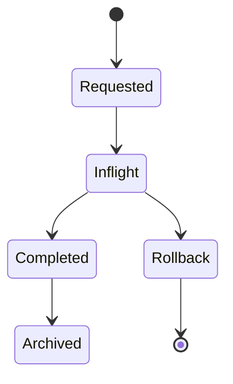
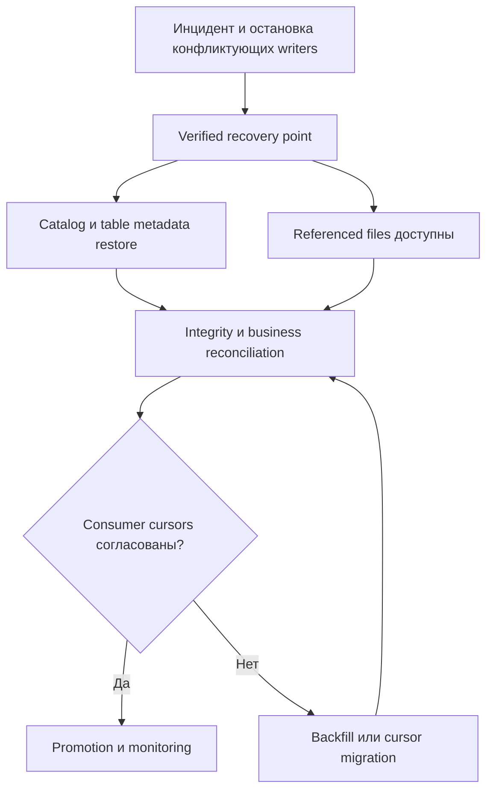

# 18. Lakehouse и табличные форматы

Основной язык примеров — **Python / PySpark**, SQL вызывается из `spark.sql`. Проверенное лабораторное окружение: **Apache Spark 4.0.1, Scala 2.13, OpenJDK 17.0.20, Python 3.12.14, Delta Lake 4.0.0, Apache Iceberg 1.10.2, Apache Hudi 1.1.1**, Spark Classic, Linux, `local[2]`. Для независимого чтения используются **delta-rs/deltalake 1.2.1, PyIceberg 0.10.0, PyArrow 22.0.0 и DuckDB 1.4.1**.

**Почему здесь Spark 4.0.1.** В предыдущих разделах базой был Spark 4.2.0; table formats выпускают отдельные коннекторы с собственной матрицей поддержки. Для этой главы выбран общий документированный и реально проверенный tuple трёх connectors на Spark 4.0.1. Нельзя подставить Spark 4.2 и оставить JAR `spark-runtime-4.0` без проверки. Это отдельная учебная среда; версии не обозначают «latest».

Раздел покрывает транзакционные метаданные, DML/evolution, snapshots, incremental/CDC semantics, table maintenance, interoperability и recovery. **Все 12 тем и 83 пункта README сохранены дословно и в исходном порядке.** Заголовки имеют ровно три уровня: раздел → тема → пункт; практика и вопросы помещены внутри пунктов.

**Содержание**

1. [Основы Lakehouse](#lakehouse-foundations)
2. [Подключение table formats к Spark](#format-integration)
3. [Архитектура Delta Lake](#delta-architecture)
4. [Операции Delta Lake](#delta-operations)
5. [Обслуживание Delta Lake](#delta-maintenance)
6. [Архитектура Apache Iceberg](#iceberg-architecture)
7. [Операции Apache Iceberg](#iceberg-operations)
8. [Обслуживание Apache Iceberg](#iceberg-maintenance)
9. [Архитектура Apache Hudi](#hudi-architecture)
10. [Операции и обслуживание Apache Hudi](#hudi-operations-maintenance)
11. [Сравнение и проектирование таблиц](#table-comparison-design)
12. [Жизненный цикл и надёжность Lakehouse](#lakehouse-lifecycle-reliability)

**Как выполнить примеры**

Нужны Java 17, полный PySpark package, доступ к Maven Central для первоначальной загрузки JARs и права на temporary files. Создай отдельную virtual environment; не обновляй этим набором среду прежних глав.

```bash
java -version
python -m venv .venv-lakehouse
source .venv-lakehouse/bin/activate
python -m pip install pyspark==4.0.1 delta-spark==4.0.0 deltalake==1.2.1 pyiceberg==0.10.0 pyarrow==22.0.0 duckdb==1.4.1 sqlalchemy==2.0.44
# Скопируй все Python-блоки главы в один файл сверху вниз:
SPARK_LOCAL_IP=127.0.0.1 python chapter18_lab.py
```

Команды рассчитаны на Linux/macOS/WSL. Все Python-блоки выполняй в одной чистой session без существующего SparkContext. `build_spark` загрузит закреплённые Maven packages. Если JARs уже подготовлены администратором, `LAKEHOUSE_JARS` может содержать comma-separated absolute paths к совместимым JARs, включая `delta-storage` и нужные transitive dependencies; пустое значение использует Maven resolution. Не запускай с `python -O`: assertions проверяют results.

Первый блок создаёт `spark`, helpers, fixtures и временный `lab`. В теме Hudi session останавливается и создаётся с HoodieCatalog, затем для сравнения снова возвращается к Delta/Iceberg. Это сделано явно: разные default catalogs не подменяются через повторный getOrCreate. Последний блок останавливает Spark и удаляет только `lab`. Production tables и accounts не используются.

**Что выполняется.** Настоящие table-format writes/reads, UPDATE/DELETE/MERGE, selective overwrite, schema evolution, time travel/restore, Delta CDF/txn identifiers/stream restart, Iceberg append scan/stream source/position deletes/branch publication, Hudi ordering/upsert/delete/COW/MOR/compaction и stream sink. Небольшие rows собираются для assertions; это не production collect pattern. Capacity/retention formulas отмечены как модели, а длительность tiny local run не является benchmark.

**Границы проверки.** Внешние catalogs/locks, multi-cluster writers, vendor runtimes и production disaster recovery не запускались. Сторонние snapshot reads выполнены delta-rs и PyIceberg; DuckDB выполняет SQL над resolved Arrow table, его native format extensions здесь не используются. Clustering Hudi только планируется; Delta VACUUM и Iceberg orphan cleanup работают в dry-run, snapshot expiration — с non-expiring cutoff. Наблюдённая ошибка Hudi CDC на history range с zero-effect stale update описана в соответствующем пункте; положительный CDC опыт использует отдельную fixture. Для Delta convertToDelta выявлен binary API mismatch выбранного tuple; migration example выполняет проверенный read/write fallback, что указано явно.

Официальные отправные страницы: [Delta Spark docs](https://docs.delta.io/delta-batch/), [Delta compatibility](https://docs.delta.io/releases/), [Iceberg 1.10.2 Spark integration](https://iceberg.apache.org/docs/1.10.2/spark-getting-started/), [Iceberg specification](https://iceberg.apache.org/spec/), [Hudi 1.1.1](https://hudi.apache.org/docs/1.1.1/quick-start-guide/). Delta/PyIceberg/delta-rs documentation может обновляться независимо от pinned runtime; в лаборатории API availability и results проверяются реальным выполнением.


<a id="lakehouse-foundations"></a>

## Основы Lakehouse


### Файловый формат, table format, catalog и execution engine

Lakehouse добавляет к объектному/файловому хранилищу управляемые таблицы: версии, транзакционные изменения, schema evolution и жизненный цикл метаданных. Термин описывает архитектуру; он не является конкретным file format или гарантией совместимости всех движков.

| Слой | Пример | Ответственность |
| --- | --- | --- |
| File format | Parquet, ORC, Avro | Кодирование rows/columns внутри файла |
| Table format | Delta Lake, Iceberg, Hudi | Какие файлы/изменения образуют видимую версию таблицы |
| Catalog | Hive, REST, HadoopCatalog | Идентичность таблицы, location/metadata pointer, namespace и commit contract |
| Execution engine | Spark, Trino, Flink, DuckDB | Планирование и выполнение запросов |
| Storage | Local FS, HDFS, S3-compatible store | Durability и операции над объектами |

Parquet-файл может входить в любую из этих таблиц. Нельзя прочитать directory как обычный Parquet dataset и ожидать применения tombstones, deletion vectors, delete files или timeline.

**Лабораторная основа.** Все операции выполняются в изолированном временном каталоге; rows маленькие, суммы целочисленные. Session сначала использует DeltaCatalog и отдельный Iceberg catalog `lake`; в теме Hudi она явно перезапускается с HoodieCatalog.

```python
import contextlib
import datetime as dt
import hashlib
import importlib.metadata
import json
import math
import os
import shutil
import tempfile
import time
import uuid
from pathlib import Path
from urllib.parse import unquote, urlparse

import duckdb
import pyarrow as pa
from deltalake import DeltaTable as RustDeltaTable
from pyiceberg.table import StaticTable
from pyspark.sql import SparkSession, Window, functions as F
from delta.tables import DeltaTable

lab = Path(tempfile.mkdtemp(prefix="spark_ch18_"))
PACKAGES = ",".join([
    "io.delta:delta-spark_2.13:4.0.0",
    "org.apache.iceberg:iceberg-spark-runtime-4.0_2.13:1.10.2",
    "org.apache.hudi:hudi-spark4.0-bundle_2.13:1.1.1",
])

def build_spark(mode="main"):
    extensions = ("io.delta.sql.DeltaSparkSessionExtension,"
                  "org.apache.iceberg.spark.extensions.IcebergSparkSessionExtensions")
    session_catalog = "org.apache.spark.sql.delta.catalog.DeltaCatalog"
    if mode == "hudi":
        extensions = "org.apache.spark.sql.hudi.HoodieSparkSessionExtension"
        session_catalog = "org.apache.spark.sql.hudi.catalog.HoodieCatalog"
    builder = (SparkSession.builder.master("local[2]").appName("Spark Zero to Hero - Chapter 18")
        .config("spark.sql.extensions", extensions)
        .config("spark.sql.catalog.spark_catalog", session_catalog)
        .config("spark.sql.catalog.lake", "org.apache.iceberg.spark.SparkCatalog")
        .config("spark.sql.catalog.lake.type", "hadoop")
        .config("spark.sql.catalog.lake.warehouse", str(lab / "iceberg_warehouse"))
        .config("spark.sql.warehouse.dir", str(lab / "session_warehouse"))
        .config("spark.sql.shuffle.partitions", "2")
        .config("spark.sql.session.timeZone", "UTC")
        .config("spark.sql.adaptive.enabled", "false")
        .config("spark.ui.showConsoleProgress", "false")
        .config("spark.python.use.daemon", "false")
        .config("spark.serializer", "org.apache.spark.serializer.KryoSerializer")
        .config("spark.kryo.registrator", "org.apache.spark.HoodieSparkKryoRegistrar"))
    if os.environ.get("LAKEHOUSE_JARS"):
        builder = builder.config("spark.jars", os.environ["LAKEHOUSE_JARS"])
    else:
        builder = builder.config("spark.jars.packages", PACKAGES)
    result = builder.getOrCreate()
    result.sparkContext.setLogLevel("ERROR")
    assert result.version == "4.0.1"
    return result

spark = build_spark()

def fixture():
    # SQL VALUES даёт обычный DataFrame без Python UDF.
    return spark.sql("""SELECT * FROM VALUES
        (1L, 'Ann', 100L, 1L, DATE '2026-01-01', 'north'),
        (2L, 'Bob', 200L, 1L, DATE '2026-01-01', 'south'),
        (3L, 'Cat', 300L, 1L, DATE '2026-01-02', 'north')
        AS t(id, name, amount, version, event_date, region)""")

def business_rows(df):
    return sorted((r.id, r.name, r.amount, r.version, str(r.event_date), r.region)
                  for r in df.select("id", "name", "amount", "version", "event_date", "region").collect())

def delta_read(path, version=None):
    reader = spark.read.format("delta")
    if version is not None:
        reader = reader.option("versionAsOf", version)
    return reader.load(str(path))

def delta_identifier(path):
    return "delta.`" + str(path).replace("`", "``") + "`"

def actions(path):
    return [json.loads(line) for p in sorted((Path(path) / "_delta_log").glob("[0-9]*.json"))
            for line in p.read_text().splitlines()]

def local_path(uri):
    parsed = urlparse(uri)
    assert parsed.scheme in ("", "file"), uri
    return Path(unquote(parsed.path))

def latest_iceberg_metadata(table="orders"):
    directory = lab / "iceberg_warehouse" / "demo" / table / "metadata"
    version = int((directory / "version-hint.text").read_text())
    return directory / f"v{version}.metadata.json"

def finish(q, timeout=90):
    try:
        assert q.awaitTermination(timeout), "Query timeout"
        assert q.exception() is None
    finally:
        if q.isActive:
            q.stop()

@contextlib.contextmanager
def sql_conf(**settings):
    previous = {k: spark.conf.get(k, None) for k in settings}
    try:
        for k, v in settings.items():
            spark.conf.set(k, str(v).lower() if isinstance(v, bool) else str(v))
        yield
    finally:
        for k, v in previous.items():
            if v is None:
                spark.conf.unset(k)
            else:
                spark.conf.set(k, v)

base_df = fixture()
expected_base = business_rows(base_df)
plain_path = lab / "plain_parquet"
base_df.write.parquet(str(plain_path))
delta_path = lab / "delta_orders"
(base_df.write.format("delta").partitionBy("region")
 .option("delta.enableChangeDataFeed", "true").save(str(delta_path)))
assert business_rows(delta_read(delta_path)) == expected_base
print({"Spark": spark.version, "Delta": importlib.metadata.version("delta-spark"),
       "PyArrow": pa.__version__, "DuckDB": duckdb.__version__})
```

Один и тот же DataFrame записан в Parquet и Delta. Это реальные writes, а не имитация transaction log. `latest_iceberg_metadata` — helper **только local HadoopCatalog** этой лаборатории; production catalog pointer нельзя угадывать по именам файлов.

**Практика.** Для своей платформы сопоставь каждый слой с продуктом и владельцем. **Самопроверка:** почему S3 + Parquet + Spark ещё не определяют table commit semantics?


### Проблемы набора Parquet-файлов без транзакционных метаданных

Directory Parquet не хранит общий atomic набор add/remove действий. Update через «записать новые файлы и удалить старые» может открыть reader частичную картину; retry append добавит дубликаты; schema и partitions разных jobs могут расходиться. Удалённая из business table строка может остаться в старом физическом файле.

```python
# Retry обычного append физически удваивает rows.
plain_retry = lab / "plain_retry"
base_df.write.parquet(str(plain_retry))
base_df.write.mode("append").parquet(str(plain_retry))
assert spark.read.parquet(str(plain_retry)).count() == 6
assert spark.read.parquet(str(plain_retry)).groupBy("id").count().where("count > 1").count() == 3
```

Table format создаёт управляемую версию, но **append повторного бизнес-события** всё равно может добавить его снова, если нет idempotency protocol или key/version merge. ACID не является уникальным constraint на каждый user-defined ID.

**Практика.** Перечисли failure windows собственного file overwrite script. **Самопроверка:** почему atomic rename одного Parquet-файла не обеспечивает atomic update набора из тысячи файлов?


### ACID, snapshot isolation и concurrent writers

Atomicity означает видимость всей table transaction; consistency — соблюдение реализованных schema/protocol invariants; isolation — корректное взаимодействие readers/writers по выбранному режиму; durability — сохранение committed результата на supported storage. Foreign keys, уникальность business keys и общая transaction нескольких таблиц не возникают автоматически.

Reader закрепляет snapshot; writer строит изменения от прочитанной версии и валидирует commit. Concurrent updates могут конфликтовать или объединяться по contract формата/catalog. Snapshot isolation не всегда эквивалентна serializable business transaction и не устраняет write skew любых приложений.



Файлы до commit могут физически существовать и быть невидимыми в таблице. Retry должен заново проверить read set и business decision, а не только заменить номер версии.

**Самопроверка:** почему успешный commit таблицы A не доказывает atomic publication таблиц A и B?


### Schema enforcement, schema evolution и partition evolution

Schema enforcement отклоняет несовместимые записи. Schema evolution меняет logical schema по supported rules. Partition evolution меняет layout **новых** data files; старые продолжают читаться по своему spec. Добавить nullable column и изменить тип business key — разные по риску изменения.

| Изменение | Что нужно проверить |
| --- | --- |
| Nullable column | Default/null для старых файлов, consumers |
| Rename | Стабильная column identity и mapping |
| Type widening | Поддержка reader/writer, semantic precision |
| Partition transform | Plan pruning для нескольких specs |
| Required field | Backfill/validation исторических rows |

Delta, Iceberg и Hudi реализуют эти операции разными механизмами; одинаковая команда Spark не означает одинаковую поддержку. В следующих темах выполняются enforcement, column mapping и Iceberg field-ID/partition evolution.

**Практика.** Определи forward/rollback compatibility перед schema change. **Самопроверка:** почему `mergeSchema=true` не решает переименование столбца без column identity?


### Time travel, snapshots и retention

Time travel читает прежнюю table version/snapshot, пока доступны **и metadata, и referenced data/delete files**. Retention задаёт поддерживаемый исторический horizon. Версия таблицы — committed system history; business `event_date` может быть старой и не определяет время commit.

```python
assert business_rows(delta_read(delta_path, version=0)) == expected_base
assert DeltaTable.forPath(spark, str(delta_path)).history().select("version").collect()[0].version == 0
```

Отдельно существуют retention data files, transaction log, snapshots/refs, streaming checkpoint и source history. Cleanup одной части может сломать historical read, CDF или slow consumer. Retention не заменяет независимый backup и не гарантирует бесконечный audit trail.

**Самопроверка:** почему наличие имени snapshot после удаления его data files не обеспечивает time travel?


### Copy-on-write и merge-on-read как стратегии обновления

Copy-on-write переписывает затронутые base files при update/delete; readers читают подготовленный актуальный набор. Merge-on-read сохраняет изменения отдельно и применяет их при чтении; позже compaction материализует объединённое состояние. В Hudi это table types, в Iceberg — режимы row-level operations, в Delta deletion vectors дают отложенное применение части удалений.

| Стратегия | Write cost | Read cost | Обслуживание |
| --- | --- | --- | --- |
| COW | Перезапись affected files | Проще scan актуальных files | Compaction/layout и cleanup history |
| MOR | Обычно меньше немедленной перезаписи | Merge base + logs/deletes | Compaction/delete rewrite и retention |

```python
# Условная модель amplification: не измерение Spark.
changed_row_bytes, rewritten_file_bytes = 1_000, 128 * 1024 * 1024
assert rewritten_file_bytes / changed_row_bytes > 100_000
```

Выбор зависит от update density, read frequency, задержки compaction и поддержки delete/log semantics всеми engines. MOR не означает «запись всегда быстрее» при indexing, merge и metadata overhead.

**Самопроверка:** почему read-optimized MOR view может отставать от snapshot view?


### Интероперабельность Spark с другими движками

Interoperability проверяется на table features и operation semantics: snapshot read, deletes, mapping, timestamp/decimal types, evolution, catalog auth и commit. Возможность engine читать Parquet не является поддержкой Delta/Iceberg/Hudi таблицы.

Cross-engine contract фиксирует writer release, format/protocol version, enabled features и reader release. После DML/evolution сравнивают logical rows и aggregates, а не только row count. В теме подключения Delta snapshot будет прочитан delta-rs и проверен SQL в DuckDB; Iceberg — PyIceberg с metadata snapshot. Это конкретные пути, а не утверждение о поддержке всех форматов DuckDB.

**Практика темы.** Составь тестовый набор с DELETE, nullable column, renamed column и UTC dates/timestamps. **Самопроверка:** почему reader может успешно читать таблицу до включения deletion vectors и перестать после него?


<a id="format-integration"></a>

## Подключение table formats к Spark


### Библиотеки, SQL extensions и конфигурация каталога

Table format plugin должен быть доступен driver и executors. SQL extensions регистрируют parser/planner rules; catalog implementation разрешает table identities и write protocols. Эти настройки задают **до** создания SparkSession/SparkContext: повторный `getOrCreate()` не заменяет уже созданную session.

В setup выше Delta extension обслуживает DML Delta, Iceberg extension — Iceberg procedures и row-level operations. Catalog `lake` — отдельный HadoopCatalog с local warehouse. Hudi позже получает собственную session с HoodieCatalog; два разных класса не могут одновременно быть значением одного `spark.sql.catalog.spark_catalog`.

```python
assert "DeltaSparkSessionExtension" in spark.conf.get("spark.sql.extensions")
assert "IcebergSparkSessionExtensions" in spark.conf.get("spark.sql.extensions")
assert spark.conf.get("spark.sql.catalog.lake.type") == "hadoop"
spark.sql("CREATE NAMESPACE lake.demo")
(base_df.writeTo("lake.demo.orders").using("iceberg")
 .tableProperty("format-version", "2").create())
assert business_rows(spark.table("lake.demo.orders")) == expected_base
```

Для REST/Hive нужны endpoint, auth, storage access и свой catalog atomicity contract. Это deployment configuration, а не смена suffix `.parquet`.

**Документация:** [Iceberg setup 1.10.2](https://iceberg.apache.org/docs/1.10.2/spark-getting-started/), [Delta setup](https://docs.delta.io/quick-start/), [Hudi setup 1.1.1](https://hudi.apache.org/docs/1.1.1/quick-start-guide/).

**Самопроверка:** почему наличие Python package `delta-spark` без JVM JARs недостаточно?


### Матрица совместимости Spark, Scala и table format

Выбирай согласованный tuple Spark minor, Scala binary version, JVM/Python и connector release. Maven suffix `_2.13` задаёт Scala binary compatibility; `spark-runtime-4.0` или `spark4.0-bundle` задаёт Spark integration line. Поддержка 4.0 не доказывает совместимость с 4.2.

| Проверенная лабораторная комбинация | Artifact |
| --- | --- |
| Spark 4.0.1 / Scala 2.13 / Delta 4.0.0 | `io.delta:delta-spark_2.13:4.0.0` |
| Spark 4.0.1 / Scala 2.13 / Iceberg 1.10.2 | `org.apache.iceberg:iceberg-spark-runtime-4.0_2.13:1.10.2` |
| Spark 4.0.1 / Scala 2.13 / Hudi 1.1.1 | `org.apache.hudi:hudi-spark4.0-bundle_2.13:1.1.1` |

Официальные текущие matrices на момент проверки описывают Delta 4.3.x с Spark 4.0/4.1, Iceberg runtime releases для 4.0/4.1 и Hudi 1.2.x для 4.0/4.1; это не подтверждение всех сочетаний с Spark 4.2. Здесь сознательно выбран общий совместимый Spark 4.0.1, чтобы выполнить три connectors. Зафиксированные версии — учебная база, не утверждение «latest».

```python
assert spark.version == "4.0.1"
scala_runtime_version = spark.sparkContext._jvm.scala.util.Properties.versionNumberString()
assert scala_runtime_version.startswith("2.13.")
assert importlib.metadata.version("delta-spark") == "4.0.0"
```

**Документация:** [Delta releases/matrix](https://docs.delta.io/releases/), [Iceberg releases](https://iceberg.apache.org/releases/), [Hudi matrix](https://hudi.apache.org/docs/1.1.1/quick-start-guide/#spark-support-matrix).

**Самопроверка:** почему одинаковый Scala suffix не гарантирует совместимость Spark internal APIs?


### Чтение по пути и чтение по имени таблицы

Path read разрешает snapshot по format metadata у конкретного location; table-name read сначала разрешает catalog entry. Logical identity таблицы не равна текущему storage path. Catalog поддерживает permissions, rename и controlled commit; path access может обходить эти границы.

```python
spark.sql(f"CREATE TABLE delta_orders USING DELTA LOCATION '{delta_path}'")
assert business_rows(spark.table("delta_orders")) == business_rows(delta_read(delta_path))
assert business_rows(spark.read.format("iceberg").load("lake.demo.orders")) == expected_base
```

Для Iceberg production предпочтителен catalog identity; direct metadata path пригоден для закреплённого read-only snapshot в лаборатории. Перемещение directory без обновления metadata references может нарушить чтение. Hudi path read ниже использует `.hoodie` timeline, а не glob всех base files.

**Самопроверка:** почему table rename не должен означать копирование каждого data file?


### Writer protocol и возможности reader

Writer protocol определяет допустимые metadata actions и capabilities создаваемой версии. Reader обязан применять все features, влияющие на logical rows. Reader-only feature и writer-only feature имеют разный compatibility effect; проверка минимальной версии без feature names недостаточна.

```python
initial_delta_actions = actions(delta_path)
initial_protocol = next(a["protocol"] for a in initial_delta_actions if "protocol" in a)
assert "minReaderVersion" in initial_protocol and "minWriterVersion" in initial_protocol
assert any("metaData" in a for a in initial_delta_actions)
assert any("add" in a for a in initial_delta_actions)
```

Чтение JSON здесь — inspection ограниченной local table; не самостоятельная реализация Delta reader. Реальный reader использует checkpoint/log replay, tombstones и feature semantics. Для Iceberg формат v2/v3 и поддержка конкретных delete representations проверяются отдельно; Hudi имеет свою table version и bundle support.

**Самопроверка:** почему копирование только data files потеряет writer protocol таблицы?


### Capability negotiation и неподдерживаемые операции

Spark DataSourceV2/catalog APIs не требуют, чтобы каждый connector поддерживал каждую operation. Возможны table capabilities, unsupported DML/output mode, schema evolution restrictions и разные guarantees CREATE/REPLACE. Fail fast после analysis предпочтительнее неявного «fallback Parquet».

```python
# Негативная проверка: ordinary Parquet table не становится row-level table от SQL DELETE.
spark.sql(f"CREATE TABLE plain_orders USING PARQUET LOCATION '{plain_path}'")
try:
    spark.sql("DELETE FROM plain_orders WHERE id = 1").collect()
    raise AssertionError("Unexpected Parquet row-level DELETE support")
except Exception as exc:
    assert "UNSUPPORTED" in str(exc).upper() or "does not support" in str(exc).lower()
assert spark.table("plain_orders").count() == 3
```

Schema inference, DELETE support и commit protocol — независимые capabilities. Для процедуры CALL нужны extension и procedure support соответствующего catalog. Ошибку unsupported operation нельзя проглотить и считать successful commit.

**Практика.** Проверь CREATE, append, overwrite, MERGE и streaming output на target tuple. **Самопроверка:** что нужно проверить, если builder API есть, но `.execute()` завершается ошибкой?


### Проверка результатов сторонним движком

Сторонний reader должен читать **ту же закреплённую table version**, иначе concurrent commit даст закономерно другую картину. Проверим Spark-created Delta через delta-rs, затем SQL aggregate через DuckDB. Iceberg metadata JSON закрепляет snapshot для PyIceberg StaticTable.

```python
rust_snapshot = RustDeltaTable(str(delta_path), version=0).to_pyarrow_table()
assert sorted((r["id"], r["amount"]) for r in rust_snapshot.to_pylist()) == [(1, 100), (2, 200), (3, 300)]
with duckdb.connect() as db:
    db.register("delta_snapshot", rust_snapshot)
    assert db.sql("SELECT count(*), sum(amount) FROM delta_snapshot").fetchone() == (3, 600)
iceberg_static = StaticTable.from_metadata(str(latest_iceberg_metadata()))
iceberg_arrow = iceberg_static.scan().to_arrow()
assert sorted((r["id"], r["amount"]) for r in iceberg_arrow.to_pylist()) == [(1, 100), (2, 200), (3, 300)]
```

Выполнены delta-rs/PyIceberg snapshot resolution и Arrow reads; DuckDB работает с resolved Arrow table, **не** со своим Delta extension. Это важно для честного coverage: native Trino/Flink/Hudi reads здесь не запускались. Позже повторим сверку после DML; column mapping/delete-file tests нужны перед включением новых features.

**Документация:** [delta-rs querying](https://delta-io.github.io/delta-rs/latest/usage/querying-delta-tables/), [PyIceberg StaticTable/API](https://py.iceberg.apache.org/api/).

**Практика темы.** Сохрани snapshot ID/version и canonical rows hash в verification manifest. **Самопроверка:** почему сравнение count без keys/values пропустит часть semantic ошибок?


<a id="delta-architecture"></a>

## Архитектура Delta Lake


### Delta transaction log и JSON actions

Delta snapshot определяется `_delta_log`, а не listing всех Parquet files. Commit обычно содержит JSON actions; reader восстанавливает active file set и table metadata до выбранной версии. Число версии — порядок table commits, не количество business events.

```python
first_delta_commit = delta_path / "_delta_log" / "00000000000000000000.json"
assert first_delta_commit.exists()
first_action_names = {name for action in actions(delta_path) for name in action}
assert {"commitInfo", "protocol", "metaData", "add"} <= first_action_names
assert DeltaTable.isDeltaTable(spark, str(delta_path))
```



В крупных logs reader не обязан читать каждый JSON с самого начала: checkpoints ускоряют reconstruction. JSON inspection в лаборатории помогает понимать действия; не реализуй production reader на трёх `glob`/`json.loads`.

**Документация:** [Delta feature/protocol compatibility](https://docs.delta.io/versioning/).

**Самопроверка:** почему произвольный Parquet-файл в table directory может не входить ни в один committed snapshot?


### Add/remove files, metadata и protocol

`add` вводит logical data file в active snapshot; `remove` исключает его из следующих snapshots, но не обязательно сразу удаляет физически. `metaData` описывает schema, partitions, configuration и table ID. `protocol` определяет reader/writer requirements. Другие actions включают commitInfo, transaction identifiers и change-data records.

```python
adds_v0 = [a["add"] for a in actions(delta_path) if "add" in a]
assert adds_v0 and all("path" in a and "partitionValues" in a for a in adds_v0)
assert {a["partitionValues"]["region"] for a in adds_v0} == {"north", "south"}
metadata_v0 = next(a["metaData"] for a in actions(delta_path) if "metaData" in a)
assert metadata_v0["partitionColumns"] == ["region"]
assert {f["name"] for f in json.loads(metadata_v0["schemaString"])["fields"]} == set(base_df.columns)
```

`dataChange=false` применяется к rearrangement без изменения logical content по protocol. Это не флаг, которым можно скрыть настоящий update от consumers. Partition values и stats используются reader, но must match action semantics.

**Самопроверка:** чем logical remove отличается от physical delete и зачем этот промежуток нужен readers?


### Log checkpoints и восстановление snapshot

Delta **log checkpoint** — материализация transaction-log state для ускорения snapshot loading. Это не Spark streaming checkpoint, не reliable DataFrame checkpoint и не отдельная резервная копия данных. Его schema/representation определяется Delta protocol; `_last_checkpoint` помогает найти актуальный checkpoint.

```python
# Создаём отдельную tiny table и заставляем её регулярно checkpoint log.
log_demo = lab / "delta_log_demo"
(base_df.write.format("delta").option("delta.checkpointInterval", "2").save(str(log_demo)))
for batch in range(1, 4):
    spark.range(batch, batch + 1).selectExpr(
        "cast(id + 100 as bigint) AS id", "'Extra' AS name", "1L AS amount", "1L AS version",
        "DATE '2026-01-03' AS event_date", "'north' AS region",
    ).write.format("delta").mode("append").save(str(log_demo))
last_checkpoint = json.loads((log_demo / "_delta_log" / "_last_checkpoint").read_text())
assert last_checkpoint["version"] >= 2
assert any("checkpoint" in p.name and p.suffix == ".parquet" for p in (log_demo / "_delta_log").iterdir())
assert delta_read(log_demo).count() == 6
```

Маленький interval здесь выбран для наблюдения. В production он балансирует reconstruction time и checkpoint cost. Retention log cleanup должно оставлять reconstruction path для поддерживаемых versions; manually удалить JSON/checkpoint «чтобы ускорить listing» нельзя.

**Самопроверка:** почему log checkpoint без referenced Parquet files не восстанавливает таблицу?


### Optimistic concurrency control и конфликты commit

Optimistic concurrency control читает snapshot, подготавливает files, проверяет intervening commits и публикует новую версию при отсутствии conflicts. Соприкосновение file/read sets и изменение metadata/protocol могут сделать два update несовместимыми, даже если они меняют разные business IDs.

| Причина конфликта | Действие приложения |
| --- | --- |
| Изменены прочитанные files | Перечитать snapshot, пересчитать operation |
| Concurrent schema/protocol change | Обновить contract/client либо остановить migration |
| Один txn namespace у двух независимых writers | Исправить identity и owner |
| Пересечение selective overwrite predicates | Развести ownership/диапазоны |

Не retry только последний «commit metadata» без повторной проверки semantic decision. Ограниченный retry с backoff должен различать retriable conflict, unsupported protocol и permanent data validation error. Разделение partitions может уменьшить conflicts, но high-cardinality layout имеет свою цену.

В этой главе engine DML/commits выполняются реально; распределённый конфликт двух writers специально не симулировался. Схема выше описывает protocol, а не результат multi-cluster stress test.

**Документация:** [Concurrency control](https://docs.delta.io/concurrency-control/).

**Самопроверка:** почему blind retry может применить бизнес-решение к уже изменившемуся состоянию?


### Table features и reader/writer compatibility

Table features могут повышать reader/writer protocol и требовать upgrades клиентов. Column mapping, deletion vectors, clustering и CDF имеют разные compatibility effects. Название версии package не заменяет чтение table protocol конкретной таблицы.

```python
initial_detail = DeltaTable.forPath(spark, str(delta_path)).detail().collect()[0].asDict()
assert initial_detail["format"] == "delta"
assert initial_detail["numFiles"] >= 1
assert initial_detail["minReaderVersion"] >= 1
assert initial_detail["minWriterVersion"] >= 2
```

Перед feature enable составляют inventory readers/writers и recovery tools, проверяют unsupported client failure и rollback/drop-feature support. Нельзя вручную понизить protocol integer, если metadata/data уже используют feature. Отключение создания новых deletion vectors не обязательно удаляет существующие.

**Практика.** Проверь reader matrix до и после feature enable на isolated table. **Самопроверка:** почему `SET delta.enableDeletionVectors=false` не равнозначен downgrade всех snapshots?


### Различие открытого Delta Lake и возможностей управляемой платформы

Open Delta Lake включает transaction log, Spark connector, DML, CDF и поддержанные OSS optimizations. Managed runtime может добавлять optimized execution, automation, governance/catalog integration и другие команды. Их availability/performance не нужно приписывать любому `delta-spark` installation.

У части функций есть OSS реализации: OPTIMIZE/Z-ordering и liquid clustering не являются автоматически «только платформенными». Проверять нужно конкретный release, SQL command/API и protocol requirements. В этой лаборатории используются OSS JARs; later maintenance выполняется именно ими.

| Проверка | Как зафиксировать |
| --- | --- |
| Доступность команды | Exact connector/runtime version и execution |
| Storage guarantees | Supported LogStore/filesystem contract |
| Governance | Catalog/permissions implementation |
| Automation | Отдельный service/job и его policy |
| Performance | Representative workload, стоимость ресурсов |

**Практика темы.** Удали из runbook claims, подтверждённые только vendor notebook. **Самопроверка:** почему одинаковый SQL OPTIMIZE не обещает одинаковую оптимизацию и cost на двух runtimes?


<a id="delta-operations"></a>

## Операции Delta Lake


### Create, append, overwrite и selective overwrite

Create создаёт table metadata и начальный snapshot; append добавляет files; overwrite публикует replacement; selective overwrite заменяет только заданный диапазон. Выбор mode не задаёт business uniqueness. Default `errorifexists` полезен, чтобы случайно не стереть существующую таблицу.

```python
append_df = spark.sql("""SELECT 4L AS id, 'Dan' AS name, 400L AS amount, 1L AS version,
    DATE '2026-01-02' AS event_date, 'south' AS region""")
append_df.write.format("delta").mode("append").save(str(delta_path))
assert delta_read(delta_path).count() == 4
replacement_north = spark.sql("""SELECT * FROM VALUES
    (1L, 'Ann', 110L, 2L, DATE '2026-01-01', 'north'),
    (3L, 'Cat', 330L, 2L, DATE '2026-01-02', 'north')
    AS t(id, name, amount, version, event_date, region)""")
(replacement_north.write.format("delta").mode("overwrite")
 .option("replaceWhere", "region = 'north'").save(str(delta_path)))
assert {r.id: r.amount for r in delta_read(delta_path).collect()} == {1: 110, 2: 200, 3: 330, 4: 400}
```

`replaceWhere` проверяет соответствие incoming rows predicate по supported behavior. Predicate должен быть явно reviewable; accidental `mode("overwrite")` без него заменит table content целиком. Dynamic partition overwrite имеет другие границы и риски ошибочной partition value.

**Документация:** [Batch writes/selective overwrite](https://docs.delta.io/delta-batch/).

**Самопроверка:** почему одна неверная partition value опасна при dynamic overwrite?


### UPDATE, DELETE и MERGE

UPDATE и DELETE меняют logical snapshot; MERGE выбирает actions по match/non-match conditions. Для latest-state CDC полезен version guard: старый повтор не должен перезаписать новую версию. Missing source row не означает DELETE, если source — инкрементальный batch, а не полный snapshot.

```python
delta_table = DeltaTable.forPath(spark, str(delta_path))
delta_table.update(condition="id = 2", set={"amount": "220L", "version": "2L"})
delta_table.delete("id = 4")
merge_df = spark.sql("""SELECT * FROM VALUES
    (1L, 'Ann', 150L, 3L, DATE '2026-01-01', 'north'),
    (5L, 'Eve', 500L, 1L, DATE '2026-01-03', 'south')
    AS t(id, name, amount, version, event_date, region)""")
(delta_table.alias("t").merge(merge_df.alias("s"), "t.id = s.id")
 .whenMatchedUpdateAll(condition="s.version > t.version")
 .whenNotMatchedInsertAll().execute())
assert {r.id: r.amount for r in delta_read(delta_path).collect()} == {1: 150, 2: 220, 3: 330, 5: 500}
final_delta_business_rows = business_rows(delta_read(delta_path))
assert any("remove" in a for a in actions(delta_path))
```

Нужны contract для key changes, deletes/tombstones и same-version conflicts; простая таблица current rows не хранит автоматически историю всех business revisions. DML может переписать больше данных, чем число изменённых rows.

**Документация:** [Delta DML/MERGE](https://docs.delta.io/delta-update/).

**Самопроверка:** почему `WHEN NOT MATCHED BY SOURCE THEN DELETE` ошибочен для обычного CDC micro-batch?


### Дубликаты source keys и неоднозначный MERGE

Несколько source rows могут match одну target row; update becomes ambiguous. Preprocessing выбирает winner по business version и проверяет same-version payload conflicts. При нескольких source rows для отсутствующего target key MERGE не следует считать универсальным uniqueness enforcement.

```python
duplicate_source = merge_df.unionByName(merge_df.where("id = 1"))
assert duplicate_source.groupBy("id").count().where("count > 1").count() == 1
# Здесь повторы byte-equivalent по business fields; конфликтующие payloads надо отклонить.
source_distinct = duplicate_source.dropDuplicates(merge_df.columns)
assert source_distinct.groupBy("id").count().where("count > 1").count() == 0
(delta_table.alias("t").merge(source_distinct.alias("s"), "t.id = s.id")
 .whenMatchedUpdateAll(condition="s.version > t.version")
 .whenNotMatchedInsertAll().execute())
assert business_rows(delta_read(delta_path)) == final_delta_business_rows
```

Если есть разные версии, сначала проверяют conflicts внутри `(id, version)`, затем выбирают максимальную version per ID. `row_number` с orderBy только version при равенстве разных payloads не решает проблему детерминированно. Target тоже должен удовлетворять invariant уникальности keys.

**Практика.** Добавь разные values при одинаковой версии и fail до MERGE. **Самопроверка:** почему dropDuplicates(["id"]) может выбрать устаревшую строку?


### Schema enforcement, mergeSchema и overwriteSchema

Schema enforcement защищает таблицу от непреднамеренного shape/type drift. `mergeSchema` допускает supported additive evolution конкретной записи; `overwriteSchema` заменяет schema в сочетании с overwrite и может потребовать полного rewrite. Ни одна option не объясняет consumers новую семантику column.

```python
schema_path = lab / "delta_schema"
base_df.write.format("delta").save(str(schema_path))
with_note = base_df.withColumn("note", F.lit("new field"))
try:
    with_note.write.format("delta").mode("append").save(str(schema_path))
    raise AssertionError("Schema enforcement did not reject new column")
except Exception as exc:
    assert "schema" in str(exc).lower()
(with_note.write.format("delta").mode("append").option("mergeSchema", "true").save(str(schema_path)))
assert "note" in delta_read(schema_path).columns and delta_read(schema_path).count() == 6
(base_df.select("id", "name").write.format("delta").mode("overwrite")
 .option("overwriteSchema", "true").save(str(schema_path)))
assert delta_read(schema_path).columns == ["id", "name"] and delta_read(schema_path).count() == 3
```

Это isolated schema table; append содержит повторные business IDs намеренно для schema experiment. Production enforcement также включает required/nullability и поддержанные constraints; не включай auto-merge глобально без change ownership.

**Самопроверка:** почему новый nullable column совместим технически, но может сломать downstream SELECT * contract?


### Time travel, history и restore при поддержке

`history()` показывает committed operations и versions, `versionAsOf` читает старую версию, restore публикует **новый commit**, возвращающий logical content выбранного snapshot. Restore не стирает историю и может быть воспринят incremental consumers как новые изменения.

```python
before_restore_version = delta_table.history(1).collect()[0].version
assert before_restore_version > 0
assert business_rows(delta_read(delta_path, 0)) == expected_base
delta_table.restoreToVersion(0).collect()
assert business_rows(delta_read(delta_path)) == expected_base
delta_table.restoreToVersion(before_restore_version).collect()
assert business_rows(delta_read(delta_path)) == final_delta_business_rows
assert delta_table.history(1).collect()[0].version > before_restore_version
```

Restore требует сохранённых files; после VACUUM историческая версия может быть невосстановима. Для external effects/serving metrics согласуй restore с downstream reconciliation и consumer cursor; table restore не откатывает автоматически Kafka сообщения или внешние БД.

**Документация:** [History/restore utilities](https://docs.delta.io/delta-utility/).

**Самопроверка:** почему restore может привести к повторной обработке downstream даже при вернувшихся прежних rows?


### Change Data Feed и инкрементальное чтение изменений

Change Data Feed выдаёт row changes с `_change_type`, `_commit_version`, `_commit_timestamp`; updates могут давать preimage/postimage. CDF включён для main table при создании и не является бесконечным полным audit archive. Потребитель должен интерпретировать inserts/deletes/update pairs и version cursor.

```python
cdf_end_version = delta_table.history(1).collect()[0].version
cdf = (spark.read.format("delta").option("readChangeFeed", "true")
       .option("startingVersion", 0).option("endingVersion", cdf_end_version).load(str(delta_path)))
assert {"_change_type", "_commit_version", "_commit_timestamp"} <= set(cdf.columns)
change_types = {r[0] for r in cdf.select("_change_type").distinct().collect()}
assert {"insert", "delete", "update_preimage", "update_postimage"} <= change_types
assert cdf.where("_change_type = 'update_postimage' AND id = 1 AND amount = 150").count() >= 1
```

Batch bounds versions здесь inclusive. CDF до enable point недоступен; retention/column mapping evolution могут ограничить диапазон. Не суммируй все CDF amounts как новые факты: preimage и deletes требуют снятия прежнего вклада или current-state upsert protocol.

**Документация:** [Change Data Feed](https://docs.delta.io/delta-change-data-feed/).

**Практика.** Применяй feed дважды в isolated consumer и проверь идемпотентность. **Самопроверка:** почему append incremental scan и CDF различаются после UPDATE?


### Streaming source/sink и идемпотентные write identifiers

Delta streaming sink интегрирует micro-batch commit с transaction log. Для batch/foreachBatch write можно применять `txnAppId` и монотонный `txnVersion` внутри namespace. Они дедуплицируют **write attempts**, а не разные business events с одним key. При новой checkpoint lineage нужен согласованный новый namespace.

```python
idempotent_path = lab / "delta_idempotent"
for _ in range(2):
    (base_df.write.format("delta").mode("append").option("txnAppId", "orders_lineage_v1")
     .option("txnVersion", 0).save(str(idempotent_path)))
assert delta_read(idempotent_path).count() == 3

stream_input = lab / "stream_json"
base_df.coalesce(1).write.json(str(stream_input))
stream_delta = lab / "delta_stream"
stream_cp = lab / "stream_cp"
stream_source = spark.readStream.schema(base_df.schema).json(str(stream_input))
q = (stream_source.writeStream.format("delta").outputMode("append")
     .option("checkpointLocation", str(stream_cp)).trigger(availableNow=True).start(str(stream_delta)))
finish(q)
assert delta_read(stream_delta).count() == 3
q2 = (stream_source.writeStream.format("delta").outputMode("append")
      .option("checkpointLocation", str(stream_cp)).trigger(availableNow=True).start(str(stream_delta)))
finish(q2)
assert delta_read(stream_delta).count() == 3
```

Реально проверены repeated txn write и stream restart с тем же checkpoint. Delta source по умолчанию не является полноценным CDC reader для mutable table; use CDF, если нужны update/delete semantics. `skipChangeCommits`/другие options имеют собственные ограничения и могут сознательно пропускать изменения.

**Документация:** [Streaming reads/writes](https://docs.delta.io/delta-streaming/), [Idempotent batch writes](https://docs.delta.io/delta-batch/#idempotent-writes).

**Самопроверка:** почему reused txnAppId с заново начавшимся batch numbering может пропустить нужную запись?


### Column mapping и deletion vectors при поддержке протокола

Column mapping отделяет logical names от physical columns и позволяет supported rename/drop без полного data rewrite. Deletion vectors помечают удалённые позиции в существующих files; reader применяет их при snapshot read. Оба меняют interoperability/reader requirements.

```python
mapping_path = lab / "delta_mapping"
(base_df.write.format("delta").option("delta.columnMapping.mode", "name")
 .save(str(mapping_path)))
spark.sql(f"ALTER TABLE {delta_identifier(mapping_path)} RENAME COLUMN name TO customer_name")
assert "customer_name" in delta_read(mapping_path).columns and "name" not in delta_read(mapping_path).columns
assert delta_read(mapping_path).where("id = 1").select("customer_name").collect()[0][0] == "Ann"

dv_path = lab / "delta_dv"
(base_df.coalesce(1).write.format("delta").option("delta.enableDeletionVectors", "true").save(str(dv_path)))
DeltaTable.forPath(spark, str(dv_path)).delete("id = 1")
assert delta_read(dv_path).count() == 2
assert DeltaTable.forPath(spark, str(dv_path)).detail().collect()[0].minReaderVersion >= 3
```

Выполнены mapping rename и DELETE на DV-enabled table. Table capability не доказывает использование DV каждым DML plan; physical representation проверяется metadata actions/metrics. Logical DELETE и DROP column не гарантируют физического уничтожения bytes старых snapshots. Для mapping non-additive evolution streaming readers могут требовать schema tracking.

**Документация:** [Column mapping](https://docs.delta.io/delta-column-mapping/), [Deletion vectors](https://docs.delta.io/delta-deletion-vectors/).

**Практика темы.** Повтори reader matrix на этих feature tables. **Самопроверка:** почему low-level Parquet reader может показать удалённую строку DV table?


<a id="delta-maintenance"></a>

## Обслуживание Delta Lake


### Compaction, OPTIMIZE и доступность команд в дистрибутиве

Compaction объединяет small files, сохраняя logical content. В OSS Delta поддержанный OPTIMIZE и Python optimize builder выполняют bin packing; availability проверяется по release. Это table transaction, а не ручное concatenation файлов. Reader продолжает старый snapshot, пока его files доступны.

```python
compact_path = lab / "delta_compact"
base_df.write.format("delta").save(str(compact_path))
for _ in range(2):
    base_df.write.format("delta").mode("append").save(str(compact_path))
compact_table = DeltaTable.forPath(spark, str(compact_path))
compact_before = business_rows(delta_read(compact_path))
compact_metrics = compact_table.optimize().executeCompaction().collect()
assert business_rows(delta_read(compact_path)) == compact_before
assert compact_metrics
```

Здесь duplicates намеренно остаются: compaction не является business dedup. Target file size — ориентир, не guarantee одинакового размера всех files. Frequency зависит от ingest rate и latency budget, а не правила «OPTIMIZE каждый batch».

**Документация:** [OSS optimizations](https://docs.delta.io/optimizations-oss/).

**Самопроверка:** почему correctness compaction сравнивается logical rows, а не их физическим расположением?


### Data skipping и Z-ordering

Data skipping использует per-file statistics, чтобы исключать files без подходящих rows. Z-ordering размещает значения выбранных columns рядом и может увеличить selective pruning; это не B-tree index и не гарантия глобального ORDER BY.

```python
zorder_metrics = compact_table.optimize().executeZOrderBy("id").collect()
assert zorder_metrics
assert business_rows(delta_read(compact_path)) == compact_before
stats_actions = [a["add"] for a in actions(compact_path) if "add" in a and a["add"].get("stats")]
assert stats_actions and any("minValues" in json.loads(a["stats"]) for a in stats_actions)
```

Выбирай few columns с query selectivity и collected stats; чрезмерный список размывает locality и увеличивает rewrite cost. Tiny fixture подтверждает API/content preservation, не performance gain. Для benchmark сравнивай scanned files/bytes, latency и maintenance cost на одинаковом workload.

**Самопроверка:** почему наличие min/max stats не означает, что любой predicate сможет их использовать?


### Clustering и доступность liquid clustering

Liquid clustering в поддержанных Delta releases отделяет clustering columns от традиционного static partitioning/Z-order layout. Он имеет table-feature requirements и ограничения сочетаний; это не просто alias `partitionBy`. Изменение clustering columns направляет будущую organization, а не мгновенно оптимизирует все старые files.

```python
cluster_path = lab / "delta_clustered"
spark.sql(f"""CREATE TABLE {delta_identifier(cluster_path)} (
    id BIGINT, name STRING, amount BIGINT, version BIGINT, event_date DATE, region STRING
) USING DELTA CLUSTER BY (id)""")
base_df.write.format("delta").mode("append").save(str(cluster_path))
spark.sql(f"OPTIMIZE {delta_identifier(cluster_path)}").collect()
assert business_rows(delta_read(cluster_path)) == expected_base
cluster_detail = DeltaTable.forPath(spark, str(cluster_path)).detail().collect()[0].asDict()
assert "id" in cluster_detail.get("clusteringColumns", [])
```

Команда выполнена в OSS Delta 4.0.0. Это не проверка managed automatic clustering service. До enable проверь writer/reader protocol, maintenance strategy и поддержанные types; не смешивай partitioning/ZORDER с clustered table без documented support.

**Документация:** [Liquid clustering](https://docs.delta.io/delta-clustering/).

**Самопроверка:** почему ALTER clustering columns само по себе не доказывает снижение scan bytes существующих files?


### VACUUM, retention и активные readers

VACUUM удаляет files, больше не нужные поддерживаемым snapshot horizon. Слишком короткий retention может нарушить long-running reader, stream recovery, restore и CDF. Retention должен превышать максимальную длительность readers/writers и допустимое отставание consumers с запасом.

```python
# Только планирование удаления: никакие data files не удаляются.
vacuum_candidates = spark.sql(f"VACUUM {delta_identifier(compact_path)} RETAIN 168 HOURS DRY RUN").collect()
assert isinstance(vacuum_candidates, list)
assert business_rows(delta_read(compact_path)) == compact_before
```

168 часов — типичный default/minimum safety ориентир Delta, не универсально правильный business retention. В лаборатории safety check не отключается. Для фактической cleanup сначала убедись в завершении active readers и наличии независимых backups/archives; затем выполняй approved retention policy.

**Практика.** Рассчитай retention из max outage + catch-up + oldest-reader duration. **Самопроверка:** почему завершённый текущий writer не доказывает отсутствие старого snapshot reader?


### Retention transaction log и data files

`delta.logRetentionDuration` регулирует сохранение transaction-log history, `delta.deletedFileRetentionDuration` — horizon старых data files/tombstones для cleanup. Их нельзя считать одним параметром. Time travel требует data files и reconstructable metadata; более длинный log horizon не возвращает удалённые files.

```python
retention_properties = {"delta.logRetentionDuration": "interval 30 days",
                        "delta.deletedFileRetentionDuration": "interval 7 days"}
assert retention_properties["delta.logRetentionDuration"] != retention_properties["delta.deletedFileRetentionDuration"]
```

Это configuration model; production policy зависит от требований history, streaming restart, regulatory/business archive и storage cost. Log cleanup выполняется engine lifecycle, а не только VACUUM. Historical timestamps могут зависеть от commit file times, поэтому копирование/restore требует сохранения version semantics и verification.

**Самопроверка:** какая из двух частей отсутствует, если history видна, а time travel получает file-not-found?


### Мелкие commits, checkpoint frequency и размер метаданных

Много мелких commits увеличивают JSON/checkpoint work, file count, listing и planning. Frequency checkpoint log amortizes replay, но сама добавляет write cost. Слишком редкий checkpoint увеличивает reconstruction work, слишком частый — metadata overhead. Включение async progress Spark не заменяет Delta log checkpoint tuning.

```python
commit_files = sorted((log_demo / "_delta_log").glob("[0-9]*.json"))
assert len(commit_files) == 4
log_size = sum(p.stat().st_size for p in (log_demo / "_delta_log").iterdir() if p.is_file())
assert log_size > 0
assert last_checkpoint["version"] <= 3
```

Это реальные metadata measurements local fixture, не прогноз для миллионов commits. Подбирай ingest batch size, target file layout и maintenance interval совместно; оптимизация только JSON bytes может ухудшить freshness.

**Самопроверка:** почему compaction data files и checkpoint log решают разные причины медленного startup?


### Удаление данных и последствия для time travel и CDF

DELETE делает row невидимой в новых snapshots; VACUUM/data rewrite/retention определяют физическое удаление старых bytes. CDF files и старые log entries тоже имеют lifecycle. Если нужна долгая история changes, её заранее переносят в собственный durable archive с verified cursor; retention таблицы не обязан хранить её бессрочно.

```python
# После UPDATE/DELETE старая version по-прежнему читается: physical history ещё существует.
assert delta_read(delta_path, 0).where("id = 1 AND amount = 100").count() == 1
assert delta_read(delta_path).where("id = 1 AND amount = 100").count() == 0
assert cdf.where("_change_type = 'delete'").count() > 0
```

Удаление required historical files делает прежние snapshots/CDF range недоступными; consumer обязан заметить gap и перейти к reconciliation/backfill из archive. Не скрывай data-loss ошибку повторной инициализацией cursor без восстановления пропущенных изменений.

**Практика темы.** Спроектируй архив CDF с version ranges и контрольными aggregates. **Самопроверка:** почему DROP column с mapping не доказывает физическое уничтожение персонального значения?


<a id="iceberg-architecture"></a>

## Архитектура Apache Iceberg


### Table metadata, snapshots, manifest lists и manifests

Iceberg catalog указывает на текущий table metadata JSON. Он описывает schema/specs/sort orders и snapshots; snapshot ссылается на manifest list, manifests перечисляют data/delete files со statistics и partition metadata. Такая структура позволяет планировать scan без listing всех data objects.

```python
iceberg_metadata_path = latest_iceberg_metadata()
iceberg_metadata = json.loads(iceberg_metadata_path.read_text())
assert iceberg_metadata["format-version"] == 2
assert iceberg_metadata["current-snapshot-id"] > 0
iceberg_initial_snapshot = iceberg_metadata["current-snapshot-id"]
assert iceberg_metadata["snapshots"]
iceberg_files = spark.table("lake.demo.orders.files")
iceberg_manifests = spark.table("lake.demo.orders.manifests")
assert iceberg_files.count() >= 1 and iceberg_manifests.count() >= 1
assert iceberg_files.select(F.sum("record_count")).collect()[0][0] == 3
```



Metadata table `.files` отражает format metadata, а не произвольный storage directory. Файл JSON сам по себе не является независимым copy данных: его references нужны для восстановления snapshot.

**Документация:** [Iceberg spec](https://iceberg.apache.org/spec/), [Metadata queries](https://iceberg.apache.org/docs/1.10.2/spark-queries/).

**Самопроверка:** какие metadata levels нужно сохранить, чтобы прочитать snapshot без live catalog?


### Field IDs и безопасное переименование столбцов

Iceberg идентифицирует columns field IDs, которые сохраняются при rename и не переиспользуются для unrelated новых columns. Reader разрешает поля по IDs, а не только по ordinal position/name. Это предотвращает случайное чтение старого physical поля как другого logical поля после evolution.

```python
schema_before = json.loads(latest_iceberg_metadata().read_text())
current_schema_before = next(s for s in schema_before["schemas"] if s["schema-id"] == schema_before["current-schema-id"])
name_field_id = next(f["id"] for f in current_schema_before["fields"] if f["name"] == "name")
spark.sql("ALTER TABLE lake.demo.orders RENAME COLUMN name TO customer_name")
renamed_metadata = json.loads(latest_iceberg_metadata().read_text())
renamed_schema = next(s for s in renamed_metadata["schemas"] if s["schema-id"] == renamed_metadata["current-schema-id"])
assert next(f["id"] for f in renamed_schema["fields"] if f["name"] == "customer_name") == name_field_id
assert spark.table("lake.demo.orders").where("id = 1").select("customer_name").collect()[0][0] == "Ann"
spark.sql("ALTER TABLE lake.demo.orders RENAME COLUMN customer_name TO name")
assert business_rows(spark.table("lake.demo.orders")) == expected_base
```

Оба rename реально выполнены; data content сохранился. Field IDs не устраняют business breaking change: consumers с прежним column name нужно мигрировать. DROP и ADD с тем же именем создают другую identity, поэтому это не «переименование в два шага».

**Самопроверка:** почему reuse field ID для другого смысла опаснее изменения отображаемого имени?


### Hidden partitioning и partition transforms

Hidden partitioning преобразует logical columns по partition transforms; пользователю не нужно вручную поддерживать `event_date_day` column. Reader переносит filter по исходному column в pruning нескольких partition specs. `bucket(N,id)` использует определённый Iceberg hash transform, а не произвольный Python `% N`.

```python
spark.sql("""CREATE TABLE lake.demo.partitioned (
    id BIGINT, name STRING, amount BIGINT, version BIGINT, event_date DATE, region STRING
) USING iceberg PARTITIONED BY (days(event_date), bucket(4, id))
TBLPROPERTIES ('format-version'='2')""")
base_df.writeTo("lake.demo.partitioned").append()
assert spark.table("lake.demo.partitioned").where("event_date = DATE '2026-01-01'").count() == 2
partition_metadata = json.loads(latest_iceberg_metadata("partitioned").read_text())
transforms = {f["transform"] for spec in partition_metadata["partition-specs"] for f in spec["fields"]}
assert {"day", "bucket[4]"} <= transforms
assert "event_date_day" not in spark.table("lake.demo.partitioned").columns
```

Partition count и transform cardinality выбирают по queries и file sizes. Hidden не значит бесплатный или идеально selective. Один маленький bucket/день всё ещё может дать tiny files; sorting и distribution решают другие части layout.

**Самопроверка:** почему пользовательский `hash(id) % 4` не доказывает совпадение с Iceberg bucket transform?


### Schema и partition evolution

Schema evolution в Iceberg — metadata изменения с supported type rules/IDs; partition evolution сохраняет прежние specs для старых files. Новые записи используют current spec. Existing files не переписываются автоматически, а dynamic overwrite boundary может измениться.

```python
(base_df.writeTo("lake.demo.schema_demo").using("iceberg")
 .tableProperty("format-version", "2").create())
spark.sql("ALTER TABLE lake.demo.schema_demo ADD COLUMN note STRING")
assert spark.table("lake.demo.schema_demo").where("note IS NOT NULL").count() == 0
spark.sql("ALTER TABLE lake.demo.schema_demo ALTER COLUMN note FIRST")
assert spark.table("lake.demo.schema_demo").columns[0] == "note"

spark.sql("ALTER TABLE lake.demo.orders ADD PARTITION FIELD days(event_date)")
partition_evolution = json.loads(latest_iceberg_metadata().read_text())
assert len(partition_evolution["partition-specs"]) >= 2
assert business_rows(spark.table("lake.demo.orders")) == expected_base
```

Исходные orders files остаются в прежнем unpartitioned spec. Позже append создаст files с новым spec; planner должен понимать оба. Для перехода layout всех данных нужна отдельная controlled rewrite. Evolution ключей/columns также требует проверки downstream schema и partition metadata tables.

**Документация:** [Evolution](https://iceberg.apache.org/docs/1.10.2/evolution/), [DDL/partition fields](https://iceberg.apache.org/docs/1.10.2/spark-ddl/).

**Самопроверка:** почему ADD PARTITION FIELD не должен удалить прежние files как «неправильно partitioned»?


### Catalogs: Hive, Hadoop, REST и внешние реализации

Catalog identity обеспечивает table discovery и atomic commit contract. HadoopCatalog использует файловую структуру/операции конкретного filesystem, Hive — metastore coordination, REST — protocol и server-side implementation. Внешние catalogs могут добавлять auth, governance, branches или service-specific behavior.

| Catalog | Что проверить |
| --- | --- |
| Hadoop | Atomic filesystem operations и warehouse semantics |
| Hive | HMS availability, locks/commit и storage permissions |
| REST | Protocol version, auth, commit requirements, credential vending |
| Vendor/external | Spec compatibility, API extensions, backup/DR |

```python
assert spark.conf.get("spark.sql.catalog.lake") == "org.apache.iceberg.spark.SparkCatalog"
assert spark.conf.get("spark.sql.catalog.lake.type") == "hadoop"
assert spark.catalog.tableExists("lake.demo.orders")
```

HadoopCatalog на local filesystem — корректная учебная комбинация, но её нельзя автоматически переносить в object store без проверки commit requirements. REST — interface, не обещание одинаковой реализации всех серверов. Storage доступ и catalog доступ — разные permissions.

**Самопроверка:** почему один reader с direct metadata path может прочитать таблицу, хотя catalog API ему недоступен?


### Data files, delete files и поддерживаемые версии формата

Iceberg v1 описывает базовые immutable data/snapshot operations; v2 добавляет row-level delete files и sequence semantics; v3 вводит дополнительные representations/metadata, включая deletion vectors и row lineage, с version-specific engine support. Здесь все исполняемые Iceberg tables явно v2.

| Representation | Смысл | Reader requirement |
| --- | --- | --- |
| Data file | Строки таблицы | Schema IDs, spec, file format |
| Equality delete | Значения полей, по которым исключают rows | Equality field IDs и sequence applicability |
| Position delete | File path и row position | Применение к соответствующему data file |
| V3 deletion representation | Новые layout/features | Explicit format-v3 feature support |

```python
assert json.loads(latest_iceberg_metadata().read_text())["format-version"] == 2
assert {r.content for r in iceberg_files.select("content").distinct().collect()} == {0}
```

Значение content 0 здесь data files; delete representations будут проверены на отдельной MOR table. Schema compatibility и format-version compatibility независимы. Upgrade metadata без reader inventory способен сломать engines, которые раньше читали Parquet.

**Самопроверка:** почему engine со «Spark Iceberg support» может не поддерживать все v3 features?


### Atomic commit и optimistic concurrency

Writer строит новое metadata tree и atomically меняет current pointer по catalog/storage contract. Optimistic validation обнаруживает concurrent metadata/data changes. Точечные updates проверяют свои read/write dependencies; append compatibility не означает, что любой MERGE может blindly rebase.

```python
current_iceberg_metadata = json.loads(latest_iceberg_metadata().read_text())
assert current_iceberg_metadata["current-snapshot-id"] == iceberg_initial_snapshot
assert len(current_iceberg_metadata["schemas"]) >= 2  # Schema metadata изменилась без data append.
```

Rename/partition spec changes обновляют table metadata без обязательного нового data snapshot. Это объясняет, почему metadata version, snapshot ID и business version — разные сущности. Metadata files, не попавшие в успешный commit, могут стать orphan candidates после безопасного waiting horizon.

**Практика темы.** Зафиксируй catalog commit guarantee и retry strategy для concurrent append/MERGE. **Самопроверка:** почему существование нового metadata JSON ещё не доказывает его publication в catalog?


<a id="iceberg-operations"></a>

## Операции Apache Iceberg


### Spark SQL extensions и DataFrameWriterV2

DataFrameWriterV2 выражает create/append/overwrite по table identity и capabilities. Iceberg extensions добавляют procedures и row-level SQL. Explicit overwrite predicate яснее, чем неявная замена partitions после partition evolution.

```python
append_df.writeTo("lake.demo.orders").append()
assert spark.table("lake.demo.orders").count() == 4
spec_ids_after_append = {r.spec_id for r in spark.table("lake.demo.orders.files").select("spec_id").distinct().collect()}
assert len(spec_ids_after_append) >= 2
assert callable(base_df.writeTo("lake.demo.orders").overwrite)
```

Прежние и новые files реально используют разные specs. `.overwrite(F.col(...))` требует supported predicate overwrite; `.overwritePartitions()` привязан к current partition layout и может иметь другой эффект после evolution. `createOrReplace` также проверяет atomic RTAS capabilities catalog.

**Документация:** [Spark writes](https://iceberg.apache.org/docs/1.10.2/spark-writes/), [DDL](https://iceberg.apache.org/docs/1.10.2/spark-ddl/).

**Самопроверка:** почему смена day→hour spec меняет границы dynamic partition overwrite?


### MERGE, UPDATE и DELETE

MERGE/UPDATE/DELETE работают через Iceberg row-level plans. Source key/version policy задаётся приложением; format не является enforced primary-key database. Only matched target rows должны обновляться по guard, а inserts проверяются на duplicates.

```python
spark.sql("UPDATE lake.demo.orders SET amount = 220L, version = 2L WHERE id = 2")
spark.sql("DELETE FROM lake.demo.orders WHERE id = 4")
merge_df.createOrReplaceTempView("merge_orders")
spark.sql("""MERGE INTO lake.demo.orders t USING merge_orders s ON t.id = s.id
WHEN MATCHED AND s.version > t.version THEN UPDATE SET *
WHEN NOT MATCHED THEN INSERT *""")
assert {r.id: r.amount for r in spark.table("lake.demo.orders").collect()} == {1: 150, 2: 220, 3: 300, 5: 500}
final_iceberg_business_rows = business_rows(spark.table("lake.demo.orders"))
```

Iceberg id3 остаётся 300: selective overwrite north из Delta experiment здесь не выполнялся. Это разные operations, поэтому сравнивать их final totals без учёта history неправильно. В теме сравнения будет общий отдельный update contract.

**Самопроверка:** почему один MERGE result нельзя сравнивать с другой таблицей без согласованного initial state и event sequence?


### Equality deletes и position deletes

Equality deletes исключают строки по equality field IDs/values и применимым sequence numbers. Position deletes исключают позиции конкретного data file. Простого наличия delete файла недостаточно: reader должен учитывать path, sequence и snapshot applicability. Spark row-level writer может создавать один representation, а другой engine — другой.

```python
(base_df.coalesce(1).writeTo("lake.demo.mor").using("iceberg")
 .tableProperty("format-version", "2").tableProperty("write.delete.mode", "merge-on-read")
 .tableProperty("write.update.mode", "merge-on-read").tableProperty("write.merge.mode", "merge-on-read")
 .create())
spark.sql("DELETE FROM lake.demo.mor WHERE id = 1")
mor_files = spark.table("lake.demo.mor.files")
assert spark.table("lake.demo.mor").count() == 2
assert mor_files.where("content = 1").count() >= 1
assert mor_files.where("content = 0").select(F.sum("record_count")).collect()[0][0] == 3
```

На fixture реально получены position deletes: physical data ещё содержит три строки, logical table — две. Equality-delete writing отдельным Flink/Java client здесь не выполнялось; engine support проверяется отдельной матрицей. Delete-file list нельзя бездумно приложить к любому Parquet dataset.

**Практика.** Прочитай MOR snapshot сторонним reader, который заявляет position-delete support. **Самопроверка:** почему простое count всех base files завышает logical count?


### Copy-on-write и merge-on-read settings

Iceberg table properties `write.delete.mode`, `write.update.mode`, `write.merge.mode` выбирают COW/MOR при support engine. Mode не является общей характеристикой всех writes: разные operations могут иметь разные settings. MOR обычно требует v2+ и readers с поддержкой delete semantics.

```python
mor_properties = json.loads(latest_iceberg_metadata("mor").read_text())["properties"]
assert mor_properties["write.delete.mode"] == "merge-on-read"
assert mor_properties["write.update.mode"] == "merge-on-read"
assert business_rows(spark.table("lake.demo.mor")) == [row for row in expected_base if row[0] != 1]
```

Isolation-level настройки row-level operation также влияют на validation: менять serializable/snapshot ради throughput без понимания anomalies опасно. Подбирай mode на representative update density и измеряй read overhead/compaction debt, а не только duration write.

**Документация:** [Table properties](https://iceberg.apache.org/docs/1.10.2/configuration/).

**Самопроверка:** почему отключение MOR новых writes не удаляет delete files прежних snapshots?


### Time travel и metadata tables

Time travel выбирает snapshot ID или timestamp/ref по supported engine syntax. Metadata tables дают snapshots/history/files/manifests/refs/entries; их schema зависит от version. Закреплённый snapshot read воспроизводим, пока retained files доступны.

```python
historical_iceberg = (spark.read.format("iceberg").option("snapshot-id", iceberg_initial_snapshot)
                      .load("lake.demo.orders"))
assert business_rows(historical_iceberg) == expected_base
snapshots_before_branch = spark.table("lake.demo.orders.snapshots").collect()
assert len(snapshots_before_branch) >= 4
assert {"snapshot_id", "parent_id", "operation", "summary"} <= set(spark.table("lake.demo.orders.snapshots").columns)
```

Snapshot ID не является монотонной event sequence. Для interpretation history используй parent relation, timestamp, operation и refs. Metadata query работает с current view по documented semantics; нельзя сортировать snapshot IDs и считать это chronological order.

**Самопроверка:** чем ancestors текущей ветки отличаются от всех snapshots, присутствующих в metadata?


### Branches, tags и write-audit-publish

Branch хранит evolving snapshot reference для изолированной записи, tag закрепляет snapshot. Write-audit-publish отделяет computation от publication: candidate branch проверяется до main fast-forward. Table branches не создают автоматически общую transaction нескольких tables.

```python
spark.sql("ALTER TABLE lake.demo.orders CREATE TAG baseline AS OF VERSION " + str(iceberg_initial_snapshot))
spark.sql("ALTER TABLE lake.demo.orders CREATE BRANCH audit")
audit_df = spark.sql("""SELECT 6L AS id, 'Fox' AS name, 600L AS amount, 1L AS version,
    DATE '2026-01-04' AS event_date, 'north' AS region""")
audit_df.writeTo("lake.demo.orders.branch_audit").append()
assert spark.table("lake.demo.orders").count() == 4
assert spark.table("lake.demo.orders.branch_audit").count() == 5
assert spark.table("lake.demo.orders.branch_audit").groupBy("id").count().where("count > 1").count() == 0
spark.sql("CALL lake.system.fast_forward(table => 'demo.orders', branch => 'main', to => 'audit')").collect()
assert spark.table("lake.demo.orders").count() == 5
refs = {r.name: r.type for r in spark.table("lake.demo.orders.refs").collect()}
assert refs["baseline"] == "TAG" and refs["audit"] == "BRANCH"
```

Fast-forward требует ancestry/compatible branch state; это не arbitrary conflict merge двух diverged branches. Publication audit должен проверять invariants, total/count и covered input range. Tag baseline сохранит history в следующей теме до явной смены retention policy.

**Документация:** [Branches/tags DDL](https://iceberg.apache.org/docs/1.10.2/spark-ddl/#branching-and-tagging-ddl), [Fast forward](https://iceberg.apache.org/docs/1.10.2/spark-procedures/#fast_forward).

**Самопроверка:** почему audit branch creation сама по себе не гарантирует качество candidate data?


### Incremental scan и ограничения на типы изменений

Incremental append scan читает добавленные данные между snapshots по supported range. Это не полноценный row CDC после UPDATE/DELETE/MERGE. Unsupported overwrite/delete transitions могут приводить к отказу или deliberate skip в streaming reader; skip означает отсутствие propagation этих изменений.

```python
(base_df.writeTo("lake.demo.append_only").using("iceberg")
 .tableProperty("format-version", "2").create())
append_start = spark.table("lake.demo.append_only.snapshots").collect()[0].snapshot_id
append_df.writeTo("lake.demo.append_only").append()
append_end = (spark.table("lake.demo.append_only.history").orderBy(F.col("made_current_at").desc())
              .collect()[0].snapshot_id)
incremental_append = (spark.read.format("iceberg").option("start-snapshot-id", append_start)
                      .option("end-snapshot-id", append_end).load("lake.demo.append_only"))
assert incremental_append.count() == 1 and incremental_append.collect()[0].id == 4
```

Start exclusive/end inclusive для этого append range. Changelog capabilities/procedures конкретной Iceberg версии — отдельный API; нельзя назвать `.option(start-snapshot-id)` equivalent Delta CDF или Hudi CDC. Для mutation pipeline фиксируй support и semantic mapping changes.

**Самопроверка:** почему differences двух full snapshots и append scan — разные способы получить изменения?


### Streaming read/write и snapshot lifecycle

Streaming read/write использует DataSourceV2 и snapshot lifecycle. Для append table можно читать новые append snapshots; write каждый micro-batch создаёт commits/files. Retention должен покрывать consumer positions, slow recovery и snapshots, нужные audit/branches.

```python
iceberg_stream_rows = []
def capture_iceberg_batch(df, batch_id):
    iceberg_stream_rows.extend(r.id for r in df.select("id").collect())
iceberg_stream = spark.readStream.format("iceberg").load("lake.demo.append_only")
iceberg_q = (iceberg_stream.writeStream.foreachBatch(capture_iceberg_batch)
    .option("checkpointLocation", str(lab / "iceberg_stream_cp")).trigger(availableNow=True).start())
finish(iceberg_q)
assert sorted(iceberg_stream_rows) == [1, 2, 3, 4]
```

Выполнен реальный Iceberg streaming source. Для write можно использовать `df.writeStream.format("iceberg").option("checkpointLocation",...).toTable(...)` при supported sink/output mode; постоянные commits требуют compaction и snapshot expiration. `streaming-skip-overwrite-snapshots`/`streaming-skip-delete-snapshots` сознательно пропускают unsupported changes, а не превращают stream в CDC.

**Документация:** [Iceberg Structured Streaming](https://iceberg.apache.org/docs/1.10.2/spark-structured-streaming/).

**Практика темы.** Добавь DELETE в isolated source table и проверь отказ/semantic consequences skip option. **Самопроверка:** что произойдёт, если expire snapshots раньше позиции остановленного stream consumer?


<a id="iceberg-maintenance"></a>

## Обслуживание Apache Iceberg


### rewrite_data_files и compacting delete files

`rewrite_data_files` группирует/переписывает files по bin-pack/sort strategy, сохраняя logical rows. Compaction delete files — отдельная операция: `rewrite_position_delete_files` уменьшает file count и удаляет dangling position entries по supported semantics. Rewriting data также может materialize deletes, но physical history остаётся до retention cleanup.

```python
mor_before_maintenance = business_rows(spark.table("lake.demo.mor"))
delete_rewrite_metrics = spark.sql("""CALL lake.system.rewrite_position_delete_files(
    table => 'demo.mor', options => map('rewrite-all', 'true'))""").collect()
data_rewrite_metrics = spark.sql("""CALL lake.system.rewrite_data_files(
    table => 'demo.mor', options => map('rewrite-all', 'true'))""").collect()
assert delete_rewrite_metrics and data_rewrite_metrics
assert business_rows(spark.table("lake.demo.mor")) == mor_before_maintenance
```

Equality-delete rewrite support и strategy проверяются отдельно; название процедуры position delete нельзя обобщать до любых delete representation. Maintenance competing writers требует validation/retry и достаточного storage budget для old/new files.

**Документация:** [Iceberg procedures](https://iceberg.apache.org/docs/1.10.2/spark-procedures/).

**Самопроверка:** почему удаление dangling delete entries не является удалением business rows ещё раз?


### rewrite_manifests

`rewrite_manifests` меняет organization metadata для более эффективного planning/pruning; он не обязан менять data files. Разные partition specs и плохо сгруппированные manifests могут увеличить planning costs. Schema/partition metadata history сохраняет значение для interpretation старых files.

```python
orders_before_manifest_rewrite = business_rows(spark.table("lake.demo.orders"))
manifest_rewrite_metrics = spark.sql("CALL lake.system.rewrite_manifests(table => 'demo.orders')").collect()
assert manifest_rewrite_metrics
assert business_rows(spark.table("lake.demo.orders")) == orders_before_manifest_rewrite
```

Use metrics rewritten/added manifests и scan planning latency. Больше metadata compaction не всегда полезно: tiny tables и high write frequency могут не окупить overhead. Настройку caching процедуры проверяют по executor memory budget.

**Самопроверка:** почему уменьшение manifest count может ускорить planning, даже если read bytes data files не изменились?


### expire_snapshots и remove_orphan_files

`expire_snapshots` удаляет исторические snapshot references и files, больше не требуемые retained snapshots/refs. `remove_orphan_files` ищет objects, не referenced table metadata; такие files могут принадлежать ещё не завершённому writer. Это разные cleanup workflows.

```python
# Expiration cutoff далеко в прошлом: API исполняется, fresh history не удаляется.
expiration_metrics = spark.sql("""CALL lake.system.expire_snapshots(
    table => 'demo.orders', older_than => TIMESTAMP '2020-01-01 00:00:00', retain_last => 100)""").collect()
orphan_candidates = spark.sql("CALL lake.system.remove_orphan_files(table => 'demo.orders', dry_run => true)").collect()
assert expiration_metrics and isinstance(orphan_candidates, list)
assert spark.table("lake.demo.orders").count() == 5
```

Тест подтверждает procedures, но не simulates lost history и не удаляет актуальные files. Production cutoff согласуют с longest-running jobs, stream positions и refs; dry-run output проверяют прежде удаления. Catalog metadata cleanup и storage lifecycle должны работать по одной ownership policy.

**Практика.** Сопоставь orphan candidate age с max writer duration. **Самопроверка:** почему file, отсутствующий в current snapshot, не обязательно orphan?


### Sort order, distribution mode и target file size

Sort order задаёт желаемую organization записи, distribution mode — распределение rows между tasks, target file size — ориентир writer. Установить property недостаточно, чтобы все старые files изменили layout; требуются новые writes/rewrite с поддержкой engine.

```python
spark.sql("ALTER TABLE lake.demo.orders WRITE ORDERED BY region, id")
spark.sql("""ALTER TABLE lake.demo.orders SET TBLPROPERTIES (
    'write.distribution-mode'='range', 'write.target-file-size-bytes'='134217728')""")
layout_metadata = json.loads(latest_iceberg_metadata().read_text())
assert layout_metadata["default-sort-order-id"] > 0
assert layout_metadata["properties"]["write.distribution-mode"] == "range"
assert layout_metadata["properties"]["write.target-file-size-bytes"] == "134217728"
```

Global write ordering не обещает ORDER BY query output. File size зависит от partition density, compression, task size и shuffle; target 128MiB не создаёт такие files из пяти rows. Hash/range distribution имеют разные shuffle/coordination costs.

**Самопроверка:** почему target-file-size и Spark input partition size не взаимозаменяемы?


### Metadata growth и планирование scan

Planning cost растёт с количеством snapshots, metadata versions, manifests, data/delete files и specs. Data scan может быть быстрым, а query startup — медленным из-за catalog/storage metadata. Measure catalog latency, manifest reads, planned file counts и driver memory отдельно от executor throughput.

```python
current_files_count = spark.table("lake.demo.orders.files").count()
current_manifest_count = spark.table("lake.demo.orders.manifests").count()
metadata_bytes = sum(p.stat().st_size for p in (lab / "iceberg_warehouse" / "demo" / "orders" / "metadata").iterdir()
                     if p.is_file())
assert current_files_count > 0 and current_manifest_count > 0 and metadata_bytes > 0
```

Это реальные local metadata counts, не доказательство ускорения на production. Snapshot expiration, metadata cleanup и manifest rewrite решают разные причины growth; поддержанная metadata delete-after-commit policy не должна удалять referenced history.

**Самопроверка:** какие метрики отличают source listing problem от Iceberg manifest-planning problem?


### Retention для branches, tags и активных jobs

Branches и tags удерживают snapshots по своим policies, поэтому global expiration не обязана удалить pinned history. Branch retention может задавать min snapshots/max snapshot age, refs — max ref age. Active external jobs не всегда автоматически pin snapshot в catalog: это обязанность deployment/retention policy.

```python
ref_rows = spark.table("lake.demo.orders.refs").collect()
assert any(r.name == "baseline" and r.snapshot_id == iceberg_initial_snapshot for r in ref_rows)
assert business_rows(spark.read.format("iceberg").option("snapshot-id", iceberg_initial_snapshot)
                     .load("lake.demo.orders")) == expected_base
```

Ненужные branch/tag references тоже увеличивают storage cost. Перед удалением ref проверь владельца, audits, stream/backfill runs и rollback window. Long-running pinned jobs требуют margin к cleanup age; «последние N snapshots» при частых commits может покрывать всего минуты.

**Самопроверка:** почему retain_last=100 не задаёт гарантированный retention в семь дней?


### Риск удаления файлов с учётом concurrent writes

Concurrent writer может загрузить новые files до их publication; orphan cleanup увидит их как unreferenced. Поэтому minimum age должен быть больше максимальной длительности writes/retries. Path normalization и shared file ownership важны: разные URI schemes/authorities могут ошибочно отличать один объект.

```python
# Capacity/cleanup policy model; единицы — seconds.
max_write_seconds, max_retry_seconds, margin_seconds = 1800, 600, 600
orphan_min_age_seconds = 3 * 24 * 3600
assert orphan_min_age_seconds > max_write_seconds + max_retry_seconds + margin_seconds
```

Три дня — documented default ориентир процедуры, не универсальный SLA. Не запускай orphan deletion по parent warehouse нескольких tables; template должен scope конкретную ownership boundary. Files, совместно используемые imported/snapshot tables, требуют особой cleanup policy.

**Практика темы.** Подготовь runbook dry-run → ownership check → age check → delete → integrity verification. **Самопроверка:** почему bucket lifecycle «удалять все старые files» несовместим со snapshot reference graph?


<a id="hudi-architecture"></a>

## Архитектура Apache Hudi


### Timeline, instants и состояния commit

Hudi timeline содержит instants и их transitions: requested → inflight → completed. Data changes, compaction, clustering/replace commits, cleaning и rollback имеют action types. Reader использует completed timeline и file-system view, а не все найденные files.

```python
# До смены session сохраняем результаты, а не старые ленивые DataFrames.
assert not spark.streams.active
spark.stop()
spark = build_spark("hudi")
base_df = fixture()
hudi_path = lab / "hudi_orders"
hudi_options = {
    "hoodie.table.name": "hudi_orders",
    "hoodie.datasource.write.table.type": "COPY_ON_WRITE",
    "hoodie.datasource.write.recordkey.field": "id",
    "hoodie.datasource.write.partitionpath.field": "region",
    "hoodie.table.ordering.fields": "version",
    "hoodie.write.record.merge.mode": "EVENT_TIME_ORDERING",
    "hoodie.datasource.write.operation": "upsert",
    "hoodie.datasource.write.hive_style_partitioning": "true",
    "hoodie.upsert.shuffle.parallelism": "2", "hoodie.insert.shuffle.parallelism": "2",
    "hoodie.bulkinsert.shuffle.parallelism": "2",
    "hoodie.clean.automatic": "false",
    "hoodie.compact.inline": "false",
    "hoodie.datasource.compaction.async.enable": "false",
    "hoodie.table.timeline.timezone": "UTC",
    "hoodie.table.cdc.enabled": "true",
    "hoodie.table.cdc.supplemental.logging.mode": "DATA_BEFORE_AFTER",
}

def hudi_read(path=hudi_path, query_type="snapshot"):
    return spark.read.format("hudi").option("hoodie.datasource.query.type", query_type).load(str(path))

def hudi_write(df, path=hudi_path, operation="upsert", table_type="COPY_ON_WRITE", mode="append"):
    options = dict(hudi_options)
    options.update({"hoodie.datasource.write.operation": operation,
                    "hoodie.datasource.write.table.type": table_type,
                    "hoodie.table.name": Path(path).name})
    df.write.format("hudi").options(**options).mode(mode).save(str(path))

hudi_write(base_df, mode="overwrite")
assert business_rows(hudi_read()) == expected_base
spark.sql(f"CREATE TABLE hudi_orders USING hudi LOCATION '{hudi_path}'")
hudi_commit_rows = spark.sql("CALL show_commits(table => 'hudi_orders', limit => 20)").collect()
assert hudi_commit_rows and all(r.total_errors == 0 for r in hudi_commit_rows)
print("Hudi completed commits:", [r.asDict() for r in hudi_commit_rows])
```

Session/Catalog сменены явно; old DataFrames после остановки не используются. Initial COW table и timeline inspection выполнены. Hudi 1.x incremental/CDC boundaries используют completion time; `_hoodie_commit_time` хранит другую identity и не должен слепо использоваться вместо consumer cursor.



**Документация:** [Timeline 1.1.1](https://hudi.apache.org/docs/1.1.1/timeline/), [Procedures](https://hudi.apache.org/docs/1.1.1/procedures/).

**Самопроверка:** почему requested instant и completed action не одно и то же для incremental recovery?


### File groups, file slices и log files

File group — logical unit из file ID в partition; file slice включает base file и относящиеся к нему log files для конкретной timeline boundary. Следующие updates/compaction создают новые slices. Старые могут быть нужны readers до cleaner horizon.

```python
fsview = spark.sql("CALL show_fsview_latest(table => 'hudi_orders')").collect()
assert fsview and all(r.file_id for r in fsview)
assert {r.partition for r in fsview} == {"region=north", "region=south"}
assert {"_hoodie_record_key", "_hoodie_commit_time", "_hoodie_file_name"} <= set(hudi_read().columns)
```

Base/log filename conventions не являются API для самостоятельного восстановления таблицы. Используй timeline/filesystem view или supported reader. Metadata table — отдельный internal dataset; его log files нельзя спутать с business MOR logs.

**Самопроверка:** почему cleaner должен работать с file slices/timeline, а не удалять каждый старый base file по mtime?


### Copy-on-Write и Merge-on-Read tables

COW материализует updates в base files; MOR накапливает delta logs и объединяет их со snapshot view. Read-optimized MOR читается без текущих uncompacted log updates и может иметь меньшую freshness. Compaction уменьшает эту разницу, но требует resources и coordination.

```python
hudi_mor_path = lab / "hudi_mor"
hudi_write(base_df, path=hudi_mor_path, operation="bulk_insert", table_type="MERGE_ON_READ", mode="overwrite")
mor_update = spark.sql("""SELECT 1L AS id, 'Ann' AS name, 999L AS amount, 2L AS version,
    DATE '2026-01-01' AS event_date, 'north' AS region""")
hudi_write(mor_update, path=hudi_mor_path, table_type="MERGE_ON_READ")
assert hudi_read(hudi_mor_path).where("id = 1").select("amount").collect()[0][0] == 999
assert hudi_read(hudi_mor_path, "read_optimized").where("id = 1").select("amount").collect()[0][0] == 100
business_mor_logs = [p for p in hudi_mor_path.rglob("*.log.*") if ".hoodie" not in p.relative_to(hudi_mor_path).parts]
assert business_mor_logs
```

Реально проверена разница freshness snapshot/read-optimized до compaction. COW и MOR не надо переключать одной произвольной write option существующей таблицы: выбранный type — persisted table contract. Для миграции нужен поддержанный workflow/новая таблица.

**Документация:** [Table/query types](https://hudi.apache.org/docs/1.1.1/table_types/).

**Самопроверка:** почему read-optimized view нельзя использовать как current-state истину без допустимого lag budget?


### Record key, partition path и ordering field

Record key определяет identity записи для index/merge, partition path — physical grouping, ordering field — порядок бизнес-версий при выбранном merge mode. Hudi 1.1 использует `hoodie.table.ordering.fields`; старый precombine field встречается в прежних integrations. Write merge mode сохраняется в table config.

```python
hudi_properties_text = (hudi_path / ".hoodie" / "hoodie.properties").read_text()
assert "hoodie.record.merge.mode=EVENT_TIME_ORDERING" in hudi_properties_text
assert "hoodie.table.ordering.fields=version" in hudi_properties_text
newer = spark.sql("""SELECT 1L AS id, 'Ann' AS name, 150L AS amount, 3L AS version,
    DATE '2026-01-01' AS event_date, 'north' AS region""")
hudi_write(newer)
stale = spark.sql("""SELECT 1L AS id, 'Ann' AS name, 50L AS amount, 2L AS version,
    DATE '2026-01-01' AS event_date, 'north' AS region""")
hudi_write(stale)
assert hudi_read().where("id = 1").select("amount", "version").collect()[0] == (150, 3)
```

Late lower version реально не перезаписала current row. Same-version conflicting payloads, null ordering fields и partition moves требуют explicit policy. Partition-local index не гарантирует global uniqueness при смене path; версия удаления тоже должна участвовать в бизнес-контракте replay.

**Документация:** [Record merger](https://hudi.apache.org/docs/1.1.1/record_merger/).

**Самопроверка:** почему правильный record key без правильного ordering mode не защищает от out-of-order updates?


### Metadata table и виды индексации

Hudi metadata table ускоряет listing и хранит поддержанные indexes/statistics; это internal table, а не business audit store. Index types решают lookup existing key/file group либо skipping query files; их scope, storage/write cost и поддержка COW/MOR отличаются.

| Механизм | Задача | Цена/ограничение |
| --- | --- | --- |
| Bloom/Simple | Поиск existing keys/file locations | Lookup/scanning overhead, partition scope |
| Record index | Key → file group | Metadata maintenance и scale |
| Bucket index | Детерминированное размещение keys | Bucket planning и skew |
| Column stats | Data skipping | Stats ingestion/storage |
| Secondary/expression index | Supported query acceleration | Version/merge-mode dependencies |

```python
assert (hudi_path / ".hoodie" / "metadata").exists()
assert hudi_read().groupBy("id").count().where("count > 1").count() == 0
```

Наличие metadata directory не означает включение всех indexes. Сначала проверь configs/metadata partitions и explain/scan metrics. Индекс не исправляет неправильный business key или stale payload contract.

**Самопроверка:** почему record index и column stats не являются взаимозаменяемыми оптимизациями?


### Single-writer и поддерживаемые multi-writer modes

Single writer проще координирует data writes и inline services. Multi-writer требует поддержанного режима: OCC либо NBCC по version/table/index/operation constraints. Нельзя превратить `SINGLE_WRITER` в корректную распределённую схему запуском второго приложения с теми же options.

OCC обнаруживает конфликт после concurrent preparation и может потребовать retry. NBCC обеспечивает иной coordination/merge workflow для поддержанных streaming сценариев, а не universal serializable transaction всех действий. Async table services тоже являются участниками concurrency topology.

**Документация:** [Concurrency control](https://hudi.apache.org/docs/1.1.1/concurrency_control/).

**Практика.** Составь inventory writers/table services и отметь scope lock/index. **Самопроверка:** почему один ingest writer плюс отдельный compactor уже требует анализа concurrency?


### Конкурентность, lock providers и recovery

Distributed lock provider координирует короткие critical sections commits/services; provider должен быть поддержан underlying storage. InProcessLockProvider годится для процессов внутри одной JVM, а не двух независимых clusters. Filesystem lock provider не следует переносить на object store как production distributed lock.

```python
# Deployment template: внешний ZooKeeper не подключается.
occ_deployment = {
    "hoodie.write.concurrency.mode": "optimistic_concurrency_control",
    "hoodie.write.lock.provider": "org.apache.hudi.client.transaction.lock.ZookeeperBasedLockProvider",
    "hoodie.write.lock.zookeeper.url": "zk.internal",
    "hoodie.write.lock.zookeeper.port": "2181",
    "hoodie.write.lock.zookeeper.base_path": "/lakehouse/orders",
    "hoodie.cleaner.policy.failed.writes": "LAZY",
}
assert occ_deployment["hoodie.write.lock.zookeeper.base_path"].startswith("/")
```

Шаблон проверен как configuration object; distributed lock/recovery test не выполнялся. Все writers обязаны согласовать table identity, lock path и provider. Recovery после stale inflight write использует supported heartbeat/rollback/failed-write policy; вручную удалить lock/timeline entry без проверки active owner рискованно.

**Практика темы.** Подготовь failure drill writer crash → lock lease → rollback/retry → integrity check. **Самопроверка:** почему «lock получен» не доказывает отсутствие semantic conflict с уже committed update?


<a id="hudi-operations-maintenance"></a>

## Операции и обслуживание Apache Hudi


### Insert, bulk insert, upsert и delete

Insert предназначен для новых records по contract операции, bulk_insert оптимизирует крупную начальную загрузку, upsert выполняет key lookup/merge, delete исключает keys. При `insert`/`bulk_insert` нельзя ожидать такой же dedup как у upsert; pre-existing key policy и write configs проверяются отдельно.

```python
insert_hudi = spark.sql("""SELECT 4L AS id, 'Dan' AS name, 400L AS amount, 1L AS version,
    DATE '2026-01-02' AS event_date, 'south' AS region""")
hudi_write(insert_hudi, operation="insert")
assert hudi_read().count() == 4
hudi_delete = hudi_read().where("id = 2").select(base_df.columns)
hudi_write(hudi_delete, operation="delete")
assert {r.id for r in hudi_read().select("id").collect()} == {1, 3, 4}
```

Bulk insert был выполнен при создании отдельной MOR table; upsert/newer/stale — в предыдущей теме. Delete operation и out-of-order delete semantics требуют свой version/tombstone contract; удаление current row само по себе не гарантирует защиту от всего старого replay.

**Документация:** [Hudi operations](https://hudi.apache.org/docs/1.1.1/write_operations/).

**Самопроверка:** почему initial bulk load и постоянная CDC загрузка могут требовать разных операций?


### Snapshot, read-optimized и incremental queries

Snapshot read возвращает актуальную logical table, read-optimized — base view, incremental latest_state — актуальные значения records, затронутых range. Latest_state не обязан сохранять каждую промежуточную версию и удаление в форме change record.

```python
hudi_snapshot_rows = business_rows(hudi_read())
assert hudi_snapshot_rows == business_rows(hudi_read(query_type="read_optimized"))  # COW.
hudi_incremental = spark.sql(f"SELECT * FROM hudi_table_changes('{hudi_path}', 'latest_state', 'earliest')")
assert {r.id for r in hudi_incremental.select("id").collect()} == {1, 3, 4}
assert hudi_incremental.where("id = 1").select("amount").collect()[0][0] == 150
```

Table-valued function реально выполнена. В Hudi 1.x range/checkpoints основаны на completion time; requested instants старых deployments нуждаются в documented translation. Не используй произвольную текущую wall-clock string как completed cursor. Для propagation deletes и всех versions нужен CDC либо reconciliation.

**Документация:** [SQL queries и completion-time semantics](https://hudi.apache.org/docs/1.1.1/sql_queries/).

**Самопроверка:** почему latest_state 1M changed keys может представлять 10M updates, но не все эти transitions?


### CDC query при поддержке конфигурации

CDC query при включённом table CDC возвращает change operation и before/after information. Supplemental logging mode выбирает объём сохранённых images и цену reconstruction. В лаборатории CDC включён при creation с `DATA_BEFORE_AFTER`; enable позднее не создаёт отсутствующую историю автоматически.

```python
# Отдельная CDC fixture без zero-effect stale-update commit.
hudi_cdc_path = lab / "hudi_cdc_demo"
hudi_write(base_df, path=hudi_cdc_path, mode="overwrite")
cdc_update = spark.sql("""SELECT 1L AS id, 'Ann' AS name, 150L AS amount, 3L AS version,
    DATE '2026-01-01' AS event_date, 'north' AS region""")
hudi_write(cdc_update, path=hudi_cdc_path)
hudi_write(hudi_read(hudi_cdc_path).where("id = 2").select(base_df.columns),
           path=hudi_cdc_path, operation="delete")
hudi_cdc = spark.sql(f"SELECT * FROM hudi_table_changes('{hudi_cdc_path}', 'cdc', 'earliest')")
assert {"op", "ts_ms", "before", "after"} <= set(hudi_cdc.columns)
hudi_ops = {r.op for r in hudi_cdc.select("op").distinct().collect()}
assert {"i", "u", "d"} <= hudi_ops
assert hudi_cdc.where("op = 'd'").count() >= 1
```

**Наблюдённое ограничение exact build:** CDC range основной таблицы после zero-effect stale update завершился `HoodieException: There should be a cdc log file`. Поэтому положительный опыт выполняется на отдельной CDC fixture без этого commit и проверяет inserts/update/delete. Это не доказательство, что любой history range Hudi 1.1.1 читается успешно; zero-effect commits и replay обязательно входят в integration tests. При reader error cursor нельзя объявлять успешно обработанным.

Reader должен понимать images, operation semantics и completion-time range. Retention base/log slices, supplemental files и timeline влияет на возможность reconstruction. Latest-state incremental и CDC имеют разные costs/output; название «incremental» не является достаточным contract.

**Практика.** Применяй CDC в isolated target с durable cursor и key/version checks. **Самопроверка:** почему CDC before image нельзя автоматически считать новым положительным вкладом в агрегат?


### Compaction и clustering

Compaction объединяет MOR base/log slices; clustering перераспределяет layout/file groups для file size/query locality. Это разные table services с timeline actions и concurrency requirements. COW тоже может нуждаться в clustering, хотя MOR log compaction ему не требуется.

```python
# Две отдельные стадии compaction в контролируемой local MOR table.
compaction_schedule = spark.sql(f"CALL run_compaction(op => 'schedule', path => '{hudi_mor_path}', options => 'hoodie.compact.inline.max.delta.commits=1')").collect()
compaction_run = spark.sql(f"CALL run_compaction(op => 'run', path => '{hudi_mor_path}')").collect()
assert compaction_schedule and compaction_run
assert business_rows(hudi_read(hudi_mor_path)) == business_rows(hudi_read(hudi_mor_path, "read_optimized"))
assert hudi_read(hudi_mor_path, "read_optimized").where("id = 1").select("amount").collect()[0][0] == 999

clustering_plan = spark.sql(f"CALL run_clustering(path => '{hudi_path}', op => 'schedule', order => 'id')").collect()
assert isinstance(clustering_plan, list)
assert business_rows(hudi_read()) == hudi_snapshot_rows
```

Для tiny fixture scheduling threshold задаётся явно: `hoodie.compact.inline.max.delta.commits=1`; production policy выбирают по log volume и latency. Compaction реально выполнена: read-optimized догнал snapshot. Clustering только запланирован; выполнение candidate plan требует отдельного service step и validation. Scheduling может не выбрать groups на tiny layout и не доказывает performance gain. Inline/async execution должен иметь resources и compatible locks/writers.

**Документация:** [Compaction](https://hudi.apache.org/docs/1.1.1/compaction/), [Clustering](https://hudi.apache.org/docs/1.1.1/clustering/), [Procedures](https://hudi.apache.org/docs/1.1.1/procedures/).

**Самопроверка:** почему compaction не обязана менять clustering/sort order всего dataset?


### Cleaner, archival и retention timeline

Cleaner удаляет старые file slices по policy; archival переносит старые instants из active timeline в archived history. Это не одинаковое удаление. Archived commit metadata не возвращает data/log files, которые cleaner уже удалил.

```python
# Commits мало; default retention оставляет нашу необходимую историю.
clean_metrics = spark.sql("CALL run_clean(table => 'hudi_orders')").collect()
assert isinstance(clean_metrics, list)
assert business_rows(hudi_read()) == hudi_snapshot_rows
clean_policy_model = {"hoodie.cleaner.policy": "KEEP_LATEST_COMMITS",
                      "hoodie.cleaner.commits.retained": "20",
                      "hoodie.keep.min.commits": "30", "hoodie.keep.max.commits": "40"}
assert int(clean_policy_model["hoodie.keep.min.commits"]) < int(clean_policy_model["hoodie.keep.max.commits"])
```

Числа model illustrative, не применённый production profile. Policies могут опираться на commits, file versions или hours; их поддержка/взаимосвязь с archival проверяется по версии. Увеличение retained commits не задаёт фиксированное время при меняющейся ingest frequency.

**Документация:** [Cleaning](https://hudi.apache.org/docs/1.1.1/cleaning/).

**Самопроверка:** почему active timeline маленькая, а общий metadata/history объём всё равно может быть большим?


### Индексы и компромисс стоимости записи и поиска ключа

Index lookup снижает стоимость поиска обновляемых keys, но добавляет maintenance/storage/network работу. Partition-local index дешевле при известном path; global key lookup полезен при partition moves, но дороже. Bloom/filter false positives требуют последующей проверки; secondary indexes могут иметь зависимости на record index/merge mode.

Измеряй lookup duration, write amplification, metadata table size, skew file groups, index hit/pruning metrics и compaction debt. Benchmark чистого append не характеризует CDC upsert workload. Change key/partition strategy может потребовать index migration и новую table contract, а не смену одного flag.

**Практика.** Сравни две поддержанные index configurations при одинаковых 90% updates/10% inserts. **Самопроверка:** почему более быстрый key lookup может увеличить end-to-end write latency из-за metadata maintenance?


### Синхронизация с каталогами и Spark streaming integration

Catalog synchronization публикует schema/location/partition metadata в выбранный metastore; это отдельный workflow и failure boundary от Hudi commit. Пользователи path reader могут видеть committed data раньше, чем внешняя catalog запись обновится. Sync не переносит все CDC/merge semantics в любой другой engine.

```python
assert business_rows(spark.table("hudi_orders")) == hudi_snapshot_rows
hudi_stream_source_dir = lab / "hudi_stream_input"
base_df.coalesce(1).write.json(str(hudi_stream_source_dir))
hudi_stream_path = lab / "hudi_stream_target"
hudi_stream_df = spark.readStream.schema(base_df.schema).json(str(hudi_stream_source_dir))
stream_hudi_options = dict(hudi_options)
stream_hudi_options["hoodie.table.name"] = "hudi_stream_target"
stream_hudi_q = (hudi_stream_df.writeStream.format("hudi").options(**stream_hudi_options)
    .option("checkpointLocation", str(lab / "hudi_stream_cp")).outputMode("append")
    .trigger(availableNow=True).start(str(hudi_stream_path)))
finish(stream_hudi_q)
assert business_rows(hudi_read(hudi_stream_path)) == expected_base
```

Выполнен реальный Hudi streaming sink и local catalog read. Внешний Hive/Glue sync не запускался: endpoint/auth/partition compatibility являются deployment settings. Idempotency/recovery query и replay business versions проверяются отдельно; успешная initial streaming write не доказывает все failure guarantees.

**Практика темы.** Смоделируй catalog-sync failure после успешного commit и проверь повтор без повторного ingest. **Самопроверка:** почему sync retry не должен повторно писать business rows?


<a id="table-comparison-design"></a>

## Сравнение и проектирование таблиц


### Update frequency, latency и характер чтения

Выбор формата начинается с workload и contracts: доля inserts/updates/deletes, update density в files, query selectivity, freshness, допустимый consumer lag, engines и команда эксплуатации. У throughput ingest, read latency, recovery и maintenance могут быть разные оптимумы.

| Workload | Что сравнивать |
| --- | --- |
| Append-heavy analytics | Commit/file count, scan pruning, snapshot expiration |
| Частые sparse updates | MERGE lookup, amplification, COW/MOR read debt |
| Streaming CDC serving | Version semantics, delete propagation, incremental cursor |
| Multi-engine access | Catalog/protocol/features и фактические reader tests |
| Audit/replay | Retention data + metadata + change archive |

Это критерии дизайна, не универсальный рейтинг форматов. Подготовим Hudi результат **общего** update contract для позднейшей cross-format сверки и вернём session Delta/Iceberg: один default catalog не должен случайно подменяться через getOrCreate.

```python
comparison_hudi_path = lab / "hudi_comparison"
hudi_write(base_df, path=comparison_hudi_path, mode="overwrite")
comparison_update = spark.sql("""SELECT 1L AS id, 'Ann' AS name, 150L AS amount, 3L AS version,
    DATE '2026-01-01' AS event_date, 'north' AS region""")
hudi_write(comparison_update, path=comparison_hudi_path)
hudi_write(hudi_read(comparison_hudi_path).where("id = 2").select(base_df.columns),
           path=comparison_hudi_path, operation="delete")
comparison_hudi_rows = business_rows(hudi_read(comparison_hudi_path))
assert len(comparison_hudi_rows) == 2
spark.stop()
spark = build_spark()
base_df = fixture()
```

Общий contract: initial IDs 1/2/3, update ID1 version3/amount150, delete ID2. Никакого special selective overwrite или audit-branch insert в этих comparison tables нет.

**Практика.** Запиши workload dimensions до benchmark. **Самопроверка:** почему быстрый append benchmark не выбирает лучший формат для 90% updates?


### Совместимость движков и требования к каталогу

Reader/writer compatibility задаётся набором конкретных operations/features и catalog integration, а не чекбоксом «поддерживает Iceberg/Delta». Engine может читать v2 COW snapshot, но не equality deletes или выполнять unsupported schema evolution. Catalog auth/credential vending и identity consistency также входят в integration.

```python
# Повторяем сторонний read после DML, restore и branch publication.
rust_current = RustDeltaTable(str(delta_path)).to_pyarrow_table()
assert sorted((r["id"], r["amount"]) for r in rust_current.to_pylist()) == sorted(
    (r.id, r.amount) for r in delta_read(delta_path).select("id", "amount").collect())
static_current = StaticTable.from_metadata(str(latest_iceberg_metadata()))
static_rows = static_current.scan().to_arrow().to_pylist()
assert sorted((r["id"], r["amount"]) for r in static_rows) == sorted(
    (r.id, r.amount) for r in spark.table("lake.demo.orders").select("id", "amount").collect())
```

Реально сверены Delta через delta-rs и Iceberg через PyIceberg. Сторонние writers, Trino/Flink, REST auth и native Hudi reads вне Spark не проверялись. Для общего catalog production не стоит одновременно вести независимые mutable pointers на одну таблицу без координации.

**Самопроверка:** почему одинаковый storage location у двух catalogs не гарантирует одинаковую current metadata version?


### Concurrency, schema evolution и эксплуатационная сложность

Concurrency/schema evolution — часть operational contract, не дополнительная настройка после запуска. Сравнивайте supported commit topology, ключевые constraints, protocol upgrades, services и восстановление. Чем больше независимых writers/readers, тем важнее formal compatibility manifest и failure drills.

| Область | Delta в этой лаборатории | Iceberg в этой лаборатории | Hudi в этой лаборатории |
| --- | --- | --- | --- |
| Identity/history | Log versions | Catalog metadata/snapshots/refs | Timeline instants/file slices |
| Updates | MERGE/UPDATE/DELETE | COW/MOR row operations | Key upsert/delete + merge mode |
| Rename | Column mapping example | Field-ID rename | Version-specific schema workflow отдельно |
| Incremental | CDF | Append scan, не универсальный CDC | latest_state и CDC |
| Maintenance | OPTIMIZE/log checkpoint/VACUUM plan | Rewrite/expiration/orphan plan | Compaction/cleaner/clustering plan |

Таблица описывает выполненные/разобранные mechanisms; не claims максимальную feature parity. Managed catalogs/runtimes могут добавлять возможности, требующие другой документации. Estimate operational effort включает monitoring, retries, retention coordination, upgrades и recovery tests.

**Самопроверка:** какую feature стоит отключить, если обязательный reader не понимает её protocol?


### Выбор partitioning, sorting и clustering по запросам

Partitioning снижает scanned regions по predicates, sorting/clustering улучшает locality/statistics внутри files, distribution определяет writing tasks. Эти решения связаны, но не interchangeable. Partition by unique user ID часто создаёт чрезмерную cardinality; date partition полезна только при enough data per partition и соответствующих queries.

```python
layout_workload = {"date_range_queries": 0.7, "point_id_queries": 0.2, "full_scans": 0.1}
assert math.isclose(sum(layout_workload.values()), 1)
# Это условная модель потребности: не автоматически выбранная production схема.
model_daily_bytes, model_partitions_per_day = 10 * 1024 ** 3, 1000
assert model_daily_bytes / model_partitions_per_day < 128 * 1024 ** 2
```

В модели слишком много partitions для целевых 128MiB files. Hidden transforms Iceberg, Z-order/liquid Delta и Hudi clustering/index имеют разные semantics. Выбери layout по filter distribution, update locality и file sizes; benchmark учитывает maintenance amplification и hot partitions.

**Практика.** Разложи top queries на partition predicates и selective columns. **Самопроверка:** почему query point lookup и daily scan могут требовать разных layouts?


### Миграция существующих файлов в table format

Миграция existing files может импортировать metadata без rewrite или переписать logical snapshot. Metadata-only migration быстрее, но требует field-ID/name mapping, partition/schema checks и ясного file ownership. Две таблицы, ссылающиеся на общие files, не должны независимо удалять их через cleanup.

```python
migration_delta = lab / "migration_delta"
base_df.write.parquet(str(migration_delta))
try:
    DeltaTable.convertToDelta(spark, "parquet.`" + str(migration_delta) + "`")
    delta_conversion_strategy = "metadata_conversion"
except Exception as exc:
    # В проверенном tuple эта операция вызывает binary API mismatch.
    assert "NoSuchMethodError" in str(exc) and "ParquetToSparkSchemaConverter" in str(exc)
    rewritten_delta = lab / "migration_delta_rewritten"
    spark.read.parquet(str(migration_delta)).write.format("delta").save(str(rewritten_delta))
    migration_delta = rewritten_delta
    delta_conversion_strategy = "verified_rewrite_fallback"
assert business_rows(delta_read(migration_delta)) == expected_base

migration_source = lab / "migration_iceberg_source"
base_df.write.parquet(str(migration_source))
spark.sql(f"CREATE TABLE migration_parquet USING parquet LOCATION '{migration_source}'")
spark.sql("""CREATE TABLE lake.demo.imported (
    id BIGINT, name STRING, amount BIGINT, version BIGINT, event_date DATE, region STRING
) USING iceberg TBLPROPERTIES ('format-version'='2')""")
import_metrics = spark.sql("CALL lake.system.add_files(table => 'demo.imported', source_table => 'migration_parquet')").collect()
assert import_metrics and business_rows(spark.table("lake.demo.imported")) == expected_base
```

**Результат exact tuple:** `convertToDelta` в Delta 4.0.0 + Spark 4.0.1 завершился `NoSuchMethodError` для внутреннего `ParquetToSparkSchemaConverter`. Матрица line compatibility не заменяет проверку каждой операции. В примере предусмотрен конкретный проверяемый fallback: full read/write в отдельную Delta table; остальные ошибки не проглатываются. Это rewrite migration, а не успешная metadata-only conversion. На другой версии сначала проверь поддержанный convert workflow и integrity results.

Iceberg add_files выполнен отдельно. Его target ссылается на imported original files: автоматическое удаление source запрещено до ownership/cutover решения. Hudi предлагает bootstrap workflows по версии; универсальный rewrite through supported writer проще semantic review, но дороже I/O. Metadata-only migration не превращает дублированные keys в корректную latest-state table.

**Документация:** [Delta convert utilities](https://docs.delta.io/delta-utility/#convert-a-parquet-table-to-a-delta-table), [Iceberg add_files/migration](https://iceberg.apache.org/docs/1.10.2/spark-procedures/).

**Самопроверка:** почему metadata import не должен обещать automatic cleanup исходного Parquet dataset?


### Смена формата и проверка семантики обновлений

Смена формата требует agreement по key, version ordering, deletes, nulls, decimals, timestamps, schema evolution и incremental semantics. Одинаковые final rows на одном input не доказывают equal guarantees при concurrent writes или source replay.

```python
comparison_delta = lab / "delta_comparison"
base_df.write.format("delta").save(str(comparison_delta))
comparison_update = spark.sql("""SELECT 1L AS id, 'Ann' AS name, 150L AS amount, 3L AS version,
    DATE '2026-01-01' AS event_date, 'north' AS region""")
comparison_delta_table = DeltaTable.forPath(spark, str(comparison_delta))
(comparison_delta_table.alias("t").merge(comparison_update.alias("s"), "t.id = s.id")
 .whenMatchedUpdateAll(condition="s.version > t.version").whenNotMatchedInsertAll().execute())
comparison_delta_table.delete("id = 2")

(base_df.writeTo("lake.demo.comparison").using("iceberg").tableProperty("format-version", "2").create())
comparison_update.createOrReplaceTempView("comparison_update")
spark.sql("""MERGE INTO lake.demo.comparison t USING comparison_update s ON t.id = s.id
WHEN MATCHED AND s.version > t.version THEN UPDATE SET *
WHEN NOT MATCHED THEN INSERT *""")
spark.sql("DELETE FROM lake.demo.comparison WHERE id = 2")
assert business_rows(delta_read(comparison_delta)) == business_rows(spark.table("lake.demo.comparison")) == comparison_hudi_rows
assert {row[0]: row[2] for row in comparison_hudi_rows} == {1: 150, 3: 300}
```

Выполнен один общий update/delete contract на трёх настоящих форматах. Для migration acceptance добавь same-version conflict, old version после delete, partition move, restart/retry и downstream changes. Временный dual-write требует cursor/reconciliation и cutover; он не становится общей transaction от соседства writes в коде.

**Самопроверка:** почему final-state equality не доказывает equality change feeds и их checkpoint boundaries?


### Производительность MERGE и стоимость обслуживания

MERGE cost включает scan/pruning target files, key matching/shuffle, rewrite/delete application, commit metadata и последующее обслуживание. Измеряй affected files/bytes, input/change density, task skew, commit/restore time и maintenance debt. Micro-benchmark трёх rows подтверждает correctness/API, а не выбор победителя.

```python
# Условная стоимость rewritten bytes на одну изменённую строку.
changed_rows, rewritten_bytes = 1000, 20 * 128 * 1024 ** 2
assert rewritten_bytes / changed_rows > 2 * 1024 ** 2
comparison_counts = {"Delta": delta_read(comparison_delta).count(),
                     "Iceberg": spark.table("lake.demo.comparison").count(),
                     "Hudi": len(comparison_hudi_rows)}
assert set(comparison_counts.values()) == {2}
```

Benchmark сравнивает одинаковые keys/version distribution, partition layout, storage и SLO. Учти COW write amplification, MOR merge/deletes, indexes, compaction/clustering и retention storage. Производительность без maintenance часто выглядит лучше, пока debt не начинает ухудшать read/restart.

**Практика темы.** Проведи benchmark с fixed correctness fixture и затем representative volume; сообщи p95 write/read, resources и maintenance cost. **Самопроверка:** почему sparse updates и dense updates могут поменять относительную выгодность COW/MOR?


<a id="lakehouse-lifecycle-reliability"></a>

## Жизненный цикл и надёжность Lakehouse


### Retention snapshots и согласование с streaming consumers

Retention согласуют с positions consumers, outage/catch-up, replay/backfill, long readers и audit/rollback. Каждый формат имеет собственные metadata/data horizons; consumer cursor должен ссылаться на доступную history. Не полагайся на одинаковую цифру «7 дней» в разных cleanup policies.

```python
# Модель retention budget, все величины в hours.
outage_h, catchup_h, long_reader_h, safety_h = 24, 12, 8, 24
required_horizon_h = max(outage_h + catchup_h, long_reader_h) + safety_h
assert required_horizon_h == 60 and 168 > required_horizon_h
```

| Consumer | Что сохранить |
| --- | --- |
| Delta CDF | Reconstructable log + change/data files нужного range |
| Iceberg append stream | Snapshot ancestry/metadata + referenced files |
| Hudi incremental/CDC | Completion-time timeline + required slices/logs/images |
| Backfill snapshot reader | Pinned snapshot/ref и все referenced files |

При gap нельзя молча перескочить на latest cursor: нужен archive/snapshot reconciliation и proof completeness. **Практика.** Найди самого медленного consumer и согласуй его ownership/SLO с cleanup job. **Самопроверка:** почему uptime pipeline не исключает задержку отдельного downstream consumer?


### Backup данных и независимый backup метаданных каталога

Backup должен сохранять data/delete/log files и table metadata в согласованной boundary; catalog database/pointers, namespaces, permissions и external service configuration резервируются отдельно. Copy data bucket без catalog backup не обеспечивает discoverable/committable table. Backup catalog без files не обеспечивает чтение.

```python
# Согласованная local копия остановленной Delta table с relative file references.
assert not spark.streams.active
backup_delta = lab / "backup_delta"
shutil.copytree(delta_path, backup_delta)
assert business_rows(delta_read(backup_delta)) == business_rows(delta_read(delta_path))
backup_manifest = {
    "table_format": "delta", "source_table_id": DeltaTable.forPath(spark, str(delta_path)).detail().collect()[0].id,
    "version": DeltaTable.forPath(spark, str(delta_path)).history(1).collect()[0].version,
    "rows": business_rows(delta_read(delta_path)), "catalog_backup": "separate responsibility",
}
assert backup_manifest["version"] >= 0
```

Это isolated local backup/read, не live concurrent/object-store DR. Iceberg metadata часто содержит absolute URIs; arbitrary directory relocation не переписывает references. Для Hudi учитывай `.hoodie`, metadata table и bootstrap dependencies. Bucket replication может скопировать части commits в разном порядке; нужен verified recovery point.

**Самопроверка:** почему корректно прочитанная копия Delta не доказывает recovery Hive/REST catalog?


### Disaster recovery и восстановление таблиц

Disaster recovery задаёт RPO, RTO, promotion protocol и проверку split brain. Восстановление metadata pointer или table version не откатывает уже выполненные внешние effects. После restore проверяют table integrity, source/consumer cursor и duplicate/delete semantics.

```python
restore_start = time.perf_counter()
restored_rows = business_rows(delta_read(backup_delta))
assert restored_rows == backup_manifest["rows"]
restore_seconds = time.perf_counter() - restore_start
assert restore_seconds > 0
restored_hash = hashlib.sha256(json.dumps(restored_rows, ensure_ascii=False).encode()).hexdigest()
assert len(restored_hash) == 64
```

Измеряется tiny local read существующей копии, не production RTO. Real drill включает catalog restore, auth, storage access, engines, metadata references, stateful consumers и returning business freshness SLO. Перед promotion ограничивают прежнего writer/cleanup, затем сверяют shared ownership и recovery boundary.



**Практика.** Пройди drill без доступа к исходному catalog и зафиксируй proof восстановленного range. **Самопроверка:** почему active query после restart ещё не означает recovery по freshness SLO?


### Storage tiers и доступность исторических данных

Storage tiers меняют latency/availability/cost; cold/archive tier может требовать restore перед read. Snapshot остаётся metadata-valid, но становится практически unreadable, если referenced file недоступен. Lifecycle правила должны учитывать reference graph, а не только object age/path.

Metadata обычно нужна быстро для planning; historical data может иметь другой tier при согласованных restore SLA. Retention, replication и immutable backups могут препятствовать physical purge или повышать recovery time. Для low-latency stream/backfill нельзя неожиданно отправлять required historical files в archive tier.

**Практика.** Сопоставь retained snapshots с storage class и временем восстановления. **Самопроверка:** почему маленькая сумма current table bytes не показывает стоимость всех referenced historical objects?


### Физическое удаление персональных данных

Logical DELETE/DROP column делает значения невидимыми в определённых snapshots. Физическое удаление требует устранить bytes в old files, deletion/log/change representations, backups, replicas и caches по согласованной policy. MOR/deletion vectors могут оставить значения в base files до materialization/rewrite и cleanup.

Для подтверждаемого удаления сначала инвентаризируй copies и references, затем выполняй supported rewrite/purge/retention workflow и проверяй результаты. Нельзя считать raw directory listing доказательством отсутствия значения: bytes могут остаться в архиве/backup либо encrypted object.

```python
# В main table old amount ещё доступен через historical snapshot.
assert delta_read(delta_path, 0).where("id = 1 AND amount = 100").count() == 1
assert delta_read(delta_path).where("id = 1 AND amount = 100").count() == 0
```

Глава не выполняет irreversible purge production данных; cleanup commands выше проверены в dry-run/non-expiring scope либо на isolated Hudi fixture. Для подтверждения удаления нужны audit evidence и согласованный retention exception process.

**Самопроверка:** почему enable deletion vectors меняет physical deletion workflow, хотя SQL DELETE выглядит прежним?


### Аудит изменений и проверка полноты инкрементального чтения

Audit changes должен включать source range, format version/feature set, table commit/snapshot/completion identity, operation, counts/totals и consumer applied cursor. Engine history показывает technical operations, но не всегда business actor/reason и не заменяет архив всех events. Maintenance commits отличаются от бизнес-изменений.

```python
final_verification = {
    "spark": spark.version,
    "delta_version": DeltaTable.forPath(spark, str(delta_path)).history(1).collect()[0].version,
    "iceberg_snapshot": json.loads(latest_iceberg_metadata().read_text())["current-snapshot-id"],
    "delta_rows": business_rows(delta_read(delta_path)),
    "iceberg_rows": business_rows(spark.table("lake.demo.orders")),
    "hudi_rows": hudi_snapshot_rows,
    "shared_contract_rows": comparison_hudi_rows,
    "backup_hash": restored_hash,
}
assert {row[0]: row[2] for row in final_verification["shared_contract_rows"]} == {1: 150, 3: 300}
assert len(final_verification["delta_rows"]) == 4 and len(final_verification["iceberg_rows"]) == 5
print(json.dumps(final_verification, ensure_ascii=False, default=str))
for active_query in list(spark.streams.active):
    active_query.stop()
spark.stop()
assert lab.name.startswith("spark_ch18_")
shutil.rmtree(lab)
assert not lab.exists()
```

**Coverage лаборатории:** Spark 4.0.1 и настоящие Delta 4.0.0 / Iceberg 1.10.2 / Hudi 1.1.1 tables; create/append/DML, schema checks/evolution, snapshots/history, streaming reads/writes, idempotent Delta txn identifiers, CDF/CDC и append ranges, Delta log checkpoints/OPTIMIZE/Z-order/liquid, Iceberg field IDs/specs/position deletes/branches/procedures, Hudi ordering/COW/MOR/compaction и catalog reads. Общий update/delete contract сравнивается на трёх форматах; Delta migration использует проверенный rewrite fallback после отклонённого convertToDelta. Delta/PyIceberg сторонние snapshot reads выполнены; DuckDB SQL использует resolved Arrow snapshot.

**Границы выполнения:** local filesystem, один последовательный writer, маленькие fixtures. Distributed OCC/locks, REST/Hive/Glue services, managed runtime features, external multi-engine writers и production-scale benchmarks не запускались. Hudi clustering только планируется. Delta VACUUM и Iceberg orphan cleanup не удаляют files; snapshot expiration использует старый non-expiring cutoff. Backup test — local read согласованной копии, не межрегиональный failover. Rolling документация и pinned runtime availability различаются, поэтому фактические API подтверждены assertions.

**Практика темы.** Сверь producer range с consumer applied range и current-state reconstruction, затем проверь gaps/duplicates после replay. **Самопроверка:** какие изменения потеряет consumer, если заменит CDC cursor на «latest snapshot» без reconciliation?
