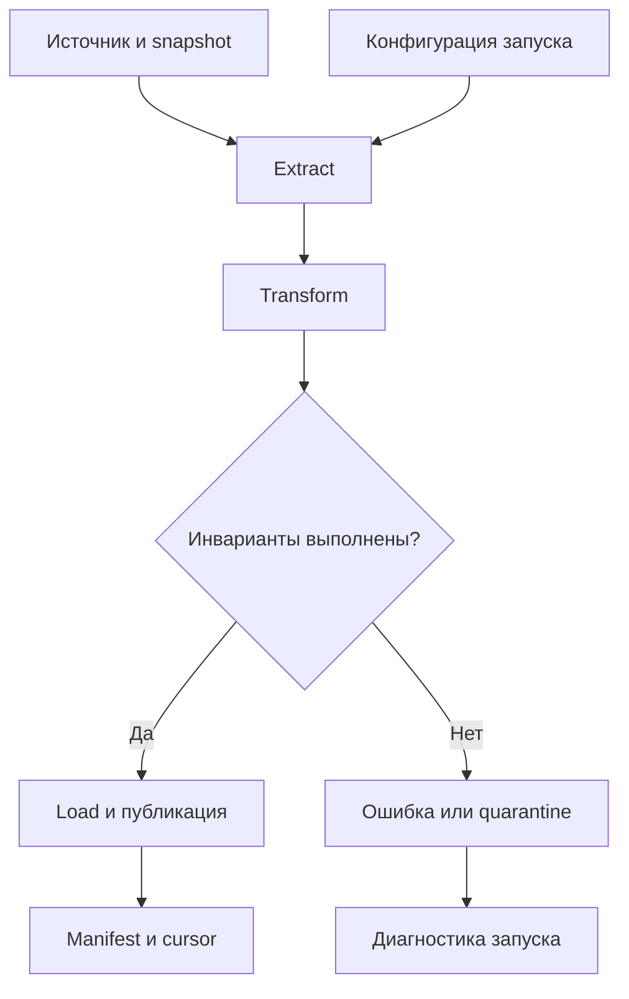
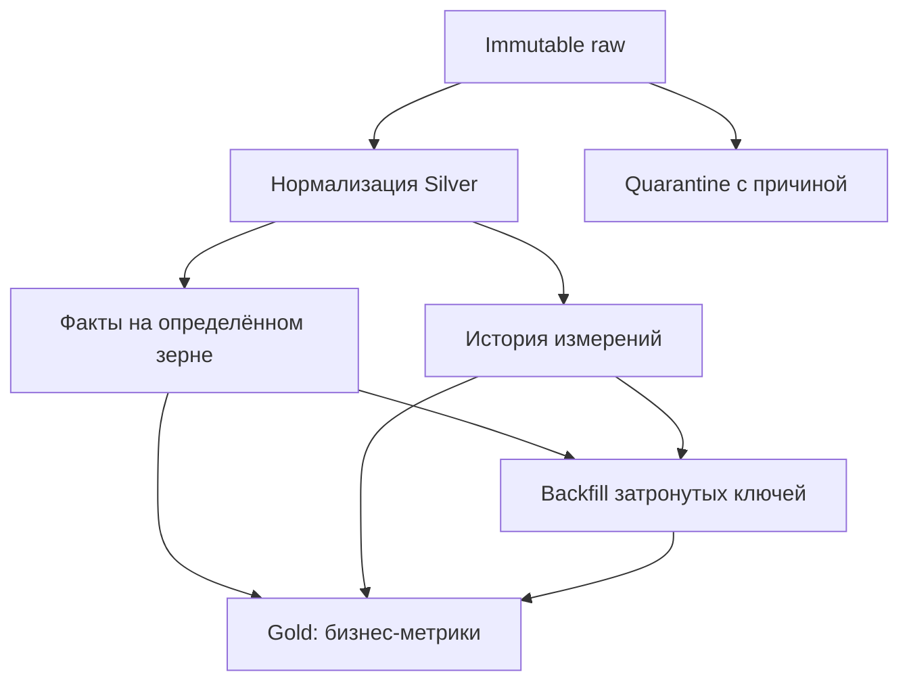
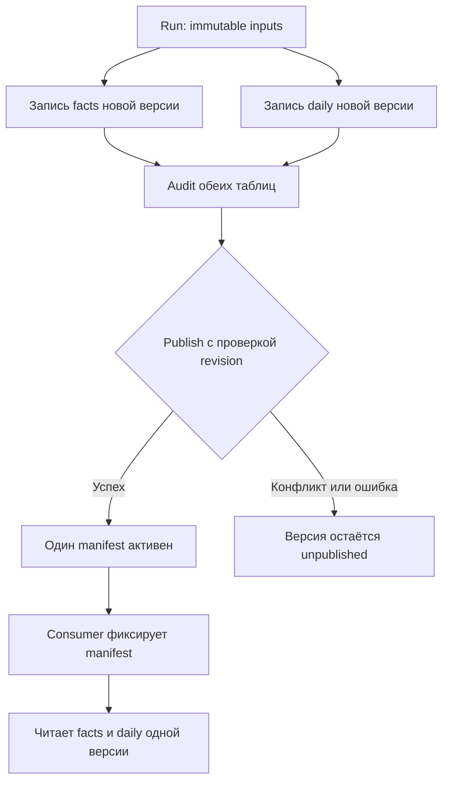
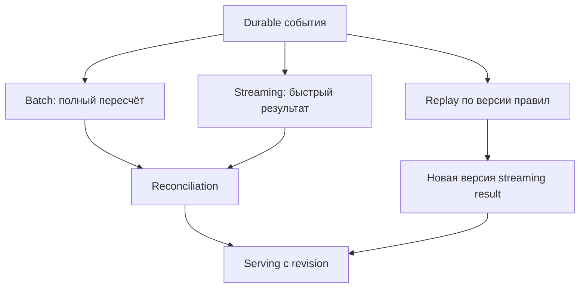

# 19. Архитектура Spark-пайплайнов и инженерия данных

Основной язык примеров — **Python / PySpark**. Проверенное окружение основной лаборатории: **Apache Spark 4.2.0, Python 3.12.14, OpenJDK 17.0.20, Spark Classic**, Linux, `local[2]`. Отдельные Spark Declarative Pipelines запускаются через `spark-pipelines` и Spark Connect. Версии зафиксированы: API и capability connector проверяются для своего окружения.

Глава связывает преобразования Spark с инженерными гарантиями: воспроизводимый вход, бизнес-инварианты, инкрементальная позиция, модель истории, backfill и согласованная публикация. Все **10 тем и 68 пунктов README сохранены в исходном порядке**, включая дополнения в скобках. Заголовки имеют три уровня: раздел → тема → пункт; практика и самопроверка расположены внутри каждого пункта.

**Содержание**

1. [Организация приложения](#application-organization)
2. [Batch ETL/ELT](#batch-etl-elt)
3. [Моделирование аналитических данных](#analytical-modeling)
4. [Слои данных и границы ответственности](#data-layers)
5. [Публикация и согласованность результатов](#publication-consistency)
6. [Backfill и пересчёты](#backfill)
7. [Batch и streaming в единой системе](#batch-and-streaming)
8. [Spark Declarative Pipelines](#declarative-pipelines)
9. [Метаданные и управление изменениями](#metadata-and-change)
10. [Архитектурные антипаттерны](#architecture-antipatterns)

**Как выполнить примеры**

Нужны JDK 17, Python, место для временных JSON/Parquet и локальных SQLite databases. Kafka, внешний catalog и lineage backend для основной лаборатории не требуются. Устанавливай полный PySpark с extra `pipelines`, а не только client-пакет.

```bash
java -version
python -m venv .venv
source .venv/bin/activate
python -m pip install 'pyspark[pipelines]==4.2.0' \
  'pyarrow==22.0.0' 'pandas==2.2.3' \
  'grpcio==1.76.0' 'grpcio-status==1.76.0' \
  'protobuf==6.33.5' 'googleapis-common-protos==1.72.0'
# Собери Python-блоки главы в файл в порядке появления.
python chapter19_lab.py
```

Команды активации рассчитаны на Linux/macOS/WSL. Выполняй **все 60 Python-блоков сверху вниз в одной чистой сессии**. Первый создаёт `spark` и временный `lab`; последующие используют эти переменные. Блоки SDP записывают source code отдельного проекта строками; последний блок останавливает основную session, запускает CLI, проверяет реальные outputs и удаляет только `lab`. Не используй `python -O`: он отключает проверочные `assert`.

Для локальной воспроизводимости установлены UTC, две shuffle partitions, loopback driver address и отключённая UI. Это настройки лаборатории, не универсальная production configuration; loopback address нельзя переносить на распределённые executors. Малые `collect()`, SQLite adapter и файловые checksums нужны для проверяемых fixtures; большой production dataset требует распределённого IO и подходящего storage protocol.

**Что выполнено и где граница проверки**

| Часть | Фактическая проверка | Ограничение |
|---|---|---|
| Batch/моделирование | Преобразования, cursor, lookback, SCD и as-of join | Малые управляемые fixtures |
| Публикация | SQLite rollback, failure между outputs, повтор publish, revision conflict | Локальный metadata store, без distributed failure model |
| Streaming | AvailableNow, restart, повтор без новых файлов, смена справочника | Immutable file source и file sink |
| SDP | CLI dry-run/run, Python/SQL, materialized/streaming datasets, fan-in, external file sink | Локальный execution environment |
| Auto CDC | API, отказ SCD2, фактический отказ Parquet без MERGE | Рабочий внешний MERGE connector не запускается |
| Deployment templates | Разобранные параметры YARN/OpenLineage | Внешний кластер, agent и backend не запускаются |

Архитектурные протоколы в главе — учебные реализации с указанными границами, а не скрытая гарантия Spark для любого source/sink. В частности, обычный Parquet не обеспечивает transactional MERGE и общей транзакции нескольких datasets.

Официальные отправные страницы: [Spark Submit](https://spark.apache.org/docs/4.2.0/submitting-applications.html), [Structured Streaming](https://spark.apache.org/docs/4.2.0/streaming/apis-on-dataframes-and-datasets.html), [SDP guide](https://spark.apache.org/docs/4.2.0/declarative-pipelines-programming-guide.html), [PySpark Pipelines API](https://spark.apache.org/docs/4.2.0/api/python/reference/pyspark.pipelines.html), [error conditions](https://spark.apache.org/docs/4.2.0/sql-error-conditions.html), [OpenLineage Spark integration](https://openlineage.io/docs/integrations/spark/). Ссылки на использованные APIs приведены также рядом с примерами.


<a id="application-organization"></a>

## Организация приложения


### Разделение extract, transform, validate и load

Пайплайн отвечает не только за вычисление DataFrame. Он должен объяснять, какие данные были прочитаны, какое правило применено, что проверено и какой результат доступен потребителям. Разделение стадий делает эти ответы явными: **extract** фиксирует вход и позицию источника; **transform** строит новый DataFrame; **validate** проверяет договорённости; **load** записывает и публикует результат.



Первый блок создаёт всё окружение основной лаборатории. Денежные суммы представлены в целых копейках; `source_seq` — условная позиция упорядоченного журнала источника, а не автоматически вычисленный Spark ID.

```python
from dataclasses import dataclass, replace
from datetime import datetime, timezone, timedelta
from pathlib import Path
from typing import Protocol
import hashlib
import json
import shutil
import sqlite3
import tempfile
import uuid

from pyspark.sql import SparkSession, DataFrame, functions as F, Window

lab = Path(tempfile.mkdtemp(prefix="spark-ch19-"))
spark = (
    SparkSession.builder.master("local[2]")
    .appName("spark-pipeline-engineering")
    .config("spark.sql.session.timeZone", "UTC")
    .config("spark.sql.shuffle.partitions", "2")
    .config("spark.ui.enabled", "false")
    .config("spark.driver.host", "127.0.0.1")
    .config("spark.driver.bindAddress", "127.0.0.1")
    .config("spark.python.use.daemon", "false")
    .config("spark.sql.warehouse.dir", str(lab / "warehouse"))
    .getOrCreate()
)
spark.sparkContext.setLogLevel("ERROR")
assert spark.version == "4.2.0"

source = spark.sql("""
SELECT * FROM VALUES
 ('e1', 101, 1, 1L, TIMESTAMP '2026-01-01 10:00:00', 'paid', 1000L),
 ('e2', 101, 1, 2L, TIMESTAMP '2026-01-02 10:00:00', 'paid', 1200L),
 ('e3', 102, 2, 3L, TIMESTAMP '2026-01-02 10:00:00', 'paid',  800L),
 ('e4', 103, 9, 4L, TIMESTAMP '2026-01-03 10:00:00', 'cancelled', 500L)
AS t(event_id, order_id, customer_id, source_seq, updated_at, status, amount_cents)
""")

def latest_orders(df: DataFrame) -> DataFrame:
    order = Window.partitionBy("order_id").orderBy(
        F.col("source_seq").desc(), F.col("event_id").desc()
    )
    return (df.withColumn("_rn", F.row_number().over(order))
            .filter(F.col("_rn") == 1).drop("_rn"))

def paid_orders(df: DataFrame) -> DataFrame:
    # Сначала выбираем текущее состояние, затем проверяем статус.
    return latest_orders(df).filter(F.col("status") == "paid")

def validate_orders(df: DataFrame) -> None:
    if df.filter("order_id IS NULL OR amount_cents IS NULL OR amount_cents < 0").limit(1).count():
        raise ValueError("Нарушен контракт заказа")
    if df.groupBy("order_id").count().filter("count > 1").limit(1).count():
        raise ValueError("Неуникальный order_id")

facts = paid_orders(source)
validate_orders(facts)
assert facts.count() == 2
assert facts.agg(F.sum("amount_cents")).first()[0] == 2000
```

Последовательность `latest → filter` существенна: если сначала отфильтровать отмены, можно восстановить старый оплаченный заказ после его отмены. `validate` содержит actions, поэтому запускается в orchestration-слое, отдельно от чистой функции преобразования. Проверки на малых fixtures просты; production-проверки стоит объединять, чтобы не сканировать один большой dataset многократно.

**Практика.** Добавь более новую отмену заказа 101 и проверь, что он исчезает из `paid_orders`. **Самопроверка.** Почему успешно построенный logical plan ещё не означает, что результат записан и опубликован?


### Чистая логика преобразований и слой взаимодействия с системами

Чистая логика здесь означает предсказуемое преобразование **DataFrame → DataFrame** без записи в хранилище, изменения cursor и внешних вызовов. Это не запрет на join или window: оба могут быть частью чистого плана. IO-слой выбирает snapshot, credentials, connector и способ публикации, а бизнес-функция получает уже прочитанные данные.

```python
def daily_revenue(df: DataFrame) -> DataFrame:
    return (df.withColumn("day", F.to_date("updated_at"))
            .groupBy("day")
            .agg(F.sum("amount_cents").alias("revenue_cents"),
                 F.count("order_id").alias("orders")))

mart = daily_revenue(facts)
assert mart.count() == 1
assert mart.first().revenue_cents == 2000
```

В этой учебной витрине день относится к последнему изменению заказа. Для отчёта «выручка по дате оплаты» нужен отдельный `paid_at`, который не меняется при редактировании заказа. Архитектура не исправляет неправильно выбранную бизнес-дату. Передавай справочник, дату расчёта и параметры явно, чтобы та же функция работала в batch, streaming и backfill.

**Практика.** Добавь `paid_at` и измени зерно ежедневной витрины. **Самопроверка.** Что сложнее воспроизвести: функцию с переданным справочником или функцию, которая сама читает «самую свежую» таблицу внутри себя?


### Переиспользуемые библиотеки и тонкие entry points

Библиотека содержит правила очистки, модели контрактов, вычисление ключей и проверки. Entry point разбирает параметры, создаёт SparkSession, вызывает библиотеку и возвращает понятный код завершения. Ставить `SparkSession.builder.getOrCreate()` при импорте библиотеки не следует: импорт перестаёт быть безопасным и начинает зависеть от окружения.

| Компонент | Содержимое | Кто меняет чаще |
|---|---|---|
| `transformations.py` | DataFrame → DataFrame | Разработчик бизнес-правил |
| `contracts.py` | Схемы и инварианты | Owner dataset вместе с consumers |
| `io.py` | Чтение, запись, catalog adapter | Инженер интеграций |
| `runner.py` | Порядок стадий, run metadata | Команда пайплайна |
| `main.py` | CLI, session lifecycle | Владелец приложения |

Для Python зависимостей [Spark Submit](https://spark.apache.org/docs/4.2.0/submitting-applications.html) поддерживает `--py-files` с `.py`, `.zip` и `.egg`. Wheel с native libraries нельзя считать автоматически доставленным таким способом: используйте установку окружения или механизм упаковки среды, поддержанный платформой.

```bash
# Шаблон запуска приложения проекта; files должны существовать в проекте.
spark-submit --master yarn --deploy-mode cluster \
  --py-files dist/pipeline_lib.zip main.py \
  --start 2026-01-01T00:00:00Z --end 2026-01-02T00:00:00Z
```

**Практика.** Раздели первый блок на библиотеку без side effects и CLI. **Самопроверка.** Почему одинаковая версия `main.py` не гарантирует одинаковый результат при разных версиях зависимостей?


### Конфигурация, dependency injection и управление ресурсами

Конфигурация — вход пайплайна, а не коллекция случайных глобальных переменных. Зафиксируй обязательные поля, типы, часовой пояс, версию правил и source snapshot. Dependency injection позволяет заменить файловый reader на JDBC adapter, не переписывая преобразование. Credentials передаются через механизм секретов платформы; не включай их в manifest или журнал параметров.

```python
@dataclass(frozen=True)
class RunConfig:
    start: datetime
    end: datetime
    rules_version: str
    source_snapshot: str

    def __post_init__(self):
        if any(t.tzinfo is None or t.utcoffset() != timedelta(0)
               for t in (self.start, self.end)):
            raise ValueError("Границы должны быть timezone-aware UTC")
        if self.start >= self.end:
            raise ValueError("Пустой или обратный интервал")

cfg = RunConfig(
    datetime(2026, 1, 1, tzinfo=timezone.utc),
    datetime(2026, 1, 4, tzinfo=timezone.utc),
    "orders-v1", "source-log-through-4",
)

class Reader(Protocol):
    def read(self, config: RunConfig) -> DataFrame: ...

class FixtureReader:
    def read(self, config: RunConfig) -> DataFrame:
        return source.filter((F.col("updated_at") >= F.lit(config.start)) &
                             (F.col("updated_at") < F.lit(config.end)))

def prepare(reader: Reader, config: RunConfig) -> DataFrame:
    result = paid_orders(reader.read(config))
    validate_orders(result)
    return result

assert prepare(FixtureReader(), cfg).count() == 2
```

Это bounded fixture: фильтрация до `latest_orders` корректна для определённого здесь входного snapshot, но не является универсальным способом получить состояние на дату. В реальном snapshot состояния сначала учитываются все изменения до cutoff, а затем выбирается текущая версия; период фактов фильтруется по своей бизнес-дате. Жизненный цикл session, connections и cache контролирует runner через `try/finally`, а не функции преобразования.

**Практика.** Реализуй второй Reader, читающий Parquet с явно зафиксированным путём версии. **Самопроверка.** Какие параметры нужны, чтобы повтор через месяц вычислил тот же результат?


### Notebook для исследования и приложение для регулярного запуска

Notebook удобен для исследования: посмотреть schema, проверить гипотезу join, оценить skew и объяснить правило. Регулярный запуск требует фиксированной последовательности, параметров и окружения. Состояние kernel, переменные из удалённых ячеек и ручное изменение временных views не должны становиться зависимостями production-процесса.

Практический путь: сначала исследовать небольшой snapshot, затем перенести правила в импортируемые функции, добавить entry point, запускать в чистом окружении и сохранять run metadata. Notebook остаётся демонстрацией и средством диагностики. Сам факт исполнения notebook оркестратором не делает его плохим: проблема в неявном состоянии и отсутствии контракта, а не в расширении файла.

Проверяй, что «Restart kernel → Run all» даёт ожидаемый результат. Actions вроде `show()` и `count()` нужны для исследования, но могут многократно перечитывать большой источник. Ограничивай просмотр и явно управляй промежуточным cache.

**Практика.** Найди в своём notebook переменные, значение которых зависит от порядка ручного исполнения. **Самопроверка.** Чем parameterized notebook с чистыми функциями отличается от notebook, который работает только в текущем kernel?


### Документация входов, выходов и бизнес-инвариантов

Контракт dataset включает больше, чем типы полей. Для `orders_current` нужно написать: одна строка на `order_id`, источник последовательности версий, статус удаления, единицы денег, допустимость NULL, временная семантика, правила поздних исправлений и срок хранения истории. Выходная витрина также описывает freshness, owners и способ чтения согласованной версии.

```python
orders_contract = {
    "dataset": "curated.orders_current",
    "grain": "one row per order_id",
    "primary_key": ["order_id"],
    "money_unit": "RUB kopecks",
    "version_order": ["source_seq", "event_id"],
    "event_time_zone": "UTC",
    "deletes": "latest cancelled order excluded from paid mart",
    "source_snapshot": cfg.source_snapshot,
    "rules_version": cfg.rules_version,
}
(lab / "orders-contract.json").write_text(
    json.dumps(orders_contract, ensure_ascii=False, indent=2), encoding="utf-8"
)
assert json.loads((lab / "orders-contract.json").read_text())["primary_key"] == ["order_id"]
```

`event_id` в демонстрации завершает детерминированный порядок; в реальном журнале конфликт одинаковых source positions с разным содержимым лучше отклонять, если источник не определил разрешение конфликта. Документируй также, куда попадают rejected rows: молчаливый `dropna()` может скрыть потерю данных.

**Практика.** Напиши контракт своей витрины из пяти бизнес-инвариантов и пяти требований к эксплуатации. **Самопроверка.** Может ли совпадение schema гарантировать совпадение смысла `amount_cents`?


<a id="batch-etl-elt"></a>

## Batch ETL/ELT


### Полная загрузка и инкрементальная загрузка

**Полная загрузка** читает весь согласованный snapshot и строит новую версию результата. Она проще в понимании, но дороже по IO и вычислениям. **Инкрементальная** применяет новые изменения к уже вычисленному состоянию; уменьшение объёма сопровождается cursor, обработкой deletes и восстановлением после сбоя.

| Сценарий | Полная загрузка | Инкрементальная |
|---|---|---|
| Маленький справочник | Часто достаточно нового snapshot | Может быть лишней сложностью |
| Большой журнал изменений | Дорогой replay | Cursor и version-aware upsert |
| Удаление в источнике | Исчезает в новом snapshot | Нужен tombstone или сверка |
| Новое бизнес-правило | Полный пересчёт доступной истории | Backfill затронутой области |
| Исправление очень старой записи | Видно при следующем snapshot | Зависит от журнала и retention |

```python
full_current = latest_orders(source)
delta_events = source.filter(F.col("source_seq") > 2)
prior_events = source.filter(F.col("source_seq") <= 2)
incremental_current = latest_orders(prior_events.unionByName(delta_events))
assert full_current.exceptAll(incremental_current).count() == 0
assert incremental_current.exceptAll(full_current).count() == 0
```

Здесь replay четырёх событий заменяет storage MERGE только для демонстрации. В production версии и tombstones хранятся в целевой таблице либо отдельном состоянии, а adapter реализует upsert, который умеет отвергать более старое изменение. Нельзя просто append новых снимков заказа в таблицу с зерном «текущий заказ».

**Практика.** Сравни объём чтения при полном snapshot и при журнале с 1% изменённых ключей. **Самопроверка.** Почему инкрементальное чтение `id > max(id)` пропустит исправление существующего заказа?


### Incremental cursor по времени, ID и журналу изменений

Cursor задаёт позицию чтения, поэтому обязан соответствовать гарантиям источника. Последовательный ID годится только для новых строк при стабильном порядке видимости. `updated_at` подходит, если обновляется при каждом изменении и учитывает commit order; timestamp без tie breaker теряет строки с равным временем. CDC cursor обычно содержит журнал/partition и offset; для нескольких независимых partitions это вектор позиций.

```python
cursor_time = datetime(2026, 1, 2, 10, tzinfo=timezone.utc)
cursor_id = "e2"
after_composite = source.filter(
    (F.col("updated_at") > F.lit(cursor_time)) |
    ((F.col("updated_at") == F.lit(cursor_time)) &
     (F.col("event_id") > F.lit(cursor_id))))
assert {r.event_id for r in after_composite.select("event_id").collect()} == {"e3", "e4"}
assert source.filter(F.col("updated_at") > F.lit(cursor_time)).count() == 1
```

Составной `(updated_at, event_id)` исправляет пагинацию **внутри зафиксированного snapshot**. Он не защищает от транзакции, которая поздно стала видна с более ранним timestamp или меньшим ID. Для этого нужен источник с гарантированным commit cursor, фиксированный snapshot плюс стратегия догрузки, или lookback/reconciliation. `monotonically_increasing_id()` и номера партиций Spark не являются cursor источника.

**Практика.** Смоделируй поздний commit со старым `updated_at`. **Самопроверка.** Какие свойства должен иметь source cursor, чтобы граница «всё до неё прочитано» была доказуемой?


### High-water mark загрузки и отличие от streaming watermark

Batch high-water mark — **последняя подтверждённая позиция источника**, до которой изменения отражены в опубликованном результате. Streaming watermark — граница event time, используемая stateful operators для управления поздними событиями и состоянием. Их нельзя заменять друг другом: advancing watermark не доказывает, что все upstream-записи бизнес-периода получены.

| Свойство | Batch high-water mark | Streaming watermark |
|---|---|---|
| Шкала | Commit ID, offset, composite cursor | Время события |
| Назначение | Следующее инкрементальное чтение | Политика lateness и state cleanup |
| Условие сохранения | После успешного протокола публикации | Продвижение streaming engine |
| «До границы больше нет исправлений» | Только по контракту источника | Не является такой бизнес-гарантией |

Зафиксируй нижнюю позицию `C0` и верхний cutoff `C1` до чтения. Читай `(C0, C1]` и сохраняй **тот же C1**, а не новый `max()` источника после записи: между чтением и вторым `max()` могли появиться непрочитанные изменения. Для timestamp-периодов часто выбирают `[start, end)`; важно явно описать включённость каждой границы.

```python
c0, c1 = 2, 4
bounded_changes = source.filter((F.col("source_seq") > c0) &
                                (F.col("source_seq") <= c1))
assert sorted(r.source_seq for r in bounded_changes.select("source_seq").collect()) == [3, 4]
confirmed_high_water_mark = c0  # До commit остаётся прежним.
assert confirmed_high_water_mark == 2
```

**Практика.** Добавь событие с позицией 5 после фиксации cutoff 4. **Самопроверка.** Почему сохранение 5 после обработки диапазона `(2, 4]` опасно?


### Lookback window и повторное чтение изменившегося периода

Lookback повторно читает уже обработанный хвост: например, от `last_success_time - 2 days` до фиксированного cutoff. Он компенсирует ограниченную задержку видимости и поздние изменения. Повторно прочитанные строки должны обновляться по ключу и версии; обычный append удвоит данные.

```python
lookback_start = cursor_time - timedelta(days=1)
lookback_end = cfg.end
replayed = source.filter((F.col("updated_at") >= F.lit(lookback_start)) &
                         (F.col("updated_at") < F.lit(lookback_end)))
current_once = latest_orders(source)
current_twice = latest_orders(source.unionByName(replayed))
assert current_once.exceptAll(current_twice).count() == 0
assert current_twice.exceptAll(current_once).count() == 0
```

Размер окна выбирается по измеренной задержке и контракту источника. Исправление полугодовой записи не попадёт в двухдневное окно, если `updated_at` не обновился. Lookback не заменяет журнал изменений и периодическую сверку. Для агрегатов нужно **пересчитать затронутые ключи/периоды** или применить корректные retract/update; добавление новой суммы к старой без удаления предыдущего вклада создаёт двойной учёт.

**Практика.** Покажи на заказе 101, почему `1000 + 1200` неверно для текущей выручки. **Самопроверка.** Что сильнее влияет на безопасность lookback: размер окна или семантика записи результата?


### Идемпотентность запуска и безопасный rerun

Идемпотентность означает, что повтор одной **логической операции** оставляет тот же эффект. UUID каждой попытки полезен для диагностики, но не предотвращает дубль: attempt ID меняется при retry. Стабильный idempotency key может включать pipeline, source snapshot, interval и rules version. Публикация другой бизнес-версии — уже другая операция.

```python
def logical_key(config: RunConfig) -> str:
    canonical = json.dumps({
        "pipeline": "orders",
        "start": config.start.isoformat(), "end": config.end.isoformat(),
        "rules": config.rules_version, "snapshot": config.source_snapshot,
    }, sort_keys=True, separators=(",", ":"))
    return hashlib.sha256(canonical.encode()).hexdigest()

assert logical_key(cfg) == logical_key(replace(cfg))
assert logical_key(cfg) != logical_key(replace(cfg, rules_version="orders-v2"))
assert str(uuid.uuid4()) != str(uuid.uuid4())
```

Стабильный ключ должен опираться на immutable input. Если под тем же `source_snapshot` фактически читается изменяемая папка, hash не делает вычисление воспроизводимым. Случайные числа, `current_timestamp()` и нестабильное разрешение равных версий также могут менять результат rerun. Идемпотентность полезно проверять отказом после записи, но до подтверждения успеха.

**Практика.** Определи отдельные logical run ID и attempt ID для своего DAG. **Самопроверка.** Почему дедупликация только по номеру streaming batch не защищает от нового checkpoint?


### Согласование cursor, записи результата и успешного статуса

Ошибка «сначала сохранить cursor, потом писать результат» приводит к пропускам при сбое. Ошибка «записать результат, затем append при retry» приводит к дублям. Возможные решения: одна транзакция в общей системе, идемпотентная запись с последующим подтверждением, либо versioned outputs и атомарный pointer на полный набор.

Следующий **локальный SQLite adapter** показывает общую транзакцию для четырёх маленьких строк. Spark выполняет преобразование, а SQLite согласует своё состояние, cursor и журнал успеха. Это не транзакция между Spark и произвольной внешней БД и не масштабируемый driver sink.

```python
control = sqlite3.connect(lab / "batch-control.sqlite")
control.executescript("""
CREATE TABLE current_orders(order_id INTEGER PRIMARY KEY, seq INTEGER NOT NULL,
                            status TEXT NOT NULL, amount INTEGER NOT NULL);
CREATE TABLE cursor_state(name TEXT PRIMARY KEY, position INTEGER NOT NULL);
INSERT INTO cursor_state VALUES ('orders', 0);
CREATE TABLE completed(logical_key TEXT PRIMARY KEY, cutoff INTEGER NOT NULL);
""")
control.commit()

def commit_small_batch(key, cutoff, rows, fail=False):
    with control:
        if control.execute("SELECT 1 FROM completed WHERE logical_key=?", (key,)).fetchone():
            return
        old = control.execute("SELECT position FROM cursor_state WHERE name='orders'").fetchone()[0]
        if cutoff < old:
            raise ValueError("Cursor regression")
        control.executemany("""
          INSERT INTO current_orders VALUES (?, ?, ?, ?)
          ON CONFLICT(order_id) DO UPDATE SET seq=excluded.seq,
            status=excluded.status, amount=excluded.amount
          WHERE excluded.seq > current_orders.seq
        """, rows)
        if fail:
            raise RuntimeError("Сбой после записи, до cursor")
        control.execute("UPDATE cursor_state SET position=? WHERE name='orders'", (cutoff,))
        control.execute("INSERT INTO completed VALUES (?, ?)", (key, cutoff))

small_rows = [(r.order_id, r.source_seq, r.status, r.amount_cents)
              for r in source.orderBy("source_seq").collect()]
try:
    commit_small_batch(logical_key(cfg), 4, small_rows, fail=True)
except RuntimeError:
    pass
assert control.execute("SELECT COUNT(*) FROM current_orders").fetchone()[0] == 0
assert control.execute("SELECT position FROM cursor_state").fetchone()[0] == 0
commit_small_batch(logical_key(cfg), 4, small_rows)
commit_small_batch(logical_key(cfg), 4, small_rows)
assert control.execute("SELECT COUNT(*) FROM current_orders").fetchone()[0] == 3
assert control.execute("SELECT SUM(amount) FROM current_orders WHERE status='paid'").fetchone()[0] == 2000
assert control.execute("SELECT position FROM cursor_state").fetchone()[0] == 4
```

Версия сохраняется и для отменённых заказов: старое paid-событие не должно воскресить отмену. На одинаковой `seq` этот adapter оставляет прежнее состояние, поэтому production-контракт обязан запрещать различное содержимое одной позиции или задавать дополнительный version key. Для concurrent writers нужны блокировки/optimistic concurrency и проверка исходного cursor. Протокол для независимых файловых outputs рассмотрен ниже.

**Практика.** Отправь старую paid-версию после новой cancelled-версии. **Самопроверка.** Какие гарантии потеряются, если `completed` записывать в другой БД без общей транзакции?


<a id="analytical-modeling"></a>

## Моделирование аналитических данных


### Гранулярность фактов и уникальность ключей

**Гранулярность** — смысл одной строки факта: заказ, строка заказа, платёж, доставка или изменение заказа. Первичный ключ должен соответствовать этому смыслу. В журнале `event_id` уникален для события, а `order_id` повторяется законно; в `orders_current` должно быть по одной строке на заказ. Смешивание этих двух datasets даёт завышение выручки.

```python
assert source.select("event_id").distinct().count() == source.count()
assert source.select("order_id").distinct().count() < source.count()
assert facts.select("order_id").distinct().count() == facts.count()
raw_paid_total = source.filter("status='paid'").agg(F.sum("amount_cents")).first()[0]
assert raw_paid_total == 3000  # Здесь смешаны версии заказа 101.
assert facts.agg(F.sum("amount_cents")).first()[0] == 2000
```

Запиши зерно текстом в контракте и проверь uniqueness до join и после него. Ключ `(order_id, line_id)` нельзя заменить на `order_id`, если в заказе несколько позиций. Не применяй `dropDuplicates` как универсальное лечение: оно может удалить законные строки или скрыть конфликт версий.

**Практика.** Спроектируй зерно для витрин платежей и возвратов. **Самопроверка.** Почему уникальный технический ID строки не доказывает уникальность бизнес-факта?


### Справочники, surrogate keys и referential integrity

Natural key приходит из бизнеса, например `customer_id`; surrogate key идентифицирует строку измерения и часто отдельную историческую версию клиента. Он должен быть стабильным между reruns. `row_number()` без долговременной key registry и `monotonically_increasing_id()` не подходят как универсальные стабильные surrogate keys.

```python
dim_current = spark.sql("""
SELECT * FROM VALUES (1, 1001L, 'Moscow'), (2, 1002L, 'Kazan')
AS t(customer_id, customer_sk, city)
""")
missing_customers = facts.join(dim_current, "customer_id", "left_anti")
assert missing_customers.count() == 0
joined_facts = facts.join(dim_current, "customer_id", "left")
assert joined_facts.count() == facts.count()
assert joined_facts.filter("customer_sk IS NULL").count() == 0
```

Для неизвестного клиента выбирают quarantine, специальную unknown-member строку или отложенное обогащение. Решение описывается в контракте. Не превращай отсутствие справочника в inner join, который тихо выкидывает выручку. Spark не проверяет автоматически все внешние ключи: возможности constraints зависят от catalog/provider, а проверки данных остаются частью пайплайна.

**Практика.** Добавь оплаченный заказ клиента 9 и реализуй явно выбранную unknown-member политику. **Самопроверка.** Что случится с количеством фактов, если справа две текущие строки на `customer_id`?


### SCD Type 1 и Type 2

**SCD Type 1** хранит актуальные атрибуты: смена города заменяет прежний город. **SCD Type 2** хранит версии и их интервалы действия. Для исторического отчёта факт связывается с версией измерения, действовавшей в бизнес-время факта, а не с текущей строкой.

```python
dim_changes = spark.sql("""
SELECT * FROM VALUES
 (1, DATE '2026-01-01', 'Moscow', 1L),
 (1, DATE '2026-01-03', 'SPb',    2L),
 (2, DATE '2026-01-01', 'Kazan',  1L)
AS t(customer_id, valid_from, city, change_seq)
""")

def scd2_intervals(changes: DataFrame) -> DataFrame:
    # На одну effective date оставляем исправление с максимальной sequence.
    w_same = Window.partitionBy("customer_id", "valid_from").orderBy(F.desc("change_seq"))
    dedup = (changes.withColumn("_rn", F.row_number().over(w_same))
             .filter("_rn=1").drop("_rn"))
    w_time = Window.partitionBy("customer_id").orderBy("valid_from")
    return dedup.withColumn("valid_to", F.lead("valid_from").over(w_time))

history = scd2_intervals(dim_changes)
assert history.filter("customer_id=1 AND city='Moscow'").first().valid_to.isoformat() == "2026-01-03"
scd1 = (dim_changes.withColumn("_rn", F.row_number().over(
    Window.partitionBy("customer_id").orderBy(F.desc("valid_from"), F.desc("change_seq"))))
    .filter("_rn=1").drop("_rn"))
assert scd1.filter("customer_id=1").first().city == "SPb"
```

У SCD2 интервалы `[valid_from, valid_to)`; NULL `valid_to` означает открытый конец. Убедись в отсутствии пересечений и одинаковых effective positions с конфликтующим содержимым. Пример хранит все поступившие изменения и заново строит интервалы; крупная система пересчитывает затронутые ключи или использует соответствующий table-format adapter. Повтор одинакового атрибута можно схлопывать по отдельному правилу, если бизнес не требует хранить каждое наблюдение.

**Практика.** Проверь uniqueness `(customer_id, valid_from)` и одну открытую версию на клиента. **Самопроверка.** Может ли SCD1 восстановить город клиента на дату старого платежа?


### Valid time, system time и бивременные модели

**Valid time** говорит, когда значение действовало в бизнесе. **System time** — когда система считала это значение известным. Если 5 января пришло исправление, действующее с 2 января, исторический отчёт «как мы считали 4 января» отличается от отчёта «что мы теперь знаем про 4 января».

| Модель | Ключевой вопрос | Какие интервалы нужны |
|---|---|---|
| Текущее состояние | Что известно сейчас? | Версия текущей строки |
| SCD2 по valid time | Что действовало в момент факта? | `valid_from`, `valid_to` |
| История по system time | Что система знала в момент расчёта? | `sys_from`, `sys_to` |
| Бивременная | Что действовало тогда согласно знаниям на дату X? | Обе пары |

```python
bitemporal = spark.sql("""
SELECT * FROM VALUES
 (1, 'Moscow', DATE '2026-01-01', DATE '9999-12-31', DATE '2026-01-01', DATE '2026-01-05'),
 (1, 'Moscow', DATE '2026-01-01', DATE '2026-01-02', DATE '2026-01-05', DATE '9999-12-31'),
 (1, 'Kazan',  DATE '2026-01-02', DATE '9999-12-31', DATE '2026-01-05', DATE '9999-12-31')
AS t(customer_id, city, valid_from, valid_to, sys_from, sys_to)
""")
def known_city(valid_date, known_date):
    return bitemporal.filter(
        (F.col("valid_from") <= F.to_date(F.lit(valid_date))) &
        (F.to_date(F.lit(valid_date)) < F.col("valid_to")) &
        (F.col("sys_from") <= F.to_date(F.lit(known_date))) &
        (F.to_date(F.lit(known_date)) < F.col("sys_to"))
    ).first().city
assert known_city("2026-01-04", "2026-01-04") == "Moscow"
assert known_city("2026-01-04", "2026-01-06") == "Kazan"
```

System time не возникает автоматически от добавления `ingested_at`: нужны версии прежних знаний и правила их закрытия. Time travel табличного формата хранит snapshots таблицы, но само по себе не моделирует valid time и не обещает бессрочное хранение.

**Практика.** Нарисуй две версии знаний для ретроактивной смены тарифного плана. **Самопроверка.** Какой второй параметр нужен запросу «город на 4 января», чтобы результат был однозначным?


### Поздние факты и поздние изменения измерений

Поздний факт может требовать исторической версии измерения, которая уже не current. Позднее изменение измерения может изменить обогащение ранее обработанных фактов. Здесь изменение города клиента 1 с 2 января поступает после известной смены с 3 января: нужно вставить промежуточный интервал, а не закрывать текущую версию сегодняшним временем.

```python
late_change = spark.sql("""
SELECT 1 AS customer_id, DATE '2026-01-02' AS valid_from,
       'Kazan' AS city, 3L AS change_seq
""")
corrected_history = scd2_intervals(dim_changes.unionByName(late_change))
old_enrichment = facts.withColumn("fact_date", F.to_date("updated_at"))

def enrich_as_of(df: DataFrame, dimension: DataFrame) -> DataFrame:
    f, d = df.alias("f"), dimension.alias("d")
    condition = ((F.col("f.customer_id") == F.col("d.customer_id")) &
                 (F.col("d.valid_from") <= F.col("f.fact_date")) &
                 (F.col("d.valid_to").isNull() |
                  (F.col("f.fact_date") < F.col("d.valid_to"))))
    return f.join(d, condition, "left").select("f.*", F.col("d.city").alias("city"))

before_late = enrich_as_of(old_enrichment, history)
after_late = enrich_as_of(old_enrichment, corrected_history)
assert before_late.filter("order_id=101").first().city == "Moscow"
assert after_late.filter("order_id=101").first().city == "Kazan"
assert after_late.count() == facts.count()
```

Список affected facts выводится из изменившихся ключей и valid intervals. Обновлять только сам справочник недостаточно, если city уже материализован в фактах или агрегатах. Сохраняй natural key, business time и dimension version, чтобы найти область пересчёта. Для отсутствующей исторической строки нужна явная политика, а не произвольная current-версия.

**Практика.** Пересчитай агрегат выручки по city после `late_change`. **Самопроверка.** Почему корректировка одного клиента может затронуть много партиций фактов?


### Факты, snapshots и агрегированные витрины

Транзакционный факт описывает событие, например проведённый платёж. Snapshot показывает состояние на cutoff: остаток, активные подписки, backlog заказов. Агрегированная витрина хранит заранее вычисленные показатели на определённом зерне. Эти виды данных имеют разные правила сложения.

Остатки из двух ежедневных snapshots обычно нельзя суммировать как выручку. Distinct customers по городам не всегда складываются в distinct customers всей компании. Средние следует пересчитывать через сумму и число наблюдений, а не усреднять средние групп без весов.

```python
city_mart = after_late.groupBy("city").agg(
    F.sum("amount_cents").alias("revenue_cents"),
    F.count("order_id").alias("orders"),
)
assert city_mart.count() == 1
assert city_mart.first().orders == 2
assert city_mart.first().revenue_cents == 2000
```

В fixture обе оплаченные строки теперь относятся к Kazan. Зафиксируй, что витрина отражает **текущее состояние оплаченных заказов** с историческим обогащением на `updated_at`, а не бухгалтерские проводки: отмены и возвраты требуют отдельной финансовой модели.

**Практика.** Раздели показатели на additive, semi-additive и non-additive. **Самопроверка.** Почему сумма дневных active users не равна monthly active users?


### Сверка метрик между слоями и контроль двойного учёта

Сверка должна учитывать одинаковое зерно, диапазон, фильтры, валюту и версии источника. Сравнение «все raw-события» с «текущие paid-заказы» некорректно: raw содержит старые версии и отмены. Правильная сверка отделяет намеренное изменение набора строк от потерь и размножения.

```python
def cents_total(df, column="amount_cents"):
    return df.agg(F.coalesce(F.sum(column), F.lit(0)).alias("total")).first().total

assert cents_total(facts) == cents_total(joined_facts)
assert cents_total(facts) == cents_total(city_mart, "revenue_cents")
assert city_mart.agg(F.sum("orders")).first()[0] == facts.count()
# Симуляция many-to-many: дублируем одну сторону join.
bad_dim = dim_current.unionByName(dim_current.filter("customer_id=1"))
bad_join = facts.join(bad_dim, "customer_id", "left")
assert bad_join.count() == 3
assert cents_total(bad_join) == 3200
```

Сохраняй reconciliation metrics в run manifest: число исходных событий, число ключей, discarded versions, rejected rows, current rows и totals. Одной общей суммы недостаточно: две ошибки могут взаимно компенсироваться. Добавь контроль по периоду, валюте и business key, а для инкремента — сверку старого состояния плюс delta с новым состоянием.

**Практика.** Сделай проверку, которая обнаружит две противоположные ошибки при совпадающем total. **Самопроверка.** Что нужно согласовать перед сравнением сумм между Bronze и Gold?


<a id="data-layers"></a>

## Слои данных и границы ответственности


### Raw/staging/curated/serving и Bronze/Silver/Gold

Названия слоёв различаются, но полезная граница связана с **ответственностью за смысл и восстановление**. Raw/Bronze сохраняет исходное наблюдение; staging может быть временной технической областью; curated/Silver нормализует и проверяет сущности; serving/Gold адаптирует данные под потребителя. Не все организации сопоставляют эти названия один к одному.

| Слой | Основная ответственность | Типичный контракт |
|---|---|---|
| Raw / Bronze | Источник и воспроизводимость | Исходный payload, source position, schema version |
| Staging | Изоляция незавершённой обработки | Run ID, срок жизни, отсутствие serving-доступа |
| Curated / Silver | Ключи, типы, качество, изменения | Гранулярность, версия, deletions, dedup rule |
| Serving / Gold | Метрики и потребительская модель | Семантика показателя, период, freshness |



Три папки сами по себе не создают архитектуру. Если Gold читает скрытый mutable CSV на driver, границы нарушены независимо от названия каталога. Лишнее копирование каждого dataset через все слои повышает стоимость без обязательной пользы.

**Практика.** Для каждого слоя своей системы запиши owner, retention и возможность rebuild. **Самопроверка.** Зачем хранить Silver, если Gold можно вычислить напрямую из Bronze?


### Сохранение неизменного исходного события

Неизменный исходный payload позволяет отличить ошибку источника от ошибки parser и повторить обработку новой логикой. Сохраняй source namespace, event ID, position, время получения, schema version и checksum. Нормализованный JSON не всегда заменяет исходные bytes: parser может изменить порядок, числовую запись и неизвестные поля.

```python
raw_dir = lab / "raw"
raw_dir.mkdir()
raw_bytes = b'{"event_id":"e5","order_id":104,"amount_cents":700,"extra":"future-field"}\n'
raw_file = raw_dir / "source-event-e5.json"
with raw_file.open("xb") as stream:
    stream.write(raw_bytes)
raw_metadata = {
    "event_id": "e5", "source": "orders-journal",
    "position": 5, "schema_version": "1",
    "sha256": hashlib.sha256(raw_bytes).hexdigest(),
    "received_at": "2026-01-04T00:00:00Z",
}
assert hashlib.sha256(raw_file.read_bytes()).hexdigest() == raw_metadata["sha256"]
assert json.loads(raw_file.read_bytes())["extra"] == "future-field"
```

`xb` здесь предотвращает перезапись локального файла. Для object storage нужен аналогичный immutable naming и механизм conditional create/versioning, проверенный для выбранного API. Сохраняй исходные данные с учётом фактического retention и правил доступа; «raw навсегда» не является обязательным свойством lakehouse.

**Практика.** Сохрани payload, который текущая schema не умеет разобрать, и добавь reason code. **Самопроверка.** Какие сведения теряются, если оставить только успешно разобранные поля?


### Нормализация, качество и бизнес-агрегации по слоям

Расположи проверки там, где существует необходимый контекст. Raw проверяет читаемость envelope и source position. Silver приводит типы, разрешает версии и проверяет бизнес-ключи. Gold проверяет семантику метрик и reconciliation. Invalid rows могут блокировать run или попадать в quarantine по явной политике; это решение влияет на completeness.

```python
quality_fixture = source.unionByName(spark.sql("""
SELECT 'bad' AS event_id, 104 AS order_id, 1 AS customer_id, 5L AS source_seq,
 TIMESTAMP '2026-01-04 10:00:00' AS updated_at, 'paid' AS status,
 -1L AS amount_cents
"""))
marked = quality_fixture.withColumn("quality_error", F.when(
    F.col("amount_cents").isNull() | (F.col("amount_cents") < 0),
    F.lit("INVALID_AMOUNT")))
valid = marked.filter("quality_error IS NULL").drop("quality_error")
quarantine = marked.filter("quality_error IS NOT NULL")
assert valid.count() + quarantine.count() == quality_fixture.count()
assert quarantine.first().event_id == "bad"
assert quarantine.first().quality_error == "INVALID_AMOUNT"
```

При contract violation не нужно автоматически продвигать cursor: либо run блокируется, либо checkpoint подтверждает, что rejected rows сохранены и могут быть переобработаны независимо. В метриках разделяй discarded old versions, lawful cancelled orders и invalid rows: причины потери строк различны.

**Практика.** Определи порог rejected rows, при котором публикация запрещена. **Самопроверка.** Почему неизвестный статус заказа нельзя молча интерпретировать как cancelled?


### Независимая переработка промежуточного слоя

Независимая переработка слоя требует стабильного входа и contract boundary. Если изменилось только вычисление Gold, не обязательно повторно читать внешнюю БД: можно использовать закреплённую версию Silver. Если ошибка находится в parser, нужно вернуться к immutable raw. Источник пересчёта выбирается по **месту ошибки**, а не по желанию сократить IO любой ценой.

```python
silver_version = lab / "silver" / "snapshot-4"
latest_orders(source).write.mode("errorifexists").parquet(str(silver_version))
pinned_silver = spark.read.parquet(str(silver_version))
rebuilt_gold = daily_revenue(pinned_silver.filter("status='paid'"))
assert cents_total(rebuilt_gold, "revenue_cents") == 2000
```

Фиксированный путь здесь играет роль версии. Для табличного формата используется snapshot/version API выбранного provider, а retention должен покрывать срок backfill. Не привязывай пересчёт к temporary view прошлой SparkSession: после перезапуска она исчезнет.

**Практика.** Поменяй только Gold-правило и вычисли две витрины на одной версии Silver. **Самопроверка.** Когда перерасчёт из Silver сохранит ошибку вместо исправления?


### Контракты producer/consumer и schema ownership

Producer отвечает за смысл, schema и правила изменения dataset, consumer — за поддерживаемые версии и ожидания. Совместимость шире правила «новый nullable столбец безопасен»: positional reads, `SELECT *`, schema inference и строгий serializer могут сделать добавление поля несовместимым. Изменение единиц измерения при сохранении `BIGINT` ломает смысл незаметно для schema checker.

Зафиксируй ключи, сортировку версий, timezone, monetary units, NULL policy, deletion semantics и порядок rollout. Изменение имени или типа business key затрагивает dedup, join, Auto CDC state и consumers. Owner должен принимать решение о migration и deprecation; consumers не должны самовольно менять shared-table schema.

```python
consumer_columns = ["order_id", "customer_id", "amount_cents"]
consumer_v1 = pinned_silver.select(*consumer_columns)
producer_v2 = pinned_silver.withColumn("discount_cents", F.lit(0).cast("long"))
consumer_on_v2 = producer_v2.select(*consumer_columns)
assert consumer_v1.schema == consumer_on_v2.schema
assert consumer_v1.exceptAll(consumer_on_v2).count() == 0
```

Здесь additive change действительно совместим с **конкретной projection**. Это проверка данного consumer, а не доказательство для всех читателей.

**Практика.** Найди consumer с `SELECT *` и оцени влияние нового поля. **Самопроверка.** Может ли исправление типа `INT → BIGINT` нарушить сериализацию downstream-сервиса?


### Lineage на уровне dataset, job и поля

Dataset lineage показывает, из каких наборов получается результат. Job lineage связывает запуск, версию кода и execution context. Field lineage объясняет происхождение поля и выражение преобразования. Все три нужны для impact analysis: «Gold зависит от Silver» недостаточно, чтобы понять влияние изменения `amount_cents`.

```python
lineage_example = {
    "job": "orders_daily", "run_id": str(uuid.uuid4()),
    "inputs": [{"dataset": "curated.orders_current", "snapshot": "snapshot-4"}],
    "outputs": ["serving.daily_revenue"],
    "fields": {
        "day": {"inputs": ["orders_current.updated_at"], "expression": "to_date(updated_at)"},
        "revenue_cents": {"inputs": ["orders_current.amount_cents"], "expression": "sum(amount_cents)"},
    },
}
assert lineage_example["fields"]["revenue_cents"]["inputs"] == ["orders_current.amount_cents"]
```

Это собственная учебная metadata-модель, не сериализация OpenLineage event. Автоматический сбор из Spark plans полезен, но не видит смысл ручной корректировки, внешнего REST-вызова или поля внутри opaque UDF без дополнительного описания. Run-level manifest и каталог должны дополнять друг друга.

**Практика.** Добавь lineage для `orders = count(order_id)` и отметь grain. **Самопроверка.** Почему одинаковый DAG datasets может скрывать изменение бизнес-смысла одного поля?


<a id="publication-consistency"></a>

## Публикация и согласованность результатов


### Atomic table commit и атомарность всего pipeline

Atomic table commit означает, что reader одной таблицы видит старый или новый snapshot согласно гарантиям provider. **Атомарность pipeline** означала бы согласованную смену всех outputs, cursor и внешних эффектов. Два успешных table commits не превращаются автоматически в общую транзакцию.

Пример: `facts` записана в новой версии, а `daily` не записана из-за сбоя. Читатель, который независимо открывает latest каждой таблицы, смешивает версии. Решение может быть общей транзакцией каталога, специальной transaction capability платформы или **immutable outputs + manifest + атомарный serving pointer**. Нужно проверять реальные возможности, а не выводить их из слова ACID.



В лаборатории Parquet directories сами по себе не обладают общей transaction capability. Согласованную **видимость** обеспечивает отдельный SQLite pointer. Условие протокола: consumers всегда читают по закреплённому manifest, не обходят его через listing/latest; опубликованные directories не изменяются.

**Практика.** Опиши последствия сбоя между commit двух таблиц своего pipeline. **Самопроверка.** Чем атомарная видимость отличается от атомарного физического создания всех файлов?


### Write-audit-publish и проверка до публикации

Write-audit-publish сначала создаёт изолированную candidate version, затем проверяет её **после фактической записи**, и лишь потом делает доступной serving readers. Audit включает читаемость, schema, ключи, totals и согласованность outputs. `_SUCCESS` одного writer не доказывает полноту всего pipeline.

```python
publication = sqlite3.connect(lab / "publication.sqlite")
publication.executescript("""
CREATE TABLE versions(version TEXT PRIMARY KEY, manifest TEXT NOT NULL);
CREATE TABLE serving(singleton INTEGER PRIMARY KEY CHECK(singleton=1),
                     version TEXT, revision INTEGER NOT NULL, cursor INTEGER NOT NULL);
INSERT INTO serving VALUES (1, NULL, 0, 0);
""")
publication.commit()

def file_hashes(path: Path):
    return {str(p.relative_to(path)): hashlib.sha256(p.read_bytes()).hexdigest()
            for p in sorted(path.rglob("*.parquet"))}

def stage_outputs(version: str, output_facts: DataFrame, fail_after_facts=False,
                  rules_version=None):
    if not version.replace("-", "").isalnum():
        raise ValueError("Небезопасное имя версии")
    if publication.execute("SELECT 1 FROM versions WHERE version=?", (version,)).fetchone():
        raise ValueError("Опубликованная версия immutable")
    root = lab / "versions" / version
    # Повтор может заменить только никогда не опубликованную candidate.
    if root.exists():
        shutil.rmtree(root)
    root.mkdir(parents=True)
    output_facts.write.mode("errorifexists").parquet(str(root / "facts"))
    if fail_after_facts:
        raise RuntimeError("Сбой между outputs")
    daily_revenue(output_facts).write.mode("errorifexists").parquet(str(root / "daily"))
    read_facts = spark.read.parquet(str(root / "facts"))
    read_daily = spark.read.parquet(str(root / "daily"))
    validate_orders(read_facts)
    if cents_total(read_facts) != cents_total(read_daily, "revenue_cents"):
        raise ValueError("Reconciliation failed")
    manifest = {
        "version": version, "attempt_id": str(uuid.uuid4()),
        "source_snapshot": cfg.source_snapshot,
        "rules_version": cfg.rules_version if rules_version is None else rules_version,
        "outputs": {
            "facts": {"path": str(root / "facts"), "rows": read_facts.count(),
                      "schema": read_facts.schema.json(), "files": file_hashes(root / "facts")},
            "daily": {"path": str(root / "daily"), "rows": read_daily.count(),
                      "schema": read_daily.schema.json(), "files": file_hashes(root / "daily")},
        },
        "total_cents": cents_total(read_facts), "audit_passed": True,
    }
    (root / "manifest.json").write_text(json.dumps(manifest, sort_keys=True))
    return manifest

candidate_v1 = stage_outputs("v1", facts)
assert candidate_v1["total_cents"] == 2000
assert publication.execute("SELECT version FROM serving").fetchone()[0] is None
```

Checksum каждого файла практичен в малой лаборатории. На больших данных используется metadata/checksum-механизм storage/table format и распределённые метрики, а не чтение всех bytes на driver. Вызов `shutil.rmtree` безопасен здесь только благодаря isolated temp root и проверке unpublished version; concurrent staging attempts одной версии этот helper не поддерживает. Production использует уникальный attempt path, lease и fencing.

**Практика.** Добавь audit на unexpected NULL и проверь, что pointer не меняется при отказе. **Самопроверка.** Зачем перечитывать candidate после записи, если DataFrame был проверен перед ней?


### Версии результата и переключение serving view

Serving pointer меняется только после audit. Consumer читает pointer **один раз**, сохраняет manifest и читает все пути из него. Даже если другой run позже переключит serving, начатый consumer продолжает читать свою версию. Старые версии удаляются только после retention/lease правил, учитывающих активных readers.

```python
def publish(manifest, expected_revision, cursor):
    if manifest.get("audit_passed") is not True:
        raise ValueError("Нет успешного audit")
    for spec in manifest["outputs"].values():
        if not spec["files"] or file_hashes(Path(spec["path"])) != spec["files"]:
            raise ValueError("Candidate изменилась после audit")
    encoded = json.dumps(manifest, sort_keys=True)
    with publication:
        prior = publication.execute("SELECT manifest FROM versions WHERE version=?",
                                    (manifest["version"],)).fetchone()
        if prior:
            if prior[0] != encoded:
                raise ValueError("Version ID использован для другого manifest")
            return "already_published"
        publication.execute("INSERT INTO versions VALUES (?, ?)",
                            (manifest["version"], encoded))
        updated = publication.execute("""
          UPDATE serving SET version=?, revision=revision+1, cursor=?
          WHERE singleton=1 AND revision=? AND cursor<=?
        """, (manifest["version"], cursor, expected_revision, cursor))
        if updated.rowcount != 1:
            raise RuntimeError("Publish conflict или cursor regression")
    return "published"

def pinned_manifest():
    row = publication.execute("""
      SELECT v.manifest FROM serving s JOIN versions v ON s.version=v.version
      WHERE s.singleton=1
    """).fetchone()
    if row is None:
        raise RuntimeError("Ничего ещё не опубликовано")
    return json.loads(row[0])

assert publish(candidate_v1, expected_revision=0, cursor=4) == "published"
pinned_v1 = pinned_manifest()
assert publish(candidate_v1, expected_revision=0, cursor=4) == "already_published"
assert publication.execute("SELECT revision FROM serving").fetchone()[0] == 1
```

Revision защищает от lost update и ABA: проверяется не только имя версии, но и monotonically advancing publication generation. В реальной системе транзакция должна включать также logical-run success record; здесь запись в `versions` играет роль подтверждения публикации. Смена persistent SQL view может быть альтернативой, но две отдельные views для двух outputs снова требуют общего протокола версии.

**Практика.** Проверь повтор publish уже подтверждённой версии. **Самопроверка.** Почему consumer не должен читать pointer заново перед каждым output?


### Несколько таблиц и отсутствие общей транзакции по умолчанию

Поведение без общей транзакции проще всего увидеть на сбое. Candidate v2 записывает `facts`, затем падает. Файлы новой версии уже существуют, но pointer остаётся на v1, и consumer продолжает видеть согласованные данные.

```python
facts_v2 = facts.withColumn("amount_cents", F.when(
    F.col("order_id") == 101, F.lit(1300).cast("long")
).otherwise(F.col("amount_cents")))
try:
    stage_outputs("v2", facts_v2, fail_after_facts=True,
                  rules_version="orders-corrected-v2")
except RuntimeError:
    pass
assert (lab / "versions" / "v2" / "facts").exists()
assert not (lab / "versions" / "v2" / "daily").exists()
assert pinned_manifest()["version"] == "v1"
assert cents_total(spark.read.parquet(pinned_manifest()["outputs"]["facts"]["path"])) == 2000
```

Недоступность candidate для readers достигается соглашением о namespace и ACL: staging paths не должны быть публичным serving API. Протокол не откатывает произвольный HTTP-вызов, email или запись во внешнюю систему. Для таких эффектов нужен outbox, idempotency key или компенсация, соответствующая конкретному sink.

**Практика.** Запиши третью таблицу и проверь отказ после второго output. **Самопроверка.** Можно ли обещать atomic pipeline, если consumer читает Parquet по glob `versions/*/facts`?


### Run ID, manifest и контроль завершённости набора outputs

Manifest связывает outputs одной логической версии, входные snapshots, код, schema, quality metrics и успешный audit. Attempt ID описывает физическую попытку; version/logical ID описывает результат. Нельзя объявлять run complete только потому, что один output имеет `_SUCCESS`.

```python
candidate_v2 = stage_outputs("v2", facts_v2, rules_version="orders-corrected-v2")
required_outputs = {"facts", "daily"}
assert set(candidate_v2["outputs"]) == required_outputs
assert candidate_v2["rules_version"] == "orders-corrected-v2"
assert all(s["rows"] >= 0 and s["files"] for s in candidate_v2["outputs"].values())
assert publish(candidate_v2, expected_revision=1, cursor=4) == "published"
assert pinned_manifest()["version"] == "v2"
assert pinned_manifest()["total_cents"] == 2100
# Reader, начатый до переключения, продолжает видеть pinned v1.
assert cents_total(spark.read.parquet(pinned_v1["outputs"]["facts"]["path"])) == 2000
```

Количество строк и schema недостаточны для доказательства бизнес-корректности; нужны инварианты из контракта. В fixture `v2` — коррекция бизнес-результата на том же source cutoff: правило `orders-corrected-v2` меняет сумму заказа 101. Manifest уже фиксирует новую `rules_version`, поэтому результат отличим от вычисления старым правилом. Сам `audit_passed` не должен быть непроверенным флагом от случайного клиента: право publish принадлежит доверенному runner.

**Практика.** Добавь в manifest parent version и revision бизнес-логики. **Самопроверка.** Какие поля позволяют отличить retry от нового пересчёта на тех же входах?


### Компенсация частичного успеха и повторяемая публикация

После частичного успеха возможны повтор candidate staging, компенсация side effects или оставление orphan files до garbage collection. Выбор зависит от visibility boundary. Удаление новой **неопубликованной** версии обычно безопаснее, чем попытка переписать уже прочитанный serving output.

```python
# Повтор публикации v2 не повышает revision и не меняет cursor.
assert publish(candidate_v2, expected_revision=1, cursor=4) == "already_published"
assert publication.execute("SELECT revision FROM serving").fetchone()[0] == 2
# Устаревший writer пытается публиковать другую версию.
candidate_conflict = stage_outputs("v3", facts)
try:
    publish(candidate_conflict, expected_revision=1, cursor=4)
except RuntimeError:
    pass
else:
    raise AssertionError("Ожидался optimistic concurrency conflict")
assert pinned_manifest()["version"] == "v2"
assert publication.execute("SELECT 1 FROM versions WHERE version='v3'").fetchone() is None
```

В production garbage collector сверяет manifests, retention и active reader leases. Нельзя удалить старую v1 сразу после переключения: pinned consumer всё ещё использует её. Для повторного side effect недостаточно сказать «retry безопасен»; подтвердите ключ дедупликации, срок его хранения и поведение после timeout, когда клиент не знает, применился ли запрос.

**Практика.** Опиши recovery для timeout после commit pointer, но до ответа runner. **Самопроверка.** Почему «повторить INSERT» и «повторить publish той же версии» имеют разные последствия?


<a id="backfill"></a>

## Backfill и пересчёты


### Параметризация периода: полуоткрытые интервалы \[start, end), точные крайние границы и отсутствие пропусков или пересечений

Backfill должен получать явные границы `[start, end)`: включённый start, исключённый end. Соседние интервалы соединяются без двойного учёта. Не заменяй end на «23:59:59»: timestamp может иметь доли секунды, а день в локальном timezone может длиться 23 или 25 часов.

```python
def in_period(df, start, end, column="updated_at"):
    if start >= end:
        raise ValueError("Некорректные границы")
    return df.filter((F.col(column) >= F.lit(start)) &
                     (F.col(column) < F.lit(end)))

boundary_data = spark.sql("""
SELECT * FROM VALUES
 ('left', TIMESTAMP '2026-01-01 00:00:00'),
 ('middle', TIMESTAMP '2026-01-01 23:59:59.999999'),
 ('right', TIMESTAMP '2026-01-02 00:00:00')
AS t(id, updated_at)
""")
d0 = datetime(2026, 1, 1, tzinfo=timezone.utc)
d1 = d0 + timedelta(days=1)
d2 = d1 + timedelta(days=1)
a = in_period(boundary_data, d0, d1)
b = in_period(boundary_data, d1, d2)
assert {r.id for r in a.collect()} == {"left", "middle"}
assert {r.id for r in b.collect()} == {"right"}
assert a.unionByName(b).count() == boundary_data.count()
assert a.intersect(b).count() == 0
```

Для календарного дня Europe/Berlin сначала вычисляют две локальные midnight boundaries через timezone rules, затем переводят в UTC. Для cursor журнала `(C0, C1]` также допустим, если эта convention выбрана и не смешана с timestamp-периодом. Пустая партиция может быть корректным результатом backfill и должна публиковаться как отсутствие строк, а не сохранять старые ошибочные данные.

**Практика.** Рассчитай UTC-границы дня перехода DST с `zoneinfo`. **Самопроверка.** Почему `between(start, end)` не соответствует полуоткрытому интервалу?


### Dependency-aware backfill и порядок пересчёта

Backfill учитывает зависимости: исправление Silver должно завершиться до вычисления зависимого Gold. При позднем изменении измерения область пересчёта определяется valid intervals и ключами, а не только датой поступления изменения. План должен содержать dataset versions, диапазоны и порядок publication.

```python
from graphlib import TopologicalSorter, CycleError

dependencies = {
    "raw": set(),
    "silver_orders": {"raw"},
    "dim_history": {"raw"},
    "enriched_facts": {"silver_orders", "dim_history"},
    "gold": {"enriched_facts"},
}
rebuild_order = list(TopologicalSorter(dependencies).static_order())
assert rebuild_order.index("gold") > rebuild_order.index("enriched_facts")
assert rebuild_order.index("enriched_facts") > rebuild_order.index("dim_history")
try:
    list(TopologicalSorter({"a": {"b"}, "b": {"a"}}).static_order())
except CycleError:
    pass
else:
    raise AssertionError("Цикл зависимостей должен быть отклонён")
```

Topological sort показывает логический порядок, но не даёт транзакции и не вычисляет affected periods автоматически. Оркестратор должен передавать согласованные версии: Gold не должен внезапно читать новую unrelated версию измерения во время backfill старых фактов.

**Практика.** Составь DAG пересчёта после изменения поля цены в Silver. **Самопроверка.** Когда backfill одного Gold dataset требует backfill соседней витрины?


### Изоляция backfill от текущей production-нагрузки

Backfill часто читает годы данных и создаёт крупный shuffle. Изолируй queue/pool или отдельное приложение, ограничь concurrency, задай resource budget и согласуй IO нагрузку на источник. FAIR scheduling распределяет задачи внутри приложения, но не гарантирует лимит памяти, bandwidth или изоляцию внешней БД.

```python
sc = spark.sparkContext
sc.setJobGroup("backfill-demo", "Bounded demonstration", interruptOnCancel=True)
sc.setLocalProperty("spark.scheduler.pool", "backfill")
try:
    assert facts.count() == 2
finally:
    sc.setLocalProperty("spark.scheduler.pool", None)
    sc.setLocalProperty("spark.jobGroup.id", None)
    sc.setLocalProperty("spark.job.description", None)
    sc.setLocalProperty("spark.job.interruptOnCancel", None)
```

Лаборатория не включает FAIR scheduler: здесь проверяется API установки и очистки job context. Чтобы pool влиял на планирование, нужны `spark.scheduler.mode=FAIR` и подходящая allocation configuration; [официальное руководство](https://spark.apache.org/docs/4.2.0/job-scheduling.html) описывает границы этих настроек. В cluster manager отдельные applications/queues часто дают более явную эксплуатационную изоляцию.

**Практика.** Оцени чтение, shuffle, storage и источник как четыре отдельных resource budgets. **Самопроверка.** Почему `local[2]` не доказывает изоляцию backfill в production cluster?


### Обработка старых версий схемы и бизнес-логики

Пересчёт старых периодов требует знать, какой смысл имели старые поля и какое правило нужно применить: историческое правило периода или исправленное современное правило. Это бизнес-решение фиксируется в `rules_version`. Schema evolution не решает semantic evolution автоматически.

```python
legacy = spark.sql("SELECT 105 AS order_id, '12.34' AS amount_rubles")
normalized_legacy = legacy.select(
    "order_id",
    (F.col("amount_rubles").cast("decimal(18,2)") * F.lit(100))
        .cast("long").alias("amount_cents"),
)
assert normalized_legacy.first().amount_cents == 1234
migration_metadata = {
    "input_schema": "legacy-v1", "normalizer": "rubles-to-cents-v1",
    "rules_version": "orders-corrected-v2", "source_snapshot": "archive-2026-01",
}
assert migration_metadata["input_schema"] != migration_metadata["rules_version"]
```

Для валюты и округления нужны отдельные правила; простой cast не заменяет их. Храни decoder для поддерживаемых исторических schema versions и immutable артефакт кода либо окружение, позволяющее исполнить его. Если retention уничтожил необходимую историю, честно ограничь backfill доступным диапазоном.

**Практика.** Добавь старую schema без customer ID и выбери documented fallback. **Самопроверка.** Что определяет исторический результат: дата запуска backfill или выбранная версия бизнес-логики?


### Сверка старого и нового результата

Перед publication сравни старый и новый datasets на одном зерне. `exceptAll` сохраняет кратность и помогает обнаруживать дубли; его столбцы сравниваются по позиции, поэтому сначала выровняй projection. Diff должен объяснять added, removed и changed keys, а не только общий row count.

```python
compare_columns = ["order_id", "amount_cents"]
old_projection = facts.select(*compare_columns)
new_projection = facts_v2.select(*compare_columns)
removed_or_changed = old_projection.exceptAll(new_projection)
added_or_changed = new_projection.exceptAll(old_projection)
assert removed_or_changed.count() == added_or_changed.count() == 1
assert removed_or_changed.first().amount_cents == 1200
assert added_or_changed.first().amount_cents == 1300
assert cents_total(facts_v2) - cents_total(facts) == 100
```

Для большого diff сравнивай business keys и агрегированные метрики по партициям; checksum не заменяет проверки семантики. Правомерные отличия записываются в backfill plan: expected correction, affected periods, tolerance и owner. Совпадение общей суммы при разных распределениях не считается успешной сверкой.

**Практика.** Добавь изменение customer ID без изменения суммы и обнаружь его в diff. **Самопроверка.** Почему проверка только `old.count() == new.count()` недостаточна?


### Публикация пересчитанных партиций и контроль downstream

Пересчитанные партиции публикуются после audit, с явным диапазоном замены. Если целевой provider поддерживает `DataFrameWriterV2.overwrite(condition)`, adapter проверяет эту capability и predicate. `overwritePartitions()` заменяет партиции, представленные входными строками; пустой вход не означает автоматическое удаление старой партиции. Нужна явно определённая политика пустых результатов.

```python
replacement = in_period(facts_v2, d1, d2)
assert replacement.filter((F.col("updated_at") < F.lit(d1)) |
                          (F.col("updated_at") >= F.lit(d2))).count() == 0
backfill_release = {
    "start": d1.isoformat(), "end": d2.isoformat(),
    "candidate_version": "v2", "parent_version": "v1",
    "affected_consumers": ["daily_revenue", "customer_revenue"],
    "audit": {"revenue_delta_cents": 100},
}
assert backfill_release["parent_version"] != backfill_release["candidate_version"]
```

В нашей лаборатории v2 публикуется целиком через manifest; мы не имитируем transactional partition overwrite обычным Parquet writer. Если изменяется одна партиция большого versioned dataset, новый manifest может ссылаться на неизменённые старые партиции и новую пересчитанную; readers всё равно фиксируют один manifest. Downstream получает revision/version signal и пересчитывает затронутую область; streaming readers с append-only предположением нельзя молча направить на переписанные файлы.

**Практика.** Спроектируй publication пустого дня, который раньше содержал ошибочные строки. **Самопроверка.** Как сообщить downstream, что прошлый период изменился, если новые event IDs не появились?


<a id="batch-and-streaming"></a>

## Batch и streaming в единой системе


### Общая логика преобразования при разных источниках

Общая логика batch/streaming особенно полезна для **stateless transformations**: projection, casts, filters, parsing и часть joins. Функция получает DataFrame и возвращает DataFrame; способ чтения и trigger остаются снаружи. Stateful dedup, windows, агрегации и публикация требуют отдельных режимов и не становятся взаимозаменяемыми из-за общей сигнатуры.

```python
def normalize_payment(df: DataFrame) -> DataFrame:
    return (df.select(
        F.col("event_id").cast("string").alias("event_id"),
        F.col("order_id").cast("int").alias("order_id"),
        F.col("customer_id").cast("int").alias("customer_id"),
        F.col("amount_cents").cast("long").alias("amount_cents"),
        F.col("status").cast("string").alias("status"),
    ).filter("status='paid' AND amount_cents >= 0"))

stream_input = lab / "scheduled-input"
stream_input.mkdir()
payment_schema = "event_id STRING, order_id INT, customer_id INT, amount_cents BIGINT, status STRING"

def add_payment_file(directory: Path, name: str, rows):
    # Immutable files; запись complete file до следующего запуска query.
    with (directory / name).open("x", encoding="utf-8") as out:
        for row in rows:
            out.write(json.dumps(row) + "\n")

add_payment_file(stream_input, "batch-1.json", [
    {"event_id":"p1", "order_id":201, "customer_id":1, "amount_cents":600, "status":"paid"},
    {"event_id":"p2", "order_id":202, "customer_id":2, "amount_cents":900, "status":"paid"},
])
batch_payments = normalize_payment(spark.read.schema(payment_schema).json(str(stream_input)))
stream_payments = normalize_payment(spark.readStream.schema(payment_schema).json(str(stream_input)))
assert not batch_payments.isStreaming
assert stream_payments.isStreaming
assert cents_total(batch_payments) == 1500
```

`normalize_payment` не выполняет `count()` или write. Наша earlier `latest_orders` использует произвольный `row_number` window и не подходит напрямую для unbounded streaming DataFrame. Для текущего состояния в streaming нужен выбранный stateful/CDC механизм, ключи, version order и checkpoint. Общую бизнес-логику выделяют настолько, насколько совпадают semantics.

**Практика.** Выдели общую parser-функцию и разные batch/streaming runners. **Самопроверка.** Почему один `DataFrame → DataFrame` интерфейс не доказывает поддержку streaming execution?


### Lambda и Kappa architectures и их эксплуатационная цена

Lambda architecture поддерживает отдельно batch-истину и быстрый streaming path, затем согласует их в serving. Kappa строит обработку вокруг replayable журнала и streaming path; backfill выполняется replay. Оба подхода имеют цену: Lambda — два исполнения правил и reconciliation; Kappa — длительный replay, versioned state и достаточный retention.

| Выбор | Когда помогает | Какую цену учитывать |
|---|---|---|
| Batch + отдельный realtime path | Важны быстрый предварительный результат и полный пересчёт | Дублирование logic, provisional/final semantics |
| Replayable streaming path | Есть полный durable event log | Скорость replay, state migration, sink dedup |
| Scheduled incremental processing | Допустима задержка минуты/часы | Cutoff, checkpoint, overlap scheduling |



Не называй архитектуру Kappa, если исходные события исчезают раньше допустимого пересчёта. Общая библиотека преобразований уменьшает расхождение правил в Lambda, но сама не согласует event time, reference data и момент публикации.

**Практика.** Сравни стоимость replay года событий и backfill одной месячной партиции. **Самопроверка.** Какие свойства event log нужны, чтобы streaming result можно было восстановить с нуля?


### AvailableNow как инкрементальная загрузка по расписанию

`AvailableNow` позволяет запускать Structured Streaming по расписанию: query обрабатывает доступный при старте backlog, возможно несколькими micro-batches, и завершается. Прогресс сохраняется в checkpoint; это не каждый раз полный read с нуля. Источник должен поддерживать режим; руководство описывает fallback для неподдерживающего источника.

```python
scheduled_output = lab / "scheduled-output"
scheduled_checkpoint = lab / "scheduled-checkpoint"

def run_available_now():
    query = (normalize_payment(spark.readStream.schema(payment_schema)
                              .option("maxFilesPerTrigger", 1).json(str(stream_input)))
        .writeStream.format("parquet").outputMode("append")
        .option("path", str(scheduled_output))
        .option("checkpointLocation", str(scheduled_checkpoint))
        .trigger(availableNow=True).start())
    try:
        if not query.awaitTermination(60):
            raise TimeoutError("AvailableNow не завершился за 60 секунд")
        if query.exception() is not None:
            raise query.exception()
        return query.id
    finally:
        if query.isActive:
            query.stop()

first_query_id = run_available_now()
assert cents_total(spark.read.parquet(str(scheduled_output))) == 1500
assert run_available_now() == first_query_id
assert spark.read.parquet(str(scheduled_output)).count() == 2
add_payment_file(stream_input, "batch-2.json", [
    {"event_id":"p3", "order_id":203, "customer_id":1, "amount_cents":100, "status":"paid"},
])
assert run_available_now() == first_query_id
assert spark.read.parquet(str(scheduled_output)).count() == 3
assert cents_total(spark.read.parquet(str(scheduled_output))) == 1600
```

Проверены начальное чтение, повтор без новых файлов и продолжение из того же checkpoint. Здесь immutable files и штатный file sink; мы не обещаем такую же гарантию для любого JDBC/Kafka sink. Запуски одного query с одним checkpoint не должны перекрываться. Расписание, retries и alerting остаются обязанностью оркестратора.

Официальный источник: [triggers и lifecycle](https://spark.apache.org/docs/4.2.0/streaming/apis-on-dataframes-and-datasets.html#triggers).

**Практика.** Запиши два новых файла и убедись, что лимит one file per trigger не теряет второй. **Самопроверка.** Что потеряется, если планировщик каждый раз выбирает новый checkpoint path?


### Realtime serving и периодическая reconciliation

Realtime serving часто отдаёт предварительный результат быстрее полной сверки. Reconciliation сравнивает его с расчётом на согласованном snapshot и выпускает correction revision. У результата должны быть `as_of`, `source_position`, `rules_version` и статус provisional/final — иначе читатель не понимает, почему вчерашнее число изменилось.

```python
realtime_result = spark.read.parquet(str(scheduled_output)).select("event_id", "amount_cents")
reconciled_result = normalize_payment(
    spark.read.schema(payment_schema).json(str(stream_input))
).select("event_id", "amount_cents")
assert realtime_result.exceptAll(reconciled_result).count() == 0
assert reconciled_result.exceptAll(realtime_result).count() == 0
realtime_release = {"source_files": ["batch-1.json", "batch-2.json"],
                    "as_of": "2026-01-04T00:00:00Z", "revision": 1,
                    "status": "reconciled", "total_cents": 1600}
assert realtime_release["status"] == "reconciled"
```

Reconciliation не должна сравнивать moving targets: зафиксируй одинаковый cutoff. На CDC-сущностях сравнивай актуальное состояние с учётом deletes, а не сумму всех изменений. Если исправление применяется в serving-store, оно само нуждается в version-aware/idempotent update.

**Практика.** Удали одну строку из предварительного результата и сформируй correction по ключу. **Самопроверка.** Почему различие realtime и batch totals не всегда является ошибкой streaming engine?


### Статические справочники в долгоживущем streaming query

Static DataFrame, присоединённый к stream, не превращается автоматически в live subscription на изменения справочника. Видимость зависит от построенного плана, cache, provider, snapshot semantics и рестартов query. Для воспроизводимости лучше явно фиксировать dimension version и протокол смены, чем ожидать «всегда свежий справочник» без контракта.

```python
reference_input = lab / "reference-input"
reference_input.mkdir()
reference_output = lab / "reference-output"
reference_checkpoint = lab / "reference-checkpoint"
add_payment_file(reference_input, "ref-1.json", [
    {"event_id":"r1", "order_id":301, "customer_id":1, "amount_cents":100, "status":"paid"},
])

def run_with_dimension(dimension):
    payments = normalize_payment(spark.readStream.schema(payment_schema).json(str(reference_input)))
    enriched = payments.join(dimension.select("customer_id", "city"), "customer_id", "left")
    query = (enriched.writeStream.format("parquet").outputMode("append")
             .option("path", str(reference_output))
             .option("checkpointLocation", str(reference_checkpoint))
             .trigger(availableNow=True).start())
    try:
        if not query.awaitTermination(60):
            raise TimeoutError("Reference enrichment timeout")
    finally:
        if query.isActive:
            query.stop()

run_with_dimension(dim_current)
assert spark.read.parquet(str(reference_output)).first().city == "Moscow"
```

Fixture использует literal-backed dimension. Внешний каталог может давать другие visibility guarantees, которые нужно проверить отдельно. Snapshot/version и cache lifetime должны быть частью release plan. `refreshTable` не является универсальным механизмом атомарной смены всех stateful dependencies.

**Практика.** Запиши dimension version рядом с каждым enriched output. **Самопроверка.** Почему обновление переменной `dim_current` в Python не меняет уже созданный query plan?


### Согласование обновления справочника и результата обогащения

Смена справочника должна ответить на два вопроса: какое значение применяют **к новым событиям** и нужно ли переобогащать **уже обработанные факты**. Restart с новым static DataFrame может изменить будущие результаты, но checkpoint не заставит источник заново выдать все старые события.

```python
new_dimension = dim_current.withColumn("city", F.when(
    F.col("customer_id") == 1, F.lit("SPb")
).otherwise(F.col("city")))
add_payment_file(reference_input, "ref-2.json", [
    {"event_id":"r2", "order_id":302, "customer_id":1, "amount_cents":100, "status":"paid"},
])
run_with_dimension(new_dimension)
reference_rows = {r.event_id: r.city for r in spark.read.parquet(str(reference_output)).collect()}
assert reference_rows == {"r1": "Moscow", "r2": "SPb"}
```

Показана stateless stream-static join с явным restart: старый output остался Moscow, новый стал SPb. Чтобы получить единый «текущий город всех клиентов», нужен backfill/reconciliation и публикация новой версии результата. Для event-time enrichment нужна SCD2 история и as-of join. Изменение stateful query требует отдельной проверки совместимости checkpoint, а не переноса вывода этой малой stateless-лаборатории.

**Практика.** Пересчитай оба события по new dimension и сравни с append output. **Самопроверка.** В каком отчёте две разные city для одного клиента корректны, а в каком нарушают контракт?


<a id="declarative-pipelines"></a>

## Spark Declarative Pipelines


### Доступность SDP и пакет pyspark.pipelines

Spark Declarative Pipelines (SDP) описывает связанные datasets и flows, а framework строит и выполняет их граф. Пакет `pyspark.pipelines` появился в Apache Spark 4.1; эта лаборатория зафиксирована на **4.2.0**, где доступен также `create_auto_cdc_flow`. Нельзя переносить пример на Spark 3.x или считать все функции одноимённого модуля managed-платформ частью Apache Spark.

```python
from pyspark import pipelines as dp
import inspect

required_sdp = ("materialized_view", "table", "temporary_view", "append_flow",
                "create_streaming_table", "create_sink", "create_auto_cdc_flow")
assert all(callable(getattr(dp, name, None)) for name in required_sdp)
assert "sequence_by" in inspect.signature(dp.create_auto_cdc_flow).parameters
assert "once" not in inspect.signature(dp.append_flow).parameters
```

Установка для отдельного проекта: `python -m pip install 'pyspark[pipelines]==4.2.0'`. Extra добавляет зависимости Spark Connect и CLI; одного успешного `import pipelines` недостаточно для работоспособного запуска. В проверенном окружении использованы Arrow 22.0.0, pandas 2.2.3, gRPC 1.76.0 и Protobuf 6.33.5: runtime Protobuf не должен быть старше version generated code, с которым пришёл пакет.

Официальные источники: [SDP guide](https://spark.apache.org/docs/4.2.0/declarative-pipelines-programming-guide.html), [Python API](https://spark.apache.org/docs/4.2.0/api/python/reference/pyspark.pipelines.html). Реальный запуск выполняется `spark-pipelines`, а не обычным вызовом декорированной функции в notebook.

**Практика.** Проверь version и signatures в своём окружении до переноса кода. **Самопроверка.** Почему наличие `dp.create_auto_cdc_flow` ещё не означает поддержку MERGE выбранной целевой таблицей?


### Декларативное описание datasets, flows и зависимостей

Dataset определяет **что существует**, flow — **как поступают данные в target**, dependency — **какой dataset читается другим определением**. Query function возвращает план; framework владеет actions, порядком запуска и checkpoint. Выражение `spark.table("payments_py")` внутри другого определения создаёт dependency, которая анализируется после регистрации проекта.

Следующие блоки постепенно формируют **отдельный SDP-проект** внутри временной лаборатории. Мы записываем его source code строками, чтобы основной Python runner не применял SDP decorators вне framework. Содержимое строк — обычный код файлов проекта; далее оно действительно запускается CLI.

```python
sdp_root = lab / "sdp"
sdp_root.mkdir()
sdp_input = sdp_root / "input"
sdp_input.mkdir()
add_payment_file(sdp_input, "payments.json", [
    {"event_id":"s1", "order_id":401, "customer_id":1, "amount_cents":400, "status":"paid"},
    {"event_id":"s2", "order_id":402, "customer_id":2, "amount_cents":600, "status":"paid"},
])
python_definitions = f'''from pyspark import pipelines as dp
from pyspark.sql import SparkSession, functions as F
spark = SparkSession.active()
INPUT = {str(sdp_input)!r}
SCHEMA = "event_id STRING, order_id INT, customer_id INT, amount_cents BIGINT, status STRING"
'''
assert "SparkSession.active()" in python_definitions
```

В Spark 4.2 framework также injects `spark` в module namespace; явный `SparkSession.active()` остаётся поддержанным вариантом и удобен для static tooling. Создавать session через builder в dataset function нельзя. Фиксированный `INPUT` относится к isolated fixture; production inputs выбираются через контракт проекта и поддерживаемую конфигурацию.

**Практика.** Опиши dataset и flow для загрузки платежей без смешивания этих понятий. **Самопроверка.** Кто вызывает write при декларативном определении dataset?


### Streaming tables, materialized views и temporary views

Streaming table получает incremental данные от streaming flows. Materialized view вычисляется batch flow и сохраняет результат; не следует предполагать, что любой сложный запрос автоматически поддерживает инкрементальную maintenance. Temporary view существует в области pipeline и помогает переиспользовать logical transformations без отдельного durable output.

```python
python_definitions += '''
@dp.temporary_view
def normalized_payments():
    return (spark.read.schema(SCHEMA).json(INPUT)
            .select("event_id", "order_id", "customer_id", "amount_cents", "status")
            .filter("status='paid' AND amount_cents >= 0"))

@dp.materialized_view(name="payments_py", format="parquet")
def payments_materialized():
    return spark.table("normalized_payments")

@dp.table(name="payments_stream", format="parquet")
def payment_stream():
    return spark.readStream.schema(SCHEMA).json(INPUT).filter("status='paid'")
'''
import ast
ast.parse(python_definitions)
```

Все три формы описывают разные storage/lifecycle semantics. В примере materialized и streaming outputs содержат одинаковые начальные две строки, но дальнейшая обработка и обновление определяются framework и типом источника. Temporary view не является externally queryable serving table. Имена definitions внутри одного pipeline должны быть однозначными.

**Практика.** Выбери, какие промежуточные datasets следует материализовать, а какие оставить temporary views. **Самопроверка.** Почему materialized view с `groupBy` нельзя заменить на append flow без изменения смысла?


### Python- и SQL-определения pipeline

SDP поддерживает Python и SQL definitions в одном проекте. SQL `CREATE MATERIALIZED VIEW` и `CREATE STREAMING TABLE ... SELECT ... FROM STREAM(...)` относятся к pipeline language: нельзя считать их обычным DDL, который любой SparkSession исполнит с той же maintenance semantics.

```python
sql_definitions = '''
CREATE TEMPORARY VIEW amounts_sql AS
SELECT customer_id, amount_cents FROM payments_py;

CREATE MATERIALIZED VIEW revenue_sql AS
SELECT customer_id, SUM(amount_cents) AS revenue_cents
FROM amounts_sql
GROUP BY customer_id;
'''
(sdp_root / "definitions.sql").write_text(sql_definitions)
```

Спецификация связывает `.py` и `.sql` через `libraries`. Используй SQL для прозрачных relational transformations, Python — когда нужны reusable functions или программная генерация определений. Не храните два разных правила одной метрики только потому, что один путь написан Python, а другой SQL.

**Практика.** Перепиши materialized transformation на SQL и сравни результат. **Самопроверка.** Что обеспечивает порядок между SQL view и Python dataset, если файл SQL найден раньше файла Python?


### Append flows и несколько потоков записи в цель

`create_streaming_table` создаёт target без обязательного единственного default flow; `append_flow` позволяет определить несколько writers. Fan-in полезен для независимых региональных источников, но **append не выполняет дедупликацию пересекающихся данных**. Имена flows должны быть стабильны, потому что framework связывает с ними execution state.

```python
python_definitions += '''
dp.create_streaming_table("payments_fan_in", format="parquet")

@dp.append_flow(target="payments_fan_in", name="customer_group_one")
def first_group():
    return spark.readStream.schema(SCHEMA).json(INPUT).filter("customer_id=1")

@dp.append_flow(target="payments_fan_in", name="customer_group_two")
def second_group():
    return spark.readStream.schema(SCHEMA).json(INPUT).filter("customer_id=2")
'''
ast.parse(python_definitions)
```

Здесь группы непересекающиеся. Если оба flows читают одинаковые события, target получит обе записи. Добавление flow и переименование существующего flow имеют разные последствия для checkpoint/replay. Проверяй partitioning входов, уникальность event IDs и поведение полного refresh.

Официальный API: [append_flow](https://spark.apache.org/docs/4.2.0/api/python/reference/api/pyspark.pipelines.append_flow.html). В Apache API 4.2.0 нет параметра `once`; не копируй его из примеров другой платформы.

**Практика.** Убери filters у двух flows и предскажи multiplicity результата. **Самопроверка.** Делает ли наличие одного общего target события из разных flows уникальными?


### Batch flows, streaming flows и external sinks

Batch flow формирует materialized view, streaming flow инкрементально пишет в streaming table. External sink отправляет данные за пределы pipeline-owned datasets. В проверяемом Apache API sink определяется Python-функцией `create_sink` и используется streaming `append_flow`; batch output не следует произвольно подключать к такому sink.

```python
sdp_external = sdp_root / "external"
python_definitions += f'''
dp.create_sink(name="payment_export", format="parquet", options={{"path": {str(sdp_external)!r}}})

@dp.append_flow(target="payment_export", name="export_payments")
def export_payments():
    return spark.readStream.schema(SCHEMA).json(INPUT).filter("status='paid'")
'''
ast.parse(python_definitions)
```

Append-only external sink не очищает прежние side effects при полном refresh pipeline: checkpoint reset может привести к повторной доставке. Для Kafka/JDBC/HTTP consumers нужны гарантии конкретной интеграции. Пайплайн не приобретает глобальную exactly-once транзакцию от того, что sink описан декларативно.

Официальный API: [create_sink](https://spark.apache.org/docs/4.2.0/api/python/reference/api/pyspark.pipelines.create_sink.html). В этой главе file export будет реально выполнен; Kafka sink и его connector не запускаются.

**Практика.** Опиши idempotency protocol внешнего serving-store. **Самопроверка.** Почему full refresh и повтор append во внешний sink требуют отдельной политики очистки/дедупликации?


### create_auto_cdc_flow в Apache Spark 4.2: ключи, sequence_by и обработка удалений (добавлено по проверке полноты)

Auto CDC задаёт business keys, порядок версий `sequence_by` и predicate deletes. Sequence должна отражать порядок изменений **одного ключа**, а не processing time Spark. При совпадающих timestamps можно использовать struct из времени и source sequence; NULL и конфликтующие позиции следует отклонять или разрешать по контракту источника.

```python
cdc_root = lab / "sdp-cdc"
cdc_root.mkdir()
cdc_input = cdc_root / "input"
cdc_input.mkdir()
cdc_events = [
    {"id":1, "seq":1, "event_id":"c1", "city":"Moscow", "op":"U"},
    {"id":1, "seq":3, "event_id":"c3", "city":"SPb", "op":"U"},
    {"id":1, "seq":2, "event_id":"c2", "city":"Kazan", "op":"U"},
    {"id":2, "seq":1, "event_id":"c4", "city":"Kazan", "op":"U"},
    {"id":2, "seq":2, "event_id":"c5", "city":None, "op":"D"},
]
add_payment_file(cdc_input, "changes.json", cdc_events)

def auto_cdc_source_code(target_format):
    return f'''from pyspark import pipelines as dp
from pyspark.sql import SparkSession
spark = SparkSession.active()

@dp.temporary_view
def changes():
    return spark.readStream.schema("id INT, seq BIGINT, event_id STRING, city STRING, op STRING").json({str(cdc_input)!r})

dp.create_streaming_table("customers_cdc", format={target_format!r})
dp.create_auto_cdc_flow(
    target="customers_cdc", source="changes", keys=["id"],
    sequence_by="struct(seq, event_id)", apply_as_deletes="op = 'D'",
    column_list=["id", "city"], stored_as_scd_type=1,
)
'''

# Этот вариант специально проверяет отказ неподходящего provider.
(cdc_root / "definitions.py").write_text(auto_cdc_source_code("parquet"))
ast.parse(auto_cdc_source_code("parquet"))
```

Цель должна поддерживать row-level operations/MERGE через подходящий connector и catalog. **Обычный Parquet target не подходит**: локальный запуск ниже действительно возвращает `AUTOCDC_TARGET_DOES_NOT_SUPPORT_MERGE`. Для рабочего deployment выбирают проверенную совместимую версию provider и durable catalog; замена строки `format` сама по себе не устанавливает JAR, extension и catalog.

Сверка API выполнена по [официальному исходному коду PySpark](https://spark.apache.org/docs/latest/api/python/_modules/pyspark/pipelines/api.html#create_auto_cdc_flow), опубликованному как документация 4.2.0, и установленному пакету 4.2.0. У отдельной API-страницы функции на момент проверки были проблемы доступности. Ограничение provider также описано в [error conditions](https://spark.apache.org/docs/4.2.0/sql-error-conditions.html#autocdc-target-does-not-support-merge).

**Практика.** Объясни, почему id=1 должен остаться SPb, а id=2 исчезнуть, несмотря на порядок строк файла. **Самопроверка.** Почему deletes должны участвовать в version ordering, даже если строка затем исчезает из пользовательской таблицы?


### Auto CDC SCD Type 1 и предварительное создание целевой streaming table; различия с SCD-возможностями управляемых платформ (добавлено по проверке полноты)

В Apache Spark 4.2.0 `create_auto_cdc_flow` поддерживает **SCD Type 1**, а целевая streaming table заранее определяется через `create_streaming_table`. Нельзя заявлять поддержку Type 2 на основании managed API с похожим именем. Одновременно `column_list` и `except_column_list` не задаются.

```python
from pyspark.errors import PySparkTypeError
try:
    dp.create_auto_cdc_flow(
        target="t", source="s", keys=["id"], sequence_by="seq",
        stored_as_scd_type=2,
    )
except PySparkTypeError as error:
    assert "stored_as_scd_type" in str(error)
else:
    raise AssertionError("Apache API должен отклонить SCD Type 2")

# Независимая batch-модель ожидаемой SCD1 семантики; это не Auto CDC execution.
cdc_batch = spark.read.schema(
    "id INT, seq BIGINT, event_id STRING, city STRING, op STRING"
).json(str(cdc_input))
cdc_latest = (cdc_batch.withColumn("_rn", F.row_number().over(
    Window.partitionBy("id").orderBy(F.desc("seq"), F.desc("event_id"))))
    .filter("_rn=1").drop("_rn"))
cdc_expected = cdc_latest.filter("op <> 'D'").select("id", "city")
assert [(r.id, r.city) for r in cdc_expected.collect()] == [(1, "SPb")]
```

Managed platforms могут предоставлять SCD2, ожидания качества, автоматическую загрузку файлов и другие расширения. Доступность каждой функции определяется документацией конкретной платформы. Batch-модель выше проверяет ожидаемый бизнес-результат; успешный Auto CDC MERGE с внешним connector в этой лаборатории не заявляется.

**Практика.** Сравни signature Apache функции с API своей платформы, выпиши только реально доступные параметры. **Самопроверка.** Чем ручная SCD2 из предыдущей темы отличается от встроенной Apache Auto CDC SCD1?


### Сохранённое состояние Auto CDC: ограничения изменения набора ключей и безопасная перестройка результата (добавлено по проверке полноты)

Набор и типы `keys` входят в persisted Auto CDC state. Переименование, добавление, удаление или смена типа ключа между incremental runs не являются обычной additive schema evolution. Потребуется безопасная перестройка результата, а не редактирование списка keys и продолжение старого checkpoint.

```python
def key_contract_fingerprint(schema, keys):
    by_name = {field.name: field.dataType.jsonValue() for field in schema.fields}
    canonical = json.dumps([(key, by_name[key]) for key in keys],
                           sort_keys=True, separators=(",", ":"))
    return hashlib.sha256(canonical.encode()).hexdigest()

key_v1 = key_contract_fingerprint(cdc_batch.schema, ["id"])
key_v2 = key_contract_fingerprint(cdc_batch.schema, ["id", "event_id"])
assert key_v1 != key_v2
```

План migration: зафиксировать новый key contract, обеспечить полный исходный snapshot/CDC replay с deletes, построить новую target/state version, проверить uniqueness и reconciliation, затем переключить consumers и оставить предыдущую версию на срок rollback. Документация функции требует full refresh target для изменения keys; если выбираешь in-place refresh, заранее оцени удаление state и доступность истории. Отдельная новая target снижает риск частично видимой перестройки.

Ошибка `KEY_SCHEMA_DRIFT` в [официальном каталоге ошибок](https://spark.apache.org/docs/4.2.0/sql-error-conditions.html#key-schema-drift) связана именно с несовместимыми persisted keys. Здесь проверен fingerprint плана migration; state migration действующего Auto CDC connector не выполнялась.

**Практика.** Спроектируй переход от `customer_id` к `(tenant_id, customer_id)`. **Самопроверка.** Почему копирование checkpoint под новым именем не меняет внутренний key schema?


### Автоматическое построение графа зависимостей

Framework анализирует зависимости зарегистрированных definitions, поэтому порядок функций в файле не обязан совпадать с порядком исполнения. Cycles и отсутствующие datasets должны выявляться до выполнения. `dry-run` проверяет проект без чтения/записи данных; он полезен, но не заменяет настоящий run и quality audit.

```python
import os
import subprocess
import pyspark

(sdp_root / "definitions.py").write_text(python_definitions)

def write_sdp_spec(root, name, with_sql=False):
    text = (f"name: {name}\nstorage: {root.as_uri()}/state\n"
            "libraries:\n  - glob:\n      include: definitions.py\n")
    if with_sql:
        text += "  - glob:\n      include: definitions.sql\n"
    text += ('configuration:\n  spark.sql.shuffle.partitions: "2"\n'
             '  spark.sql.sources.default: "parquet"\n')
    (root / "spark-pipeline.yaml").write_text(text)

write_sdp_spec(sdp_root, "payments_lab", with_sql=True)
write_sdp_spec(cdc_root, "cdc_capability_probe")

pipeline_cli = shutil.which("spark-pipelines")
if pipeline_cli is None:
    pipeline_cli = str(Path(pyspark.__file__).resolve().parent / "bin" / "spark-pipelines")

def run_sdp(root, action, expected_error=None):
    child_env = os.environ.copy()
    # Собственная JVM/Connect session; не наследуем gateway основного Spark.
    for key in ("PYSPARK_GATEWAY_PORT", "PYSPARK_GATEWAY_SECRET", "SPARK_REMOTE",
                "SPARK_CONNECT_MODE_ENABLED", "SPARK_LOCAL_REMOTE"):
        child_env.pop(key, None)
    child_env["SPARK_LOCAL_IP"] = "127.0.0.1"
    log = root / f"{action}.log"
    command = [pipeline_cli, action, "--spec", str(root / "spark-pipeline.yaml")]
    with log.open("w") as output:
        result = subprocess.run(command, cwd=root, env=child_env,
                                stdout=output, stderr=subprocess.STDOUT, timeout=120)
    content = log.read_text(errors="replace")
    if expected_error:
        assert result.returncode != 0 and expected_error in content, content[-4000:]
    else:
        assert result.returncode == 0, content[-4000:]
    return content

# Вызовы CLI находятся в последнем блоке главы после остановки основной JVM.
# Здесь проект полностью подготовлен, а schema его Python source проверена.
assert (sdp_root / "definitions.sql").exists()
ast.parse((sdp_root / "definitions.py").read_text())
```

Проект использует isolated working directory, поэтому локальные warehouse и metadata не пересекаются с пользовательскими таблицами. Spec `configuration` содержит динамические параметры; static configuration следует задавать при создании execution environment. Для remote production укажите Connect endpoint и соответствующий durable catalog. Локальный CLI в проверенном окружении запускается без сочетания `--master` с автоматически выбранным remote mode.

**Практика.** Добавь dependency cycle и убедись, что `dry-run` отклоняет проект. **Самопроверка.** Какие проблемы обнаружит реальный run, даже если dry-run завершился успешно?


### Отсутствие побочных эффектов внутри функций определения dataset

Dataset function может вычисляться несколько раз во время планирования и запуска. Поэтому внутри неё не должно быть writes, `collect()`, `count()`, `toPandas()`, `start()`, изменения session config или HTTP side effects. Функция описывает план, а framework исполняет его. Непредсказуемое число вызовов делает обычный «один раз отправить событие» ошибочным.

| Внутри query function | Оценка | Где выполнять альтернативу |
|---|---|---|
| `select`, `filter`, `join` | Построение плана | В definition |
| `count`, `collect` | Action/analysis запрещены | В отдельном audit/diagnostic job |
| `write.save`, `writeStream.start` | Нарушение lifecycle | Через dataset/flow/sink |
| HTTP update, cursor commit | Непредсказуемый side effect | Внешний orchestration/publication protocol |
| Builder для новой SparkSession | Mutation environment | При запуске execution environment |

Вычислить небольшой список static конфигурационных значений вне query function иногда допустимо, но это не разрешение тайно читать mutable production source при импорте. Значения, влияющие на результат, должны быть versioned и documented. Даже `df.schema` или `df.columns` могут инициировать анализ: разрешённость операций проверяется именно в pipeline context, а не только в обычной SparkSession.

**Практика.** Найди actions в определении своей таблицы и перенеси их в контрольный job. **Самопроверка.** Почему idempotent HTTP API всё равно не делает такой вызов корректной частью dataset definition?


### Различия Apache SDP и расширений управляемых платформ

Apache SDP — открытый framework Spark; managed platforms добавляют свои операционные возможности и APIs. Разделяй portable transformation logic и платформенные определения, проверяй версию Spark, provider, catalog и deployment mode. Совпадающее имя декоратора не доказывает совпадение lifecycle, checkpoint и SCD capabilities.

| Возможность | Что проверено здесь | Что требует отдельной интеграции |
|---|---|---|
| Python/SQL definitions | CLI dry-run и run | Production permissions/catalog |
| MV, streaming table, temporary view | Parquet outputs и schema/values | Incremental maintenance сложных запросов |
| Append fan-in | Два непересекающихся flows | Dedup пересекающихся источников |
| External sink | Streaming file export | Kafka/JDBC connectors и гарантии |
| Auto CDC | API, SCD2 rejection, Parquet capability rejection | MERGE connector, durable state и рестарт |
| Platform extensions | Не заявляются как Apache API | Документация выбранной платформы |

Декларативный граф не заменяет бизнес-контракты, reconciliation и согласованную publication нескольких datasets. Сначала определите correctness requirements и recoverability, затем выбирайте framework, который поддерживает нужные свойства. Протокол manifest из предыдущей темы остаётся полезным способом мыслить о границе доступности независимо от конкретного инструмента.

**Практика.** Составь portability checklist из реальных используемых APIs и capabilities. **Самопроверка.** Какие условия нужны помимо `pip install`, чтобы Auto CDC выполнял корректные incremental updates между запусками?


<a id="metadata-and-change"></a>

## Метаданные и управление изменениями


### Data contracts и совместимость изменений

Data contract задаёт schema, grain, semantics и operational expectations. Изменения классифицируются по фактическому влиянию на consumers: добавление nullable поля, tightening nullability, переименование, изменение типа, единиц или правил dedup. Структурная совместимость — лишь один вид совместимости.

```python
def check_projection_contract(actual_schema, expected_schema):
    actual = {field.name: field for field in actual_schema.fields}
    for expected in expected_schema.fields:
        if expected.name not in actual:
            raise ValueError(f"Missing field: {expected.name}")
        field = actual[expected.name]
        if field.dataType != expected.dataType:
            raise ValueError(f"Type changed: {expected.name}")
        if not expected.nullable and field.nullable:
            raise ValueError(f"Nullability loosened: {expected.name}")

projection_schema = consumer_v1.schema
check_projection_contract(producer_v2.schema, projection_schema)
wrong_units = producer_v2.withColumn("amount_cents", F.col("amount_cents") * 100)
check_projection_contract(wrong_units.schema, projection_schema)
assert cents_total(wrong_units) == cents_total(producer_v2) * 100
```

Второй dataset проходит structural check, но нарушает monetary units. Функция не является универсальным schema compatibility engine: она проверяет конкретную projection с exact types; бизнес-инварианты и connector compatibility нужны отдельно. Contract версии связываются с code и release plan, а не только с названием таблицы.

**Практика.** Классифицируй смену UTC на локальное время без изменения `TIMESTAMP`. **Самопроверка.** Почему «schema unchanged» не равно «backward compatible»?


### Каталог наборов данных, owners и документация

Каталог datasets нужен для поиска и ответственности: qualified name, owner/team, grain, schema, sensitivity, retention, freshness, upstream/downstream и документация. Owner — роль, которая принимает решения о contract и выпуске изменений; контакта автора первого notebook недостаточно.

```python
catalog_record = {
    "name": "serving.daily_revenue", "owner_team": "analytics-engineering",
    "grain": ["day"], "freshness_target": "scheduled daily by 06:00 UTC",
    "inputs": ["curated.orders_current"],
    "contract_version": "1", "run_manifest_required": True,
    "retention": "defined by the dataset policy",
    "documentation": "Revenue of current paid orders by last update day; RUB kopecks",
}
assert catalog_record["owner_team"]
assert catalog_record["grain"] == ["day"]
```

Каталог бизнес-метаданных и Spark catalog для resolution таблиц — связанные, но разные понятия. Hive/REST catalog не обязательно хранит SLA и business definitions; wiki не обязательно разрешает table identifiers. Их связывают устойчивые dataset identities и автоматическое обновление технической metadata.

**Практика.** Оформи record для snapshot активных подписок. **Самопроверка.** Какие сведения позволят другому инженеру понять, можно ли суммировать показатель между днями?


### OpenLineage и интеграция с каталогами данных

OpenLineage описывает job/run/dataset metadata и интегрируется с каталогами/lineage backends. Spark integration использует `OpenLineageSparkListener` для анализа execution events и зависимостей. Listener требует совместимого JAR и конфигурации до создания SparkContext; одно свойство в уже работающей session не загружает agent задним числом.

```python
# Проверяемый deployment configuration template; agent и endpoint не запускаются.
openlineage_settings = {
    "spark.extraListeners": "io.openlineage.spark.agent.OpenLineageSparkListener",
    "spark.openlineage.transport.type": "http",
    "spark.openlineage.transport.url": "https://lineage.example.org",
    "spark.openlineage.namespace": "production-spark",
    "spark.openlineage.parentJobNamespace": "orchestrator",
    "spark.openlineage.parentJobName": "orders_daily.transform",
    "spark.openlineage.parentRunId": str(uuid.uuid4()),
}
assert openlineage_settings["spark.extraListeners"].endswith("OpenLineageSparkListener")
```

Передай параметры через `spark-submit --conf` либо поддерживаемую cluster configuration; выбери artifact version по [матрице интеграции](https://openlineage.io/docs/integrations/spark/) и настрой [transport/usage](https://openlineage.io/docs/integrations/spark/configuration/usage/). `spark.extraListeners` не additive: новая строка заменяет прежнее значение, поэтому сохраняй необходимые существующие listeners. Фактическая доставка и сбор field lineage зависят от integration/provider; проверь это отдельным integration test.

В лаборатории проверена структура deployment template, но JAR agent и backend не устанавливались. Объект `lineage_example` выше был нашей metadata-моделью и не является валидированным OpenLineage RunEvent. Перед production передачей формируй событие SDK или агентом, а не произвольным JSON.

**Практика.** Свяжи parent run оркестратора с Spark job и проверь доставку COMPLETE/FAIL events в своём backend. **Самопроверка.** Какие lineage dependencies могут остаться невидимыми внутри opaque UDF?


### Версии кода, схемы и входного snapshot

Один Git commit не определяет результат целиком. Нужны версии libraries, Spark/Java/Python, code artifact, schema, source snapshots, dimension versions, rules и runtime parameters. Сохраняй digest immutable artifact и идентификаторы фактически прочитанных версий, а не branch name `main` и `latest`.

```python
reproducibility_record = {
    "code_sha256": hashlib.sha256(python_definitions.encode()).hexdigest(),
    "spark_version": spark.version,
    "rules_version": cfg.rules_version,
    "schema_sha256": hashlib.sha256(source.schema.json().encode()).hexdigest(),
    "source_snapshot": cfg.source_snapshot,
    "dimension_snapshot": "customers-valid-history-revision-2",
    "interval": [cfg.start.isoformat(), cfg.end.isoformat()],
    "timezone": spark.conf.get("spark.sql.session.timeZone"),
}
assert reproducibility_record["timezone"] == "UTC"
assert len(reproducibility_record["code_sha256"]) == 64
```

Schema digest не доказывает тождество bytes dataset; source snapshot должен иметь свои guarantees. Одинаковый код может дать иной результат при изменённом справочнике, timezone или недетерминированном выборе строки. Dynamic defaults вычисляются один раз на границе orchestration и сохраняются как explicit resolved parameters.

**Практика.** Дополни manifest versioned dependency lockfile и dimension snapshot. **Самопроверка.** Почему ветка Git и путь `s3://bucket/current/` недостаточны для восстановления расчёта?


### Депрекация полей и миграция consumers

Депрекация — согласованный переход: объявление новой версии contract, период совместного чтения, migration consumers, наблюдение actual usage и удаление старого поля после принятого срока. Silent rename ломает consumers; оставление старого поля с новым смыслом ломает их ещё менее заметно.

```python
# Compatibility projection для consumer v1 при новой producer schema.
renamed_v2 = consumer_v1.withColumnRenamed("amount_cents", "net_amount_cents")
compat_v1 = renamed_v2.select(
    "order_id", "customer_id", F.col("net_amount_cents").alias("amount_cents")
)
assert compat_v1.schema == consumer_v1.schema
assert compat_v1.exceptAll(consumer_v1).count() == 0
```

Alias допустим только при одинаковом смысле. Если новая `net_amount_cents` вычитает возвраты, а старая `amount_cents` этого не делала, простой alias нарушит контракт. В migration plan укажи несовместимости, reconciliation, rollback и дату остановки старой projection; consumers закрепляют поддерживаемую contract version.

**Практика.** Напиши migration plan для nullable `customer_id`, который становится обязательным. **Самопроверка.** Какие данные подтверждают, что старое поле можно удалить без потери работающего consumer?


### Оценка влияния изменения на downstream-пайплайны

Impact analysis идёт по downstream graph и учитывает поля, grain и materialization. Изменение нормализации `amount_cents` затрагивает enriched facts, totals и serving APIs; изменение комментария к таблице может не требовать backfill. Автоматический lineage показывает вероятную область, а owner уточняет semantic impact.

```python
def downstream_of(changed, graph):
    result = set()
    frontier = [changed]
    while frontier:
        parent = frontier.pop()
        for node, parents in graph.items():
            if parent in parents and node not in result:
                result.add(node)
                frontier.append(node)
    return result

assert downstream_of("dim_history", dependencies) == {"enriched_facts", "gold"}
assert downstream_of("silver_orders", dependencies) == {"enriched_facts", "gold"}
assert downstream_of("gold", dependencies) == set()
```

Перед rollout определяют affected ranges, contract changes, code versions, resources, regeneration order и publication boundary. Скрытые зависимости от shared views, current time и local files не попадут в полный DAG без явного описания. Каталог и run manifest нужны не ради документации самой по себе, а чтобы пересчёт и rollback имели проверяемые границы.

**Практика.** Рассчитай downstream closure для исправления parser в raw → Silver. **Самопроверка.** Почему dataset lineage без field lineage может привести к слишком широкому backfill?


<a id="architecture-antipatterns"></a>

## Архитектурные антипаттерны


### Цикл collect → Python processing → parallelize

Цикл `collect → Python processing → parallelize` переносит весь dataset на driver, теряет распределённое выполнение и часто меняет schema/order semantics. Driver memory становится ограничением, а повторное распределение добавляет сериализацию. Для обычных фильтров, join и aggregate выбирай Spark SQL expressions.

```python
# Распределённый вариант арифметики; без Python-цикла по всем строкам.
fee_mart = facts.select(
    "order_id", "amount_cents",
    (F.col("amount_cents") * F.lit(2)).alias("doubled_cents"),
)
assert fee_mart.agg(F.sum("doubled_cents")).first()[0] == 4000
# collect допустим здесь только для явно малого fixture с двумя строками.
assert len(fee_mart.limit(3).collect()) == 2
```

Маленький результат метрики, configuration dictionary и ограниченная fixture — нормальные driver objects. `toLocalIterator()` уменьшает пик памяти, но не превращает последовательную обработку driver в распределённый pipeline. Pandas/Arrow APIs выбираются по задаче и memory limits, а не как обход любого Catalyst expression.

**Практика.** Перепиши цикл расчёта комиссии на `select` и Decimal expression. **Самопроверка.** Почему repartition после `collect()` не устраняет уже случившийся driver OOM?


### Построчные сетевые обращения и неограниченные retries

Построчный HTTP-вызов в UDF связывает Spark task с latency и отказами сети. Task retry, speculative execution и повтор batch могут повторить side effect. Неограниченные retries превращают сбой сервиса в зависшие executors и лавину запросов. Даже `mapPartitions` с connection pooling не даёт exactly-once внешнему API.

```python
@dataclass(frozen=True)
class DeliveryPolicy:
    connect_timeout_seconds: float = 3.0
    request_timeout_seconds: float = 10.0
    max_attempts: int = 4
    max_in_flight: int = 8

policy = DeliveryPolicy()
assert policy.max_attempts > 0 and policy.max_in_flight > 0

def side_effect_key(event_id, operation_version):
    return hashlib.sha256(f"{operation_version}:{event_id}".encode()).hexdigest()

assert side_effect_key("p1", "v1") == side_effect_key("p1", "v1")
assert side_effect_key("p1", "v1") != side_effect_key("p1", "v2")
```

Предпочтителен durable outbox/export dataset и отдельный delivery service с batching, rate limits, bounded backoff, dead-letter queue и идемпотентностью принимающей стороны. Если partition-level IO необходим, тестируй timeout после server commit, дедупликацию повторов и срок хранения idempotency keys. `attemptNumber` Spark не является бизнес-ключом доставки.

**Практика.** Опиши восстановление после timeout, когда сервер уже применил запрос. **Самопроверка.** Какие два независимых механизма нужны: retry policy и что ещё?


### Один монолитный notebook для всей платформы

Один notebook, который читает все системы, меняет справочники, строит витрины и отправляет внешние эффекты, имеет огромную область отказа. Его невозможно частично пересчитать без знания скрытого состояния. Разделение на datasets и jobs создаёт самостоятельные contracts, version boundaries и точки восстановления.

Разбивать нужно по ответственности и materialization boundaries, а не на job на каждый `select`: чрезмерная дробность увеличивает IO, startup time и orchestration complexity. Сохраняй достаточно крупные transformations внутри одного Spark plan, а durable boundary размещай там, где полезен replay, sharing или отдельная publication.

| Граница | Полезное разделение | Риск чрезмерной дробности |
|---|---|---|
| Raw ingestion / normalization | Независимый decoder replay | Множество микрофайлов |
| Curated entities / marts | Переиспользование контрактов | Повторное чтение одинаковых данных |
| Compute / delivery | Контроль side effects | Дополнительная latency |
| Candidate / publication | Проверяемая видимость | Усложнение metadata protocol |

**Практика.** Выдели в монолитном notebook две durable boundaries и оцени стоимость. **Самопроверка.** Почему количество jobs само по себе не измеряет качество архитектуры?


### Произвольный overwrite без проверки диапазона

Произвольный `mode("overwrite")` опасен, когда backfill должен заменить один день, а path указывает на всю таблицу. Проверяй resolved target, диапазон **всех** candidate rows, полноту expected period и empty-result policy. Сначала запиши isolated candidate, сравни с old version, затем используй operation с подходящими provider guarantees.

```python
def validate_replacement_scope(df, start, end):
    invalid = df.filter(
        F.col("updated_at").isNull() |
        (F.col("updated_at") < F.lit(start)) |
        (F.col("updated_at") >= F.lit(end))
    )
    if invalid.limit(1).count():
        raise ValueError("Candidate содержит строки вне заявленного диапазона")

validate_replacement_scope(replacement, d1, d2)
try:
    validate_replacement_scope(source, d1, d2)
except ValueError:
    pass
else:
    raise AssertionError("Широкий input должен быть отклонён")
```

Проверка subset не доказывает completeness: input с одной строкой нужного дня может пройти predicate и потерять остальные строки дня при overwrite. Нужна сверка с source cutoff/expected keys и контрактом загрузки. `overwritePartitions()` не удаляет партиции, которых нет во входе; пустой период требует explicit clear/replacement. API описан в [официальном readwriter source](https://spark.apache.org/docs/latest/api/python/_modules/pyspark/sql/readwriter.html#DataFrameWriterV2.overwritePartitions).

**Практика.** Проверь две ошибки: строка вне периода и неполный набор строк внутри периода. **Самопроверка.** Почему правильный predicate ещё не доказывает безопасный overwrite?


### Скрытые зависимости от текущего времени и локальных файлов

Скрытая зависимость от `datetime.now()`, `current_date()`, mutable local CSV или notebook temp view делает rerun другим расчётом. В cluster mode путь на laptop driver не доступен executors; относительный путь может указывать на другое место. Current time используется для observability, но business cutoff передаётся как resolved parameter.

```python
fixed_as_of = datetime(2026, 1, 4, tzinfo=timezone.utc)
def at_business_cutoff(df, as_of):
    if as_of.tzinfo is None:
        raise ValueError("Timezone-aware cutoff required")
    return df.filter(F.col("updated_at") < F.lit(as_of))

assert at_business_cutoff(source, fixed_as_of).count() == 4
assert at_business_cutoff(source, fixed_as_of).exceptAll(source).count() == 0
```

Локальные paths в главе намеренно ограничены `local` fixtures и временным каталогом. Для распределённого deployment нужны общедоступное storage/catalog и delivery dependencies. Не заменяй source snapshot случайным путём «на машине автора». Local job result и production deployment проверяют разные границы.

**Практика.** Выпиши все mutable defaults своего job и сохрани их resolved values в manifest. **Самопроверка.** Где допустим current time: в `attempt_started_at` или в невидимом фильтре business period?


### Отсутствие event IDs, run IDs и правил повторного запуска

Без event IDs невозможно отличить повтор доставки от нового события; без run IDs нельзя связать logs, outputs и attempts; без rerun policy невозможно решить, что делать после частичного успеха. Идентификаторы должны иметь scope: Kafka offset уникален с topic/partition, CDC position — с источником, order ID — иногда с tenant.

```python
def canonical_event_id(source_name, partition, position):
    return json.dumps([source_name, partition, position], separators=(",", ":"))

assert canonical_event_id("orders", 0, 10) != canonical_event_id("orders", 1, 10)
run_identity = {
    "logical_key": logical_key(cfg), "attempt_id": str(uuid.uuid4()),
    "publication_version": "v2", "cursor": 4,
    "rerun_policy": "reuse confirmed manifest; rebuild only unpublished candidate",
}
assert run_identity["logical_key"] != run_identity["attempt_id"]
```

Идентификатор события должен сопровождаться semantic version/order. Два разных payload с одним event ID — конфликт, а не автоматически корректный дубль. Срок хранения dedup state и completed runs должен покрывать допустимое окно retries/replay. После его истечения требования к гарантии меняются.

**Практика.** Определи namespace для event ID multi-tenant источника. **Самопроверка.** Почему новый UUID каждого replay не помогает дедуплицировать старые события?


### Обещание exactly-once без проверки source и sink

Exactly-once — свойство **всей цепочки в определённой модели отказов**, а не название framework. Нужны replayable source positions, checkpoint/state, deterministic/version-aware transformations, sink commit/dedup и согласование их границ. Spark может повторить task или micro-batch, а внешний side effect всё равно выполниться дважды.

| Граница | Что доказать | Что проверено лабораторией |
|---|---|---|
| Source → batch cursor | Ни одно изменение до cutoff не пропущено | Фиксированный seq range, composite timestamp fixture |
| Transform → current state | Повтор/порядок не меняет правильную версию | Version selection, отмены, SCD, поздние изменения |
| State + cursor + run status | Сбой не создаёт пропуск/дубль | SQLite rollback и повтор logical operation |
| Несколько outputs → serving | Reader видит полную согласованную версию | Manifest, pinned reader, injected failure, CAS conflict |
| File stream → checkpoint/sink | Restart продолжает обработку | AvailableNow restart, no-new-data rerun |
| SDP → external connector | Реальная capability provider | File outputs; явный отказ Auto CDC на Parquet |

Этот набор проверок не моделирует потерю диска, distributed concurrent writers, Kafka retention, JDBC isolation и недоступность внешнего каталога. Они требуют integration/system tests в выбранной среде. В частности, checkpoint не является outbox-транзакцией с произвольной внешней БД.

Последний блок завершает основную SparkSession, реально запускает подготовленный SDP-проект и проверяет записанные datasets через Arrow. Отдельный CDC-проект **обязан завершиться ожидаемым capability error**. После проверки удаляется только временный каталог, созданный первым блоком.

```python
import pyarrow.dataset as arrow_dataset

control.close()
publication.close()
spark.stop()

def read_sdp_parquet(path):
    files = sorted(str(p) for p in Path(path).rglob("*.parquet"))
    if not files:
        raise AssertionError(f"Нет Parquet output: {path}")
    return arrow_dataset.dataset(files, format="parquet").to_table().to_pylist()

try:
    dry_log = run_sdp(sdp_root, "dry-run")
    run_log = run_sdp(sdp_root, "run")
    warehouse = sdp_root / "spark-warehouse"
    materialized_rows = read_sdp_parquet(warehouse / "payments_py")
    streaming_rows = read_sdp_parquet(warehouse / "payments_stream")
    fan_in_rows = read_sdp_parquet(warehouse / "payments_fan_in")
    revenue_rows = read_sdp_parquet(warehouse / "revenue_sql")
    exported_rows = read_sdp_parquet(sdp_external)
    assert len(materialized_rows) == len(streaming_rows) == len(fan_in_rows) == 2
    assert {r["event_id"] for r in fan_in_rows} == {"s1", "s2"}
    assert sum(r["revenue_cents"] for r in revenue_rows) == 1000
    assert len(exported_rows) == 2
    assert sum(r["amount_cents"] for r in exported_rows) == 1000
    cdc_failure_log = run_sdp(cdc_root, "run", expected_error="AUTOCDC_TARGET_DOES_NOT_SUPPORT_MERGE")
    print("SDP Python/SQL, batch/streaming, fan-in, external sink: PASS")
    print("Auto CDC Parquet capability rejection: PASS")
finally:
    shutil.rmtree(lab)
```

**Границы проверки.** Все Python-блоки основной лаборатории выполняются в указанном порядке, включая preparation файлов SDP. Реально проверяются Parquet/JSON IO, SQLite failure/retry, SCD/as-of join, lookback, периодные границы, comparisons, AvailableNow и reference-data restart, SDP dry-run/run и expected Auto CDC rejection. Deployment templates для YARN и OpenLineage проверены как примеры конфигурации; внешние сервисы и рабочий Auto CDC MERGE provider не запускались.

**Итоговая практика.** Построй pipeline заказов с immutable raw, version-aware Silver, SCD2 клиентов и двумя Gold outputs. Добавь фиксированный cutoff, manifest, quality audit, optimistic publication и downstream backfill. Введи сбои после extract, после первого output и после publish, но до ответа runner. Для каждого случая проверь cursor, serving version, отсутствие двойного учёта и возможность безопасного rerun. При смене ключей CDC подготовь отдельную target/state и сравни результат до переключения consumers.

**Самопроверка.** 1) Где именно проходит commit boundary? 2) Какой source position подтверждён? 3) Что увидит reader при сбое второго output? 4) Чем retry отличается от новой correction revision? 5) Какие гарантии всё ещё зависят от конкретных source/sink и не доказаны локальной лабораторией?
