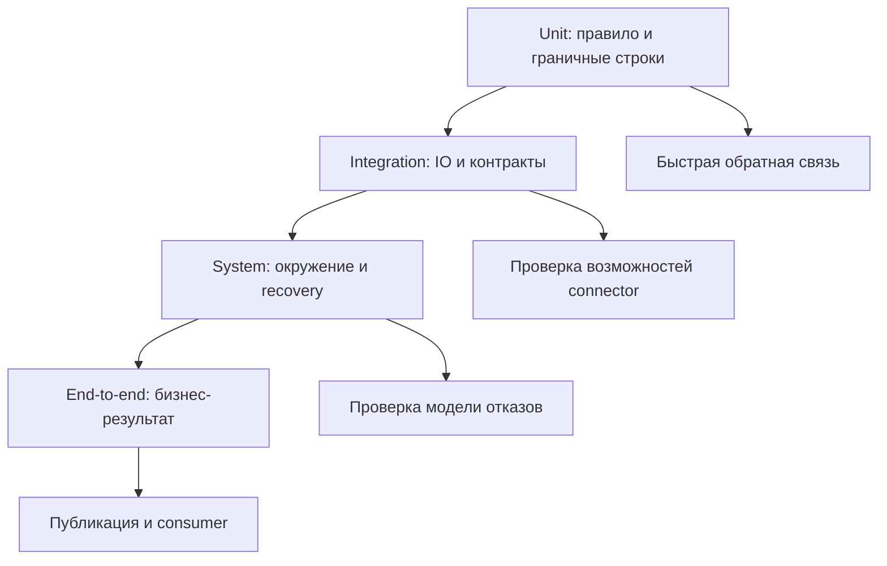
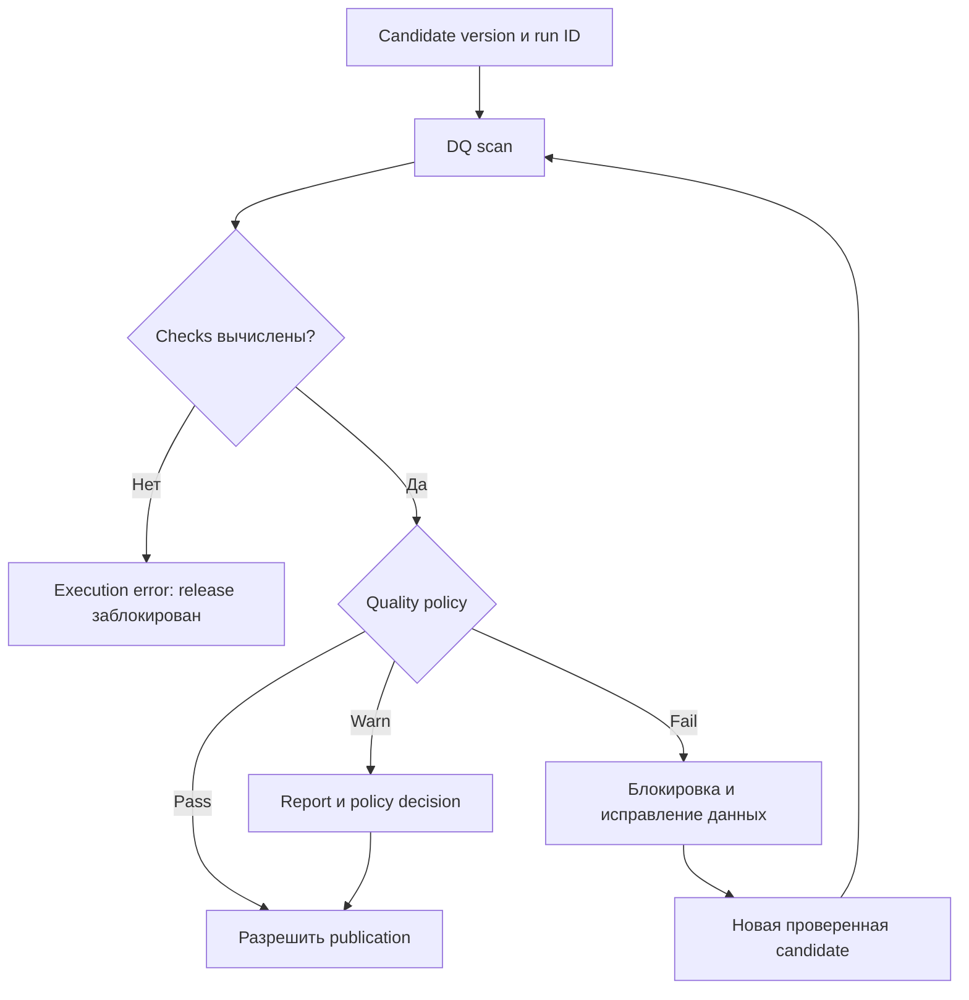
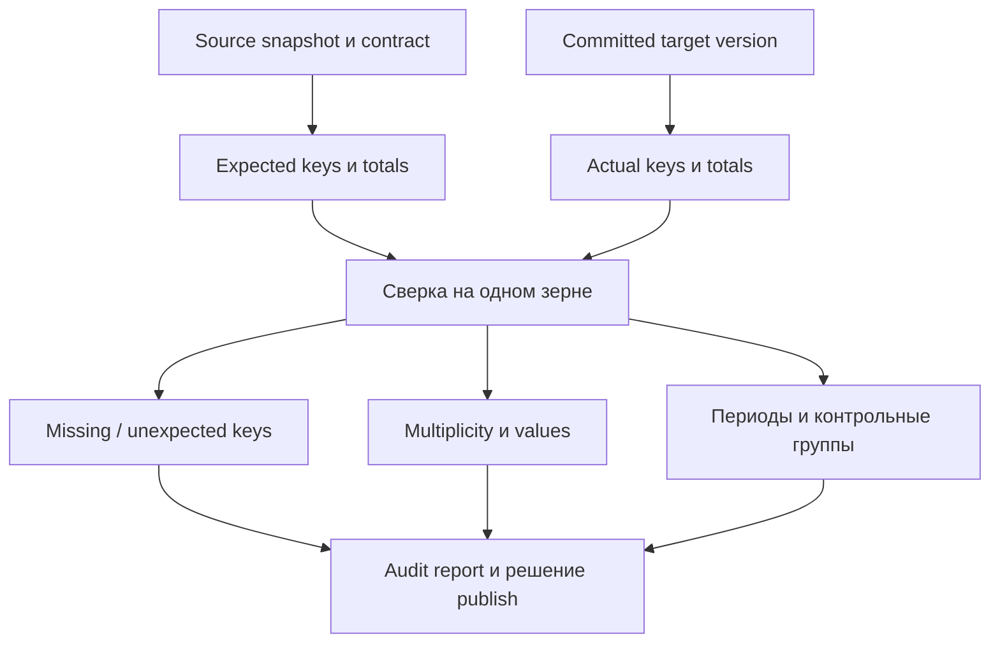
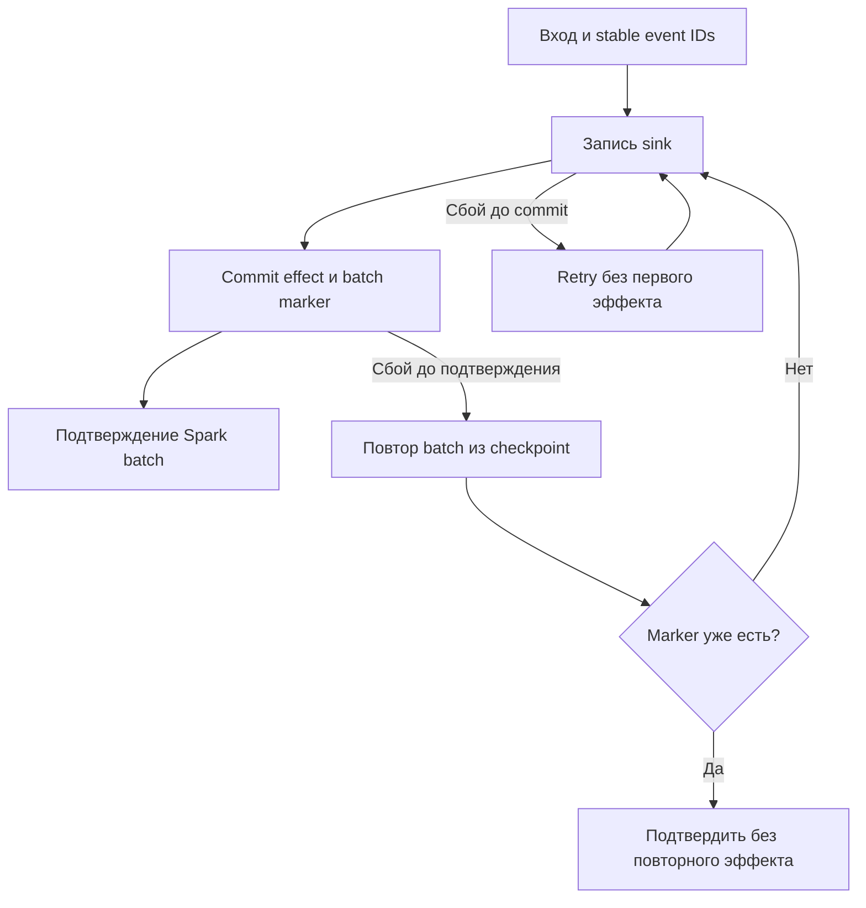

# 20. Корректность, качество данных и тестирование

Основной язык примеров — **Python / PySpark**. Проверенное окружение основной лаборатории: **Apache Spark 4.2.0, Python 3.12.14, OpenJDK 17.0.20, Spark Classic**, Linux, `local[2]`. Для отдельного JVM-примера использованы Scala 2.13.18 и ScalaTest 3.2.20. Версии зафиксированы; APIs, defaults и connector compatibility нужно проверять для своей платформы.

Глава объясняет, как проверять бизнес-результат Spark-пайплайна: инварианты и schema, мультимножества, граничные значения, property-based tests, реальные IO boundaries, streaming state/recovery, production quality gates и reconciliation. Все **11 тем и 74 пункта README сохранены в исходном порядке**. Используются только три уровня заголовков: раздел → тема → пункт; задания и самопроверка находятся внутри пунктов.

**Содержание**

1. [Инварианты обработки данных](#data-invariants)
2. [Стратегия и уровни тестирования Spark-пайплайна](#test-strategy)
3. [Локальные unit tests](#local-unit-tests)
4. [Сравнение результатов](#result-comparison)
5. [Тестирование граничных случаев](#edge-cases)
6. [Property-based и metamorphic testing](#properties-and-metamorphic)
7. [Integration и contract tests](#integration-contracts)
8. [Тестирование streaming](#streaming-tests)
9. [Data quality checks в production](#production-quality)
10. [Reconciliation и аудит](#reconciliation-audit)
11. [Performance и resilience testing](#performance-resilience)

**Как выполнить лабораторию**

Нужны Python, JDK 17 и место для временных JSON/Parquet, SQLite, test reports и subprocess logs. Основные примеры, pytest suite и локальная цепочка jobs не требуют Kafka, Airflow, Docker или внешнего каталога. Установка рассчитана на Linux/macOS/WSL.

```bash
java -version
python -m venv .venv
.venv/bin/python -m pip install 'pyspark==4.2.0' 'pyarrow==22.0.0' \
  'pytest==8.4.2' 'hypothesis==6.140.2' 'chispa==0.11.1' 'PyYAML==6.0.3'

# Soda Core connector 3.5.6 имеет зависимость PySpark 3.5.
python -m venv .venv-soda
.venv-soda/bin/python -m pip install 'soda-core-spark-df==3.5.6' 'pyspark==3.5.9'
export CH20_SODA_PYTHON="$(pwd)/.venv-soda/bin/python"

source .venv/bin/activate
# Собери Python-блоки главы в файл в порядке появления.
python chapter20_lab.py
```

Выполняй **все 69 Python-блоков сверху вниз в одной чистой сессии**. Первый создаёт `spark` и временный `lab`. Блоки с source strings создают полноценные файлы pytest, Spark jobs и Soda suite; последний блок после остановки основной JVM действительно запускает их и проверяет outputs. Отдельный fenced Scala-пример относится к JVM project и не вставляется в Python-файл. Не используй `python -O`: он отключает проверочные `assert`.

Loopback driver address, две shuffle partitions, UTC и ANSI mode служат воспроизводимости локальной лаборатории. Эти параметры не являются универсальными production defaults; loopback нельзя переносить на distributed executors. Малые `collect`, SQLite adapters и Arrow readback предназначены для явно ограниченных fixtures. Они не являются масштабируемой схемой загрузки всей production таблицы на driver.

**Версии и выполненные проверки**

| Часть | Фактическое исполнение | Граница |
|---|---|---|
| Основная PySpark лаборатория | 69 последовательных Python-блоков, включая определения templates | Spark 4.2.0, bounded local fixtures |
| pytest / Hypothesis | 4 tests, включая generated property с 6 примерами | Отдельная локальная JVM |
| ScalaTest | 1 compiled JVM test | Spark 4.2.0 / Scala 2.13 / ScalaTest 3.2.20 |
| Streaming | Dedup, поздние события, eviction, checkpoint restart, failure после sink commit | File source и локальный transactional fixture sink |
| Полная локальная цепочка | 2 независимых Spark applications + consumer audit | Local harness, без Airflow scheduler |
| Soda Core | Реальные pass/warn/fail/error scans, чтение candidate Parquet | Soda 3.5.6 с отдельным PySpark 3.5.9 |
| Deployment templates и clock/capacity models | Определения и логика policy/model проверены | Внешние сервисы и указанные engines не запускаются |

Soda Core 3.5.6 **не заявляется здесь как поддержанный connector для Spark 4.2**. Отдельное окружение сохраняет проверенную dependency matrix. Deequ/GX, Airflow TaskFlow и container integrations помечены как границы deployment; их APIs разобраны по официальным источникам, но соответствующие services/engines не подключаются.

Основные источники: [PySpark testing guide](https://spark.apache.org/docs/4.2.0/api/python/getting_started/testing_pyspark.html), [Testing API](https://spark.apache.org/docs/4.2.0/api/python/reference/pyspark.testing.html), [pytest fixtures](https://docs.pytest.org/en/stable/reference/fixtures.html), [Hypothesis](https://hypothesis.readthedocs.io/en/latest/reference/strategies.html), [chispa](https://github.com/MrPowers/chispa), [Structured Streaming](https://spark.apache.org/docs/4.2.0/streaming/apis-on-dataframes-and-datasets.html), [Soda Spark/Scan](https://docs.soda.io/soda-documentation/soda-v3/data-source-reference/connect-spark). Другие точные API и compatibility references приведены в соответствующих пунктах.


<a id="data-invariants"></a>

## Инварианты обработки данных


### Уникальность ключей и допустимая cardinality

Ключевой инвариант связывает **зерно dataset** и допустимую кратность. В current-orders таблице требуется одна строка на заказ; в журнале изменений order ID закономерно повторяется, а event ID должен быть уникален в своём namespace. Перед join проверь сторону «один», иначе many-to-many размножит факты и суммы.

Первый блок создаёт окружение всей лаборатории. Fixtures маленькие и построены SQL, чтобы бизнес-ожидания было легко проверить вручную.

```python
from pathlib import Path
from datetime import datetime, timezone, timedelta
from decimal import Decimal
from dataclasses import dataclass
from collections import Counter
import hashlib
import json
import math
import os
import shutil
import sqlite3
import subprocess
import sys
import tempfile
import time
import uuid

import pytest
from pyspark.sql import SparkSession, DataFrame, Row, functions as F, Window
from pyspark.sql.types import (
    StructType, StructField, IntegerType, LongType, StringType,
    DoubleType, ArrayType, MapType,
)
from pyspark.testing import assertDataFrameEqual, assertSchemaEqual

lab = Path(tempfile.mkdtemp(prefix="spark-ch20-"))
spark = (SparkSession.builder.master("local[2]")
    .appName("spark-correctness-tests")
    .config("spark.sql.session.timeZone", "UTC")
    .config("spark.sql.shuffle.partitions", "2")
    .config("spark.sql.ansi.enabled", "true")
    .config("spark.driver.host", "127.0.0.1")
    .config("spark.driver.bindAddress", "127.0.0.1")
    .config("spark.ui.enabled", "false")
    .config("spark.python.use.daemon", "false")
    .config("spark.sql.warehouse.dir", str(lab / "warehouse"))
    .getOrCreate())
spark.sparkContext.setLogLevel("ERROR")
assert spark.version == "4.2.0"

sales = spark.sql("""
SELECT * FROM VALUES
 (1, 10, 'USD', 100L, 'paid', TIMESTAMP '2026-01-01 10:00:00'),
 (2, 20, 'USD', 200L, 'paid', TIMESTAMP '2026-01-01 11:00:00'),
 (3, 10, 'EUR', 500L, 'paid', TIMESTAMP '2026-01-02 12:00:00')
AS t(order_id, customer_id, currency, amount_cents, status, updated_at)
""")

def require_unique(df, keys):
    if df.filter(F.expr(" OR ".join(f"{k} IS NULL" for k in keys))).limit(1).count():
        raise ValueError("NULL business key")
    if df.groupBy(*keys).count().filter("count > 1").limit(1).count():
        raise ValueError("Duplicate business key")

require_unique(sales, ["order_id"])
duplicated = sales.unionByName(sales.filter("order_id=1"))
with pytest.raises(ValueError, match="Duplicate"):
    require_unique(duplicated, ["order_id"])
```

Helper работает с доверенными именами fixture columns; для произвольных имён используй Column expressions и корректное quoting. `countDistinct` игнорирует NULL, поэтому равенство `countDistinct(key) == row_count` без явной NULL-политики не всегда выражает требуемый инвариант. Для join опиши expected cardinality: one-to-one, many-to-one или намеренный many-to-many.

**Практика.** Проверь составной ключ `(tenant_id, order_id)` и допустимые повторы order ID между tenants. **Самопроверка.** Почему уникальный event ID не доказывает уникальность текущего заказа?


### Completeness, validity, consistency, accuracy и freshness

Качество имеет несколько измерений. Их метрики и знаменатели нужно определить отдельно: «99% quality» без правил ничего не объясняет.

| Измерение | Проверяемый вопрос | Пример |
|---|---|---|
| Completeness | Получены ли ожидаемые строки/значения? | Все source keys представлены; обязательный ID не NULL |
| Validity | Соответствуют ли значения правилам? | Допустимый статус, неотрицательная сумма |
| Consistency | Согласуются ли поля и наборы? | Currency факта и платежа совпадает |
| Accuracy | Соответствует ли значение реальности? | Сумма сверена с независимой проводкой |
| Freshness | Насколько свежи доступные данные? | Последний подтверждённый source cutoff |

```python
as_of = datetime(2026, 1, 3, 12, tzinfo=timezone.utc)
profile = sales.agg(
    F.count("*").alias("rows"),
    F.sum(F.when(F.col("order_id").isNull(), 1).otherwise(0)).alias("missing_ids"),
    F.sum(F.when(F.col("amount_cents") < 0, 1).otherwise(0)).alias("negative_amounts"),
    F.max("updated_at").alias("latest_update"),
).first()
assert profile.rows == 3 and profile.missing_ids == profile.negative_amounts == 0
freshness_seconds = (as_of - profile.latest_update.astimezone(timezone.utc)).total_seconds()
assert freshness_seconds == 86400
```

Для точности нужен внешний эталон или доказуемое бизнес-правило: тип `BIGINT` и положительная сумма не доказывают верную цену. Freshness по `max(updated_at)` может выглядеть хорошей при потере большинства строк; добавь cutoff/completeness и при необходимости ingestion delay. Для empty dataset заранее определи поведение метрик и знаменателей.

**Практика.** Для каждой метрики укажи числитель, знаменатель и owner. **Самопроверка.** Почему одна новая строка не доказывает свежесть всех партиций?


### NULL, NaN, пустые значения и неизвестные категории

NULL означает отсутствие значения; NaN — специальное floating-point значение; пустая строка и пробелы — строковые значения. Неизвестная категория может быть корректным future value или contract violation. В SQL `NULL = NULL` не даёт TRUE; `eqNullSafe`/`<=>` используют другую семантику. Spark также имеет особую [NaN semantics](https://spark.apache.org/docs/4.2.0/sql-ref-datatypes.html#nan-semantics).

```python
specials = spark.sql("""
SELECT * FROM VALUES
 (1, CAST(NULL AS DOUBLE), CAST(NULL AS STRING)),
 (2, CAST('NaN' AS DOUBLE), ''),
 (3, 0D, '   '), (4, 1D, 'new_status')
AS t(id, score, status)
""")
assert specials.filter(F.col("score").isNull()).count() == 1
assert specials.filter(F.isnan("score")).count() == 1
assert specials.filter(F.col("status").isNotNull() & (F.length(F.trim("status")) == 0)).count() == 2
assert specials.filter(F.col("score").eqNullSafe(F.lit(None))).count() == 1
unknowns = specials.filter(F.col("status").isNotNull() &
                          ~F.trim("status").isin("paid", "cancelled"))
assert unknowns.count() == 3
```

Последняя проверка намеренно считает пустые строки неизвестными: другая классификация потребует отдельного predicate. Для числового контракта задавай finiteness явно; приблизительный comparator не заменяет проверку NaN и infinity. В установленном Spark 4.2.0 проверка utilities основана на арифметике tolerance, поэтому критичные NaN/Inf случаи проверяем собственными predicates, а не выводом «assert не упал».

**Практика.** Раздели отсутствующий статус, пустой статус и новый непустой статус на три reason codes. **Самопроверка.** Чем `count(*)`, `count(score)` и количество конечных score отличаются?


### Точность Decimal, floating-point и допустимые погрешности

Для денег используй integer minor units или Decimal с согласованными precision/scale. `float` не представляет многие десятичные дроби точно; операции и порядок суммирования могут менять последние разряды. Decimal тоже имеет предел precision, правила rounding и overflow; их надо проверить, а не считать любую decimal arithmetic безусловно точной.

```python
money = spark.sql("""
SELECT CAST('0.10' AS DECIMAL(18,2)) AS a,
       CAST('0.20' AS DECIMAL(18,2)) AS b
""")
assert money.select((F.col("a") + F.col("b")).alias("total")).first().total == Decimal("0.30")
assert 0.1 + 0.2 != 0.3
assert math.isclose(0.1 + 0.2, 0.3, rel_tol=0, abs_tol=1e-15)
rounding = spark.sql("SELECT round(2.5, 0) AS half_up, bround(2.5, 0) AS half_even").first()
assert rounding.half_up == 3 and rounding.half_even == 2
```

В отчёте нельзя суммировать EUR и USD как одни «копейки»: currency входит в grain/контракт сверки. Tolerance для измерений назначается по бизнес-смыслу: абсолютная важна около нуля, относительная — на больших величинах. Для денег со строгим minor-unit контрактом expected comparison обычно exact.

**Практика.** Проверь округление отрицательных половинных значений и overflow выбранного Decimal. **Самопроверка.** Почему `round(a+b)` может отличаться от `round(a)+round(b)`?


### Часовые пояса и календарные границы

Определи, хранится ли instant, local datetime или календарная date. Session timezone влияет на parsing, отображение и calendar extraction для timestamp с local-time-zone semantics. День задаётся `[start, end)`, а его UTC-длительность в timezone с DST может быть 23/25 часов.

```python
from zoneinfo import ZoneInfo
berlin = ZoneInfo("Europe/Berlin")
start_local = datetime(2026, 3, 29, tzinfo=berlin)
end_local = datetime(2026, 3, 30, tzinfo=berlin)
start_utc, end_utc = start_local.astimezone(timezone.utc), end_local.astimezone(timezone.utc)
assert (end_utc - start_utc).total_seconds() == 23 * 3600

boundaries = spark.sql("""
SELECT * FROM VALUES
 (1, TIMESTAMP '2026-01-01 00:00:00'),
 (2, TIMESTAMP '2026-01-01 23:59:59.999999'),
 (3, TIMESTAMP '2026-01-02 00:00:00') AS t(id, ts)
""")
period = boundaries.filter((F.col("ts") >= F.lit(datetime(2026,1,1,tzinfo=timezone.utc))) &
                           (F.col("ts") < F.lit(datetime(2026,1,2,tzinfo=timezone.utc))))
assert [r.id for r in period.orderBy("id").collect()] == [1, 2]
```

Явно укажи timezone и политику ambiguous/nonexistent local times. `between` включает обе границы и не соответствует этому half-open contract. Нельзя заменить end на `23:59:59`, теряя fractional seconds. `TIMESTAMP_NTZ` не обозначает автоматически UTC instant.

**Практика.** Вычисли UTC-границы осеннего 25-часового дня. **Самопроверка.** Почему одна и та же date может соответствовать разным instant intervals в двух timezones?


### Детерминированность выбора строки и порядка коллекций

Детерминированный dedup требует полного порядка, определённого источником. `dropDuplicates([key])`, `first()` и `last()` без соответствующей semantics не выбирают «самое свежее». После shuffle порядок `collect_list` не гарантирован. Добавь source sequence и tie breaker; конфликт одинаковой версии с разным содержимым лучше выявить явно.

```python
changes = spark.sql("""
SELECT * FROM VALUES
 (1, 1L, 'a', 100L), (1, 2L, 'b', 120L), (2, 1L, 'c', 200L)
AS t(order_id, seq, event_id, amount_cents)
""")
def latest_change(df):
    w = Window.partitionBy("order_id").orderBy(F.desc("seq"), F.desc("event_id"))
    return df.withColumn("_rn", F.row_number().over(w)).filter("_rn=1").drop("_rn")

assert latest_change(changes).filter("order_id=1").first().amount_cents == 120
ordered_ids = changes.groupBy("order_id").agg(
    F.sort_array(F.collect_list(F.struct("seq", "event_id"))).alias("ordered")
)
assert [r.event_id for r in ordered_ids.filter("order_id=1").first().ordered] == ["a", "b"]
```

Sorting по `event_id` здесь допустим только как согласованный tie rule; случайный UUID не отражает business recency. Для массивов реши, важен ли order, являются ли они sets или multisets, и canonicalize соответственно. Для floating sums проверяй корректный tolerance при разных partition layouts.

**Практика.** Добавь конфликт двух payloads с одной source position и отклони его. **Самопроверка.** Почему `orderBy` перед `groupBy().agg(first(...))` не задаёт надёжный порядок выбора внутри shuffle?


<a id="test-strategy"></a>

## Стратегия и уровни тестирования Spark-пайплайна


### Пирамида тестирования: unit, integration, system и end-to-end tests

Тесты располагаются по границам ответственности. Unit проверяет чистое правило на малом dataset. Integration проверяет взаимодействие с реальным форматом/connector/catalog. System проверяет систему как развернутое целое, включая configuration и recovery. End-to-end проходит пользовательский/business сценарий от входа до доступного результата. Эти уровни могут пересекаться; полезнее явная test boundary, чем спор о названии.



| Уровень | Пример | Чего не доказывает |
|---|---|---|
| Unit | Cancelled order исключён из paid mart | Права на production storage |
| Integration | Parquet roundtrip и schema | Реальная executor failure handling |
| System | DAG в staging cluster | Полноту всех возможных input combinations |
| End-to-end | CDC correction отражена в serving report | Необходимость повторить все unit cases |

**Практика.** Размести один свой business scenario на четырёх границах и убери избыточные повторы. **Самопроверка.** Почему успешный локальный unit test не заменяет integration test MERGE target?


### Баланс скорости обратной связи, стоимости запуска и реалистичности окружения

Скорость обратной связи и реалистичность — разные свойства. Запуск JVM дорог относительно обычной Python-функции, поэтому shared SparkSession ускоряет suite, но требует session isolation. Полный кластер нужен для network/security/resource/recovery boundaries, которые local mode не воспроизводит.

Разделяй suite по необходимости: быстрые tests на каждом изменении, connector integration на релевантных изменениях, system/e2e по release boundary или расписанию. Тест с небольшим real Parquet часто полезнее большого mock, который просто повторяет цепочку calls implementation. Не переноси production volume во все unit tests.

```python
test_schedule = {
    "commit": ["business_cases", "schema_contract", "bounded_properties"],
    "connector_change": ["real_read_write", "permissions", "provider_commit"],
    "release": ["orchestrator_dag", "checkpoint_recovery", "consumer_result"],
}
assert "permissions" not in test_schedule["commit"]
assert "consumer_result" in test_schedule["release"]
```

Это пример политики команды, а не обязательная cadence. Если permissions или connector являются частью изменения, проверяй их до выпуска. Runtime, dependency lock и test data version сохраняй вместе с результатом проверки.

**Практика.** Замерь JVM startup и полезное время tests отдельно. **Самопроверка.** Что опаснее для suite: пять быстрых meaningful tests или сотня tests без независимого ожидаемого результата?


### Инкрементальная интеграция, top-down/bottom-up и big-bang проверка

Инкрементальная интеграция подключает реальные компоненты по одному и локализует дефект. Top-down начинает с runner/consumer, заменяя нижние системы adapters; bottom-up сначала проверяет source/storage и затем orchestration. Big-bang подключает всё сразу и делает root cause труднее найти.

Например, для pipeline `extract → Silver → Gold → publish`: сначала проверяются transformations, затем JSON/Parquet IO, затем две реальные Spark applications на закреплённом пути, затем DAG и consumer manifest. Fake HTTP scheduler полезен для retry/timeout logic, но отдельно нужен тест настоящего endpoint и auth.

Не используй stub, который всегда возвращает success, как доказательство работы integration. Stub должен моделировать failure cases, а границы его гарантий должны быть явно указаны. Во время migration схема промежуточного output проверяется потребляющим job, а не только writer.

**Практика.** Составь порядок подключения Kafka, catalog, MERGE и serving consumer. **Самопроверка.** В какой момент заменяется stub реальным компонентом и какое новое свойство проверяется?


### Различие проверок кода, интеграционных контрактов и качества самих данных

Проверка кода отвечает: «правило реализовано верно на заданных inputs?» Contract test: «системы согласны о schema, grain, IO и guarantees?» Production DQ: «данные конкретного run соответствуют правилам?» Корректный код может получить плохие данные; хорошие данные сегодня не доказывают корректность кода на завтрашнем edge case.

| Вид проверки | Вход | Expected |
|---|---|---|
| Код | Специальная fixture с отменой и дублем | Известный business result |
| Контракт | Реальный producer output | Consumer-required schema/semantics |
| DQ | Candidate dataset этого run | Пороги и business invariants |

```python
check_kinds = {
    "unit": "known input -> independently specified output",
    "contract": "producer output -> consumer requirements",
    "quality": "actual run data -> invariants and thresholds",
}
assert len(set(check_kinds.values())) == 3
```

Проверка, которая сравнивает функцию с её копией, не создаёт независимого oracle. DQ thresholds не должны автоматически превращаться в assertions expected unit fixtures: deterministic fixture требует exact result, production distribution может иметь допустимую вариативность.

**Практика.** Для правила nonnegative amount напиши по одному code, contract и DQ case. **Самопроверка.** Почему валидность типа не доказывает accuracy суммы?


### Выбор минимального набора тестов, проверяющего бизнес-инварианты и границы систем

Минимальный набор выбирается по риску неправильного результата и системным границам. Для инкрементального заказа нужны хотя бы: новый paid, новая отмена старого paid, более старое событие после нового, duplicate delivery, NULL key, конфликт версии и retry после partial commit. Один nominal test на три paid-заказа не покрывает это поведение.

Составь matrix «инвариант → triggering input → expected effect → граница». Coverage кода помогает увидеть неисполненные ветви, но 100% lines coverage не доказывает semantic correctness. Особенно важны negative tests, которые должны **обнаружить** дефект, а не просто успешно прочитать данные.

```python
risk_cases = {
    "cancel_after_paid": "order absent from paid mart",
    "duplicate_delivery": "same business effect",
    "old_update_after_new": "version does not regress",
    "null_key": "explicit rejection/quarantine",
    "partial_commit": "cursor and visible outputs remain consistent",
}
assert "partial_commit" in risk_cases
```

**Практика.** Убери один тест из своего suite и объясни, какой риск останется непокрытым. **Самопроверка.** Какой test поймает правильную сумму при неверном распределении по currency?


<a id="local-unit-tests"></a>

## Локальные unit tests


### pytest и fixture локального SparkSession

pytest fixture управляет созданием и очисткой ресурсов. Session-scoped SparkSession уменьшает число стартов JVM; отдельная SQL session на тест изолирует temporary views и SQL config, но SparkContext/cache остаются общими. Поэтому suite должен контролировать cache и активные queries, а параллельные worker processes получать отдельные warehouses/checkpoints.

Следующий блок записывает **реальный pytest-проект**, который будет запущен в последнем пункте главы после остановки основной JVM.

```python
tests_root = lab / "pytest-project"
tests_root.mkdir()
conftest_source = '''import pytest
from pyspark.sql import SparkSession

@pytest.fixture(scope="session")
def spark_root(tmp_path_factory):
    warehouse = tmp_path_factory.mktemp("warehouse")
    session = (SparkSession.builder.master("local[2]")
        .appName("chapter20-pytest")
        .config("spark.sql.session.timeZone", "UTC")
        .config("spark.sql.shuffle.partitions", "2")
        .config("spark.sql.ansi.enabled", "true")
        .config("spark.ui.enabled", "false")
        .config("spark.driver.host", "127.0.0.1")
        .config("spark.driver.bindAddress", "127.0.0.1")
        .config("spark.python.use.daemon", "false")
        .config("spark.sql.warehouse.dir", str(warehouse)).getOrCreate())
    session.sparkContext.setLogLevel("ERROR")
    yield session
    for query in session.streams.active:
        query.stop()
    session.catalog.clearCache()
    session.stop()

@pytest.fixture
def spark_test(spark_root):
    session = spark_root.newSession()
    session.conf.set("spark.sql.session.timeZone", "UTC")
    try:
        yield session
    finally:
        for table in session.catalog.listTables():
            if table.isTemporary:
                session.catalog.dropTempView(table.name)
        session.catalog.clearCache()
'''
(tests_root / "conftest.py").write_text(conftest_source)
assert "yield session" in conftest_source
```

Не вызывай `session.stop()` для каждой `newSession`: общий SparkContext остановится для остальных tests. Ограничение `local[2]` не воспроизводит изоляцию нескольких applications кластера. `tmp_path_factory` создаёт session directory, `tmp_path` — отдельный путь test case. Официальные источники: [PySpark testing guide](https://spark.apache.org/docs/4.2.0/api/python/getting_started/testing_pyspark.html), [pytest fixtures](https://docs.pytest.org/en/stable/reference/fixtures.html).

**Практика.** Добавь test, меняющий timezone, и проверь, что следующий test получает UTC. **Самопроверка.** Какие ресурсы `newSession` не изолирует?


### ScalaTest/JUnit и тестирование JVM API

JVM API проверяется тем же принципом: минимальный input, независимый expected, cleanup SparkSession и version-compatible dependencies. ScalaTest подходит для Scala, JUnit Jupiter — для Java/Scala JVM suites. Ни один framework сам не проверяет DataFrame: actions и assertions нужно написать явно.

Ниже полный ScalaTest case и runnable launcher. Он компилируется и выполняется со **Spark 4.2.0 / Scala 2.13.18 / ScalaTest 3.2.20**; Java/JUnit вариант — альтернативный framework, в данной лаборатории не запускается.

```scala
import org.apache.spark.sql.SparkSession
import org.scalatest.funsuite.AnyFunSuite

class SalesSpec extends AnyFunSuite {
  test("cancelled orders do not contribute to paid revenue") {
    val spark = SparkSession.builder.master("local[2]")
      .appName("chapter20-jvm-test")
      .config("spark.ui.enabled", "false")
      .config("spark.driver.host", "127.0.0.1")
      .config("spark.driver.bindAddress", "127.0.0.1")
      .getOrCreate()
    try {
      val input = spark.sql("""
        SELECT * FROM VALUES (1, 'paid', 100L), (2, 'cancelled', 900L)
        AS t(id, status, amount_cents)
      """)
      val result = input.filter("status='paid'")
        .groupBy().sum("amount_cents").first().getLong(0)
      assert(result == 100L)
    } finally {
      spark.stop()
    }
  }
}

object RunSalesSpec {
  def main(args: Array[String]): Unit = {
    val passed = org.scalatest.tools.Runner.run(Array("-o", "-s", "SalesSpec"))
    require(passed, "ScalaTest suite failed")
  }
}
```

В обычном Scala project добавь `org.scalatest %% scalatest % 3.2.20 % Test`, Spark SQL matching runtime и запусти `sbt test`. Scala binary suffix должен совпадать с Spark; для JUnit добавляются Jupiter engine/API и runner build tool. Не переиспользуй случайный Spark 3.x artifact с Scala 2.12 в Spark 4.2/2.13.

Официальные источники: [ScalaTest](https://www.scalatest.org/user_guide/writing_your_first_test), [JUnit guide](https://docs.junit.org/current/user-guide/). Пример не доказывает одинаковую семантику Python UDF и JVM UDF: каждый language boundary проверяется отдельно.

**Практика.** Перенеси правило Decimal rounding в JVM test и сравни с business oracle. **Самопроверка.** Почему совпадение версии Scala языка важно для Spark dependency classpath?


### Минимальные datasets для бизнес-правила

Минимальная fixture содержит ровно столько строк, сколько нужно для различения правильного и ошибочного поведения. Для paid-фильтра достаточно paid, cancelled, нормализуемого статуса и invalid amount. «Миллион случайных строк» хуже локализует failure, чем четыре осмысленных случая.

```python
def normalize_sales(df):
    return (df.withColumn("status", F.lower(F.trim("status")))
        .filter((F.col("status") == "paid") & F.col("amount_cents").isNotNull() &
                (F.col("amount_cents") >= 0))
        .select("order_id", "currency", "amount_cents", "status"))

rule_fixture = spark.sql("""
SELECT * FROM VALUES
 (1, 'USD', 100L, ' PAID '), (2, 'USD', 900L, 'cancelled'),
 (3, 'EUR', -10L, 'paid'), (4, 'EUR', CAST(NULL AS BIGINT), 'paid')
AS t(order_id, currency, amount_cents, status)
""")
rule_expected = spark.sql("""
SELECT 1 AS order_id, 'USD' AS currency, 100L AS amount_cents, 'paid' AS status
""")
assertDataFrameEqual(normalize_sales(rule_fixture), rule_expected, rtol=0, atol=0)
```

Этот cleanup policy исключает invalid amounts; production должна отдельно сохранить reason/quarantine или fail согласно контракту. Test expected записан независимо от chain transformations. В fixtures нужны отрицательные случаи: test, который проходит и при удалении фильтра cancelled, не проверяет бизнес-правило.

**Практика.** Удали paid filter и убедись, что test перестаёт проходить. **Самопроверка.** Какой fixture случай обнаружит ошибку «фильтрация до нормализации пробелов»?


### Тестирование DataFrame → DataFrame отдельно от IO

Pure `DataFrame → DataFrame` logic проверяется отдельно от IO. Это помогает понять, ошиблось правило или connector. Для IO integration проверяются parsing, schema, permissions и committed result; mocking `read.parquet` не доказывает настоящий Parquet roundtrip.

```python
module_source = '''from pyspark.sql import functions as F

def normalize_sales(df):
    return (df.withColumn("status", F.lower(F.trim("status")))
        .filter((F.col("status") == "paid") & F.col("amount_cents").isNotNull() &
                (F.col("amount_cents") >= 0))
        .select("order_id", "currency", "amount_cents", "status"))
'''
(tests_root / "pipeline_rules.py").write_text(module_source)
test_source = '''from pyspark.testing import assertDataFrameEqual
from pipeline_rules import normalize_sales

def test_paid_rule(spark_test):
    given = spark_test.sql("""SELECT * FROM VALUES
      (1,'USD',100L,' PAID '), (2,'USD',900L,'cancelled'),
      (3,'EUR',-10L,'paid'), (4,'EUR',CAST(NULL AS BIGINT),'paid')
      AS t(order_id,currency,amount_cents,status)""")
    expected = spark_test.sql("SELECT 1 AS order_id, 'USD' AS currency, 100L AS amount_cents, 'paid' AS status")
    assertDataFrameEqual(normalize_sales(given), expected, rtol=0, atol=0)
'''
(tests_root / "test_rules.py").write_text(test_source)
assert "read." not in module_source and "write." not in module_source
```

Не сравнивай rule с literal копией её реализации. Возвращённый план ленивый, поэтому test должен выполнить action через assertion или контрольный read. Test-only IO adapter должен иметь явную границу и не скрывать source snapshot.

**Практика.** Добавь отдельно Parquet roundtrip test, сохранив transformation test без IO. **Самопроверка.** Почему отсутствие exception при построении DataFrame не означает успешного выполнения Spark plan?


### assertDataFrameEqual и assertSchemaEqual

`assertDataFrameEqual` сравнивает rows и, когда оба inputs — DataFrames, schema. В Spark 4.2.0 defaults: `checkRowOrder=False`, `rtol=1e-5`, `atol=1e-8`, `ignoreNullable=True`. `assertSchemaEqual` также игнорирует nullable по умолчанию. Для строгого контракта передавай нужные flags явно.

```python
strict_schema = StructType([StructField("id", IntegerType(), False)])
loose_schema = StructType([StructField("id", IntegerType(), True)])
assertSchemaEqual(strict_schema, loose_schema)  # Default игнорирует nullable.
with pytest.raises(AssertionError):
    assertSchemaEqual(strict_schema, loose_schema, ignoreNullable=False)
assertDataFrameEqual(sales, sales.repartition(2), rtol=0, atol=0, ignoreNullable=False)
```

| Опция PySpark 4.2.0 | Default | Когда менять |
|---|---|---|
| `checkRowOrder` | `False` | Последовательность значима и задан полный порядок |
| `rtol`, `atol` | `1e-5`, `1e-8` | Для exact money comparison использовать нули |
| `ignoreNullable` | `True` | Для strict schema contract установить `False` |
| `ignoreColumnType` | `False` | Не ослаблять без документированной type policy |
| `ignoreColumnOrder` | `False` | Разрешать только name-based совместимость |

Helpers collect bounded results на driver; это инструменты малых tests, а не бесплатная полная сверка production tables. `ignoreColumnType`, `ignoreColumnName` и `ignoreColumnOrder` могут скрыть contract violation. Для числовых сравнений по ключу сначала проверь uniqueness и выровняй rows; approximate comparison unordered rows не заменяет keyed reconciliation. Для NaN/Inf добавляй explicit semantic checks.

Официальные APIs: [assertDataFrameEqual](https://spark.apache.org/docs/4.2.0/api/python/reference/api/pyspark.testing.assertDataFrameEqual.html), [assertSchemaEqual](https://spark.apache.org/docs/4.2.0/api/python/reference/api/pyspark.testing.assertSchemaEqual.html).

**Практика.** Создай schema mismatch, который default nullable comparison не заметит. **Самопроверка.** Почему expected `list[Row]` не задаёт полный schema contract?


### chispa и spark-testing-base; точные assert_column_equality/assert_df_equality и приближённые assert_approx_column_equality/assert_approx_df_equality в chispa

chispa предоставляет четыре полезных API: exact column equality **внутри одного DataFrame**, exact equality двух DataFrames и два approximate варианта. У approx функций positional `precision` — абсолютный допуск; это не набор `rtol/atol` из PySpark utility. Defaults row order и nullable отличаются: у chispa обычно важны оба, если не заданы ignore flags.

```python
from chispa import (assert_column_equality, assert_df_equality,
                    assert_approx_column_equality, assert_approx_df_equality)

columns_fixture = spark.sql("SELECT 1.0D AS left, 1.0D AS exact, 1.01D AS near")
assert_column_equality(columns_fixture, "left", "exact")
assert_approx_column_equality(columns_fixture, "left", "near", 0.02)
assert_df_equality(sales, sales.repartition(2), ignore_row_order=True)
near_a = spark.sql("SELECT 1 AS id, 1.0D AS value")
near_b = spark.sql("SELECT 1 AS id, 1.01D AS value")
assert_approx_df_equality(near_a, near_b, 0.02)
```

Проверенная версия — **chispa 0.11.1**. Approx comparison применяется к float-значениям; строки и другие типы сравниваются точно по правилам helper. Проверяй отдельно NaN-policy (`allow_nan_equality` у DataFrame helpers) и свои требования к Decimal.

`spark-testing-base` предоставляет JVM base classes и генераторы, но artifact привязан к версиям Spark/Scala и самой библиотеки. Проверь [совместимость проекта](https://github.com/holdenk/spark-testing-base), прежде чем использовать DataFrameSuiteBase. Здесь реально выполнены chispa assertions; spark-testing-base artifact не подключался. Официальный [chispa repository](https://github.com/MrPowers/chispa) описывает точные и приближённые APIs.

**Практика.** Добавь failure при string mismatch, даже если numeric difference укладывается в precision. **Самопроверка.** Почему `assert_column_equality` не принимает два разных DataFrames?


### Очистка temp views, cache и конфигурации между тестами

Tests должны восстанавливать изменённые config, temp views, cache и queries даже при failure. Иначе следующий test получает чужой state и становится зависимым от порядка suite. Общий catalog/cache SparkContext требует осторожности при параллельном исполнении.

```python
old_timezone = spark.conf.get("spark.sql.session.timeZone")
cached_test = sales.cache()
try:
    cached_test.count()
    sales.createOrReplaceTempView("chapter20_temporary")
    spark.conf.set("spark.sql.session.timeZone", "Europe/Berlin")
    assert spark.catalog.tableExists("chapter20_temporary")
finally:
    cached_test.unpersist(blocking=True)
    spark.catalog.dropTempView("chapter20_temporary")
    spark.conf.set("spark.sql.session.timeZone", old_timezone)
assert not spark.catalog.tableExists("chapter20_temporary")
assert spark.conf.get("spark.sql.session.timeZone") == "UTC"
```

В reusable fixtures удаляй только test-owned objects. `clearCache()` всей shared production session не подходит для обычной библиотеки cleanup. Static Spark settings нельзя менять и откатывать произвольно через `spark.conf.set`; они задаются до создания execution environment.

**Практика.** Искусственно брось exception внутри `try` и проверь teardown. **Самопроверка.** Почему `newSession` не делает произвольный `clearCache()` локальным для одного test?


<a id="result-comparison"></a>

## Сравнение результатов


### Проверка схемы, типов и nullability

Schema contract включает names, порядок при positional consumers, types, вложенные types, nullable и при необходимости metadata. Parquet roundtrip может расширить nullability; сравнение логических значений и strict schema — разные assertions. Не ослабляй contract только ради зелёного test.

```python
schema_int = StructType([StructField("id", IntegerType(), False)])
schema_long = StructType([StructField("id", LongType(), False)])
with pytest.raises(AssertionError):
    assertSchemaEqual(schema_int, schema_long, ignoreNullable=False)
assert sales.schema["amount_cents"].dataType == LongType()
assert sales.schema["currency"].dataType == StringType()
```

Для reader, который допускает storage-level nullable, проверь отдельно absence NULL в данных, а не заявляй неверный schema flag. Cast может изменить nullability и при `try_cast` превратить invalid values в NULL: нужен отдельный rejection check. Для вложенных arrays/maps учитывай `containsNull` и `valueContainsNull`.

**Практика.** Проверь type и nullable внутри `array<struct<...>>`. **Самопроверка.** Может ли одинаковый `simpleString()` скрыть различие в metadata/nullability?


### Порядок строк и сравнение как мультимножества

DataFrame не имеет гарантированного row order без explicit sort. Большинство relational результатов сравнивают как **мультимножества**: порядок не важен, кратность каждой строки важна. Для последовательностей/event ordering отдельно задают полный ordering key.

```python
left_bag = spark.sql("SELECT * FROM VALUES (1), (1), (2) AS t(id)")
right_bag = spark.sql("SELECT * FROM VALUES (2), (1), (1) AS t(id)")
assertDataFrameEqual(left_bag, right_bag, rtol=0, atol=0)
assertDataFrameEqual(left_bag.orderBy("id"), right_bag.orderBy("id"),
                     checkRowOrder=True, rtol=0, atol=0)
assert Counter(r.id for r in left_bag.collect()) == Counter({1: 2, 2: 1})
```

| Модель результата | Порядок | Повторы | Подход |
|---|---|---|---|
| Последовательность | Важен | Важны | Полный sort + ordered comparison |
| Мультимножество | Не важен | Важны | `exceptAll` в обе стороны / bounded equality utility |
| Множество | Не важен | Не важны по контракту | Distinct set comparison |

Sorting только по неуникальному key не делает полный порядок deterministic, если остальные поля различаются. Для больших tables не `collect` whole result: выполняй distributed keyed/multiset diff, а на driver выводи ограниченную диагностику. Сначала выровняй projection, потому что set operations могут сравнивать columns позиционно.

**Практика.** Добавь два разных payloads с одним ID и задай полный порядок сравнения. **Самопроверка.** Почему сравнение `set(rows)` теряет важный дефект?


### Дубликаты и почему простого except недостаточно

SQL `EXCEPT`/DataFrame `subtract` имеет distinct semantics: дубли схлопываются. `exceptAll` сохраняет multiplicity. Чтобы проверить exact equality мультимножеств, нужны diff в обе стороны и одинаковая projection/schema.

```python
bag_extra = spark.sql("SELECT * FROM VALUES (1), (1), (2) AS t(id)")
bag_once = spark.sql("SELECT * FROM VALUES (1), (2) AS t(id)")
assert bag_extra.subtract(bag_once).count() == 0
assert bag_once.subtract(bag_extra).count() == 0
assert bag_extra.exceptAll(bag_once).count() == 1
assert bag_once.exceptAll(bag_extra).count() == 0

def assert_bag_equal(actual, expected, columns):
    a, b = actual.select(*columns), expected.select(*columns)
    assertSchemaEqual(a.schema, b.schema, ignoreNullable=True)
    if a.exceptAll(b).limit(1).count() or b.exceptAll(a).limit(1).count():
        raise AssertionError("Multiset mismatch")

with pytest.raises(AssertionError, match="Multiset"):
    assert_bag_equal(bag_extra, bag_once, ["id"])
```

Helper deliberately ignores storage nullability but keeps types; если nullable входит в contract, добавь strict assertion до diff. При floating-point data exact diff может быть слишком строгим, поэтому применяй отдельное keyed tolerance сравнение. Официальный API: [exceptAll](https://spark.apache.org/docs/4.2.0/api/python/reference/pyspark.sql/api/pyspark.sql.DataFrame.exceptAll.html).

**Практика.** Построй два datasets одинакового row count с разной multiplicity. **Самопроверка.** Почему одной стороны diff недостаточно?


### Absolute/relative tolerance для чисел

PySpark utility использует критерий `|actual - expected| <= atol + rtol * |expected|`. Он зависит от expected и может быть асимметричен. Укажи units и business tolerance; большой `rtol` может скрыть существенную ошибку денег. Uniqueness и matching keys должны проверяться до numeric tolerance.

```python
approx_a = spark.sql("SELECT 1 AS id, 1000.001D AS value")
approx_b = spark.sql("SELECT 1 AS id, 1000.0D AS value")
assertDataFrameEqual(approx_a.orderBy("id"), approx_b.orderBy("id"),
                    checkRowOrder=True, rtol=0, atol=0.002)
with pytest.raises(AssertionError):
    assertDataFrameEqual(approx_a, approx_b, rtol=0, atol=0.0001)
assert abs(1000.001 - 1000.0) <= 0.002
```

Для NaN/Inf сначала проверь domain и отдельные expected categories. Проверка с неопределённой floating арифметикой может пройти неожиданно; нельзя объявлять наличие NaN допустимым из результата approximate helper. Возле нуля relative tolerance почти не помогает, а для overflow/truncation tolerance вообще не заменяет проверку типа.

**Практика.** Подбери две ошибки одинаковой absolute magnitude на разных scales и оцени их допустимость. **Самопроверка.** Почему `atol=1` означает совершенно разное для метров, процентов и денежных minor units?


### Сравнение вложенных arrays, maps и structs

Array — упорядоченная последовательность; map — набор key/value pairs; struct — поля с schema. Если business array является set, canonicalization через sort/distinct допустима только согласно контракту. Если важна multiplicity, `array_distinct` скроет ошибку.

```python
nested_a = spark.sql("""
SELECT array(1,2,2) AS items, map('a',10,'b',20) AS attrs,
       named_struct('name','Alice','score',1.0D) AS profile
""")
nested_b = spark.sql("""
SELECT array(1,2,2) AS items, map('b',20,'a',10) AS attrs,
       named_struct('name','Alice','score',1.0D) AS profile
""")
assertDataFrameEqual(nested_a, nested_b, rtol=0, atol=0)
reordered_array = nested_b.withColumn("items", F.array(F.lit(2), F.lit(1), F.lit(2)))
with pytest.raises(AssertionError):
    assertDataFrameEqual(nested_a, reordered_array, rtol=0, atol=0)
assertDataFrameEqual(nested_a.withColumn("items", F.sort_array("items")),
                    reordered_array.withColumn("items", F.sort_array("items")), rtol=0, atol=0)
```

Spark set operations не поддерживают все nested types одинаково: например, map columns имеют ограничения. Для nested fixtures utility/explicit field checks удобнее универсального `exceptAll`. JSON serialization map без canonicalization нельзя считать стабильным hash schema-independent данных.

**Практика.** Проверь array `[1,1,2]` против `[1,2]` как multiset и как set. **Самопроверка.** Когда сортировка массива изменит смысл данных?


### Стабильные expected datasets и golden files

Golden dataset фиксирует expected output известного input и версии правила. Храни canonical schema, projection, units и ordering convention. Обновление golden после failure требует объяснения business change; автоматически принимать новый output как expected означает выключить test.

```python
golden = {"contract_version": "1", "currency_totals": {"EUR": 500, "USD": 300}}
golden_file = lab / "expected-totals.json"
golden_file.write_text(json.dumps(golden, sort_keys=True), encoding="utf-8")
actual_totals = {r.currency: r.total for r in sales.groupBy("currency")
                 .agg(F.sum("amount_cents").alias("total")).collect()}
assert actual_totals == json.loads(golden_file.read_text())["currency_totals"]
```

Это independent expected fixture, не snapshot текущего произвольного production output. Версионируй input и expected вместе с code. Для huge results сохраняй meaningful aggregates и critical-key samples, дополняя их full reconciliation по риску; golden hash сам по себе не объясняет diff.

**Практика.** Измени правило скидки и составь reviewable diff старого/new golden. **Самопроверка.** Почему «перегенерировали expected тем же job» не является независимой проверкой?


<a id="edge-cases"></a>

## Тестирование граничных случаев


### Пустой DataFrame и полностью NULL-столбцы

Empty dataset — нормальный input многих инкрементальных runs. Он должен иметь explicit schema и понятный result contract. Сумма пустого набора в Spark обычно NULL, `count` равен нулю; `first()` пустого DataFrame возвращает None. Полностью NULL column не позволяет надёжно вывести тип через inference.

```python
empty_sales = sales.limit(0)
assert empty_sales.count() == 0
assert empty_sales.first() is None
assert empty_sales.agg(F.sum("amount_cents")).first()[0] is None
empty_total = empty_sales.agg(F.coalesce(F.sum("amount_cents"), F.lit(0)).alias("total"))
assert empty_total.first().total == 0
all_null = spark.sql("SELECT CAST(NULL AS BIGINT) AS amount_cents")
assert all_null.schema["amount_cents"].dataType == LongType()
assert all_null.count() == 1 and all_null.filter("amount_cents IS NULL").count() == 1
assert normalize_sales(empty_sales).count() == 0
```

«NULL сумма → zero» допустимо для выбранного агрегата, но не для неизвестной цены отдельного заказа. Для публикации empty replacement проверь, нужно ли удалить старый период: отсутствие incoming rows не означает, что старый output верен.

**Практика.** Добавь pytest case для empty input и explicit schema. **Самопроверка.** Почему `createDataFrame([], ['id'])` не задаёт достаточный type contract?


### Дублирующиеся ключи и many-to-many join

Join checks должны ловить и duplication, и dropping. Дубли справочника размножают строки; inner join неизвестного клиента теряет строки. Сверяй ключи, кратность и totals по согласованному grain, а не только общий row count.

```python
dim_good = spark.sql("SELECT * FROM VALUES (10,'A'), (20,'B') AS t(customer_id, segment)")
dim_bad = dim_good.unionByName(dim_good.filter("customer_id=10"))
joined_good = sales.join(dim_good, "customer_id", "left")
joined_bad = sales.join(dim_bad, "customer_id", "left")
assert joined_good.count() == 3
assert joined_bad.count() == 5
with pytest.raises(ValueError, match="Duplicate"):
    require_unique(dim_bad, ["customer_id"])
missing_dim = dim_good.filter("customer_id=10")
assert sales.join(missing_dim, "customer_id", "inner").count() == 2
assert sales.join(missing_dim, "customer_id", "left_anti").select("order_id").first()[0] == 2
```

Expected cardinality проверяется до join и после него. Distinct после bad join может скрыть дефект, а aggregate до distinct уже завысит сумму. Для SCD2 измерения требуется uniqueness/as-of matching interval, а не один current key check.

**Практика.** Найди пример, где dropping и duplication сохраняют общий count. **Самопроверка.** Почему row count может совпасть при неверном составе фактов?


### Отрицательные, предельные и переполняющиеся числа

Проверяй отрицательные числа, крайние значения type и арифметический overflow. В Spark 4.2 ANSI mode влияет на поведение: invalid cast/overflow обычно выбрасывает exception; `try_cast`/`try_add` дают NULL для поддерживаемых ошибочных случаев. Поведение legacy mode нельзя принимать за correctness requirement.

```python
from pyspark.errors import PySparkException
with pytest.raises(PySparkException):
    spark.sql("SELECT CAST(2147483647 AS INT) + 1 AS overflow").collect()
assert spark.sql("SELECT try_add(CAST(2147483647 AS INT), 1) AS value").first().value is None
assert spark.sql("SELECT try_cast('not-a-number' AS BIGINT) AS value").first().value is None
assert spark.sql("SELECT CAST(-9223372036854775808 AS BIGINT) AS minimum").first().minimum == -(2**63)
```

NULL после try operation требует reason/DQ policy; иначе ошибка суммы превращается в silently skipped contribution `sum(NULL)`. Для integer money проверяй bounds aggregation output type и возможность large totals. Для Decimal тестируй precision growth, scale reduction и rounding negative values.

Официальные источники: [ANSI compliance](https://spark.apache.org/docs/4.2.0/sql-ref-ansi-compliance.html), [SQL functions](https://spark.apache.org/docs/4.2.0/api/sql/index.html).

**Практика.** Добавь boundary около `DECIMAL(5,2)` и проверь выбранную overflow policy. **Самопроверка.** Почему отсутствие exception после `try_cast` не означает валидности входных данных?


### Некорректные даты, DST и неоднозначные timestamps

Невалидные даты, nonexistent local time и ambiguous local time — разные случаи. Парсер может отклонить строку или нормализовать время согласно конфигурации; не полагайся на случайный default. Важно сравнивать ожидаемый instant и календарный результат, а не только факт успешного parsing.

```python
invalid_date = spark.sql("SELECT try_cast('2026-02-30' AS DATE) AS d").first().d
assert invalid_date is None
fall_back = ZoneInfo("Europe/Berlin")
ambiguous_first = datetime(2026,10,25,2,30,tzinfo=fall_back,fold=0)
ambiguous_second = datetime(2026,10,25,2,30,tzinfo=fall_back,fold=1)
assert (ambiguous_second.astimezone(timezone.utc) -
        ambiguous_first.astimezone(timezone.utc)).total_seconds() == 3600
```

Python `zoneinfo` назначение timezone само по себе не валидирует nonexistent local time; validate через roundtrip/contract или требуй offset от producer. Test DST должен включать оба occurrences ambiguous time и отсутствие реального spring-gap instant. Хранение только local string теряет различие.

**Практика.** Сделай roundtrip UTC → local для spring-gap строки и обнаружь несовпадение. **Самопроверка.** Что нужно добавить к `2026-10-25 02:30`, чтобы определить instant однозначно?


### Большие группы, горячие ключи и длинные строки

Volume edge cases отличаются от обычных correctness fixtures. Hot key создаёт большую группу и state/shuffle skew; длинная строка меняет row width, сериализацию и memory footprint. Равномерный `range()` не моделирует production skew и wide payloads.

```python
skew_fixture = spark.range(1000).select(
    F.when(F.col("id") < 900, F.lit("hot")).otherwise(F.concat(F.lit("k"), F.col("id"))).alias("key"),
    F.when(F.col("id") == 0, F.repeat(F.lit("x"), 10000)).otherwise(F.lit("short")).alias("payload"),
)
profile_skew = skew_fixture.groupBy("key").count()
assert profile_skew.filter("key='hot'").first()["count"] == 900
assert skew_fixture.agg(F.max(F.length("payload"))).first()[0] == 10000
```

Это bounded fixture для shape проверки, не stress benchmark. Для performance suite задавай distribution, data size, partitioning, null share и payload percentiles по измерениям. Проверь, что алгоритм не собирает одну giant group на driver и что state/aggregation growth ограничен требованиями.

**Практика.** Добавь один ключ с тысячей элементов массива и сравни plan с ordinary fixture. **Самопроверка.** Почему 1 GB равномерных маленьких строк может быть легче 100 MB одного горячего ключа?


### Несовместимые схемы, добавленные поля и удалённые поля

Добавление поля, его удаление и смена type имеют разные последствия. Consumer, читающий explicit projection, может пережить extra field; positional read и `SELECT *` — нет. `unionByName(..., allowMissingColumns=True)` добавляет NULL, но не доказывает semantic compatibility.

```python
producer_extra = sales.withColumn("discount_cents", F.lit(0).cast("long"))
consumer_columns = ["order_id", "currency", "amount_cents"]
assertDataFrameEqual(sales.select(*consumer_columns), producer_extra.select(*consumer_columns), rtol=0, atol=0)
missing_amount = sales.drop("amount_cents")
with pytest.raises(PySparkException):
    missing_amount.select(*consumer_columns).collect()
merged_missing = sales.unionByName(missing_amount, allowMissingColumns=True)
assert merged_missing.filter("amount_cents IS NULL").count() == 3
```

NULL-filled missing data может быть допустимой legacy migration policy, но для обязательной цены это нарушение. Test producer/consumer contract должен проверять units, grain и delete semantics, даже если schema types не изменились.

**Практика.** Проверь consumer после изменения cents на rubles при сохранении BIGINT. **Самопроверка.** Почему `allowMissingColumns=True` не является универсальным решением schema drift?


<a id="properties-and-metamorphic"></a>

## Property-based и metamorphic testing


### Генерация данных с заданными инвариантами

Property-based testing генерирует разные inputs по declared constraints, а shrinking уменьшает failing input. Генератор не должен отфильтровывать все интересные edge cases и тем самым оставлять только правильные данные. Раздели valid-domain properties и explicit invalid-domain examples.

```python
from hypothesis import given, settings, strategies as st

property_test_source = '''from hypothesis import given, settings, strategies as st
from pyspark.testing import assertDataFrameEqual
from pipeline_rules import normalize_sales

@settings(max_examples=6, deadline=None, derandomize=True, database=None)
@given(amounts=st.lists(st.integers(min_value=-1000, max_value=1000), max_size=5))
def test_generated_paid_amounts(spark_root, amounts):
    session = spark_root.newSession()
    if amounts:
        values = ",".join(f"({i},'USD',{value}L,'paid')" for i,value in enumerate(amounts))
        frame = session.sql("SELECT * FROM VALUES " + values +
                            " AS t(order_id,currency,amount_cents,status)")
    else:
        frame = session.sql("SELECT CAST(NULL AS INT) order_id, 'USD' currency, "
                            "CAST(NULL AS BIGINT) amount_cents, 'paid' status WHERE FALSE")
    result = normalize_sales(frame)
    actual = {r.order_id:r.amount_cents for r in result.collect()}
    expected = {i:value for i,value in enumerate(amounts) if value >= 0}
    assert actual == expected
'''
(tests_root / "test_properties.py").write_text(property_test_source)
assert "max_examples=6" in property_test_source
```

| Свойство | Допустимое изменение input | Expected relation |
|---|---|---|
| Partition invariance | Repartition без изменения rows | Те же logical rows |
| Cleanup idempotency | Повтор clean | Тот же cleaned dataset |
| Load idempotency | Повтор одной logical operation | Один business effect |
| Conservation | Unique many-to-one enrichment | Те же totals на том же grain |
| Permutation invariance | Перестановка событий | Та же latest source version |

Bounded settings сохраняют стоимость JVM-tests разумной. Здесь business oracle написан на Python, expected rows включают identity и сумму. Не используем `.example()` в tests: воспроизводимость и shrinking обеспечиваются `@given`. Session-scoped `spark_root` совместим с этим generated test; function-scoped fixture с mutable state требует отдельного решения lifetime. Официальный источник: [Hypothesis strategies](https://hypothesis.readthedocs.io/en/latest/reference/strategies.html).

**Практика.** Генерируй duplicate IDs отдельно от valid uniqueness properties. **Самопроверка.** Какой defect не обнаружит генератор, который создаёт только paid nonnegative rows?


### Независимость результата от числа партиций

Обычное изменение числа partitions не должно менять relational business result. Metamorphic test исполняет правило с несколькими layouts и сравнивает ожидаемую semantics. Это обнаруживает reliance на partition ID, implicit order, произвольный first и некоторые неверные локальные агрегаты.

```python
canonical_latest = latest_change(changes)
for partitions in (1, 2, 4):
    assertDataFrameEqual(latest_change(changes.repartition(partitions)),
                        canonical_latest, rtol=0, atol=0)
```

Несколько layouts не доказывают детерминизм для всех случаев, поэтому нужна и аргументация complete order. Для floating aggregates применяется обоснованный tolerance; для money minor units exact comparison. Сравнивай logical rows, а не количество output files.

**Практика.** Убери seq из dedup order и подбери fixture, где результат становится произвольным. **Самопроверка.** Что должно оставаться неизменным при repartition: бизнес-результат или физическое расположение файлов?


### Идемпотентность очистки и повторной загрузки

Идемпотентность cleanup — `clean(clean(x)) = clean(x)`; идемпотентность загрузки — повтор логической операции не добавляет эффект. Это разные свойства: хороший stateless cleaner не делает append sink безопасным для replay.

```python
clean_once = normalize_sales(rule_fixture)
clean_twice = normalize_sales(clean_once)
assertDataFrameEqual(clean_once, clean_twice, rtol=0, atol=0)

idempotency_db = sqlite3.connect(lab / "idempotency.sqlite")
idempotency_db.execute("CREATE TABLE delivered(event_id TEXT PRIMARY KEY, amount INTEGER NOT NULL)")
def deliver_small_events(events):
    with idempotency_db:
        for event_id, amount in events:
            existing = idempotency_db.execute("SELECT amount FROM delivered WHERE event_id=?", (event_id,)).fetchone()
            if existing is not None and existing[0] != amount:
                raise ValueError("Conflicting duplicate")
            idempotency_db.execute("INSERT OR IGNORE INTO delivered VALUES (?,?)", (event_id, amount))

deliver_small_events([("e1",100),("e2",200)])
deliver_small_events([("e1",100),("e2",200)])
assert idempotency_db.execute("SELECT SUM(amount) FROM delivered").fetchone()[0] == 300
with pytest.raises(ValueError, match="Conflicting"):
    deliver_small_events([("e1",999)])
```

SQLite — маленький transactional fixture, не распределённый Spark sink. Event ID namespace и retention дедупликации входят в гарантию. `INSERT OR IGNORE` без проверки payload способен скрыть конфликт; здесь он отклоняется явно.

**Практика.** Добавь operation version в idempotency key и определи replay horizon. **Самопроверка.** Почему новая случайная UUID на каждую попытку не устраняет дубли?


### Сохранение totals при допустимом преобразовании

Metamorphic relation задаёт допустимое преобразование входа и ожидаемое отношение outputs. Например, many-to-one left enrichment не меняет количество фактов и money totals, если dimension unique и values не изменяются. Currency totals проверяются отдельно, иначе взаимные ошибки могут компенсироваться.

```python
def totals_by_currency(df):
    return {r.currency:r.total for r in df.groupBy("currency")
            .agg(F.sum("amount_cents").alias("total")).collect()}
assert totals_by_currency(sales) == {"USD":300,"EUR":500}
assert totals_by_currency(joined_good) == totals_by_currency(sales)
assert totals_by_currency(joined_bad) != totals_by_currency(sales)
```

Очистка invalid rows намеренно не сохраняет все totals: её relation учитывает quarantine/discarded amounts и reasons. Не формулируй conservation law там, где business transformation меняет зерно или смысл метрики. Для refunds/upserts требуется signed delta или пересчёт affected keys.

**Практика.** Сформулируй conservation relation для split одного payment на две строки. **Самопроверка.** Какие assumptions нужны, чтобы left join сохранял сумму?


### Сравнение альтернативной реализации на малом наборе

Independent implementation полезна как oracle на небольшом dataset: SQL/window result сравнивается с понятной Python-моделью бизнес-версий. Независимость означает разные способы вычисления и явный contract, а не другую копию той же ошибочной функции.

```python
reference = {}
for event in changes.collect():
    rank = (event.seq, event.event_id)
    if event.order_id not in reference or rank > reference[event.order_id][0]:
        reference[event.order_id] = (rank, event.amount_cents)
actual_latest = {r.order_id:r.amount_cents for r in latest_change(changes).collect()}
assert actual_latest == {key:value[1] for key,value in reference.items()} == {1:120,2:200}
```

Collect допустим только для малой fixture. Python oracle может тоже ошибаться, поэтому дополняй его вручную заданными expected cases и negative tests. Для NULL, NaN, Decimal и SQL three-valued logic независимая модель должна воспроизводить **выбранную бизнес-семантику**, а не случайно Python semantics.

**Практика.** Добавь delete marker и проверь, что старая update не воскресит удалённый key. **Самопроверка.** Почему одна альтернативная реализация не является абсолютным доказательством correctness?


### Выявление недетерминированных aggregate и dedup rules

Недетерминированный aggregate/dedup выявляют shuffle/repartition, повтор исполнения и adversarial ties. Отсутствие расхождения в двух runs не делает `first()` корректным. Полезно тестировать не только observed output, но и contract требования к ordering и конфликтам.

```python
with_tie = changes.unionByName(spark.sql("SELECT 1 order_id, 2L seq, 'z' event_id, 130L amount_cents"))
for count in (1, 3):
    chosen = latest_change(with_tie.repartition(count)).filter("order_id=1").first()
    assert chosen.event_id == "z" and chosen.amount_cents == 130
stable_array = with_tie.groupBy("order_id").agg(
    F.sort_array(F.collect_list(F.struct("seq","event_id"))).alias("events"))
assert [r.event_id for r in stable_array.filter("order_id=1").first().events] == ["a","b","z"]
```

Tie breaker `'z' > 'b'` здесь является documented fixture rule; production source обязан определить meaningful sequence. Если два events имеют одинаковый полный version key и разный payload, нужно reject/conflict policy, а не дополнительная случайная сортировка для зелёного test.

**Практика.** Подготовь property «перестановка input не меняет version-aware result». **Самопроверка.** Почему stable test на одном layout не оправдывает reliance на `collect_list` order после shuffle?


<a id="integration-contracts"></a>

## Integration и contract tests


### Реальные форматы файлов и временные каталоги

Integration test должен действительно записать и прочитать формат в isolated directory. Для Parquet сравниваются значения и storage schema отдельно; читатель может расширять nullable. Для JSON/CSV также проверяются malformed input, explicit schema и encoding.

```python
roundtrip_dir = lab / "roundtrip"
sales.write.mode("errorifexists").parquet(str(roundtrip_dir))
readback = spark.read.parquet(str(roundtrip_dir))
assertDataFrameEqual(sales, readback, rtol=0, atol=0, ignoreNullable=True)
assert totals_by_currency(readback) == {"USD":300,"EUR":500}
with pytest.raises(PySparkException):
    sales.write.mode("errorifexists").parquet(str(roundtrip_dir))

extra_pytests = '''
def test_parquet_contract(spark_test, tmp_path):
    given = spark_test.sql("SELECT 1 AS order_id, 'USD' AS currency, 100L AS amount_cents, 'paid' AS status")
    path = tmp_path / "candidate"
    normalize_sales(given).write.mode("errorifexists").parquet(str(path))
    actual = spark_test.read.parquet(str(path))
    assertDataFrameEqual(actual, normalize_sales(given), rtol=0, atol=0)

def test_empty_rule(spark_test):
    given = spark_test.sql("SELECT CAST(NULL AS INT) order_id, 'USD' currency, "
                          "CAST(NULL AS BIGINT) amount_cents, 'paid' status WHERE FALSE")
    assert normalize_sales(given).count() == 0
'''
with (tests_root / "test_rules.py").open("a") as file:
    file.write(extra_pytests)
```

Не используй настоящий production path в tests. Temporary directory существует только на local host: cluster executors должны видеть shared test namespace. `errorifexists` защищает от повторной случайной записи fixture, но не является общей multi-table transaction.

**Практика.** Добавь JSON case с unknown field и missing required amount. **Самопроверка.** Почему mock успешного `write.parquet` не доказывает читаемость результата?


### Testcontainers для Kafka, JDBC, MinIO и catalog services

Testcontainers поднимает реальные services в containers: PostgreSQL для JDBC, Kafka для offsets/replay, MinIO для S3-compatible IO, REST catalog service для table-format integration. Fixture должна ждать readiness, передавать mapped endpoint и очищать namespace/containers после теста.

| Сервис | Что проверить | Дополнительная Spark зависимость |
|---|---|---|
| PostgreSQL | Типы, NULL, транзакции, isolation, retry | Matching JDBC driver |
| Kafka | Topic/partition offsets, replay, retention | Spark Kafka connector соответствующей версии |
| MinIO | Listing, credentials, conditional operations | S3A/SDK dependency matrix |
| Catalog | Table create, snapshots, commits/conflicts | Table-format runtime и catalog implementation |

Docker-compatible runtime здесь отсутствует, поэтому container integration **не запускается**. Это независимая test stage со своим окружением, а не замена endpoint на localhost без реального сервиса. Network address, доступный test runner, может быть недоступен Spark executors внутри другого container network.

Официальные отправные страницы: [Java Kafka module](https://java.testcontainers.org/modules/kafka/), [Python PostgreSQL module](https://testcontainers-python.readthedocs.io/en/latest/modules/postgres/README.html). Testcontainers API и образы также versioned; закрепи tags/digests, не используй moving `latest` как воспроизводимый fixture.

**Практика.** Спроектируй readiness и cleanup для Kafka test с отдельным topic на run. **Самопроверка.** Почему успешное соединение driver с контейнером не доказывает executor connectivity?


### Проверка прав доступа и конфигурации connectors

Contract integration проверяет не только syntax configuration: read/write действительно исполняются нужным principal и connector. Проверь denied access, отсутствующий JAR, неверный catalog, timezone/type mapping и минимально необходимую операцию. Read permission не означает write/commit permission.

```python
connector_requirements = {
    "jdbc": {"read": True, "write": True, "driver_version": "pinned in deployment lock"},
    "object_store": {"list": True, "read": True, "write": True, "commit": "provider-specific"},
    "catalog": {"resolve": True, "create": True, "commit_conflict": "must be tested"},
}
assert connector_requirements["catalog"]["commit_conflict"] == "must be tested"
# Реальный local negative IO case; cloud IAM этот тест не моделирует.
with pytest.raises(PySparkException):
    spark.read.parquet(str(lab / "does-not-exist")).count()
```

Делай negative test ожидаемой категории ошибки, а не `except Exception: pass`. Внешние permission tests требуют реального service и отдельного least-privilege test principal. Не записывай credentials в snapshots/golden outputs. Проверка локального отсутствующего path не является проверкой IAM.

**Практика.** Добавь source-read-only и target-write-only principals в integration matrix. **Самопроверка.** Что именно означает успешный `load()`, если action ещё не выполнялся?


### Совместимость producer/consumer schemas

Producer/consumer contract проверяется на **реальном сериализованном boundary**. Writer может сохранить BIGINT, а consumer ожидать INT; nullable/default semantics могут измениться на read. Сохраняй explicit projection, version и type policy, включая legacy schemas.

```python
required_schema = StructType([
    StructField("order_id", IntegerType(), True),
    StructField("currency", StringType(), True),
    StructField("amount_cents", LongType(), True),
])
consumer_frame = readback.select("order_id","currency","amount_cents")
assertSchemaEqual(consumer_frame.schema, required_schema, ignoreNullable=False)
require_unique(consumer_frame, ["order_id"])
assert consumer_frame.filter("amount_cents IS NULL").count() == 0
```

Смена cents на rubles при тех же types требует semantic check. Добавление extra field совместимо только для конкретного reader, использующего projection; consumer со strict serialized schema может отказать. Для enums и deletes задавай forward compatibility и migration policy.

**Практика.** Запиши producer v2 и отклони consumer, который неверно interprets units. **Самопроверка.** Почему schema-only contract test может пропустить breaking business change?


### Commit, concurrency и чтение после записи

Read-after-write, concurrent writers и commit conflict зависят от provider. Local Parquet roundtrip проверяет завершённую запись одного writer; он не доказывает atomic table snapshot или сериализуемость. Для metadata pointer можно отдельно проверить optimistic generation conflict.

```python
commit_db = sqlite3.connect(lab / "commit.sqlite")
commit_db.execute("CREATE TABLE pointer(id INTEGER PRIMARY KEY, revision INTEGER, version TEXT)")
commit_db.execute("INSERT INTO pointer VALUES (1,0,'v0')")
commit_db.commit()
def compare_and_publish(expected_revision, version):
    with commit_db:
        update = commit_db.execute("UPDATE pointer SET revision=revision+1,version=? WHERE id=1 AND revision=?",
                                   (version, expected_revision))
        if update.rowcount != 1:
            raise RuntimeError("Commit conflict")
compare_and_publish(0, "v1")
with pytest.raises(RuntimeError, match="conflict"):
    compare_and_publish(0, "v2")
assert commit_db.execute("SELECT revision,version FROM pointer").fetchone() == (1,"v1")
```

Это stale-writer conflict в SQLite, а не реальный concurrent table-format commit. Для выбранного lakehouse provider запусти два independent writers на overlapping/non-overlapping predicates, проверь retry и final snapshot. Reader должен фиксировать coherent version всех outputs, если pipeline публикует их вместе.

**Практика.** Проверь timeout после server commit и повтор того же logical version. **Самопроверка.** Почему два отдельных successful table writes не дают общей pipeline transaction?


### Проверка полного пайплайна в оркестраторе и совместимости последовательных Spark jobs

Full pipeline test проверяет совместимость последовательных applications: output первого job должен быть пригоден второму без shared notebook state. Оркестратор передаёт test namespace и pinned paths; Spark DataFrame не передаётся через XCom или process boundary.

Следующий блок создаёт два **реально исполняемых jobs** и локальный DAG harness. Первый пишет paid Silver, второй читает его, строит currency mart и проверяет результат. Harness — учебный local orchestrator; Airflow cluster этим не проверяется.

```python
pipeline_root = lab / "pipeline-e2e"
pipeline_root.mkdir()
job_prefix = '''from pathlib import Path
import sys
from pyspark.sql import SparkSession, functions as F
root = Path(sys.argv[1])
spark = (SparkSession.builder.master("local[2]").appName("chapter20-e2e")
    .config("spark.ui.enabled","false").config("spark.sql.shuffle.partitions","2")
    .config("spark.driver.host","127.0.0.1").config("spark.driver.bindAddress","127.0.0.1")
    .getOrCreate())
spark.sparkContext.setLogLevel("ERROR")
'''
stage_job = job_prefix + '''
try:
    source = spark.sql("""SELECT * FROM VALUES
        (1,'USD',100L,'paid'),(2,'USD',200L,'paid'),(3,'USD',900L,'cancelled')
        AS t(order_id,currency,amount_cents,status)""")
    source.filter("status='paid'").write.mode("errorifexists").parquet(str(root / "silver"))
finally:
    spark.stop()
'''
mart_job = job_prefix + '''
try:
    silver = spark.read.parquet(str(root / "silver"))
    assert silver.count() == 2
    assert silver.filter("amount_cents IS NULL").count() == 0
    mart = silver.groupBy("currency").agg(F.sum("amount_cents").alias("total"))
    assert [(r.currency,r.total) for r in mart.collect()] == [('USD',300)]
    mart.write.mode("errorifexists").parquet(str(root / "gold"))
finally:
    spark.stop()
'''
(pipeline_root / "stage.py").write_text(stage_job)
(pipeline_root / "mart.py").write_text(mart_job)
harness_source = '''from pathlib import Path
import json,os,subprocess,sys
root = Path(__file__).resolve().parent
status_path = root / "status.json"
def status(value, reason=None):
    pending = root / "status.pending"
    pending.write_text(json.dumps({"state":value,"reason":reason}))
    os.replace(pending,status_path)
status("running")
for job in ("stage.py","mart.py"):
    with (root / (job+".log")).open("w") as log:
        result = subprocess.run([sys.executable,str(root/job),str(root)],stdout=log,stderr=subprocess.STDOUT)
    if result.returncode:
        status("failed", (root/(job+".log")).read_text(errors="replace")[-4000:])
        raise SystemExit(result.returncode)
status("success")
'''
(pipeline_root / "harness.py").write_text(harness_source)
```

Test target — фактический Gold result, а не только process return code. В настоящем DAG дополнительно проверяй scheduling, secrets, pool, connection IDs, dependencies, task retries и serving publish. Green DAG может быть неправильно сконструирован: Airflow определяет итог по leaf tasks, и successful cleanup с `all_done` может скрыть upstream failure. Официальное описание: [Dag Run status](https://airflow.apache.org/docs/apache-airflow/stable/core-concepts/dag-run.html#dag-run-status).

**Практика.** Удали required amount в stage job и проверь отказ mart job. **Самопроверка.** Почему shared SparkSession двух функций не проверяет boundary двух Spark applications?


### Запуск тестового DAG из CI, асинхронное ожидание статуса, timeout и передача причины ошибки в CI

CI должен trigger test DAG с уникальным run ID, дождаться terminal state, ограничить ожидание и передать diagnostic failure. HTTP 200 при submit означает принятие запроса, а не success DAG. Для конкретного оркестратора adapter реализует auth и documented API своей версии; общий polling protocol не должен скрывать failed/skipped states.

```python
def wait_for_run(read_status, timeout_seconds, interval_seconds=0.2,
                 clock=time.monotonic, pause=time.sleep):
    deadline = clock() + timeout_seconds
    while clock() < deadline:
        status = read_status()
        if status["state"] == "success":
            return status
        if status["state"] in ("failed", "cancelled"):
            raise RuntimeError(status.get("reason") or status["state"])
        pause(interval_seconds)
    raise TimeoutError("Test DAG timeout")

states = iter([{"state":"queued"},{"state":"running"},{"state":"success"}])
assert wait_for_run(lambda:next(states), 5, pause=lambda _:None)["state"] == "success"
with pytest.raises(RuntimeError, match="schema mismatch"):
    wait_for_run(lambda:{"state":"failed","reason":"schema mismatch"}, 5)
fake_clock = [0.0]
def advance_clock(seconds):
    fake_clock[0] += seconds
with pytest.raises(TimeoutError):
    wait_for_run(lambda:{"state":"running"}, 1,
                 clock=lambda:fake_clock[0], pause=advance_clock)
```

Success, failure и timeout branches действительно проверяются без arbitrary sleeps. Последний блок главы применит polling к реальному local subprocess harness. В production timeout должен отменять соответствующий DAG/job через API и ждать безопасного прекращения, а не просто оборвать CI клиент. Добавь transport timeouts и failure diagnostics без секретов.

**Практика.** Проверь потерю ответа submit после создания DAG run и восстановление по stable run ID. **Самопроверка.** Как отличить timeout CI от фактического failure pipeline?


### Изолированные test datasets, проверка выходных таблиц и очистка результатов полного запуска

Изолированный namespace — часть test correctness: run не читает outputs прошлого test и не удаляет чужие datasets. В CI names включают suite/run ID; schema/catalog/topic/path/checkpoint scopes создаются заранее. Cleanup выполняется в `finally`, но diagnostics следует сохранить до удаления fixtures.

```python
ci_namespace = "test_ch20_" + uuid.uuid4().hex
(pipeline_root / "status.json").write_text(json.dumps({"state":"queued"}))
ci_parameters = {"namespace":ci_namespace,"root":str(pipeline_root),
                 "expected_currency":"USD","expected_total":300}
assert ci_parameters["namespace"].startswith("test_ch20_")
assert pipeline_root.is_relative_to(lab)
```

Row counts, schema, unique keys и totals проверяются после **полного** DAG, затем consumer читает published output своей версии. Не делай cleanup при первых признаках success, пока job ещё пишет файлы. Отдельный cleanup task не должен маскировать failed quality/publish stage.

**Практика.** Запусти два test namespaces одновременно в разрешённой среде и проверь отсутствие пересечений. **Самопроверка.** Почему один общий checkpoint всех CI runs нарушает изоляцию?


### Окружение, близкое к production, и ограничения local mode

Local mode полезен для relational semantics и local IO. Он не воспроизводит executor network, cloud IAM, distributed storage consistency, driver restart на другой машине, quotas и cluster scheduler. Окружение, близкое к production, фиксирует Spark/Scala/Java, connector artifacts, catalog, configs и похожую source/sink topology.

| Свойство | Local fixture | Staging/system test |
|---|---|---|
| Schema, nulls, dedup rule | Хорошая проверка | Подтверждение integration |
| Настоящий distributed executor loss | Не моделируется | Fault injection в test cluster |
| Cloud permissions/consistency | Не моделируются локальной FS | Реальный provider/principal |
| Driver recovery | Отдельная bounded crash fixture | Новый driver и durable checkpoint |
| Performance budget | Sanity baseline | Репрезентативные volume/skew/resources |

Не называй тест end-to-end всей платформы, если critical service заменён fake. Ограничения fixture фиксируются в test report; release решение учитывает непроверенные boundaries. В этой главе full local chain исполняется, внешние Airflow, Kafka, MinIO и catalog services — отдельные deployment tests.

**Практика.** Выпиши три production failures, которые никогда не проявятся в `local[2]`. **Самопроверка.** Какие результаты local tests можно переносить на кластер, а какие требуют новой проверки?


<a id="streaming-tests"></a>

## Тестирование streaming


### Детерминированные входные micro-batches

Streaming test управляет **входной последовательностью**, event time и checkpoint, а не полагается на wall-clock скорость источника. Immutable files позволяют задать конкретные micro-batches, restart и late events. Source files публикуются полностью, прежде чем Spark их увидит.

```python
stream_root = lab / "streaming"
stream_root.mkdir()
stream_input = stream_root / "input"
stream_input.mkdir()
stream_schema = "event_id STRING, amount BIGINT, event_time TIMESTAMP"

def publish_events(directory, filename, events):
    target = directory / filename
    if target.exists():
        raise ValueError("Immutable fixture filename already exists")
    pending = directory.parent / (uuid.uuid4().hex + ".pending")
    pending.write_text("".join(json.dumps(event)+"\n" for event in events))
    os.replace(pending, target)

publish_events(stream_input, "batch-1.json", [
    {"event_id":"s1","amount":100,"event_time":"2026-01-01T00:00:00Z"},
    {"event_id":"s1","amount":100,"event_time":"2026-01-01T00:00:00Z"},
])
assert spark.read.schema(stream_schema).json(str(stream_input)).count() == 2

def finish_query(query, seconds=60):
    try:
        if not query.awaitTermination(seconds):
            raise TimeoutError("Streaming fixture timeout")
        return query.id, list(query.recentProgress)
    finally:
        if query.isActive:
            query.stop()
```

Atomic rename здесь относится к local filesystem; object storage имеет другие guarantees. Filename нельзя переиспользовать для нового содержимого. Бизнес-события дублируются намеренно, source file identity при этом остаётся уникальной. Expected result зависит от оператора и policy; следующие пункты проверят его.

**Практика.** Добавь batch с тем же event ID, но конфликтующим amount, и выбери явную conflict policy. **Самопроверка.** Почему перезапись существующего source file не является корректной моделью нового micro-batch?


### rate-micro-batch и тестовые файловые источники

`rate` зависит от elapsed time и scheduling. `rate-micro-batch` создаёт заданное число rows per micro-batch и управляемое generated time, поэтому лучше подходит для bounded engine tests. Для business events с refunds/late corrections file fixture информативнее последовательности искусственных чисел.

```python
rate_fixture = (spark.readStream.format("rate-micro-batch")
    .option("rowsPerBatch", 5).option("numPartitions", 2)
    .option("startTimestamp", 1000).option("advanceMillisPerBatch", 1000).load())
rate_query = (rate_fixture.writeStream.format("memory").queryName("ch20_rate_fixture")
    .trigger(once=True).start())
finish_query(rate_query)
rate_rows = spark.table("ch20_rate_fixture").select("value").orderBy("value").collect()
assert [r.value for r in rate_rows] == [0,1,2,3,4]
spark.catalog.dropTempView("ch20_rate_fixture")
```

`once=True` здесь сознательно ограничивает искусственный бесконечный источник одним micro-batch; trigger deprecated и не предлагается как production schedule. Для supported bounded backlog source используй AvailableNow. Memory sink только test convenience: он не является durable production sink и не даёт гарантию восстановления outputs. Официальная [таблица источников](https://spark.apache.org/docs/4.2.0/streaming/apis-on-dataframes-and-datasets.html#input-sources) описывает options rate-micro-batch.

**Практика.** Проверь вторую batch последовательность с durable sink/checkpoint в отдельном fixture. **Самопроверка.** Почему обычный rate source не должен проверяться точным count после `sleep(1)`?


### MemoryStream в JVM-тестах с учётом internal API

JVM `MemoryStream` часто используется в Spark own tests: data добавляются программно, а query progress контролируется test harness. Это **internal API**, который может изменяться между версиями, и PySpark не предоставляет стабильный public аналог `MemoryStream` для production. Не делай его частью runtime contract приложения.

Для Scala tests можно закрепить конкретный internal implementation и обновлять suite вместе со Spark. Для portable PySpark cases выбирай immutable file source или documented rate-micro-batch. Mock streaming DataFrame не выполняет stateful engine и не проверяет checkpoint, watermark или sink commits.

В этой лаборатории MemoryStream не импортируется; реальные file queries используются для late data и recovery. Это позволяет проверить engine behavior через public APIs без зависимости от test-only JVM artifact.

**Практика.** Сравни управляемость MemoryStream и file fixture для своей версии Spark. **Самопроверка.** Почему наличие internal class в JAR не превращает её в supported PySpark API?


### Дубликаты, поздние события и продвижение watermark

Watermark tests должны задать event-time progression и дождаться использования границы в следующем processing step. Часть поздних events может быть допустима до границы; «older than watermark» и «older than latest seen event» — разные понятия. Для dedup delay задаёт ограниченный horizon, а не вечную уникальность event ID.

```python
dedup_output = stream_root / "dedup-output"
dedup_checkpoint = stream_root / "dedup-checkpoint"
stream_progress = []

def run_dedup_available():
    query = (spark.readStream.schema(stream_schema).option("maxFilesPerTrigger",1)
        .json(str(stream_input)).withWatermark("event_time","10 minutes")
        .dropDuplicatesWithinWatermark(["event_id"])
        .writeStream.format("parquet").outputMode("append")
        .option("path",str(dedup_output)).option("checkpointLocation",str(dedup_checkpoint)))
    identity, progress = finish_query(query.trigger(availableNow=True).start())
    stream_progress.extend(progress)
    return identity

stream_query_id = run_dedup_available()
assert spark.read.parquet(str(dedup_output)).count() == 1
publish_events(stream_input, "batch-2.json", [
    {"event_id":"s1","amount":100,"event_time":"2026-01-01T00:05:00Z"},
    {"event_id":"s2","amount":200,"event_time":"2026-01-01T00:05:00Z"},
])
assert run_dedup_available() == stream_query_id
assert spark.read.parquet(str(dedup_output)).count() == 2
publish_events(stream_input, "batch-3.json", [
    {"event_id":"advance","amount":1,"event_time":"2026-01-01T00:40:00Z"},
])
run_dedup_available()
publish_events(stream_input, "batch-4.json", [
    {"event_id":"too_late","amount":999,"event_time":"2026-01-01T00:01:00Z"},
])
run_dedup_available()
kept_ids = {r.event_id for r in spark.read.parquet(str(dedup_output)).select("event_id").collect()}
assert kept_ids == {"s1","s2","advance"}
state_metrics = [operator for p in stream_progress for operator in p.get("stateOperators",[])]
assert any(m.get("numRowsDroppedByWatermark",0) > 0 for m in state_metrics)
```

| Входной шаг | События | Проверяемый эффект |
|---|---|---|
| Batch 1 | Две копии s1 в 00:00 | Одна output row |
| Batch 2 | s1 и s2 в 00:05 | s1 подавлен, s2 добавлен |
| Batch 3 | Новое событие в 00:40 | Watermark продвигается; прежний state удаляется |
| Batch 4 | Новый ID в 00:01 | Too-late row отброшена |
| Batch 5 ниже | s1 в 01:00 | ID принят после истечения dedup horizon |

Fixture реально проверяет duplicate within horizon, advancement и dropped late row. Batch progress и state operator metrics важнее предположения «после одного нового файла watermark уже применён». Не называй dropped late business correction корректной автоматически: pipeline должен иметь отдельный replay/reconciliation policy.

**Практика.** Добавь допустимо позднее событие до advancement и очень позднее после него. **Самопроверка.** Почему max event time сам по себе не является checkpoint source offset?


### Restart из checkpoint и повторная обработка batch

После sink commit, но до успешного завершения batch, Spark может повторить тот же batch из checkpoint. `foreachBatch` предоставляет at-least-once invocation; sink должен поддерживать idempotent effect. Номер batch ID unique в области данного query/checkpoint, поэтому namespace обязателен.

```python
recovery_input = stream_root / "recovery-input"
recovery_input.mkdir()
publish_events(recovery_input, "events.json", [
    {"event_id":"r1","amount":100,"event_time":"2026-01-01T00:00:00Z"},
    {"event_id":"r2","amount":200,"event_time":"2026-01-01T00:00:01Z"},
])
recovery_db = sqlite3.connect(stream_root / "sink.sqlite", check_same_thread=False)
recovery_db.executescript("""
CREATE TABLE events(event_id TEXT PRIMARY KEY, amount INTEGER NOT NULL);
CREATE TABLE completed(query_name TEXT,batch_id INTEGER,PRIMARY KEY(query_name,batch_id));
""")
recovery_db.commit()
fail_after_commit = {"remaining":1}
callback_attempts = []

def transactional_fixture_sink(batch, batch_id):
    rows = batch.select("event_id","amount").collect()  # Только две fixture строки.
    callback_attempts.append(batch_id)
    with recovery_db:
        done = recovery_db.execute("SELECT 1 FROM completed WHERE query_name=? AND batch_id=?",
                                   ("recovery-v1",batch_id)).fetchone()
        if not done:
            for row in rows:
                prior = recovery_db.execute("SELECT amount FROM events WHERE event_id=?", (row.event_id,)).fetchone()
                if prior is not None and prior[0] != row.amount:
                    raise ValueError("Conflicting event payload")
                recovery_db.execute("INSERT OR IGNORE INTO events VALUES (?,?)", (row.event_id,row.amount))
            recovery_db.execute("INSERT INTO completed VALUES (?,?)", ("recovery-v1",batch_id))
    if fail_after_commit["remaining"]:
        fail_after_commit["remaining"] = 0
        raise RuntimeError("Injected failure after sink commit")

def start_recovery_query():
    return (spark.readStream.schema(stream_schema).json(str(recovery_input))
        .writeStream.foreachBatch(transactional_fixture_sink)
        .option("checkpointLocation",str(stream_root/"recovery-checkpoint"))
        .trigger(availableNow=True).start())

with pytest.raises(PySparkException, match="Injected failure"):
    finish_query(start_recovery_query())
assert recovery_db.execute("SELECT COUNT(*),SUM(amount) FROM events").fetchone() == (2,300)
finish_query(start_recovery_query())
assert recovery_db.execute("SELECT COUNT(*),SUM(amount) FROM events").fetchone() == (2,300)
assert callback_attempts.count(0) >= 2
assert recovery_db.execute("SELECT COUNT(*) FROM completed").fetchone()[0] == 1
```

Повтор реально произошёл, а transactional batch marker предотвратил второй effect. Это single-writer local SQLite fixture; external JDBC sink, distributed concurrent writes и rollback across services требуют своих tests. Новый checkpoint может иметь batch 0 снова, поэтому stable business event ID полезен сверх batch marker. Не удаляй checkpoint как обычный способ лечить failed query.

**Практика.** Повтори опыт с fail до commit и проверь отсутствие первого эффекта. **Самопроверка.** Почему success возвращённого callback и атомарность внешней записи — разные гарантии?


### Таймеры, TTL и очистка состояния

Таймер, TTL и watermark имеют разные clock semantics. Event-time timer зависит от advancement event-time watermark, processing-time timer — от processing clock. TTL определяет срок хранения state, но logical expiry и физическая cleanup могут происходить в разное время. Tests проверяют boundary, повтор после expiry, callback и restart policy.

Реальная dedup query выше уже позволяет проверить state eviction. Отдельная маленькая clock-модель ниже проверяет declared TTL boundary; она **не является исполнением transformWithState timer API**.

```python
assert any(m.get("numRowsRemoved",0) > 0 for m in state_metrics)

def active_before_expiry(value, expires_at_ms, now_ms):
    return value if now_ms < expires_at_ms else None
assert active_before_expiry("state",1000,999) == "state"
assert active_before_expiry("state",1000,1000) is None
assert active_before_expiry("state",1000,1001) is None

# После истечения dedup state event ID может быть принят снова в новом horizon.
publish_events(stream_input, "batch-5.json", [
    {"event_id":"s1","amount":100,"event_time":"2026-01-01T01:00:00Z"},
])
run_dedup_available()
assert spark.read.parquet(str(dedup_output)).filter("event_id='s1'").count() == 2
```

Это доказывает, что limited-horizon dedup не заменяет durable business uniqueness. Для своего processor создай integration cases с явным event-time progression либо контролируемым processing clock и проверкой persisted state/timer behavior. Не требуй мгновенного уменьшения state-store bytes в момент logical expiry. Официальное [transformWithState руководство](https://spark.apache.org/docs/4.2.0/streaming/structured-streaming-transform-with-state.html) описывает time modes и state lifecycle.

**Практика.** Опиши expected behavior event-time timer при отсутствии новых events. **Самопроверка.** Почему elapsed wall time не гарантирует advancement watermark?


### Ожидание прогресса по условию вместо произвольных sleeps

`time.sleep(5)` делает suite либо медленным, либо flaky. Жди проверяемое условие с deadline: terminal state AvailableNow, обработанную source position, watermark, output keys или metric. По timeout сохраняй query status/progress и останавливай fixture. Не забывай failure query: ожидание должно закончиться с причиной, а не висеть до deadline.

```python
assert run_dedup_available() == stream_query_id  # Нет новых файлов.
final_stream = spark.read.parquet(str(dedup_output))
assert final_stream.count() == 4
assert final_stream.agg(F.sum("amount")).first()[0] == 401
watermarks = [p.get("eventTime",{}).get("watermark") for p in stream_progress]
assert any(w is not None for w in watermarks)
assert not spark.streams.active
```

AvailableNow queries имеют finite termination condition; `awaitTermination(60)` задаёт bound. Для continuously running query используйте documented progress/listener/status API и predicate с deadline. `processAllAvailable()` полезен для тестовых sources, но без независимого timeout может зависнуть на бесконечном input. Fresh output alone не доказывает, что все expected source positions processed.

**Практика.** Напиши predicate «в output есть оба required event IDs, а query не failed». **Самопроверка.** Какие diagnostics нужны по timeout, чтобы отличить slow processing от отсутствия input?


<a id="production-quality"></a>

## Data quality checks в production


### Проверки до и после преобразования

Production quality проверяет **конкретный run**, до publication и при необходимости после readback. Вход проверяется на source contract, output — на новый grain и business invariants. Порог rejected rows и retained totals задаётся заранее; неожиданная потеря строк не становится нормальной только потому, что job завершился.

```python
def quality_metrics(df):
    return df.agg(
        F.count("*").alias("rows"),
        F.sum(F.when(F.col("order_id").isNull(),1).otherwise(0)).alias("missing_keys"),
        F.sum(F.when(F.col("amount_cents").isNull() | (F.col("amount_cents")<0),1).otherwise(0)).alias("invalid_amounts"),
    ).first().asDict()

input_quality = quality_metrics(rule_fixture)
output_quality = quality_metrics(normalize_sales(rule_fixture))
assert input_quality["rows"] == 4 and input_quality["invalid_amounts"] == 2
assert output_quality["rows"] == 1 and output_quality["invalid_amounts"] == 0
assert rule_fixture.filter(F.lower(F.trim("status")) == "cancelled").count() == 1
```

Output-only check «invalid_count=0» пройдёт и после полного удаления inputs. Поэтому проверяй balance: valid output + intentional exclusions + quarantine, а также totals на сопоставимом зерне. Audit после storage write может обнаружить проблемы reader/type mapping, отсутствующие в исходном DataFrame.

**Практика.** Добавь completeness check, который отклонит пустой output вместо ожидаемой одной paid строки. **Самопроверка.** Почему чистый output не доказывает отсутствия потерь?


### Deequ, PyDeequ и Great Expectations

Deequ вычисляет analyzers/constraints на Spark, PyDeequ предоставляет Python bridge; Great Expectations организует expectations, suites, batches и validation results. Они дают reusable quality framework, но выбор библиотек не заменяет собственные инварианты и checks dependencies.

| Инструмент | Основной интерфейс | Что проверить до использования |
|---|---|---|
| Deequ | JVM analyzers и VerificationSuite | Spark/Scala artifact compatibility |
| PyDeequ | `AnalysisRunner`, `Check`, `VerificationSuite` | Python wrapper + matching Deequ JAR |
| GX Core | Data Source → Asset → Batch → Expectation | API version, Spark execution engine, result storage |
| Native Spark checks | SQL/DataFrame metrics | Своё хранение правил/результатов и policy |

На момент проверки [PyDeequ README](https://github.com/awslabs/python-deequ) описывает для 1.7.0+ `SPARK_VERSION=3.5` или `4.1`; это **не подтверждённая поддержка 4.2**. Не указывай 4.1 ради обхода проверки своей 4.2 JVM. Подключение JAR должно соответствовать supported runtime и проверяться отдельной integration suite.

Для GX Core 1.x современный [dataframe workflow](https://docs.greatexpectations.io/docs/core/connect_to_data/dataframes/) использует `context.data_sources.add_spark`, `add_dataframe_asset`, `add_batch_definition_whole_dataframe` и `get_batch(batch_parameters={"dataframe": df})`. В 0.18 examples встречается другой API `context.sources`; их нельзя смешивать без migration. Дальше формируется явный **optional deployment template**; GX не установлен и validation engine не запускается в этой лаборатории.

```python
def gx_batch_template(context, frame):
    datasource = context.data_sources.add_spark(name="chapter20_spark")
    asset = datasource.add_dataframe_asset(name="candidate")
    definition = asset.add_batch_definition_whole_dataframe(name="whole_run")
    return definition.get_batch(batch_parameters={"dataframe":frame})

assert callable(gx_batch_template)
```

Deequ/GX здесь разобраны по официальным APIs и compatibility boundaries; реальные quality scans далее выполнены Soda Core в отдельном runtime. Для GX дополнительно задаются expectation suite, validation definition/checkpoint и policy сохранения result; получение batch ещё не означает успешную проверку данных.

**Практика.** Реализуй один invariant native Spark и выбранным framework и сравни метрику/denominator. **Самопроверка.** Почему `pip install pydeequ` не загружает нужный Deequ JAR в уже работающую JVM?


### Soda Core и SodaCL: декларативные YAML-проверки объёма, пропусков, допустимых значений и дубликатов

SodaCL — YAML-описание checks. Отдели thresholds от connection configuration. `row_count`, `missing_count`, `duplicate_count` и `invalid_count` имеют разные смыслы; source volume threshold не заменяет business key completeness. Для invalid values укажи разрешённые значения и explicit NULL policy.

**Проверенный вариант:** Soda Core `soda-core-spark-df==3.5.6` с его dependency **PySpark 3.5.9**, Python 3.12.14 и JDK 17. Connector package требует PySpark 3.5; установка рядом с основной 4.2 может понизить runtime. Используем отдельное окружение.

```python
soda_root = lab / "soda-quality"
soda_root.mkdir()
soda_checks = '''checks for dq_orders:
  - row_count = 3
  - missing_count(id) = 0
  - duplicate_count(id) = 0
  - invalid_count(status) = 0:
      valid values: [paid, cancelled]
  - min(amount) >= 0
'''
(soda_root / "checks.yml").write_text(soda_checks)
import yaml
assert len(yaml.safe_load(soda_checks)["checks for dq_orders"]) == 5
# Реальный Parquet boundary между основной Spark 4.2 и Soda fixture Spark 3.5.9.
soda_candidate = soda_root / "candidate"
spark.sql("""SELECT * FROM VALUES (1,'paid',100),(2,'paid',200),(3,'cancelled',0)
  AS t(id,status,amount)""").write.mode("errorifexists").parquet(str(soda_candidate))
```

Здесь integer `amount` выбран для компактной fixture, а бизнес-платформа обязана задавать реальные monetary types. Документация Soda v3 часто описывает commercial Soda Library и Cloud; не все её methods доступны **Soda Core 3.5.6**. В примере ниже используются APIs, присутствующие в установленном Core, без Cloud credentials.

Официальные источники: [SodaCL metrics](https://docs.soda.io/soda-documentation/soda-v3/sodacl-reference/metrics-and-checks), [Spark connection/Scan](https://docs.soda.io/soda-documentation/soda-v3/data-source-reference/connect-spark). Syntactic YAML parse не проверяет semantics SodaCL — настоящий scan выполняется следующим script.

**Практика.** Добавь amount upper bound и обязательность currency. **Самопроверка.** Может ли `invalid_count(status)=0` заменить `missing_count(status)=0`?


### Программный Scan, Scan.add_spark_session и временные представления как источник DQ-проверок

`Scan.add_spark_session` привязывает **уже существующую** SparkSession; datasets доступны через зарегистрированные views. `data_source_name` подключения и выбранное scan source name должны совпадать. Temporary view другого process не доступна scan: отдельный job читает candidate из storage и создаёт свою view.

```python
soda_program = r'''from pathlib import Path
import json,sys,uuid
from soda.common.config_helper import ConfigHelper
root = Path(__file__).resolve().parent
# Версионная настройка isolated offline fixture до импорта telemetry/Scan.
local_config = root / "soda-local-config.yml"
local_config.write_text("send_anonymous_usage_stats: false\nuser_cookie_id: "+str(uuid.uuid4())+"\n")
ConfigHelper.get_instance(path=str(local_config))
from soda.scan import Scan
from pyspark.sql import SparkSession
spark = (SparkSession.builder.master("local[2]").appName("chapter20-soda")
    .config("spark.ui.enabled","false").config("spark.sql.shuffle.partitions","2")
    .config("spark.driver.host","127.0.0.1").config("spark.driver.bindAddress","127.0.0.1")
    .getOrCreate())
spark.sparkContext.setLogLevel("ERROR")
assert spark.version == "3.5.9"
checks = (root / "checks.yml").read_text()
results = []
def scan_frame(frame, yaml_text, expected_code):
    frame.createOrReplaceTempView("dq_orders")
    scan = Scan()
    scan.disable_telemetry()
    scan.set_scan_definition_name("chapter20_quality")
    scan.set_data_source_name("local_spark")
    scan.add_spark_session(spark, data_source_name="local_spark")
    scan.add_sodacl_yaml_str(yaml_text)
    code = scan.execute()
    result = {"code":code,"has_errors":scan.has_error_logs(),
              "has_failures":scan.has_check_fails(),"has_warnings":scan.has_check_warns(),
              "scan_result":scan.get_scan_results()}
    assert code == expected_code, scan.get_logs_text()
    results.append(result)
    return result
try:
    good = spark.read.parquet(str(root / "candidate"))
    scan_frame(good,checks,0)
    bad = good.unionByName(spark.sql("SELECT 1 id,'unknown' status,-1 amount"))
    scan_frame(bad,checks,2)
    warning = "checks for dq_orders:\n  - row_count:\n      warn:\n        when < 4\n      fail:\n        when = 0\n"
    scan_frame(good,warning,1)
    scan_frame(good,"checks for missing_table:\n  - row_count > 0\n",3)
    (root / "scan-results.json").write_text(json.dumps(results,default=str))
    print("Soda scans pass/fail/warn/error: PASS")
finally:
    spark.stop()
'''
(soda_root / "run_quality_tests.py").write_text(soda_program)
import ast
ast.parse(soda_program)
```

Последний блок главы запускает этот script отдельным interpreter. Ожидаемая ошибка missing table подтверждает **неуспешное выполнение checks**, а не плохое качество найденных rows. Проверены все exit categories: 0 pass, 1 warn, 2 quality fail, 3 execution/config error для Core 3.5.6. При upgrade заново сверяй API и result semantics.

`ConfigHelper` здесь используется только для isolated fixture configuration зафиксированной версии; это не portable production API. Метод `set_is_local`, встречающийся в примерах Soda Library, отсутствует в проверенном Core 3.5.6 и здесь не вызывается. Cloud, лицензируемые extras и внешняя доставка результатов не запускаются.

**Практика.** Замени temp view name без смены checks и убедись, что scan error не трактуется как pass. **Самопроверка.** Почему «checks не вычислены» хуже, чем осмысленный quality fail?


### Запуск DQ scan как отдельной задачи Airflow и политика обработки результатов проверки

Отдельная DQ task читает candidate своей версии, запускает scan и сохраняет result с run ID. Только после успешной policy evaluation разрешается publication. Retry на deterministic quality failure редко меняет результат; transient connectivity failure требует другой bounded retry policy.

```python
def enforce_dq_policy(exit_code, report_uri):
    if exit_code == 0:
        return {"publish":True,"warning":False,"report":report_uri}
    if exit_code == 1:
        return {"publish":True,"warning":True,"report":report_uri}
    if exit_code == 2:
        raise ValueError("Quality gate failed: "+report_uri)
    raise RuntimeError("Quality scan did not complete: "+report_uri)

assert enforce_dq_policy(0,"report.json")["publish"]
assert enforce_dq_policy(1,"report.json")["warning"]
with pytest.raises(ValueError):
    enforce_dq_policy(2,"report.json")
with pytest.raises(RuntimeError):
    enforce_dq_policy(3,"report.json")

def airflow_dq_task_template(execute_quality_job):
    # Deployment template для Airflow 3.x; не вызывается без Airflow environment.
    from airflow.sdk import task
    @task(task_id="dq_scan", retries=0)
    def scan_candidate(candidate_uri, run_id):
        result = execute_quality_job(candidate_uri,run_id)
        return enforce_dq_policy(result["exit_code"],result["report_uri"])
    return scan_candidate
```

Adapter `execute_quality_job` запускает настоящий quality job в его окружении; он возвращает маленькую summary, а подробные metrics хранит в report storage. Он не должен заменяться fixture script, где fail/warn являются **ожидаемыми test cases**. Для deployment нужен single-candidate scan, возвращающий фактический status этой candidate. XCom не передаёт SparkSession/DataFrame и весь большой scan result.



Пример policy разрешает warning, но команда может блокировать публикацию на определённых warning categories. SDK import проверен по [Airflow 3.1 TaskFlow](https://airflow.apache.org/docs/apache-airflow/3.1.0/tutorial/taskflow.html); Airflow scheduler и task execution здесь не запускаются. DAG success без consumer-result audit недостаточен.

**Практика.** Раздели quality failure и connector timeout на разные retry policies. **Самопроверка.** Почему cleanup task с `all_done` не должна становиться единственным success leaf DAG?


### Метрики качества, профилирование и пороги

Метрики качества должны иметь имя, units, denominator, grain, source snapshot и threshold version. Профилирование даёт распределения и кандидаты правил, но observed range не автоматически business validity range. Порог выбирается по смыслу и истории с учётом сезонности.

```python
dq_profile = sales.agg(
    F.count("*").alias("rows"), F.countDistinct("customer_id").alias("customers"),
    F.min("amount_cents").alias("min_amount"), F.max("amount_cents").alias("max_amount"),
).first().asDict()
assert dq_profile == {"rows":3,"customers":2,"min_amount":100,"max_amount":500}
thresholds = {"missing_key_count":{"fail_above":0},
              "rejected_fraction":{"warn_above":0.01,"fail_above":0.05}}
assert thresholds["rejected_fraction"]["warn_above"] < thresholds["rejected_fraction"]["fail_above"]
```

Distinct/count/percentile могут быть дорогими. Approximate profiling допустимо с описанной ошибкой; mandatory key uniqueness или финансовая полнота могут требовать exact checks. Empty denominator, stale partitions и changes in expected population проверяются отдельно.

**Практика.** Подготовь threshold для дневного объёма с отдельным baseline выходных. **Самопроверка.** Почему historical maximum цены не является бизнес-верхней границей?


### Fail, warn, quarantine и drop как явные политики

Fail блокирует release; warn сохраняет разрешённый результат с signal; quarantine сохраняет bad rows и reasons для исправления; drop удаляет rows по явному контракту. Эти политики не взаимозаменяемы и влияют на cursor/completeness. Drop без accounting скрывает потери.

```python
marked_quality = rule_fixture.withColumn("reason", F.when(
    F.col("amount_cents").isNull() | (F.col("amount_cents")<0), F.lit("INVALID_AMOUNT")))
quarantined_rows = marked_quality.filter("reason IS NOT NULL")
accepted_rows = marked_quality.filter("reason IS NULL")
assert accepted_rows.count() + quarantined_rows.count() == rule_fixture.count()
assert quarantined_rows.count() == 2
assert {r.order_id for r in quarantined_rows.select("order_id").collect()} == {3,4}
```

Cancelled row принята по amount validity, но исключается бизнес-правилом paid mart — это отдельная причина. Если cursor продвинут после quarantine, bad rows должны иметь durable путь retry; иначе их невозможно вернуть в результат. Если политика fail, outputs не публикуются и committed cursor остаётся прежним.

**Практика.** Сохрани rejected event ID, rule version и correction status в quarantine contract. **Самопроверка.** Когда drop является корректной бизнес-политикой, а когда потерей данных?


### Drift распределения, объёма и схемы

Drift объёма, distribution и schema может означать defect или легитимное изменение бизнеса. Сравнивай одинаковые окна, population, currency и seasons; фиксируй baseline version. Одной mean недостаточно: изменение tail, null share или горячего key может быть существенно при той же средней.

```python
baseline_distribution = {"paid":0.90,"cancelled":0.10}
new_distribution = {"paid":0.60,"cancelled":0.40}
total_variation = 0.5 * sum(abs(new_distribution[k]-baseline_distribution[k])
                          for k in baseline_distribution)
assert math.isclose(total_variation,0.30)
schema_added = set(producer_extra.columns) - set(sales.columns)
assert schema_added == {"discount_cents"}
```

Total variation здесь illustrative exact calculation двух категорий, не универсальный detector. Statistical tests зависят от sample size и multiple comparisons; простые thresholds должны описывать ложные тревоги и допустимые сезонные отличия. Schema drift анализируй вместе с producer release и consumer contract.

**Практика.** Найди distribution change при неизменных row count и mean. **Самопроверка.** Почему «drift detected» не обязательно означает неверные данные?


### Стоимость quality jobs и переиспользование вычислений

Quality jobs могут повторно читать весь dataset несколько раз. Объединяй совместимые агрегаты в один pass, переиспользуй materialized candidate и при оправдании cache; uniqueness, referential integrity и row-level samples могут требовать отдельного shuffle. Сначала измерь стоимость, потом ослабляй проверки.

```python
shared_candidate = readback.persist()
try:
    combined = shared_candidate.agg(
        F.count("*").alias("rows"),
        F.sum(F.when(F.col("order_id").isNull(),1).otherwise(0)).alias("missing"),
        F.min("amount_cents").alias("minimum"),
        F.max("amount_cents").alias("maximum"),
    ).first()
    assert (combined.rows,combined.missing,combined.minimum,combined.maximum) == (3,0,100,500)
    assert totals_by_currency(shared_candidate) == {"EUR":500,"USD":300}
finally:
    shared_candidate.unpersist(blocking=True)
```

Observation может прикрепить metrics к action над batch DataFrame; для streaming используй поддерживаемые observation/progress APIs своей версии. Cache не фиксирует external source snapshot и может быть evicted. Учитывай memory/storage pressure и завершай lifecycle cache, чтобы quality не ухудшала основной job.

**Практика.** Измерь scans/shuffles для раздельных и объединённых metric checks. **Самопроверка.** Почему замена exact uniqueness на approximate distinct меняет correctness guarantee?


### Хранение результатов проверок вместе с run ID

Quality result сохраняется с run ID, dataset version, source snapshot, contract/rule version, observed values, thresholds и policy outcome. Отдельно фиксируются execution errors и невычисленные checks. Boolean `passed=True` без metadata не позволяет восстановить, что проверялось.

```python
quality_run_id = "ch20_" + uuid.uuid4().hex
quality_report = {
    "run_id":quality_run_id,"dataset_version":"fixture-v1","contract_version":"1",
    "source_snapshot":"three-sales-fixture","policy_version":"dq-v1",
    "metrics":input_quality,"status":"audited",
    "checks":[{"name":"output_invalid_amounts","value":output_quality["invalid_amounts"],
               "threshold":0,"outcome":"pass"}],
}
(lab / "quality-report.json").write_text(json.dumps(quality_report,sort_keys=True))
assert json.loads((lab / "quality-report.json").read_text())["run_id"] == quality_run_id
```

Подробные samples ограничиваются policy объёмом и access rules; для audit чаще достаточно stable keys/reasons, чем случайных полных payloads. Report сам по себе не публикует dataset: release protocol проверяет именно report нужной candidate version и фиксирует decision.

**Практика.** Сохрани отдельный report для failed scan и покажи отличие data fail от execution error. **Самопроверка.** Почему report старого успешного run нельзя использовать для новой candidate?


<a id="reconciliation-audit"></a>

## Reconciliation и аудит


### Сверка row counts, sums и контрольных групп

Reconciliation сравнивает сопоставимые наборы: одинаковое зерно, период, currency, filters, source cutoff и бизнес-правило. Row count и total полезны, но две противоположные ошибки могут взаимно компенсироваться. Контрольные группы локализуют дефект.



```python
same_total_wrong_rows = sales.withColumn("amount_cents", F.when(
    F.col("order_id")==1, F.lit(150).cast("long")
).when(F.col("order_id")==2,F.lit(150).cast("long")).otherwise(F.col("amount_cents")))
assert totals_by_currency(same_total_wrong_rows) == totals_by_currency(sales)
assert same_total_wrong_rows.count() == sales.count()
assert sales.select("order_id","amount_cents").exceptAll(
    same_total_wrong_rows.select("order_id","amount_cents")).count() == 2
```

USD total остаётся 300, но оба заказа неправильны. Добавь counts/sums по business slices и keyed diff critical rows. В финансовой сверке проверяй currency и sign/rounding contract; сумма всех валют не имеет требуемого смысла.

**Практика.** Построй dataset с совпадающей общей суммой и ошибкой только одного календарного дня. **Самопроверка.** Какие две ошибки могут компенсироваться в общем total?


### Сверка источника, staging и целевой таблицы

Сверка source → staging → target учитывает намеренные преобразования. Raw CDC содержит старые версии и deletes; current target — последнюю видимую версию ключа. Их counts не обязаны совпадать. Staging ledger должен объяснить причины изменения population и totals.

```python
staging_normalized = normalize_sales(sales)
assert staging_normalized.count() == sales.count()
assert totals_by_currency(staging_normalized) == totals_by_currency(sales)
assert_bag_equal(staging_normalized,
                 normalize_sales(readback),
                 ["order_id","currency","amount_cents","status"])
reconciliation_context = {
    "source_snapshot":"sales-fixture-v1","target_snapshot":"roundtrip-v1",
    "grain":["order_id"],"rule_version":"paid-normalization-v1",
    "control_groups":["currency"],
}
assert reconciliation_context["grain"] == ["order_id"]
```

Для rejected rows reconciliation добавляет quarantine/reason counts. Source может меняться во время выполнения, поэтому moving latest comparison даёт ложный diff. Фиксируй snapshot/cutoff или documented isolation level чтения; target должен быть committed version, а не incomplete staging directory.

**Практика.** Подготовь ledger старые версии/отмены/invalid rows/current rows для CDC run. **Самопроверка.** Почему совпадение raw count с current count может быть признаком ошибочного append?


### Missing keys, unexpected keys и дубли

Missing key отсутствует в target, unexpected key не ожидался source contract, duplicate key имеет лишнюю кратность. Все три проверяются отдельно. Set of keys не выявляет payload change и duplicate multiplicity; добавь value diff и grain checks.

```python
expected_keys = sales.select("order_id")
wrong_target = sales.filter("order_id<>3").unionByName(spark.sql("""
SELECT 9 order_id, 90 customer_id,'USD' currency, 50L amount_cents,
       'paid' status,TIMESTAMP '2026-01-01 10:00:00' updated_at
"""))
actual_keys = wrong_target.select("order_id")
missing = expected_keys.join(actual_keys,"order_id","left_anti")
unexpected = actual_keys.join(expected_keys,"order_id","left_anti")
assert [r.order_id for r in missing.collect()] == [3]
assert [r.order_id for r in unexpected.collect()] == [9]
assert wrong_target.count() == sales.count()
```

NULL keys требуют отдельной policy: обычный equi-join NULL не матчится сам с собой. Если NULL допустим как значение comparison key, применяй explicit null-safe join, но mandatory business key всё равно проверяется до reconciliation. Для composite keys проверяй полный namespace.

**Практика.** Добавь лишний дубль existing key и покажи, почему anti joins его не обнаружат. **Самопроверка.** Чем unexpected key отличается от новой версии existing key?


### Хэши и ограничения вероятностной проверки

Hashes ускоряют локализацию отличий, но являются fingerprint, а не логическим доказательством exact equality. Важно canonical encoding, NULL, types, order maps/arrays, precision и multiplicity. Простой `concat_ws` пропускает NULL и может создать delimiter collisions.

```python
ambiguous_encoding = spark.sql("SELECT * FROM VALUES ('a|b','c'),('a','b|c') AS t(x,y)")
with_encoding = ambiguous_encoding.select(
    F.concat_ws("|","x","y").alias("unsafe"),
    F.to_json(F.struct("x","y"), options={"ignoreNullFields":"false"}).alias("structured"),
)
assert with_encoding.select("unsafe").distinct().count() == 1
assert with_encoding.select("structured").distinct().count() == 2

def fingerprint(df):
    canonical = F.to_json(F.struct("order_id","currency","amount_cents"),
                          options={"ignoreNullFields":"false"})
    hashes = df.select(F.xxhash64(canonical).cast("decimal(38,0)").alias("h"))
    return hashes.agg(F.count("*").alias("rows"),F.sum("h").alias("sum_hash")).first()
assert fingerprint(sales) == fingerprint(readback)
assert fingerprint(sales) != fingerprint(same_total_wrong_rows)
```

Decimal accumulator предотвращает обычный BIGINT overflow sum hash. `xxhash64` — 64-bit hash, не cryptographic identity guarantee. Даже count + sum hash может совпасть у разных multisets; XOR особенно теряет чётные повторы. SHA-256 снижает вероятность row collisions, но не исправляет неверную canonicalization или потерю multiplicity при combining hashes. Официальный API: [xxhash64](https://spark.apache.org/docs/4.2.0/api/python/reference/pyspark.sql/api/pyspark.sql.functions.xxhash64.html).

**Практика.** Покажи collision encoding при NULL и empty string. **Самопроверка.** Что нужно проверить после несовпадения fingerprint, чтобы объяснить defect?


### Выборочные проверки и полная сверка критичных данных

Sampling полезен для дешёвой диагностики и distribution checks, но может пропустить редкий критичный defect. Для high-value keys и финансовых сумм нужны full checks выбранной critical population. Fixed seed помогает воспроизводимости sample в одном layout; изменение partitions может изменить sampled rows.

```python
critical_keys = [1,2]
critical_expected = sales.filter(F.col("order_id").isin(critical_keys))
# Дефект находится в key 3 и не виден выбранной critical slice.
only_critical_target = sales.filter("order_id<>3")
assertDataFrameEqual(critical_expected,
                    only_critical_target.filter(F.col("order_id").isin(critical_keys)), rtol=0,atol=0)
assert sales.join(only_critical_target.select("order_id"),"order_id","left_anti").count() == 1
```

Full key completeness здесь обнаруживает пропуск. Для стабильной deterministic selection можно использовать documented hash/key predicate, но это тоже sample, не proof outside slice. Сохраняй sample scope и coverage; не называй subset comparison полной сверкой.

**Практика.** Оцени вероятность увидеть один дефект из миллиона при sample из тысячи. **Самопроверка.** Почему зелёный sample test не доказывает полноту dataset?


### Аудит CDC, удалений и поздних исправлений

CDC аудит проверяет ordering, duplicate delivery, deletes и late corrections. Delete участвует в version selection даже после исчезновения строки из user-facing target. Если забыть tombstone/version, старая update может воскресить удалённый ключ.

```python
cdc_audit_log = spark.sql("""
SELECT * FROM VALUES
 (1,10L,'u1','U',100L),(1,20L,'u2','U',120L),(1,15L,'late1','U',110L),
 (2,10L,'u3','U',200L),(2,20L,'d1','D',CAST(NULL AS BIGINT)),
 (2,15L,'late2','U',220L)
AS t(order_id,seq,event_id,op,amount_cents)
""")
cdc_state = latest_change(cdc_audit_log)
cdc_visible = cdc_state.filter("op <> 'D'")
assert [(r.order_id,r.amount_cents) for r in cdc_visible.collect()] == [(1,120)]
assert cdc_state.filter("order_id=2").first().op == "D"
assertDataFrameEqual(cdc_state,latest_change(cdc_audit_log.unionByName(cdc_audit_log)),rtol=0,atol=0)
new_correction = spark.sql("SELECT 1 order_id,30L seq,'correction' event_id,'U' op,130L amount_cents")
corrected_state = latest_change(cdc_audit_log.unionByName(new_correction))
assert corrected_state.filter("order_id=1").first().amount_cents == 130
assert corrected_state.filter("order_id=2").first().op == "D"
```

Здесь source sequence определяет recency, а порядок arrival строк не определяет current value. Аудит записывает initial cutoff, applied positions, latest versions, deleted keys, conflicts и correction revision. Snapshot source и CDC event stream имеют разные counts; reconciliation строится после replay/upsert semantics. Cross-partition source cursor не всегда один scalar максимум.

**Практика.** Добавь ошибочную реализацию «отфильтровать D до latest» и обнаружь воскресший key 2. **Самопроверка.** Какие metadata нужно хранить, чтобы старые события не отменили delete?


<a id="performance-resilience"></a>

## Performance и resilience testing


### Репрезентативный объём и распределение ключей

Performance test моделирует не только bytes и rows, но distribution keys, row width, null fraction, files, partitions и business selectivity. Replication трёх rows миллион раз может создавать совершенно другой skew и compression profile, чем production. Correctness result проверяется во время benchmark, иначе можно измерить быстрый неправильный алгоритм.

```python
perf_source = spark.range(20000).select(
    F.col("id"),
    F.when(F.col("id")<18000,F.lit("hot")).otherwise(F.concat(F.lit("k"),F.col("id"))).alias("key"),
    (F.col("id") % 100).cast("long").alias("amount"),
)
perf_path = lab / "performance-fixture"
perf_source.write.mode("errorifexists").parquet(str(perf_path))
assert perf_source.filter("key='hot'").count() == 18000
assert perf_source.agg(F.sum("amount")).first()[0] == 990000
```

Fixture демонстрирует shape и IO, но не является production volume benchmark. Для system suite фиксируй resource envelope, dataset version и expected result; добавь heavy skew и large payload separately. Увеличение количества rows без репрезентативного layout не проверяет ту же проблему.

**Практика.** Воспроизведи измеренные p50/p95 row sizes и долю hot key своего dataset. **Самопроверка.** Почему uniform synthetic range может скрыть spill и state skew?


### Cold/warm cache и фиксация конфигурации

Cold и warm результаты сравниваются в фиксированном контексте. Spark cache, filesystem/OS cache, JVM JIT, connector/catalog cache и cluster warmup — разные слои. `clearCache()` удаляет Spark SQL cache, но не делает диск и JVM абсолютно cold.

```python
import statistics
performance_runs = []
def measure_total(frame, label):
    started = time.perf_counter()
    result = frame.agg(F.sum("amount").alias("total")).first().total
    duration = time.perf_counter()-started
    assert result == 990000
    performance_runs.append({"label":label,"seconds":duration,"total":result})

spark.catalog.clearCache()
perf_read = spark.read.parquet(str(perf_path))
measure_total(perf_read,"spark-cache-cold")
warm_frame = perf_read.cache()
try:
    warm_frame.count()
    for iteration in range(3):
        measure_total(warm_frame,f"spark-cache-warm-{iteration}")
finally:
    warm_frame.unpersist(blocking=True)
perf_configuration = {key:spark.conf.get(key) for key in (
    "spark.sql.shuffle.partitions","spark.sql.adaptive.enabled","spark.sql.session.timeZone")}
assert all(run["seconds"]>=0 for run in performance_runs)
```

Лаборатория не утверждает, что warm всегда быстрее: на малом input шум scheduler/startup может доминировать. Для regression измеряй несколько независимых trials в сопоставимом environment и сохраняй distribution, не только лучший run. Cache materialization action включай/исключай из бюджета явно.

**Практика.** Отдельно измерь cache build и reuse. **Самопроверка.** Почему `clearCache` не гарантирует cold object-store read и empty OS cache?


### Regression budgets по длительности и стоимости

Regression budget ограничивает длительность, resource usage и стоимость при неизменном expected result. Сравнивай одинаковый dataset/config/runtime и учитывай шум. Один медленный shared-cluster run — сигнал для диагностики, а не автоматически доказанный code regression.

```python
def within_duration_budget(samples, baseline_median, allowed_ratio):
    if not samples or baseline_median<=0 or allowed_ratio<1:
        raise ValueError("Invalid benchmark budget")
    return statistics.median(samples) <= baseline_median * allowed_ratio
assert within_duration_budget([1.0,1.1,1.2],1.0,1.3)
assert not within_duration_budget([1.5,1.6,1.7],1.0,1.3)
performance_report = {
    "dataset":"20k-skew-fixture","spark":spark.version,
    "configuration":perf_configuration,"runs":performance_runs,
    "budget_policy":"illustrative median ratio; production baseline measured separately",
}
(lab / "performance-report.json").write_text(json.dumps(performance_report))
```

Compute spend можно измерять executor/core time, memory/resource seconds, storage API operations и actual platform billing units. Не приравнивай wall duration к стоимости. Для p95 требуется достаточно trials; три warm samples дают sanity illustration, а не надёжный tail estimate.

**Практика.** Определи отдельный wall-time и shuffle-byte budget. **Самопроверка.** Как более быстрый job может стать дороже предыдущего?


### Fault injection: потеря executor, driver и доступности sink

Fault injection выбирается по failure model: потеря executor проверяет replay tasks, driver restart — durable checkpoints/metadata, sink outage — bounded retries и idempotency. Делай это в isolated test environment. Local mode не моделирует настоящий remote executor loss.

В streaming выше уже введён реальный callback failure после sink commit и проверен restart. Следующий bounded subprocess crash проверяет rollback локальной SQLite-транзакции при abrupt process exit; это **не авария настоящего cluster Spark driver**.

```python
crash_db_path = lab / "crash-control.sqlite"
connection = sqlite3.connect(crash_db_path)
connection.execute("CREATE TABLE records(id INTEGER PRIMARY KEY, amount INTEGER)")
connection.commit()
connection.close()
crash_script = lab / "crash-before-commit.py"
crash_script.write_text('''import os,sqlite3,sys
connection=sqlite3.connect(sys.argv[1])
connection.execute("BEGIN IMMEDIATE")
connection.execute("INSERT INTO records VALUES (1,100)")
os._exit(17)
''')
crashed = subprocess.run([sys.executable,str(crash_script),str(crash_db_path)],timeout=10)
assert crashed.returncode == 17
connection = sqlite3.connect(crash_db_path)
assert connection.execute("SELECT COUNT(*) FROM records").fetchone()[0] == 0
connection.close()
```



После каждого сценария проверяй бизнес-результат, cursor, sink markers и published version. Для настоящей executor/driver loss suite отдельно подтверждает recovery на новой машине и доступность shared checkpoint. Не делай вывод о distributed resilience только из SQLite rollback.

**Практика.** Спроектируй fault point между двумя output table commits. **Самопроверка.** Почему retry task может быть корректным для вычисления и некорректным для внешнего side effect?


### Retry storm, throttling и заполнение диска

Retry storm усиливает отказ сервиса: множество tasks одновременно повторяют запросы без budget/jitter. Проверяй максимальные attempts, total deadline, Retry-After, backoff cap и concurrency. Full disk/quota — отдельная failure category; её нельзя превращать в бесконечный retry.

```python
class RetryableFailure(Exception):
    pass

def bounded_send(send, max_attempts, pause):
    if max_attempts<1:
        raise ValueError("No attempts allowed")
    for attempt in range(max_attempts):
        try:
            return send()
        except RetryableFailure:
            if attempt+1 == max_attempts:
                raise
            pause(min(2**attempt,8))

attempt_counter = [0]
delays = []
def throttled_fixture():
    attempt_counter[0]+=1
    if attempt_counter[0]<3:
        raise RetryableFailure("429 fixture")
    return "accepted"
assert bounded_send(throttled_fixture,4,delays.append) == "accepted"
assert attempt_counter[0] == 3 and delays == [1,2]
with pytest.raises(RetryableFailure):
    bounded_send(lambda: (_ for _ in ()).throw(RetryableFailure("still throttled")),2,lambda _:None)

import errno
def capacity_limited_fixture(payload, capacity):
    if len(payload)>capacity:
        raise OSError(errno.ENOSPC,"Bounded test sink capacity exceeded")
    return len(payload)
with pytest.raises(OSError) as disk_error:
    capacity_limited_fixture(b"x"*11,10)
assert disk_error.value.errno == errno.ENOSPC
```

Это deterministic retry и capacity models; мы не заполняем реальный диск и не вызываем HTTP service. Production policy добавляет jitter, server Retry-After, cancellation/deadline, rate limits и idempotency ключи. Timeout after server commit не должен приводить к double effect при повторе. Ошибка места требует cleanup/pressure policy, а не только sleep.

**Практика.** Добавь fake clock и total deadline, который заканчивается раньше max attempts. **Самопроверка.** Почему фиксированная пауза всех executors способна синхронизировать retry storm?


### Проверка результата после recovery, а не только успешного статуса

Recovery test завершается не на green status, а на корректном committed результате. Проверь отсутствие пропусков/дублей, сохранённую версию, reconciliation и input positions. Отдельно проверяется, что failed checks действительно блокируют публикацию. Физическое повторное вычисление допустимо, если business effect соответствует контракту.

```python
assert recovery_db.execute("SELECT event_id,amount FROM events ORDER BY event_id").fetchall() == [("r1",100),("r2",200)]
assert recovery_db.execute("SELECT COUNT(*) FROM completed").fetchone()[0] == 1
assert callback_attempts.count(0) >= 2
assert totals_by_currency(readback) == {"EUR":500,"USD":300}
assert_bag_equal(sales,readback,sales.columns)
```

Последний блок запускает pytest suite, два настоящих Spark applications через local harness и отдельную Soda suite. Для Soda укажи interpreter отдельного окружения в `CH20_SODA_PYTHON`; в обычном установленном virtualenv дополнительный PYTHONPATH не нужен. `CH20_SODA_PYTHONPATH` предназначен только для нестандартного isolated package layout лаборатории.

```python
import xml.etree.ElementTree as ET
import pyarrow.dataset as arrow_dataset
import signal

for database in (idempotency_db,commit_db,recovery_db):
    database.close()
spark.stop()

def isolated_child_env():
    env = os.environ.copy()
    for key in ("PYSPARK_GATEWAY_PORT","PYSPARK_GATEWAY_SECRET","SPARK_HOME",
                "SPARK_REMOTE","SPARK_CONNECT_MODE_ENABLED","SPARK_LOCAL_REMOTE"):
        env.pop(key,None)
    env["SPARK_LOCAL_IP"] = "127.0.0.1"
    return env

def terminate_fixture_tree(process):
    if process.poll() is None:
        os.killpg(process.pid, signal.SIGTERM)
        try:
            process.wait(timeout=10)
        except subprocess.TimeoutExpired:
            os.killpg(process.pid, signal.SIGKILL)
            process.wait(timeout=10)

def run_bounded_fixture(command, cwd, env, log, seconds):
    process = subprocess.Popen(command, cwd=cwd, env=env, stdout=log,
                               stderr=subprocess.STDOUT, start_new_session=True)
    try:
        process.wait(timeout=seconds)
    except subprocess.TimeoutExpired as error:
        terminate_fixture_tree(process)
        raise TimeoutError("Fixture process timeout") from error
    return subprocess.CompletedProcess(command, process.returncode)

try:
    # Настоящий bounded timeout локального process; process group принадлежит fixture.
    with (lab / "timeout-probe.log").open("w") as log:
        with pytest.raises(TimeoutError):
            run_bounded_fixture([sys.executable,"-c","import time; time.sleep(20)"],
                                lab,isolated_child_env(),log,0.05)
    pytest_log = tests_root / "pytest.log"
    junit_report = tests_root / "junit.xml"
    with pytest_log.open("w") as log:
        tested = run_bounded_fixture([sys.executable,"-m","pytest","-q",str(tests_root),
                                      "--junitxml",str(junit_report)],
                                     tests_root,isolated_child_env(),log,120)
    assert tested.returncode==0,pytest_log.read_text(errors="replace")[-6000:]
    pytest_suites = ET.parse(junit_report).getroot()
    assert sum(int(s.attrib.get("tests",0)) for s in pytest_suites.findall("testsuite")) == 4

    with (pipeline_root/"harness.log").open("w") as log:
        process = subprocess.Popen([sys.executable,str(pipeline_root/"harness.py")],
                                   env=isolated_child_env(),stdout=log,stderr=subprocess.STDOUT,
                                   start_new_session=True)
        try:
            def real_status():
                state = json.loads((pipeline_root/"status.json").read_text())
                if process.poll() not in (None,0) and state["state"] not in ("success","failed"):
                    return {"state":"failed","reason":"Harness process failed"}
                return state
            wait_for_run(real_status,120)
            assert process.wait(timeout=10)==0
        finally:
            terminate_fixture_tree(process)
    gold_files = sorted(str(p) for p in (pipeline_root/"gold").rglob("*.parquet"))
    assert gold_files
    assert arrow_dataset.dataset(gold_files,format="parquet").to_table().to_pylist() == [{"currency":"USD","total":300}]

    soda_python = os.environ.get("CH20_SODA_PYTHON")
    if not soda_python:
        raise RuntimeError("Set CH20_SODA_PYTHON to the isolated Soda/PySpark 3.5.9 interpreter")
    soda_env = isolated_child_env()
    soda_env["PYSPARK_PYTHON"] = soda_python
    custom_soda_path = os.environ.get("CH20_SODA_PYTHONPATH")
    if custom_soda_path:
        soda_env["PYTHONPATH"] = custom_soda_path
    else:
        soda_env.pop("PYTHONPATH",None)
    with (soda_root/"scan.log").open("w") as log:
        soda_test = run_bounded_fixture([soda_python,str(soda_root/"run_quality_tests.py")],
                                        soda_root,soda_env,log,120)
    assert soda_test.returncode==0,(soda_root/"scan.log").read_text(errors="replace")[-6000:]
    assert [r["code"] for r in json.loads((soda_root/"scan-results.json").read_text())] == [0,2,1,3]
    print("pytest suite, two Spark jobs, consumer audit, Soda scans: PASS")
finally:
    shutil.rmtree(lab)
```

При timeout локальный harness завершает принадлежащую fixture process group вместе с дочерними jobs. Это Linux/macOS process-механизм лаборатории; отмена настоящего cluster application требует API оркестратора/cluster manager. Временные files удаляются после остановки локальных processes.

**Границы проверки.** Python blocks выполняются по порядку в основной Spark 4.2.0; реальные pytest tests исполняются отдельной JVM, Hypothesis генерирует bounded inputs, ScalaTest case скомпилирован и выполнен отдельно. Проверены local JSON/Parquet IO, assertions/chispa, streaming late data/state/restart, retry после sink commit, SQLite crash rollback, local pipeline orchestration и Soda Core 3.5.6/PySpark 3.5.9 pass/warn/fail/error. Numeric performance measurements являются local sanity check. Airflow scheduler, containers, cloud IAM, actual remote executor loss, Deequ/GX engines и transformWithState timer callbacks не запускались; соответствующие templates/models помечены в пунктах.

**Итоговая практика.** Собери suite для заказов: unit cases на cancellation/deletes/ties/NULL, generated inputs, currency totals, реальный Parquet/JDBC contract в разрешённой среде, две Spark applications в DAG, DQ candidate gate и consumer audit. Добавь duplicate delivery, late correction и failure после sink commit. По каждому failure проверь final business rows, high-water mark и release version; сохрани diagnostics с run ID. Для performance сравни один fixed snapshot на representative layout и одинаковом resource envelope.

**Самопроверка.** 1) Какие tests гарантированно обнаружат double count? 2) Как отличить data failure от scan execution error? 3) Что остаётся непроверенным в local mode? 4) Какие side effects допустимо повторять после timeout? 5) Почему `success` DAG и правильный consumer output должны проверяться отдельно?
