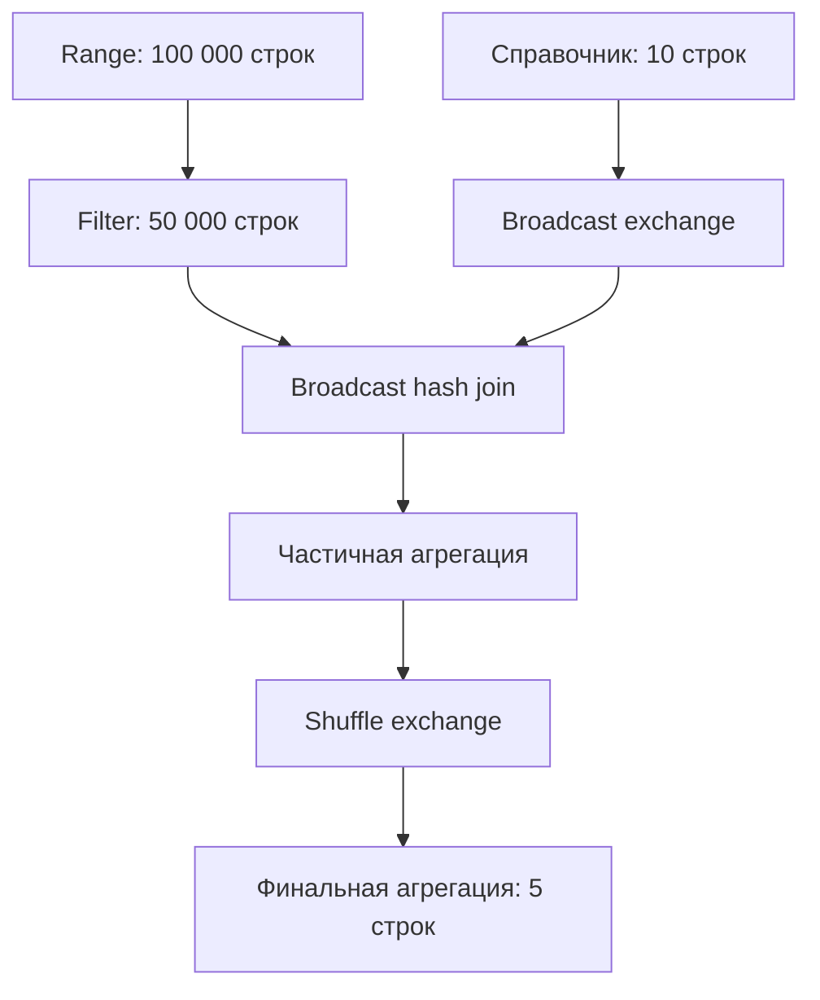
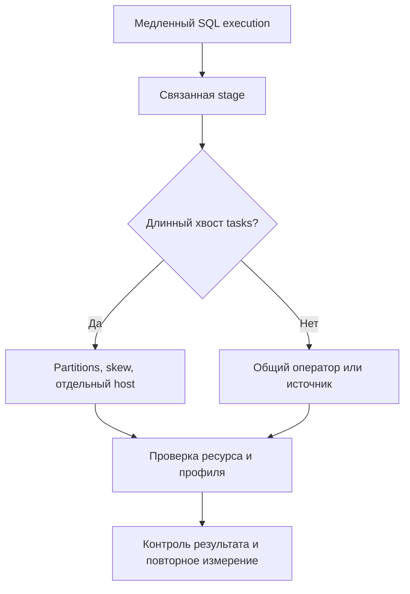
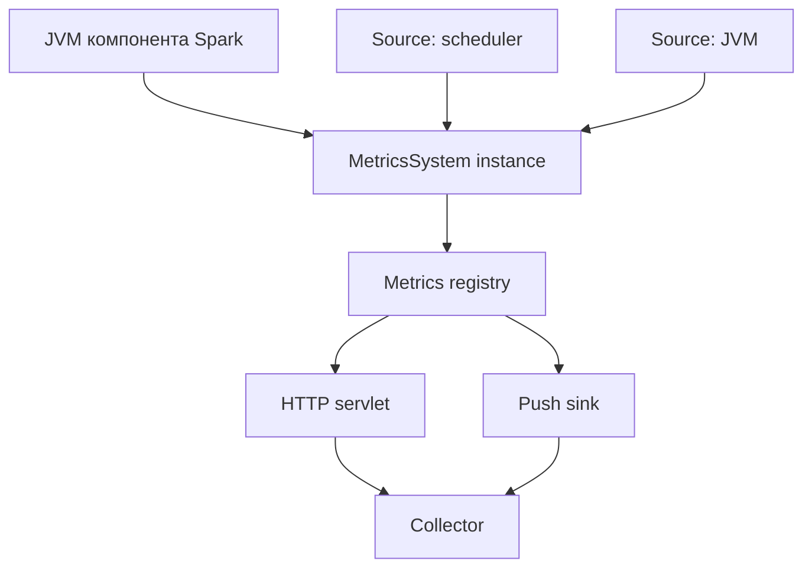
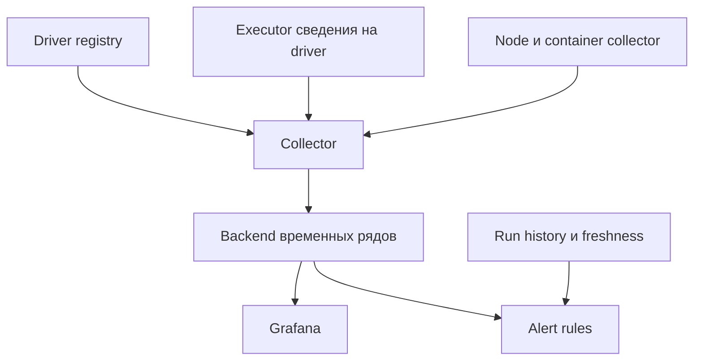
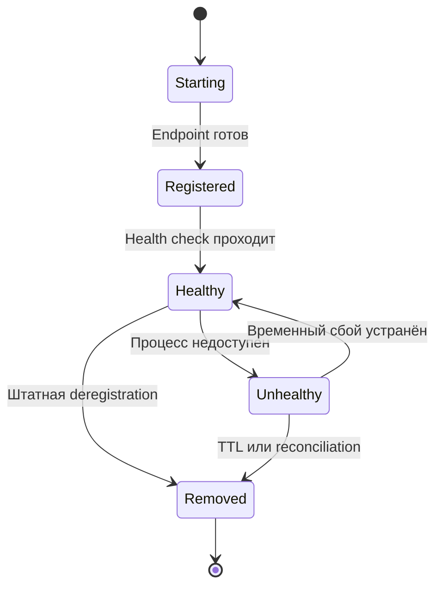

# 21. Наблюдаемость, профилирование и диагностика

Основной язык примеров — **Python / PySpark**. Базовое окружение: **Apache Spark 4.2.0, Python 3.12, Java 17, Spark Classic, Linux, local[2]**. Дополнительные JVM-примеры написаны на Scala 2.13. Документация привязана к версии, а не к изменяемому адресу `latest`.

**Цель раздела:** пройти путь от симптома «витрина опоздала» до проверяемого объяснения: какой запуск, запрос, оператор, stage, task, процесс или внешний источник задержал результат. Наблюдаемость объединяет метрики, логи, события и контекст запуска; профилирование объясняет, на что процесс расходует ресурсы; диагностика проверяет конкретные гипотезы.

**Как выполнять примеры**

- Код с пометкой **«в общей сессии»** использует `spark`, `sc`, `ROOT` и другие переменные из начальной лаборатории. Выполняй эти блоки последовательно в одной Python-сессии.
- Код с пометкой **«отдельный запуск»** требует нового процесса: конфигурация SparkContext обычно не меняется через повторный `getOrCreate()`.
- Scala listeners выполняются отдельно от Python-лаборатории.
- Конфигурации кластерных сервисов — шаблоны для указанной инфраструктуры. Адреса `.example`, HDFS-пути и credentials заменяются своими значениями.
- Маленький локальный пример проверяет API и устройство наблюдаемости. Он не воспроизводит многомашинную сеть, реальные Kafka offsets, pressure production-кластера или отказ узла.
- В Spark Connect доступ к `spark.sparkContext`, RDD и приватному `_jvm` нельзя переносить из Classic автоматически. Клиентские Python-логи и серверные JVM-логи собираются отдельно.

**Содержание**

1. [Spark UI](#spark-ui)
2. [SQL metrics и поиск bottleneck](#sql-metrics)
3. [History Server и event logs](#history)
4. [Логирование приложения](#logging)
5. [Архитектура и конфигурация системы метрик](#metrics-architecture)
6. [Экспорт и сбор метрик Spark](#metrics-export)
7. [Динамическое обнаружение targets мониторинга](#discovery)
8. [Listeners и REST API](#listeners)
9. [Мониторинг streaming](#streaming)
10. [Профилирование](#profiling)
11. [Диагностика типичных сбоев](#failures)
12. [Диагностика медленной или зависшей job](#slow-jobs)
13. [SLO, алерты и incident response](#slo)

<a id="spark-ui"></a>

## Spark UI

### Jobs, Stages, SQL, Executors, Storage и Environment

**Spark UI — представление выполнения конкретного приложения.** Его адрес связан с driver, а не с компьютером, с которого ты отправил запрос. В локальном режиме обычно используется порт 4040; при конфликте порт меняется. Поэтому получай фактический URL.

| Вкладка | Основной вопрос | Что сопоставить |
| --- | --- | --- |
| Jobs | Какие actions уже запустили вычисление? | Описание, статус, связанные stages |
| Stages | Где находится длительная часть выполнения? | Attempts, tasks, объёмы, распределения |
| SQL / DataFrame | Какой физический план действительно выполнялся? | Execution ID, операторы, связанные jobs |
| Executors | Кто выполнял работу и кто исчез? | Активные/удалённые executors, tasks, GC, shuffle |
| Storage | Что материализовано через persist/cache? | Доля сохранённых partitions, размещение блоков |
| Environment | С какими настройками запущено приложение? | Spark properties, JVM, classpath, окружение |

Storage не является обзором всей памяти процесса. Например, незакэшированный DataFrame может создать большую hash-таблицу join и не появиться как сохранённый набор в этой вкладке.

**Лаборатория A, шаг 1: создать общую сессию.** Перед этим установи `pyspark==4.2.0` в своём виртуальном окружении. Запускай в новом процессе, в котором ещё нет SparkContext.

```python
import json
import tempfile
from pathlib import Path
from urllib.parse import quote
from urllib.request import urlopen

from pyspark.sql import SparkSession, functions as F

ROOT = Path(tempfile.mkdtemp(prefix="spark-observability-"))
EVENT_DIR = ROOT / "events"
EVENT_DIR.mkdir()

spark = (
    SparkSession.builder
    .master("local[2]")
    .appName("spark-zth-observability")
    .config("spark.driver.host", "127.0.0.1")
    .config("spark.driver.bindAddress", "127.0.0.1")
    .config("spark.ui.showConsoleProgress", "false")
    .config("spark.python.use.daemon", "false")  # Для изолированной локальной лаборатории.
    .config("spark.sql.shuffle.partitions", "4")
    .config("spark.eventLog.enabled", "true")
    .config("spark.eventLog.dir", EVENT_DIR.as_uri())
    .config("spark.eventLog.compress", "false")
    .config("spark.eventLog.rolling.enabled", "true")
    .config("spark.eventLog.logStageExecutorMetrics", "true")
    .config("spark.executor.metrics.pollingInterval", "1000")
    .config("spark.executor.processTreeMetrics.enabled", "true")
    .config(
        "spark.metrics.conf.*.source.jvm.class",
        "org.apache.spark.metrics.source.JvmSource",
    )
    .config(
        "spark.metrics.conf.*.sink.prometheusServlet.class",
        "org.apache.spark.metrics.sink.PrometheusServlet",
    )
    .config(
        "spark.metrics.conf.*.sink.prometheusServlet.path",
        "/metrics/prometheus",
    )
    .config("spark.ui.prometheus.enabled", "true")
    .getOrCreate()
)
sc = spark.sparkContext
sc.setLogLevel("WARN")

print("Spark:", spark.version)
print("Application ID:", sc.applicationId)
print("UI:", sc.uiWebUrl)
print("Event logs:", EVENT_DIR)
```

Привязка к `127.0.0.1` подходит именно этой локальной лаборатории. В распределённом приложении executors должны достигать driver по кластерному адресу. Event log включён заранее, до создания SparkContext; каталог уже существует.

**Проверка:** открой напечатанный URL, найди имя приложения и убедись, что параметры event logging присутствуют в Environment. UI живёт до завершения контекста.

[Официальное описание Web UI](https://spark.apache.org/docs/4.2.0/web-ui.html).

### DAG visualization и SQL plan visualization

**DAG в Jobs/Stages** помогает увидеть зависимости вычислений и границы stages. **SQL plan** показывает физические SQL-операторы: чтение, фильтры, join, exchange, aggregate. Эти представления связаны, но не взаимозаменяемы: несколько операторов могут выполняться в одной task, а один запрос — запускать несколько jobs.

**Лаборатория A, шаг 2, в общей сессии:** создадим набор, broadcast join и агрегат.

```python
fact = (
    spark.range(100_000, numPartitions=4)
    .select(
        "id",
        (F.col("id") % 10).alias("k"),
        (F.col("id") % 100).alias("amount"),
    )
    .filter((F.col("id") % 2) == 0)
)

dim = spark.range(10).select(
    F.col("id").alias("k"),
    F.concat(F.lit("group-"), F.col("id")).alias("segment"),
)

result = (
    fact.join(F.broadcast(dim), "k")
    .groupBy("segment")
    .agg(
        F.sum("amount").alias("total"),
        F.count(F.lit(1)).alias("rows"),
    )
)

result.explain(mode="formatted")
rows = result.collect()  # Всего пять итоговых строк.
assert sum(row["rows"] for row in rows) == 50_000
assert sum(row["total"] for row in rows) == 2_450_000
result.explain(mode="formatted")
```

Сравни план до action и после него. При AQE после выполнения может быть виден финальный adaptive plan с иным числом shuffle partitions. `explain("formatted")` сам по себе не является измерением выполнения; `explain("cost")` также не превращает оценки в фактические длительности.



Схема описывает зависимости лаборатории, а не обещает конкретные stage IDs или точное число jobs. Whole-stage code generation объединяет операции; AQE способен изменить физическое выполнение.

[DataFrame.explain](https://spark.apache.org/docs/4.2.0/api/python/reference/pyspark.sql/api/pyspark.sql.DataFrame.explain.html).

### Jobs, stages и tasks одного SQL execution

**SQL execution ID**, **job ID**, **stage ID** и **task ID** принадлежат разным уровням.

| Уровень | Значение | Оговорка |
| --- | --- | --- |
| SQL execution | Выполнение SQL/DataFrame action | Не совпадает с StreamingQuery.id |
| Job | Задание scheduler для получения результата | Один execution может иметь несколько jobs |
| Stage + attempt | Набор tasks с общей зависимостью вычисления | Повтор стадии имеет отдельный attempt |
| Partition + task attempt | Попытка обработать partition данной стадии | Retry/speculation создают несколько попыток |
| Application + attempt | Запуск SparkContext/попытка платформы | Нужен для уникальности локальных IDs |

Не делай ключ истории из одного `stageId`: stage 3 разных приложений — разные стадии. Не складывай повторные попытки в «полезную обработку» незаметно: они важны для стоимости, но не обязательно увеличили итоговые данные.

**В общей сессии:** назначим понятную группу следующему action.

```python
sc.setJobGroup(
    "lab-aggregate",
    "Observability lab: aggregation",
    interruptOnCancel=True,
)
try:
    checked_rows = result.collect()
    assert len(checked_rows) == 5
finally:
    sc.setLocalProperty("spark.jobGroup.id", None)
    sc.setLocalProperty("spark.job.description", None)
    sc.setLocalProperty("spark.job.interruptOnCancel", None)
```

Job group — пользовательская строка, не присвоенный Spark job ID. Local properties связаны с потоком driver; при многопоточном запуске их распространение надо организовать явно. В UI начни с SQL execution, перейди к связанным jobs, затем к stages и медленным tasks.

**Упражнение:** выполни отдельно `result.count()` и `result.collect()`. Объясни, почему это два actions, хотя Python-переменная DataFrame одна.

[setJobGroup](https://spark.apache.org/docs/4.2.0/api/python/reference/api/pyspark.SparkContext.setJobGroup.html).

### Input/output, shuffle read/write и spill

У каждого объёма есть граница измерения. Input — чтение источника в task; output — внешняя запись; shuffle write/read — промежуточный обмен. SQL row count описывает строки конкретного оператора.

| Метрика | Что означает | Что нельзя заключить |
| --- | --- | --- |
| Input bytes/records | Объём, сообщённый источником/task instrumentation | Это все строки после фильтров и join |
| Output bytes/records | Объём внешней записи task | Данные уже доступны потребителю после commit |
| Shuffle write | Данные, подготовленные для следующей стадии | Все байты ушли по межузловой сети |
| Shuffle read | Полученные локально и удалённо shuffle blocks | Это чтение исходного Parquet |
| Memory spill | Оценка объёма вытесненных структур в памяти | Такой объём RAM занят сейчас |
| Disk spill | Объём записи spill на диск | Он должен равняться memory spill |

В проверенном Spark 4.2.0 tasks генерации `range` учли по 25 000 input records и ноль input bytes: данные создаются без чтения файла. После фильтра осталось 50 000 SQL-строк, хотя upstream tasks учли суммарно 100 000 records. В reduce task той же агрегации input records были нулевыми, а shuffle records — ненулевыми. Это разные границы измерения. В `local[2]` shuffle в основном локальный: такой запуск не проверяет пропускную способность сети между машинами.

Spill не всегда означает сбой. Операторы могут успешно завершиться, используя диск. Но рост spill одновременно с runtime, GC и disk utilization — повод изучить partitions, ширину строк, cardinality групп и параллельную нагрузку.

**Пример интерпретации:** после join объём shuffle вырос в 20 раз. Сначала проверь число строк join и дубликаты ключей справочника. Повышение памяти до проверки корректности join может лишь сделать ошибочное размножение строк дороже.

### Task duration, GC time и scheduler delay

Task duration — elapsed time попытки; executor run time — время исполнения на executor; scheduler delay в UI — производная часть временного интервала, не объяснённая измеренными фазами. В неё могут попадать задержки передачи, scheduling и отчёта о результате. Ожидание запуска приложения в YARN-очереди измеряется отдельно.

| Показатель | Единица task/status API | Как использовать |
| --- | --- | --- |
| `executorRunTime` | Миллисекунды | Время выполнения, включая ожидание shuffle |
| `executorCpuTime` | Наносекунды | CPU исполняющего JVM-потока |
| `executorDeserializeTime` | Миллисекунды | Подготовка task и десериализация |
| `jvmGcTime` в status REST | Миллисекунды | Изменение GC-счётчика JVM за окно task |
| `schedulerDelay` | Миллисекунды | Поиск задержек вне основной работы task |
| `shuffleWriteMetrics.writeTime` | Наносекунды | Не смешивать с миллисекундами runtime |

Название Java-метода `jvmGCTime()` и JSON-поле `jvmGcTime` отличаются регистром. Проверяй реальный контракт endpoint.

Отношение `executorCpuTime / 1e6 / executorRunTime` — ориентир загрузки измеренного потока. Оно не отражает все CPU процесса, Python workers и background threads. GC измеряется на уровне JVM; overlapping tasks могут учитывать один GC-интервал, поэтому сумма task GC не равна времени остановки приложения.

**Самопроверка:** task длилась 10 секунд, CPU-поток работал 0,5 секунды. Почему это ещё не доказывает медленную сеть? Возможны диск, внешняя система, locks, Python-работа, ожидание shuffle и другие причины.

### Executor lost, failed tasks и retry attempts

Failed task — сбой конкретной попытки. Executor lost — потеря процесса, способная повлиять на множество tasks и shuffle blocks. Успешный application может содержать failed attempts, которые Spark восстановил.

Диагностируй по времени:

1. Найди первую ошибку и executor/host.
2. Посмотри причину завершения контейнера или процесса.
3. Сопоставь задачи, которые выполнялись в тот момент.
4. Проверь, начались ли после этого fetch failures и повторные stages.
5. Оцени, завершился ли job и корректен ли опубликованный результат.

При `spark.task.maxFailures` учитываются не все ситуации одинаково; отдельные executor/node failures и stage retries имеют собственную логику. Не объясняй любой retry одной настройкой.

Speculative attempt — дополнительная попытка медленной task, а не обязательно исправление ошибки. Она может увеличить нагрузку на внешнюю систему. Внешние эффекты из `foreachPartition` должны учитывать повторное выполнение.

**Упражнение:** для двух failed attempts и одной successful attempt одной partition укажи отдельно полезный результат, фактический CPU расход и число внешних попыток записи.

### Распределение метрик, а не только средние значения

Среднее скрывает хвост: 99 tasks по одной секунде и одна task 100 секунд дают среднее 1,99 секунды, но stage ждёт последнюю task.

**В общей сессии:** числовая иллюстрация без дополнительного Spark job.

```python
from statistics import mean, median

durations_s = [1.0] * 99 + [100.0]
print(mean(durations_s))    # 1.99
print(median(durations_s))  # 1.0
print(max(durations_s))     # 100.0
```

Смотри p50/p95/p99/max вместе с количеством tasks, input bytes, shuffle bytes и executor placement. Для четырёх tasks p99 малоинформативен: он почти описывает максимум. Сравнивай одинаковые стадии и успешные попытки отдельно от retry cost.

| Наблюдение | Гипотеза | Следующая проверка |
| --- | --- | --- |
| Одна task и много shuffle bytes | Skew ключей | Распределение ключей и partitions |
| Один host, разные тяжёлые tasks | Медленный узел | CPU, диск, сеть, neighbours |
| Все tasks одинаково медленные | Общая причина | Источник, план, ресурсы, throttling |
| Долгая task при малом объёме | Внешний вызов или ожидание | Thread dump и timeout |

**Практика по теме:** составь карточку SQL execution: application ID, execution ID, jobs, stages, самая долгая task, её executor и объёмы. Объясни, почему Storage не заменяет мониторинг RSS и почему сумма длительностей tasks не равна wall-clock runtime.

<a id="sql-metrics"></a>

## SQL metrics и поиск bottleneck

### Число строк на входе и выходе оператора

Число строк — первая проверка корректности и стоимости. Фильтр должен уменьшать либо сохранять cardinality; join может резко увеличивать её; aggregate обычно уменьшает, но при почти уникальном ключе почти не сокращает данные.

Не у каждого оператора есть отдельная метрика input rows. Иногда её оценивают по дочернему узлу плана; reused exchange, несколько входов join, whole-stage fusion и неполные метрики усложняют такое сопоставление.

**В общей сессии:** измерим число строк на определённой границе без отдельного `count()` перед action.

```python
from pyspark.sql import Observation

observation = Observation("fact_quality")
observed_fact = fact.observe(
    observation,
    F.count(F.lit(1)).alias("rows"),
    F.sum("amount").alias("amount_total"),
)

observed_result = (
    observed_fact.join(F.broadcast(dim), "k")
    .groupBy("segment")
    .agg(F.sum("amount").alias("total"))
)
observed_result.collect()
assert observation.get == {"rows": 50_000, "amount_total": 2_450_000}
```

`Observation.get` — property, не вызов `get()`; она ждёт выполнения action. В этой batch-форме Observation фиксирует метрики первого action, который обработал наблюдаемую границу. Не используй чтение до action как «неблокирующую проверку готовности».

Измеряй нужную границу: число строк до join не подтверждает отсутствие размножения после join. Для streaming используй именованный `observe("name", ...)` и `observedMetrics` в progress; объект Observation не является универсальным streaming-контейнером.

[Observation](https://spark.apache.org/docs/4.2.0/api/python/reference/pyspark.sql/api/pyspark.sql.Observation.html), [DataFrame.observe](https://spark.apache.org/docs/4.2.0/api/python/reference/pyspark.sql/api/pyspark.sql.DataFrame.observe.html).

### Scan time, aggregate time и join metrics

Названия и набор SQL metrics зависят от физического оператора и connector. FileScan и BatchScan могут публиковать разные показатели. BroadcastHashJoin и SortMergeJoin также не имеют одинакового «join time».

| Узел | Полезные свидетельства | Возможная проверка |
| --- | --- | --- |
| Scan | Files, bytes, rows, scan/metadata time | Pruning, listing, pushdown, splitability |
| Aggregate | Output rows, aggregation time, spill, peak memory | Число групп и размер состояния |
| Join | Output rows, build side, связанные sort/exchange | Размножение строк, skew, стратегия |
| Python evaluation | Rows, conversion, связанные tasks | UDF, batching, worker CPU |
| Write | Task write, output bytes и конец execution | Отличить обработку от commit |

Внутри pipeline работа операторов перекрывается: оператор может получать строки от дочернего узла прямо во время своих вызовов. Сумма всех operator times не является временем запроса, а большой счётчик не всегда означает самостоятельный bottleneck.

**Разбор:** если scan выдаёт 100 млн строк, join — 3 млрд, а aggregate сокращает до 500 тыс., изучи join раньше aggregate. Если cardinality ожидаемая, сравни CPU, shuffle и memory pressure связанных stages.

### Broadcast size и время подготовки broadcast

Broadcast требует не только передачи по сети. Нужно вычислить маленькую сторону, собрать её для broadcast, построить используемое представление и разослать данные executors. Размер исходного файла, размер сериализованных строк и размер hash relation могут отличаться.

В SQL UI у BroadcastExchange обычно есть показатели размера и фаз подготовки. В лаборатории ищи этот узел справочника из десяти строк. На маленьком запуске задержка scheduler/JVM может превосходить полезную работу.

В проверенном финальном плане этой лаборатории BroadcastQueryStage показал `sizeInBytes=32.0 MiB` при `rowCount=10`. Размер выбранного внутреннего представления не равен длине десяти исходных строк в JSON. Это полезный пример того, почему «десять строк» и «почти нет расхода памяти» не являются взаимозаменяемыми оценками.

**В общей сессии:** сравним планы с явным broadcast и без автоматического broadcast.

```python
old_threshold = spark.conf.get("spark.sql.autoBroadcastJoinThreshold")
old_aqe = spark.conf.get("spark.sql.adaptive.enabled")
try:
    spark.conf.set("spark.sql.autoBroadcastJoinThreshold", "-1")
    spark.conf.set("spark.sql.adaptive.enabled", "false")
    fact.join(dim, "k").explain(mode="formatted")
    fact.join(F.broadcast(dim), "k").explain(mode="formatted")
finally:
    spark.conf.set("spark.sql.autoBroadcastJoinThreshold", old_threshold)
    spark.conf.set("spark.sql.adaptive.enabled", old_aqe)
```

Это проверка выбора плана, не benchmark. Hint может принудить broadcast при выключенном автоматическом пороге. Не используй его для справочника, который «маленький» только в тестовых данных.

При broadcast timeout установи, какая фаза задержалась, и проверь driver memory. Увеличение timeout не исправляет build side, не помещающуюся в память.

### Shuffle partitions и runtime statistics

Число `spark.sql.shuffle.partitions` описывает исходную конфигурацию соответствующих exchanges. При AQE фактическое число reduce tasks может измениться: coalescing объединяет partitions, обработка skew может разделять тяжёлые части.

Для лаборатории исходное значение — четыре; оно не обещает четыре tasks в любой финальной стадии. Проверяй финальный план, связанные stages и объёмы на task.

| Недостаточно partitions | Слишком много partitions |
| --- | --- |
| Большие partitions, мало параллелизма | Множество коротких tasks |
| Более тяжёлые sort/hash structures | Scheduler и metadata overhead |
| Возможны spill и длинный хвост | Много мелких выходных файлов при записи |

Runtime statistics отдельных query stages помогают AQE принимать решения. Оценки оптимизатора, фактически собранная statistics и task input bytes — разные данные. Например, размер shuffle после partial aggregate не равен исходному размеру таблицы.

**Упражнение:** выполни ту же агрегацию с AQE включённым и выключенным, с исходными 4 и 20 partitions. Запиши фактическое число tasks и объёмы; не делай вывод по одной длительности короткого теста.

[Adaptive Query Execution](https://spark.apache.org/docs/4.2.0/sql-performance-tuning.html#adaptive-query-execution).

### Sort, spill и peak memory

Sort хранит и перерабатывает буферы; hash aggregate/join создают структуры по ключам. Чем шире строки и выше cardinality, тем выше риск давления на memory pool. Spill показывает вынесенную работу, а peak execution memory — учтённые структуры выполнения.

**В общей сессии:** создадим отдельный запрос с сортировкой. Он небольшой и не обязан вызвать spill.

```python
sorted_result = fact.repartition(4, "k").sortWithinPartitions(
    F.desc("amount"), "id"
)
sorted_result.write.mode("overwrite").parquet(str(ROOT / "sorted-output"))
assert spark.read.parquet(str(ROOT / "sorted-output")).count() == 50_000
```

Одна `count()` над отсортированным DataFrame не гарантирует выполнение полезной сортировки: оптимизатор может убрать ненужный order. Здесь запись материализует преобразование, а чтение проверяет результат. Не считай результат отсортированным глобально после чтения Parquet.

SQL-метрика peak memory конкретного оператора, task `peakExecutionMemory`, executor heap и process RSS имеют разные области измерения. Ни одна из первых двух не является полным размером Python worker либо JVM.

**Практика:** найди Sort и Exchange в плане записи, связанные stages и spill. Нулевой spill на небольшом примере — нормальный проверяемый результат.

### Связь operator metrics с медленной стадией

Начинай с elapsed time медленного execution, затем выделяй критический путь. Десять параллельных tasks по минуте — одна минута полезной wall-clock работы при достаточном количестве slots, а не десять минут последовательной задержки.

Используй цепочку доказательств:

1. SQL execution задерживает требуемый результат.
2. Связанная stage завершилась существенно позднее других.
3. В этой stage есть тяжёлые partitions или общая задержка.
4. Оператор объясняет объём, сортировку, Python-вызов или запись.
5. Ресурсная метрика/профиль подтверждает причину.
6. Изменение устраняет причину при сохранении корректности.



**Задание по теме:** сформулируй две гипотезы для запроса с большим shuffle: ошибки cardinality join и корректной, но широкой группировки. Укажи, какие метрики различают их. **Самопроверка:** почему нельзя складывать все operator times и почему `count()` может оказаться неподходящим action для benchmark сортировки?

<a id="history"></a>

## History Server и event logs

### Включение spark.eventLog.enabled

Event log сохраняет события, из которых восстанавливается история UI. Это отдельный поток от текстовых логов driver и executor: Java stack trace и бизнес-сообщения не становятся полноценным архивом только из-за event logging.

В лаборатории включение уже выполнено при создании SparkContext. Для отдельного приложения тот же выбор передаётся до старта:

```bash
spark-submit \
  --conf spark.eventLog.enabled=true \
  --conf spark.eventLog.dir=hdfs:///platform/spark-events \
  pipeline.py
```

**Кластерный шаблон:** каталог заранее создан и доступен driver на запись; Hadoop-конфигурация и authentication уже настроены.

Event logs не являются checkpoint streaming и не позволяют восстановить потерянное пользовательское состояние. Event log объясняет прошлое выполнение; checkpoint поддерживает recovery вычисления.

**Проверка:** в напечатанном `EVENT_DIR` появляется файл либо каталог текущего приложения. Не меняй конфигурацию задним числом: History Server не восстановит события, которые не записывались.

[Event logs и History Server](https://spark.apache.org/docs/4.2.0/monitoring.html#viewing-after-the-fact).

### Размещение event logs на общем хранилище

Общее хранилище нужно потому, что History Server и driver могут жить на разных машинах, а локальный диск driver исчезает при удалении pod. Согласуй URI, права и жизненный цикл независимо от каталога output.

| Хранилище | Что проверить |
| --- | --- |
| Локальный диск | Server и приложение реально видят один каталог |
| HDFS | Kerberos, ACL, доступность NameNode/DataNode |
| Object storage через Hadoop FS | Connector/JAR, credentials, listing, стоимость requests |
| Управляемая платформа | Кто пишет/читает историю и какой retention действует |

Не достаточно установить `spark.eventLog.dir=s3a://...`, если в runtime нет совместимого S3A connector. Сам URI не устанавливает клиентскую библиотеку.

Приложению обычно нужна запись собственной истории; серверу — чтение, а для cleanup/compaction также удаление или перезапись в соответствии с выбранной политикой. Разделяй production/staging, владельцев и доступ пользователей.

**Упражнение:** объясни, почему `file:///tmp/events` на driver pod и такой же URI в History Server pod могут указывать на два разных каталога.

### Настройка и доступ к History Server

History Server читает event logs и строит UI завершённых или незавершённых приложений. Обычно используется порт 18080; адрес UI может дополнительно проходить через proxy платформы.

**Отдельный сервис, полный дистрибутив Spark:** файл конфигурации сервера содержит его собственные параметры.

```properties
# spark-defaults.conf, используемый процессом History Server
spark.history.fs.logDirectory hdfs:///platform/spark-events
spark.history.ui.port 18080
spark.history.fs.update.interval 10s
```

```bash
"$SPARK_HOME/sbin/start-history-server.sh"
# После локальной проверки:
"$SPARK_HOME/sbin/stop-history-server.sh"
```

Для локальной лаборатории вместо HDFS передай URI напечатанного `EVENT_DIR` через `SPARK_HISTORY_OPTS`:

```bash
# Подставь существующий каталог из лаборатории.
SPARK_HISTORY_OPTS="-Dspark.history.fs.logDirectory=file:///absolute/path/events" \
  "$SPARK_HOME/sbin/start-history-server.sh"
```

UI/cache History Server — собственные ресурсы сервера. Большая история и много одновременных открытий способны нагрузить его heap, CPU и диск; добавление executor memory приложению этого не исправит.

**Проверка:** после `spark.stop()` живой UI закрыт, а History Server отображает application ID и позволяет получить jobs через `/api/v1`. Проверенный локальный replay описан в конце главы.

### Rolling logs, compression и compaction

Эти механизмы решают разные задачи.

| Механизм | Эффект | Ограничение |
| --- | --- | --- |
| Rolling | Разбивает поток событий на сегменты | Сам по себе не удаляет старые события |
| Compression | Сжимает записанные сегменты | Требует совместимого codec при чтении |
| Compaction в History Server | Переписывает старые сегменты с сокращением событий | Может терять детализацию завершённых jobs/tasks |

**Кластерный шаблон, до запуска приложения:**

```properties
spark.eventLog.rolling.enabled true
spark.eventLog.rolling.maxFileSize 128m
spark.eventLog.compress true
spark.eventLog.compression.codec zstd
```

**Настройка именно History Server:**

```properties
spark.history.fs.eventLog.rolling.maxFilesToRetain 10
```

Число 10 — пример политики, а не рекомендация для всех систем. Прежде чем включать compaction, проверь, остаются ли данные, необходимые твоему разбору инцидентов. Для долгоживущего streaming loss завершённых micro-batch jobs может существенно сократить историю.

Лаборатория пишет rolling event log без сжатия, чтобы можно было прочитать строки JSON. Парсер несжатого JSON не подходит автоматически к сжатым сегментам. Не интерпретируй rolling directory как один файл.

### Retention, cleanup и размер истории

Различай retention **в живом UI/status store**, retention **кэша History Server** и удаление **исходных event logs**. Исчезновение job из UI не доказывает удаление её событий из файлов; выпадение приложения из кэша не обязательно удаляет источник.

**Пример конфигурации сервера:**

```properties
spark.history.fs.cleaner.enabled true
spark.history.fs.cleaner.interval 1d
spark.history.fs.cleaner.maxAge 30d
spark.history.fs.cleaner.maxNum 10000
```

Cleanup требует соответствующих прав и охватывает историю согласно поведению провайдера. Для object storage отдельно согласуй lifecycle: удалённый bucket policy файл не восстановится из UI после истечения server cache.

При планировании хранения оценивай размер на task attempt и частоту micro-batches. Например, 1000 micro-batches/сутки с десятками tasks дают совсем иной объём событий, чем один batch job/сутки.

**Практика:** сформулируй политику хранения: сколько дней нужна детализация tasks, какие сводки нужны дольше и когда завершается окно расследования. Ограничение числа приложений в UI не заменяет эту политику.

### Incomplete applications и logs аварийного завершения

Incomplete означает отсутствие корректно наблюдаемого завершения, а не обязательно работающий процесс. Driver мог аварийно завершиться, потерять доступ к хранилищу или не успеть дописать последние события.

Сопоставь три источника: History Server, фактический статус приложения у cluster manager и логи процесса. Сервер обновляет незавершённую историю периодически; отсутствие свежего события в нём не является мгновенным health check.

Последние события могут остаться в буфере при аварии. Отсутствие `SparkListenerApplicationEnd` объясняет неполноту, но не устанавливает причину аварии. OOMKill, eviction, потеря JVM и ошибка event-log записи требуют разных доказательств.

**После выполнения всех Python-лабораторий**, а не сейчас:

```python
# Последний шаг общей сессии.
spark.stop()
print("Сохранённая история:", EVENT_DIR)
```

`stop()` выполняй в `finally` у самостоятельного приложения. Это помогает нормальному завершению и освобождению ресурсов; принудительное уничтожение процесса такой гарантии не даёт.

### Доступ к истории и защита чувствительной информации

Event logs и восстановленный UI могут содержать SQL, пути, настройки, имена пользователей и параметры. Даже если output закрыт, история запросов способна раскрыть структуру данных и operational context.

Проверяй доступ на двух уровнях: файловая система/bucket и UI/REST. Аутентификация пользователя не равна проверке прав на каждое приложение. Параметры History Server ACL должны соответствовать authentication механизму платформы.

Редактирование секретных значений в Spark-конфигурации не является универсальной очисткой SQL literals, UDF traceback и пользовательских logs. Не помещай токен в SQL-текст или имя приложения.

**Упражнение:** создай матрицу доступа для автора pipeline, дежурного инженера и пользователя витрины. Укажи права на output, event logs, UI и executor logs отдельно.

**Самопроверка по теме:** можно ли восстановить job без event log; чем compaction отличается от compression; почему incomplete application может быть уже мёртвым; чем checkpoint отличается от истории UI?

[Безопасность Spark и History Server](https://spark.apache.org/docs/4.2.0/security.html).

<a id="logging"></a>

## Логирование приложения

### Log4j2 и log4j2.properties

JVM-компоненты Spark используют Log4j2. Python-модуль `logging` — другой механизм. Настройка `log4j2.properties` не превращает Python `print()` в структурированный JVM log.

**Шаблон для JVM driver/executors:** размести файл в конфигурационном каталоге runtime.

```properties
status = warn
name = SparkObservability

appender.console.type = Console
appender.console.name = STDERR
appender.console.target = SYSTEM_ERR
appender.console.layout.type = PatternLayout
appender.console.layout.pattern = %d{ISO8601} %-5p [%t] %c{1} %X{run_id} - %m%n%ex

rootLogger.level = info
rootLogger.appenderRef.stderr.ref = STDERR

logger.spark.name = org.apache.spark
logger.spark.level = warn
```

`%X{run_id}` печатает значение MDC текущего JVM-контекста, если оно действительно установлено; Python-переменная с таким именем сама MDC не заполняет. Plain text layout удобен для чтения, но сложнее для автоматического разбора многострочных stack traces.

В Spark 4.x есть поддержка структурированного JVM-логирования: `spark.log.structuredLogging.enabled=true` и шаблон `log4j2-json-layout.properties.template`. Пользовательский Log4j2 layout может менять формат; проверь фактическую запись.

При доставке через `--files` недостаточно положить файл на driver: убедись, что executor JVM выбирает его. В client mode параметры JVM driver задаются до запуска процесса, например через `--driver-java-options`, а не поздним `spark.conf.set`.

[Конфигурация логирования Spark](https://spark.apache.org/docs/4.2.0/configuration.html#configuring-logging), [Log4j2 configuration](https://logging.apache.org/log4j/2.x/manual/configuration.html).

### Логи driver, executors и Python workers

Для одной PySpark task могут быть задействованы driver Python, driver JVM, executor JVM и Python worker. Ошибка видна не обязательно там, где произошла.

| Источник | Что искать |
| --- | --- |
| Driver Python | Входные параметры приложения, orchestration, traceback клиентского кода |
| Driver JVM | Scheduling, анализ/планирование SQL, heartbeat, общую причину abort |
| Executor JVM | Task failures, shuffle, GC/OOM, блоки, transport |
| Python worker | Ошибку UDF/partition function, Python dependencies, native crash |
| Cluster manager | OOMKilled, eviction, exit code, quota, потерю узла |

Поток stdout/stderr Python worker обычно попадает в executor/container logs через инфраструктуру запуска. Но это не делает все worker-сообщения отдельными полями driver log. Ищи executor ID, task attempt и время.

В `local[2]` driver и executor-подобная работа используют одну JVM; полноценное разделение процессов кластера не проверяется. Python workers при RDD/UDF всё равно могут быть отдельными процессами.

**Практика:** для ошибки Python UDF найди Python traceback и JVM-обёртку. Для OOMKill начни с container status: JVM могла не успеть напечатать Java OOM.

### Структурированные логи и поля run ID/job ID/query ID

Задай корреляцию заранее. `run_id` orchestration, `application_id` Spark, SQL execution ID и streaming query ID — разные идентификаторы. Пользовательское поле `job_id` должно явно обозначать Spark job или job оркестратора.

**В общей сессии:** структурированный Python log через публичный API Spark 4.x.

```python
import logging
from uuid import uuid4
from pyspark.logger import PySparkLogger

run_id = str(uuid4())
app_logger = PySparkLogger.getLogger("spark-zero-to-hero")
app_logger.setLevel(logging.INFO)
app_logger.info(
    "run_started",
    run_id=run_id,
    application_id=sc.applicationId,
    pipeline="observability-lab",
)
```

Дополнительные keyword arguments попадают в контекст JSON. Они не присваивают Spark job IDs и не переносятся автоматически в executor MDC.

Рекомендуемые поля: UTC timestamp, severity, pipeline, environment, run_id, application_id, query_id/run_id для streaming, stage/attempt/task/executor при наличии, git commit, input snapshot, error condition. Избегай одной неоднозначной строки `id`.

**Пример:** streaming `query.id` сохраняется при перезапуске с тем же checkpoint, а `query.runId` меняется. Для incident timeline нужны оба.

[PySparkLogger](https://spark.apache.org/docs/4.2.0/api/python/reference/api/pyspark.logger.PySparkLogger.html).

### Logging levels и управление объёмом

Логируй события, на которые можно отреагировать. INFO — старт/конец этапа и подтверждённый результат; WARN — деградация или восстановленная проблема; ERROR — конкретная неуспешная операция. DEBUG включают на ограниченное время и конкретный logger.

**В общей сессии:**

```python
sc.setLogLevel("WARN")
app_logger.setLevel(logging.INFO)
app_logger.info("validation_passed", run_id=run_id, checked_groups=5)
```

Первая строка регулирует Spark logging; вторая — Python logger приложения. Не ожидай, что одна строка унифицирует все библиотеки.

Запись на каждую строку DataFrame создаёт overhead, шум и возможную утечку данных. Для плохих записей полезнее count, reason code и ограниченная выборка в защищённое назначение. Ошибки, повторённые тысячами tasks, агрегируй по условию, stage и частоте.

**Упражнение:** выбери log level для успешного retry, окончательного abort и ожидаемого отказа валидации. Объясни, какие сообщения сохраняешь после агрегации повторов.

### Агрегация через централизованную систему логов

Центральная система связывает сообщения разных процессов. На Kubernetes это может быть collection stdout/stderr pod; на YARN — log aggregation и последующая доставка; на Standalone — сбор файлов с worker hosts.

Сохраняй metadata процесса: application ID, executor ID, pod/container ID, host, source stream, оригинальный timestamp. Время получения collector не равно времени события. Clock skew способен поменять видимый порядок причин и последствий.

Для JSON лучше одна запись на строку, где stack trace находится внутри JSON string/array. Для plain text нужен multiline parser; иначе каждая строка `Caused by` становится отдельным несвязанным событием.

Контролируй очередь collector, dropped messages, rotation и disk usage. Недоступный backend не должен блокировать critical path каждой Spark task. Для важных сообщений нужна явная политика буферизации, а не надежда на stdout.

**Проверка:** найди один run_id и восстанови временную последовательность driver → executor → cluster manager. Убедись, что exit code не потерян после удаления pod.

### Пользовательская ошибка, wrapped exception и root cause

Traceback часто имеет несколько уровней: ошибка пользовательского кода → PythonException/Java exception → Task failed → Job aborted → клиентская обёртка. Самая внешняя фраза говорит о масштабе последствия, но не обязательно о причине.

**Порядок разбора:**

1. Классифицируй фазу: startup, analysis, task execution, write/commit.
2. Найди первый значимый cause в цепочке и исходный worker traceback.
3. Свяжи его с stage/task/executor и входом.
4. Сравни повторяемость: все tasks, одна partition, один host.
5. Проверь причину внешними данными: schema, credential, диск, контейнер.
6. Сохрани минимальный пример и проверяемое исправление.

«Root cause» не всегда последняя вложенная exception. `Connection reset` может быть следствием OOMKilled сервера; причина находится в другой системе. «Task not serializable» может указывать на захваченный `self`, который содержит клиент БД, а не на само выражение map.

**Самопроверка:** почему `Py4JJavaError` не является достаточной классификацией инцидента? Это механизм передачи JVM-ошибки, а не диагноз.

### getCondition() и getErrorClass() с учётом версии API: устойчивые идентификаторы ошибок (добавлено по проверке полноты)

Для структурированных ошибок PySpark 4.x предпочтителен `getCondition()`. Он появился в 4.0; `getErrorClass()` доступен в более раннем API и deprecated с 4.0. Не парси локализованный текст, если есть структурированный код.

**В общей сессии:** helper для текущего и более старого API.

```python
from pyspark.errors import PySparkException

def error_condition(exc):
    if hasattr(exc, "getCondition"):
        return exc.getCondition()
    if hasattr(exc, "getErrorClass"):
        return exc.getErrorClass()
    return None

try:
    spark.sql("SELECT missing_column FROM range(1)").collect()
except PySparkException as exc:
    condition = error_condition(exc)
    print(condition)
    assert condition == "UNRESOLVED_COLUMN.WITH_SUGGESTION"
```

Ожидаемый код относится к этой конкретной ошибке Spark 4.2.0. Другой вход может дать `WITHOUT_SUGGESTION` или иной condition. Идентификаторы удобнее message parsing, но не являются обещанием неизменного набора ошибок во всех будущих версиях.

У обычного `ValueError`, transport error или непереведённого JVM exception такого API может не быть. Отсутствие condition не означает отсутствие проблемы. Не вызывай deprecated метод на 4.x только ради сравнения в production-логах.

[getCondition](https://spark.apache.org/docs/4.2.0/api/python/reference/api/pyspark.errors.PySparkException.getCondition.html), [getErrorClass](https://spark.apache.org/docs/4.2.0/api/python/reference/api/pyspark.errors.PySparkException.getErrorClass.html).

### getSqlState() и getMessageParameters(): классификация ошибок и параметризованные сообщения; доступность атрибутов зависит от происхождения исключения (добавлено по проверке полноты)

SQLSTATE помогает группировать SQL-ошибки: например, `42703` в проверенном примере означает неопределённую колонку. `getMessageParameters()` возвращает значения параметризованного сообщения; для unresolved column это имя объекта и варианты исправления.

**В общей сессии:**

```python
try:
    spark.sql("SELECT missing_column FROM range(1)").collect()
except PySparkException as exc:
    sql_state = exc.getSqlState()
    parameters = exc.getMessageParameters()
    assert sql_state == "42703"
    assert "missing_column" in parameters["objectName"]
    print("SQLSTATE:", sql_state)
    print("Parameter keys:", sorted(parameters))
```

SQLSTATE может быть `None`, а parameters — пустыми/недоступными для конкретного происхождения exception. Python worker error не обязан содержать те же атрибуты, что SQL AnalysisException.

Параметры могут включать значения, пути и SQL-фрагменты. Не записывай весь map автоматически в доступный всем log. Для автоматизации часто достаточно condition, SQLSTATE и списка ключей parameters; значения допускай по allowlist.

**Упражнение:** составь routing rules: schema issue — владелец pipeline; auth issue — credential/permissions owner; transport error — совместная диагностика. Один SQLSTATE не должен автоматически запускать бесконечный retry.

[getSqlState](https://spark.apache.org/docs/4.2.0/api/python/reference/api/pyspark.errors.PySparkException.getSqlState.html), [getMessageParameters](https://spark.apache.org/docs/4.2.0/api/python/reference/api/pyspark.errors.PySparkException.getMessageParameters.html).

### getQueryContext(): SQL-фрагмент или контекст вызова, структурированное логирование и автоматизация разбора (добавлено по проверке полноты)

`getQueryContext()` возвращает список контекстов, а не единственную строку SQL. В Spark 4.x контекст может описывать SQL либо DataFrame-вызов. SQL indexes/object metadata и DataFrame call site не одинаково доступны.

**В общей сессии:** защищённое получение metadata без полного текста запроса.

```python
def optional_api_call(obj, method_name):
    method = getattr(obj, method_name, None)
    if not callable(method):
        return None
    try:
        return method()
    except Exception:
        # Диагностический helper не должен скрывать исходную ошибку
        # вторичным сбоем чтения optional context.
        return None

def exception_metadata(exc):
    contexts = optional_api_call(exc, "getQueryContext") or []
    return {
        "exception_type": type(exc).__name__,
        "condition": error_condition(exc),
        "sql_state": optional_api_call(exc, "getSqlState"),
        "contexts": [
            {
                "type": str(optional_api_call(ctx, "contextType")),
                "start": optional_api_call(ctx, "startIndex"),
                "stop": optional_api_call(ctx, "stopIndex"),
            }
            for ctx in contexts
        ],
    }

try:
    spark.sql("SELECT missing_column FROM range(1)").collect()
except PySparkException as exc:
    metadata = exception_metadata(exc)
    assert metadata["contexts"]
    app_logger.warning("query_failed", run_id=run_id, **metadata)
```

Для интерактивного разбора локально полезны `ctx.fragment()`, `ctx.summary()`, а у DataFrame-контекста — `ctx.callSite()`, если поддерживается. Но SQL literal и путь из source code могут быть чувствительными; публичный log helper выше их не копирует.

Не вызывай все методы QueryContext без проверки применимости: «метод есть» не гарантирует, что конкретный тип контекста его поддерживает.

[getQueryContext](https://spark.apache.org/docs/4.2.0/api/python/reference/api/pyspark.errors.PySparkException.getQueryContext.html), [QueryContext](https://spark.apache.org/docs/4.2.0/api/python/reference/api/pyspark.errors.QueryContext.html).

### Редактирование секретов и персональных данных в логах

Redaction — маскирование чувствительных значений. Оно дополняет правило «не записывать секрет», но не делает любую произвольную строку безопасной.

**Шаблон конфигурации до запуска приложения:**

```properties
spark.redaction.regex (?i)secret|password|token|access[.]?key|api[._-]?key
spark.sql.redaction.options.regex (?i)url|password|token
```

Key-based redaction в Spark применяется в соответствующих местах вывода конфигурации/options. Оно не очищает автоматически пользовательский `logger.info(row)`, JSON payload, JDBC exception или SQL literal. String-based redaction настраивается отдельно и тоже действует в определённых местах, а не во всех потоках.

**В общей сессии:** короткий allowlist-helper для бизнес-логов.

```python
def safe_log_fields(fields):
    allowed = {"run_id", "application_id", "pipeline", "rows", "condition"}
    return {key: value for key, value in fields.items() if key in allowed}

sample_fields = {
    "run_id": run_id,
    "rows": 50_000,
    "token": "example-secret",
    "customer_email": "person@example.invalid",
}
assert safe_log_fields(sample_fields) == {
    "run_id": run_id,
    "rows": 50_000,
}
```

Это allowlist конкретного формата, не универсальный DLP detector. Маскируй значения также в logs collector и защищай доступ к исходным event logs/profile dumps.

**Практика по теме:** спроектируй одну JSON-запись неуспешного run с condition, SQLSTATE и metadata, не раскрывая SQL. **Самопроверка:** почему Log4j2 не регулирует весь Python logging; почему deprecated API не нужен в новом коде; почему message parameters тоже требуют фильтрации?

<a id="metrics-architecture"></a>

## Архитектура и конфигурация системы метрик

### MetricsSystem и Dropwizard Metrics: instances, sources и sinks

**MetricsSystem** организует публикацию метрик компонента. **Source** регистрирует измерения в registry; **sink** читает их и отправляет/показывает в выбранном формате. Один компонент может иметь несколько sources и sinks.



Период обновления source, executor heartbeat и период sink — разные часы. Sink каждые 10 секунд не делает measurement частотой 10 секунд, если source обновляется реже. Очень короткое событие может исчезнуть между scrape/poll.

Dropwizard registry не является durable history: рестарт процесса сбрасывает локальное состояние. Временные ряды сохраняет внешний backend, а event logs — другую форму истории.

Для начала проверь путь целиком: source появился → metric name существует → sink доступен → collector получил sample → backend сохранил → dashboard использует правильную единицу.

[Dropwizard Metrics core](https://metrics.dropwizard.io/4.2.0/manual/core.html).

### Driver, executor, master, worker, ApplicationMaster и shuffle service как разные metrics instances

Instance — компонент, для которого создаётся система метрик. Это не Prometheus label `instance` по определению: Prometheus обычно использует этим label адрес target, а Spark instance указывает роль процесса/компонента.

| Spark instance | Где возникает | Что описывает |
| --- | --- | --- |
| `driver` | Приложение | Scheduling, status, driver runtime |
| `executor` | Исполнитель приложения | Task execution и ресурсы executor |
| `master` | Standalone | Состояние master |
| `applications` | Компонент Standalone master | Сводки приложений у master |
| `worker` | Standalone worker | Ресурсы/работу worker |
| `applicationMaster` | YARN | Контейнеры и allocation |
| `shuffleService` | Внешний shuffle service | Shuffle service instrumentation |

Kubernetes не создаёт Standalone master/worker только потому, что executors запущены в pods. Метрики YARN ApplicationMaster не появляются в локальном режиме. Worker-сводка памяти не заменяет memory usage каждого executor/container.

Настройка `*.sink...` означает применение шаблона к подходящим instances в процессах, которые действительно читают этот файл. Она не доставляет файл на все узлы и не создаёт отсутствующие компоненты.

**Самопроверка:** почему dashboard для Standalone worker нельзя механически применить к Kubernetes executor?

### Metrics Sources: AccumulatorSource, AppStatusSource, BlockManagerSource, DAGSchedulerSource, ExecutorAllocationManagerSource, ExecutorMetricsSource, ExecutorSource, JvmSource и ShuffleMetricsSource с проверкой доступности по версии

Наличие имени в учебном списке не означает, что класс находится в одном package и вручную включается одинаковой строкой. Большинство Spark-specific sources регистрируются самим компонентом; `JvmSource` — типичный явно подключаемый source.

**Проверено по JAR Spark 4.2.0:**

| Source | JVM-класс/расположение | Условие и смысл |
| --- | --- | --- |
| AccumulatorSource | `org.apache.spark.metrics.source.AccumulatorSource` | База для экспорта подходящих accumulators; не автоматический экспорт всех пользовательских метрик |
| AppStatusSource | `org.apache.spark.status.AppStatusSource` | Status counters driver; зависит от status source configuration |
| BlockManagerSource | `org.apache.spark.storage.BlockManagerSource` | Учтённые блоки и memory pools |
| DAGSchedulerSource | `org.apache.spark.scheduler.DAGSchedulerSource` | Scheduler driver |
| ExecutorAllocationManagerSource | `org.apache.spark.ExecutorAllocationManagerSource` | Relevant при dynamic allocation |
| ExecutorMetricsSource | `org.apache.spark.executor.ExecutorMetricsSource` | Executor memory/GC measurements; enable/configuration имеют значение |
| ExecutorSource | `org.apache.spark.executor.ExecutorSource` | Накопленные task/executor counters |
| JvmSource | `org.apache.spark.metrics.source.JvmSource` | Явно включается через metrics config |
| ShuffleMetricsSource | `org.apache.spark.storage.BlockManager$ShuffleMetricsSource` | Вложенный класс в этой версии; не обещанный top-level package |

**В общей сессии, Classic:** диагностическая проверка наличия классов через JVM, а не переносимый public PySpark API.

```python
source_classes = [
    "org.apache.spark.metrics.source.AccumulatorSource",
    "org.apache.spark.status.AppStatusSource",
    "org.apache.spark.storage.BlockManagerSource",
    "org.apache.spark.scheduler.DAGSchedulerSource",
    "org.apache.spark.ExecutorAllocationManagerSource",
    "org.apache.spark.executor.ExecutorMetricsSource",
    "org.apache.spark.executor.ExecutorSource",
    "org.apache.spark.metrics.source.JvmSource",
    "org.apache.spark.storage.BlockManager$ShuffleMetricsSource",
]
for class_name in source_classes:
    sc._jvm.java.lang.Class.forName(class_name)
print("Все перечисленные классы найдены")
```

Присутствие класса не доказывает, что его registry зарегистрирован и metric обновляется. Для этого прочитай endpoint и проверь нагрузкой изменение нужного показателя. Internal classes могут перемещаться между версиями: не используй эту таблицу как ABI-contract monitoring plugin.

### Gauges, counters, histograms, meters и timers; единицы измерения и различия типов метрик

| Dropwizard тип | Значение | Типичная ошибка |
| --- | --- | --- |
| Gauge | Значение в момент чтения | Применять rate к текущему размеру heap |
| Counter | Счётчик, поддерживающий increment/decrement | Считать любой counter монотонным Prometheus counter |
| Histogram | Распределение наблюдений по reservoir | Суммировать p95 разных executors |
| Meter | Число событий и оценки rate | Считать rate количеством накопленных events |
| Timer | Duration distribution + rate/count | Путать секунды reporter и наносекунды источника |

Dropwizard counter может уменьшаться по своей семантике. Prometheus `rate()` предназначен для соответствующих монотонных counter series с обработкой resets, а не для любого поля с суффиксом `.count`.

Histogram percentiles описывают reservoir и window конкретной реализации. Среднее p99 по executors не даёт p99 всех tasks; для общей quantile нужны исходные наблюдения либо совместимые bucket distributions.

Единицы входят в контракт. BlockManager может публиковать `*_MB`, task CPU — ns, GC — ms, RSS — bytes. Normalization делай один раз на границе exporter/dashboard и отражай единицу в имени.

**Упражнение:** классифицируй current heap, completed tasks, длительности task и число событий в секунду. Для каждого выбери функцию агрегирования и объясни reset при рестарте.

### metrics.properties, metrics.properties.template, spark.metrics.conf и inline spark.metrics.conf.*

Файл `metrics.properties.template` показывает поддерживаемую конфигурацию дистрибутива. Рабочий файл обычно называется `metrics.properties`; альтернативный путь задаётся через `spark.metrics.conf`.

**Шаблон файла:**

```properties
*.source.jvm.class=org.apache.spark.metrics.source.JvmSource
*.sink.servlet.class=org.apache.spark.metrics.sink.MetricsServlet
*.sink.servlet.path=/metrics/json
*.sink.prometheusServlet.class=org.apache.spark.metrics.sink.PrometheusServlet
*.sink.prometheusServlet.path=/metrics/prometheus
```

**Отдельный запуск:**

```bash
spark-submit \
  --conf spark.metrics.conf=/etc/spark/metrics.properties \
  pipeline.py
```

Путь должен быть доступен каждому процессу, которому нужен этот файл. В контейнерной системе обычно используют mount/image; путь на ноутбуке не возникает на executor автоматически.

Inline-эквивалент использует prefix `spark.metrics.conf.` и полный ключ из metrics properties. Например, `spark.metrics.conf.*.source.jvm.class`. Именно этот способ использован в начальной лаборатории, поэтому дополнительный файл ей не нужен.

Для повторяемости выбери один основной маршрут настройки и проверь effective values в Environment и фактический endpoint. Несогласованное смешение wildcard/instance-specific/file/inline значений усложняет диагностику.

### Включение JVM/process metrics и системные метрики узла; разделение показателей задачи, процесса и узла

| Уровень | Примеры | Откуда брать |
| --- | --- | --- |
| Task | Runtime, shuffle, task peak execution memory | UI, REST, listener/event log |
| Executor JVM | Heap, off-heap pools, GC | ExecutorMetrics/JvmSource |
| Process tree | JVM/Python RSS, virtual memory | Spark process tree metrics при поддержке |
| Container/cgroup | Memory limit, throttling, OOM events | Container collector |
| Node | Disk saturation, network, CPU соседних процессов | Node collector |

В лаборатории включены `spark.executor.processTreeMetrics.enabled=true` и polling 1000 ms. Process tree collection зависит от доступного `/proc` и окружения. Отсутствующее/нулевое поле нельзя принимать за доказательство нулевого расхода Python memory.

Heap usage может быть низким при высоком RSS из-за native allocations, direct buffers, Arrow, RocksDB и Python. VMemory — объём виртуального адресного пространства, а не реально занятая RAM. Container memory также учитывается по собственным правилам, включая некоторые виды page cache.

Для узла важны соседи: task на здоровом executor может ждать диск, который загружает другой процесс. В обратную сторону высокий node CPU не доказывает работу Spark — это может быть соседняя нагрузка.

**Практика:** нарисуй отдельные графики heap, Python RSS, container memory и node memory, затем подпиши источник и область каждого.

### spark.metrics.namespace, spark.app.id и spark.app.name: группировка повторных запусков и область действия namespace

По умолчанию driver/executor metric names привязаны к application ID. Это помогает различать запуски, но создаёт новые серии/пути при каждом приложении.

**Шаблон:** стабильное имя pipeline может быть подставлено в namespace.

```properties
spark.app.name orders-daily
spark.metrics.namespace ${spark.app.name}
```

Namespace влияет на именование соответствующих driver/executor metrics; не переименовывает приложение и не задаёт глобальное поведение master/worker/shuffleService.

У стабильного namespace есть обратная сторона: два одновременно работающих приложения с одинаковым app name могут писать в один Graphite path. Это особенно опасно для driver metrics; исполнительские IDs также могут повторяться между приложениями.

Разделяй **логическое имя pipeline** и **уникальный запуск**. Для backend с labels обычно используют стабильный `pipeline`, плюс bounded retention по run identity либо отдельную историю запусков. Для Graphite учитывай collision policy в path.

**Самопроверка:** почему подстановка app name улучшает сравнение запусков, но может смешать конкурирующие runs?

### Labels, высокая cardinality и стоимость метрик; идентификация конкурирующих запусков

Каждая уникальная комбинация labels — отдельная time series. Если метрика имеет 100 pipelines × 10 concurrent runs × 20 executors × 30 measurements, это уже 600 000 комбинаций до дополнительных labels.

Хорошие labels: environment, pipeline, component, bounded outcome/error family. Высокорисковые: task ID, SQL text, email, customer ID, произвольный filename, уникальный stack trace.

Run ID полезен для incident correlation, но постоянно накапливать его во всех time series дорого. Подробную историю executions/tasks часто лучше хранить в event/relational store, а метрики агрегировать по стабильным dimensions.

Для конкурирующих запусков идентификация всё равно нужна. Решение зависит от backend: ограниченный lifetime labels, distinct target metadata, внешняя run history, отдельные paths или per-run collector. «Удалить app ID везде» не является универсальной оптимизацией.

**Упражнение:** выбери labels для freshness alert и для подробного разового исследования task skew. Объясни, почему это два разных набора данных.

### Сопоставление runtime metrics и бизнес-метрик

Успешный Spark job означает завершение вычисления по runtime, но не подтверждает бизнес-качество. Витрина может успешно записаться пустой, неполной или устаревшей.

| Runtime measurement | Бизнес-свидетельство |
| --- | --- |
| Job succeeded | Результат опубликован в ожидаемом snapshot/partition |
| Input rows | Получены ожидаемые интервалы/источники |
| Output rows | Выполнены правила полноты и cardinality |
| Runtime | Результат готов до бизнес-deadline |
| State size | Query сохраняет корректный горизонт событий |
| Kafka offsets | Требуемые события отражены в выходе |

В лаборатории сумма `2_450_000` и пять групп — простые независимые проверки результата. Observation сообщает строки до join, а output validation проверяет после преобразования.

Не используй accumulator для финансовой суммы или общего числа уникальных бизнес-записей без анализа retry semantics. Runtime instrumentation может учитывать попытки; authoritative бизнес-показатель берётся из определённого committed результата.

**Практика по теме:** составь паспорт пяти метрик: name, type, unit, component, labels, sampling, reset policy, владелец и business relevance. **Самопроверка:** чем sink period отличается от executor polling; почему task peak не равен process RSS; где хранится долговременная история?

<a id="metrics-export"></a>

## Экспорт и сбор метрик Spark

### Pull и push модели: жизненный цикл targets, доступность endpoint и интервалы сбора

**Pull:** collector регулярно обращается к endpoint. **Push:** приложение/agent отправляет measurements в receiver. Обе модели требуют решения для короткой жизни executor и динамических адресов.

| Свойство | Pull | Push |
| --- | --- | --- |
| Доступность | Collector достигает target | Target достигает receiver |
| Окончание приложения | Endpoint исчезает | Нужно корректно завершить/flush отправку |
| Потеря короткого run | Может не попасть между scrapes | Возможна потеря буфера при аварии |
| Health | Можно наблюдать scrape success | Нужен heartbeat/absence detection |
| История | Сохраняется в backend | Сохраняется в backend |

Если приложение живёт пять секунд, scrape interval 15 секунд может вообще не увидеть его. Уменьшение интервала увеличивает нагрузку и не гарантирует sample при startup/termination races. Итоговая запись об outcome/run duration в orchestration history закрывает другую часть задачи.

Метрики, собранные driver из executor heartbeats, могут быть запаздывающими. Driver endpoint не является прямым чтением текущего RSS всех executors в момент scrape.

### ConsoleSink, CSVSink, Slf4jSink и StatsdSink при наличии в версии

**Нюанс имени:** в документации встречается обозначение CSVSink, но в Spark 4.2.0 JVM-класс называется **`org.apache.spark.metrics.sink.CsvSink`**. Строка class с `CSVSink` не подходит.

| Sink | Назначение | Практическое ограничение |
| --- | --- | --- |
| ConsoleSink | Диагностический вывод measurements | Много шума при большом registry |
| CsvSink | Периодические CSV-файлы | Локальный filesystem, retention и доставка |
| Slf4jSink | Метрики как JVM log entries | Дополнительный объём в logging pipeline |
| StatsdSink | Отправка StatsD measurements | Receiver и transport/aggregation semantics |

**В общей сессии:** проверить class names, не запускать сетевую отправку.

```python
sink_classes = [
    "org.apache.spark.metrics.sink.ConsoleSink",
    "org.apache.spark.metrics.sink.CsvSink",
    "org.apache.spark.metrics.sink.Slf4jSink",
    "org.apache.spark.metrics.sink.StatsdSink",
    "org.apache.spark.metrics.sink.JmxSink",
    "org.apache.spark.metrics.sink.GraphiteSink",
]
for class_name in sink_classes:
    sc._jvm.java.lang.Class.forName(class_name)
```

**Отдельный запуск, CSV-шаблон:**

```properties
*.sink.csv.class=org.apache.spark.metrics.sink.CsvSink
*.sink.csv.period=10
*.sink.csv.unit=seconds
*.sink.csv.directory=/var/log/spark-metrics
```

Создай каталог с нужными правами в каждом процессе/контейнере. Sink configuration должна соответствовать template твоей версии: параметры ConsoleSink и StatsdSink нельзя слепо скопировать из GraphiteSink.

### JmxSink и просмотр JVM-метрик через JConsole или отдельный collector

JmxSink регистрирует metrics registry для доступа через JMX. JConsole и collectors могут читать MBeans; это иной интерфейс, чем HTTP `/metrics/json`.

**Шаблон:**

```properties
*.source.jvm.class=org.apache.spark.metrics.source.JvmSource
*.sink.jmx.class=org.apache.spark.metrics.sink.JmxSink
```

Локальное подключение требует совместимых прав и доступного процесса. Remote JMX требует отдельной настройки JVM connector, advertised address и сетевых портов; один `JmxSink` их не открывает автоматически.

JVM platform MBeans, например Memory/Threading, существуют отдельно от Spark Dropwizard MBeans. JmxSink не создаёт task history и не превращает Python worker RSS в JVM heap.

Не выставляй remote JMX без authentication/TLS в общедоступную сеть. Для кластера обычно проще контролируемый collector/agent с приватным доступом, чем ручное подключение JConsole к каждому executor.

**Практика:** сравни heap MBean с Spark execution/storage pools и объясни, почему значения не обязаны совпадать.

### MetricsServlet и /metrics/json: структура JSON и отличие от Spark status REST API

MetricsServlet публикует registry с секциями gauges/counters/histograms/meters/timers. **Status REST API `/api/v1`** описывает applications/jobs/stages/tasks/SQL. Это два разных контракта и две формы сведений.

**В общей сессии:** actual endpoints локального driver.

```python
ui_url = sc.uiWebUrl.rstrip("/")

def fetch_json(url):
    with urlopen(url, timeout=10) as response:
        return json.load(response)

registry = fetch_json(ui_url + "/metrics/json")
print({name: len(registry.get(name, {}))
       for name in ("gauges", "counters", "histograms", "meters", "timers")})
assert "gauges" in registry and "counters" in registry

app_path = quote(sc.applicationId, safe="")
status_base = f"{ui_url}/api/v1/applications/{app_path}"
jobs = fetch_json(status_base + "/jobs")
assert isinstance(jobs, list)
```

Не зашивай полный metric key с `local-...`: application ID меняется. Сначала исследуй keys и выбери нужную source/measurement. Публичный HTTP endpoint не гарантирует одинаковый набор зарегистрированных internal sources во всех версиях.

Для completed application status REST доступен у History Server при наличии event logs. Живой MetricsServlet registry завершённого JVM-процесса восстановлением UI не создаётся.

### PrometheusServlet и endpoints driver/master/applications; отдельный экспорт executor metrics при поддержке

PrometheusServlet — sink для представления registry в text exposition. В Spark 4.2.0 он помечен экспериментальным. Отдельный executor endpoint на driver UI публикует сведения, которые driver имеет об executors; это другой маршрут.

| Компонент | JSON route | Prometheus route |
| --- | --- | --- |
| Driver | `/metrics/json` | `/metrics/prometheus` |
| Standalone master | `/metrics/master/json` | `/metrics/master/prometheus` |
| Applications у master | `/metrics/applications/json` | `/metrics/applications/prometheus` |
| Worker | `/metrics/json` | `/metrics/prometheus` |
| Executor сведения на driver | Status executors API | `/metrics/executors/prometheus` |

Paths servlet задаются конфигурацией; reverse proxy может добавлять prefix. Executor route связан с `spark.ui.prometheus.enabled`, а driver registry route — с настроенным PrometheusServlet. Один флаг не включает автоматически все виды экспорта.

**В общей сессии:** оба routes настроены в начальной лаборатории.

```python
def fetch_text(url):
    with urlopen(url, timeout=10) as response:
        return response.read().decode("utf-8")

driver_prom = fetch_text(ui_url + "/metrics/prometheus")
executor_prom = fetch_text(ui_url + "/metrics/executors/prometheus")
assert "metrics_" in driver_prom
assert "application_id" in executor_prom
print(driver_prom.splitlines()[0])
print(executor_prom.splitlines()[0])
```

Metric names/labels проверяй по реальному ответу, а не по случайному Grafana dashboard. Не переписывай метрику из CSV в PromQL по одному имени, не сверив type, labels и units.

### GraphiteSink: class, host, port, period, unit, prefix и отбор метрик

GraphiteSink периодически отправляет measurements в receiver. Здесь `period/unit` задают период reporter; `prefix` участвует в именовании paths, `regex` отбирает metric names.

**Отдельный запуск, template:**

```properties
*.sink.graphite.class=org.apache.spark.metrics.sink.GraphiteSink
*.sink.graphite.host=graphite.internal.example
*.sink.graphite.port=2003
*.sink.graphite.period=10
*.sink.graphite.unit=seconds
*.sink.graphite.prefix=platform.spark
*.sink.graphite.regex=.*(jvm|executor|DAGScheduler|BlockManager).*
```

Regex чувствителен к регистру и должен соответствовать actual keys. После изменения проверь, что receiver получил выбранные measurements и что непреднамеренно не отфильтрован нужный source.

Timestamp, metric value и path должны интерпретироваться согласованно. Timer reporter может выдавать rates и duration values в иных единицах, чем raw task API. Совместимость transport/receiver проверяется отдельно от существования GraphiteSink class.

Если несколько приложений имеют одинаковый namespace/path, их значения могут смешиваться. Для concurrent runs нужна явная политика идентификации.

### Graphite-протокол и совместимые backends: Graphite, InfluxDB или ClickHouse при наличии соответствующего receiver

Graphite plaintext передаёт path, числовое значение и timestamp. Базовая форма:

```text
platform.spark.example.completed_tasks 42 1791885600
```

Это иллюстрация формата, не команда сетевой отправки. Receiver должен действительно принимать выбранный протокол на указанном порту.

| Backend | Что требуется |
| --- | --- |
| Graphite/Carbon | Настроенный listener и retention/storage schemas |
| InfluxDB | Graphite-compatible listener/adapter, доступный в конкретном продукте/версии |
| ClickHouse | Настроенный Graphite listener и соответствующая схема хранения, например GraphiteMergeTree |
| Другой TSDB | Явный protocol adapter или collector |

Нельзя указать HTTP API InfluxDB/ClickHouse как Graphite host/port и ожидать conversion. Доступность Graphite ingestion отличается между версиями/редакциями; проверяй receiver, а не только бренд backend.

Продумай downsampling: среднее gauges может быть полезным, а среднее cumulative counters требует иной последующей обработки. Потеря max при rollup способна скрыть peak memory.

[Graphite plaintext protocol](https://graphite.readthedocs.io/en/latest/feeding-carbon.html#the-plaintext-protocol), [ClickHouse GraphiteMergeTree](https://clickhouse.com/docs/engines/table-engines/mergetree-family/graphitemergetree).

### Spark metrics → Prometheus или другой backend временных рядов → Grafana dashboards и alerts

Grafana обычно читает measurements из datasource. Она не заменяет storage и сама по себе не восстанавливает исчезнувшие samples коротких приложений.

**Шаблон Prometheus для известного локального driver:** запускается отдельно; при смене UI-port требуется изменение target.

```yaml
scrape_configs:
  - job_name: spark-driver-registry
    scrape_interval: 10s
    metrics_path: /metrics/prometheus
    static_configs:
      - targets: ["127.0.0.1:4040"]

  - job_name: spark-driver-executors
    scrape_interval: 10s
    metrics_path: /metrics/executors/prometheus
    static_configs:
      - targets: ["127.0.0.1:4040"]
```

Если Prometheus в контейнере, `127.0.0.1` означает сам контейнер. Используй доступный collector адрес driver.



Минимальные dashboards: pipeline outcome/runtime/freshness; executors/GC/memory; stage/task tail и shuffle; streaming throughput/backlog/state; health самого monitoring pipeline.

**Задание:** создай panel с явной единицей и labels, затем проверь значение по исходному endpoint. Dashboard без проверки источника может выглядеть убедительно и показывать неверные числа.

[Prometheus configuration](https://prometheus.io/docs/prometheus/latest/configuration/), [Grafana datasources](https://grafana.com/docs/grafana/latest/datasources/).

### Защита metrics endpoints, сетевой доступ и сохранение истории краткоживущих приложений

Metrics endpoint раскрывает имена applications, hosts и характеристики нагрузки; custom metrics могут раскрывать больше. Публикуй endpoint через private network/authenticated proxy согласно платформе. Authentication и allowlist collector нужны даже для «только чисел».

Проверяй доступ именно из collector: driver может быть доступен тебе через proxy и недоступен Prometheus. При UI ACL нельзя предполагать, что все servlet routes наследуют одинаковую защиту; выполни проверку разрешённого и запрещённого доступа.

Для короткого batch outcome/runtime/final counts сохраняй из driver/orchestrator в отдельную durable run history. Для task detail используй event log. Для resource timelines необходимы samples, полученные пока процесс жил.

Не считай отсутствие series доказательством успешного завершения. Нужны expected-run/expected-query inventory и сигнал о наблюдаемости: scrape error, discovery failure, collector drop, event-log write error.

**Самопроверка по теме:** чем отличаются MetricsServlet и status REST; почему CSV class называется CsvSink; почему driver executor endpoint не требует HTTP-порта каждого executor; что происходит с пятиминутной историей после удаления driver?

<a id="discovery"></a>

## Динамическое обнаружение targets мониторинга

### Изменяющиеся адреса driver/executors и отличие от статической scrape-конфигурации

Driver может получить новый pod/IP/port при каждом запуске, а executors — появляться и исчезать при scaling. Статический target `host:4040` работает только пока адрес соответствует нужному процессу.

Discovery отвечает на вопрос **«что сейчас надо опрашивать?»**. Оно не гарантирует существование endpoint, доступ по сети или правильность exposed metrics. После обнаружения всё ещё нужны scrape, ingestion и проверка labels.

Различай архитектуры:

- Driver aggregation: один driver endpoint выдаёт сведения обо всех известных executors. Discovery отдельных executor HTTP targets для этого маршрута не нужен.
- Per-process exporter: каждый executor/sidecar имеет свой HTTP endpoint. Нужны отдельные targets и их lifecycle.
- Push sink: executor отправляет данные receiver. Scrape discovery может не использоваться, но остаётся идентификация процесса и отсутствие measurements.

Не считай адрес стабильным идентификатором приложения: IP может быть переиспользован. Храни application/run metadata рядом с target.

### Prometheus service discovery и регистрация targets через Consul

Consul хранит service registrations; Prometheus может получать их через `consul_sd_configs`. Service **ID** должен различать одновременно работающие экземпляры, а service **Name** может быть общим.

**Инфраструктурный пример регистрации driver** через Consul agent API; нужен реальный agent, ACL и доступный driver address:

```json
{
  "ID": "spark-driver-example-run-1",
  "Name": "spark-driver",
  "Address": "driver.internal.example",
  "Port": 4040,
  "Tags": ["spark", "driver"],
  "Meta": {
    "pipeline": "orders-daily",
    "application_id": "example-app-1"
  },
  "Check": {
    "HTTP": "http://driver.internal.example:4040/metrics/prometheus",
    "Interval": "10s",
    "Timeout": "3s",
    "DeregisterCriticalServiceAfter": "5m"
  }
}
```

Запрос регистрации использует `PUT /v1/agent/service/register`. Подставь реальные ID/address. ACL token передавай через поддерживаемый защищённый механизм, не публикуй его в JSON/репозитории.

**Шаблон Prometheus:**

```yaml
scrape_configs:
  - job_name: spark-discovered-drivers
    metrics_path: /metrics/prometheus
    consul_sd_configs:
      - server: consul.internal.example:8500
        services: ["spark-driver"]
    relabel_configs:
      - source_labels: [__meta_consul_service_metadata_pipeline]
        target_label: pipeline
```

Discovery не равен фильтрации по health: настрой желаемое поведение для unhealthy instances, scrape failures и удаления регистрации. Проверяй фактические targets и meta labels своего Prometheus.

[Prometheus Consul discovery](https://prometheus.io/docs/prometheus/latest/configuration/#consul_sd_config), [Consul service API](https://developer.hashicorp.com/consul/api-docs/agent/service).

### CERN SparkPlugins как пример внешней интеграции регистрации и сбора метрик

[CERN SparkPlugins](https://github.com/cerndb/SparkPlugins) — внешний проект с примерами SparkPlugin и дополнительными probes. Его полезно изучать как устройство lifecycle hooks и регистрации measurements в Spark MetricsSystem.

Публичный SparkPlugin имеет driver/executor части. Hooks позволяют инициализировать probes при старте процесса и завершать их при штатной остановке. Это подходящая точка для собственного service registration adapter.

Однако проверенный README проекта не подтверждает готовую универсальную Consul-регистрацию каждого executor. Для такого поведения нужен конкретный adapter с заявленной поддержкой либо собственная реализация. Одно включение `spark.plugins` произвольного класса не создаёт service discovery.

**Что проверить у выбранной интеграции:**

| Проверка | Зачем |
| --- | --- |
| Spark/Scala compatibility | Не получить NoSuchMethodError при startup |
| Actual plugin class | Не включить demo OS command вместо monitoring |
| Endpoint владельца | Понять, публикует ли executor HTTP самостоятельно |
| cgroups v1/v2 и /proc | Убедиться, что OS measurements применимы |
| Init/shutdown failures | Не сделать мониторинг причиной падения pipeline |
| Registration TTL/reconciliation | Удалять targets после аварии |

Проект может содержать примеры для старых runtime. Изучи source конкретного plugin, закрепи версию и выполни smoke check в своём image.

[SparkPlugin API](https://spark.apache.org/docs/4.2.0/api/java/org/apache/spark/api/plugin/SparkPlugin.html).

### Регистрация при запуске, обновление при масштабировании и deregistration при завершении

Корректный lifecycle охватывает обычное завершение и аварийное исчезновение.



Регистрируй endpoint после readiness, а не сразу после выделения pod. Service ID формируй так, чтобы duplicate registration была идемпотентной, но новый процесс не перезаписал другой активный run.

При scaling регистрируй новые processes и удаляй завершившиеся. Shutdown hook помогает нормальному пути, но при SIGKILL/OOMKill может не выполниться. Поэтому нужны health/TTL и периодическая сверка с фактическим inventory cluster manager.

Consul deregistration использует `PUT /v1/agent/service/deregister/{service_id}` на соответствующем agent. Ошибка deregistration должна быть наблюдаема; silently stale target не исчезает по намерению приложения.

**Упражнение:** опиши сценарии graceful stop, pod eviction, потеря Consul и restart с новым IP. Для каждого укажи, кто исправит registry.

### Stale targets, недоступные executors и проверка совместимости monitoring plugin с runtime

Stale target — запись, которая больше не соответствует нужному живому endpoint. Причины: отсутствующий shutdown, неисправный health check, потерянное обновление IP, collision service IDs.

Scrape failure не всегда означает executor lost: может быть недоступен exporter, маршрут, authentication или collector. Сравни cluster manager state, Spark executors status и discovery state.

Compatibility check включает Spark minor version, Scala binary version, Java, plugin dependencies и API, которые plugin использует. Внешний plugin, завязанный на internal metrics classes, требует более строгой проверки, чем REST consumer.

**Практика по теме:** создай ожидаемый inventory и сравни его с discovered targets. Для пропусков различай «executor жив, metrics недоступны» и «executor завершён, registry не очищен». **Самопроверка:** почему shutdown недостаточно; когда discovery каждого executor вообще не требуется; какой симптом покажет collision registration IDs?

<a id="listeners"></a>

## Listeners и REST API

### SparkListener и события жизненного цикла

SparkListener получает scheduler/lifecycle events на driver: application/job/stage/task start/end, executor additions/removals и другие события. Он удобен для сбора attempt-aware истории.

**Scala, отдельная лаборатория B:** выполни в `spark-shell --master local[2]`. Callback только копирует маленькую запись; сетевых вызовов внутри нет.

```scala
import org.apache.spark.scheduler._
import java.util.concurrent.{ConcurrentLinkedQueue, CountDownLatch, TimeUnit}
import scala.jdk.CollectionConverters._

case class TaskSample(
    stageId: Int,
    stageAttemptId: Int,
    taskId: Long,
    taskAttempt: Int,
    executorId: String,
    successful: Boolean,
    runTimeMs: Long
)

class MiniTaskListener extends SparkListener {
  val samples = new ConcurrentLinkedQueue[TaskSample]()
  val firstTask = new CountDownLatch(1)

  override def onTaskEnd(event: SparkListenerTaskEnd): Unit = {
    val metrics = event.taskMetrics
    if (metrics != null) {
      val info = event.taskInfo
      samples.add(TaskSample(
        event.stageId,
        event.stageAttemptId,
        info.taskId,
        info.attemptNumber,
        info.executorId,
        info.successful,
        metrics.executorRunTime
      ))
      firstTask.countDown()
    }
  }
}
```

Добавь application ID/attempt и timestamp в durable записи: task ID уникален только в области приложения. Для cost собирай все attempts; для полезной обработки учитывай выбранные successful attempts.

Очередь в минимальном Scala-примере не ограничена; её используют только для короткого smoke test ниже. Для production требуется bounded queue и drainage policy, разобранные в последнем пункте темы.

[SparkListener](https://spark.apache.org/docs/4.2.0/api/java/org/apache/spark/scheduler/SparkListener.html), [SparkListenerTaskEnd](https://spark.apache.org/docs/4.2.0/api/java/org/apache/spark/scheduler/SparkListenerTaskEnd.html).

### Регистрация listener программно и через spark.extraListeners

**Продолжение Scala-лаборатории B:**

```scala
val taskListener = new MiniTaskListener()
sc.addSparkListener(taskListener)

spark.range(1000).selectExpr("id % 5 AS k")
  .groupBy("k").count().collect()

assert(taskListener.firstTask.await(10, TimeUnit.SECONDS))
assert(taskListener.samples.asScala.nonEmpty)
println(taskListener.samples.asScala.take(3).toList)

sc.removeSparkListener(taskListener)
```

Await здесь нужен для проверки асинхронной доставки. Он находится в учебном driver code, а не в callback. Первый event не гарантирует, что все events execution уже доставлены: для полного отчёта нужна отдельная стратегия завершения/flush.

Для автоматической регистрации до начала workload упакуй listener в JAR. Spark создаёт классы из `spark.extraListeners`; для этого используется доступный no-arg constructor либо поддерживаемый constructor со SparkConf.

**Шаблон отдельного запуска:**

```bash
spark-submit \
  --jars observability-listeners.jar \
  --conf spark.extraListeners=com.example.RunListener \
  pipeline.py
```

Класс `com.example.RunListener` должен существовать в твоём JAR. Класс, определённый только в интерактивной Scala REPL, не является готовой dependency для такого запуска.

В PySpark нет публичного Python SparkListener, полностью эквивалентного JVM scheduler listener. Для него обычно пишут Scala/Java JAR. Python StreamingQueryListener — отдельный API.

### ListenerBus/LiveListenerBus и асинхронная доставка SparkListener events

LiveListenerBus переносит события в очереди и доставляет их listeners асинхронно. Producer выполнения и consumer наблюдаемости работают с разными скоростями.

Поэтому возврат `collect()` не означает мгновенную готовность внешнего listener report. Пустая очередь сразу после action может быть race, а не отсутствие работы.

В callbacks нельзя полагаться на существование thread-local context потока, который запустил action. Нужные поля копируют из event/properties либо связывают по IDs. Listener data structures должны быть thread-safe; SQL listener также требует thread-safe реализации.

Наблюдаемость не должна становиться транзакционной зависимостью workload без специального дизайна. Доставка через listener bus сама по себе не обещает внешнему backend exactly-once history.

**Упражнение:** нарисуй последовательность «task finished → event enqueued → action вернулся → listener получил event». Объясни, почему логика «после count сразу выгрузить все samples» может потерять последнюю часть отчёта.

### AppStatusListener и EventLoggingListener: живой статус, запись event logs и восстановление истории

Эти внутренние компоненты отвечают за разные представления одного потока событий.

| Компонент | Работа |
| --- | --- |
| AppStatusListener | Обновляет status store, который используют UI/REST |
| EventLoggingListener | Сериализует выбранные события в event log |
| History replay | Читает сохранённые события и восстанавливает status/UI |

Event log — источник истории; status store — подготовленное представление с retention и schema текущей реализации. Их размеры и полнота не обязаны совпадать.

Runtime SQL details могут дополняться SQL-specific status listeners; scheduler events сами по себе не исчерпывают информацию обо всех операторах. Не пытайся собрать полноценный SQL UI только из `onTaskEnd`.

Пропущенное событие event log нельзя восстановить из намерения программы. После аварии история может иметь tasks без end events, а compaction — убрать завершённые части.

**Практика:** найди в event log `SparkListenerJobStart`, `SparkListenerTaskEnd` и `SparkListenerApplicationEnd` после штатного завершения; сопоставь их с UI. Парсинг лабораторных файлов приведён в проверке в конце главы.

### QueryExecutionListener для SQL

QueryExecutionListener предназначен для SQL execution, а не для каждого task. `onSuccess` получает function name, QueryExecution и duration в **наносекундах**; `onFailure` — exception.

**Scala, в той же отдельной сессии B:**

```scala
import org.apache.spark.sql.execution.QueryExecution
import org.apache.spark.sql.util.QueryExecutionListener

val sqlSamples = new ConcurrentLinkedQueue[(String, Long)]()
val sqlArrived = new CountDownLatch(1)

val sqlListener = new QueryExecutionListener {
  override def onSuccess(
      funcName: String,
      qe: QueryExecution,
      durationNs: Long
  ): Unit = {
    sqlSamples.add((funcName, durationNs))
    sqlArrived.countDown()
  }

  override def onFailure(
      funcName: String,
      qe: QueryExecution,
      exception: Exception
  ): Unit = {
    sqlArrived.countDown()
  }
}

spark.listenerManager.register(sqlListener)
spark.range(100).count()
assert(sqlArrived.await(10, TimeUnit.SECONDS))
assert(sqlSamples.asScala.nonEmpty)
println(sqlSamples.asScala.toList)
spark.listenerManager.unregister(sqlListener)
```

Не отправляй полный `qe.toString` в общедоступный backend автоматически: plan/SQL могут содержать literals и чувствительные пути. Не выполняй дополнительные Spark actions внутри callback — можно создать рекурсию и нагрузку на driver.

Этот SQL API не сообщает число уникальных записей, опубликованных business pipeline, и не заменяет progress listener streaming.

[QueryExecutionListener](https://spark.apache.org/docs/4.2.0/api/java/org/apache/spark/sql/util/QueryExecutionListener.html).

### StreamingQueryListener и StreamingQueryProgress

В PySpark есть публичный StreamingQueryListener. Он получает started/progress/terminated, а также idle event при поддержке версии. Progress содержит counters и phase durations конкретного trigger.

**В общей Python-сессии:** установим listener перед лабораторией streaming.

```python
import queue
import threading
from pyspark.sql.streaming import StreamingQueryListener

class ProgressCollector(StreamingQueryListener):
    def __init__(self):
        super().__init__()
        self.events = queue.Queue(maxsize=100)
        self.first_progress = threading.Event()
        self.dropped = 0

    def _emit(self, record):
        try:
            self.events.put_nowait(record)
        except queue.Full:
            self.dropped += 1

    def onQueryStarted(self, event):
        self._emit({
            "kind": "started",
            "query_id": str(event.id),
            "query_run_id": str(event.runId),
        })

    def onQueryProgress(self, event):
        self._emit({
            "kind": "progress",
            "progress": json.loads(event.progress.json),
        })
        self.first_progress.set()

    def onQueryIdle(self, event):
        self._emit({"kind": "idle", "query_id": str(event.id)})

    def onQueryTerminated(self, event):
        self._emit({
            "kind": "terminated",
            "query_id": str(event.id),
            "has_exception": event.exception is not None,
        })

progress_collector = ProgressCollector()
spark.streams.addListener(progress_collector)
```

`event.progress.json` в этом API — property, содержащая JSON string. Callback started может быть синхронным относительно старта, а progress доставляется асинхронно; нельзя безопасно обращаться к Python-переменной `query`, которая ещё не присвоена при `start()`.

При завершении лаборатории listener будет удалён. В production background consumer дренирует очередь, ограничивает размер record и ведёт own drop/error metrics.

[StreamingQueryListener](https://spark.apache.org/docs/4.2.0/api/python/reference/pyspark.ss/api/pyspark.sql.streaming.StreamingQueryListener.html).

### Spark UI/History Server REST API

Status REST расположен под `/api/v1` у UI живого приложения и History Server. Используй application ID в нужной области, а для попыток YARN cluster-mode — соответствующий attempt path.

| Route после `/applications/{app}` | Что получить |
| --- | --- |
| `/jobs` | Jobs и связанные stages |
| `/stages` | Стадии/attempts |
| `/stages/{stage}/{attempt}` | Детали конкретной попытки |
| `/stages/{stage}/{attempt}/taskList` | Tasks с pagination/sorting |
| `/stages/{stage}/{attempt}/taskSummary` | Распределения task metrics |
| `/executors` | Активные executors |
| `/allexecutors` | Активные и удалённые executors |
| `/sql` | SQL executions |
| `/environment` | Конфигурация окружения |

**В общей сессии:** выберем завершённую stage и получим tail.

```python
stages = fetch_json(status_base + "/stages")
completed = [stage for stage in stages if stage.get("numCompleteTasks", 0) > 0]
assert completed
stage = completed[0]
attempt_base = (
    f"{status_base}/stages/{stage['stageId']}/{stage['attemptId']}"
)
summary = fetch_json(
    attempt_base + "/taskSummary?quantiles=0.5,0.95,0.99"
)
tasks = fetch_json(
    attempt_base + "/taskList?offset=0&length=100&sortBy=-runtime"
)
assert summary["quantiles"] == [0.5, 0.95, 0.99]
assert tasks
print("Runtime quantiles, ms:", summary.get("executorRunTime"))
```

Запрос первых 100 tasks не охватывает стадию с тысячами tasks. В автоматизации нужны pagination, timeout, auth, ограничение ответа, retry/backoff для транспорта и учёт retention. Queries с `details=true` могут возвращать большие JSON documents.

[Status REST API](https://spark.apache.org/docs/4.2.0/monitoring.html#rest-api).

### Сбор кастомных метрик и история выполнений

Кастомную метрику выбирай по требуемой семантике. Scheduler history, business counts, процессные gauges и streaming progress не должны складываться в один универсальный accumulator.

| Задача | Подход |
| --- | --- |
| История attempts и затрат | SparkListener/event log с application/stage/task identity |
| Метрика качества batch-границы | Observation либо проверка committed output |
| Метрика trigger | StreamingQueryProgress/observedMetrics |
| Current process gauge | Source/plugin/collector |
| Outcome pipeline | Durable run record оркестратора/приложения |

**В общей сессии:** запишем небольшой итоговый record, который не зависит от живого UI.

```python
from datetime import datetime, timezone

run_record = {
    "pipeline": "observability-lab",
    "run_id": run_id,
    "application_id": sc.applicationId,
    "recorded_at": datetime.now(timezone.utc).isoformat(),
    "validated_input_rows": observation.get["rows"],
    "validated_total": observation.get["amount_total"],
    "outcome": "validated",
}
(ROOT / "run-record.json").write_text(
    json.dumps(run_record, ensure_ascii=False, indent=2),
    encoding="utf-8",
)
```

Это локальный учебный record. В production outcome `published` устанавливают после подтверждения commit/publication и нужных правил качества; durable store выбирают с учётом retry и idempotency.

Accumulators удобны для instrumentation, но эффекты повторного вычисления transformations и actions различаются. Не объявляй их business exactly-once counters без отдельного анализа.

### Неблокирующая обработка событий listener: очереди, медленные обработчики и потеря событий при переполнении очереди

Медленный callback способен задержать свою очередь listener bus. При переполнении events могут быть потеряны; UI/custom history станет неполной, хотя workload продолжит выполняться.

Существуют `spark.scheduler.listenerbus.eventqueue.capacity` и параметры отдельных queues: `shared`, `appStatus`, `eventLog`, `executorManagement`, `streams`. Увеличение capacity расходует driver memory и лишь откладывает переполнение, если consumer постоянно медленнее producer.

**Проектирование production listener:**

1. Callback копирует ограниченный record и использует nonblocking offer.
2. Bounded queue ограничивает memory.
3. Background sender объединяет записи и использует timeout/backoff.
4. Overflow policy фиксирует drop count либо spool на защищённый диск.
5. Shutdown имеет bounded flush и отчет о недоставленных данных.
6. Backend deduplicates attempts по устойчивому event key.

Spark очередь и очередь твоего collector — два разных места потери. Измеряй drops на обоих уровнях. Публичное отсутствие ошибок приложения не доказывает полноту monitoring history.

**Практика по теме:** перегрузи только учебный collector маленькой очередью и наблюдай его `dropped`. Не блокируй рабочий Spark callback вызовом HTTP. **Самопроверка:** чем SparkListener отличается от QueryExecutionListener и StreamingQueryListener; почему listener report может отставать от action; что означает потеря events для итоговых counts?

<a id="streaming"></a>

## Мониторинг streaming

### Input rows, inputRowsPerSecond и processedRowsPerSecond

Streaming progress описывает trigger, а не общую долговременную скорость системы. `numInputRows` — обработанный вход этого trigger; `inputRowsPerSecond` и `processedRowsPerSecond` используют разные временные интервалы.

Если batch содержит 1000 строк и обработан за секунду, processed rate может быть около 1000 строк/с. При интервале поступления/trigger в десять секунд input rate может быть около 100 строк/с. Это не противоречие и не доказательство backlog.

На первом trigger, пустом входе и очень коротких интервалах отдельные rates могут быть нулевыми, отсутствовать либо иметь особые значения. Не устанавливай правило `processedRowsPerSecond < inputRowsPerSecond` как единственный health alert.

**Лаборатория C, в общей сессии:** конечный файловый stream с тремя событиями и двумя итоговыми группами. Kafka для проверки progress API не требуется.

```python
stream_input = ROOT / "stream-input"
stream_input.mkdir(exist_ok=True)

input_events = [
    {"k": "a", "value": 1, "event_time": "2026-10-13T10:00:00Z"},
    {"k": "a", "value": 2, "event_time": "2026-10-13T10:00:01Z"},
    {"k": "b", "value": 3, "event_time": "2026-10-13T10:00:02Z"},
]
(stream_input / "batch-1.json").write_text(
    "\n".join(json.dumps(event) for event in input_events) + "\n",
    encoding="utf-8",
)

source = (
    spark.readStream
    .schema("k STRING, value LONG, event_time TIMESTAMP")
    .json(str(stream_input))
)

stream_agg = (
    source.withWatermark("event_time", "5 seconds")
    .groupBy(F.window("event_time", "10 seconds"), "k")
    .agg(F.sum("value").alias("total"))
)

query = (
    stream_agg.writeStream
    .format("memory")
    .queryName("lab_stream")
    .outputMode("complete")
    .option("checkpointLocation", str(ROOT / "stream-checkpoint"))
    .trigger(availableNow=True)
    .start()
)
try:
    if not query.awaitTermination(30):
        raise TimeoutError("Учебный stream не завершился за 30 секунд")
    progress_snapshots = [json.loads(p.json) for p in query.recentProgress]
    progress = json.loads(query.lastProgress.json)
    assert sum(p["numInputRows"] for p in progress_snapshots) == 3
    output_rows = spark.table("lab_stream").collect()
    assert {row["k"]: row["total"] for row in output_rows} == {"a": 3, "b": 3}
    if not progress_collector.first_progress.wait(timeout=10):
        raise TimeoutError("Listener не доставил progress в пределах учебного ожидания")
    print("Query ID:", query.id)
    print("Query run ID:", query.runId)
    print("Input rows:", progress["numInputRows"])
finally:
    query.stop()
    spark.streams.removeListener(progress_collector)
```

Memory sink здесь служит учебной проверке, не durable production output. `availableNow` обрабатывает доступный вход и завершает query. Complete mode с watermark не демонстрирует гарантированное удаление state: это отдельный вопрос output mode и state semantics.

Ожидание `first_progress` находится в driver-коде и ограничено десятью секундами. Оно даёт асинхронному listener время доставить событие до удаления регистрации; callback остаётся неблокирующим. Timeout listener указывает на проблему наблюдаемости отдельно от уже проверенного результата query.

В Spark 4.2.0 progress — dict-like объект; его поля могут включать UUID и Row. Для JSON-снимка используем `p.json` и `json.loads`, а не безусловный `json.dumps(p)`. Сохраняй snapshots до их вытеснения из `recentProgress`.

[StreamingQuery.lastProgress](https://spark.apache.org/docs/4.2.0/api/python/reference/pyspark.ss/api/pyspark.sql.streaming.StreamingQuery.lastProgress.html), [StreamingQueryProgress](https://spark.apache.org/docs/4.2.0/api/java/org/apache/spark/sql/streaming/StreamingQueryProgress.html).

### Batch duration и durationMs phases

Batch duration сравнивают с trigger interval и deadline результата. Рост elapsed time при стабильном входе требует разбора фаз.

**В общей сессии после лаборатории C:**

```python
for snapshot in progress_snapshots:
    print(
        "batch", snapshot["batchId"],
        "duration_ms", snapshot.get("batchDuration"),
        "phases", snapshot.get("durationMs", {}),
    )
```

| Фаза, если опубликована | На что направить проверку |
| --- | --- |
| `latestOffset` / `getBatch` | Доступ к source, offset/metadata retrieval |
| `queryPlanning` | Размер плана и стоимость анализа |
| `addBatch` | Основное выполнение, state, sink work |
| `commitOffsets` / `walCommit` | Checkpoint и commit metadata |
| `triggerExecution` | Общий elapsed time trigger |

Названия и наличие phases зависят от engine/source/runtime. Некоторые durations вложены друг в друга; суммировать все keys и сравнивать с elapsed time неправильно.

Если processing дольше интервала, следующий micro-batch может запускаться без ожидаемой паузы. Это повод оценить рост backlog; одновременно источник может быть rate-limited, и текущие rates не показывают всю потребность.

**Упражнение:** phase `addBatch` нормальная, а `commitOffsets` выросла в десять раз. Какие симптомы ты ожидаешь у checkpoint storage?

### Kafka lag и source progress

Lag — расстояние между доступными offsets и обработанной границей каждой partition. Различай **latest offset у broker**, **endOffset выбранного batch** и **offset, отражённый в успешно обработанном/committed состоянии**.

Для Structured Streaming не следует считать обычный Kafka consumer-group lag единственным источником истины. Query отслеживает свой прогресс через checkpoint; Kafka group offsets могут не отражать требуемую семантику Spark.

**Чистый Python-пример определения lag:** числа synthetic, не взяты из локального файлового source.

```python
latest_offsets = {("events", 0): 120, ("events", 1): 75}
processed_offsets = {("events", 0): 100, ("events", 1): 60}

offset_gaps = {}
for partition, latest in latest_offsets.items():
    processed = processed_offsets.get(partition)
    if processed is None or latest < processed:
        offset_gaps[partition] = None
    else:
        offset_gaps[partition] = latest - processed

assert offset_gaps == {("events", 0): 20, ("events", 1): 15}
```

Отрицательное значение не надо молча превращать в ноль: проверь topic recreation, truncation и несовместимые snapshots. Сумма gaps приблизительно описывает offset distance; при compacted/transactional topic она не обязана равняться числу пользовательских сообщений.

`maxOffsetsPerTrigger` ограничивает выбранный вход, поэтому endOffset batch может отставать от broker latest даже при высокой processing rate. Нужны timestamp/age backlog, per-partition gaps и реальные source progress keys.

[Kafka integration](https://spark.apache.org/docs/4.2.0/streaming/structured-streaming-kafka-integration.html).

### Watermark и event-time progress

Watermark описывает границу event time, которую engine использует в stateful semantics. Он не равен текущему времени, последнему времени публикации output или общему latency pipeline.

**В общей сессии:**

```python
for snapshot in progress_snapshots:
    print("batch", snapshot["batchId"], "eventTime", snapshot.get("eventTime", {}))
```

Смотри min/max/avg event time, watermark и число отклонённых поздних записей у stateful operators, если показатель доступен. Первый batch может иметь watermark, ещё не отражающий его новые события: обновление и применение происходят согласно micro-batch semantics.

При отсутствии новых event times watermark может не двигаться. `withWatermark("event_time", "5 seconds")` не означает автоматическое продвижение каждые пять секунд wall clock. Один source в multi-source query также способен влиять на общий progress.

**Разбор:** source читает свежие offsets, но событие содержит вчерашний timestamp. Kafka lag может быть низким, а event-time freshness — плохой. Это проблема producer/data semantics, которую runtime throughput не обнаружит.

[Watermark и state semantics](https://spark.apache.org/docs/4.2.0/streaming/apis-on-dataframes-and-datasets.html#handling-late-data-and-watermarking).

### State operator metrics и RocksDB custom metrics

State metrics связывают correctness и ресурсы. Размер состояния растёт из-за новых ключей, длинного retention horizon, отсутствующей eviction либо остановившегося event-time progress.

**В общей сессии:**

```python
for snapshot in progress_snapshots:
    for state in snapshot.get("stateOperators", []):
        print({
            "operatorName": state.get("operatorName"),
            "rowsTotal": state.get("numRowsTotal"),
            "rowsUpdated": state.get("numRowsUpdated"),
            "rowsRemoved": state.get("numRowsRemoved"),
            "memoryUsedBytes": state.get("memoryUsedBytes"),
            "customMetricNames": sorted(state.get("customMetrics", {})),
        })
```

RocksDB state store публикует provider-specific custom metrics: timings get/put/commit, block-cache activity, bytes и SST/checkpoint-related measurements при доступности. Набор/единицы проверяй в actual progress конкретной версии, а не угадывай ключи по названию RocksDB.

**Отдельный запуск до создания stateful query:**

```properties
spark.sql.streaming.stateStore.providerClass org.apache.spark.sql.execution.streaming.state.RocksDBStateStoreProvider
```

Выбор provider не делает всю memory JVM heap: RocksDB использует native memory и локальный диск. В некоторых конфигурациях отключено отслеживание числа state rows; нулевой count тогда не доказывает пустой state.

Не меняй provider/схему state поверх рабочего checkpoint без проверки поддерживаемого recovery. Полезная проверка: state rows + watermark + key cardinality + eviction semantics + container RSS.

[RocksDB state store](https://spark.apache.org/docs/4.2.0/streaming/apis-on-dataframes-and-datasets.html#rocksdb-state-store-implementation).

### Output freshness и длительность отсутствия результата

Freshness определяют относительно бизнес-смысла выхода. Возможные measures: возраст последней подтверждённой публикации, задержка отражённого source interval, возраст newest event time или completeness требуемого окна.

`MAX(event_time)` alone недостаточен: одна свежая запись может появиться при отсутствии остальных partitions/источников. Используй coverage и publication identity вместе с timestamp.

**Python-пример publication age:** timestamp synthetic, специально задан как успешно подтверждённый commit.

```python
from datetime import timedelta

now_utc = datetime.now(timezone.utc)
last_successful_publish = now_utc - timedelta(minutes=3)
publication_age_s = (now_utc - last_successful_publish).total_seconds()
assert publication_age_s == 180.0
```

При append mode оконной агрегации результат может появиться только после watermark. Отсутствие output при наличии input не обязательно ошибка — сначала проверь ожидаемую semantics.

Пустой, но успешно опубликованный результат и отсутствие успешного commit — разные события. Логируй подтверждённую публикацию, output partition/snapshot и правила полноты, а не только факт выполнения micro-batch.

### Различие отсутствия входа и остановившегося query

Тишина может быть нормальной, но её нужно доказать.

| Ситуация | Что проверить |
| --- | --- |
| Query active, source пуст | Status, свежесть source observation, broker/file activity |
| Query active, trigger застрял | Длительность текущего batch, threads, sink/checkpoint |
| Query terminated успешно | Был ли режим availableNow/once и ожидаемое завершение |
| Query terminated с ошибкой | Query exception, driver/executor/cluster logs |
| Driver исчез | Cluster manager + отсутствие target/heartbeat |
| Monitoring сломан | Collector/discovery health и expected query inventory |

**В общей сессии после лаборатории C:**

```python
print("Active:", query.isActive)
print("Status:", query.status)
print("Exception:", query.exception())
assert not query.isActive
assert query.exception() is None

captured_events = []
while True:
    try:
        captured_events.append(progress_collector.events.get_nowait())
    except queue.Empty:
        break
print("Captured event kinds:", [event["kind"] for event in captured_events])
print("Dropped:", progress_collector.dropped)
```

Здесь inactive — ожидаемый исход конечного availableNow query. Listener events асинхронны: `recentProgress` и query exception — более прямые источники результата этой лаборатории; неполный мгновенный snapshot очереди listener не доказывает потерю события.

**Практика по теме:** опиши health rules для бесконечного Kafka stream и конечного availableNow ingestion отдельно. **Самопроверка:** почему низкий consumer-group lag не гарантирует freshness; почему watermark не движется по wall clock; почему complete-mode лаборатория не доказывает eviction state?

[StreamingQuery.status](https://spark.apache.org/docs/4.2.0/api/python/reference/pyspark.ss/api/pyspark.sql.streaming.StreamingQuery.status.html).

<a id="profiling"></a>

## Профилирование

### JVM thread dumps, heap dumps и GC logs

**Thread dump** показывает, где потоки находятся в конкретный момент. Несколько снимков с интервалом позволяют увидеть устойчивое ожидание. Один WAITING thread pool worker часто нормален.

**Heap dump** показывает JVM heap objects; он может быть большим, содержать данные и заметно влиять на процесс. Он не является dump Python memory или всего native allocation.

**GC logs** связывают allocation, pauses и heap pressure во времени. Их лучше настроить до инцидента.

**Инфраструктурные команды, полный JDK и права на целевой JVM-процесс:**

```bash
jcmd "$EXECUTOR_PID" Thread.print -l
jcmd "$EXECUTOR_PID" GC.heap_dump /protected/path/executor.hprof
```

PID относится к нужному container/PID namespace. Перед heap dump проверь размер/диск и допустимость pause. Нельзя автоматически повторять dump на всех executors.

**В общей сессии, Classic: получение thread dump через Java management API.** Это диагностический JVM bridge, доступный в проверенном окружении без CLI `jcmd`.

```python
thread_bean = sc._jvm.java.lang.management.ManagementFactory.getThreadMXBean()
thread_infos = thread_bean.dumpAllThreads(True, True)

thread_lines = []
for info in thread_infos:
    if info is not None:
        thread_lines.append(f"{info.getThreadName()}: {info.getThreadState()}")
        thread_lines.extend(str(frame) for frame in info.getStackTrace())

(ROOT / "driver-threads.txt").write_text(
    "\n".join(thread_lines),
    encoding="utf-8",
)
assert len(thread_infos) > 0
```

**JDK 17 GC logging, template до запуска:**

```properties
spark.executor.extraJavaOptions -Xlog:gc*:file=/var/log/spark/gc-%p.log:time,uptime,level,tags:filecount=5,filesize=20M
```

Каталог должен существовать в executor runtime. Driver JVM настраивается отдельно. Java 8 flags из старых примеров не переносим механически на Java 17.

[Команды jcmd для JDK 17](https://docs.oracle.com/en/java/javase/17/docs/specs/man/jcmd.html).

### Java Flight Recorder и async-profiler

JFR записывает выбранные JVM events в файл: CPU samples, allocations, locks, GC и другие события в зависимости от recording settings. Async-profiler помогает исследовать CPU, wall time, allocations и native/JVM stacks при поддерживаемых event types.

**CLI templates для целевого executor:**

```bash
jcmd "$EXECUTOR_PID" JFR.start name=spark-sample settings=profile duration=30s filename=/protected/path/executor.jfr

# Требуется установленный async-profiler:
asprof -d 30 -e cpu -f /protected/path/executor-cpu.html "$EXECUTOR_PID"
```

Выбирай событие по гипотезе. CPU profile может почти ничего не объяснить при ожидании внешнего сервиса; wall-clock/lock profile подходит другому вопросу. Flame graph показывает распределение samples, не последовательную временную диаграмму и не готовую причину замедления.

**В общей сессии, проверенный JFR Java API через Classic bridge:**

```python
profile_settings = sc._jvm.jdk.jfr.Configuration.getConfiguration("profile")
recording = sc._jvm.jdk.jfr.Recording(profile_settings)
recording.setName("spark-lab")
recording.start()
try:
    total_id = spark.range(10_000).agg(F.sum("id")).first()[0]
    assert total_id == 49_995_000
finally:
    recording.stop()
    empty_parts = sc._gateway.new_array(sc._jvm.java.lang.String, 0)
    jfr_path = sc._jvm.java.nio.file.Paths.get(
        str(ROOT / "driver-sample.jfr"), empty_parts
    )
    recording.dump(jfr_path)
    recording.close()

assert (ROOT / "driver-sample.jfr").stat().st_size > 0
```

Это проверка API/создания recording. Короткое `range` не является репрезентативным CPU benchmark. Пример записывает локальную driver JVM, которая в local mode выполняет и задачи; в кластере выбирай конкретный executor.

[Java Recording API](https://docs.oracle.com/en/java/javase/17/docs/api/jdk.jfr/jdk/jfr/Recording.html), [async-profiler](https://github.com/async-profiler/async-profiler).

### Python/UDF profiling при поддержке выбранного API

JVM profile может показать ожидание Python, но не содержать Python call stacks. Для UDF в Spark 4.x существует `spark.sql.pyspark.udf.profiler` с типами `perf` и `memory`, а `spark.profile` позволяет посмотреть/сохранить/очистить результаты.

**В общей сессии:** явно отключим Arrow для этого обычного scalar UDF, чтобы пример проверял один маршрут выполнения.

```python
spark.conf.set("spark.sql.pyspark.udf.profiler", "perf")
try:
    @F.udf("long", useArrow=False)
    def score(value):
        return value * value + 1

    scored = spark.range(1000).select(score("id").alias("score"))
    score_total = scored.agg(F.sum("score").alias("total")).first()["total"]
    assert score_total == 332_834_500

    spark.profile.show(type="perf")
    spark.profile.dump(str(ROOT / "udf-profiles"), type="perf")
    spark.profile.clear(type="perf")
finally:
    spark.conf.unset("spark.sql.pyspark.udf.profiler")
```

Action реально использует UDF output. `scored.count()` мог бы не вычислить `score` из-за column pruning, и отсутствие профиля означало бы неподходящий benchmark.

Perf profile агрегирует Python executions; суммарное function time across tasks не равно elapsed time query. Для memory profiling нужен `memory_profiler` на workers и доступный source code функции; интерактивные определения/отдельные UDF forms могут ограничивать поддержку. Iterator-based forms и конкретный API проверяй отдельно.

Старые `spark.python.profile`/`show_profiles()` относятся к другому profiler route; не смешивай их настройки с новым session UDF profiler.

В проверяемом изолированном runtime Python daemon потребовал отключения для запуска workers; при необходимости локальной проверки добавь **до создания SparkContext** `spark.python.use.daemon=false`. Это настройка маршрута запуска worker, а не способ ускорения UDF.

[SparkSession.profile](https://spark.apache.org/docs/4.2.0/api/python/reference/pyspark.sql/api/pyspark.sql.SparkSession.profile.html), [UDF profiler configuration](https://spark.apache.org/docs/4.2.0/configuration.html).

### CPU, allocations и native memory

| Измерение | Вопрос | Ограничение |
| --- | --- | --- |
| CPU sampling | Какие стеки потребляют CPU? | Не объясняет все ожидания |
| Wall-clock sampling | Где поток проводит elapsed time? | Нужна интерпретация idle threads |
| Allocation profile | Где создаются объекты? | Высокие allocations не равны retained heap |
| Heap/retained objects | Что удерживается в heap? | Не показывает весь native/Python расход |
| Native Memory Tracking | Что учитывает HotSpot вне heap? | Не охватывает весь сторонний native allocation |
| RSS/cgroup usage | Сколько памяти учитывает ОС? | Не показывает распределение по Java объектам |

Для NMT JVM запускают с `-XX:NativeMemoryTracking=summary` либо `detail`; включение имеет стоимость. Затем `jcmd PID VM.native_memory summary` и baseline/diff помогают сравнить учтённые категории. При выключенном NMT команда не создаст историю задним числом.

В PySpark высокая память может находиться в JVM hash relation, Python object graph, Arrow buffers или native библиотеке. Увеличение `spark.executor.memory` влияет на JVM heap; container overhead и Python/native memory требуют отдельного расчёта.

**Практика:** сформулируй диагностику «heap стабилен, container RSS растёт». Сначала проверь Python workers, native/direct buffers, RocksDB, mapped files и cgroup accounting, затем выбери profiler.

### Профилирование отдельного executor и сопоставление с task

Выбирай executor по stage/task свидетельствам, а не случайно. Если хвост находится на одном executor, профиль другого процесса может показывать только idle.

**Последовательность:**

1. Найди task ID, stage attempt, executor ID и host.
2. Установи container/JVM PID и время жизни процесса.
3. Выбери короткое окно, которое пересекается с медленной task.
4. Собери соответствующий CPU/wall/allocation/lock profile.
5. Сопоставь время, stacks, task metrics и external logs.
6. Проверь, что профиль не охватывает в основном соседние tasks.

Один executor выполняет несколько tasks параллельно. Профиль процесса — сумма их деятельности и background threads; без correlation нельзя приписать весь flame graph одной task.

При dynamic allocation executor может исчезнуть между выбором и attach. Сохраняй metadata профиля: application ID, executor ID, container ID, PID, UTC start/end, command/settings и stage/task IDs.

**Самопроверка:** почему профиль всего приложения трудно использовать для одной проблемной partition и почему профиль driver не заменяет executor profile?

### sparkMeasure: StageMetrics, TaskMetrics и listener-based сбор метрик workload

[sparkMeasure](https://github.com/LucaCanali/sparkMeasure) — внешняя listener-based библиотека. StageMetrics собирает/агрегирует stage measurements; TaskMetrics сохраняет детализацию attempts, полезную для распределений и skew. Task collection обычно требует больше memory и записей.

В проверенной версии **sparkMeasure 0.28.0** Python wrapper работает вместе с JVM JAR **`ch.cern.sparkmeasure:spark-measure_2.13:0.28`**. Wrapper и JAR нужны оба; `pip install sparkmeasure` сам по себе не делает JVM-класс доступным.

**Отдельный процесс, лаборатория D:**

```python
from pyspark.sql import SparkSession, functions as F
from sparkmeasure import StageMetrics, TaskMetrics

measure_spark = (
    SparkSession.builder
    .master("local[2]")
    .appName("sparkmeasure-lab")
    .config("spark.sql.shuffle.partitions", "4")
    .config(
        "spark.jars.packages",
        "ch.cern.sparkmeasure:spark-measure_2.13:0.28",
    )
    .getOrCreate()
)

stage_metrics = StageMetrics(measure_spark)
task_metrics = TaskMetrics(measure_spark)
try:
    stage_metrics.begin()
    task_metrics.begin()

    measured_rows = (
        measure_spark.range(10_000)
        .groupBy((F.col("id") % 5).alias("k"))
        .agg(F.count(F.lit(1)).alias("rows"))
        .collect()
    )
    assert sum(row["rows"] for row in measured_rows) == 10_000

    task_metrics.end()
    stage_metrics.end()

    stage_report = stage_metrics.aggregate_stagemetrics()
    task_report = task_metrics.aggregate_taskmetrics()
    print(stage_report)
    print(task_report)

    task_df = task_metrics.create_taskmetrics_DF()
    assert task_df.count() > 0
finally:
    stage_metrics.remove_listener()
    task_metrics.remove_listener()
    measure_spark.stop()
```

Dependency resolver требует доступа к Maven/repository и совместимого JAR. Для offline runtime доставь закреплённый JAR через `--jars`; именно локальный JAR использован в проверке этой главы.

Не собирай метрики собственного `task_df.count()` как часть измеряемого workload: measurement interval уже закрыт. При одновременных jobs других пользователей в той же сессии collector interval требует дополнительной изоляции/фильтрации.

### Сравнение запусков по task metrics и экспорт результатов в поддерживаемые monitoring backends

Честное сравнение фиксирует data snapshot, outcome, software/runtime, configuration, resources и характер cache. Один холодный run и один прогретый run — плохая пара для утверждения об оптимизации.

| Что записать | Для чего |
| --- | --- |
| Wall-clock runtime | Пользовательская задержка |
| Сумму task executor runtime | Объём оплаченной/занятой task работы |
| CPU time | Учтённую вычислительную работу |
| Shuffle/spill | Перемещение данных и давление на memory/disk |
| p50/p95/max и attempts | Хвост и стоимость retries |
| Output checks | Сохранение корректности |
| Resource/cost context | Сравнение на одинаковых условиях |

Stage/task reports sparkMeasure можно сохранять как DataFrame или через поддерживаемые средства экспорта выбранной версии. Для внешнего backend проверь schema/protocol/dependency; наличие библиотеки не означает автоматическую публикацию в любой Prometheus/InfluxDB/Graphite receiver.

Сверяй units отчёта библиотеки отдельно: sparkMeasure нормализует некоторые CPU/shuffle времена в миллисекунды, тогда как соответствующие raw task REST measurements выражаются в наносекундах. Совпадение похожего имени не гарантирует совпадения единицы.

Суммировать peak memory по sequential tasks и называть результат «максимальной RAM» нельзя. Task sums полезны для workload accounting, но peak одновременного процесса требует временных измерений.

**Задание:** сравни два run с одинаковыми данными и разным partitioning, выполнив несколько повторов после явно описанного warm-up. Покажи median elapsed time, tail и output checks, а не только лучший run.

### peakExecutionMemory, inputMetrics.recordsRead и отличие метрик task от общей памяти executor/process RSS

`peakExecutionMemory` учитывает определённые execution structures, например используемые sort/join/aggregation. Он не является полным heap high-water mark и может объединять пики разных внутренних structures.

`inputMetrics.recordsRead` относится к task input instrumentation. Range, reused cache, разные connectors и record-level counting не дают универсального соответствия SQL row count. Join output может многократно превосходить source records.

**В общей сессии:** читаем actual task REST record.

```python
task = tasks[0]
metrics = task.get("taskMetrics", {})
print({
    "peakExecutionMemory": metrics.get("peakExecutionMemory"),
    "recordsRead": metrics.get("inputMetrics", {}).get("recordsRead"),
    "executorRunTimeMs": metrics.get("executorRunTime"),
    "executorCpuTimeNs": metrics.get("executorCpuTime"),
})
```

Код не предполагает, что selected task выполняла чтение файлов или Python. Отсутствующее поле — отсутствие measurement в этом record, а не всегда нулевой ресурс.

В одном executor одновременно могут идти четыре tasks; JVM heap также хранит cache, metadata и user objects, а RSS добавляет native memory. Поэтому сравнение «task peak 100 MB, RSS 4 GB — метрики ошибочны» некорректно.

### Безопасная выборка профиля без чрезмерной нагрузки

Профиль выбирают по конкретному вопросу и ограничивают: один executor, короткое окно, измеренный sampling rate, защищённое назначение. Перед массовым profiling проверь overhead на учебной нагрузке.

Избегай одновременного включения DEBUG всех loggers, heap dumps всех процессов, очень частого polling и подробного task listener на миллионы tasks. Суммарная стоимость observability способна изменить исследуемый runtime.

JFR/heap/thread artifacts могут содержать names, paths и данные. Храни их с контролем доступа и сроком хранения; не делай произвольный dump частью общедоступного репозитория.

**Практика по теме:** для «CPU высокая», «CPU низкая и query ждёт» и «RSS растёт» выбери разные инструменты и объясни scope. **Самопроверка:** почему count может не вызвать UDF; почему cumulative Python function time не равно query duration; чем TaskMetrics отличается от executor RSS; как отделить работу profiler от baseline?

<a id="failures"></a>

## Диагностика типичных сбоев

### AnalysisException и ошибки разрешения схемы

AnalysisException обычно возникает до task execution: Spark не может разрешить колонку, таблицу, тип или неоднозначную ссылку. Для такого сбоя увеличение executor memory не имеет отношения к причине.

**В общей сессии:** минимальный пример DataFrame-ошибки.

```python
from pyspark.errors import AnalysisException

try:
    fact.select("not_a_column")
except AnalysisException as exc:
    assert error_condition(exc).startswith("UNRESOLVED_COLUMN")
    print("Columns:", fact.columns)
    print("Condition:", error_condition(exc))
else:
    raise AssertionError("Ожидалась ошибка отсутствующей колонки")
```

Проверь actual schema на шаге перед ошибкой, aliases после join/select, выбранный catalog/database, case-sensitivity и schema evolution источника. Нельзя полагаться только на схему входа, если upstream select переименовал колонку.

При ambiguous reference явно квалифицируй колонку через aliases. При несовместимых типах выясни бизнес-смысл conversion, а не добавляй cast только ради исчезновения ошибки.

**Упражнение:** создай две колонки `id` после join и объясни, какой alias должен участвовать в результате. Используй structured condition/context для диагностики.

[SQL error conditions](https://spark.apache.org/docs/4.2.0/sql-error-conditions.html).

### Serialization errors и Task not serializable; предупреждение Stage contains a task of very large size и поиск крупных объектов в замыкании

Spark передаёт код/closures на исполнителей. Захваченные ресурсы driver — SparkContext, live socket, JDBC client, lock или большой `self` — могут сделать closure непереносимым.

JVM `Task not serializable` связан с JVM serialization; Python pickling failures — с cloudpickle и Python object graph. Это родственные задачи доставки closure, но разные механизмы.

**В общей Python-сессии:** проверим непереносимый lock без запуска failed Spark tasks.

```python
import threading
from pyspark import cloudpickle

driver_lock = threading.Lock()

def bad_operation(value):
    with driver_lock:
        return value + 1

try:
    cloudpickle.dumps(bad_operation)
except TypeError as exc:
    assert "lock" in str(exc).lower()
else:
    raise AssertionError("Lock не должен сериализоваться этим способом")
```

Warning `Stage contains a task of very large size` не всегда фатален. Он сообщает о большом task payload: большой локальный набор для parallelize/createDataFrame, захваченный справочник, длинный план или другие сериализованные объекты.

Найди источник payload. Проверь closure/global references, атрибуты bound method и способ чтения входа. Чтение большого dataset через distributed file source часто лучше, чем построение огромного Python list на driver.

Смена serializer не делает live connection сериализуемым и не устраняет лишний многомегабайтный closure.

[Passing functions и closures](https://spark.apache.org/docs/4.2.0/rdd-programming-guide.html#passing-functions-to-spark).

### Выбор между broadcast справочника и созданием ресурса внутри executor-функции

Справочник данных и клиент внешней системы — разные объекты. Read-only dictionary можно распространять broadcast; live connection создают там, где она используется.

**В общей сессии, небольшой Python broadcast:**

```python
lookup = sc.broadcast({1: "one", 2: "two"})

def lookup_partition(values):
    mapping = lookup.value
    for value in values:
        yield mapping.get(value, "unknown")

try:
    enriched = sc.parallelize([1, 2, 3], 2).mapPartitions(
        lookup_partition
    ).collect()
    assert sorted(enriched) == ["one", "two", "unknown"]
finally:
    lookup.destroy()
```

`sc.broadcast(dict)` не равен SQL `F.broadcast(DataFrame)`: первый помогает Python/RDD code, второй выбирает SQL join strategy. Broadcast dictionary может иметь копии/десериализованные объекты в нескольких workers.

**В общей сессии, resource-per-partition:** sqlite используется как доступный локальный пример ресурса с явным lifecycle, без внешнего сервера.

```python
def use_resource_partition(values):
    import sqlite3

    connection = sqlite3.connect(":memory:")
    try:
        for value in values:
            row = connection.execute(
                "SELECT ? * 2", (int(value),)
            ).fetchone()
            yield row[0]
    finally:
        connection.close()

doubled = sc.parallelize([1, 2, 3], 2).mapPartitions(
    use_resource_partition
).collect()
assert sorted(doubled) == [2, 4, 6]
```

Внешнему DB/API клиенту нужны connect/read/query timeouts, limit concurrency и idempotency для effects. Этот sqlite пример демонстрирует создание/закрытие ресурса; построчный SQL-вызов не является образцом performant bulk ingestion.

[SparkContext.broadcast](https://spark.apache.org/docs/4.2.0/api/python/reference/api/pyspark.SparkContext.broadcast.html).

### FetchFailed и MetadataFetchFailed

FetchFailed возникает при получении shuffle blocks; MetadataFetchFailed связан с отсутствующей/непригодной metadata о shuffle output. Ищи upstream producer и первое событие потери, а не только последнюю reduce task.

| Свидетельство | Возможная причина | Проверка |
| --- | --- | --- |
| Executor lost до fetch failure | Shuffle output исчез | Container/node logs, decommission |
| Network errors между hosts | Transport/route/firewall | Доступность и retransmits |
| Disk error на producer | Блоки недоступны/повреждены | Local dirs, storage errors |
| Массовые retries под allocation | Несогласованный shuffle lifecycle | Dynamic allocation и выбранный механизм сохранения shuffle |

Восстановление может пересоздать map output и повторить зависимые stages. Рост retries увеличивает runtime/стоимость, даже если application в конце успешно завершилось.

External shuffle service, shuffle tracking, decommission и remote shuffle — разные механизмы. Их доступность зависит от cluster/runtime; не включай произвольный флаг без проверки выбранной архитектуры.

**Упражнение:** driver показывает FetchFailed в 10:05, а node logs — OOMKill producer в 10:04. Какое исправление проверять первым и почему timeout не устраняет потерянные blocks?

### ExecutorLostFailure и потеря узла

ExecutorLostFailure сообщает о потере исполнителя, но причина может быть за пределами Spark: OOMKill, eviction, node restart, preemption, disk failure, процессный crash или lost heartbeat.

Сопоставь executor ID → container/pod ID → host → exit reason. Exit code 137 сам по себе не доказывает Java heap OOM: процесс мог получить SIGKILL по другой причине.

| Причина | Какие данные нужны |
| --- | --- |
| Java heap OOM | JVM error/heap/GC profile |
| Container memory limit | OOMKilled/cgroup counters, RSS timeline |
| Eviction/preemption | Cluster manager events |
| Node failure | Node/network/system logs |
| Heartbeat loss | Driver/executor GC pauses, transport, timeout |
| Native/Python crash | Worker stderr, core/faulthandler при настройке |

Не называй потерю узла «skew» только потому, что в этот момент выполнялась самая долгая task. Но skew может повысить memory pressure и стать входным условием сбоя — это проверяется объёмом и resource data.

**Практика:** подготовь корреляционную запись с IDs и временными метками, позволяющую найти причину после удаления executor.

### ClassNotFoundException, NoSuchMethodError и classpath conflicts

ClassNotFoundException означает, что нужный класс не найден у соответствующего процесса. NoSuchMethodError обычно означает несовместимую версию уже найденного класса либо ABI conflict.

Проверь Scala binary suffix, Spark version, connector version, driver/executor classpath, dependency scopes и дублирующие JAR. Python `pip install` не устанавливает JVM connector автоматически.

**В общей сессии, Classic: покажем actual origin класса SparkSession.**

```python
loader = sc._jvm.java.lang.Thread.currentThread().getContextClassLoader()
resources = loader.getResources("org/apache/spark/sql/SparkSession.class")
class_locations = []
while resources.hasMoreElements():
    class_locations.append(str(resources.nextElement()))
assert class_locations
print(class_locations)
```

Повторяющиеся origins — повод изучить дублирование, но не любая множественность сама по себе ошибка. Для зависимого класса исследуй именно его resource и фактический loaded origin.

Не начинай с `userClassPathFirst` как универсального исправления. Оно меняет порядок разрешения и может сломать другие зависимости. Лучше установить совместимый dependency graph, исключить лишний Spark JAR из приложения и закрепить connector artifacts.

### Broadcast timeout, network timeout и connection refused

Эти ошибки относятся к разным границам.

| Ошибка | Вопрос для диагностики |
| --- | --- |
| Broadcast timeout | Вычислена ли build side, хватает ли driver memory, готово ли представление? |
| Network timeout | Какой канал ждёт: heartbeat, shuffle, RPC или connector? |
| Connection refused | Слушает ли нужный процесс указанный host:port? |
| Connect timeout | Доступен ли маршрут/endpoint за выделенное время? |
| Read/query timeout | Сервер принял запрос, но не вернул результат вовремя? |

`spark.sql.broadcastTimeout` относится к SQL broadcast wait; `spark.network.timeout` — к Spark network defaults/соответствующим компонентам. JDBC/HTTP client может иметь свои независимые timeouts. Один глобальный Spark timeout не охватывает любой код внутри Python function.

Heartbeat interval должен согласовываться с timeout. При GC pause driver либо executor может временно пропустить heartbeat, поэтому изучи GC и network одновременно.

**Практика:** для connection refused проверь адрес, readiness и listener до увеличения retry. Для broadcast timeout сравни compute/build/broadcast phases и размер build side.

### No space left on device и ошибки файлового commit

Executor local disk хранит shuffle/spill/temp data; output filesystem хранит результаты; driver disk может хранить event logs и локальные артефакты. Ошибка на одном из них не устраняется очисткой другого.

**Команды диагностики выбранного local mount:**

```bash
df -h /tmp
df -i /tmp
```

Проверь free bytes, inodes, quota, реальные local directories и persistent volume. Множество маленьких файлов может исчерпать inodes при свободных гигабайтах.

Commit происходит после/вместе с task writes согласно filesystem/table format. Все tasks могли завершиться, но driver ещё ждёт publication/rename/manifest/catalog transaction. Наличие отдельных `part-...` не гарантирует committed table snapshot.

Не удаляй рабочие shuffle/checkpoint/temp directories произвольно во время исполнения. Выясни владельца и lifecycle cleanup. Для object storage важны connector/committer semantics; rename-based expectations локального FS могут быть неприменимы.

**Упражнение:** output tasks succeeded, но catalog commit failed. Какие данные ты сохранишь перед retry и как исключишь double publication?

### Authentication, authorization и credential expiry

Authentication отвечает на вопрос «кто клиент?», authorization — «имеет ли он право на действие?». Успешное чтение не доказывает права на создание, commit, rename, delete или чтение checkpoint.

Credential может быть корректным на driver и отсутствовать/истечь на executors. Долгий stream требует поддерживаемого renewal; одно успешное подключение при startup не подтверждает работоспособность через сутки.

Проверяй service principal/role, фактическое время истечения, clock skew, token propagation и permissions нужной операции. Для encrypted connections различай certificate/TLS failure и permission denial.

HTTP 401/403, cloud access denied, Kerberos/SASL messages и expired delegation token имеют разные контексты. Не отправляй raw credentials в logs или README для диагностики.

**Практика по теме:** для schema, serialization, shuffle, executor loss, ABI и auth failures составь первую проверку, владельца и условия допустимого retry. **Самопроверка:** почему retries не исправляют детерминированную schema error; почему live client не broadcast data; почему exit code не равен root cause?

[Security](https://spark.apache.org/docs/4.2.0/security.html).

<a id="slow-jobs"></a>

## Диагностика медленной или зависшей job

### Нет tasks: очередь, планирование или анализ большого плана

Сначала выясни, запущено ли само приложение и отправлен ли action. Ленивый DataFrame без action не обязан создавать tasks.

| Где ожидание | Свидетельство |
| --- | --- |
| Cluster queue | Application ожидает resources у cluster manager |
| Driver startup | JVM/dependencies/catalog initialization |
| SQL analysis/planning | Driver CPU и stacks analyzer/optimizer |
| File listing/metadata | Driver/source metadata requests |
| Job/stage scheduling | UI pending tasks, allocation/locality/pool |
| Пользовательский driver code | Thread dump Python/JVM, внешний вызов до action |

Если UI вообще отсутствует, investigation начинается с driver/container startup logs. Если UI жив, но SQL plan ещё строится, изменение shuffle partitions не обязано помочь.

Большой план может возникнуть из тысяч chained transformations/unions/columns. Измеряй размер/структуру плана и выделяй этапы осознанно; checkpoint/cache не должен быть случайным лекарством для каждого planning delay.

**Упражнение:** отличи pending application в YARN от running application с большим analysis и от DataFrame, к которому ещё не применили action.

[Job scheduling](https://spark.apache.org/docs/4.2.0/job-scheduling.html).

### Одна долгая task: skew, большой файл или внешний сервис

Сравни медленную task с peers по input/shuffle volume, host, CPU, GC и ожиданиям. Одинаковая длительность имеет разные причины.

| Профиль task | Гипотеза | Проверка |
| --- | --- | --- |
| Очень большой shuffle read | Skew ключа/partition | Key distribution, actual adaptive plan |
| Очень большой source input | Крупный split/unsplittable input | Format, compression, file layout |
| Малый объём, мало CPU | External service/lock | Thread/wall profile, client timeouts |
| На одном host медленны разные tasks | Проблема узла | Disk/network/CPU neighbours |
| Много CPU на обычном объёме | Дорогая UDF/данные | CPU profile, input features |

Salting меняет алгоритм и требует сохранения semantics; coalescing может усилить skew. Speculation полезна для некоторых случайных stragglers, но не делит тяжёлый ключ и способна удвоить external side effects.

**Практика:** объясни, какие две дополнительные метрики нужны, чтобы различить skew и медленный API при одной длинной task.

### Высокий GC и memory pressure

Высокий GC может быть следствием allocation churn, large retained structures или конкуренции tasks за heap. Сопоставь JVM GC logs, heap occupancy после GC, allocation profile, spill и task concurrency.

Если full GC почти не освобождает heap, ищи retained state/cache/relations. Если heap возвращается к умеренному уровню, но allocations очень частые, исследуй object churn и представление данных.

Больше executor cores означает больше одновременных tasks и их structures. Увеличение heap иногда помогает, но может также изменить pause time и не решить Python/native pressure.

Не суммируй task `jvmGcTime` как длительность уникальных pauses executor. При overlapping tasks один GC интервал может учитываться неоднократно.

**Упражнение:** предложи разные проверки для «рост live heap после GC» и «стабильный live heap, высокий allocation rate». Объясни, почему cache удаляют только после проверки повторного использования.

[Tuning Spark](https://spark.apache.org/docs/4.2.0/tuning.html).

### Большой shuffle fetch wait и медленная сеть

Shuffle fetch wait измеряет ожидание получения blocks. Высокое значение не является прямым измерением «сеть медленная»: producer disk, remote executor saturation, retry, block service и огромное число маленьких blocks также влияют.

Сравни remote/local read bytes, blocks fetched, fetch wait, producer node disk, network throughput/retransmits и concurrent reduce load. В local mode remote network bottleneck не воспроизводится.

Если одна downstream stage читает большой shuffle, проверь необходимость exchange, раннее сокращение колонок/строк и число partitions. Если объём нормальный, а скорость резко упала только сегодня, коррелируй инфраструктурные изменения.

**Самопроверка:** почему увеличение `spark.network.timeout` позволяет ждать дольше, но не увеличивает bandwidth и не возвращает потерянные shuffle files?

### Низкая CPU utilization при IO wait

Низкая CPU сама по себе не говорит, что ресурсов достаточно. Query может ждать source, disk, metadata, network, locks, allocation или внешний sink.

Host `iowait` — OS measurement с собственной семантикой; он не показывает всё сетевое/remote-storage ожидание и не равен «время этой Spark task на IO». Сопоставляй node/process/thread measurements.

Если executors idle, но driver занят planning, проблема находится на driver. Если JVM task thread ждёт Python worker, Python CPU может быть высокой — нужны process tree/container данные.

Добавление cores к IO-bound source способно перегрузить source и сделать ситуацию хуже. Сначала проверь throughput/latency/limits внешней системы и число concurrent requests.

**Практика:** составь три сценария одинаково низкого JVM CPU: idle без tasks, slow source и активная Python UDF. Какие показатели их различают?

### Подвисшее внешнее соединение и отсутствующий timeout

External calls в partition function могут бесконечно ждать, если клиентские deadlines не заданы. Spark task retries не гарантируют ограничение текущего зависшего вызова.

Разделяй connect timeout, read timeout, query/server deadline, pool acquisition timeout и общий бюджет операции. Retry budget должен быть конечным и учитывать цену повторного side effect.

В `fetch_json` этой главы уже задан `urlopen(..., timeout=10)` для HTTP status requests. Это ограничение socket operations конкретного клиента, не глобальная гарантия total wall-clock deadline всех retries.

Thread dump может показать ожидание socket read или pool; wall profile и client/server logs дают дополнительное подтверждение. У отменённой task пользовательская/native библиотека не всегда реагирует на interrupt так, как ожидается.

**Упражнение:** спроектируй deadline 20 секунд для вызова с retries: сколько времени дать connect/read и какое количество попыток допустимо? Обоснуй idempotency.

### Отличие медленного вычисления от медленной записи или commit

Время от начала action до подтверждённой публикации включает вычисление, передачу результата, task writes, commit и операции catalog/storage. «Tasks закончились» — промежуточное свидетельство.

| Наблюдение | Где искать |
| --- | --- |
| Долгие compute stages | Join/aggregate/UDF/shuffle |
| Долгие output tasks | Encoding, storage bandwidth, sink throttling |
| Tasks закончились, action не вернулся | Driver commit/catalog/metadata, result transfer |
| Action succeeded, потребитель не видит обновление | Publication semantics, cache, snapshot/partition |
| Много маленьких файлов и долгий commit | Listing/metadata/committer overhead |

Для JDBC sink число partitions связано с concurrent connections. Для table formats commit может конфликтовать с другим writer. Для object storage долгий listing/rename/manifest требует своего набора logs.

Не принимай `_SUCCESS` за универсальный бизнес-SLO: table/catalog и правила полноты могут иметь иной authoritative marker.

**Практика по теме:** опиши критический путь от source до доступной витрины и назначь measurement каждому этапу. **Самопроверка:** когда добавление executors не помогает; почему низкий CPU не исключает saturation; как отделить commit от compute?

<a id="slo"></a>

## SLO, алерты и incident response

### Success rate, runtime, freshness и backlog SLO

**SLI** — измерение качества, **SLO** — целевой уровень этого измерения на заданном окне. Определение начинается с пользовательского результата, а не с наличия красивого графика.

| SLI | Пример SLO | Нужно определить |
| --- | --- | --- |
| Success rate | 99% ожидаемых логических runs успешно опубликованы за 30 дней | Denominator, retries, отмены и пропущенные runs |
| Runtime/deadline | 95% витрин готовы до 08:00 | Включается ли queue/startup/commit |
| Freshness | 99% наблюдаемых минут с lag результата не более 15 минут | Timestamp/coverage, источник истины |
| Backlog | Возраст необработанных событий не более 10 минут в 99% окон | Source partitions, event age и полнота |

Retries одного scheduled run не должны создавать несколько независимых «успешных бизнес-запусков». Незапущенный ожидаемый run нельзя исключать из denominator только потому, что Spark application ID так и не появился.

**Python-иллюстрация error budget:**

```python
expected_runs = 100
success_target = 0.99
allowed_bad_runs = expected_runs * (1 - success_target)
observed_bad_runs = 2

assert round(allowed_bad_runs, 6) == 1.0
budget_consumed = observed_bad_runs / allowed_bad_runs
assert round(budget_consumed, 6) == 2.0
```

Окно и denominator должны соответствовать реальному SLI. Два failed attempts с последующей своевременной publication — не то же самое, что два неготовых результата.

### Алерты на бизнес-симптом и инфраструктурную причину

Бизнес-alert указывает нарушенный результат: freshness, deadline, backlog age, отсутствие публикации. Infrastructure alert помогает установить причину: OOM, lost executors, disk pressure, collector outage.

Используй разные severity/routing и grouping, чтобы один сбой узла не создал сотни одинаковых уведомлений без контекста. Alert должен содержать pipeline, затронутый interval, owner и ссылку на runbook.

**Prometheus template:** эта custom metric публикуется твоим приложением/оркестратором; она **не является встроенной метрикой Spark**.

```yaml
groups:
  - name: pipeline-business-symptoms
    rules:
      - alert: OrdersOutputStale
        expr: |
          time() - pipeline_last_successful_publish_timestamp_seconds{pipeline="orders-stream"} > 900
        for: 5m
        labels:
          severity: critical
          team: data-platform
        annotations:
          summary: "Orders output has not been published within the expected window"
          description: "Check the last committed result and the pipeline runbook."
```

Порог 900 секунд плюс `for: 5m` означает дополнительную задержку устойчивого срабатывания; это не мгновенный alert ровно на пятнадцатой минуте. Выбирай delay в соответствии с SLO и реакцией дежурного.

Здесь `orders-stream` ожидает частую публикацию. Для ежедневной витрины сравнивай готовность ожидаемого run с календарём и deadline, например 08:00; постоянный порог возраста последней публикации 15 минут для daily job даст ложные срабатывания большую часть суток.

Если series отсутствует, обычное выражение может вообще не дать alert. Нужен отдельный сигнал expected pipeline/monitoring absence. Для стабильного metric inventory можно использовать `absent_over_time`, а для динамических приложений — сопоставление с inventory.

Error-budget burn-rate alerts полезны при достаточном числе наблюдений; редкий daily batch может требовать deadline/expected-run rules вместо механического копирования request-rate SRE templates.

[Alerting on SLOs](https://sre.google/workbook/alerting-on-slos/).

### Runbook, owner и данные для первичной диагностики

Runbook должен позволять выполнить первые полезные действия, даже если автор pipeline недоступен. Он описывает проверку и восстановление конкретного результата.

**Шаблон runbook:**

| Поле | Содержание |
| --- | --- |
| Симптом | Какой результат/interval не готов и как это проверить |
| Owner | Команда, дежурная роль, путь escalation |
| Scope | Pipeline, source partitions, consumers |
| Evidence | Run/application/query IDs, UI/history, logs, input/output snapshots |
| Первые проверки | Последняя publication, текущий run, source freshness, runtime state |
| Безопасное восстановление | Остановить, retry, replay или rollback при заданных условиях |
| Idempotency | Как избежать duplicate effects и partial output |
| Критерий восстановления | Результат доступен, полный и достаточно свежий |
| Follow-up | Что сохранить для postmortem |

Runbook не должен содержать production secrets. Для доступа указывай утверждённый механизм, владельца и требуемые права.

Retry разрешается условиями: вход воспроизводим, причина устранена, partial output понятен, effects идемпотентны. «Запустить ещё раз» без проверки commit может усугубить сбой.

**Практика:** напиши runbook для «витрина не опубликована к 08:00» с четырьмя первыми проверками и однозначным recovery criterion.

### Корреляция изменений кода, данных и инфраструктуры

Замедление после deploy может быть связано с кодом, но одновременно мог измениться объём данных, distribution keys, schema, connector, cluster quota, node image или upstream latency.

Сохраняй release/run metadata: git commit, package/image digest, Spark/Java/Scala/Python versions, effective config, input snapshot/interval, row/byte volumes, schema hash, partition distribution и ресурсы.

| Изменение | Какие доказательства сравнить |
| --- | --- |
| Новый join | Plan, output cardinality, build side, shuffle |
| Рост входа | Bytes/rows, runtime на единицу, partitions |
| Skew данных | Task tails и key distribution |
| Новый runtime/connector | ABI, plans, error conditions, read/write semantics |
| Меньше ресурсов | Slots, queue wait, parallelism и throttling |
| Внешняя система | Latency, quotas, errors и commit timings |

Корреляция по времени — основание для гипотезы, не доказательство причинности. Восстановление/сравнение контрольного run на том же входе сильнее простого «вчера было быстро».

### Postmortem и предотвращение повторного сбоя

Postmortem описывает влияние, временную линию, contributing factors, обнаружение, восстановление и меры с owner/deadline. Он должен объяснить, почему система допускала сбой и почему он не был обнаружен раньше.

Отделяй trigger от уязвимости. Рост объёма может быть trigger; отсутствие проверки build-side size, quota planning и freshness alert — contributing factors. Призыв «быть внимательнее» не даёт проверяемой защиты.

**Пример actions после broadcast OOM:**

| Action | Как подтвердить выполнение |
| --- | --- |
| Добавить размер/cardinality guard | Test на крупном справочнике отклоняет/меняет маршрут |
| Сохранить build-side measurement | Метрика присутствует в run record |
| Проверить alternative join | Корректный результат и измеренный runtime |
| Добавить freshness/expected-run alert | Синтетическая задержка обнаруживается |
| Проверить replay | Нет дубликатов/partial publication после retry |

Не включай тесты, которые только повторяют implementation. Recovery test должен проверять actual output semantics после failure, а monitoring test — обнаружение реального business symptom.

**Самопроверка:** какие меры уменьшают вероятность повторения, какие — время обнаружения, а какие — время восстановления?

### Измерение времени обнаружения и восстановления

Определяй временные границы явно. Impact onset, alert fired, человек начал работу, service restored и incident administratively closed — разные события.

**Python-иллюстрация одного инцидента:**

```python
impact_start = datetime(2026, 10, 13, 9, 0, tzinfo=timezone.utc)
detected_at = datetime(2026, 10, 13, 9, 4, tzinfo=timezone.utc)
restored_at = datetime(2026, 10, 13, 9, 25, tzinfo=timezone.utc)

time_to_detect_s = (detected_at - impact_start).total_seconds()
time_to_restore_after_detection_s = (restored_at - detected_at).total_seconds()
user_impact_s = (restored_at - impact_start).total_seconds()

assert time_to_detect_s == 240.0
assert time_to_restore_after_detection_s == 1260.0
assert user_impact_s == 1500.0
```

Это TTD/TTR отдельного инцидента. Mean time to detect/restore рассчитывают по множеству событий; показывай median/p95 и количество incidents, чтобы среднее не скрывало хвост. Аббревиатура MTTR бывает неоднозначной, поэтому фиксируй, от какого момента до какого её считаешь.

Для pipeline восстановление — подтверждённая корректная и свежая publication и устранённый backlog в заданных пределах. Перезапущенный JVM и зелёный job status могут предшествовать восстановлению пользователя на десятки минут.

**Итоговая практика:** выбери incident «daily pipeline опоздал из-за skew и последующего executor loss». Составь evidence chain, SLO impact, первые действия, проверку recovery и три предотвращающие меры. **Вопросы для самопроверки:**

1. Какие IDs нужны для SQL execution, task retry и streaming restart?
2. Почему `/metrics/json`, `/api/v1` и event logs решают разные задачи?
3. Как отличить skew, GC, remote shuffle wait и slow commit?
4. Почему `peakExecutionMemory` не является RSS?
5. Как доказать freshness при успешно завершившемся Spark job?
6. Как сохранить и проверить monitoring data, когда driver уже удалён?
7. Как listener drops и missing time series влияют на достоверность отчёта?
8. Что считать восстановлением при partial output и повторной publication?

**Завершение общей лаборатории и проверка сохранённых событий**

Теперь, после всех Python-блоков общей сессии, заверши контекст. В самостоятельной программе этот шаг должен находиться в `finally`. Проверка ниже применима к выбранной несжатой rolling-конфигурации.

```python
from collections import Counter

spark.stop()

event_counts = Counter()
for event_file in EVENT_DIR.rglob("events_*"):
    if not event_file.is_file():
        continue
    with event_file.open(encoding="utf-8") as stream:
        for line in stream:
            if line.strip():
                event = json.loads(line)
                event_counts[event["Event"]] += 1

assert event_counts["SparkListenerApplicationStart"] == 1
assert event_counts["SparkListenerApplicationEnd"] == 1
assert event_counts["SparkListenerTaskEnd"] > 0
print("Event types:", len(event_counts))
print("Task attempts recorded:", event_counts["SparkListenerTaskEnd"])
print("Artifacts:", ROOT)
```

После аварийного завершения trailing event может быть неполным; такой случай нужно обработать явно и пометить историю incomplete. Сжатые логи и другие layouts требуют соответствующего reader, а не этого простого текстового цикла.

**Проверка примеров и границы проверки**

Дата проверки — 13 октября 2026 года. Базовая проверка проведена на Spark 4.2.0, Python 3.12 и Java 17 в локальном Classic-режиме. Проверенные операции и ожидаемые инварианты:

| Пример | Проверка |
| --- | --- |
| Filter → broadcast join → aggregate | 50 000 исходных строк после фильтра, 5 групп, сумма 2 450 000 |
| Observation | `rows=50000`, `amount_total=2450000` |
| Sort → Parquet write → read | Сохранены и прочитаны 50 000 строк |
| Registry/status endpoints | Получены JSON metrics, jobs/stages/tasks/SQL и оба Prometheus routes |
| Structured errors | Condition `UNRESOLVED_COLUMN.WITH_SUGGESTION`, SQLSTATE `42703`, parameters и query context |
| Metrics sources/sinks | Наличие перечисленных классов проверено в JAR данной версии |
| Scala scheduler/SQL listeners | Код скомпилирован и выполнен, получены callback records |
| AvailableNow file stream | Прочитаны 3 события, output `a=3`, `b=3`, завершение без exception |
| UDF perf profiling | Вычислена сумма 332 834 500, сохранён profile |
| Thread dump и JFR | Получены threads и непустой JFR recording |
| sparkMeasure | JVM JAR 0.28 + Python wrapper 0.28.0, stage/task reports |
| Broadcast/partition resource | Проверены результаты lookup и удвоение значений |
| Event log/History Server | События штатного завершения и replay завершённого приложения |

HDFS, Kafka broker, Consul, production Prometheus/Grafana, Graphite receivers, remote JMX, async-profiler, credential expiry и реальные node failures требуют отдельной инфраструктуры. Их snippets обозначены как templates/операционные команды; эта глава не выдаёт локальную проверку за многомашинный тест. CLI `jcmd` требует полного JDK; в локальной проверке использованы эквивалентные Java APIs для thread dump/JFR.
