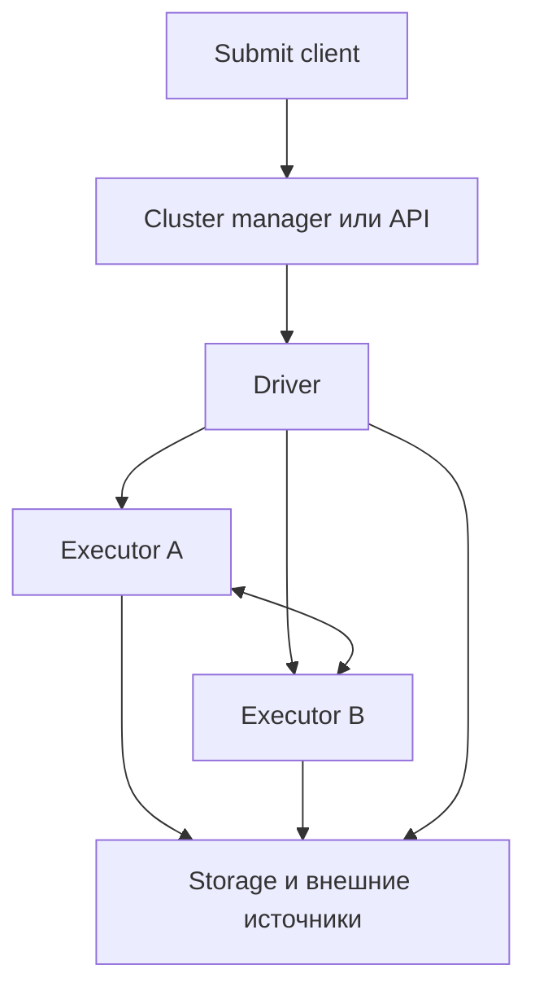
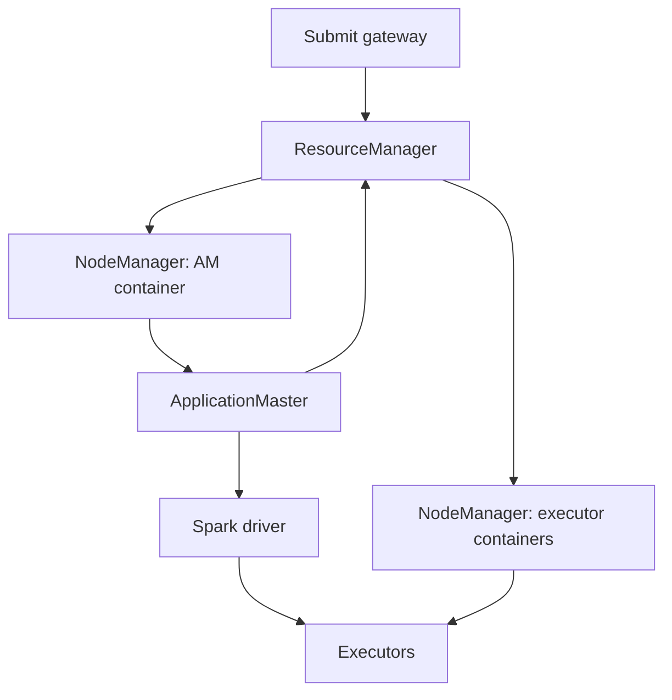
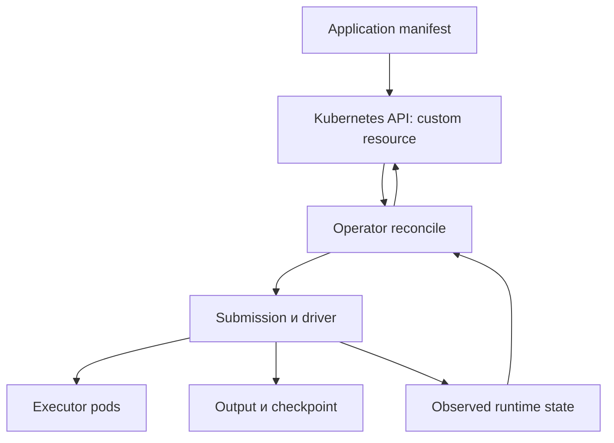
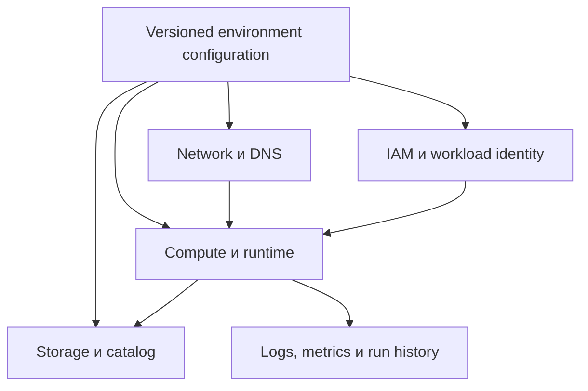

# 22. Развёртывание: Standalone, YARN, Kubernetes и облака

Основной язык примеров — **Python / PySpark**. Учебное окружение: **Apache Spark 4.2.0, Python 3.12, Java 17, Spark Classic, Linux**. Для локальной проверки использованы `local[2]` и настоящий Standalone с отдельными процессами master, worker, driver и двух executors на одной машине.

**Цель раздела:** понять, кто создаёт driver/executors, откуда они получают код и credentials, как им выделяются CPU, память и диски, какие сетевые маршруты необходимы и что переживает остановку compute.

**Как пользоваться примерами**

- **Локальная лаборатория** выполняется на отдельном учебном компьютере/окружении. Loopback-адреса `127.0.0.1` в ней корректны, потому что все процессы находятся на одной машине и видят одну сеть.
- **Кластерный шаблон** требует существующего YARN/Kubernetes/облачного окружения. Домены `.example`, cloud IDs, bucket names, image reference и storage classes заменяются своими значениями.
- Для полного дистрибутива доступны `sbin/start-master.sh` и `start-worker.sh`; пакет PySpark может поставлять иной набор административных scripts. Лаборатория использует `bin/spark-class`, проверенный в установленном пакете.
- Cluster manager, deploy mode, оператор и vendor runtime — разные оси выбора. Kubernetes не требует Spark Operator для native submission; Standalone не означает local mode.
- Cloud runtime выбирается по матрице провайдера. Версия Spark 4.2.0 локальной лаборатории не означает, что каждый managed service предоставляет её.
- Базовое приложение использует Classic `SparkContext` для metadata. В Spark Connect/serverless с ограниченным API адаптируй entrypoint и сбор metadata; сами DataFrame-преобразования можно отделить от запуска.
- Дата проверки документации и примеров — **13 октября 2026 года**. Для новой установки сверяй поддержку runtime, Kubernetes, operator chart и сервиса ещё раз.

**Содержание**

1. [Модели развёртывания](#deployment-models)
2. [Spark Standalone](#standalone)
3. [Spark on YARN](#yarn)
4. [Spark on Kubernetes](#kubernetes)
5. [Контейнерные образы](#images)
6. [Kubernetes Operators](#operators)
7. [Управляемые облачные платформы](#managed-cloud)
8. [Serverless и интерактивный compute](#serverless)
9. [Infrastructure as Code](#iac)
10. [Мультитенантность и изоляция](#isolation)

<a id="deployment-models"></a>

## Модели развёртывания

### Local, standalone cluster и внешний cluster manager

**Local mode** выполняет Spark-задачи в локальной JVM с заданным числом task threads. **Standalone** — cluster manager Spark: master выделяет ресурсы через workers, а те запускают executor processes. **YARN/Kubernetes** выделяют ресурсы через собственные механизмы containers/pods.

| Модель | Кто выделяет executors | Типичный учебный/рабочий сценарий |
| --- | --- | --- |
| `local[2]` | Нет отдельного распределённого allocator | Проверка API и алгоритма |
| Standalone | Spark master/workers | Собственный Spark-кластер |
| YARN | ResourceManager + ApplicationMaster + NodeManagers | Hadoop-платформа |
| Kubernetes | Kubernetes API/scheduler, Spark driver | Контейнерная платформа |
| Managed/serverless | Управляемая система провайдера | Сервисный submit API и выбранный runtime |

У каждого приложения свой driver и executors; worker — не executor. Один worker способен запускать executors разных приложений.

`local-cluster[N,C,M]` — специальный тестовый режим, не production Standalone. Он не заменяет проверку сетей, namespaces, quotas и отдельных узлов. `local[*]` выбирает доступные JVM logical processors; это не обещание всей физической CPU-мощности хоста.

**Наблюдение из лаборатории:** Standalone worker с двумя cores запустил два отдельных executor JVM по одному core. Это другой process layout, чем `local[2]`, даже при одинаковом числе task slots.

[Cluster overview](https://spark.apache.org/docs/4.2.0/cluster-overview.html).

### Master URL и адреса driver/executors

Master URL выбирает механизм управления приложением. Он не является универсальным адресом Spark UI или endpoint чтения данных.

| Значение | Что означает |
| --- | --- |
| `local[2]` | Локальные task threads |
| `spark://master.internal.example:7077` | Standalone master RPC |
| `spark://master-a:7077,master-b:7077` | Standalone HA masters |
| `yarn` | YARN cluster из Hadoop/YARN configuration |
| `k8s://https://api.internal.example:6443` | Kubernetes API server |
| `sc://connect.internal.example:15002` | Spark Connect server; отдельный протокол/путь подключения |

Порт Standalone master RPC обычно 7077, master UI — 8080, REST submission при включении — 6066. Driver UI обычно начинается с 4040. Не отправляй `--master` на web UI port.

`spark.driver.host` — advertised address driver, который должны достигать executors. `spark.driver.bindAddress` — локальный адрес интерфейса для bind. `0.0.0.0` может быть bind address, но не полезным адресом для подключения remote executors.

**Пример ошибки:** driver внутри контейнера сообщает executors `localhost`. Для executor это его собственная network namespace, поэтому SparkContext на другом pod недоступен.

**Самопроверка:** чем отличаются Kubernetes API URL, driver service DNS, Spark Connect endpoint и object-storage URI?

[Master URLs](https://spark.apache.org/docs/4.2.0/submitting-applications.html#master-urls).

### Client/cluster deploy mode и место размещения driver

**Client mode:** driver живёт в процессе/окружении отправителя. **Cluster mode:** driver создаётся в управляемой cluster environment. Deploy mode не определяет язык приложения и не равен cluster manager.

| Свойство | Client | Cluster |
| --- | --- | --- |
| Driver placement | Gateway, notebook host, submit container | Worker/container/pod сервиса |
| Зависимость от submit host | Driver должен оставаться живым | Submit client может только наблюдать/отправлять |
| Driver networking | Executors должны достигать client host | Обычно cluster-local routes |
| Driver logs | На submit host плюс log pipeline | В logs платформы/driver container |
| Хороший сценарий | Интерактивная работа с близкого gateway | Автономный batch/streaming run |

Cluster submission accepted не означает application succeeded. Даже если submit client не ждёт завершения, требуется получить итоговый status и проверить output.

**Сквозное приложение `deployment_smoke.py`:** сохрани этот блок как Python-файл для лабораторий. Master и resources задаются через `spark-submit`, а не зашиваются в business code.

```python
import argparse
import json
from pathlib import Path

from pyspark.sql import SparkSession, functions as F

parser = argparse.ArgumentParser()
parser.add_argument("--output", required=True)
parser.add_argument("--report")
args = parser.parse_args()

spark = SparkSession.builder.appName("deployment-smoke").getOrCreate()
try:
    sc = spark.sparkContext
    sc.setLogLevel("WARN")

    result = (
        spark.range(1000, numPartitions=4)
        .withColumn("bucket", F.col("id") % 5)
        .groupBy("bucket")
        .agg(
            F.count(F.lit(1)).alias("rows"),
            F.sum("id").alias("sum_id"),
        )
    )
    result.write.mode("errorifexists").parquet(args.output)

    restored = spark.read.parquet(args.output).collect()
    assert len(restored) == 5
    assert sum(row["rows"] for row in restored) == 1000
    assert sum(row["sum_id"] for row in restored) == 499500

    report = {
        "spark_version": spark.version,
        "master": sc.master,
        "application_id": sc.applicationId,
        "groups": len(restored),
        "rows": sum(row["rows"] for row in restored),
        "sum_id": sum(row["sum_id"] for row in restored),
        "output": args.output,
    }
    print(json.dumps(report, ensure_ascii=False))

    if args.report:
        # Учебный локальный отчёт: путь должен быть writable на driver.
        Path(args.report).write_text(
            json.dumps(report, indent=2),
            encoding="utf-8",
        )
finally:
    spark.stop()
```

`collect()` получает только пять агрегированных строк. Запись и повторное чтение проверяют не только вычисление, но и доступ к output. `errorifexists` специально не перезаписывает прошлый run: для повторения используй новый каталог.

**Локальный запуск:**

```bash
DEPLOY_LAB_DIR="$(mktemp -d)"
SPARK_LOCAL_IP=127.0.0.1 spark-submit \
  --master 'local[2]' \
  --driver-memory 512m \
  --conf spark.sql.shuffle.partitions=4 \
  deployment_smoke.py \
  --output "file://$DEPLOY_LAB_DIR/local-result" \
  --report "$DEPLOY_LAB_DIR/local-report.json"
```

Для нескольких узлов `file://` означает filesystem каждой машины, а не общее хранилище. Такой путь допустим в этой лаборатории; на настоящем кластере используй общее storage с подходящим connector и credentials.

`SPARK_LOCAL_IP=127.0.0.1` фиксирует адрес для лаборатории на одной машине и помогает в контейнерном окружении, где hostname разрешается в недоступный для bind адрес. Для отдельных локальных Python-лабораторий ниже используй тот же префикс: `SPARK_LOCAL_IP=127.0.0.1 python3 имя_файла.py`. На нескольких узлах нужны настоящие адреса, достижимые другими процессами кластера.

### Сетевые маршруты между компонентами

Не достаточно открыть один master/API port. После allocation процессы должны обмениваться control/data traffic, читать зависимости и достигать storage/источников.

| Направление | Для чего |
| --- | --- |
| Submit client → cluster manager/API | Отправка приложения |
| Driver → manager/API | Allocation и управление executors |
| Executors → driver | Регистрация, heartbeat, task results |
| Driver ↔ executors | Доставка задач/кода и control traffic |
| Executor ↔ executor | Shuffle/block transfer |
| Driver/executors → storage/catalog | Metadata, input/output/checkpoint |
| Nodes → registry/repository | Image pull и dependencies |
| Пользователь/collector → UI/log endpoints | Наблюдаемость |



В client mode driver уже находится у отправителя; стрелка manager → driver в схеме обозначает именно создание cluster-mode driver. Для troubleshooting нарисуй фактическое размещение своего приложения.

Проверь DNS, advertised addresses, TLS/auth, firewall/NetworkPolicy и ответы сервиса. Успешный TCP connect не подтверждает правильный protocol/auth. NAT без inbound route к client driver — частая причина «executors создались, tasks не идут».

**Практика:** отметь source/destination network namespace каждого подключения. Объясни, почему доступный с ноутбука UI не доказывает доступ executors к driver RPC.

### Привязка сервисных портов, конфликты адресов и spark.port.maxRetries как лимит повторов поиска доступного порта

`spark.port.maxRetries` ограничивает **bind retries**, а не повторы jobs/tasks или сетевых requests. Для фиксированного порта P Spark последовательно пробует P, P+1 и далее до P+maxRetries, если речь идёт о поддерживающем такой bind сервисе.

В Spark 4.2.0 значение по умолчанию — 16. Следовательно, диапазон включает начальную попытку плюс до 16 повторов. Для port 0 ОС выбирает свободный ephemeral port; это другая ситуация.

**Шаблон фиксированных driver ports:**

```properties
spark.driver.host driver.internal.example
spark.driver.bindAddress 0.0.0.0
spark.driver.port 35000
spark.driver.blockManager.port 35010
spark.port.maxRetries 0
```

Нулевой retry делает конфликт предсказуемым fail-fast, но требует действительно свободного порта. Значение 16 при firewall, разрешающем только P, может дать успешный bind P+1 и затем networking failure.

Не назначай один `spark.blockManager.port` нескольким executors, живущим в одной network namespace, без модели разных ports. На Kubernetes каждый pod обычно имеет своё port space; `hostNetwork` меняет это предположение.

**Практика:** займи один фиксированный port в учебном окружении, сравни запуск с retries=0 и retries=1 и запиши фактически выбранный port. Не путай конфликт bind с `Connection refused` при попытке достигнуть чужого процесса.

[Network configuration](https://spark.apache.org/docs/4.2.0/configuration.html#networking).

### Долгоживущий кластер и ephemeral cluster под job

Долгоживущий кластер амортизирует startup и используется несколькими runs. Ephemeral compute создаётся для ограниченного workload и освобождается после него. Ephemeral Spark application на постоянном Kubernetes cluster — ещё одна модель: control plane/nodes могут жить дольше приложения.

| Долгоживущий compute | Compute под run |
| --- | --- |
| Быстрый повторный submit | Более чистое окружение запуска |
| Возможны warm caches/pools | Явный lifecycle и ownership ресурсов |
| Нужны quotas и борьба с neighbours | Есть startup/provisioning latency |
| Idle capacity может стоить денег | Cleanup должен срабатывать при сбоях |
| Накопление work dirs/dependencies | Данные/история должны быть внешними |

Ephemeral не означает автоматическое исчезновение всех связанных объектов. Buckets, disks, PVCs, logs, orphan pods и сетевые ресурсы имеют собственный lifecycle.

Для streaming важны recovery time и durable checkpoint, а для short batch startup может превосходить compute time. Измеряй время от ожидаемого запуска до опубликованного результата, включая provisioning и queue wait.

**Упражнение:** выбери модели для ежедневной витрины, интерактивного notebook и непрерывного Kafka stream. Укажи, какие ресурсы должны сохраняться после остановки.

### Отделение compute от storage

Compute обрабатывает данные; storage сохраняет input, output, checkpoints, metadata и историю. Их lifecycle нельзя считать одинаковым.

| Данные | Где хранить при ephemeral compute |
| --- | --- |
| Источник и committed output | Durable shared storage/table system |
| Streaming checkpoint | Durable location с поддерживаемым filesystem |
| Event logs и run history | Внешнее доступное наблюдаемости хранилище |
| Shuffle/spill/temp | Local disk/volume согласно выбранному recovery |
| Credentials | Identity/secret management, не output directory |

Объектное хранилище не является POSIX-диском: path/rename/commit semantics зависят от connector/committer/table format. Разделение compute и storage не означает отсутствие сетевой стоимости и ограничений throughput.

Локальный cache улучшает повторное чтение, но не становится авторитетной копией данных. Удаление executors должно влиять на скорость/recomputation, а не уничтожать единственный экземпляр результата.

**Практика по теме:** составь таблицу «объект → владелец → срок жизни → recovery». **Самопроверка:** чем deploy mode отличается от cluster manager; почему client driver нельзя просто закрыть; какие данные нельзя оставлять в ephemeral disk?

<a id="standalone"></a>

## Spark Standalone

### Master, workers и регистрация executors

Master хранит состояние кластера и распределяет ресурсы; worker сообщает свои resources и запускает процессы; driver регистрирует application и затем взаимодействует с выделенными executors.

**Лаборатория A: три терминала, одна машина.** Используй отдельный учебный каталог, доступные порты и пути с правом записи. В полном дистрибутиве `spark-class` обычно находится в `$SPARK_HOME/bin`; пакет PySpark также поставляет его.

**Терминал 1 — master:**

```bash
SPARK_LOCAL_IP=127.0.0.1 SPARK_DAEMON_MEMORY=256m \
  spark-class org.apache.spark.deploy.master.Master \
  --host 127.0.0.1 \
  --port 17077 \
  --webui-port 18090
```

**Терминал 2 — worker:**

```bash
STANDALONE_WORK_DIR="$(mktemp -d)"
SPARK_LOCAL_IP=127.0.0.1 SPARK_DAEMON_MEMORY=256m \
  spark-class org.apache.spark.deploy.worker.Worker \
  --host 127.0.0.1 \
  --port 17078 \
  --webui-port 18091 \
  --cores 2 \
  --memory 1536m \
  --work-dir "$STANDALONE_WORK_DIR" \
  spark://127.0.0.1:17077
```

Процессы работают foreground; завершай именно эти учебные процессы после проверки. Если wrappers не находятся в PATH, используй абсолютный путь из установленного Spark.

Открой master UI `http://127.0.0.1:18090`: один ALIVE worker, два cores, 1536 MiB объявленной памяти. Выделенная worker memory — capacity для allocation, а не измеренный RSS worker daemon.

**Терминал 3 — отправка сквозного приложения:**

```bash
STANDALONE_RUN_DIR="$(mktemp -d)"
SPARK_LOCAL_IP=127.0.0.1 spark-submit \
  --master spark://127.0.0.1:17077 \
  --deploy-mode client \
  --driver-memory 512m \
  --executor-memory 512m \
  --executor-cores 1 \
  --total-executor-cores 2 \
  --conf spark.driver.host=127.0.0.1 \
  --conf spark.driver.bindAddress=127.0.0.1 \
  --conf spark.sql.shuffle.partitions=4 \
  deployment_smoke.py \
  --output "file://$STANDALONE_RUN_DIR/result" \
  --report "$STANDALONE_RUN_DIR/report.json"
```

Проверенный результат: пять групп, 1000 строк, сумма IDs 499500; в work directory возникли каталоги двух executor processes. На многомашинном кластере loopback и локальный output надо заменить cluster addresses/shared storage.

[Spark Standalone](https://spark.apache.org/docs/4.2.0/spark-standalone.html).

### Ресурсы worker и ограничения приложения; spark.cores.max как общий предел CPU приложения в Standalone и его отличие от spark.executor.cores

`SPARK_WORKER_CORES`/`--cores` описывает capacity worker. `spark.cores.max` ограничивает суммарно выделенные cores приложения в Standalone. `spark.executor.cores` определяет размер одного executor и task concurrency при обычном `spark.task.cpus=1`.

| Параметр | Область |
| --- | --- |
| Worker cores/memory | Объявленные ресурсы узла для cluster manager |
| `spark.cores.max` | Общий core cap приложения |
| `spark.executor.cores` | Cores одного executor |
| `spark.executor.memory` | Heap одного executor |
| `spark.task.cpus` | Требуемые cores task для scheduling |
| `--total-executor-cores` | Standalone submit option для общего core cap |

Если executor получает два cores, task требует один — обычно возможно две tasks одновременно. Executor с одним core и task, требующей два, не сможет штатно выполнять такую task.

**Чистый Python-пример оценки верхней границы:** не заменяет реальный allocator и память узлов.

```python
worker_cores = [4, 4]
app_core_cap = 6
cores_per_executor = 2
cpus_per_task = 1

executor_core_capacity = sum(
    cores // cores_per_executor for cores in worker_cores
)
executor_app_cap = app_core_cap // cores_per_executor
max_executors_by_cpu = min(executor_core_capacity, executor_app_cap)
max_task_slots = max_executors_by_cpu * (cores_per_executor // cpus_per_task)

assert max_executors_by_cpu == 3
assert max_task_slots == 6
```

Настоящее размещение ограничивается также executor memory, resource profiles, свободными worker resources и scheduling policy. Core limit не является OS CPU cgroup limit и не резервирует capacity заранее.

Для dynamic allocation в Standalone задавай executor cores явно, чтобы размер executor не получился неожиданным. `spark.cores.max` остаётся общей границей; семантику `spark.executor.instances`/initial allocation проверяй для конкретного manager.

### Запуск и supervision driver при поддержке режима

Standalone cluster mode умеет запускать поддерживаемое JVM-приложение на worker. `--supervise` позволяет перезапустить driver после неуспешного завершения в поддерживаемом режиме.

**Кластерный шаблон для Scala/Java JAR:**

```bash
spark-submit \
  --master spark://master.internal.example:7077 \
  --deploy-mode cluster \
  --supervise \
  --class com.example.Main \
  --driver-memory 2g \
  --executor-memory 4g \
  --executor-cores 2 \
  --total-executor-cores 8 \
  application.jar \
  --run-id example-run-001
```

JAR и main class должны действительно существовать; это не команда для Python-файла лаборатории.

Supervision перезапускает driver process, а не откатывает external effects. Для batch replay требуются идемпотентная publication и сохранённый run context; для Structured Streaming — совместимый durable checkpoint.

Не складывай supervision, operator restarts и orchestration retries без общей retry policy. Несколько независимых уровней могут создать competing runs одного интервала.

**Самопроверка:** чем driver restart отличается от task retry и почему успешный повтор не гарантирует отсутствие дубликатов?

### Master recovery и ZooKeeper-based high availability

Один master — single point of availability cluster control. Standalone поддерживает recovery modes, включая ZooKeeper-based HA с несколькими masters и локальное сохранение state для single-node recovery.

**Шаблон опций master daemons:**

```bash
SPARK_MASTER_OPTS="-Dspark.deploy.recoveryMode=ZOOKEEPER -Dspark.deploy.zookeeper.url=zk-a:2181,zk-b:2181,zk-c:2181 -Dspark.deploy.zookeeper.dir=/spark-prod" \
  "$SPARK_HOME/sbin/start-master.sh"
```

Настрой соответствующий режим на всех masters и используй общий ZooKeeper ensemble/namespace. Клиенту передают список masters:

```bash
spark-submit \
  --master spark://master-a:7077,master-b:7077 \
  --deploy-mode client \
  deployment_smoke.py \
  --output hdfs:///labs/deployment/example-run-001
```

HA master не реплицирует RAM executors, не восстанавливает потерянные shuffle blocks автоматически и не превращает application output в транзакционный. Driver/executor/data recovery остаются отдельными механизмами.

Для single-node recovery `FILESYSTEM` сохраняет cluster state в `spark.deploy.recoveryDirectory`; потеря того же диска/узла ограничивает его полезность. Не путай эту directory с streaming checkpoint.

**Практика:** спланируй failover test master с заранее определёнными критериями: регистрация clients/workers, existing application progress, новые submissions, сохранность output.

[Standalone high availability](https://spark.apache.org/docs/4.2.0/spark-standalone.html#high-availability).

### Логи, рабочие каталоги и cleanup

Worker work directory содержит application/executor logs и локальные artifacts. Shuffle/spill может использовать каталоги `SPARK_LOCAL_DIRS`/`spark.local.dir`; driver logs client mode находятся у клиента.

**Шаблон worker configuration:**

```properties
spark.worker.cleanup.enabled true
spark.worker.cleanup.interval 3600
spark.worker.cleanup.appDataTtl 604800
```

Значения interval/TTL для этих worker properties задаются в секундах. Политика семь дней — пример, а не универсальный срок хранения. Убедись, что параметр передан worker daemon, а не только Spark-приложению.

До cleanup отправь нужные logs/event logs/run records в durable monitoring storage. Очистка worker artifacts не должна удалять business output, пользовательские checkpoints и каталоги других сервисов.

Для диагностики связывай application ID → executor directory → stdout/stderr → host. Успешный driver log не подтверждает, что ни один executor не имел retries/OOM.

**Упражнение:** раздели filesystem paths на worker artifacts, shuffle, event logs и output. Для каждого назначь владельца cleanup.

### Ограничения deploy modes для выбранного языка

Для **Spark 4.2.0 Standalone Python application не поддерживает `--deploy-mode cluster`**. Рабочий путь лаборатории — client mode с driver на gateway/submit host.

| Язык/entrypoint | Standalone client | Standalone cluster |
| --- | --- | --- |
| Scala/Java JAR | Поддерживаемый сценарий | Поддерживаемый сценарий при корректной submission |
| Python `.py` | Поддерживаемый сценарий | Не поддерживается в этой версии |
| Interactive shell | Driver в shell/session | Не эквивалент автономному cluster-mode JAR |

Обёртка Python-кода в контейнер не снимает ограничение Standalone deploy mode. Можно разместить client driver в отдельном управляемом gateway/container, но это всё ещё client mode по отношению к Standalone.

YARN и Kubernetes имеют собственную поддержку Python cluster mode. Spark Connect позволяет вынести клиентскую интерактивность из driver процесса, но не является переключателем deploy mode существующего `spark-submit`.

**Практика по теме:** выбери способ запуска PySpark на Standalone, который переживает закрытие пользовательского терминала без потери driver process, и опиши управление gateway/service lifecycle. **Самопроверка:** кто создаёт executors; что ограничивает `spark.cores.max`; что сохраняет master HA; почему supervision не равна recovery бизнес-результата?

[Application submission](https://spark.apache.org/docs/4.2.0/submitting-applications.html).

<a id="yarn"></a>

## Spark on YARN

### ResourceManager, NodeManager и ApplicationMaster

ResourceManager распределяет cluster resources между YARN applications; NodeManager запускает и контролирует containers на узле; ApplicationMaster конкретного Spark application взаимодействует с YARN и управляет жизненным циклом ресурсов приложения.



В cluster mode Spark driver находится в AM container; в client mode driver живёт на gateway, а AM выполняет свою координирующую роль. Схема показывает роли, а не обязательные отдельные процессы каждой коробки.

YARN container — ресурсная единица YARN, не обязательный Docker/OCI container. Изоляция процессов, CPU accounting и enforcement зависят от NodeManager/runtime configuration.

Spark UI показывает состояние computation; ResourceManager UI — allocation/application attempts; NodeManager/aggregated logs объясняют контейнерные failures. Эти источники дополняют друг друга.

[YARN architecture](https://hadoop.apache.org/docs/stable/hadoop-yarn/hadoop-yarn-site/YARN.html), [Spark on YARN](https://spark.apache.org/docs/4.2.0/running-on-yarn.html).

### YARN containers и размещение driver/executors

**Кластерный шаблон:** Hadoop/YARN client configuration доступна submit process.

```bash
HADOOP_CONF_DIR=/etc/hadoop/conf \
spark-submit \
  --master yarn \
  --deploy-mode cluster \
  --queue data-engineering \
  --driver-memory 2g \
  --executor-memory 4g \
  --executor-cores 2 \
  --num-executors 3 \
  deployment_smoke.py \
  --output hdfs:///labs/deployment/run-yarn-001
```

Значения queue и HDFS path должны существовать/быть разрешены. Driver на кластере должен видеть Python entrypoint, dependencies и filesystem configuration.

| Настройка | Cluster mode | Client mode |
| --- | --- | --- |
| `spark.driver.memory` | Driver в AM container | Driver JVM на gateway; задаётся до её запуска |
| `spark.yarn.am.memory` | Не основной бюджет driver этого режима | Бюджет координирующего AM |
| Driver network | Cluster-local | Gateway должен быть reachable из containers |
| Executor resources | YARN allocations | YARN allocations |
| Driver credentials/logs | В окружении AM/платформы | На gateway плюс централизованный сбор |

Executor container memory включает heap, overhead, configured off-heap и отдельную PySpark memory, если она задана. `--executor-memory 4g` не равно total container memory 4 GiB.

YARN может округлять requests до allocation increments и ограничивать maximum container size. Запрос трёх executors не обещает немедленную выдачу всех трёх.

### Очереди, CapacityScheduler/FairScheduler и доступные ресурсы

Queue задаёт правила общего allocation: capacities/shares, ACL, user/application limits, priority и preemption. Spark scheduling внутри driver — другой уровень.

| Уровень | Решение |
| --- | --- |
| YARN scheduler | Какому application дать containers |
| Spark FIFO/FAIR | Каким jobs внутри SparkContext дать task slots |
| Task resource requirements | На каком executor task может выполняться |

`spark.scheduler.mode=FAIR` не переключает YARN в FairScheduler. Выбор YARN scheduler находится в cluster configuration.

CapacityScheduler описывает capacities/elastic sharing очередей; FairScheduler — fair shares и pools при поддержке выбранной Hadoop distribution. Не копируй queue config из другой версии: allocation syntax, weights и доступные функции меняются.

Причины долгого ACCEPTED/pending: нехватка AM capacity, user limit, maximum applications, слишком крупный container, node labels, ресурсная фрагментация или ACL/queue placement.

**Пример:** свободно 12 GiB суммарно на трёх узлах по 4 GiB, но executor требует 6 GiB. Суммарное значение не гарантирует возможность размещения ни одного executor.

**Практика:** сравни queue capacity, currently used resources, AM limit и размер requested containers. Объясни, почему увеличение `num-executors` не снимает queue constraint.

[CapacityScheduler](https://hadoop.apache.org/docs/stable/hadoop-yarn/hadoop-yarn-site/CapacityScheduler.html), [FairScheduler](https://hadoop.apache.org/docs/stable/hadoop-yarn/hadoop-yarn-site/FairScheduler.html).

### Hadoop/Hive configuration и distributed cache

`HADOOP_CONF_DIR`/`YARN_CONF_DIR` определяют cluster addresses и Hadoop behavior для client. Spark должен видеть соответствующие `core-site.xml`, `hdfs-site.xml`, `yarn-site.xml`; Hive/metastore configuration настраивается отдельно в выбранном runtime.

Не достаточно установить Python `pyspark`: Hadoop connector/JVM classes и XML configuration нужны соответствующим процессам. Hive catalog access также требует network/auth и совместимого metastore client.

| Опция | Что доставляет |
| --- | --- |
| `--files` | Обычные файлы в working environment |
| `--archives` | Архивы с распаковкой/alias |
| `--py-files` | Python `.py/.zip/.egg` для import |
| `--jars` | JVM JAR dependencies |
| `spark.yarn.jars`/`spark.yarn.archive` | Spark runtime artifacts для YARN |

`--py-files` не устанавливает wheel с native extension как полноценный environment. Для такой dependency подходит совместимый packed environment/image/runtime mechanism.

**Кластерный шаблон Python environment:**

```bash
HADOOP_CONF_DIR=/etc/hadoop/conf \
spark-submit \
  --master yarn \
  --deploy-mode cluster \
  --archives 'hdfs:///artifacts/envs/spark-python.tar.gz#environment' \
  --conf spark.pyspark.python=./environment/bin/python \
  deployment_smoke.py \
  --output hdfs:///labs/deployment/run-yarn-env-001
```

Архив должен быть подготовлен для нужной ОС, architecture, Python minor version и native libraries. В client mode driver не получает автоматически тот же relative archive path на gateway.

**Отдельная локальная проверка доставки файла:** публичный SparkFiles API позволяет найти localized file внутри task.

```python
import json
import sys
import tempfile
from pathlib import Path

from pyspark import SparkFiles
from pyspark.sql import SparkSession

files_lab = Path(tempfile.mkdtemp(prefix="spark-files-lab-"))
settings_file = files_lab / "settings.json"
settings_file.write_text(json.dumps({"multiplier": 3}), encoding="utf-8")

files_spark = (
    SparkSession.builder
    .master("local[2]")
    .appName("deployment-files-check")
    .config("spark.python.use.daemon", "false")
    .config("spark.pyspark.python", sys.executable)
    .getOrCreate()
)
try:
    files_sc = files_spark.sparkContext
    files_sc.addFile(str(settings_file))

    def transform_partition(values):
        import json
        from pyspark import SparkFiles

        with open(SparkFiles.get("settings.json"), encoding="utf-8") as stream:
            factor = json.load(stream)["multiplier"]
        for value in values:
            yield value * factor

    values = files_sc.parallelize([1, 2, 3], 2).mapPartitions(
        transform_partition
    ).collect()
    assert sorted(values) == [3, 6, 9]
finally:
    files_spark.stop()
```

Эта проверка выполняется локально, не проверяет YARN distributed cache permissions. Параметр daemon=false выбран для изолированного учебного runtime; он не является универсальной performance recommendation.

[SparkFiles.get](https://spark.apache.org/docs/4.2.0/api/python/reference/api/pyspark.SparkFiles.get.html), [Python package management](https://spark.apache.org/docs/4.2.0/api/python/tutorial/python_packaging.html).

### Log aggregation и диагностика application attempts

YARN log aggregation переносит container logs в настроенное storage. Для давно завершённого driver/executor это важнее URL живого UI.

**Диагностические команды для существующего application:**

```bash
yarn application -status application_1234567890000_0001
yarn applicationattempt -list application_1234567890000_0001
yarn logs -applicationId application_1234567890000_0001
```

Заменяй ID actual value. Доступ/полнота aggregation зависят от cluster policy, владельца application, retention и состояния container logs.

Различай application ID, application attempt ID, container ID и Spark stage/task attempt. Перезапуск AM — не тот же retry, что повтор одной task.

| Симптом | Первое свидетельство |
| --- | --- |
| Driver/AM failed | AM container logs + YARN attempt diagnostics |
| Executor killed | Container exit reason + memory/CPU policy |
| Application pending | Scheduler/queue allocation |
| Spark job failed при running application | Driver task/job failure chain |
| UI уже отсутствует | Aggregated logs + event log History Server |

`spark.yarn.maxAppAttempts` ограничивается также политикой ResourceManager. Согласуй attempts с application idempotency и retry orchestration; число успешных attempts не равно числу опубликованных бизнес-интервалов.

[YARN commands](https://hadoop.apache.org/docs/stable/hadoop-yarn/hadoop-yarn-site/YarnCommands.html).

### Kerberos, delegation tokens и длительные приложения

Kerberos подтверждает identity; delegation tokens дают процессам ограниченный по scope/time доступ к сервисам. Долгий stream требует поддерживаемого renewal, а не только успешной authentication при startup.

**Кластерный шаблон:**

```bash
spark-submit \
  --master yarn \
  --deploy-mode cluster \
  --principal svc-spark@EXAMPLE.COM \
  --keytab /secure/path/service.keytab \
  deployment_smoke.py \
  --output hdfs:///labs/deployment/run-secure-001
```

Keytab — секретный artifact, не файл для общего репозитория. Его localization/renewal и доступ к KDC выполняются в защищённой инфраструктуре.

При keytab-backed credentials Spark может поддерживать получение новых credentials/tokens согласно доступным providers. При `spark.kerberos.renewal.credentials=ccache` используются ticket-cache credentials; их renewable lifetime и внешнее обновление надо учитывать.

Проверь driver и executors, Kerberos clock skew, service principal/DNS, доступ к KDC, scope tokens разных filesystems и время expiry. Успешное HDFS чтение не доказывает доступ к Hive, HBase или другому Hadoop-compatible storage.

**Практика:** спланируй тест длительного приложения, который пересекает token-renewal boundary, и проверку чтения/commit после renewal. Не выводи token contents для проверки.

[Spark security и Kerberos](https://spark.apache.org/docs/4.2.0/security.html).

### External shuffle service и Dynamic Allocation

Dynamic Allocation изменяет число executors; shuffle protection сохраняет возможность прочитать их результаты после удаления процесса. Эти механизмы должны быть согласованы.

На YARN классический external shuffle service запускается как NodeManager auxiliary service. Его JAR/classpath и version compatibility настраиваются администраторами cluster.

**Фрагмент `yarn-site.xml` для настроенного NodeManager:**

```xml
<configuration>
  <property>
    <name>yarn.nodemanager.aux-services</name>
    <value>spark_shuffle</value>
  </property>
  <property>
    <name>yarn.nodemanager.aux-services.spark_shuffle.class</name>
    <value>org.apache.spark.network.yarn.YarnShuffleService</value>
  </property>
</configuration>
```

Если у NodeManager уже есть другие auxiliary services, добавь `spark_shuffle` к существующему списку, а не заменяй его этим минимальным фрагментом.

**Spark application configuration для этого выбранного механизма:**

```properties
spark.shuffle.service.enabled true
spark.dynamicAllocation.enabled true
spark.dynamicAllocation.minExecutors 1
spark.dynamicAllocation.initialExecutors 2
spark.dynamicAllocation.maxExecutors 10
```

Не устанавливай `spark.shuffle.service.enabled=true` там, где service отсутствует. В Spark доступны и другие подходы к сохранению/учёту shuffle, например shuffle tracking; выбирай supported architecture manager/runtime. Поведение decommission/remote shuffle требует отдельной проверки.

**Практика по теме:** опиши allocation, filesystem configuration, log access и credential renewal для одного YARN run. **Самопроверка:** где driver в обоих modes; чем queue отличается от Spark FAIR pool; что делает localized archive; почему dynamic allocation без корректного shuffle lifecycle приводит к retries?

<a id="kubernetes"></a>

## Spark on Kubernetes

### Driver pod, executor pods и Kubernetes API

Native cluster submission создаёт driver pod; driver через Kubernetes API создаёт executor pods и управляет их состоянием. Scheduler размещает pods на nodes. Отдельный Spark Standalone master для такого native run не нужен.

Для документации **Spark 4.2.0** проверенное минимальное требование — **Kubernetes 1.34+**, плюс совместимость используемого Kubernetes client и cluster policy.

**Кластерный шаблон:** подготовленный image уже содержит `/opt/app/deployment_smoke.py`; runtime identity имеет доступ к output storage.

```bash
spark-submit \
  --master k8s://https://api.internal.example:6443 \
  --deploy-mode cluster \
  --name deployment-smoke \
  --conf spark.kubernetes.namespace=spark-lab \
  --conf spark.kubernetes.container.image=registry.internal.example/spark-lab:4.2.0-r1 \
  --conf spark.kubernetes.authenticate.driver.serviceAccountName=spark-driver \
  --conf spark.kubernetes.authenticate.executor.serviceAccountName=spark-executor \
  --conf spark.driver.memory=1g \
  --conf spark.driver.memoryOverhead=512m \
  --conf spark.executor.memory=2g \
  --conf spark.executor.memoryOverhead=1g \
  --conf spark.executor.cores=1 \
  --conf spark.executor.instances=2 \
  local:///opt/app/deployment_smoke.py \
  --output s3a://example-data-lake/labs/deployment/run-k8s-001
```

`local:///` обозначает artifact, уже присутствующий внутри image/runtime, а не файл ноутбука. S3A в шаблоне требует совместимого connector и cloud identity; image с одним Spark не гарантирует этого.

В client mode driver может быть pod/gateway вне native driver creation path. Executors всё равно должны достигать driver address, а owner references/cleanup надо правильно связать с driver pod при таком размещении.

[Running on Kubernetes](https://spark.apache.org/docs/4.2.0/running-on-kubernetes.html).

### ServiceAccount, RBAC и namespace

ServiceAccount задаёт Kubernetes identity pod. RBAC разрешает операции API. Namespace организует ресурсы и scope некоторых permissions, но сам по себе не гарантирует data/network isolation.

**Шаблон namespace и двух identities:**

```yaml
apiVersion: v1
kind: Namespace
metadata:
  name: spark-lab
---
apiVersion: v1
kind: ServiceAccount
metadata:
  name: spark-driver
  namespace: spark-lab
---
apiVersion: v1
kind: ServiceAccount
metadata:
  name: spark-executor
  namespace: spark-lab
---
apiVersion: rbac.authorization.k8s.io/v1
kind: Role
metadata:
  name: spark-native-driver
  namespace: spark-lab
rules:
  - apiGroups: [""]
    resources: ["pods", "services", "configmaps"]
    verbs: ["get", "list", "watch", "create", "delete", "patch"]
---
apiVersion: rbac.authorization.k8s.io/v1
kind: RoleBinding
metadata:
  name: spark-native-driver
  namespace: spark-lab
subjects:
  - kind: ServiceAccount
    name: spark-driver
    namespace: spark-lab
roleRef:
  apiGroup: rbac.authorization.k8s.io
  kind: Role
  name: spark-native-driver
```

Это отправная точка для native pod allocation. PVC creation, deployment-based allocator, выбранный operator и дополнительные features могут требовать других resources/verbs. Проверяй actual API rejection и architecture; не выдавай cluster-admin ради устранения 403.

**Проверка настроенных прав:**

```bash
kubectl auth can-i create pods \
  --as=system:serviceaccount:spark-lab:spark-driver \
  --namespace spark-lab
```

Сам проверяющий пользователь должен иметь право impersonation для `--as`. Неуспех такой команды может относиться к проверяющему, а не к Role driver.

Kubernetes RBAC не выдаёт S3/GCS/ADLS permissions. Cloud workload identity/IAM и filesystem ACL — отдельные слои, которые нужны driver/executors при соответствующих операциях.

[RBAC](https://kubernetes.io/docs/reference/access-authn-authz/rbac/).

### Requests/limits и соответствие настройкам Spark

Kubernetes **requests** участвуют в placement; **limits** ограничивают ресурсы container при настройках enforcement. Spark cores определяют task scheduling; JVM heap — только часть памяти процесса.

| Spark property | Связь с pod |
| --- | --- |
| `spark.executor.cores` | Task concurrency и исходный CPU request |
| `spark.kubernetes.executor.request.cores` | Overrides CPU request; не меняет task concurrency |
| `spark.kubernetes.executor.limit.cores` | CPU limit |
| `spark.kubernetes.driver.request.cores` | Driver CPU request |
| `spark.executor.memory` | Executor JVM heap |
| `spark.executor.memoryOverhead` | Дополнительный budget |
| `spark.executor.pyspark.memory` | Отдельный PySpark budget при заданной настройке |
| `spark.memory.offHeap.size` | Configured off-heap pool при его использовании |

Для executor на YARN/Kubernetes request/container memory рассчитывается из heap + overhead + enabled configured off-heap + отдельно заданной PySpark memory. Если PySpark memory не задана, Python использует общий non-heap budget.

**Чистый Python-пример budget, MiB:**

```python
heap_mib = 4096
overhead_mib = 1024
offheap_mib = 512
python_mib = 1024

container_budget_mib = heap_mib + overhead_mib + offheap_mib + python_mib
assert container_budget_mib == 6656
```

Этот расчёт — request budget, не гарантированная верхняя граница реального RSS всех библиотек. Off-heap flag должен соответствовать использованию размера; Python resource limits зависят от платформы/implementation.

При `spark.executor.cores=4`, request=1 CPU, limit=2 CPU scheduler всё ещё может запускать четыре обычные tasks одновременно, но CPU service ограничено. Это увеличивает contention и способно усилить memory pressure.

Driver также нуждается в overhead для Python process/native memory. Прямо заданный `memoryOverhead` приоритетнее вычисления из factor. Для default factors учитывай отличие JVM/non-JVM Kubernetes jobs конкретной версии.

[Kubernetes resource management](https://kubernetes.io/docs/concepts/configuration/manage-resources-containers/).

### Pod templates, node selectors, affinity и tolerations

Spark строит pod из template, затем применяет собственные settings. Template не является последним неизменённым manifest: некоторые поля Spark переписывает.

**Шаблон executor pod `executor-template.yaml`:**

```yaml
apiVersion: v1
kind: Pod
metadata:
  labels:
    workload-family: spark-lab
spec:
  nodeSelector:
    workload: spark
  tolerations:
    - key: workload
      operator: Equal
      value: spark
      effect: NoSchedule
  securityContext:
    runAsNonRoot: true
    runAsUser: 185
    fsGroup: 185
  containers:
    - name: spark-executor
      resources:
        requests:
          ephemeral-storage: 2Gi
        limits:
          ephemeral-storage: 10Gi
      volumeMounts:
        - name: spark-local-dir-1
          mountPath: /var/data/spark
  volumes:
    - name: spark-local-dir-1
      emptyDir:
        sizeLimit: 8Gi
```

UID/group и filesystem permissions должны соответствовать image. Node label/taint должны существовать. Toleration **разрешает** размещение на tainted node, но не **выбирает** его: selector/affinity решают другой вопрос.

**Дополнительные submit options:**

```properties
spark.kubernetes.executor.podTemplateFile /absolute/path/executor-template.yaml
spark.kubernetes.executor.podTemplateContainerName spark-executor
```

Для native cluster submission Spark доставляет executor template driver через свой механизм. Тем не менее исходный файл должен быть доступен submit process, а generated pod — valid по правилам API/admission.

Affinity/anti-affinity помогают распределению и placement, но слишком жёсткие constraints оставляют pods Pending. Cluster autoscaler не всегда может создать node, удовлетворяющий все ограничения.

**Практика:** после submission сравни template с actual pod YAML. Укажи поля, которые пришли из template, Spark config и admission policy.

[Pod scheduling](https://kubernetes.io/docs/concepts/scheduling-eviction/assign-pod-node/), [taints/tolerations](https://kubernetes.io/docs/concepts/scheduling-eviction/taint-and-toleration/).

### ConfigMaps, Secrets и service discovery

ConfigMap хранит non-secret configuration; Secret — объекты для credentials/чувствительных данных с соответствующей protection policy. Base64 в Secret YAML не является шифрованием.

**Шаблон ConfigMap:**

```yaml
apiVersion: v1
kind: ConfigMap
metadata:
  name: deployment-settings
  namespace: spark-lab
data:
  settings.json: |
    {"environment": "lab", "output_prefix": "curated/deployment"}
```

**Spark properties для mount существующего Secret:**

```properties
spark.kubernetes.driver.secrets.storage-credentials /etc/storage-credentials
spark.kubernetes.executor.secrets.storage-credentials /etc/storage-credentials
```

Имя Secret и mount path должны существовать/быть применимы; filesystem connector также должен уметь читать credentials выбранным способом. Mount файла не настраивает client автоматически.

ConfigMap можно добавить volumeMount через pod template. Hadoop configuration имеет специализированный `spark.kubernetes.hadoop.configMapName`; содержимое должно соответствовать runtime.

Driver service/DNS обеспечивает stable address для executors в рамках run. DNS service discovery не заменяет readiness, authentication и NetworkPolicy. В client mode driver host обычно задают через reachable headless/service/gateway address.

**Упражнение:** разнеси network identity, cloud IAM identity и secret mount. Объясни, почему Secret mount не исправляет недоступный storage endpoint.

[ConfigMaps](https://kubernetes.io/docs/concepts/configuration/configmap/), [Secrets](https://kubernetes.io/docs/concepts/configuration/secret/).

### EmptyDir, PVC и локальные shuffle disks; spark.kubernetes.local.dirs.tmpfs как EmptyDir в RAM, сохранение spill и учёт памяти локального хранения в лимите pod

Spark использует local directories для shuffle/spill. Если отдельные local volumes не заданы, Kubernetes backend создаёт подходящие `emptyDir` volumes для scratch space.

| Вариант | Жизненный цикл | Основной ресурс |
| --- | --- | --- |
| Disk-backed emptyDir | До удаления pod | Node/container ephemeral storage |
| RAM-backed emptyDir | До удаления pod | Memory, учитываемая container/pod |
| PVC | По ownership/reclaim policy | Persistent volume/CSI backend |
| Local SSD/hostPath | По node/path lifecycle | Node-local disk, дополнительные риски изоляции |

**Spark setting:**

```properties
spark.kubernetes.local.dirs.tmpfs true
```

Он переводит соответствующие `emptyDir` local directories в RAM-backed storage. **Spill продолжает существовать**: operator выгружает structures в local files, но эти файлы теперь занимают memory.

Следовательно, уменьшение JVM heap pressure через spill не гарантирует уменьшение pod memory usage. Heap, Python/native allocations и tmpfs одновременно используют container budget; pod может получить OOMKilled при умеренном JVM heap.

Volumes для Spark local dirs должны иметь имя с prefix `spark-local-dir-`. Просто mount большого PVC под другим именем не доказывает, что Spark пишет shuffle именно туда.

[Kubernetes volumes](https://kubernetes.io/docs/concepts/storage/volumes/), [Spark local storage](https://spark.apache.org/docs/4.2.0/running-on-kubernetes.html#local-storage).

### Выбор disk/PVC/tmpfs для shuffle и spill: лимиты памяти, свободное место и причины OOMKilled

Выбирай backend по измеренному shuffle/spill, доступности IOPS/bandwidth, memory budget и требуемому recovery, а не по обещанию «RAM всегда быстрее».

**Чистая арифметика budget:**

```python
pod_limit_gib = 8.0
jvm_heap_used_gib = 3.5
python_native_gib = 1.2
other_memory_gib = 0.4
tmpfs_files_gib = 3.0

illustrative_usage_gib = (
    jvm_heap_used_gib + python_native_gib + other_memory_gib + tmpfs_files_gib
)
assert illustrative_usage_gib > pod_limit_gib
```

Это учебная модель без сложностей page-cache/shared-memory accounting. Она объясняет, почему «heap меньше лимита» недостаточно.

Disk-backed storage требует свободных bytes/inodes, разрешённой ephemeral-storage quota и node health. PVC требует compatible access mode, attachment/zone placement, ownership и throughput. Один RWO volume не надо без проверки подключать ко всем concurrent executors разных nodes.

**PVC template для on-demand local storage:**

```properties
spark.kubernetes.executor.volumes.persistentVolumeClaim.spark-local-dir-1.options.claimName OnDemand
spark.kubernetes.executor.volumes.persistentVolumeClaim.spark-local-dir-1.options.storageClass fast-ssd
spark.kubernetes.executor.volumes.persistentVolumeClaim.spark-local-dir-1.options.sizeLimit 100Gi
spark.kubernetes.executor.volumes.persistentVolumeClaim.spark-local-dir-1.mount.path /data
spark.kubernetes.executor.volumes.persistentVolumeClaim.spark-local-dir-1.mount.readOnly false
```

StorageClass — placeholder. Driver identity/allocator должны иметь требуемые PVC rights; capacity и reclaim policy проверяются отдельно.

PVC reuse и shuffle recovery — дополнительные features, не автоматическое свойство любого PVC. В Spark есть `ownPersistentVolumeClaim`, `reusePersistentVolumeClaim`, `waitToReusePersistentVolumeClaim` и `org.apache.spark.shuffle.KubernetesLocalDiskShuffleDataIO`; их конкретные mount/ownership requirements надо согласовать.

**Практика:** сравни три failure signatures: Java heap OOM, memory-limit OOMKilled, ephemeral-storage eviction. Назови источник доказательств для каждого.

### Image pull, registry и dependency distribution

Image должен быть доступен kubelet/node, а dependencies — соответствующим driver/executor processes. Runtime cloud identity для S3 не обязательно даёт node право pull приватного image.

**Дополнительная image pull configuration:**

```properties
spark.kubernetes.container.image.pullPolicy IfNotPresent
spark.kubernetes.container.image.pullSecrets registry-pull-credentials
```

Secret должен существовать в namespace; registry network/TLS и node architecture должны подходить. ImagePullBackOff проверяется через pod events до чтения Spark job logs: JVM могла ещё не запускаться.

| Artifact URI/метод | Как доставляется |
| --- | --- |
| `local:///opt/app/job.py` | Уже находится в image |
| Remote `hdfs/s3a/https` | Загружается поддерживаемым механизмом |
| Локальный submit file + upload path | Spark upload staging при подходящей конфигурации |
| `--jars/--py-files` | Доставка dependencies согласно manager/runtime |

`spark.kubernetes.file.upload.path` нужен для соответствующей загрузки local submit artifacts; его filesystem connector/permissions требуются уже submit environment. Он не нужен для каждого artifact, уже помещённого в image.

`--packages` может требовать Maven egress/credentials в runtime. Для reproducibility/offline deployments разумно доставить зафиксированные JAR заранее и проверить classpath.

### Pod lifecycle, eviction, retries и cleanup

Driver/executor pods могут быть Pending, Running, Succeeded/Failed или удалены. Spark task retries, replacement executor и повтор application через operator — разные уровни восстановления.

**Диагностика выбранного namespace:**

```bash
kubectl get pods --namespace spark-lab
kubectl describe pod deployment-driver --namespace spark-lab
kubectl logs deployment-driver --namespace spark-lab
kubectl get events --namespace spark-lab --sort-by=.metadata.creationTimestamp
```

Заменяй pod name actual value. Для multi-container pod указывай `--container`, а для перезапущенного container полезен `--previous`.

После нормального native cluster run executor pods обычно очищаются, driver может остаться completed для status/logs. Completed pod не расходует CPU/RAM как running container, но logs и API objects не являются бесконечным архивом.

Eviction из-за node pressure не равен Java exception. Повтор tasks зависит от доступного input/shuffle/state; удаление driver обычно означает конец конкретного application. Owner references помогают garbage collection, но внешние PVC/buckets и application-created artifacts требуют своего lifecycle.

`spark.kubernetes.executor.deleteOnTermination` помогает управлять сохранением executor pods для troubleshooting. Retention не должен обходить quota и бесконечно оставлять мусор.

**Практика по теме:** составь полный run checklist: namespace/RBAC, image, routes, memory, local storage, output/checkpoint, logs и cleanup. **Самопроверка:** что делает driver через API; почему CPU request не равен task slots; почему tmpfs spill может привести к OOMKilled; почему accepted submission не подтверждает готовый результат?

<a id="images"></a>

## Контейнерные образы

### Образ с совместимыми Spark, JDK и Python

Image — единица доставки runtime, а не просто упаковка Python script. Внутри должны согласованно находиться Spark distribution, JVM, Python interpreter, native libraries и entrypoint для driver/executor roles.

Для Spark 4.2.0 используется Scala binary line 2.13. Python minor versions driver/workers должны совпадать; version локального submit client и фактического container runtime сверяются отдельно.

**Dockerfile template для собственного приложения:** base tag с явно выбранной Java 17/Python variant проверен по официальному репозиторию Dockerfiles.

```dockerfile
ARG SPARK_BASE_IMAGE=apache/spark:4.2.0-scala2.13-java17-python3-ubuntu
FROM ${SPARK_BASE_IMAGE}

USER root
RUN mkdir -p /opt/app && chown 185:0 /opt/app
COPY --chown=185:0 deployment_smoke.py /opt/app/deployment_smoke.py

USER 185
WORKDIR /opt/app
```

Image не устанавливает cloud connectors специально для примера. Перед S3A/ADLS/GCS запуском добавь совместимые JVM libraries и identity configuration.

**Build/run template при установленном container engine:**

```bash
docker build -t registry.internal.example/spark-lab:4.2.0-r1 .

docker run --rm \
  registry.internal.example/spark-lab:4.2.0-r1 \
  /opt/spark/bin/spark-submit \
  --master 'local[2]' \
  /opt/app/deployment_smoke.py \
  --output file:///tmp/deployment-result
```

В этом container smoke test output специально ephemeral: проверки выполняются до удаления container. Для сохранения нужен writable mount/external storage.

Не заменяй inherited native Spark entrypoint на безусловный `python job.py`: executor pod должен уметь стартовать executor JVM, а driver — выполнить соответствующую команду Spark.

[Официальные Dockerfiles](https://github.com/apache/spark-docker), [Spark Kubernetes images](https://spark.apache.org/docs/4.2.0/running-on-kubernetes.html#docker-images).

### JVM- и Python-зависимости внутри image

JVM JAR и Python wheel находятся в разных dependency systems. Connector для Spark обычно включает JVM classes, даже если ты пишешь PySpark.

| Dependency | Что проверить |
| --- | --- |
| Spark connector JAR | Spark/Scala/Hadoop compatibility и transitive conflicts |
| Python package | Python minor version, architecture, native ABI |
| Arrow/pandas/NumPy | Совместимость вместе с выбранным PySpark |
| OS library | glibc/OpenSSL/compression и shared objects |
| Java agent/plugin | JVM args, runtime permissions и API compatibility |

**Optional Dockerfile fragment:** requirements lock file и connector уже подготовлены.

```dockerfile
USER root
RUN apt-get update \
    && apt-get install -y --no-install-recommends python3-venv \
    && rm -rf /var/lib/apt/lists/*

RUN python3 -m venv /opt/python-env
COPY requirements.lock /opt/app/requirements.lock
RUN /opt/python-env/bin/python -m pip install \
    --no-cache-dir --require-hashes \
    -r /opt/app/requirements.lock

COPY --chown=185:0 lib/custom-connector.jar /opt/spark/jars/custom-connector.jar
ENV PYSPARK_PYTHON=/opt/python-env/bin/python
USER 185
```

Фрагмент добавляется к выбранному compatible image; файл lock должен включать hashes всех нужных distributions. Не устанавливай случайную другую версию `pyspark` поверх Spark distribution только ради import: можно получить конфликт Python/JVM versions.

Native Spark launch формирует Python path к runtime. Для самостоятельного запуска interpreter вне `spark-submit` проверь import path отдельно.

**Практика:** составь dependency manifest с координатами JVM JAR, hashes Python packages, base digest и результатами import/driver-worker smoke tests.

### Non-root user, filesystem permissions и writable paths

Non-root UID уменьшает возможности процесса, но не гарантирует работоспособность filesystem. Spark пишет temporary files, dependencies, shuffle, logs и optional report.

| Path | Требуемое свойство |
| --- | --- |
| Application code/JAR | Обычно read-only для runtime UID |
| Spark runtime libraries | Доступны на чтение/исполнение |
| Local dirs/temp | Writable с подходящим объёмом |
| Ivy/cache при runtime downloads | Writable либо зависимости заранее доставлены |
| Mounted Secret/config | Разрешено чтение нужной identity |
| Output mount | Writable именно executor/driver UID согласно операции |

Проектные Spark Kubernetes images используют UID 185; custom image может иметь другую identity. Проверь UID/GID, supplementary groups и permissions, особенно после mounted volumes и admission mutation.

**Pod security context template:**

```yaml
securityContext:
  runAsNonRoot: true
  runAsUser: 185
  fsGroup: 185
```

`fsGroup` поведение зависит от volume/CSI driver. Оно не обязано изменить owner любого hostPath и не решает все permission failures. Некоторые Spark base layouts рассчитывают на доступ через group 0; при запрете этой группы подготовь image с другими согласованными permissions.

Не делай весь image writable и не выдавай root вместо проверки конкретного path. Для read-only root filesystem вынеси необходимые writable directories в volumes и проверь entrypoint/runtime behavior.

**Упражнение:** различи permission denied для application file, Ivy cache и output volume. Какие identity/path данные нужны для каждого?

[Security context](https://kubernetes.io/docs/tasks/configure-pod-container/security-context/).

### Reproducible builds и фиксация image digest

Tag может перемещаться; digest идентифицирует конкретный manifest/content. Для production delivery закрепляют base и final image, а также source commit, dependency locks и build inputs.

**Команда для просмотра actual manifest:**

```bash
docker buildx imagetools inspect \
  apache/spark:4.2.0-scala2.13-java17-python3-ubuntu
```

После получения проверенного reference передай его в build, сохранив full `name@sha256:...`:

```bash
docker build \
  --build-arg "SPARK_BASE_IMAGE=$VERIFIED_BASE_IMAGE" \
  -t registry.internal.example/spark-lab:4.2.0-r1 .
```

`VERIFIED_BASE_IMAGE` должен содержать реальный reference из registry; digest не надо придумывать или копировать из примера другого image.

Multi-architecture index digest и digest конкретной platform image — разные значения. Закрепление digest не обеспечивает подходящую CPU architecture само по себе.

Одинаковый Dockerfile при незакреплённом apt repository/pip dependency может давать разные builds. Для строгой воспроизводимости нужны package locks/snapshots, контролируемый builder и сохранённая provenance. Digest подтверждает identity результата, а не качество/безопасность.

[Docker build practices](https://docs.docker.com/build/building/best-practices/).

### Сканирование уязвимостей и минимальный runtime

Сканирование охватывает OS packages, Java/Python dependencies и выбранную base image. Отчёт связывай с digest и датой: новое знание о CVE может изменить результат без изменения image.

Минимальный runtime сокращает ненужные packages, но не должен удалять libraries, которые использует JVM/connector/Python wheel. Distroless/alpine/musl layouts требуют проверки native ABI, entrypoint и диагностики.

| Артефакт проверки | Для чего |
| --- | --- |
| SBOM | Понять, какие components поставлены |
| Scan report | Найти известные уязвимые versions |
| Provenance/signature | Проверить происхождение и integrity |
| Smoke test | Убедиться, что runtime стартует и читает/пишет |
| Runtime policy | Ограничить privileges, mounts и egress |

Не считай scanner «доказательством отсутствия уязвимостей». Решение зависит от severity, exploitability, exposure, доступной исправленной версии и требуемых libraries.

**Практика:** выбери одно base update, сравни dependency inventory и выполни workload test. Не откладывай все обновления навсегда ради byte-identical build.

### Контейнерные лимиты и поведение JVM

JVM heap `-Xmx` не равен container memory. Native/direct memory, threads, Python workers, Arrow/RocksDB и tmpfs находятся вне Java heap budget.

Java умеет учитывать container resources в поддерживаемом окружении, но Spark всё равно задаёт executor heap и task concurrency своими settings. Отображаемые logical processors могут отличаться от реального CPU service при requests/limits/cgroup quotas.

CPU throttling удлиняет processing/heartbeat/GC elapsed time. Memory pressure может привести к OOMKill без Java heap OOM stack trace. Restart container — не доказательство успешно восстановленного pipeline.

**Проверяй в actual pod:** Java version, selected JVM args, request/limit, cgroup metrics, heap/RSS и Python memory. Не пытайся исправить container RSS только повышением Spark storage fraction.

**Практика по теме:** проведи container smoke test при выбранных CPU/memory limits и проверь output. **Самопроверка:** зачем driver/executors нужен compatible interpreter; почему image digest и tag различаются; какие paths writable; почему heap ниже limit не исключает OOMKill?

<a id="operators"></a>

## Kubernetes Operators

### Native submission и operator-managed application

Native `spark-submit` использует Kubernetes backend напрямую. Operator вводит custom resource и controller, который приводит observed state к desired state и управляет application lifecycle.

| Native submit | Operator-managed |
| --- | --- |
| CLI/API submission | Declarative custom resource |
| Запуск driver и управление executors Spark | Controller управляет submission/application lifecycle |
| Retry/планирование организованы отдельно | Policies/status зависят от конкретного operator |
| Не требует Spark CRD | Требует установленных CRD/controller/RBAC |
| Удобен для простого интеграционного пути | Удобен для declarative workflows/GitOps |

Operator не заменяет Spark scheduler и не превращает каждый executor pod в самостоятельный business run. Дополнительный controller имеет свой image, version, availability и monitoring.



**Самопроверка:** что происходит, если operator недоступен, а уже созданный driver продолжает работать? Отличай невозможность дальнейшего reconcile от немедленной остановки всех tasks.

[Operator pattern](https://kubernetes.io/docs/concepts/extend-kubernetes/operator/).

### Apache Spark Kubernetes Operator и другие реализации

Есть **Apache Spark Kubernetes Operator** и отдельные проекты, например **Kubeflow Spark Operator**. Их CRD schemas, statuses, chart versions и restart behavior нельзя смешивать по одинаковому названию «Spark Operator».

Для этой главы проверены Apache operator **1.0.0**, chart **1.8.0**, и опубликованные CRD/examples этой версии. В документации Apache указаны Spark 4.0+ и Kubernetes 1.34+; для своего выпуска используй его matrix/release notes.

**Apache chart template:** здесь operator workloads живут в отдельном учебном namespace `spark-operator-lab`.

```yaml
# operator-values.yaml, ключи Apache chart 1.8.0
workloadResources:
  namespaces:
    create: true
    overrideWatchedNamespaces: true
    data:
      - spark-operator-lab
```

```bash
helm repo add apache-spark https://apache.github.io/spark-kubernetes-operator
helm repo update

helm template spark-operator apache-spark/spark-kubernetes-operator \
  --version 1.8.0 \
  --namespace spark-operator \
  --values operator-values.yaml
```

После проверки generated RBAC/configuration установка выбранного chart в своём тестовом кластере выполняется через `helm install` с теми же chart version/values и созданием operator namespace. Этот template не выполнялся против Kubernetes в локальной проверке.

Chart создаёт свои workload identities согласно values; не предполагай, что native Role предыдущего примера автоматически совпадает с его expectations. При уже существующем namespace согласуй ownership, вместо попытки бессистемно переустановить объект.

[Apache operator](https://apache.github.io/spark-kubernetes-operator/), [релиз 1.0.0](https://github.com/apache/spark-kubernetes-operator/releases/tag/1.0.0), [Kubeflow operator](https://github.com/kubeflow/spark-operator).

### CRDs и различия SparkApp/SparkApplication по operator

Смотри **apiVersion + kind + installed CRD**, а не одно короткое имя из команды `kubectl`.

**В проверенном Apache operator 1.0.0 `sparkapp` — short name, а actual kind — `SparkApplication`.** Название SparkApp также встречается в текстах/внутренних типах проекта; это не повод записывать `kind: SparkApp` вместо kind установленной CRD.

| Проект | Пример apiVersion | Kind | Важное различие |
| --- | --- | --- | --- |
| Apache operator 1.0.0 | `spark.apache.org/v1` | `SparkApplication` | `sparkapp` — CLI alias; schema содержит jars/mainClass/sparkConf |
| Kubeflow operator | `sparkoperator.k8s.io/v1beta2` | `SparkApplication` | Другая group/schema: type/mainApplicationFile/driver/executor |
| Native Spark | CRD не нужна | Создаются Pod/Service/... | `spark-submit` route |

**Apache resource template** с JVM SparkPi; schema сверена с CRD релиза 1.0.0:

```yaml
apiVersion: spark.apache.org/v1
kind: SparkApplication
metadata:
  name: deployment-pi
  namespace: spark-operator-lab
spec:
  mainClass: org.apache.spark.examples.SparkPi
  jars: local:///opt/spark/examples/jars/spark-examples.jar
  sparkConf:
    spark.kubernetes.container.image: apache/spark:4.2.0-scala2.13-java17-ubuntu
    spark.kubernetes.authenticate.driver.serviceAccountName: spark
    spark.executor.instances: "2"
    spark.executor.cores: "1"
    spark.executor.memory: 1g
  applicationTolerations:
    resourceRetainPolicy: OnFailure
    ttlAfterStopMillis: 60000
  runtimeVersions:
    sparkVersion: 4.2.0
```

Image должен содержать указанную example JAR; проверь её path при подготовке runtime. Этот resource демонстрирует schema, а не гарантирует любой image/cluster.

**Kubeflow resource template для Python:** требует именно controller/CRD Kubeflow и compatible release.

```yaml
apiVersion: sparkoperator.k8s.io/v1beta2
kind: SparkApplication
metadata:
  name: deployment-python
  namespace: spark-lab
spec:
  type: Python
  pythonVersion: "3"
  mode: cluster
  image: registry.internal.example/spark-lab:4.2.0-r1
  imagePullPolicy: IfNotPresent
  mainApplicationFile: local:///opt/app/deployment_smoke.py
  sparkVersion: 4.2.0
  arguments:
    - --output
    - s3a://example-data-lake/labs/deployment/operator-run-001
  restartPolicy:
    type: Never
  driver:
    cores: 1
    memory: 1g
    serviceAccount: spark-driver
  executor:
    cores: 1
    instances: 2
    memory: 2g
```

Условие «CRD принимает `sparkVersion: 4.2.0` как string» не заменяет compatibility test actual controller/runtime.

**Проверка установленного API:**

```bash
kubectl api-resources --api-group=spark.apache.org
kubectl api-resources --api-group=sparkoperator.k8s.io
kubectl explain sparkapplications.spec --api-version=spark.apache.org/v1
```

При присутствии обеих groups используй fully qualified resource names. Схема одного проекта не переносится заменой строки apiVersion.

[Custom resources](https://kubernetes.io/docs/concepts/extend-kubernetes/api-extension/custom-resources/), [Kubeflow user guide](https://kubeflow.github.io/spark-operator/docs/user-guide.html).

### Reconciliation, restart policies и scheduled runs

Reconciliation сравнивает desired/observed state и выполняет действия по правилам controller. Это не только «перезапустить pod»: controller может создать новую submission, обновить status, обработать timeout и cleanup.

Разделяй retries task, executor replacement, driver restart, operator application restart и orchestration retry. Для одного business interval эти уровни должны иметь согласованные limits/ownership.

`ScheduledSparkApplication` — resource конкретной реализации, например Kubeflow; не универсальная Apache Spark CRD. Для другого operator scheduling может выполняться внешним оркестратором или Kubernetes Job/CronJob integration.

| Вопрос | Что задать явно |
| --- | --- |
| Когда повторять? | Failure classes и retry delay/backoff |
| Можно ли concurrent runs? | Concurrency policy/lock |
| Какой вход повторяется? | Snapshot/interval/run identity |
| Что уже записано? | Commit marker/table snapshot |
| Где streaming recovery? | Checkpoint и совместимость state |
| Когда удалить artifacts? | TTL/retention и failure investigation |

Restart policy `Always` без конечного business lifecycle может бесконечно повторять законченный batch. Для long-running stream нужен иной desired state и recovery semantics.

**Упражнение:** опиши повтор после driver failure между data write и publication. Как controller поймёт, что результат уже существует?

### Версия operator и совместимость Spark/Kubernetes

Проверяй одновременно operator application version, Helm chart version, CRD served/storage versions, Spark/Scala/Java image и Kubernetes version. Chart 1.8.0 и operator 1.0.0 — разные номера.

CRD schema validation обнаруживает неверные поля/types, но не проверяет network, connector ABI, image content и recovery guarantees. Helm rendering тоже не является workload test.

При upgrade сначала прочитай release notes и CRD migration requirements, сохрани manifests/status и проведи тест нового controller в изолированном окружении. Несколько controllers не должны конкурировать за одни и те же resources без явно поддерживаемого дизайна.

**Проверки перед promotion:** create/update/delete resource, driver startup, executor allocation, failure/retry, final status, output correctness, logs, TTL и orphan cleanup.

Не используй `main/master` examples как гарантированную схему старого pinned release. В этой главе Apache fields сверялись с конкретным release, а доступные Kubeflow fields — с опубликованной CRD; release compatibility остаётся отдельным пунктом проверки.

### GitOps, status conditions и наблюдаемость

GitOps хранит desired manifests/versions в Git и применяет их через controller. Для batch resource важно решить, означает ли новый commit **новый run** или изменение desired state существующего run.

Status conditions/states помогают видеть submission, running, failure и cleanup. Они принадлежат schema конкретного operator; нельзя универсально считать `ResourceReleased` аналогом `Pod Succeeded` без понимания release policy и предыдущих states.

Monitor operator health, reconcile errors, API rejection, queue/pending time, driver/executor outcomes и publication freshness. Сам controller может быть здоров, а jobs постоянно Pending из-за quotas.

**Практика по теме:** сохрани runtime image digest и versioned resource manifest, затем восстанови identity запуска из logs/status. **Самопроверка:** почему одинаковый kind не означает одинаковую schema; почему `sparkapp` не обязательно kind; что делает reconcile; кто отвечает за повтор и publication; что нужно проверить при CRD upgrade?

<a id="managed-cloud"></a>

## Управляемые облачные платформы

### Amazon EMR и EMR Serverless

EMR предоставляет несколько моделей compute. Выбор модели меняет lifecycle, настройку resources и способ submission, хотя DataFrame-преобразования могут оставаться похожими.

| Модель | Что управляется |
| --- | --- |
| EMR on EC2 | Cluster instances и Hadoop/Spark environment |
| EMR on EKS | Выполнение через интеграцию с Kubernetes/EKS |
| EMR Serverless | Application/job API и service-managed workers |

В cluster модели есть node/cluster lifecycle; в serverless — application capacities, runtime release, execution role и limits сервиса. Одно и то же слово «application» у API сервиса и SparkContext может обозначать разные уровни.

**EMR Serverless job-driver template `emr-job-driver.json`:**

```json
{
  "sparkSubmit": {
    "entryPoint": "s3://example-artifacts/jobs/deployment_smoke.py",
    "entryPointArguments": [
      "--output",
      "s3://example-data-lake/labs/deployment/emr-run-001"
    ],
    "sparkSubmitParameters": "--conf spark.driver.memory=2g --conf spark.executor.memory=4g --conf spark.executor.cores=2"
  }
}
```

**Service submission template:**

```bash
aws emr-serverless start-job-run \
  --application-id "$EMR_APPLICATION_ID" \
  --execution-role-arn "$EMR_EXECUTION_ROLE_ARN" \
  --mode BATCH \
  --name deployment-smoke \
  --job-driver file://emr-job-driver.json
```

Application уже создан с supported release; role имеет доступ к script/input/output/catalog. IAM разрешение пользователя вызвать start-job-run и роль, которой читает данные workload, — разные permissions.

Сохрани возвращённый jobRunId и получи `get-job-run`; accepted submission не является proof output. Local `--master` из code не должен подменять service-selected backend.

[EMR clusters](https://docs.aws.amazon.com/emr/latest/ManagementGuide/emr-overview.html), [Serverless getting started](https://docs.aws.amazon.com/emr/latest/EMR-Serverless-UserGuide/getting-started.html), [start-job-run API/CLI](https://docs.aws.amazon.com/cli/latest/reference/emr-serverless/start-job-run.html).

### Google Dataproc и serverless-варианты

Dataproc — привычное имя семейства сервисов; актуальная проверенная документация использует также название **Managed Service for Apache Spark**. Существуют cluster-based workloads, serverless batch workloads и interactive sessions. CLI namespace `gcloud dataproc` сохраняется в приведённых командах.

**Template запуска на существующем cluster:**

```bash
gcloud dataproc jobs submit pyspark \
  gs://example-artifacts/jobs/deployment_smoke.py \
  --project "$GCP_PROJECT_ID" \
  --region "$GCP_REGION" \
  --cluster "$DATAPROC_CLUSTER_NAME" \
  -- \
  --output gs://example-data-lake/labs/deployment/dataproc-run-001
```

**Serverless batch template:**

```bash
gcloud dataproc batches submit pyspark \
  gs://example-artifacts/jobs/deployment_smoke.py \
  --project "$GCP_PROJECT_ID" \
  --region "$GCP_REGION" \
  --batch deployment-run-001 \
  --version "$DATAPROC_RUNTIME_VERSION" \
  --service-account "$GCP_WORKLOAD_SERVICE_ACCOUNT" \
  --subnet "$GCP_SUBNET_URI" \
  -- \
  --output gs://example-data-lake/labs/deployment/serverless-run-001
```

Подставь supported runtime version, service account и network. Runtime image version cluster и serverless runtime version — разные catalogues; не переноси номер механически.

Submission identity, workload service account, service agents и data permissions имеют разные роли. Private subnet/egress, GCS access, BigQuery connector и metastore configuration проверяются независимо.

**Практика:** опиши тот же run в двух моделях и сравни время provisioning, dependencies, logs, resource quota и teardown.

[Clusters](https://docs.cloud.google.com/managed-spark/docs/concepts/clusters-overview), [serverless](https://docs.cloud.google.com/managed-spark/docs/serverless-overview), [gcloud batch submit](https://cloud.google.com/sdk/gcloud/reference/dataproc/batches/submit/pyspark).

### AWS Glue и ограничения runtime

Glue version закрепляет engine/dependencies, а не совпадает с номером Apache Spark. На дату проверки **Glue 5.1** использует **Spark 3.5.6, Python 3.11, Scala 2.12.18 и Java 17**. Следовательно, Spark 4.2/Scala 2.13 artifacts нельзя автоматически устанавливать в этот runtime.

Проверяй worker types/DPU model, concurrency limits, VPC connections, package installation, supported connectors и format versions. Glue DynamicFrame/GlueContext/job bookmarks — platform-specific layers.

**Glue-only script fragment:** выполняется в Glue runtime с предоставленным `awsglue`, а не в локальном пакете PySpark этой главы.

```python
import sys

from awsglue.context import GlueContext
from awsglue.job import Job
from awsglue.utils import getResolvedOptions
from pyspark.context import SparkContext
from pyspark.sql import functions as F

glue_args = getResolvedOptions(sys.argv, ["JOB_NAME", "OUTPUT_PATH"])
glue_context = GlueContext(SparkContext.getOrCreate())
glue_spark = glue_context.spark_session

glue_job = Job(glue_context)
glue_job.init(glue_args["JOB_NAME"], glue_args)

glue_result = (
    glue_spark.range(1000)
    .groupBy((F.col("id") % 5).alias("bucket"))
    .agg(F.count(F.lit(1)).alias("rows"))
)
glue_result.write.mode("errorifexists").parquet(glue_args["OUTPUT_PATH"])

glue_job.commit()
```

Arguments передаются как `--OUTPUT_PATH`, а `getResolvedOptions` запрашивает имя без prefix `--`. `job.commit()` относится к Glue job/bookmark lifecycle; он не заменяет транзакционные guarantees любого внешнего sink.

Даже при одинаковом DataFrame API перенос требует проверки behavior: ANSI defaults, function availability, schema/connector compatibility и publication semantics.

[Glue versions](https://docs.aws.amazon.com/glue/latest/dg/release-notes.html), [Glue script tutorial](https://docs.aws.amazon.com/glue/latest/dg/aws-glue-programming-intro-tutorial.html), [job bookmarks](https://docs.aws.amazon.com/glue/latest/dg/programming-etl-connect-bookmarks.html).

### Azure Synapse, HDInsight и другие сервисы по доступности

Сравнивай конкретные Azure products и runtimes. Наличие старого tutorial не подтверждает возможность новой установки.

| Сервис | Что проверить |
| --- | --- |
| Azure Synapse Spark pools | Pool runtime, capacity, libraries, identity, workspace/network access |
| Классический Azure HDInsight | Cluster type/version, lifecycle и доступность региона |
| HDInsight on AKS | Этот отдельный сервис retired **31 января 2025 года** |
| Microsoft Fabric Spark | Fabric runtime/capacity/session model и platform catalogue |
| Azure Databricks | Databricks runtime/access mode/compute model |

Retirement HDInsight **on AKS** не означает автоматически retirement всех продуктов с именем HDInsight. Archived documentation должна читаться с её notice.

**Synapse CLI template** для существующего workspace/pool и job artifact:

```bash
az synapse spark job submit \
  --workspace-name "$SYNAPSE_WORKSPACE" \
  --spark-pool-name "$SYNAPSE_SPARK_POOL" \
  --name deployment-smoke \
  --language PySpark \
  --executors 2 \
  --executor-size Small \
  --main-definition-file abfss://artifacts@exampleaccount.dfs.core.windows.net/jobs/deployment_smoke.py \
  --arguments='--output=abfss://curated@exampleaccount.dfs.core.windows.net/labs/deployment/synapse-run-001'
```

`--arguments` передаёт аргументы приложению. Здесь используется один элемент `--output=URI`: `argparse` в сквозном приложении понимает эту форму, а явное значение после `--arguments=` отделяет его от глобальной опции Azure CLI `--output`, которая выбирает формат ответа CLI. Storage URI заменяется на существующий путь, доступный identity приложения.

Managed identity permissions, ADLS ACL, private endpoints и catalogue rights — разные слои. Pool size не гарантирует capacity availability и отсутствие соседних workloads.

[Synapse Spark](https://learn.microsoft.com/en-us/azure/synapse-analytics/spark/apache-spark-overview), [CLI](https://learn.microsoft.com/en-us/cli/azure/synapse/spark/job?view=azure-cli-latest), [HDInsight](https://learn.microsoft.com/en-us/azure/hdinsight/hdinsight-overview), [HDInsight on AKS retirement](https://learn.microsoft.com/en-us/previous-versions/azure/hdinsight-aks/overview), [Fabric runtimes](https://learn.microsoft.com/en-us/fabric/data-engineering/runtime).

### Databricks compute и managed runtime

Databricks предоставляет разные compute models: classic interactive/job compute, serverless notebooks/jobs/pipelines и SQL-oriented compute. Их runtime, access mode и permissions не взаимозаменяемы.

| Выбор | Последствие |
| --- | --- |
| Classic interactive compute | Общая session lifetime, user policies, libraries |
| Job compute | Run-specific lifecycle и job identity |
| Serverless notebooks/jobs | Управляемый runtime и ограничения APIs/configuration |
| Managed pipelines | Другая модель orchestration/streaming lifecycle |
| SQL warehouse | SQL endpoint; не произвольный Classic SparkContext |

Databricks Runtime содержит Apache-compatible и vendor-specific components. Photon, Auto Loader, Unity Catalog integration и utilities не появляются в upstream Spark из-за import одинакового DataFrame API.

Для portability выдели transformations, отдельно entrypoint/storage identity/platform operations. Classic `spark.sparkContext` из smoke script не предполагается доступным на любом serverless/access mode. Runtime release и package constraints проверяются по выбранному product.

**Практика:** перепиши metadata часть smoke script под managed session, сохранив проверку пяти групп и суммы. Укажи, где записывается outcome и какая principal публикует output.

[Compute](https://docs.databricks.com/aws/en/compute/), [serverless limitations](https://docs.databricks.com/aws/en/compute/serverless/limitations).

### Платформенные каталоги, connectors и orchestration

Каталог описывает tables/namespaces/metadata; storage содержит data files; connector обеспечивает чтение/запись. Access control может распределяться между catalogue и storage layers.

| Слой | Примеры/вопросы |
| --- | --- |
| Catalogue | Hive metastore, Glue Data Catalog, Unity Catalog, managed metastore |
| Storage | S3/GCS/ADLS/HDFS; URI и table location |
| Connector | Версии JVM dependencies и capabilities |
| Identity | Кто читает metadata, files и выполняет commit |
| Orchestration | Кто задаёт interval, dependencies, retries и deadline |
| Publication | Как consumer узнаёт о новом snapshot/partition |

Temp view в одной SparkSession не становится persistent table для другого cluster. Запись файлов не гарантирует регистрацию в catalogue; регистрация table не даёт автоматически права на underlying storage.

Task/job/service retry не является transaction orchestrator. Сохраняй run ID, input interval/snapshot, output target и authoritative commit record.

**Упражнение:** для чтения catalogue table и записи partition перечисли все permissions/network routes, включая listing, object read/write и metadata update.

### Различие Apache API и vendor-specific enhancements

API portability имеет несколько уровней: syntax, execution semantics, connectors, security model и operational lifecycle. «Код импортируется» проверяет лишь небольшую часть.

| В коде | Portability |
| --- | --- |
| Базовые select/filter/groupBy/join | Обычно хороший portable слой при сверке версии |
| `spark.sparkContext`/`_jvm` | Classic-specific/ограниченный путь |
| `dbutils`, GlueContext, platform SDK | Требует соответствующего vendor runtime |
| `cloudFiles`/Auto Loader | Vendor-specific source |
| Platform catalogue/ACL | Иная identity/security semantics |
| Table format extensions | Требуют compatible versions и configuration |

**Пример separation:** `build_result(spark, input_df)` возвращает DataFrame; platform entrypoint получает arguments/identity, читает source и публикует result. Для test можно передать small DataFrame локально, не поднимать cloud service.

Performance enhancement не доказывает byte-identical output, одинаковую plan structure или одинаковый retry behavior. Перенос проверяется на representative data и required guarantees.

**Практика по теме:** составь migration matrix одного pipeline: Apache-compatible transformations, connector-dependent operations и platform-specific APIs. **Самопроверка:** чем Glue version отличается от Spark version; почему catalogue не равно storage; чем managed runtime меняет dependency delivery; какую Azure retirement нельзя обобщать на весь HDInsight?

<a id="serverless"></a>

## Serverless и интерактивный compute

### Startup latency и warm pools

Время результата включает submission/authentication, queue, provisioning, image/environment preparation, driver startup, execution и commit. Для короткого workload первые фазы способны занимать большую долю elapsed time.

Warm pools/pre-initialized capacity уменьшают часть startup, но имеют собственный lifecycle и могут оплачиваться до полезной работы. Notebook session startup и batch job startup измеряются отдельно.

**Чистый Python-пример с условными длительностями, секунды:**

```python
cold_run = {
    "queue": 20,
    "provision": 90,
    "environment": 30,
    "compute": 15,
    "commit": 5,
}
warm_run = {
    "queue": 5,
    "provision": 2,
    "environment": 0,
    "compute": 15,
    "commit": 5,
}
assert sum(cold_run.values()) == 160
assert sum(warm_run.values()) == 27
```

Это арифметическая иллюстрация, не обещание latency конкретного провайдера. Для своего workload фиксируй p50/p95, warm/cold state и idle interval.

Warm capacity не устраняет медленный source, непрогнозируемый queue wait, неправильные packages или долгий commit. Сначала установи, какая фаза определяет deadline.

[EMR Serverless application behavior](https://docs.aws.amazon.com/emr/latest/EMR-Serverless-UserGuide/app-behavior.html).

### Автоматический scaling и скрытые ресурсные ограничения

Autoscaling работает внутри application maximum capacity, service quotas, resource shapes и policy. Spark может хотеть больше executors, чем сервис способен предоставить.

| Уровень ограничения | Пример |
| --- | --- |
| Spark allocation | min/initial/max executors |
| Application capacity | Суммарные CPU/memory/disk |
| Service/account quota | Concurrent runs и regional capacity |
| Worker shape | Допустимые сочетания cores/memory |
| Placement/network | IP addresses, subnet, zone, connectors |
| Platform policy | Запрещённые configs/API и execution limits |

Scale-up реагирует с задержкой. Если одна task держит весь тяжёлый ключ, новые executors не разделят её автоматически. Scale-down должен учитывать shuffle/state locality и recovery cost.

**Пример:** application limit 16 vCPU, driver использует 4, executor shape требует 4. Даже если maxExecutors=20, CPU budget оставляет место примерно для трёх таких executors, до учёта остальных constraints.

Проверь actual allocation, pending workers/executors, quota errors и time-to-scale. Настройка policy не является доказательством полученной capacity.

### Custom dependencies и ограничения образов

Serverless не означает «любой Docker image» или полный контроль JVM. Сервис может предоставить custom image mechanism с обязательным base/layout, inject собственный Spark/JDK или разрешать только Python dependency mechanisms.

| Перед переносом | Что выяснить |
| --- | --- |
| Custom image | Поддерживается ли, какой base/architecture |
| Spark distribution | Можно ли менять или сервис подставляет свой |
| JAR/agent/native library | Разрешённый delivery mechanism |
| Python packages | Lock files, wheels, environment cache |
| Runtime networking | Registry/repository/data-source egress |
| Init scripts/config | Какие настройки доступны/запрещены |

Google custom-container documentation прямо задаёт требования своего runtime; это не тождественно native Kubernetes image. EMR Serverless custom images также используют сервисную модель. Databricks serverless dependencies/access restrictions читаются для конкретного product.

Разделяй build-time download и runtime download. При runtime dependency resolution cold start, egress, credential expiry и repository availability становятся частью SLO.

**Практика:** выбери dependency с native extension и опиши доказательство её доступности в driver и executor, включая platform/ABI.

[Google custom containers](https://docs.cloud.google.com/managed-spark/docs/guides/custom-containers), [Databricks serverless limitations](https://docs.databricks.com/aws/en/compute/serverless/limitations).

### Персистентность диска и streaming checkpoints

Ephemeral local disk не является recovery storage. Checkpoint должен пережить завершение session/application, быть доступен новой identity/run и поддерживаться выбранным connector.

Один checkpoint соответствует одному логическому query с compatible plan/state. Нельзя одновременно запускать два writers одной query state и считать один общий checkpoint lock-free coordination.

**Лаборатория B: два local driver contexts, один checkpoint.** Проверим последовательное продолжение ingestion, не используя memory sink.

```python
import json
import tempfile
from pathlib import Path
from pyspark.sql import SparkSession

stream_lab = Path(tempfile.mkdtemp(prefix="deployment-stream-"))
input_dir = stream_lab / "input"
input_dir.mkdir()
output_dir = stream_lab / "output"
checkpoint_dir = stream_lab / "checkpoint"

batches = [
    [{"id": 1, "value": 10}, {"id": 2, "value": 20}],
    [{"id": 3, "value": 30}],
]
query_ids = []
query_run_ids = []

for run_number, batch in enumerate(batches, start=1):
    (input_dir / f"batch-{run_number}.json").write_text(
        "\n".join(json.dumps(row) for row in batch) + "\n",
        encoding="utf-8",
    )

    stream_spark = (
        SparkSession.builder
        .master("local[2]")
        .appName(f"checkpoint-run-{run_number}")
        .config("spark.sql.shuffle.partitions", "2")
        .getOrCreate()
    )
    stream_query = None
    try:
        incoming = (
            stream_spark.readStream
            .schema("id LONG, value LONG")
            .json(str(input_dir))
        )
        stream_query = (
            incoming.writeStream
            .format("parquet")
            .outputMode("append")
            .option("path", str(output_dir))
            .option("checkpointLocation", str(checkpoint_dir))
            .trigger(availableNow=True)
            .start()
        )
        if not stream_query.awaitTermination(30):
            raise TimeoutError("Учебный stream не завершился")
        assert stream_query.exception() is None

        query_ids.append(str(stream_query.id))
        query_run_ids.append(str(stream_query.runId))

        actual_ids = [
            row["id"] for row in stream_spark.read.parquet(str(output_dir))
            .select("id").collect()
        ]
        expected_ids = [1, 2] if run_number == 1 else [1, 2, 3]
        assert sorted(actual_ids) == expected_ids
    finally:
        if stream_query is not None:
            stream_query.stop()
        stream_spark.stop()

assert query_ids[0] == query_ids[1]
assert query_run_ids[0] != query_run_ids[1]
print("Checkpoint survived query/context restart:", checkpoint_dir)
```

Второй run продолжает source progress из checkpoint и добавляет третью запись. Это успешная local restart проверка; она не доказывает поведение всех external sinks при crash во время commit и не проверяет remote object-storage guarantees.

Production checkpoint хранится вне ephemeral container; его permissions, versioning/retention и recovery совместимость проверяются отдельно. Event logs и bookmarks другого продукта не заменяют checkpoint Spark query.

[Streaming recovery](https://spark.apache.org/docs/4.2.0/streaming/apis-on-dataframes-and-datasets.html#recovering-from-failures-with-checkpointing).

### Поддержка long-running streaming и ограничения сервиса

Не существует общего правила «serverless поддерживает/не поддерживает streaming». Выбирай product/mode/runtime и проверяй источник, trigger, максимальную длительность, restart ownership и checkpoint.

**На дату проверки:**

| Product/mode | Проверенное различие |
| --- | --- |
| EMR Serverless streaming jobs | Доступны для EMR releases 7.1.0+; отдельная streaming job model |
| Google Managed Spark serverless | FAQ допускает Spark streaming libraries; checkpoint/restarts остаются ответственностью пользователя |
| Databricks serverless notebooks/jobs | Используют ограниченные triggers, включая AvailableNow; time-based triggers ограничены |
| Databricks serverless Lakeflow pipelines | Continuous pipeline mode — отдельный поддерживаемый путь |
| Classic/native Spark | Возможности engine плюс собственная эксплуатация compute |

Continuous **pipeline mode** продукта не равен Spark `Trigger.Continuous` как execution mode. Эти похожие названия особенно легко перепутать.

**EMR service template для подготовленного streaming job-driver:**

```bash
aws emr-serverless start-job-run \
  --application-id "$EMR_APPLICATION_ID" \
  --execution-role-arn "$EMR_EXECUTION_ROLE_ARN" \
  --mode STREAMING \
  --name events-stream \
  --job-driver file://streaming-job-driver.json
```

JSON здесь должен указывать script с настоящей Structured Streaming query и durable checkpoint; batch `deployment_smoke.py` не становится streaming pipeline от одного flag.

Long-running readiness проверяется длительным тестом: token renewal, restart, state growth, checkpoint throughput, freshness и controlled maintenance. Объявленная поддержка сервиса не подтверждает recovery конкретного sink/plan.

[EMR streaming](https://docs.aws.amazon.com/emr/latest/EMR-Serverless-UserGuide/jobs-streaming.html), [Google FAQ](https://docs.cloud.google.com/managed-spark/docs/faq-serverless), [Databricks streaming modes](https://docs.databricks.com/aws/en/compute/serverless/streaming).

### Стоимость, observability и переносимость приложений

Стоимость включает resource-time, storage, requests, network/egress, warm/idle capacity и monitoring. Без измерения полезного результата дешёвый worker может оказаться дорогим run.

**Пример usage без тарифов:**

```python
allocated_vcpu = 4
allocated_memory_gib = 16
active_seconds = 600

vcpu_seconds = allocated_vcpu * active_seconds
gib_seconds = allocated_memory_gib * active_seconds

assert vcpu_seconds == 2400
assert gib_seconds == 9600
```

Реальные billing units, rounding, minimum charge, GB/GiB и включённые компоненты проверяются по сервису/региону. Этот пример не является price estimate.

Observability serverless может ограничивать direct access к JVM/PIDs/UI или custom listeners. Используй platform logs/metrics/event history вместе с собственными outcome/freshness records; учитывай retention и данные после окончания job.

Portability оценивай по core transformations, dependencies, storage/identity, operational controls и recovery. Явные provider limits входят в design, а не появляются неожиданно после миграции.

**Практика по теме:** сравни два compute modes на одинаковом input/output: cold/warm elapsed time, allocated resource-time, retries, availability logs и publication correctness. **Самопроверка:** что ограничивает autoscaling; почему checkpoint не должен находиться на local executor disk; чем continuous pipeline отличается от Continuous trigger; какие расходы не видны в одной task duration?

<a id="iac"></a>

## Infrastructure as Code

### Terraform, CloudFormation и Bicep по платформе

IaC описывает ресурсы declaratively и делает изменения reviewable. Terraform использует providers/state; CloudFormation — AWS stacks/resource models; Bicep компилируется в Azure ARM templates.

| Инструмент | Область | Что закрепить |
| --- | --- | --- |
| Terraform | Несколько providers/platforms | CLI/provider versions, lock file, state/backend |
| CloudFormation | AWS resources | Template, parameters, change set |
| Bicep | Azure resources | Modules, API versions, compiled template |

**Terraform template EMR Serverless application:** network уже существует и передаётся как input; jobs/execution role задаются отдельно.

```hcl
terraform {
  required_version = ">= 1.10, < 2.0"

  required_providers {
    aws = {
      source  = "hashicorp/aws"
      version = "~> 6.0"
    }
  }
}

variable "aws_region" {
  type = string
}

variable "environment" {
  type    = string
  default = "dev"

  validation {
    condition     = contains(["dev", "stage", "prod"], var.environment)
    error_message = "Use dev, stage or prod."
  }
}

variable "emr_release_label" {
  type = string
}

variable "private_subnet_id" {
  type = string
}

variable "security_group_id" {
  type = string
}

provider "aws" {
  region = var.aws_region
}

resource "aws_emrserverless_application" "lab" {
  name          = "${var.environment}-spark-deployment-lab"
  release_label = var.emr_release_label
  type          = "SPARK"

  auto_start_configuration {
    enabled = true
  }

  auto_stop_configuration {
    enabled              = true
    idle_timeout_minutes = 15
  }

  maximum_capacity {
    cpu    = "16 vCPU"
    memory = "64 GB"
    disk   = "200 GB"
  }

  network_configuration {
    subnet_ids         = [var.private_subnet_id]
    security_group_ids = [var.security_group_id]
  }

  tags = {
    environment = var.environment
    purpose     = "spark-deployment-lab"
  }
}

output "application_id" {
  value = aws_emrserverless_application.lab.id
}
```

`emr_release_label` должен быть реальным supported release выбранного региона. Constraint provider major не заменяет lock file: конкретный выбранный provider закрепляется в `.terraform.lock.hcl`.

**Bicep template одной storage-компоненты Azure environment:** это не полный Synapse deployment.

```bicep
param lakeName string
param location string = resourceGroup().location

resource lake 'Microsoft.Storage/storageAccounts@2023-05-01' = {
  name: lakeName
  location: location
  kind: 'StorageV2'
  sku: {
    name: 'Standard_LRS'
  }
  properties: {
    isHnsEnabled: true
    supportsHttpsTrafficOnly: true
    minimumTlsVersion: 'TLS1_2'
    allowBlobPublicAccess: false
  }
}

output storageAccountId string = lake.id
```

Name должен удовлетворять Azure storage naming/global uniqueness. Identity, containers, ACL, private endpoints и compute добавляются отдельными resources/modules.

CloudFormation для того же AWS compute использует `AWS::EMRServerless::Application` с `ReleaseLabel`, `Type`, network/capacity properties. Сопоставляй schema инструмента с service API, не меняй только синтаксис имён из Terraform на YAML.

[Terraform language](https://developer.hashicorp.com/terraform/language), [AWS provider resource](https://registry.terraform.io/providers/hashicorp/aws/latest/docs/resources/emrserverless_application), [CloudFormation](https://docs.aws.amazon.com/AWSCloudFormation/latest/TemplateReference/aws-resource-emrserverless-application.html), [Bicep](https://learn.microsoft.com/en-us/azure/azure-resource-manager/bicep/overview), [Storage accounts API 2023-05-01](https://learn.microsoft.com/en-us/azure/templates/microsoft.storage/2023-05-01/storageaccounts).

### Сети, IAM, storage и compute как единое окружение

Работоспособность compute зависит от network, identity и storage. IaC output `application_id` не подтверждает, что job сможет читать source или писать checkpoint.



Опиши интерфейсы modules: network/subnet IDs, role/service account, storage URI, registry, catalogue endpoint, logs destinations и runtime release. Не передавай secret values через общедоступные outputs.

| Проверка | Доказательство |
| --- | --- |
| Route/DNS | Workload достигает API/source/storage |
| Identity | Запросы идут от ожидаемой principal |
| Permissions | Доступны нужные read/write/commit actions |
| Connector | Runtime распознаёт filesystem/table source |
| Capacity | Driver/executors реально allocated |
| Monitoring | Outcome/logs доступны после завершения |

В private network нужны routes/service endpoints/NAT согласно источникам. «Private subnet» не означает автоматический доступ к registry или object storage.

**Практика:** распредели ownership между network/platform/data teams так, чтобы из ошибки чтения было понятно, кто проверяет route, IAM, connector и data ACL.

### Разделение dev/stage/prod

Разделение environment охватывает state, identities, data paths, networks, quotas и version promotion. Один suffix в имени job не создаёт isolation.

| Слой | Как разделить |
| --- | --- |
| IaC state | Отдельные state/backend keys и access policy |
| Cloud scope | Accounts/projects/subscriptions или чёткие boundaries |
| Identity | Отдельные principals/roles и минимальные scopes |
| Data | Отдельные buckets/containers/prefixes/catalogues |
| Compute | Queues/namespaces/pools и quotas |
| Configuration | Versioned environment-specific values |
| Monitoring | Environment labels, routing и owners |

Terraform workspace — удобный инструмент выбора state, но не универсальная security boundary. Один credential с широким доступом всё ещё может изменить все environments.

Stage должен проверять representative schema/cardinality/skew и recovery, а не только tiny input. Development может использовать synthetic/de-identified data с явными permissions.

Promotion лучше строить вокруг одного проверенного artifact/image digest и разных environment values, сохраняя смысл code. Запись `prod` output path в dev config должна обнаруживаться до job startup.

**Упражнение:** сформулируй invariant: dev identity не имеет write в prod storage и не может submit в prod compute. Укажи проверку этого invariant.

### Quotas, autoscaling policies и placement

Resource plan должен быть допустим сразу на всех слоях. Maximum Spark executors, application capacity и quota account/namespace — разные ограничения.

**Чистый Python-пример policy consistency:**

```python
allocation = {"min": 1, "initial": 2, "max": 8}
assert 0 <= allocation["min"] <= allocation["initial"] <= allocation["max"]

application_vcpu_limit = 16
driver_vcpu = 2
executor_vcpu = 2

maximum_by_cpu = (application_vcpu_limit - driver_vcpu) // executor_vcpu
assert maximum_by_cpu == 7
assert allocation["max"] > maximum_by_cpu
```

Policy допускает max=8, но application CPU cap в этой simplified модели — только семь executors. Это обнаруживается заранее, хотя Spark config синтаксически valid.

Placement добавляет ограничения nodes/zones/PVC attachment, node labels, affinity, worker shapes и subnet IP capacity. Суммарная свободная RAM не гарантирует размещение одного большого pod/container.

Quota — обычно верхний предел, а не зарезервированная capacity. Autoscaler может ждать provisioning и не обеспечить deadline критичного job.

**Практика:** посчитай budget нескольких concurrent jobs с drivers, executor maximum и запасом под warm capacity/rolling upgrade.

### Проверка инфраструктуры и безопасное обновление

Review infrastructure change должен показывать creates/updates/replacements/deletes и влияние на running workloads/data.

**Terraform workflow template для тестового проекта:**

```bash
terraform fmt -check
terraform init
terraform validate
terraform plan -var-file=dev.tfvars -out=dev-plan.tfplan
terraform show dev-plan.tfplan
```

После review применяют именно сохранённый plan с нужными variables/state. Plan может содержать sensitive values; защищай artifact так же, как state.

Для CloudFormation используют change set; для Bicep/ARM — validate/what-if. Kubernetes Helm template/server-side validation полезны до workload test.

| Изменение | Что дополнительно проверить |
| --- | --- |
| Runtime/image upgrade | API/ABI, output correctness, performance |
| Network/IAM change | Existing sessions и token/cache behavior |
| Capacity/placement | Peak load, pending и quotas |
| Storage/CSI change | Checkpoint/commit/recovery compatibility |
| Operator/CRD upgrade | Status migration и reconcile behavior |
| Resource replacement | Downtime, preserved data и recovery route |

Blue/green compute может улучшить переход batch workloads, но два active streaming writers одного checkpoint не являются безопасным способом rolling update.

**Самопроверка:** почему valid Terraform не гарантирует valid Spark run и почему rollback image не обязательно откатывает output/state schema?

### Воспроизводимое тестовое окружение и teardown

Тестовое окружение включает закреплённый runtime, input snapshot, expected result, failure scenarios и ownership ресурсов. Teardown — часть lifecycle, включая failure path.

**Порядок окончания теста:**

1. Дождись/отмени runs и останови streaming queries.
2. Сохрани output checks, logs, event history и versions.
3. Удали только compute/application resources этого теста.
4. Проверь orphan pods, PVC/disks, warm capacity и service registrations.
5. Сохрани durable artifacts, которые нужны расследованию.
6. Удали временные data paths по отдельной policy.

**Template для изолированного Terraform state**, где действительно находятся только test resources:

```bash
terraform plan -destroy -var-file=dev.tfvars -out=dev-destroy.tfplan
terraform show dev-destroy.tfplan
# После проверки scope:
terraform apply dev-destroy.tfplan
```

Удаление общего namespace/CRD/controller ради одного run может затронуть чужие workloads. Owners/tags/labels помогают определить scope, но сами не дают transactional protection.

В локальной лаборатории master/worker processes завершены после приложения; output и report проверены до cleanup. На настоящем cluster teardown должен доказать отсутствие оплачиваемых/orphan ресурсов, а не только успешный exit одного command.

**Практика по теме:** создай reproducibility record: source commit, image digest, runtime, input, environment config, output checks и resource IDs. **Самопроверка:** что хранит state; какие resources общие; почему quota не reservation; какие данные сохраняются после teardown?

<a id="isolation"></a>

## Мультитенантность и изоляция

### Изоляция приложений, пользователей и данных

Разные Spark applications имеют разные executor processes. Это помогает вычислительной изоляции, но не заменяет permissions/network/storage isolation.

| Изоляция | Что контролирует |
| --- | --- |
| Process/application | Driver/executor state и задачи |
| CPU/memory/storage | Resource manager/cgroup/limits |
| User/workload identity | Разрешённые API/data operations |
| Network | Допустимые маршруты/подключения |
| Data/catalogue | Table/path/row-column permissions при поддержке |
| Operational | Logs/UI/secrets и управляющие действия |

Несколько users одной notebook session могут разделять driver/global state/credentials в зависимости от access model. Проверяй модель сервиса; не выводи security guarantee только из отдельного SparkSession object.

Для сильной boundary обычно нужны отдельные identities и scopes доступа; для недоверенных tenants — дополнительные platform/security mechanisms. Namespace с общей powerful service account не разделяет данные по пользователям автоматически.

**Упражнение:** два приложения имеют разные executors, но один широкий S3 role. Какие данные остаются общими и какой слой должен устранить нежелательный доступ?

### Отдельные queues, namespaces и compute pools

Queues YARN, namespaces Kubernetes и managed compute pools организуют allocation/access в разных системах. Они не эквивалентны по guarantees.

| Механизм | Полезная boundary | Чего недостаточно |
| --- | --- | --- |
| YARN queue | Allocation, submit ACL, user/application limits | Data permissions на source/output |
| Kubernetes namespace | API scope и resource objects | Network isolation без policy |
| Compute pool | Capacity reuse/assignment по сервису | Identity/data isolation сама по себе |
| Отдельный application | Отдельные driver/executors | Ограничение shared storage role |

**Kubernetes ResourceQuota template:**

```yaml
apiVersion: v1
kind: ResourceQuota
metadata:
  name: spark-team-budget
  namespace: spark-lab
spec:
  hard:
    requests.cpu: "12"
    requests.memory: 32Gi
    requests.ephemeral-storage: 40Gi
    limits.memory: 48Gi
    pods: "20"
```

Quota включает driver, executors и другие соответствующие namespace workloads. Pod limit также учитывает lifecycle объектов согласно Kubernetes rules; completed/orphan objects могут требовать cleanup.

Quota не создаёт свободные nodes и не гарантирует размещение. Для request-based budgets нужно убедиться, что pod requests присутствуют после Spark/admission rendering.

**Практика:** вычисли, сколько executors поместится при driver request и quotas memory/CPU/pods, затем сравни actual allocation.

[Resource quotas](https://kubernetes.io/docs/concepts/policy/resource-quotas/).

### Noisy neighbors и ресурсные квоты

Noisy neighbour использует shared CPU, диск, сеть, metastore, storage requests или внешний DB. Isolation JVM heap не означает изоляцию всех этих ресурсов.

| Shared bottleneck | Measurement |
| --- | --- |
| Node CPU | Utilization, throttling и concurrent workloads |
| Local disk | IOPS, queue, bytes/inodes, pressure |
| Network | Throughput/retransmits/fetch wait |
| Object storage/catalogue | Requests, latency, throttling/errors |
| External DB/API | Connections, rate limit, server saturation |
| Cluster control plane | API/reconcile/listing delays |

CPU requests участвуют в sharing/placement; limits могут throttling; storage/network isolation зависит от platform support. YARN memory quota не ограничивает автоматически число SQL connections всех tasks.

Для JDBC/HTTP sink concurrency определяется ещё и partitions/task slots; увеличение max executors может перегрузить источник. Введи разумные connection/rate budgets и timeouts.

**Упражнение:** критичный job замедлился при неизменном плане/данных. Какие node/source metrics подтвердят neighbour effect и какие measurements могут его опровергнуть?

### Изоляция notebooks и удалённых sessions

Notebook/session lifecycle отличается от batch run. Driver может долго жить, сохранять cached data, temp views, imported libraries, credentials и пользовательское state.

Spark Connect отделяет клиентский процесс от server execution, но не задаёт автоматически полную security boundary между всеми sessions. Проверяй server authentication, session permissions, resources и доступные APIs.

| Вопрос | Почему важен |
| --- | --- |
| Кто владеет session? | Identity и audit |
| Кто может attach/share? | Доступ к state/data |
| Как отделяются dependencies? | Конфликты версий между users |
| Как ограничены ресурсы? | Interactive query может забрать budget |
| Как завершается idle session? | Cost и stale credentials |
| Где persists results? | Temp view/cache не durable publication |

Отдельный notebook UI не доказывает отдельный driver/credential. Managed access modes/policies описывают эти guarantees; Classic code с `_jvm` может быть запрещён именно из-за boundary.

**Практика:** проверь два пользователей на выбранном product: sessions, identities, shared temp state, libraries, query cancellation и access к чужому output. Используй synthetic data в тесте boundary.

### Сетевые политики и права на общие storage paths

Network policy регулирует traffic, IAM/ACL — действия с данными. Необходимо проверить оба слоя: reachable bucket не означает разрешённый read, а valid role не создаёт маршрут к private endpoint.

**Ingress policy fragment** для pods с согласованным label `workload-family: spark-lab`:

```yaml
apiVersion: networking.k8s.io/v1
kind: NetworkPolicy
metadata:
  name: spark-internal-ingress
  namespace: spark-lab
spec:
  podSelector:
    matchLabels:
      workload-family: spark-lab
  policyTypes:
    - Ingress
  ingress:
    - from:
        - podSelector:
            matchLabels:
              workload-family: spark-lab
```

Такой policy выбирает ingress нужной группы в namespace; для driver/executor communication labels должны присутствовать у обеих ролей. Поддержка enforcement требует подходящего CNI.

Это фрагмент ingress design: egress/DNS/API/storage и доступ UI/collector задаются отдельно согласно фактическим endpoints. Другие policies могут добавлять разрешения; semantics Kubernetes policies аддитивны.

Для shared storage избегай общей write identity на все prefixes, если требуется разделение tenants. Отдельные checkpoint/output paths имеют владельца; permissions на parent listing/delete могут быть шире read одного файла.

**Упражнение:** составь матрицу principal → source/output/checkpoint/catalogue action и source/destination routes. Проверь запрет чужого write отдельно от разрешённого собственного read.

[NetworkPolicy](https://kubernetes.io/docs/concepts/services-networking/network-policies/).

### SLA workloads и резервирование критичных ресурсов

Критичный workload требует capacity и policy, соответствующих deadline. Priority/queue quota — только части решения.

| Механизм | Польза | Ограничение |
| --- | --- | --- |
| Queue capacity/reservation | Управление shares/доступностью ресурсов | Зависит от scheduler и политики |
| Dedicated nodes/pool | Меньше compute neighbours | Shared storage/source всё ещё общие |
| Pod priority/preemption | Повышает вероятность placement | Не создаёт новые ресурсы мгновенно |
| Warm/minimum capacity | Сокращает startup | Idle cost и scope capacity |
| Driver protection | Уменьшает disruption application | Не решает data/commit failures |
| Admission/concurrency budget | Не допускает overload | Нужна справедливая политика ожидания |

PodDisruptionBudget относится к определённым voluntary disruptions; он не гарантирует сохранность node при crash/OOM и не восстанавливает query state. Driver и executor resources имеют разные последствия потери.

Для SLA учитывай очередь, startup, processing, retry/recovery и commit до доступного результата. Продумай maintenance windows, запас capacity для upgrade и degradation policy некритичных workloads.

**Итоговая практика:** спроектируй ежедневную витрину и постоянно работающий stream на общем cluster. Укажи identities, quotas, capacity, storage/checkpoint, network, versions, observability, retry ownership и teardown. **Вопросы для самопроверки:**

1. Кто запускает driver/executors в Standalone, YARN и native Kubernetes?
2. Где живёт driver в client/cluster mode и какие routes ему нужны?
3. Как общий core cap отличается от executor cores и Kubernetes CPU request?
4. Почему local `file://` path не является shared storage нескольких nodes?
5. Почему tmpfs spill может вызвать OOMKilled при невысоком JVM heap?
6. Чем отличаются SparkApp alias, SparkApplication kind и operator apiVersion?
7. Почему managed/serverless не гарантирует один набор Apache APIs и dependencies?
8. Какие данные должны пережить удаление compute?
9. Как проверить isolation queues/namespaces/pools и shared storage identity?
10. Что должно быть подтверждено до объявления workload успешно развёрнутым?

**Проверенные примеры и границы проверки**

| Проверка | Результат/критерий |
| --- | --- |
| Local smoke application | 5 групп, 1000 строк, сумма IDs 499500 после Parquet write/read |
| Реальный Standalone на одной машине | Master + worker + два executor JVM, application выполнено успешно |
| Standalone Python cluster mode | Ожидаемое отклонение unsupported deploy mode |
| SparkFiles | Localized JSON прочитан task functions, результат 3/6/9 |
| AvailableNow checkpoint restart | Два driver contexts, те же query ID, разные run IDs; output IDs 1/2/3 |
| Арифметические примеры resources/startup | Assertions для budgets и условных durations |
| Apache operator manifest | Структура сверена с CRD operator 1.0.0 |
| Kubeflow manifest | Поля сверены с опубликованной CRD/schema |
| YAML/JSON/XML/HCL и Markdown | Синтаксис/структура проверены, заголовки соответствуют README |
| Official source links | Проверены доступность и назначение |

YARN/Kubernetes clusters, Docker engine, cloud accounts/CLIs и Terraform/Bicep runtime не предоставлены в локальной проверке. Их commands/manifests остаются явно помеченными templates; они не выдаются за выполненный remote deployment. CRD/schema validation не доказывает успешное размещение pods или доступ storage.

На многомашинном Standalone/YARN/Kubernetes повтори test с настоящими routes, shared storage, runtime identities, representative data и контролируемым failure/recovery. Удаление temporary compute должно оставлять подтверждённый результат и историю в durable storage.
