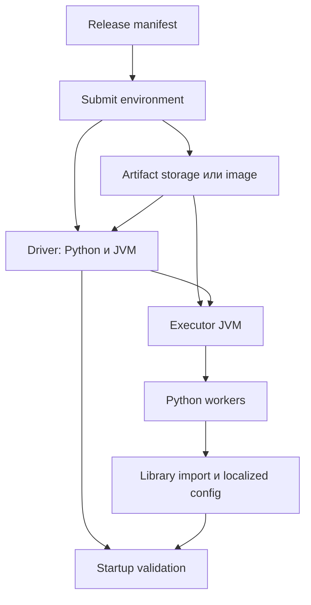
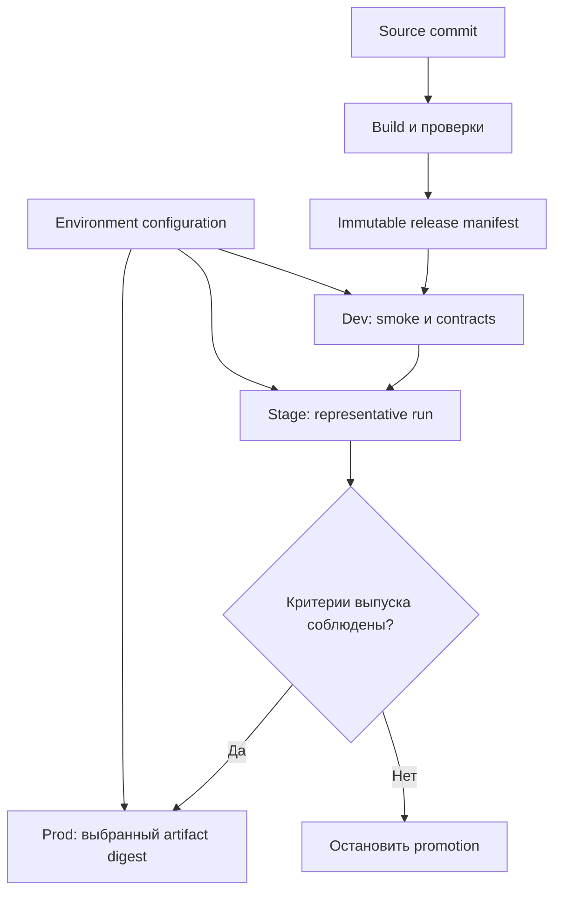
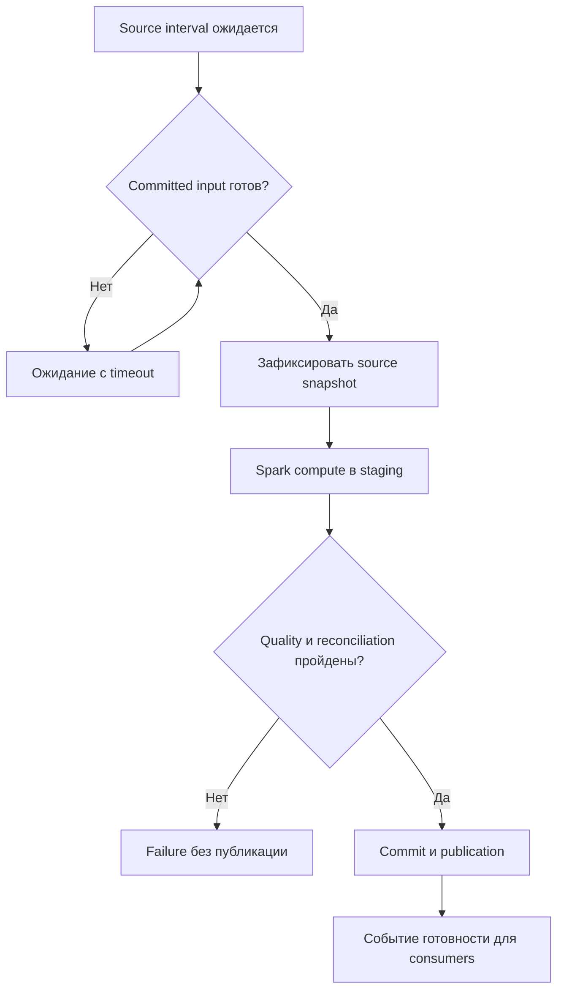
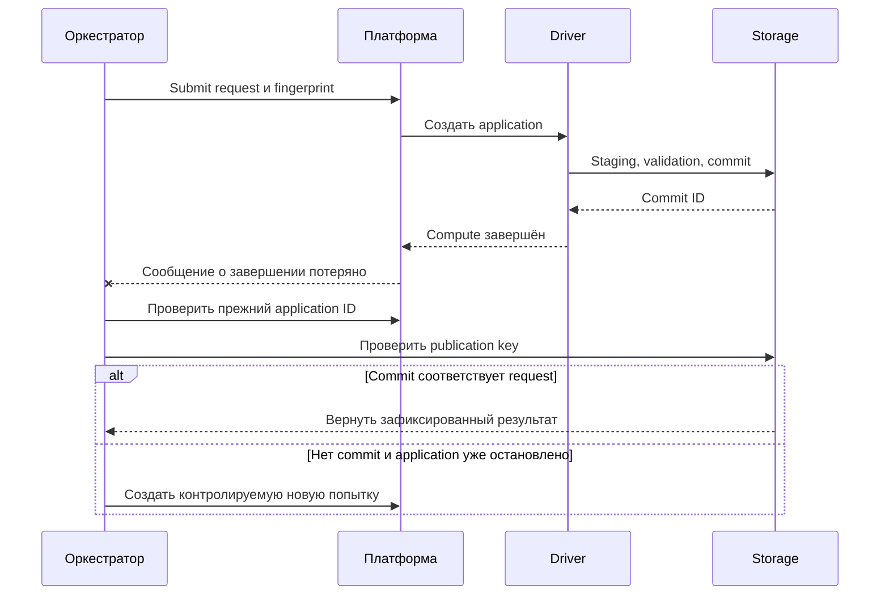

# 23. Сборка, доставка, оркестрация и эксплуатация

Основной язык примеров — **Python / PySpark**. Учебное окружение: **Apache Spark 4.2.0, Python 3.12, JDK 17, Spark Classic, Linux**. JVM-пример использует Scala **2.13.18**, соответствующую проверенному дистрибутиву. Примеры Airflow ориентированы на **Airflow 3.3.2** и **apache-airflow-providers-apache-spark 6.3.3**; версии core, Task SDK и providers нужно согласовывать при установке.

**Цель раздела:** превратить работающий Spark-код в воспроизводимый выпуск: собрать зависимости, доставить их нужным процессам, запустить приложение с явными параметрами, подтвердить публикацию результата и восстановиться после отказа.

**Как пользоваться примерами**

- **Локальная лаборатория** проверяет wheel, ZIP, импорты в Python workers, JVM JAR, конфигурационные файлы и поведение повторной публикации. Все процессы находятся на одной машине; `SPARK_LOCAL_IP=127.0.0.1` применяется именно к этой лаборатории.
- **Шаблон для инфраструктуры** требует существующего YARN/Kubernetes, Airflow connections, registry, storage и прав. Имена `.example`, пути `/opt/...`, bucket names и идентификаторы заменяются своими значениями.
- Команды выполняются из корня соответствующего учебного проекта. Один Markdown-файл содержит исходники нескольких учебных файлов: имя файла указано перед блоком. Они не являются дополнительными разделами справочника.
- Spark runtime и приложение выпускаются согласованно, но остаются разными артефактами. Wheel с бизнес-кодом не устанавливает автоматически Spark, Java или системные библиотеки на cluster nodes.
- Оркестратор хранит состояние задач; Spark управляет вычислением; table/storage layer определяет фиксацию данных. Успех одного слоя необходимо сопоставлять с результатом остальных.
- Дата проверки документации — **14 октября 2026 года, Europe/Moscow**. Зафиксированные версии нужны для воспроизводимости примеров; перед новым внедрением проверяй матрицу своей платформы.

**Содержание**

1. [Упаковка JVM-приложения](#jvm-packaging)
2. [Упаковка PySpark-приложения](#python-packaging)
3. [spark-submit и распространение зависимостей](#submission)
4. [CI/CD](#ci-cd)
5. [Оркестрация batch workloads](#batch-orchestration)
6. [Надёжный запуск и завершение](#run-lifecycle)
7. [Release и rollback](#release-rollback)
8. [Документация эксплуатации](#operations-docs)
9. [FinOps и эксплуатационная эффективность](#finops)

<a id="jvm-packaging"></a>

## Упаковка JVM-приложения

### sbt, Maven и Gradle

Build tool разрешает зависимости, компилирует исходники, запускает проверки и собирает артефакт. Spark-приложение на Scala/Java обычно доставляется как JAR. Сборка и submission — разные операции: успешно собранный JAR ещё может оказаться несовместимым с библиотеками кластера.

| Инструмент | Обычная конфигурация | Типичный выбор |
| --- | --- | --- |
| sbt | `build.sbt`, `project/build.properties` | Scala-проект, plugins, cross-building |
| Maven | `pom.xml` | Java/Scala-проект с Maven lifecycle |
| Gradle | `build.gradle.kts`, Gradle Wrapper | JVM-проект с Kotlin/Groovy DSL |

Wrapper или зафиксированная версия build tool позволяют воспроизвести сборку на другом runner. Не используй версию sbt launcher как версию Scala: это отдельные компоненты.

**Минимальный `build.sbt` для Scala-приложения:**

```scala
ThisBuild / scalaVersion := "2.13.18"
ThisBuild / version := "0.1.0"
ThisBuild / organization := "example"

name := "delivery-jvm-probe"

libraryDependencies +=
  "org.apache.spark" %% "spark-sql" % "4.2.0" % "provided"

Compile / scalacOptions += "-release:17"
Compile / javacOptions ++= Seq("--release", "17")
Compile / mainClass := Some("example.RuntimeProbe")
```

`%%` подставляет Scala binary suffix: здесь получается `spark-sql_2.13`. В Java-проекте координата задаётся явно, даже если Java-код не использует Scala-синтаксис.

**Исходник `src/main/scala/example/RuntimeProbe.scala`:**

```scala
package example

import org.apache.spark.sql.SparkSession
import org.apache.spark.sql.functions._

object RuntimeProbe {
  def main(args: Array[String]): Unit = {
    val spark = SparkSession.builder().appName("delivery-jvm-probe").getOrCreate()
    try {
      val rows = spark.range(1000)
        .groupBy(expr("id % 5").as("bucket"))
        .agg(count(lit(1)).as("rows"), sum("id").as("sum_id"))
        .collect()
      require(rows.length == 5)
      require(rows.map(_.getAs[Long]("rows")).sum == 1000L)
      require(rows.map(_.getAs[Long]("sum_id")).sum == 499500L)
      println(s"JVM_PROBE_OK Spark=${spark.version} groups=${rows.length}")
    } finally {
      spark.stop()
    }
  }
}
```

Проверяется вычисление пяти групп, общее количество 1000 и сумма IDs 499500. Это небольшой integration probe, который получает Spark runtime при запуске.

**Команды проекта с установленным sbt:**

```bash
sbt clean test package

SPARK_LOCAL_IP=127.0.0.1 spark-submit \
  --master 'local[2]' \
  --driver-memory 512m \
  --conf spark.sql.shuffle.partitions=4 \
  --class example.RuntimeProbe \
  target/scala-2.13/delivery-jvm-probe_2.13-0.1.0.jar
```

В проверке этой главы тот же Scala-код скомпилирован компилятором 2.13.18 из дистрибутива Spark с JVM target 17, собран в thin JAR и выполнен через настоящий `spark-submit`. Команды sbt/Maven/Gradle приведены как build templates: сами build tools в проверочном окружении не установлены.

**Практика:** запиши в release metadata JDK, build tool, Scala binary line, Spark version и checksum JAR. **Самопроверка:** почему наличие Java 17 на CI runner не подтверждает совместимость с любым cluster runtime?

[sbt documentation](https://www.scala-sbt.org/1.x/docs/), [Maven lifecycle](https://maven.apache.org/guides/introduction/introduction-to-the-lifecycle.html), [Gradle Java plugin](https://docs.gradle.org/current/userguide/java_plugin.html).

### Provided scope для зависимостей Spark

Spark, Hadoop и Scala часто уже поставляются платформой. Если упаковать ещё одну их копию внутрь application JAR, classloader может выбрать неподходящую версию. **Provided** означает: dependency доступна для компиляции, а runtime предоставляет среда запуска.

| Build tool | Настройка | Что важно |
| --- | --- | --- |
| sbt | `% "provided"` | Обычная assembly исключает такую dependency |
| Maven | `<scope>provided</scope>` | Dependency нужна compile/test, не обычному application runtime |
| Gradle Java plugin | `compileOnly(...)` | Не включается в runtime configuration; test dependencies задаются отдельно |

Gradle `compileOnly` не является полной копией Maven provided во всех classpaths. Если tests обращаются к Spark, предоставь им Spark через подходящую test configuration.

**Maven dependency fragment внутри `<dependencies>`:**

```xml
<dependency>
  <groupId>org.apache.spark</groupId>
  <artifactId>spark-sql_2.13</artifactId>
  <version>4.2.0</version>
  <scope>provided</scope>
</dependency>
```

**Gradle Kotlin DSL fragment:**

```kotlin
plugins {
    java
}

java {
    toolchain {
        languageVersion.set(JavaLanguageVersion.of(17))
    }
}

dependencies {
    compileOnly("org.apache.spark:spark-sql_2.13:4.2.0")
    testImplementation("org.apache.spark:spark-sql_2.13:4.2.0")
}
```

Application dependencies, которых нет в cluster runtime, нельзя объявлять provided только ради уменьшения JAR. Иначе сборка пройдёт, а driver/executor получит `ClassNotFoundException`.

Provided не гарантирует совместимость: приложение может компилироваться против API 4.2, отсутствующего в Spark 3.5 managed runtime. Сверяй API, binary versions и реальные JAR платформы.

[Maven dependency scopes](https://maven.apache.org/guides/introduction/introduction-to-dependency-mechanism.html#dependency-scope).

### Fat JAR, sbt-assembly и Maven Shade

**Thin JAR** содержит код приложения и его ресурсы; сторонние библиотеки поставляются отдельно. **Fat JAR** объединяет код и выбранные зависимости. «Fat» не означает «содержит весь Spark runtime».

| Стратегия | Польза | Цена |
| --- | --- | --- |
| Thin JAR + отдельные JAR | Видны версии и разделение dependencies | Нужно надёжно доставить полный набор |
| Fat JAR | Проще application delivery, меньше runtime resolution | Возможны class/resource conflicts |
| Platform libraries | Централизованная совместимая среда | Изменение среды влияет на несколько приложений |

**`project/plugins.sbt` — пример зафиксированного plugin:**

```scala
addSbtPlugin("com.eed3si9n" % "sbt-assembly" % "2.3.1")
```

**Дополнение к `build.sbt`:**

```scala
assembly / mainClass := Some("example.RuntimeProbe")
assembly / assemblyJarName := "delivery-jvm-probe-0.1.0-assembly.jar"
assembly / assemblyOption :=
  (assembly / assemblyOption).value.withIncludeScala(false)
```

Scala library здесь предоставляется согласованным Spark runtime. Приложение, запускаемое вне Spark, может иметь другую стратегию комплектации.

```bash
sbt clean test assembly
jar tf target/scala-2.13/delivery-jvm-probe-0.1.0-assembly.jar
```

**Maven Shade plugin fragment внутри `<build><plugins>`:** применяется в существующем Maven-проекте с корректными dependencies и компиляцией.

```xml
<plugin>
  <groupId>org.apache.maven.plugins</groupId>
  <artifactId>maven-shade-plugin</artifactId>
  <version>3.6.2</version>
  <executions>
    <execution>
      <phase>package</phase>
      <goals><goal>shade</goal></goals>
      <configuration>
        <createDependencyReducedPom>false</createDependencyReducedPom>
        <transformers>
          <transformer implementation="org.apache.maven.plugins.shade.resource.ServicesResourceTransformer" />
        </transformers>
      </configuration>
    </execution>
  </executions>
</plugin>
```

Проверяй содержимое итогового archive и dependency tree. Наличие `org/apache/spark/...` в application fat JAR часто указывает на случайно включённый runtime, но исключение должно соответствовать выбранной архитектуре.

**Практика:** сравни размеры thin/fat JAR и список включённых библиотек. Объясни, какой компонент обязан предоставить каждую исключённую dependency.

[sbt-assembly](https://github.com/sbt/sbt-assembly), [Maven Shade usage](https://maven.apache.org/plugins/maven-shade-plugin/usage.html).

### Shading, merge strategies и resource conflicts

**Shading/relocation** изменяет namespace выбранных классов, например переносит application-private библиотеку из `vendor.lib` в `example.internal.vendor.lib`. **Merge strategy/resource transformer** решает, что делать с одинаковыми путями ресурсов нескольких JAR. Это разные операции.

| Конфликт | Подход |
| --- | --- |
| Две несовместимые версии application-private library | Исключить одну либо рассмотреть relocation |
| `META-INF/services/...` | Объединить providers, сохранить корректные имена классов |
| `reference.conf` | Обычно объединить согласно библиотеке |
| Signature files `.SF/.RSA/.DSA` | Не сохранять недействительную подпись после изменения archive |
| Одинаковые `.class` с разным содержимым | Выяснить dependency conflict; не маскировать случайным выбором |
| LICENSE/NOTICE | Сохранить необходимые сведения о лицензиях и происхождении |

**sbt merge strategy fragment:**

```scala
assembly / assemblyMergeStrategy := {
  case PathList("META-INF", "services", xs @ _*) =>
    MergeStrategy.filterDistinctLines
  case "reference.conf" => MergeStrategy.concat
  case path if path.startsWith("META-INF/") &&
    (path.endsWith(".SF") || path.endsWith(".RSA") || path.endsWith(".DSA")) =>
    MergeStrategy.discard
  case path =>
    val previous = (assembly / assemblyMergeStrategy).value
    previous(path)
}
```

Не применяй `MergeStrategy.first` ко всему archive: результат станет зависеть от порядка classpath, а причина несовместимости исчезнет из build errors.

Relocation опасен для reflection, serialized class names, ServiceLoader, JNI и типов, пересекающих границу Spark API. Изолировать свою библиотеку иногда возможно; переименовать Spark/Hadoop API и ожидать совместимости с платформой нельзя.

Maven `ServicesResourceTransformer` объединяет service entries и учитывает relocation имён классов. После shading всё равно нужен runtime test функций, использующих эти services.

**Самопроверка:** почему успешная сборка с агрессивной merge strategy может сломать чтение конкретного формата только на executors?

[Shade resource transformers](https://maven.apache.org/plugins/maven-shade-plugin/examples/resource-transformers.html).

### Бинарная совместимость Scala и JVM target

У JVM-приложения несколько границ совместимости. Совпадение одной не компенсирует нарушение остальных.

| Граница | Пример проверки |
| --- | --- |
| Scala binary line | `_2.13` в Spark и connector coordinates |
| Spark API/runtime | Метод есть в фактически установленной версии |
| JVM bytecode target | Java runtime понимает class file version |
| Hadoop/connector ABI | Совместимые public/internal classes |
| Native libraries | Architecture, libc и нужные системные библиотеки |

Scala 2.12 и 2.13 — разные binary lines. Patch versions внутри поддерживаемой линии обычно совместимы согласно правилам Scala, но это не разрешение игнорировать требования Spark/vendor. Scala 3 имеет собственные правила interop; для Spark-проекта выбирай явно поддерживаемый toolchain.

`-release:17` у Scala-компилятора и `--release 17` у javac задают target/API соответствующей Java. JDK для сборки, target bytecode и JDK на executors записываются отдельно. `UnsupportedClassVersionError` обычно указывает на слишком новый class file, а `NoSuchMethodError` — на runtime API/ABI mismatch.

Не ограничивай integration test driver: connector может использовать конфликтующий класс только внутри task. Проверка должна вызвать реальное чтение/запись или тот API, ради которого подключена dependency.

**Практика:** составь compatibility matrix для Spark 4.2/Scala 2.13/Java 17 и managed runtime с другой матрицей. Какие artifacts можно переносить, какие надо пересобрать, а какие API переписать?

[Scala binary compatibility](https://docs.scala-lang.org/overviews/core/binary-compatibility-of-scala-releases.html), [javac `--release`](https://docs.oracle.com/en/java/javase/17/docs/specs/man/javac.html).

### Classpath order и конфликтующие версии библиотек

Driver и executors могут иметь разные classpaths. Отдельно существуют platform JAR, application JAR, `--jars`, Ivy-resolved dependencies и classloader rules.

| Симптом | Что проверить |
| --- | --- |
| `ClassNotFoundException` | Доставлена ли библиотека именно нужному процессу |
| `NoSuchMethodError` | Какая версия класса реально загружена |
| `AbstractMethodError` | Совместимость interface/implementation |
| `LinkageError` | Дубликаты типов и loader boundaries |
| Driver работает, task падает | Executor classpath и runtime, а не только submit host |

Dependency tree показывает результат build resolution; он не показывает весь classpath cluster runtime. Дополняй его инвентаризацией JAR образа/платформы и источником загруженного класса.

**Диагностика в Scala REPL/приложении:**

```scala
val origin = classOf[org.apache.spark.sql.SparkSession]
  .getProtectionDomain.getCodeSource
println(Option(origin).map(_.getLocation.toString).getOrElse("unknown"))
```

Не каждый classloader обязан возвращать CodeSource; `unknown` не является доказательством отсутствия класса.

`spark.driver.userClassPathFirst` и `spark.executor.userClassPathFirst` меняют приоритет загрузки в поддерживаемых сценариях; driver setting имеет ограничения deploy mode. Это экспериментальные механизмы конкретной версии, которые способны сломать другие зависимости. Начинай с согласования versions/exclusions, а не с переключения приоритета всех библиотек.

**Практика по теме:** собери dependency inventory и выдели libraries платформы и приложения. **Вопросы для самопроверки:** зачем provided; чем thin JAR отличается от fat; что объединяет services transformer; почему Scala suffix и JVM target — разные проверки; какой процесс загрузил конфликтующий класс?

[Spark configuration](https://spark.apache.org/docs/4.2.0/configuration.html).

<a id="python-packaging"></a>

## Упаковка PySpark-приложения

### Структура Python-пакета и pyproject.toml

Application package содержит переиспользуемую логику; entrypoint разбирает параметры и создаёт SparkSession. Так можно тестировать простые правила без кластера и отдельно проверять distributed execution.

**Учебный проект:**

| Путь | Назначение |
| --- | --- |
| `pyproject.toml` | Build backend, metadata, tooling |
| `src/delivery_demo/__init__.py` | Import package и версия |
| `src/delivery_demo/core.py` | Нормализация и границы интервала |
| `jobs/runtime_probe.py` | Spark entrypoint для проверки доставки |
| `config/rules.json` | Отдельный конфигурационный файл |
| `tests/test_core.py` | Unit tests бизнес-правил |
| `tools/build_zip.py` | Сборка archive для `--py-files` |

**`pyproject.toml`:**

```toml
[build-system]
requires = ["setuptools==80.9.0"]
build-backend = "setuptools.build_meta"

[project]
name = "spark-delivery-demo"
version = "0.1.0"
description = "Spark delivery laboratory"
requires-python = ">=3.12"
dependencies = []

[project.optional-dependencies]
dev = [
  "build==1.3.0",
  "pytest==8.4.2",
  "ruff==0.14.0",
  "mypy==1.18.2",
]

[tool.setuptools.packages.find]
where = ["src"]

[tool.pytest.ini_options]
testpaths = ["tests"]

[tool.ruff]
target-version = "py312"
line-length = 88

[tool.mypy]
python_version = "3.12"
strict = true
```

Версии dev tools здесь — зафиксированный учебный набор, а не утверждение, что это последние releases. В production lock должен охватывать transitive dependencies и hashes; список прямых pins сам по себе не является полным lock file.

Пакет намеренно не устанавливает `pyspark` как обязательную runtime dependency: distribution уже предоставляется Spark environment. Для CI/local Spark tests отдельно установи согласованный PySpark **4.2.0**. У PySpark нет JVM-аналога provided scope в wheel metadata: решение задаётся правилами поставки окружения.

**`src/delivery_demo/__init__.py`:**

```python
__version__ = "0.1.0"
```

**`src/delivery_demo/core.py`:**

```python
from datetime import date, datetime, time, timedelta, timezone


def interval_for_day(day: str) -> tuple[datetime, datetime]:
    parsed = date.fromisoformat(day)
    if parsed.isoformat() != day:
        raise ValueError("Expected YYYY-MM-DD")
    start = datetime.combine(parsed, time.min, tzinfo=timezone.utc)
    return start, start + timedelta(days=1)


def normalize_city(value: str) -> str:
    cleaned = value.strip()
    if not cleaned:
        raise ValueError("City must not be empty")
    return cleaned.upper()
```

Интервал задаётся как `[start, end)` в UTC. Строгое сравнение `isoformat()` отклоняет альтернативные формы даты, которые Python мог бы распознать, но которые не входят в наш contract.

`src` layout уменьшает риск, что tests случайно импортируют пакет из текущего каталога вместо установленного артефакта. Имя distribution `spark-delivery-demo` и имя import `delivery_demo` могут различаться.

[PyPA pyproject guide](https://packaging.python.org/en/latest/guides/writing-pyproject-toml/), [src layout](https://packaging.python.org/en/latest/discussions/src-layout-vs-flat-layout/).

### Wheel, zip и разные способы доставки пакета

Wheel предназначен для **установки** через package installer. ZIP может использоваться Python import machinery без установки, если содержит package в правильном месте. Это не взаимозаменяемые deployment protocols.

| Артефакт | Как использовать | Чего он не делает |
| --- | --- | --- |
| Wheel | `pip install` в runtime/image/environment | Не доставляется стандартным `--py-files` как установленные зависимости |
| Source ZIP | `--py-files` либо контролируемый Python path | Не выполняет pip dependency resolution/install hooks |
| Environment archive | Распаковка и выбор interpreter | Не гарантирует совместимость ОС/ABI |
| Container image | Image pull + запуск подготовленного runtime | Не решает автоматически data permissions |

**Подготовка и сборка из корня Python-проекта:**

```bash
python3 -m venv .venv
.venv/bin/python -m pip install -e '.[dev]'
.venv/bin/python -m build --wheel
```

Получается `dist/spark_delivery_demo-0.1.0-py3-none-any.whl`. `py3-none-any` описывает отсутствие native extension в этом wheel; допустимые Python versions дополнительно ограничивает `Requires-Python`.

**Проверка установленного wheel в другом окружении:**

```bash
python3 -m venv .wheel-check
.wheel-check/bin/python -m pip install --no-deps \
  dist/spark_delivery_demo-0.1.0-py3-none-any.whl

.wheel-check/bin/python -c \
  'from delivery_demo.core import normalize_city; assert normalize_city(" Moscow ") == "MOSCOW"'
```

`--no-deps` здесь допустим потому, что у учебного пакета `dependencies=[]`. Для настоящего проекта dependencies надо заранее установить по lock либо разрешить их проверенный installer workflow.

**`tools/build_zip.py`:**

```python
from pathlib import Path
from zipfile import ZIP_DEFLATED, ZipFile

source = Path("src")
target = Path("dist/delivery_demo-0.1.0.zip")
target.parent.mkdir(exist_ok=True)

with ZipFile(target, "w", compression=ZIP_DEFLATED) as archive:
    for path in sorted((source / "delivery_demo").rglob("*.py")):
        archive.write(path, path.relative_to(source).as_posix())

with ZipFile(target) as archive:
    assert "delivery_demo/__init__.py" in archive.namelist()
    assert "src/delivery_demo/__init__.py" not in archive.namelist()

print(target)
```

```bash
.venv/bin/python tools/build_zip.py
```

В ZIP должны находиться `delivery_demo/__init__.py` и `delivery_demo/core.py`, а не лишний верхний каталог `src/`. Сортировка списка файлов делает порядок entries детерминированным; для побайтной воспроизводимости также фиксируют archive timestamps, build inputs и versions compression tools. Не переименовывай `.whl` в `.zip` как универсальное решение: wheel layout, native libraries, metadata и зависимости имеют другие требования.

**Практика:** проверь wheel из каталога вне репозитория и ZIP в Python workers. Эти проверки обнаруживают разные ошибки доставки.

[Wheel specification](https://packaging.python.org/en/latest/specifications/binary-distribution-format/), [Python zipimport](https://docs.python.org/3/library/zipimport.html).

### Доставка .py, .zip и исторического .egg через --py-files; ограничения на wheel и нативные зависимости, отличие от упаковки полного окружения

`--py-files` добавляет поддерживаемые Python artifacts в import path приложения и workers. В Spark 4.2 документированы `.py`, `.zip`, исторический `.egg`. Для новых releases удобнее wheel для install и ZIP для простой доставки pure-Python кода.

**`config/rules.json`:**

```json
{"contract_version": 1}
```

**`jobs/runtime_probe.py`:**

```python
import argparse
import json
import platform

import delivery_demo
from pyspark.sql import SparkSession, functions as F

parser = argparse.ArgumentParser()
parser.add_argument("--expected-version", required=True)
args = parser.parse_args()

spark = SparkSession.builder.appName("delivery-runtime-probe").getOrCreate()
try:
    sc = spark.sparkContext
    sc.setLogLevel("WARN")
    assert delivery_demo.__version__ == args.expected_version

    def probe_partition(values):
        import json
        import platform

        import delivery_demo
        from delivery_demo.core import normalize_city
        from pyspark import SparkFiles

        with open(SparkFiles.get("rules.json"), encoding="utf-8") as stream:
            rules = json.load(stream)
        for city in values:
            yield (
                normalize_city(city),
                delivery_demo.__version__,
                platform.python_version(),
                rules["contract_version"],
                delivery_demo.__file__,
            )

    rows = (
        sc.parallelize([" Moscow ", "Kazan"], 2)
        .mapPartitions(probe_partition)
        .collect()
    )
    assert sorted(row[0] for row in rows) == ["KAZAN", "MOSCOW"]
    assert all(row[1] == args.expected_version for row in rows)
    assert all(row[2] == platform.python_version() for row in rows)
    assert all(row[3] == 1 for row in rows)

    total = spark.range(10).agg(F.sum("id").alias("total")).first()["total"]
    assert total == 45
    print(
        json.dumps(
            {
                "application_id": sc.applicationId,
                "spark_version": spark.version,
                "driver_python": platform.python_version(),
                "worker_probe": rows,
                "sum_id": total,
            },
            ensure_ascii=False,
        )
    )
finally:
    spark.stop()
```

**Локальный запуск с доставкой ZIP и файла:** PySpark/Spark установлены, `spark-submit` находится в PATH или вызывается по абсолютному пути `$SPARK_HOME/bin/spark-submit`.

```bash
SPARK_LOCAL_IP=127.0.0.1 spark-submit \
  --master 'local[2]' \
  --driver-memory 512m \
  --conf spark.python.use.daemon=false \
  --py-files dist/delivery_demo-0.1.0.zip \
  --files config/rules.json \
  jobs/runtime_probe.py \
  --expected-version 0.1.0
```

Проверенный результат: `MOSCOW/KAZAN`, package version 0.1.0, одинаковая Python version на driver/workers, прочитанный contract version 1 и сумма IDs 45. В проверке entrypoint запускался из каталога вне проекта; workers действительно импортировали package из доставленного ZIP.

`spark.python.use.daemon=false` используется для изолированной локальной лаборатории; это не универсальная настройка ускорения. `assert` в probe — учебные проверки: production validation должна оставаться активной независимо от Python optimization flags.

Native `.so/.pyd` обычно нельзя импортировать непосредственно из ZIP; им нужны распаковка/установка, совместимая architecture и системные библиотеки. Пакет с pandas/NumPy/Arrow также требует согласованного набора dependencies. `--py-files` не создаёт полноценное окружение и не исполняет `pip install` на executors.

**Самопроверка:** почему `import` на driver может пройти, а та же функция внутри Python task — упасть? Почему wheel в локальном virtualenv не появляется автоматически на remote nodes?

[Spark Python package management](https://spark.apache.org/docs/4.2.0/api/python/tutorial/python_packaging.html).

### --archives с подготовленным окружением Python, alias распаковки и привязкой PYSPARK_PYTHON к интерпретатору внутри окружения

`--archives` доставляет и распаковывает архив поддерживаемым механизмом cluster manager. Alias после `#` задаёт имя каталога, относительно которого можно найти interpreter.

**YARN cluster-mode template для уже подготовленного окружения:**

```bash
env -u PYSPARK_DRIVER_PYTHON \
spark-submit \
  --master yarn \
  --deploy-mode cluster \
  --archives 'hdfs:///artifacts/python/env-2026-10.tar.gz#environment' \
  --conf spark.pyspark.python=./environment/bin/python \
  --py-files hdfs:///artifacts/apps/delivery_demo-0.1.0.zip \
  --files hdfs:///artifacts/config/rules.json \
  jobs/runtime_probe.py \
  --expected-version 0.1.0
```

`spark.pyspark.python` задаёт interpreter для driver/workers в соответствующей среде и имеет приоритет над `PYSPARK_PYTHON`. Альтернативный официальный способ — согласованно передать `PYSPARK_PYTHON=./environment/bin/python` в runtime environment; переменная submit shell сама по себе не является общим механизмом передачи любой env variable каждому cluster process.

В YARN cluster mode relative path доступен в localized working environment driver/executors. В client mode driver находится на submit host: `./environment/bin/python` может отсутствовать там, хотя archive уже появился у executors. Driver environment на gateway готовится отдельно.

В Kubernetes filesystem/image и upload staging имеют другие детали. Проверяй поддержку archives и фактический путь interpreter для выбранного Spark/runtime, а не переноси YARN-команду заменой одного `--master`.

Распаковка не устраняет incompatible glibc, отсутствие shared library или symlink на чужой interpreter. После доставки нужен runtime probe, вызывающий dependency внутри task.

**Практика:** сравни driver Python path в client и cluster modes. Найди alias, working directory, ownership и interpreter у каждого процесса.

### venv-pack, conda-pack и PEX: переносимость системных библиотек, Python executable и символических ссылок с учётом среды

Эти инструменты упаковывают разные части Python environment. Нельзя считать любой archive автономным runtime для любой ОС.

| Инструмент | Что переносится | Важное ограничение |
| --- | --- | --- |
| venv-pack | Virtualenv и его packages | Interpreter часто остаётся symbolic link; нужен совместимый Python на nodes |
| conda-pack | Conda environment, включая interpreter/часть native dependencies | ОС, architecture, relocation и внешние системные библиотеки остаются важны |
| PEX | Python executable archive с выбранными dependencies | Обычный PEX не включает сам Python interpreter; нужен совместимый interpreter |
| Container image | OS userspace и подготовленный runtime | Нужны подходящие kernel/architecture, volumes и policy |

**Build templates в подходящем Linux build environment:**

```bash
# venv-pack установлен в environment, которое действительно нужно упаковать.
venv-pack -o python-env.tar.gz

# conda-pack установлен; environment ранее создан и проверен.
conda-pack -n spark-runtime -o conda-env.tar.gz

# requirements-runtime.lock существует и содержит зависимости приложения.
pex -r requirements-runtime.lock -o runtime.pex
```

PEX доставляют как файл, например через `--files runtime.pex`, и настраивают `spark.pyspark.python=./runtime.pex` при поддерживаемом scenario. Он не требует распаковки через `--archives` как директория virtualenv. Проверь executable permissions, cache directory и выбранный Python.

| До упаковки | После доставки |
| --- | --- |
| Версии Python и wheels | `sys.executable`, Python version в task |
| Architecture/glibc | Import native module в worker |
| Symlinks | Цель ссылки существует на node |
| Build prefix | Relocation работает в фактическом каталоге |
| Системные libraries | Loader находит требуемые shared objects |

Установка на CI macOS не создаёт автоматически Linux-compatible archive. Даже два Linux images могут различаться по libc, OpenSSL, CUDA и ABI. Для compiled dependencies строй и тестируй в environment, соответствующем runtime.

**Практика:** исследуй ссылку `environment/bin/python` после упаковки venv. Почему portable business ZIP оказался переносимым, а native package — нет?

[venv-pack](https://jcristharif.com/venv-pack/), [conda-pack и Spark](https://conda.github.io/conda-pack/spark.html), [PEX building](https://docs.pex-tool.org/buildingpex.html).

### Пакеты в контейнерном image

Image позволяет выполнить package install во время build и одинаково предоставить wheel/system libraries driver и executors. Необходимо сохранить Spark entrypoint и согласовать user permissions.

**Dockerfile template:** базовый image уже подготовлен со Spark 4.2.0, Scala 2.13, Java 17 и Python **3.12**, включая `venv/pip`. Reference ниже — placeholder своего registry.

```dockerfile
ARG SPARK_PY312_BASE_IMAGE=registry.internal.example/spark-py312:4.2.0-r1
FROM ${SPARK_PY312_BASE_IMAGE}

USER root
RUN python3.12 -m venv /opt/python-env
COPY dist/spark_delivery_demo-0.1.0-py3-none-any.whl /opt/wheels/
RUN /opt/python-env/bin/python -m pip install --no-deps \
    /opt/wheels/spark_delivery_demo-0.1.0-py3-none-any.whl

COPY --chown=185:0 jobs/runtime_probe.py /opt/app/runtime_probe.py
COPY --chown=185:0 config/rules.json /opt/app/rules.json
ENV PYSPARK_PYTHON=/opt/python-env/bin/python
USER 185
```

У wheel нет external dependencies, поэтому `--no-deps` достаточен для этой лаборатории. Его metadata требует Python 3.12+, поэтому minor version base interpreter нужно проверить до install. Суффикс `python3` официального Spark image сам по себе не фиксирует minor version: проверенный Java 17 Dockerfile использует Ubuntu Jammy, а Python variant устанавливает системный `python3`. Нельзя автоматически считать его образом с Python 3.12. В реальном image устанавливай полный проверенный lock и native libraries. Не ставь произвольный другой `pyspark` поверх Spark distribution.

`PYSPARK_DRIVER_PYTHON` здесь не задаётся: cluster-mode driver использует согласованную runtime configuration. Для native Kubernetes application script может указываться как `local:///opt/app/runtime_probe.py`; файл rules должен быть localized либо читаться по согласованному image path. Само наличие `/opt/app/rules.json` не делает его автоматически `SparkFiles.get("rules.json")`.

Фиксируй digest base/final image и проверь два roles, writable temp/local dirs, package imports и connector availability. Этот Dockerfile не выполнялся без Docker engine.

[Apache Spark Dockerfiles](https://github.com/apache/spark-docker).

### Одинаковый Python runtime на driver и executors; PYSPARK_PYTHON, PYSPARK_DRIVER_PYTHON и ограничения настройки driver Python в cluster deploy mode

PySpark driver сериализует Python functions/data для workers. Различие Python major/minor versions вызывает несовместимость; различие package/native versions также может изменить результат даже при одинаковом Python.

| Настройка | Назначение |
| --- | --- |
| `PYSPARK_PYTHON` | Interpreter для driver/workers по правилам runtime |
| `spark.pyspark.python` | Spark configuration interpreter; приоритетнее env setting |
| `PYSPARK_DRIVER_PYTHON` | Отдельный interpreter client driver/интерактивного запуска |
| `spark.pyspark.driver.python` | Driver interpreter configuration в поддерживаемом пути запуска |
| `spark.executorEnv.NAME` | Env variable executor process; не полный installer |
| `spark.yarn.appMasterEnv.NAME` | YARN AM environment; зависит от deploy mode |

В официальном packaging guide `PYSPARK_DRIVER_PYTHON` требуется **не задавать для YARN/Kubernetes cluster mode**. Особенно опасны значения `jupyter`, локальный путь ноутбука или shell wrapper, отсутствующий в driver container.

Не передавай `sys.executable` submit host как путь для любого remote cluster: это абсолютный path конкретной машины. При packaged environment у driver и workers могут быть разные абсолютные paths, но совместимый interpreter и dependencies.

Проверка `platform.python_version()` в runtime probe — небольшое свидетельство. Для native/Arrow code также запиши версии packages, architecture и actual import location; один `pip freeze` submit host недостаточен.

Spark Connect добавляет ещё одну роль: remote Python client не всегда является Python driver, выполняющим Spark Classic application. Ограничения API и runtime проверяются для конкретной модели подключения.

**Практика по теме:** собери wheel/ZIP, выполни probe вне каталога проекта и проверь native dependency в worker. **Вопросы для самопроверки:** чем package отличается от environment; какие formats понимает `--py-files`; что делает archive alias; почему venv symlink опасен; где выбирать driver interpreter в cluster mode?

<a id="submission"></a>

## spark-submit и распространение зависимостей

### --class, --master, --deploy-mode и аргументы приложения

`spark-submit` подготавливает запуск и зависимости. Опции Spark находятся **до** application artifact, аргументы приложения — **после** него.

| Опция | Смысл |
| --- | --- |
| `--class example.RuntimeProbe` | JVM entrypoint; не имя Python function |
| `--master yarn/spark://.../k8s://...` | Backend/resource manager |
| `--deploy-mode client/cluster` | Где запускается driver |
| `--conf key=value` | Spark configuration |
| `job.py --expected-version 0.1.0` | Python application и его параметры |

**Submission template для Python probe на YARN:**

```bash
HADOOP_CONF_DIR=/etc/hadoop/conf \
spark-submit \
  --master yarn \
  --deploy-mode cluster \
  --name delivery-runtime-probe \
  --num-executors 2 \
  --executor-cores 1 \
  --executor-memory 2g \
  --py-files hdfs:///artifacts/apps/delivery_demo-0.1.0.zip \
  --files hdfs:///artifacts/config/rules.json \
  jobs/runtime_probe.py \
  --expected-version 0.1.0
```

Скрипт знает требования к данным/пакету; manager, allocation и deploy mode остаются внешней конфигурацией. Hardcoded `.master("local[*]")` в production entrypoint способен обойти намерение оркестратора и выполнить computation на submit worker.

Не все сочетания поддерживаются: в Spark 4.2 Standalone Python cluster mode отсутствует; local mode не использует cluster deploy mode. Изоляция терминала через `nohup` не меняет client mode на cluster mode.

Для диагностики используй `spark-submit --help`/`--verbose` в подходящем environment, сохрани итоговые effective settings без secrets. Raw command line и logs тоже могут содержать чувствительные значения.

**Самопроверка:** что произойдёт, если приложение поставит `--master` после `job.py`? Почему переданный оркестратором master нельзя перекрывать в бизнес-коде?

[Submitting applications](https://spark.apache.org/docs/4.2.0/submitting-applications.html).

### --jars, --packages и Maven repositories

`--jars` доставляет конкретные JVM artifacts; `--packages` разрешает Maven coordinates и transitive dependencies. Оба механизма относятся к JVM libraries, даже в PySpark application.

| Механизм | Что фиксировать |
| --- | --- |
| `--jars /artifacts/custom-connector.jar` | Version, checksum, совместимость |
| `--packages group:artifact:version` | Точные coordinates и dependency graph |
| `--repositories URL` | Источник resolution, TLS/access policy |
| `spark.jars.ivy` | Ivy cache path и writable permissions |

**Шаблон для заранее проверенных JAR:**

```bash
spark-submit \
  --master yarn \
  --deploy-mode cluster \
  --jars hdfs:///artifacts/jvm/custom-connector-1.4.0.jar \
  jobs/connector_job.py \
  --input hdfs:///raw/example
```

Это шаблон своего connector/app; указанное имя не является обещанием существования публичной Maven library.

При `--packages` resolution может произойти в submit environment и потребовать repository access ещё до allocation executors. В разных deploy/runtime paths нужно проверять staging и последующую доступность artifacts.

Не подставляй Scala suffix произвольно: `_2.12` connector не становится `_2.13` от изменения Spark version. Совместимость Hadoop/object-storage connector также включает transitive dependencies и platform overrides.

Runtime downloads увеличивают startup latency и зависимость от внешнего repository. Для production release часто полезно заранее разрешить libraries, проверить их и доставить неизменяемый набор.

### --files, --archives и SparkFiles

Эти опции доставляют разные виды artifacts. File не превращается в import package или распакованное окружение автоматически.

| Опция/API | Результат |
| --- | --- |
| `--files config.json` | Localized обычный файл |
| `--archives env.tar.gz#environment` | Распакованный archive в поддерживаемой среде |
| `--py-files package.zip` | Поддерживаемый Python artifact в import path |
| `SparkFiles.get("config.json")` | Runtime path localized файла |
| `SparkContext.addFile(...)` | Доставка файла из уже работающего приложения |

В runtime probe rules читаются внутри `mapPartitions`, через публичный `SparkFiles.get`. Нельзя рассчитывать на `/home/user/project/config/rules.json` на всех executor hosts.

Проверь basename conflicts: два разных `rules.json` из разных источников могут иметь неоднозначное назначение. Версионируй configuration, а его checksum/contract version записывай в metadata запуска.

Файл, открытый на driver и переданный как объект в closure, — другой механизм: можно случайно сериализовать большой объект или недопустимый resource handle. Для небольшого read-only dictionary подходит broadcast; для runtime файла — localization, если этого требует library.

Localization не должна использоваться как способ раздачи постоянных credentials всему cluster. Scope, permissions и rotation подчиняются identity/secret management выбранной среды.

**Практика:** перемести submit script в другой каталог и проверь, что task использует localized file. Почему relative path CI runner не является contract executor filesystem?

[SparkFiles.get](https://spark.apache.org/docs/4.2.0/api/python/reference/api/pyspark.SparkFiles.get.html), [SparkContext.addFile](https://spark.apache.org/docs/4.2.0/api/python/reference/api/pyspark.SparkContext.addFile.html).

### Dependency exclusions и разрешение конфликтов

Исключение dependency предотвращает включение выбранной transitive library; оно не проверяет, что оставшийся набор API совместим.

| Где исключать | Механизм |
| --- | --- |
| Maven project | `<exclusions>` у dependency |
| sbt | `exclude`/dependency overrides по обоснованной схеме |
| Gradle | Dependency exclusions/constraints |
| Spark package resolution | `--exclude-packages group:artifact` |
| Already-built fat JAR | Исправить сборку; submit exclusion не переписывает archive |

**Форма Spark CLI:**

```bash
spark-submit \
  --packages "$VERIFIED_MAVEN_COORDINATES" \
  --exclude-packages "$VERIFIED_EXCLUSIONS" \
  jobs/connector_job.py
```

Переменные задают проверенные comma-separated coordinates/exclusions, а не произвольный список «всего, что конфликтует». Exclusions могут убрать library, которой реально требует connector; failure просто переместится из resolution в runtime.

Правильный порядок: определить загруженные версии → прочитать compatibility requirements → выбрать единый graph → исключить/заменить конфликтующие зависимости → выполнить реальные code paths driver/executors.

Не лечи конфликт Jackson/Guava/Netty случайным принудительным upgrade одной library. Spark, Hadoop и connector могут иметь разные требования к internal APIs.

**Самопроверка:** почему exclusion в `--packages` не удаляет класс, уже встроенный в application fat JAR?

### Offline environments и внутренний artifact repository

Offline deployment требует заранее доступных artifacts, dependency locks, metadata и доверенного источника. Наличие wheel приложения не означает наличие всех его dependencies или build backend.

| Слой | Что подготовить |
| --- | --- |
| Python runtime | Wheels для нужных Python/OS/architecture и полный lock |
| Build backend | Установленные/доступные build requirements |
| JVM | Все JAR и metadata resolution либо собранный artifact |
| Containers | Registry/image digest доступен cluster nodes |
| Configuration | Versioned config и identities без runtime downloads |

**Offline Python install template:**

```bash
python -m pip install \
  --no-index \
  --find-links /opt/wheelhouse \
  --require-hashes \
  -r requirements-runtime.lock
```

Wheelhouse должен содержать все выбранные distributions. `--require-hashes` требует соответствующих pins/hashes для зависимостей; отсутствие artifact должно давать понятный failure, а не незаметный fallback в интернет.

Internal PyPI/Maven/OCI repositories уменьшают зависимость от внешнего egress, но требуют retention, immutability, auth и контроля происхождения. Dependency confusion становится риском, когда internal name одновременно разрешается из ненадёжного public source.

Разделяй cache и authoritative repository: cache может быть очищен, а release artifacts должны оставаться восстанавливаемыми. Release manifest связывает код, artifacts, runtime, конфигурацию и checksums.

**Практика:** выполни сборку/запуск в тестовой среде без внешнего egress. Какие зависимости раньше скрыто скачивались во время первого run?

[pip repeatable installs](https://pip.pypa.io/en/stable/topics/repeatable-installs/), [pip secure installs](https://pip.pypa.io/en/stable/topics/secure-installs/).

### Доступ executors к библиотекам и конфигурационным файлам

Доставка проверяется в каждом runtime role. Submit host, driver, executor JVM и Python worker имеют разные classpaths, import paths, identities и network routes.



| Проверка | Свидетельство |
| --- | --- |
| Python package | Import inside task, version/location |
| JVM connector | Реальная task читает/пишет source |
| Config file | Task находит runtime path и ожидаемый checksum |
| Native library | Import/function call в worker подходящей architecture |
| Storage credentials | Data operation от runtime identity |
| Read-only image | Writable local dirs/cache/temporary paths |

`local:///` обычно обозначает artifact, уже находящийся в image/runtime. `file://` на одной машине не становится shared filesystem нескольких узлов. Object-storage URI требует соответствующего connector и permissions.

Probe с двумя partitions подтверждает исполнение Python tasks локально. Для production несколько partitions не гарантируют охват каждого executor/node: проверь representative allocation и собери runtime telemetry по реальным processes.

**Практика по теме:** выполни ZIP/file probe, затем составь inventory для remote run. **Вопросы для самопроверки:** где стоит `--class`; кто разрешает Maven packages; чем files отличаются от archives; почему driver import недостаточен; что проверяется при offline запуске?

<a id="ci-cd"></a>

## CI/CD

### Linting, formatting, type checks и unit tests

Эти проверки отвечают на разные вопросы. Formatter задаёт единый вид кода; linter обнаруживает подозрительные конструкции; type checker проверяет согласованность типов; unit tests подтверждают выбранное поведение.

| Проверка | Что обнаруживает | Чего не подтверждает |
| --- | --- | --- |
| Formatting | Несогласованный стиль | Корректность вычисления |
| Linting | Неиспользуемые imports, часть ошибок | Совместимость cluster runtime |
| Type checks | Несогласованные Python types | Реальные schemas всех источников |
| Unit tests | Правила на небольших входах | Remote delivery и commit guarantees |

**`tests/test_core.py` для учебного пакета:**

```python
from datetime import datetime, timezone

import pytest

from delivery_demo.core import interval_for_day, normalize_city


def test_leap_day_interval() -> None:
    start, end = interval_for_day("2024-02-29")
    assert start == datetime(2024, 2, 29, tzinfo=timezone.utc)
    assert end == datetime(2024, 3, 1, tzinfo=timezone.utc)


@pytest.mark.parametrize("day", ["2026-02-30", "20261013", "not-a-date"])
def test_invalid_day(day: str) -> None:
    with pytest.raises(ValueError):
        interval_for_day(day)


def test_normalization_is_idempotent() -> None:
    value = normalize_city(" Moscow ")
    assert value == "MOSCOW"
    assert normalize_city(value) == value


def test_empty_city_is_rejected() -> None:
    with pytest.raises(ValueError):
        normalize_city("   ")
```

Проверяются leap day, недопустимые даты, contract формата и нормализация. Для ETL полезны boundary cases: пустой input, null, duplicate keys, schema evolution, timezone и значения на границе интервала.

```bash
.venv/bin/python -m ruff check src tests tools jobs
.venv/bin/python -m ruff format --check src tests tools jobs
.venv/bin/python -m mypy src
.venv/bin/python -m pytest -q
```

В лаборатории эти проверки прошли; pytest выполнил **6 tests**. Type checking относится к typed package `src`, а не выдаётся за полную статическую проверку всех PySpark expressions.

Не мокай DataFrame API настолько подробно, что test лишь повторяет цепочку вызовов implementation. Вычисления проверяй на настоящем маленьком DataFrame; чистые правила — без Spark. Contracts данных и Python type annotations решают разные задачи.

**Практика:** добавь test, который обнаружит ошибочную включённую правую границу интервала. Почему равенство timestamp end должно попадать в следующий день?

[pytest parametrization](https://docs.pytest.org/en/stable/how-to/parametrize.html), [Ruff](https://docs.astral.sh/ruff/), [mypy](https://mypy.readthedocs.io/en/stable/).

### Integration tests и проверка совместимости runtime

Integration test запускает несколько компонентов вместе. Для Spark важны interpreter, JVM libraries, connector, storage permissions и фактическое выполнение задач.

| Уровень | Хорошая проверка |
| --- | --- |
| Installed package | Wheel импортируется вне source tree |
| Spark local | Маленькие DataFrame computations и Python tasks |
| Artifact delivery | ZIP/file доступны в worker; JAR вызывает нужный API |
| Representative runtime | Тот же image/vendor release, что будет в production |
| Remote storage/catalog | Read, write, commit и повторное чтение от runtime identity |
| Failure/recovery | Повтор после выбранной точки отказа |

Используй небольшие synthetic datasets с понятными ожидаемыми результатами. Не делай integration test «успешным», если он только создал SparkSession, не выполнив action.

Runtime probe из предыдущей темы делает RDD action в Python workers и SQL action. JVM probe выполняет агрегацию. Они проверяют базовую доставку/совместимость, но не конкретный S3A, Kafka, JDBC или lakehouse connector.

При переносе на другую матрицу версий проверь хотя бы affected code paths. Runtime из section 22 и managed release могут иметь разные Spark/Scala/Python/JDK; «тот же код» не означает «та же среда».

**Negative tests:** отсутствующий package, неправильная contract version, недоступный input и неверные permissions должны давать наблюдаемый failure. Успешный CI должен включать проверку того, что ошибочный run не публикует валидный результат.

**Самопроверка:** какую ошибку поймает ZIP probe, но пропустит обычный `pytest` с editable install?

### Сборка JAR/wheel/image и публикация версионированных artifacts

Release начинается с идентифицированного source commit и завершается набором неизменяемых artifacts. Package version, Git SHA и image digest имеют разные роли.

| Идентификатор | Для чего |
| --- | --- |
| Git commit | Какие исходники использованы |
| Application version | Читаемое имя выпуска |
| SHA-256 JAR/wheel/ZIP | Идентичность конкретного файла |
| Image digest | Идентичность container manifest/content |
| Config revision | Какие параметры сопровождали запуск |
| Runtime release | С какими Spark/JDK/Python выполнено приложение |

**Локальная сборка и checksums:**

```bash
.venv/bin/python -m build --wheel
.venv/bin/python tools/build_zip.py
sha256sum \
  dist/spark_delivery_demo-0.1.0-py3-none-any.whl \
  dist/delivery_demo-0.1.0.zip \
  > dist/SHA256SUMS
```

Checksums сохраняются рядом с release manifest. При скачивании сверяй ожидаемый checksum из доверенного metadata source; hash, присланный вместе с подменённым artifact из того же ненадёжного канала, сам по себе не подтверждает происхождение.

| Artifact | Возможное хранилище |
| --- | --- |
| Wheel | Internal Python index/wheelhouse |
| JVM JAR | Maven repository/artifact storage |
| ZIP/config bundle | Versioned artifact storage |
| Image | OCI registry по digest |
| Release manifest | Versioned metadata рядом с artifacts |

Не перезаписывай `0.1.0` новым содержимым. Новая сборка с изменившимися dependencies — новый release или явно новая build identity. `latest` удобен человеку, но не является воспроизводимым deployment reference.

Публикация artifact не равна deployment приложения. CI может собрать и проверить release, а CD применяет его manifest к выбранной среде по принятой политике команды.

**Практика:** восстанови прошлый run по manifest без Git working tree и локального cache разработчика.

### GitHub Actions, GitLab CI и другие CI systems

CI platform запускает те же проверки в контролируемом environment. Pipeline должен явно задавать toolchain, dependency sources, permissions и условия публикации.

**GitHub Actions template `.github/workflows/verify.yml`:** выполняется в репозитории учебного Python-проекта. Action references закреплены на полные commit SHA официальных repositories; комментарии показывают соответствующие major tags на дату проверки.

```yaml
name: delivery-demo-verify
"on": [push, pull_request]

permissions:
  contents: read

jobs:
  verify:
    runs-on: ubuntu-24.04
    steps:
      - uses: actions/checkout@3d3c42e5aac5ba805825da76410c181273ba90b1 # v7
        with:
          persist-credentials: false
      - uses: actions/setup-python@5fda3b95a4ea91299a34e894583c3862153e4b97 # v7
        with:
          python-version: '3.12'
      - uses: actions/setup-java@de7274f081f381c8f8158605e0321c36c376e2e6 # v6
        with:
          distribution: temurin
          java-version: '17'
      - name: Check package and build
        run: |
          python -m pip install -e '.[dev]'
          python -m ruff check src tests tools jobs
          python -m ruff format --check src tests tools jobs
          python -m mypy src
          python -m pytest -q
          python -m build --wheel
          python tools/build_zip.py
          sha256sum dist/*.whl dist/*.zip > dist/SHA256SUMS
      - name: Check installed wheel
        run: |
          python -m venv .wheel-check
          .wheel-check/bin/python -m pip install --no-deps dist/*.whl
          .wheel-check/bin/python -c 'from delivery_demo.core import normalize_city; assert normalize_city(" Moscow ") == "MOSCOW"'
      - name: Check Spark delivery
        env:
          SPARK_LOCAL_IP: '127.0.0.1'
          PYSPARK_PYTHON: python
        run: |
          python -m pip uninstall -y spark-delivery-demo
          python -m pip install pyspark==4.2.0
          SPARK_DISTRIBUTION="$(python -c 'import pathlib,pyspark; print(pathlib.Path(pyspark.__file__).parent)')"
          "$SPARK_DISTRIBUTION/bin/spark-submit" \
            --master 'local[2]' \
            --driver-memory 512m \
            --conf spark.python.use.daemon=false \
            --py-files dist/delivery_demo-0.1.0.zip \
            --files config/rules.json \
            jobs/runtime_probe.py \
            --expected-version 0.1.0
      - uses: actions/upload-artifact@cf430e030ddbb5b0abf93d22962f4752f3646cd9 # v7
        with:
          name: delivery-demo-${{ github.sha }}
          path: dist/
```

Внутренние commands лаборатории выполнены локально; сам workflow не запускался на GitHub runner. У Self-hosted runners должны быть совместимые runner/Node runtime для выбранных action versions. GHES и github.com могут поддерживать разные artifact action versions.

В production замени установку прямых dev pins полным CI lock с hashes и контролируемым index. Editable install удобен unit tests, поэтому отдельно проверяется installed wheel. Перед Spark probe editable package удаляется, чтобы ZIP delivery не маскировался ранее установленным source package; `src` не должен дополнительно добавляться через PYTHONPATH. В локальной проверке главы probe также запускался вне каталога проекта.

GitLab CI использует jobs/stages, runner images, artifacts/cache и protected variables. Jenkins/другие systems меняют orchestration pipeline, но требования к runtime, immutable artifact и проверкам остаются теми же.

**Практика:** раздели verify/build/publish/deploy permissions. Какие jobs могут исполнять PR-код без доступа к release credentials?

[Checkout](https://github.com/actions/checkout), [setup-python](https://github.com/actions/setup-python), [setup-java](https://github.com/actions/setup-java), [upload-artifact](https://github.com/actions/upload-artifact), [GitLab CI YAML](https://docs.gitlab.com/ci/yaml/).

### Продвижение одного artifact через окружения

Promotion означает запуск **тех же artifact bytes/digest** в dev, stage и prod с разрешённой конфигурацией среды. Пересборка того же Git commit заново на каждом шаге может дать другие dependencies и другой image.



Конфигурация окружения не обязана быть одинаковой: storage URI, identity, quotas и observability destinations различаются. Но она тоже versioned/reviewable; изменение алгоритма через произвольные runtime flags фактически может создать другой выпуск поведения.

| В release manifest | В environment configuration |
| --- | --- |
| Artifact URI/checksum/image digest | Input/output/catalog endpoints |
| Source commit и dependency lock | Runtime identity и network scope |
| Требуемая runtime matrix | Resources/concurrency budgets |
| Contract/schema version | SLO, alerts, retention |

Измеряй, что именно прошло stage: не только code version, но connector/runtime/configuration combination. Успех в dev с маленькими данными не подтверждает production scale.

**Самопроверка:** почему повторный `docker build` перед prod не гарантирует promotion уже проверенного stage image?

### Secrets, permissions и защита цепочки поставки

Build/deploy pipeline получает доступ к исходникам, artifact storage и иногда runtime identities. Разделяй read-only verification и доверенную публикацию/deployment.

| Механизм | Что защищает |
| --- | --- |
| Минимальные permissions | Scope CI token и deploy role |
| OIDC с проверкой claims | Короткоживущая workload identity вместо постоянного ключа |
| Pinned action SHA | Известное содержимое стороннего шага |
| Dependency lock/hashes | Контролируемый набор packages |
| Attestation/provenance | Связь artifact с build inputs/workflow |
| Protected environment/branch rules | Условия доверенного выпуска |

`permissions: id-token: write` разрешает получение OIDC token, но cloud role должна дополнительно проверять issuer/audience/subject и ожидаемые repository/environment claims. Наличие OIDC не является автоматическим разрешением на deployment.

Не выдавай secrets workflow, который исполняет untrusted pull-request code. Осторожно используй привилегированные события вроде `pull_request_target`: контекст permissions отличается от обычного PR run.

Cache может содержать зависимость или результат чужого build. Проверяй trust boundary cache keys и не считай cache authoritative release store. Log masking не устраняет секреты, записанные в artifacts или преобразованном виде.

**Практика:** проследи путь source → dependency → build → registry → cluster. Укажи identity, integrity check и scope permissions на каждом переходе.

[GitHub secure use](https://docs.github.com/en/actions/reference/security/secure-use), [OIDC](https://docs.github.com/en/actions/concepts/security/openid-connect), [artifact attestations](https://docs.github.com/en/actions/concepts/security/artifact-attestations).

### Canary, shadow runs и сверка результатов

**Canary** ограничивает влияние нового выпуска выбранными workloads/partitions/tenant groups. **Shadow run** читает сопоставимый input, но пишет в отдельный destination и не публикует его production consumers.

| Сравнение | Почему важно |
| --- | --- |
| Один input snapshot/interval | Иначе различия могут быть вызваны источником |
| Contract/schema | Readers должны понимать результат |
| Count/key uniqueness/nulls | Базовая корректность |
| Суммы и распределения | Не пропустить изменение бизнес-смысла |
| Freshness/runtime/resources | Не ухудшить эксплуатацию |
| Commit/retry/recovery | Успех одного run не подтверждает повтор |

Не сравнивай raw Parquet bytes как универсальный критерий: compression, ordering и file layout могут различаться при одинаковых logical rows. Для небольшого fixture подходит full row comparison; для больших данных — продуманная комбинация aggregate checks и key-level reconciliation.

Shadow и prod не должны одновременно писать один output/checkpoint. Даже «только чтение» может повысить нагрузку JDBC/source API и вытеснить production jobs; дай shadow собственный budget.

**Упражнение:** подготовь canary на одном business date и shadow на том же source snapshot. Заранее задай допустимые различия и условия немедленной остановки.

**Практика по теме:** сделай release manifest, выполни проверки wheel/ZIP, опиши promotion и ограниченный rollout. **Вопросы для самопроверки:** что проверяет type checker; зачем installed-wheel test; что неизменно при promotion; кто имеет deploy credentials; какие данные сравниваются в shadow?

<a id="batch-orchestration"></a>

## Оркестрация batch workloads

### Airflow LocalExecutor, CeleryExecutor и KubernetesExecutor: где исполняется задача оркестратора

Airflow executor определяет размещение **task instance оркестратора**. Он не является Spark executor и не выбирает автоматически место distributed computation.

| Airflow executor | Где выполняется task | Что потребуется Spark task |
| --- | --- | --- |
| LocalExecutor | Отдельные локальные процессы на scheduler host/environment | Submit tools, routes и собственный resource budget |
| CeleryExecutor | Celery worker из настроенной queue | Tools/configuration доступны выбранным workers |
| KubernetesExecutor | Task pod с заданным worker image | Image, volumes, connection config и namespace permissions |

Executor logic принадлежит scheduler; task process в LocalExecutor разделяет ресурсы хоста с ним, хотя не является «кодом внутри одной Python функции scheduler». Celery/Kubernetes размещают task execution в других worker environments.

KubernetesExecutor создаёт pod для Airflow task. Если та запускает `spark-submit --master local[*]`, computation всё равно останется внутри этого pod. Для distributed Spark нужен соответствующий remote master/platform submission.

Не копируй инструкции старых hybrid executors в новую версию Airflow. В актуальной документации описывается configurable multi-executor model; selection, providers и aliases проверяются для выбранного release.

**Самопроверка:** почему переход с LocalExecutor на KubernetesExecutor сам по себе не превращает локальный Spark run в cluster run?

[Airflow executors](https://airflow.apache.org/docs/apache-airflow/3.3.2/core-concepts/executor/index.html).

### Airflow worker, Spark driver и Spark executor: разные роли и ресурсные ограничения

Airflow worker исполняет operator; Spark driver планирует computation; executors выполняют Spark tasks. В client mode driver часто находится рядом с operator process, в cluster mode его выделяет удалённая платформа.

| Роль | Основная работа | Как ограничивать |
| --- | --- | --- |
| Airflow worker/task pod | Submission, polling, orchestration | Worker concurrency, pod resources, pools |
| Spark driver | Planning, metadata, scheduling, Python entrypoint | Driver heap/overhead, platform quota |
| Spark executor | JVM/Python tasks, shuffle/state | Executor resources и manager allocation |
| Airflow triggerer | Поддерживаемое async ожидание | Trigger capacity, доступ API, provider support |

В cluster mode на Airflow worker может оставаться submit JVM и Python polling process. Это меньше distributed computation, но не нулевые ресурсы. Несколько одновременно ожидающих submit JVM могут занимать существенную память.

У Spark provider 6.3.3 предусмотрено API polling: `yarn_track_via_rm_api` и `track_driver_via_k8s_api` в соответствующем cluster mode освобождают submit JVM после принятия приложения. При этом обычный operator всё ещё может занимать Airflow worker slot; API polling не равен deferrable execution.

Airflow `pool_slots=2` не означает два Spark cores. Pool ограничивает допуск tasks к общему ресурсу по принятой модели; реальная CPU/RAM allocation задаётся Spark/cluster manager.

**Практика:** оцени Airflow worker memory для нескольких client-mode drivers и для remote submissions. Как меняется budget после API polling?

### Apache Airflow: удалённый Spark submission через SparkSubmitOperator, KubernetesPodOperator и SSH при поддержке инфраструктуры

`SparkSubmitOperator` оборачивает **локально запущенный в Airflow task environment `spark-submit`**. Удалёнными становятся manager/driver/executors согласно master/deploy mode. Сам operator не выполняет SSH на gateway по наличию Spark connection.

**DAG template `dags/delivery_dag.py`:** source artifacts и script уже опубликованы; connection `remote_yarn` настроена на YARN и ResourceManager API; pool `spark_batch` создан.

```python
from datetime import timedelta

import pendulum
from airflow.sdk import DAG
from airflow.providers.apache.spark.operators.spark_submit import SparkSubmitOperator

with DAG(
    dag_id="delivery_runtime_probe",
    start_date=pendulum.datetime(2026, 1, 1, tz="UTC"),
    schedule="@daily",
    catchup=False,
    max_active_runs=1,
    default_args={
        "retries": 2,
        "retry_delay": timedelta(minutes=5),
        "retry_exponential_backoff": True,
        "max_retry_delay": timedelta(minutes=30),
    },
) as dag:
    probe = SparkSubmitOperator(
        task_id="runtime_probe",
        conn_id="remote_yarn",
        application="/opt/apps/0.1.0/runtime_probe.py",
        py_files="hdfs:///artifacts/apps/delivery_demo-0.1.0.zip",
        files="hdfs:///artifacts/config/rules.json",
        application_args=["--expected-version", "0.1.0"],
        name="delivery-probe-{{ data_interval_start | ds_nodash }}",
        conf={"spark.sql.session.timeZone": "UTC"},
        deploy_mode="cluster",
        num_executors=2,
        executor_cores=1,
        executor_memory="2g",
        driver_memory="1g",
        pool="spark_batch",
        pool_slots=2,
        execution_timeout=timedelta(hours=1),
        status_poll_interval=10,
        yarn_track_via_rm_api=True,
        durable=True,
    )
```

| Требование шаблона | Почему необходимо |
| --- | --- |
| Airflow 3.3.2 + Spark provider 6.3.3 | В том числе поддержка `durable` |
| `spark-submit`/Java на task worker | Operator запускает submit process |
| Hadoop/YARN configuration | Cluster addresses и filesystem config |
| Connection extras | Для API polling нужен `yarn_resourcemanager_webapp_address` |
| IAM/Kerberos/ACL | Runtime читает artifacts/configuration |
| Source script `/opt/apps/0.1.0/runtime_probe.py` | Доступен именно выбранному Airflow worker |
| Pool и permissions | Допуск и ограничение concurrency |

DAG импортирован и его Jinja name template отрендерен в установленном Airflow. Remote YARN execution не выполнялся. Это runtime probe, поэтому он не заявляет публикацию бизнес-витрины.

`durable=True` в поддерживаемой связке сохраняет identity удалённого driver/application и позволяет попытке переподключиться вместо безусловного duplicate submission. Для YARN здесь также нужен API tracking; для Kubernetes — свой tracking flag. Нужны durable task state и сохранённый remote status. Ни эта возможность, ни обычный retry не заменяют идемпотентность данных.

**KubernetesPodOperator template** запускает submit process в подготовленном pod; для него проверены параметры документации provider 10.24.0:

```python
from airflow.providers.cncf.kubernetes.operators.pod import KubernetesPodOperator
from kubernetes.client import V1ResourceRequirements

submit_pod = KubernetesPodOperator(
    task_id="submit_spark_native",
    name="spark-submit-client",
    namespace="airflow-submit",
    kubernetes_conn_id="compute_kubernetes",
    image="registry.internal.example/spark-submit:release-0.1.0",
    service_account_name="spark-submitter",
    cmds=["/opt/spark/bin/spark-submit"],
    arguments=[
        "--master", "k8s://https://api.internal.example:6443",
        "--deploy-mode", "cluster",
        "--conf", "spark.kubernetes.namespace=spark-jobs",
        "--conf", "spark.kubernetes.container.image=registry.internal.example/spark-app:release-0.1.0",
        "--conf", "spark.kubernetes.authenticate.driver.serviceAccountName=spark-driver",
        "--conf", "spark.kubernetes.submission.waitAppCompletion=true",
        "local:///opt/app/production_job.py",
    ],
    container_resources=V1ResourceRequirements(
        requests={"cpu": "500m", "memory": "1Gi"},
        limits={"cpu": "1", "memory": "2Gi"},
    ),
    get_logs=True,
    do_xcom_push=False,
    on_finish_action="delete_pod",
)
```

`cmds` переопределяет container entrypoint: submit image должен поддерживать прямой запуск указанного script. Application image — отдельный reference. RBAC submitter создаёт driver в `spark-jobs`; driver identity создаёт executors. Пример требует собственного `production_job.py`, dependencies и storage contract.

Если submit JVM настроена возвращаться сразу после создания driver, успешный pod подтверждает только submission. В этом шаблоне явно запрошено ожидание completion; проверь propagation remote failure в конкретной версии. Удаление submit pod всё равно не является универсальным способом убить remote application.

SSH подходит при существующем защищённом gateway: SSH operator запускает команду там, а platform API отслеживает application ID. Host-key verification, remote environment, корректный exit status и cancellation обязательны. `ssh gateway 'spark-submit ... &'` обычно теряет связь между завершением Airflow task и завершением Spark job.

[SparkSubmitOperator API](https://airflow.apache.org/docs/apache-airflow-providers-apache-spark/6.3.3/_api/airflow/providers/apache/spark/operators/spark_submit/index.html), [Spark provider guide](https://airflow.apache.org/docs/apache-airflow-providers-apache-spark/6.3.3/operators.html), [KubernetesPodOperator API](https://airflow.apache.org/docs/apache-airflow-providers-cncf-kubernetes/10.24.0/_api/airflow/providers/cncf/kubernetes/operators/pod/index.html), [SSHOperator](https://airflow.apache.org/docs/apache-airflow-providers-ssh/7.0.0/_api/airflow/providers/ssh/operators/ssh/index.html).

### Изоляция compute от Airflow scheduler/workers и выбор client/cluster deploy mode

Изоляция требует явного размещения driver/executors и ограничений. Перенести submission в pod полезно, но внутри pod всё ещё может оказаться client driver.

| Сценарий | Последствие |
| --- | --- |
| `local[*]` в task | Computation потребляет task host/pod resources |
| Remote master + client mode | Executors remote, driver занимает submit host |
| Remote master + cluster mode | Driver/executors remote; worker выполняет submit/observe |
| Managed job API | Compute lifecycle определяется сервисом; operator наблюдает job run |

Client mode подходит для reachable dedicated gateway, если его lifecycle/resources соответствуют длительности приложения. Scheduler host с LocalExecutor обычно не должен непредсказуемо принимать тяжёлые drivers.

Cluster mode снимает размещение driver на Airflow worker, но добавляет требования: remote logs, artifact staging, credentials и status tracking. Spark Standalone Python не получает cluster mode от желания оркестратора; используй поддерживаемую архитектуру.

Airflow heartbeat, task timeout и Spark heartbeat — разные сигналы. Прекращение task polling может оставлять remote driver живым. Проектируй recovery/cancellation по application ID и проверяй актуальный статус перед новым submission.

**Практика:** нарисуй реальные процессы для одного DAG и укажи ресурсы каждого. Что переживает перезапуск Airflow worker?

### Kubernetes submission и platform-specific operators

Есть три разных пути: native Spark submission, pod с submit process и controller-managed custom resource. Им нужны разные APIs и permissions.

| Путь | Объект запуска | Что наблюдать |
| --- | --- | --- |
| Native `spark-submit` | Driver pod + executors | Driver outcome, Spark logs, publication |
| KubernetesPodOperator | Submit/task pod | Его status и отдельный Spark outcome |
| SparkKubernetesOperator | SparkApplication выбранной schema | CR status, driver и result |
| Managed platform operator | Service job run | Service terminal state и business outcome |

**Airflow SparkKubernetesOperator template:** рассчитан на проверенный API соответствующего Spark-on-Kubernetes operator, обычно семейство Kubeflow `sparkoperator.k8s.io`, а не на произвольную CRD с тем же kind.

```python
from airflow.providers.cncf.kubernetes.operators.spark_kubernetes import (
    SparkKubernetesOperator,
)

spark_resource = SparkKubernetesOperator(
    task_id="run_spark_application",
    namespace="spark-jobs",
    kubernetes_conn_id="compute_kubernetes",
    application_file="/opt/manifests/kubeflow-daily-job.yaml",
    get_logs=True,
    do_xcom_push=False,
    reattach_on_restart=True,
    delete_on_termination=True,
)
```

Manifest, CRD и controller должны быть установлены и совместимы. Apache Spark Kubernetes Operator с group `spark.apache.org` имеет другую schema/status model; просто заменить apiVersion в Kubeflow manifest недостаточно. Для другой реализации нужен проверенный adapter/operator integration.

Reattach, random names, CR retry policy и Airflow retry согласуются с business run identity. Default cleanup может удалить объекты, нужные для расследования; сначала обеспечь сохранность logs/status history во внешнем storage.

Provider-specific operators могут поддерживать deferrable ожидание, API polling и разные kill semantics. Эти features проверяются по конкретному operator/version, а не предполагаются по слову Kubernetes.

**Самопроверка:** почему pod с phase Succeeded и CR со статусом завершения могут означать разные этапы одного workload?

[SparkKubernetesOperator](https://airflow.apache.org/docs/apache-airflow-providers-cncf-kubernetes/10.24.0/_api/airflow/providers/cncf/kubernetes/operators/spark_kubernetes/index.html).

### Databricks Workflows, Azure Data Factory и AWS Step Functions

Managed orchestration интегрируется с compute API платформы. У Databricks актуальная документация использует название **Lakeflow Jobs** для capabilities, известных также как Workflows/Jobs. Сохраняй различие между pipeline/job definition и отдельным run.

| Платформа | Что организует | Что проверить |
| --- | --- | --- |
| Databricks Lakeflow Jobs | Tasks, dependencies, compute и run parameters | Run-as identity, runtime/access mode, retries, concurrency |
| Azure Data Factory/Synapse pipelines | Activities, parameters, triggers и integration с compute | Activity type, linked service, identity и remote outcome |
| AWS Step Functions | State transitions, service calls и supported integrations | Request/response либо `.sync`, IAM, timeout/cancel behavior |

Integration Runtime Azure и Spark executor — разные роли. Название activity не гарантирует, что computation происходит внутри orchestration host.

**Step Functions ASL template для EMR Serverless runtime probe:** Standard workflow с supported `.sync` integration, заранее созданным application и опубликованными artifacts.

```json
{
  "StartAt": "RunProbe",
  "States": {
    "RunProbe": {
      "Type": "Task",
      "Resource": "arn:aws:states:::emr-serverless:startJobRun.sync",
      "Parameters": {
        "ApplicationId.$": "$.application_id",
        "ExecutionRoleArn.$": "$.execution_role_arn",
        "JobDriver": {
          "SparkSubmit": {
            "EntryPoint": "s3://example-artifacts/jobs/runtime_probe.py",
            "EntryPointArguments": ["--expected-version", "0.1.0"],
            "SparkSubmitParameters": "--py-files s3://example-artifacts/apps/delivery_demo-0.1.0.zip --files s3://example-artifacts/config/rules.json"
          }
        }
      },
      "TimeoutSeconds": 3600,
      "Catch": [{"ErrorEquals": ["States.ALL"], "Next": "Failed"}],
      "Next": "Succeeded"
    },
    "Succeeded": {"Type": "Succeed"},
    "Failed": {"Type": "Fail", "Error": "SparkJobFailed"}
  }
}
```

Этот probe проверяет runtime delivery, поэтому не требует business publication. Production pipeline должен добавить проверку commit/outcome перед финальным Succeed. `.sync` ждёт job completion по правилам integration; обычный asynchronous start API возвращает раньше.

State machine execution role вызывает service API, execution role EMR читает/пишет данные — это разные scopes. Timeout и abort orchestration могут пытаться отменить remote job, но результат отмены нужно подтвердить; best-effort cancellation не является транзакционным rollback.

**Практика:** опиши аналогичный run в двух orchestration systems: параметры, identity, terminal state, logs, retry ownership и output verification.

[Databricks Lakeflow Jobs](https://docs.databricks.com/aws/en/jobs/), [ADF activities](https://learn.microsoft.com/en-us/azure/data-factory/concepts-pipelines-activities), [Step Functions EMR Serverless](https://docs.aws.amazon.com/step-functions/latest/dg/connect-emr-serverless.html).

### DAG dependencies, sensors и data-aware scheduling

DAG dependency задаёт порядок tasks; sensor ждёт условия; data-aware scheduling реагирует на события datasets/assets. Ни один из механизмов не заменяет contract готовности данных.



| Механизм | Ограничение |
| --- | --- |
| `upstream >> downstream` | Успешная task должна действительно подтвердить output |
| File existence sensor | Файл может быть частично записан или относиться к старому run |
| External task sensor | Task status не раскрывает качество/версию данных |
| Asset event | Producer должен выпускать событие после успешного commit |
| Deferrable sensor/operator | Нужны поддержка provider и triggerer infrastructure |

В Airflow 3 используются публичные **Asset** APIs, доступные через `airflow.sdk`. В старых примерах Airflow 2 может встречаться `Dataset`; migration проверяется по версии. Asset URI/metadata не должны содержать secrets.

Readiness лучше выражать committed table snapshot, проверенным manifest/partition contract и интервалом, чем существованием директории. Если writer создаёт directory до окончания записи, sensor может запустить consumer слишком рано.

Синхронный sensor занимает worker slot; reschedule/deferrable режим может освобождать его по правилам реализации. При этом storage/API polling остаётся нагрузкой: интервалы ожидания и timeout задавай явно.

**Практика:** определись, какой факт должен запускать consumer после backfill: завершённая task, новая table version или готовность конкретного business interval.

[Airflow asset scheduling](https://airflow.apache.org/docs/apache-airflow/3.3.2/authoring-and-scheduling/asset-scheduling.html), [deferrable operators](https://airflow.apache.org/docs/apache-airflow/3.3.2/authoring-and-scheduling/deferring.html).

### Run parameters, logical date и интервал данных

Logical date — идентификатор временного положения DAG run, часто связанный с началом data interval. Это не обещание фактического времени запуска и не универсальный business date для каждого timetable.

| Поле | Что описывает |
| --- | --- |
| `run_id` | Orchestrator run identity |
| `logical_date` | Логическая дата по модели расписания |
| `data_interval_start/end` | Интервал данных timetable |
| Actual start/end time | Когда происходила работа |
| Input snapshot/version | Какое состояние источника прочитано |
| Attempt number | Какая попытка выполнялась |

У daily interval `[2026-10-13T00:00Z, 2026-10-14T00:00Z)` scheduled run обычно создаётся после окончания интервала. Late start 14 октября в 03:00 не меняет target interval на «сегодня».

**Python-проверка границ с package function:**

```python
from delivery_demo.core import interval_for_day

interval_start, interval_end = interval_for_day("2026-10-13")
assert interval_start.isoformat() == "2026-10-13T00:00:00+00:00"
assert interval_end.isoformat() == "2026-10-14T00:00:00+00:00"
```

Для production entrypoint параметры можно передать в `application_args`, например `--interval-start "{{ data_interval_start.isoformat() }}"`. Наш runtime probe принимает только `--expected-version`; добавлять к нему несуществующие business flags нельзя.

Manual/asset-triggered runs и новые Airflow versions могут не иметь тех же logical-date/data-interval guarantees, что cron schedule. Если интервал не выводится из timetable, передай его явно и валидируй.

Timezone/DST способны сделать локальные сутки не равными 24 часам. Для UTC дневной контракт выше однозначен; бизнес-день другой timezone рассчитывай по calendar/timetable, а не `now() - 24 hours`.

**Самопроверка:** что должен читать backfill за сентябрь, если его запустили в октябре? Почему `datetime.now()` в application мешает воспроизводимому retry?

[Airflow DAG runs и data intervals](https://airflow.apache.org/docs/apache-airflow/3.3.2/core-concepts/dag-run.html), [templates reference](https://airflow.apache.org/docs/apache-airflow/3.3.2/templates-ref.html).

### Task retries и идемпотентность приложения

Retry повторяет попытку выполнения, но не отменяет уже совершённые side effects. Driver может завершиться после commit, а Airflow worker потерять сообщение об успехе. Новая попытка должна выяснить состояние публикации.

| Идентичность | Нужное поведение |
| --- | --- |
| Business interval + immutable source + release/config | Та же логическая работа |
| Attempt ID/application ID | Новое выполнение той же работы |
| Publication/commit key | Не допускает duplicate business result |
| Другой source snapshot/release | Явное replacement/rebuild decision, а не случайный retry |

Идемпотентность — свойство всей операции: одинаковый business request приводит к согласованному опубликованному результату. `mode("overwrite")` или `MERGE` сами по себе не доказывают его при гонках, изменившемся input и нестабильных keys.

Рекомендуемая последовательность: определить request identity → проверить существующий commit → вычислить в отдельный staging → проверить quality → выполнить supported transaction/conditional publication → подтвердить видимость результата.

Для одного interval нужен coordination/fencing механизм: transaction conflict detection, conditional object write или внешний lock согласно platform/storage. Схема `if not exists: write` без общей атомарной границы имеет race condition.

**Упражнение:** останови процесс после publication, до подтверждения оркестратору. Повтор должен либо вернуть уже зафиксированный результат, либо явно обнаружить несовпадающий request. Не публикуй «следующий» input от `now()` под тем же ключом.

### Concurrent runs, pools и ограничения на backfill

Concurrency ограничивается на нескольких уровнях. Увеличение числа Airflow workers может только ускорить поступление слишком многих jobs в уже насыщенный Spark cluster.

| Ограничение | Область |
| --- | --- |
| Airflow executor/worker capacity | Количество выполняемых task processes |
| `max_active_runs` | Одновременные DAG runs |
| DAG/task concurrency settings | Task admission в заданной области |
| Airflow pool/pool slots | Общий admission budget для группы tasks |
| Spark/YARN/Kubernetes/platform quota | Реальная remote allocation |
| Source/storage/API limit | Безопасный parallel I/O |
| Publication lock/transaction | Конкурирующие writers одного результата |

В DAG template `max_active_runs=1` ограничивает runs этого DAG; `pool_slots=2` требует достаточной pool capacity. Другая DAG может писать тот же dataset, поэтому эти настройки не заменяют storage-level coordination.

Backfill может создать сотни интервалов. Дай ему отдельные budgets/priorities и предел concurrent runs, чтобы свежие production intervals не теряли SLO. Airflow backfill tooling имеет собственные concurrency/reprocessing rules, которые проверяются по release.

Не смешивай `catchup=True` с командой «повторить всё прошлое» без оценки готовности input и стоимости. Late-arriving updates и backfill могут потребовать нового source snapshot и явного replacement policy.

Deferrable tasks могут учитываться в pools иначе согласно pool settings; проверь это, если pool должен ограничивать число remote jobs, а не только занятые worker slots.

**Практика по теме:** спроектируй DAG ежедневной витрины и backfill месяца. **Вопросы для самопроверки:** где Airflow task; где driver; кто ждёт remote status; какие timestamps задают input; как предотвратить duplicate commit; чем pool отличается от cluster quota?

[Airflow pools](https://airflow.apache.org/docs/apache-airflow/3.3.2/administration-and-deployment/pools.html), [backfill](https://airflow.apache.org/docs/apache-airflow/3.3.2/core-concepts/backfill.html).

<a id="run-lifecycle"></a>

## Надёжный запуск и завершение

### Run ID, correlation ID и metadata запуска

Один business interval может иметь несколько attempts, Spark applications и orchestration tasks. Идентификаторы нужны, чтобы сопоставить их, обнаружить повтор и понять, какой результат опубликован.

| ID/metadata | Что идентифицирует |
| --- | --- |
| Business run key | Dataset + интервал + правило обновления |
| Request fingerprint | Immutable input + release + config + contract |
| Orchestrator run/task ID | Состояние workflow |
| Attempt ID/try number | Конкретную попытку |
| Spark application ID | Конкретное Spark application |
| Correlation ID | Связь events/logs нескольких компонентов |
| Commit/snapshot ID | Опубликованное состояние данных |

Не используй Spark application ID как единственный business key: после retry появляется новое приложение. И наоборот, один business key не должен скрывать изменившийся source snapshot.

**Пример deterministic request fingerprint:**

```python
import hashlib
import json

request = {
    "dataset": "sales_daily",
    "interval_start": "2026-10-13T00:00:00+00:00",
    "interval_end": "2026-10-14T00:00:00+00:00",
    "input_snapshot": "source-snapshot-17",
    "release": "0.1.0",
    "config_revision": "cfg-3",
    "contract_version": 1,
}
canonical = json.dumps(request, sort_keys=True, separators=(",", ":"))
fingerprint = hashlib.sha256(canonical.encode("utf-8")).hexdigest()
assert len(fingerprint) == 64
assert fingerprint == hashlib.sha256(canonical.encode("utf-8")).hexdigest()
```

В production release identity также связывается с artifact checksum/digest. Значения `source-snapshot-17/cfg-3` выше — условные identifiers примера, а не реально прочитанные platform snapshots.

Canonicalization должна соответствовать contract: timezone, порядок полей, числа и набор значимых parameters. Не включай attempt number в fingerprint логической работы. Credentials и secret values в metadata не нужны; указывай identity/config revision.

Запиши metadata до submission и дополни application/commit IDs по мере выполнения. Отдельно храни timestamps ожидания, старта, окончания computation и publication: это помогает измерять freshness и стоимость retries.

**Практика:** сопоставь Airflow run ID, две попытки, два Spark application IDs и один publication key. Где искать результат после потери последнего log line?

### Exit codes и критерии успешной job

Exit code характеризует завершение процесса. Он не всегда характеризует удалённое приложение и тем более бизнес-результат.

| Сигнал | Что подтверждает |
| --- | --- |
| Submit API accepted | Запрос принят |
| Submit process exit 0 | Успешно завершён этот process по своей семантике |
| Remote application succeeded | Compute признан успешным платформой |
| Quality passed | Результат соответствует проверенным правилам |
| Commit verified | Нужное состояние зафиксировано |
| Consumer read verified | Публикация видна ожидаемому reader |

Некоторые submission paths ждут driver completion, другие возвращают application ID сразу. Orchestrator должен выбрать supported tracking и получить remote terminal state. Для completion всё равно нужен явный результат: нужный interval/snapshot, schema и outcome.

**Shell wrapper для foreground local run:**

```bash
set -euo pipefail

SPARK_LOCAL_IP=127.0.0.1 spark-submit \
  --master 'local[2]' \
  --conf spark.python.use.daemon=false \
  --py-files dist/delivery_demo-0.1.0.zip \
  --files config/rules.json \
  jobs/runtime_probe.py \
  --expected-version 0.1.0 \
  2>&1 | tee runtime-probe.log
```

`pipefail` предотвращает ситуацию, когда Spark process упал, а успешный `tee` маскирует failure pipeline. Не добавляй `|| true` вокруг основной job, если exit status используется orchestration.

Application обязано распространять ошибки наверх. `except Exception: print(...); return` может превратить failure в exit 0. В production job validation выполняется явными проверками/исключениями; учебные asserts probe не должны быть единственным production guard.

**Самопроверка:** почему завершившийся submit pod не всегда подтверждает Spark output? Какие проверки относятся к compute, а какие — к publication?

### Timeouts, cancellation и cleanup

Timeout ограничивает ожидание; cancellation посылает запрос остановки; cleanup освобождает ресурсы. Это три отдельные операции.

| Timeout | Что защищает |
| --- | --- |
| Queue/provisioning timeout | Бесконечное ожидание capacity |
| Application deadline | Бюджет вычисления |
| Sensor/API timeout | Ожидание readiness/status |
| Orchestrator execution timeout | Зависшую task по правилам executor/operator |
| Shutdown grace period | Время завершения и фиксации state |

После timeout выясни статус remote application. Если оно ещё живо, новый retry может создать конкурирующего writer. Посылай cancellation по сохранённому application/job ID и проверяй фактическое terminal state.

**YARN diagnostic/cancellation template для известного application:**

```bash
yarn application -status "$SPARK_YARN_APPLICATION_ID"
yarn application -kill "$SPARK_YARN_APPLICATION_ID"
yarn application -status "$SPARK_YARN_APPLICATION_ID"
```

Kill используется при принятом решении остановить конкретный run; он не удаляет корректно опубликованные данные и не превращает частично записанный staging в успех.

Spark operator `on_kill`, remote API и SSH session termination имеют разные guarantees. Убитый submit process может оставить driver живым. Удаление native Kubernetes driver может привести к cleanup executors по owner references, но внешние volumes/output имеют собственный lifecycle.

Cleanup должен знать владельца resources: staging этого attempt, temporary cluster, submit pod и logs retention. Не удаляй общий checkpoint или authoritative output только потому, что одна orchestration task получила timeout.

**Практика:** опиши действия после timeout, если неизвестно, успел ли commit. Какие состояния нужно прочитать до kill/retry/cleanup?

[YARN commands](https://hadoop.apache.org/docs/stable/hadoop-yarn/hadoop-yarn-site/YarnCommands.html).

### Проверка фактической публикации результата

Publication — переход от подготовленного результата к состоянию, которое consumers должны считать authoritative. Directory existence и Spark `_SUCCESS` не выражают автоматически business contract, input version и ownership.



**Лаборатория локального publication manifest, Linux.** Здесь синтетический output неизменяем для каждого attempt, а manifest выбирает опубликованную версию. Lock и atomic replace проверяют concurrent/retry behavior на одном local filesystem. Это не distributed commit protocol для S3/HDFS и не полноценная транзакционная таблица.

**`publish.py`:**

```python
import fcntl
import json
import os
import re
import tempfile
from pathlib import Path


def publish_once(root: Path, key: str, candidate: dict) -> dict:
    if not re.fullmatch(r"[a-zA-Z0-9_-]+", key):
        raise ValueError("Unsafe publication key")
    required = {"fingerprint", "result_digest", "output_uri", "attempt_id"}
    if not required <= candidate.keys():
        raise ValueError("Incomplete publication metadata")
    root.mkdir(parents=True, exist_ok=True)
    manifest = root / f"{key}.json"

    # Lock file сохраняется: удаление меняет объект, на котором держится lock.
    with (root / f"{key}.lock").open("a+b") as lock:
        fcntl.flock(lock, fcntl.LOCK_EX)
        if manifest.exists():
            existing = json.loads(manifest.read_text(encoding="utf-8"))
            for field in ("fingerprint", "result_digest"):
                if existing[field] != candidate[field]:
                    raise RuntimeError("Conflicting publication")
            return existing

        temporary = None
        try:
            with tempfile.NamedTemporaryFile(
                mode="w", encoding="utf-8", dir=root,
                prefix=".commit-", delete=False,
            ) as stream:
                temporary = Path(stream.name)
                json.dump(candidate, stream, sort_keys=True)
                stream.flush()
                os.fsync(stream.fileno())
            os.replace(temporary, manifest)
            return candidate
        finally:
            if temporary is not None:
                temporary.unlink(missing_ok=True)
```

До вызова publisher caller обязан проверить output и сформировать fingerprint/result digest. После выбора manifest нужно проверить доступность и корректность именно выбранного output: повтор может вернуть прежний URI, и отсутствие его данных нельзя считать успешным результатом. В production `result_digest` может быть логическим digest нормализованных данных или набором contract metrics; hash физических Parquet files не является универсальным сравнением logical results.

**`check_publication.py`, рядом с `publish.py`:**

```python
import hashlib
import json
import tempfile
from concurrent.futures import ThreadPoolExecutor
from pathlib import Path

from publish import publish_once

root = Path(tempfile.mkdtemp(prefix="publication-lab-"))
fingerprint = hashlib.sha256(b"snapshot-17|release-0.1.0|config-1").hexdigest()
payload = b'[{"city":"KAZAN","sales_cents":200},{"city":"MOSCOW","sales_cents":1200}]'
result_digest = hashlib.sha256(payload).hexdigest()


def candidate(attempt):
    output = root / f"attempt-{attempt}.json"
    output.write_bytes(payload)
    return {
        "fingerprint": fingerprint,
        "result_digest": result_digest,
        "output_uri": output.as_uri(),
        "attempt_id": f"attempt-{attempt}",
    }


first = publish_once(root, "sales_2026-10-13", candidate(1))
again = publish_once(root, "sales_2026-10-13", candidate(2))
assert again == first

with ThreadPoolExecutor(max_workers=4) as pool:
    results = list(pool.map(
        lambda i: publish_once(root, "sales_2026-10-14", candidate(i)),
        range(10, 18),
    ))
assert all(result == results[0] for result in results)

conflict = {**candidate(3), "fingerprint": "another-release"}
try:
    publish_once(root, "sales_2026-10-13", conflict)
except RuntimeError:
    pass
else:
    raise AssertionError("Conflicting release must fail")

assert json.loads((root / "sales_2026-10-13.json").read_text()) == first
assert hashlib.sha256((root / "attempt-1.json").read_bytes()).hexdigest() == first["result_digest"]
print("PUBLICATION_RETRY_CONCURRENT_CONFLICT_PASS", root)
```

```bash
python3 check_publication.py
```

Проверены: повтор возвращает первоначальный manifest; конкурентные attempts одного key получают один выбранный результат; несовпадающий release fingerprint отклоняется; опубликованный synthetic файл читается и соответствует digest.

Ограничения модели: все writers должны соблюдать тот же lock protocol; lock file нельзя удалять, пока им пользуются processes; output files не должны изменяться после validation. `os.replace` выполняется на одном filesystem; durability при power loss потребовала бы проверки directory fsync/filesystem guarantees. Для remote storage используй его supported transaction/conditional-write/fencing mechanisms.

| Production verification | Пример |
| --- | --- |
| Нужный request | Dataset/interval/source snapshot/release |
| Данные зафиксированы | Table commit/version либо supported manifest publication |
| Quality пройдена | Counts, keys, nulls, reconciliation |
| Доступность reader | Чтение через нужный catalog/identity |
| Metadata сохранена | Application ID, commit ID, outcome |

Не публикуй readiness event до этой границы. Cleanup orphan staging делается по ownership/retention и не затрагивает результат, на который ссылается live manifest.

[Python `os.replace`](https://docs.python.org/3/library/os.html#os.replace), [Python `fcntl`](https://docs.python.org/3/library/fcntl.html).

### Graceful shutdown для long-running queries

Long-running Structured Streaming query имеет lifecycle длиннее одной batch task. Для planned shutdown перестань принимать новую работу по выбранной orchestration policy, попроси query остановиться, сохрани checkpoint и подтверди остановку.

Signal handler не должен выполнять сложный Spark RPC или filesystem cleanup: достаточно выставить flag, а управляющий код завершает query. Handler устанавливается в main thread Python process.

**Controller functions вокруг уже созданного `StreamingQuery`:**

```python
import signal
from threading import Event


def install_shutdown_handlers(stop_requested: Event) -> dict:
    previous = {}

    def request_stop(signum, frame):
        stop_requested.set()

    for signum in (signal.SIGTERM, signal.SIGINT):
        previous[signum] = signal.signal(signum, request_stop)
    return previous


def observe_until_shutdown(query, stop_requested: Event) -> None:
    while query.isActive and not stop_requested.is_set():
        query.awaitTermination(1)
    if stop_requested.is_set() and query.isActive:
        query.stop()
    failure = query.exception()
    if failure is not None:
        raise failure
```

Application создаёт `Event`, устанавливает handlers, запускает query с durable checkpoint и вызывает `observe_until_shutdown(query, event)`. В final cleanup закрывает query/session; в интерактивной среде восстанавливает предыдущие signal handlers.

`query.stop()` не обещает обработать весь backlog источника до остановки. Для catch-up конечного доступного объёма выбирай поддерживаемую AvailableNow/другую модель по своему source/sink. Planned shutdown и drain-to-fixed-offset — разные требования.

В Spark 4.2 `spark.sql.streaming.stopTimeout` задаёт ожидание stop в миллисекундах; default 0 допускает неограниченное ожидание. При выбранном ограничении согласуй timeout с container termination grace и внешним deadline. Если stop не завершился, нельзя молча объявлять успешный shutdown.

В локальном тесте file-source query записала две строки в Parquet, получила настоящий SIGTERM, завершилась через controller и сохранила checkpoint commit. Это planned-stop проверка после обработки доступного input; она не доказывает failure atomicity любого sink в середине commit.

**Практика:** отдельно проверь normal stop, driver crash и node termination. Какой checkpoint сохраняется, откуда возобновляются offsets и кто предотвращает второго writer?

[StreamingQuery.stop](https://spark.apache.org/docs/4.2.0/api/python/reference/pyspark.ss/api/pyspark.sql.streaming.StreamingQuery.stop.html), [Structured Streaming recovery](https://spark.apache.org/docs/4.2.0/streaming/apis-on-dataframes-and-datasets.html#recovering-from-failures-with-checkpointing).

### Разделение retry приложения и retry оркестратора

Spark task retry, executor replacement, application restart и workflow retry имеют разные области. Их сочетание определяет нагрузку и вероятность duplicate side effects.

| Уровень | Что повторяется | Кто хранит состояние |
| --- | --- | --- |
| Spark task | Partition computation | Spark driver |
| Executor replacement | Процесс/ресурсы | Driver/cluster manager |
| Driver/application attempt | Application lifecycle | Platform/operator |
| Orchestrator task retry | Submit/observe/business step | Workflow state |
| Business reprocessing | Новый расчёт интервала | Dataset/publication contract |

Retry task может повторить external call внутри `mapPartitions`/UDF. Нетранзакционный side effect не становится exactly-once от того, что Spark retry обычно скрыт.

Если 3 orchestration attempts каждый запускает до 2 application attempts, потенциально возможно до 6 application executions. Task-level retries внутри них добавляют нагрузку, но это не просто ещё один универсальный множитель: нужны реальные failed tasks/stages и время работы.

Для transient failures выбери retry owner, backoff и общий deadline. Authentication error, incompatible schema или отсутствующая library обычно требуют исправления, а не десятков одинаковых retries.

Durable reattach поддерживаемого operator уменьшает unnecessary resubmission, но требует существующего application/status и не исправляет неидемпотентный writer. После application failure новая попытка всё равно должна проверить publication.

**Практика по теме:** составь retry matrix по failure classes и проверь потерю acknowledgement после commit. **Вопросы для самопроверки:** какой ID стабилен; что означает exit 0; что делает timeout; какой факт считается publication; чем graceful stop отличается от crash; кто владеет retry budget?

<a id="release-rollback"></a>

## Release и rollback

### Версионирование кода, конфигурации и схем

Release поведения складывается из кода, runtime, configuration, input contract и output schema. Version только wheel/JAR недостаточна для воспроизведения run.

| Что versioned | Почему |
| --- | --- |
| Code/artifact | Изменение алгоритма |
| Runtime/connector matrix | Изменение API/default behavior |
| Configuration | Flags, thresholds, timezone, resources |
| Input/output contracts | Изменение смысла/формата данных |
| Orchestration definition | Расписание, dependencies, retry/concurrency |
| Migration plan | Последовательность перехода между versions |

Application 0.2.0 с прежней schema может изменить расчёт revenue; прежний artifact с другой timezone тоже изменяет business semantics. Записывай значимые параметры в release/request metadata.

Разделяй schema shape и contract meaning: добавление nullable column может быть технически читаемым, но изменение currency/unit в прежнем поле — semantic breaking change.

SemVer удобно как договорённость, но оно не вычисляет автоматически compatibility Spark code/data. Команда явно определяет, что означает major/minor/patch для приложения и dataset contract.

**Практика:** опиши release, который добавляет колонку и меняет бизнес-правило. Какие версии должны измениться и какие consumers нужно проверить?

### Совместимость новых writers со старыми readers

Writer способен изменить schema, table features/protocol, partitioning и семантику. Проверяй compatibility в обоих направлениях: новый writer → старый reader и старый writer → новое состояние table.

| Изменение | Возможный эффект |
| --- | --- |
| Nullable additive column | Reader с явным projection часто продолжит работу; `SELECT *`/schema equality могут измениться |
| Rename/drop | Старые projections и downstream mappings могут сломаться |
| Type widening | Поддержка зависит от format/readers и protocol |
| Новый table feature | Старый engine может не понимать table protocol |
| Изменение units/timezone | Schema та же, business result другой |
| Repartition/file layout | Обычно не schema change, но влияет на читателей и cost |

Не проверяй совместимость только новым Spark session. В читателях могут быть старый Spark/vendor runtime, Trino, BI tools, Python readers и downstream streaming consumers.

Expand-contract migration сначала добавляет совместимые возможности, обновляет readers и только потом удаляет старый contract. Dual-write/temporary views возможны, но требуют reconciliation и явной даты окончания.

Reader cache, metadata refresh и catalogue visibility тоже влияют на rollout. Snapshot compatibility и возможность старого writer продолжить commits проверяются отдельно.

**Самопроверка:** почему новый nullable field может сломать consumer с `SELECT *`, хотя Parquet reader поддерживает additive schema?

[Delta feature compatibility](https://docs.delta.io/versioning/), [Iceberg evolution](https://iceberg.apache.org/docs/latest/evolution/).

### Rollback кода и невозможность автоматического отката всех данных

Вернуть прежний artifact обычно проще, чем восстановить данные и side effects. Новая job могла уже изменить table protocol, выполнить delete, опубликовать события и быть прочитана consumers.

| Слой | Что rollback кода не отменяет |
| --- | --- |
| Output table | Уже сделанные commits |
| External database/API | Совершённые writes/calls |
| Downstream datasets | Пересчитанные результаты |
| Streaming state | State/checkpoint, записанный новым plan/runtime |
| Table protocol/schema | Upgrade features и metadata |
| Orchestration | Уже созданные runs и queued attempts |

Перед rollback останови неконтролируемые writers/rollout, сохрани affected intervals/commit IDs и проверь, сможет ли старый код читать текущее состояние. Не запускай старый writer поверх нового protocol без compatibility evidence.

Для data recovery возможны table restore, replacement affected partitions, compensating writes или replay из immutable input. Выбор зависит от retention, format, downstream effects и требуемой accuracy.

Downstream compensation может оказаться отдельным проектом: возвращённая table version не отзывает email/API call и не пересчитывает автоматически опубликованные downstream aggregates.

**Практика:** смоделируй ошибочную формулу revenue для трёх business dates. Укажи code rollback, data repair и подтверждение каждого affected consumer.

### Table snapshots и восстановление опубликованного состояния

Snapshot/version определяет согласованное состояние одной таблицы. Time travel читает прежнее состояние; restore/rollback меняет current published state по правилам format. Эти операции не равны общему восстановлению платформы.

**Delta SQL template для среды с совместимым Delta connector:**

```sql
DESCRIBE HISTORY prod.sales;
RESTORE TABLE prod.sales TO VERSION AS OF 123;
```

Версия 123 здесь placeholder известного good commit. Delta RESTORE создаёт новую операцию в истории, а не стирает все более поздние факты существования commits. Изменения могут быть видны streaming/downstream consumers как новые data changes; проверь риск повторной обработки.

**Iceberg procedure template для настроенного catalog `prod`:**

```sql
CALL prod.system.rollback_to_snapshot(
  table => 'analytics.sales',
  snapshot_id => 1234567890123456789
);
```

Snapshot ID заменяется существующим good snapshot. `rollback_to_snapshot` требует допустимый ancestor текущего snapshot; другие transitions используют другие supported procedures. Нужны настроенный Iceberg catalog и compatible runtime. В Spark 3.x для этих procedures используются Iceberg SQL extensions; Spark 4 поддерживает `CALL` нативно, поэтому extensions не являются обязательными именно для вызова procedures. Другие Iceberg operations могут иметь собственные требования.

| До восстановления | После восстановления |
| --- | --- |
| Writers coordinated/остановлены | Current snapshot соответствует плану |
| Нужные files/metadata сохранены | Reader читает корректные данные |
| Retention позволяет восстановление | Downstream effects проверены |
| Good version действительно validated | Run metadata и incident history обновлены |

VACUUM/expire snapshots могут удалить files, без которых history entry недостаточен. Object versioning/backup и table snapshot — разные уровни восстановления. Межтабличная согласованность не появляется автоматически: несколько таблиц могут требовать согласованного publication boundary.

Эти SQL templates проверены по документации, но не выполнялись без Delta/Iceberg catalogs и tables.

[Delta utility commands](https://docs.delta.io/delta-utility/), [Iceberg procedures](https://iceberg.apache.org/docs/latest/spark-procedures/).

### Совместимость streaming checkpoint при rollback

Checkpoint содержит source progress, commit metadata и state query. Возвращение старого script не возвращает checkpoint в его прежнее состояние.

| Изменение | Что проверить |
| --- | --- |
| Stateless expression | Допустимость restart и новая семантика следующих batches |
| Source type/count/options | Ограничения восстановления источников |
| Stateful operator/key/schema | Совместимость persisted state |
| State store provider/runtime | Возможность чтения state новым/старым runtime |
| Sink/output mode | Commit/idempotency и поддержка transition |
| Checkpoint path | Единственный writer и правильный recovery lineage |

В Spark documented recovery rules отличаются по типам изменения query. Изменение числа/типа stateful operations или state schema обычно нельзя считать свободно совместимым. Дополнительные migration mechanisms конкретного release не универсальны.

Не удаляй checkpoint ради того, чтобы старый код «стартовал». Это может привести к replay, пропуску данных, потере aggregate state и duplicate side effects. Новый checkpoint означает новую recovery lineage с явно выбранными initial offsets/input и sink reconciliation.

Copy backup checkpoint тоже не является универсальным rollback: source retention и sink commits могли уйти вперёд. Snapshot checkpoint в несогласованный момент требует отдельной процедуры.

**Практика:** до выпуска stateful change проверь forward restart и предполагаемый rollback на synthetic stream. Как восстанавливаются state, offsets и уже опубликованные результаты?

[Spark checkpoint recovery rules](https://spark.apache.org/docs/4.2.0/streaming/apis-on-dataframes-and-datasets.html#recovery-semantics-after-changes-in-a-streaming-query).

### План миграции и критерий остановки rollout

Migration plan описывает порядок изменений и ограничения между ними. Он должен существовать до того, как несовместимый writer обновит production data.

| Шаг | Свидетельство готовности |
| --- | --- |
| Inventory readers/writers | Известны owners и runtime versions |
| Compatibility test | Старые/новые consumers проверены |
| Backup/retention/recovery rehearsal | Good state действительно восстанавливаемо |
| Shadow/canary | Correctness и operational behavior сопоставимы |
| Controlled promotion | Known artifact/config и ограниченный scope |
| Cleanup старого contract | Consumers переведены, fallback больше не нужен |

Критерии остановки задавай измеримо: contract mismatch, reconciliation error, рост freshness lag, repeated commit conflicts, recovery failure либо исчерпание capacity/cost budget.

Остановка rollout и rollback — разные решения. Иногда безопаснее остановить новых writers, оставить validated published state и сначала подготовить repair, чем немедленно запускать несовместимый старый код.

Сохраняй affected run/commit IDs, source snapshots и evidence. После repair проверь data contracts, readers и scheduled retries: уже поставленные в очередь tasks могут снова запустить нежелательный release.

**Практика по теме:** составь migration/rollback plan для schema и stateful-streaming change. **Вопросы для самопроверки:** что versioned кроме code; какой reader проверять; что code rollback не отменяет; зачем retention; почему checkpoint rollback требует отдельного доказательства?

<a id="operations-docs"></a>

## Документация эксплуатации

### README приложения и инструкции запуска

README приложения должен помогать другому инженеру запустить и проверить конкретный release. Описание алгоритма без runtime/dependency/identity requirements оставляет существенную часть системы недокументированной.

| Поле | Что написать |
| --- | --- |
| Назначение | Какой dataset/business результат создаётся |
| Runtime matrix | Spark, Scala, Python, JDK, connectors/vendor release |
| Artifact | URI/version/checksum/image digest |
| Parameters | Значения, defaults, обязательность, timezone |
| Input/output | Contracts, paths/catalogs, snapshot/commit semantics |
| Identity/network | Нужные principals, scopes и routes |
| Run verification | Где terminal state и как проверить результат |
| Recovery | Ссылка на retry/backfill/rollback runbooks |

**Пример небольшой README-записи для лаборатории:**

```markdown
# delivery-runtime-probe

Назначение: проверить доставку Python package и rules.json в Spark workers.

Runtime: Spark Classic 4.2.0, Python 3.12, Java 17.
Package: spark-delivery-demo 0.1.0; import name: delivery_demo.
Entrypoint: jobs/runtime_probe.py.
Обязательный аргумент: --expected-version 0.1.0.

Успех: импорт workers, contract_version=1, MOSCOW/KAZAN, sum_id=45.
Данные бизнеса не публикуются; это проверка runtime delivery.
Локальная команда и подготовка ZIP приведены в инструкции лаборатории.

Ограничение: local[2] не проверяет remote storage/network permissions.
```

Для production README добавь точную foreground submission command либо API request, способ получить application/job ID и operator/provider version. Не используй команду, которая скрывает critical parameters в текущем notebook state.

Examples должны запускаться без production secrets и destructive defaults. Документируй и expected failure: что означает unsupported runtime, missing artifact или contract mismatch.

**Практика:** дай README коллеге, который не писал приложение. Все скрытые настройки, которые понадобилось объяснять отдельно, внеси в документацию.

### Data contracts и владельцы datasets

Data contract определяет shape, meaning, freshness и правила изменения dataset. Owner отвечает за согласование изменений и реакцию на нарушения, а не только за наличие таблицы в catalog.

| Часть contract | Пример |
| --- | --- |
| Grain/key | Одна строка на business date + city |
| Types/nullability | `sales_cents LONG`, key fields не null |
| Units/currency | Целые минимальные единицы согласованной валюты |
| Interval/timezone | `[start, end)` в UTC либо описанный business calendar |
| Source completeness | Подтверждённый source snapshot/ready marker |
| Quality | Unique key, accepted records, reconciliation |
| Update policy | Immutable publication или controlled replacement |
| Owner/consumers | Команда, escalation route, заинтересованные readers |

Contract не ограничивается schema: два поля типа `LONG` могут означать cents и rubles. Schema compatibility не сохраняет автоматически бизнес-смысл.

**YAML fragment примера контракта витрины:**

```yaml
dataset: sales_daily
contract_version: 1
owner_team: data-platform
grain: [business_date, city]
time_zone: UTC
money:
  currency: RUB
  unit: kopeck
  field: sales_cents
quality:
  key_must_be_unique: true
  key_must_not_be_null: true
publication:
  interval_semantics: half-open
  input_snapshot_required: true
  concurrent_writers: coordinated
```

Это пример metadata contract, не стандартная схема конкретного data-catalog product. Его правила должны быть связаны с executable checks и operational handling, а не только храниться в YAML.

Назначь source owner, transformation owner и consumer owner. За schema change источника и failed publication могут отвечать разные команды; общий контакт «data team» недостаточен при инциденте.

**Самопроверка:** какой contract field обнаружит смену валюты при неизменной schema? Кто утверждает backward compatibility для downstream readers?

### SLA/SLO, расписание и ожидаемые объёмы

**SLA** — согласованное обязательство и последствия его нарушения; **SLO** — целевой уровень сервиса; **SLI** — измеряемый показатель. Для dataset полезно измерять готовность и корректность опубликованного интервала.

| Показатель | Пример определения |
| --- | --- |
| On-time publication | Интервал успешно опубликован к deadline |
| Freshness lag | От ожидаемой готовности данных до доступного корректного результата |
| Completeness | Доля ожидаемых ключей/records/partitions по contract |
| Correctness | Согласованные quality/reconciliation checks |
| Recovery time | Время восстановления после выбранного failure |
| Capacity envelope | Поддерживаемые объёмы/rate и peak allocation |

Пример daily contract: данные за `[13 октября 00:00Z, 14 октября 00:00Z)` доступны reader к **14 октября 02:00Z**. Время запуска DAG, продолжительность Spark task и выполнение deadline — разные metrics.

**Арифметика event-based SLO:**

```python
expected_intervals = 100
on_time_valid_intervals = 99
slo_target = 0.99

sli = on_time_valid_intervals / expected_intervals
assert sli >= slo_target
assert (98 / expected_intervals) < slo_target
```

Реальная метрика требует определённых denominator, observation window, missing-run treatment и quality gates. Маленькое число daily events делает процентный error budget дискретным; не переносить минутный uptime budget непосредственно на 30 дневных runs.

Не объявляй SLI успешным только потому, что DAG/task зелёная. Reader может видеть вчерашний snapshot или output неправильного интервала. Missing scheduled run должен попасть в наблюдаемость, даже если application вообще не появилось.

Запиши ожидаемые rows/bytes/file counts, peak source rate, допустимые late events и limits. Объёмы нужны для capacity, оценки аномалий и стоимости; историческое среднее не гарантирует обработку пиков.

**Практика:** определи SLI/SLO для витрины и streaming dataset. От какой границы измеряется lag и каким read подтверждается готовность?

[Google SRE: service level objectives](https://sre.google/sre-book/service-level-objectives/).

### Runbooks для retry, backfill и recovery

Runbook описывает decision path, необходимые данные, действия и критерий завершения. Команда «перезапустить DAG» без проверки current application/commit может ухудшить инцидент.

| Сценарий | Что выяснить до действия |
| --- | --- |
| Retry | Старое application активно? Commit уже есть? Request тот же? |
| Backfill | Какие интервалы/input snapshots, capacity и replacement policy? |
| Stream recovery | Совместимы checkpoint/plan/runtime, source retention и sink state? |
| Data repair | Affected commits/consumers и known good state |
| Cleanup | Ownership ресурсов и references live publications |

**Runbook повторного batch run:**

1. Определить dataset, business interval, request fingerprint и release/config.
2. Найти orchestration run/attempt и связанные Spark application IDs.
3. Прочитать remote state; при активном application сначала восстановить observation или выполнить согласованную остановку.
4. Прочитать publication metadata/table history и проверить соответствие request.
5. При уже валидном commit подтвердить результат; при конфликте остановить автоматический retry и разобрать версии.
6. При отсутствии commit устранить failure cause, проверить unchanged input/permissions и разрешённый retry budget.
7. Запустить одну контролируемую попытку в правильном budget/coordination scope.
8. Проверить commit, quality, reader visibility и freshness; сохранить evidence и убрать только orphan staging.

Backfill runbook дополнительно задаёт список интервалов, порядок зависимостей, source snapshot policy, concurrency/cost limits и влияние на fresh runs. Stream recovery должен объяснять, когда допустим прежний checkpoint и что делать при incompatible change.

Документируй команды с явными variables и проверкой IDs; destructive repair/retention changes выполняются по принятой operational policy. Предварительные read-only status/history checks должны быть самостоятельными шагами.

**Упражнение:** проведи tabletop incident: worker умер после commit, а downstream sensor всё ещё ждёт. Заверши расследование без duplicate write.

### Описание зависимостей и внешних лимитов

Job зависит от source, catalog, identity provider, registry/repository и storage. Их limits могут стать причиной задержки при свободном Spark cluster.

| Зависимость | Что документировать |
| --- | --- |
| JDBC/database | Connections, query concurrency, snapshot/isolation, maintenance |
| API/source | Rate limits, retries, token lifetime, pagination |
| Object storage | Requests, throughput, region/egress, commit connector |
| Catalog/metastore | Availability, permissions, rate/connection limits |
| Registry/repository | Pull/resolution access, retention и outage handling |
| Identity/KDC | Renewal, expiration, routes и clock requirements |
| Orchestrator/platform API | Submission/status limits и terminal-state retention |

Запиши взаимосвязь concurrency budget и внешней нагрузки. Например, 8 Spark tasks с JDBC parallel read и 10 concurrent jobs могут создать гораздо больше connections, чем одна task Airflow.

Resource limit должен иметь owner и источник истины. Cloud quota и database policy могут меняться; не превращай найденное однажды значение в вечную константу README.

Для outage опиши допустимый режим: ждать input, откладывать некритичные backfills, использовать только validated snapshot либо остановить publication. Публикация неполного результата как complete — отдельное semantic решение, требующее contract.

**Самопроверка:** почему увеличить executors недостаточно, если source ограничивает connection count? Какие dependencies нужны уже во время startup?

### Архитектурные решения и история изменений

ADR фиксирует контекст, выбранное решение, альтернативы и последствия. Changelog показывает, что изменилось в releases. Run metadata показывает, какой вариант реально был выполнен.

| Документ | На какой вопрос отвечает |
| --- | --- |
| ADR | Почему выбран этот design |
| Release changelog | Что изменилось и как мигрировать |
| Runbook | Что делать в конкретной ситуации |
| Release manifest | Какие artifacts/config совместимы |
| Run history | Что фактически запущено и опубликовано |

**Пример ADR record:**

```yaml
id: ADR-007
title: Separate batch compute from orchestration workers
status: accepted
context:
  - Client drivers compete with orchestration processes for memory
decision:
  - Use supported remote cluster-mode submission
  - Track application identity and verify publication before readiness
consequences:
  - Remote logs and artifact storage become required dependencies
  - Retry must reconcile remote application and commit state
```

ADR — не универсальная machine-readable schema; YAML выше лишь compact record. Ссылка на конкретные runtime/provider versions должна сопровождать решение, если их возможности важны.

Changelog отмечает breaking contract changes, checkpoint compatibility, migration steps и recoverable good versions. История Git diff полезна, но не заменяет описание semantic effects для оператора системы.

**Практика по теме:** подготовь README приложения, contract, SLO и runbook; зафиксируй одно важное решение. **Вопросы для самопроверки:** кто owner; что считается complete; где deadline; какие limits внешние; чем ADR отличается от run history?

<a id="finops"></a>

## FinOps и эксплуатационная эффективность

### Стоимость job, dataset и команды

Стоимость включает compute, storage, requests, network, managed service fees и общие компоненты платформы. Один job run может закончиться failure и всё равно потребить оплачиваемые ресурсы.

| Единица анализа | Для чего |
| --- | --- |
| Attempt/application | Найти дорогие failures/retries |
| Business run/interval | Посчитать цену корректной публикации со всеми attempts |
| Dataset | Учесть compute, maintenance, reads и retention |
| Team/product | Связать расходы с ownership и budget |
| Shared platform | Распределить общую capacity/idle/observability |

**Условный учебный расчёт, не тариф провайдера:**

```python
from decimal import Decimal

allocated_vcpu = Decimal("4")
allocated_memory_gib = Decimal("16")
hours = Decimal("900") / Decimal("3600")

# Все ставки условные, в произвольных денежных единицах.
cpu_rate = Decimal("0.12")
memory_rate = Decimal("0.03")
compute_cost = hours * (
    allocated_vcpu * cpu_rate + allocated_memory_gib * memory_rate
)
storage_and_requests = Decimal("0.02")
shared_platform_share = Decimal("0.06")
total_cost = compute_cost + storage_and_requests + shared_platform_share

assert compute_cost == Decimal("0.24")
assert total_cost == Decimal("0.32")
```

Реальные units, GB/GiB, minimum duration, rounding, discounts и included service fees проверяются по product/region. Для разных compute models billing может быть по instances, capacity units или resource-time; formula выше не универсальна.

Сравнивай стоимость **валидного опубликованного результата** и его freshness. Самый дешёвый failed attempt не улучшает pipeline. Отдельно видны baseline usage, retries, backfills и maintenance.

**Практика:** посчитай стоимость одного интервала, если первая попытка упала после 80% computation, а вторая завершилась. Какие расходы нельзя взять только из successful run?

[EMR pricing](https://aws.amazon.com/emr/pricing/), [Google Managed Spark pricing](https://cloud.google.com/products/managed-service-for-apache-spark/pricing).

### Теги ресурсов и attribution расходов

Attribution связывает expense/usage с team, dataset, environment и run. Cloud billing tags, Kubernetes labels и Spark metadata — разные механизмы; их propagation нужно проверять.

| Metadata | Пример |
| --- | --- |
| Team/owner | `data-platform` |
| Dataset/product | `daily-sales` |
| Environment | `dev/stage/prod` |
| Release | Artifact/config identity |
| Workload class | Fresh batch, backfill, maintenance, interactive |
| Run/attempt | Correlation с billing/usage history |

**Spark label/tag configuration template:**

```properties
spark.kubernetes.driver.label.owner data-platform
spark.kubernetes.executor.label.owner data-platform
spark.kubernetes.driver.label.dataset daily-sales
spark.kubernetes.executor.label.dataset daily-sales
spark.yarn.tags team-data-platform,dataset-daily-sales,env-stage
```

Применяй только settings своего manager. Kubernetes label values имеют правила длины/символов; полный сложный run ID часто лучше хранить в annotations/log metadata, а для labels — короткий допустимый identifier.

Эти settings не обещают автоматического появления всех расходов в cloud billing export. Node costs, shared disks, network и service fees могут относиться к другому resource scope. Нужен mapping между runtime identity, usage records и billing data.

Shared costs распределяются по явной модели: allocated resource-time, reservations, measured usage или принятому budget share. Сумма allocations должна совпадать с общей суммой; не учитывай одну общую ноду полностью для каждой команды.

Следи за unattributed share и completeness tags. Метрика «100% jobs tagged» ещё не доказывает «100% расходов распределены».

**Самопроверка:** почему label executor pod не является автоматически cloud billing tag ноды?

### Idle clusters, startup time и wasted compute

Долгоживущий cluster может тратить деньги в idle; ephemeral/serverless run — на startup и provisioned capacity. Правильная модель зависит от частоты, длительности, latency и shared workloads.

| Потери | Свидетельство |
| --- | --- |
| Idle cluster/pool | Capacity выделена, useful workload отсутствует |
| Startup dominates | Provisioning/dependency resolution дольше computation |
| Over-allocation | Большой resource budget с низкой полезной нагрузкой |
| Queue contention | Deadline потерян до начала computation |
| Duplicate/retry work | Повторные attempts одного результата |
| Speculation/skew/recomputation | Дополнительные resource-time и shuffle |

Использованная CPU и allocated CPU — не одинаковые billing quantities. При фиксированной capacity низкая CPU utilization не означает низкую стоимость. Высокая utilization тоже может отражать лишнюю работу.

Для коротких frequent runs warm capacity иногда снижает end-to-end latency; для редких batch — idle cost может доминировать. Измеряй полный lifecycle и actual bill, не только Spark task duration.

Оптимизация packaging тоже влияет на FinOps: заранее доставленные dependencies, smaller compatible image и caching могут снизить startup, но cache correctness/trust и storage costs должны оставаться понятными.

**Практика:** раздели elapsed time run на queue, startup, compute, quality, commit и cleanup. Где уменьшение времени действительно уменьшает оплачиваемые resource-time?

### Storage requests, retention и egress

Storage costs зависят от bytes, request count, lifetime, replication и передачи между regions/services. Small files способны повышать LIST/GET/metadata load даже при небольшом объёме данных.

| Компонент | Что измерять |
| --- | --- |
| Live data | Bytes и growth rate |
| Historical snapshots/versions | Retained bytes и необходимое recovery window |
| Checkpoints/state | Growth, write/read rate и критичность recovery |
| Event logs/metrics | Volume, retention, доступ после run |
| Temporary/staging | Orphans, references и cleanup lag |
| Requests | LIST/GET/PUT и metadata operations |
| Egress | Межрегиональные/внешние transfers согласно тарифу |

Retention связывается с максимальным downstream lag, длительностью транзакций, backfill/recovery и operational requirements. Сокращение retention может сделать дешевле storage и одновременно уничтожить возможность восстановить pipeline.

Cleanup должен понимать references: live snapshot, published manifest, active writer, stream checkpoint и current recovery lineage. «Удалять всё старше суток» для общего storage небезопасно как универсальная policy.

Co-location compute/storage уменьшает часть network latency/egress при подходящем product, но не устраняет все service charges. Connector commit protocol тоже может выполнять дополнительные requests.

**Упражнение:** посчитай retained bytes для live data, snapshots и staging отдельно. Какие данные можно восстановить из source, а какие являются единственной recovery state?

### Стоимость частых MERGE, compaction и quality checks

Maintenance и correctness — часть стоимости dataset, а не бесплатное дополнение к основной job. Частый MERGE может читать/переписывать значительно больше данных, чем объём updates.

| Работа | Основная причина расходов |
| --- | --- |
| MERGE/upsert | Target scan, shuffle, file rewrite или log/delete processing |
| Compaction | Чтение/перезапись files и новые commits |
| Clustering/layout optimization | Reorganization большого объёма |
| Full quality scan | Повторное чтение всего dataset |
| Reconciliation/backfill | Дополнительное computation нескольких версий |

Write amplification удобно измерять как отношение rewritten bytes к logically changed bytes для конкретного format/operation. У разных copy-on-write/merge-on-read implementations semantics и metrics различаются.

Если маленькое обновление затрагивает много крупных files, частота commits способна доминировать в стоимости. Batching updates, predicate pruning и подходящий layout могут помочь, но увеличивают delay/изменяют operational behavior.

Compaction уменьшает future read/request overhead, но требует собственных resources и может конфликтовать с writers. Планируй её по measured file sizes/read workload и format recommendations, а не запускай после каждого tiny batch без оценки.

Quality checks можно делать incrementally, объединять compatible scans и использовать metadata metrics. Однако sampling не заменяет обязательный full reconciliation, если contract требует отсутствия потерь/дубликатов.

**Практика:** сравни daily update, hourly MERGE и compaction schedule на одном dataset: freshness, bytes scanned/rewritten, requests, concurrency conflicts и recovery.

### Экономия без ухудшения freshness и recovery guarantees

Изменение resources, trigger cadence, storage layout или retention оценивается вместе с SLO/correctness. Снижение счёта при увеличении business lag или потере recovery state может оказаться неприемлемым.

| Изменение | Что подтвердить |
| --- | --- |
| Уменьшить executors | Deadline, skew, throughput и queue behavior |
| Увеличить batch interval | Допустимая freshness и event backlog |
| Использовать interruptible capacity | Driver/state protection и recovery time |
| Снизить retention | Source/snapshot/checkpoint recovery window |
| Реже выполнять compaction | Future read latency, requests и small files |
| Incremental quality checks | Полнота проверки contract |
| Убрать idle capacity | Startup/recovery latency при следующем run |

Эксперимент проводится на сопоставимом input и runtime. Сохрани baseline cost, end-to-end latency, successful publication rate и recovery evidence. Один быстрый run без отказов недостаточен для изменения reliability policy.

При исчерпании freshness/error budget сначала выясни причины: queue, startup, input readiness, skew, checkpoint bottleneck или commit conflict. «Дать меньше ресурсов» и «дать больше ресурсов» не являются универсальными решениями.

Оптимизация должна иметь stop criteria и rollback configuration. Сравнивай cost per valid interval/unit data и учитывай maintenance/retries, чтобы не перенести расходы из одной job в другую незаметно.

**Итоговая практика:** выпусти учебный package, выполни ZIP/JAR probes, подготовь release manifest, DAG и publication/retry design для daily dataset. Опиши canary, rollback, runbook и cost attribution. Затем выбери одну оптимизацию и докажи сохранение quality, freshness и recovery.

**Вопросы для самопроверки:**

1. Какие зависимости поставляет runtime, а какие — приложение?
2. Почему wheel install и `--py-files` ZIP — разные deployment mechanisms?
3. Что находится на Airflow worker в client/cluster mode?
4. Что нужно для API polling и durable reattach конкретного provider?
5. Как связаны business key, attempt ID, application ID и commit ID?
6. Почему exit 0/зелёный DAG не всегда подтверждают публикацию?
7. Что должен сделать retry после потери acknowledgement готового commit?
8. Почему rollback кода не возвращает автоматически данные/checkpoint?
9. Какие сведения нужны README, contract и runbook?
10. Как измерить стоимость корректного результата со всеми retries и maintenance?

**Проверка примеров и границы проверки**

| Проверка | Выполнено/критерий |
| --- | --- |
| Python wheel | Собран; пакет установлен и импортирован из wheel |
| Python source ZIP | Собран с package в корне archive |
| Runtime probe Spark Classic | Driver/workers импортируют 0.1.0, localized rules прочитаны, сумма IDs 45 |
| Scala thin JAR | Scala 2.13.18, target 17; настоящий Spark run: 5 групп, 1000 records, сумма IDs 499500 |
| Unit/lint/format/types | 6 pytest tests, Ruff и mypy прошли |
| Airflow DAG | Импорт в core 3.3.2/provider 6.3.3; Jinja name отрендерен |
| Local publication model | Repeat, concurrent attempts, conflict rejection и чтение synthetic output прошли |
| Graceful stream controller | SIGTERM → query stop; две строки в Parquet и checkpoint commit |
| Pure Python calculations | Interval/fingerprint/SLO/условная стоимость проверены |
| Markdown/configuration | Порядок тем/пунктов сверён с README; Python/JSON/YAML/TOML/XML и shell syntax проверены |

sbt/Maven/Gradle commands, Docker build, remote Airflow/YARN/Kubernetes, managed workflows и Delta/Iceberg SQL приведены как **инфраструктурные шаблоны**. Их API/формы сверены с официальными источниками; они не выдаются за выполненный deployment. Airflow import/render test не подтверждает права доступа, remote tracking или worker recovery, а local filesystem publication model не доказывает remote transactional guarantees.

Перед production promotion повтори relevant tests в фактическом runtime с runtime identities, shared storage, representative data и контролируемым failure/recovery. Свидетельства release и publication должны сохраняться после остановки compute.
