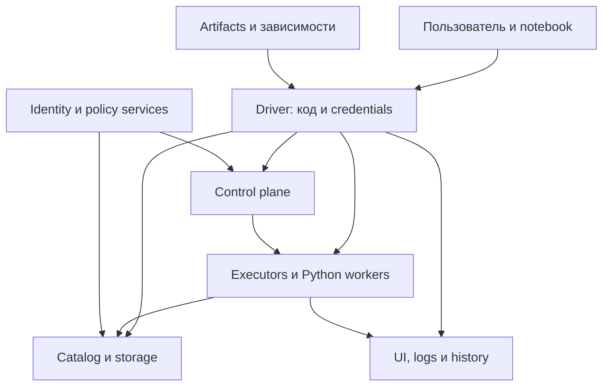
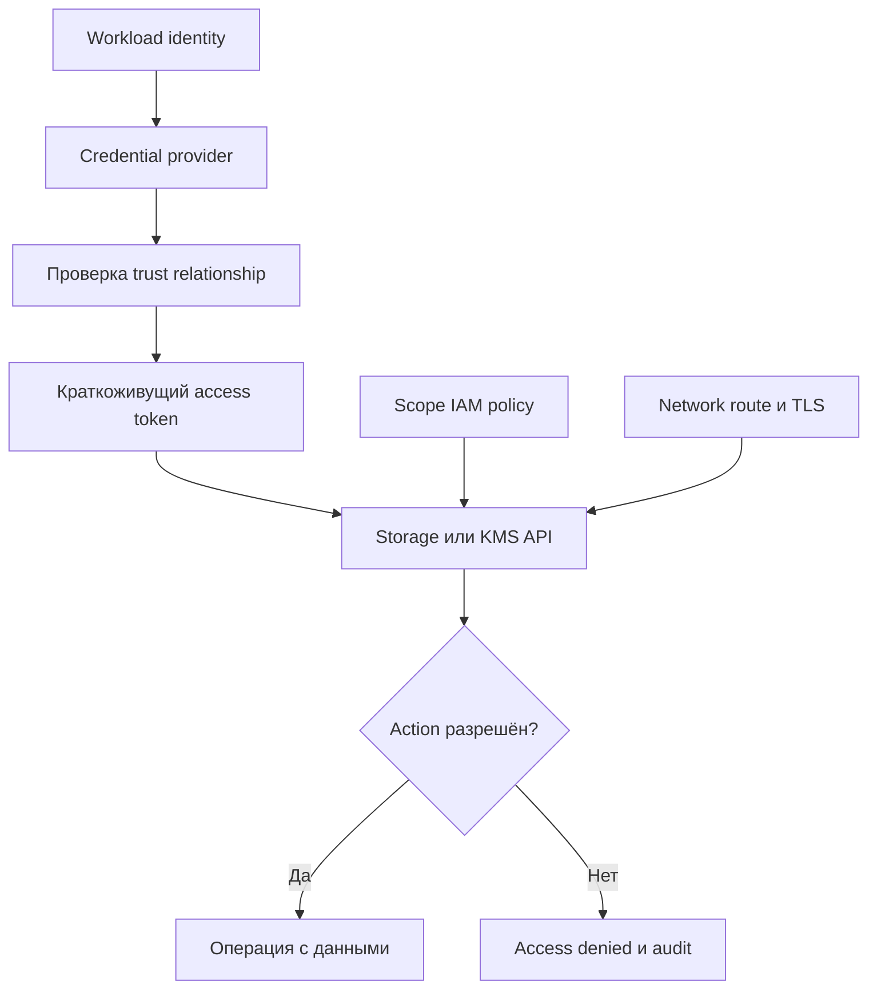
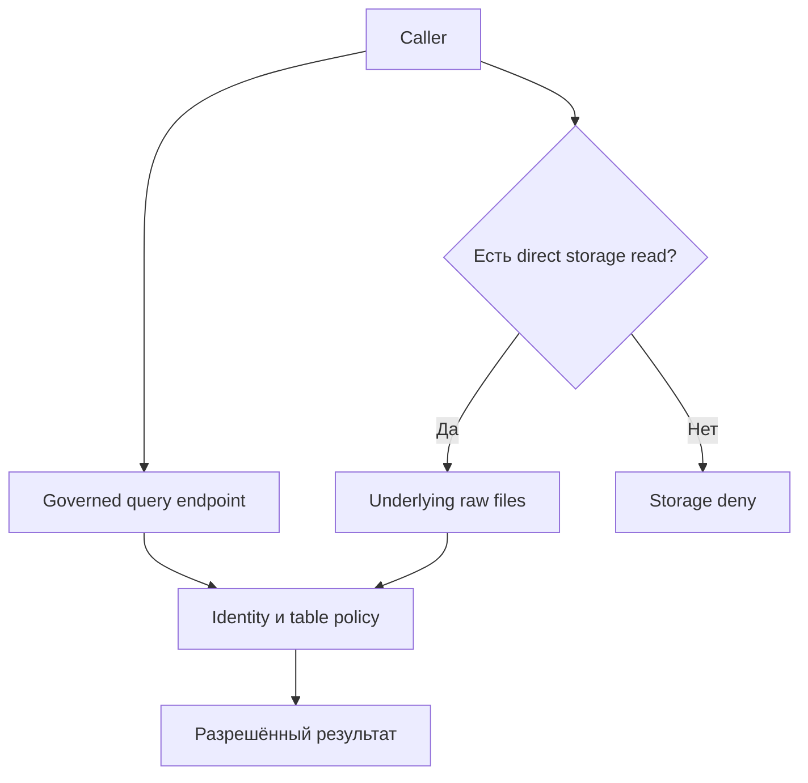
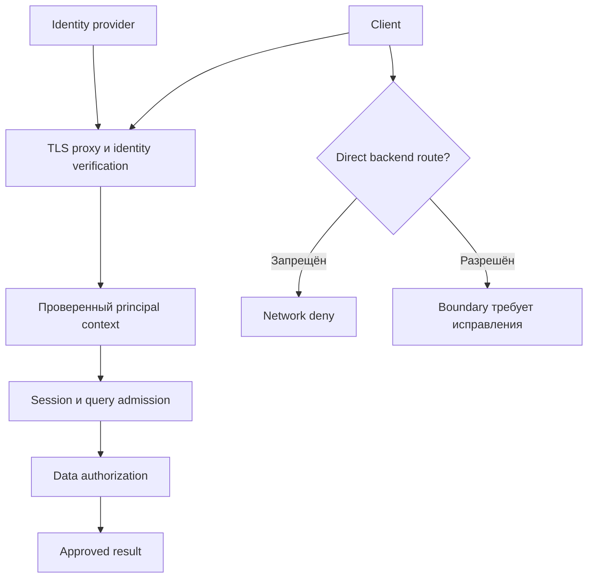
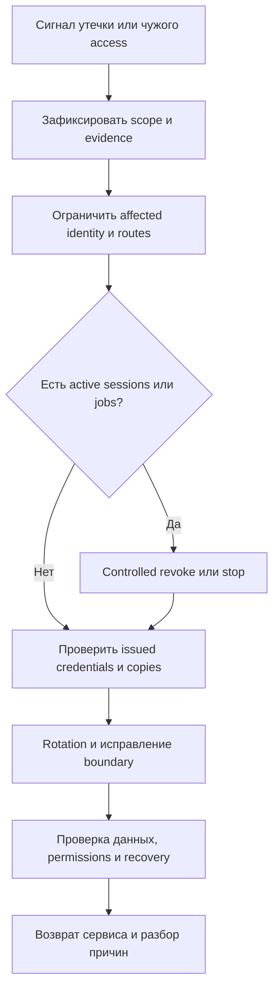

# 24. Безопасность и управление доступом к данным

Основной язык примеров — **Python / PySpark**. Учебное окружение: **Apache Spark 4.2.0, Python 3.12, JDK 17, Spark Classic, Linux**. Для криптографических примеров проверена библиотека **cryptography 50.0.2**. Настройки Spark, Hadoop, Kubernetes и managed platforms сверяются по своей версии: похожее имя параметра не гарантирует одинаковое покрытие.

**Цель раздела:** определить, кто исполняет код и получает credentials, какие соединения и данные защищены, где действительно применяется authorization и как проверить разрешённые и запрещённые действия.

| Понятие | На какой вопрос отвечает |
| --- | --- |
| Authentication | Кто подключился или предъявил credential? |
| Authorization | Что этой identity разрешено? |
| Confidentiality | Кто может прочитать содержимое? |
| Integrity | Как обнаружить недопустимое изменение? |
| Isolation | Какие процессы, данные и ресурсы разделены между tenants? |
| Audit | Какие действия подтверждаются проверяемой историей? |

**Как пользоваться примерами**

- **Локальные лаборатории** работают с синтетическими данными, свежими учебными ключами и loopback. `SPARK_LOCAL_IP=127.0.0.1` предназначен для одной машины; для distributed cluster нужны настоящие адреса и routes.
- **Инфраструктурные шаблоны** требуют существующих KDC, Hadoop/Kubernetes, cloud IAM, storage, catalog или endpoint. Имена `.example`, bucket names, groups и paths заменяются своими значениями.
- Passwords, private keys, tokens и реальные персональные данные в справочник не помещаются. Код генерации лаборатории создаёт новые значения локально и сохраняет их в приватном временном каталоге.
- Лаборатория RPC проверяет конкретные internal channels. Она не выдаётся за полноценный дизайн многопользовательской платформы: UI, endpoint users, storage и catalog требуют собственных controls.
- Здесь описывается инженерное управление данными. Организационные правила классификации, retention и удаления должны быть определены владельцами данных и применимыми требованиями.
- Дата проверки — **14 октября 2026 года, Europe/Moscow**. Утверждения о конкретных API сопровождаются официальными ссылками; выполненные тесты и границы проверки перечислены в конце.

**Содержание**

1. [Модель угроз и границы доверия](#threat-model)
2. [Аутентификация компонентов](#authentication)
3. [Шифрование](#encryption)
4. [Авторизация и политики](#authorization)
5. [Секреты и credentials](#credentials)
6. [Безопасность кода и зависимостей](#code-security)
7. [Персональные и чувствительные данные](#sensitive-data)
8. [Безопасная эксплуатация endpoint](#endpoint-operations)

<a id="threat-model"></a>

## Модель угроз и границы доверия

### Пользовательский код как исполнение с правами приложения

Spark выполняет пользовательские функции и приложения. В Spark Classic Python/Scala-код driver и код tasks работают с правами соответствующих процессов: могут читать разрешённые файлы, использовать доступные credentials и обращаться к reachable services.

Если identity приложения имеет полный доступ к raw bucket, пользователь, который может произвольно менять его код, фактически способен использовать этот доступ. SQL view, masking transformation или notebook cell не ограничивают автоматически другие действия того же процесса.

| Возможность пользователя | Что входит в область доверия |
| --- | --- |
| Запустить утверждённый неизменяемый artifact | Код выпуска и его inputs/config |
| Изменить PySpark script или UDF | Произвольное исполнение в разрешённом runtime scope |
| Добавить JAR/wheel/init script | Код dependency и installation hooks |
| Получить shell/attach к driver | Environment, files, memory и credentials процесса |
| Изменить pod specification | ServiceAccount, mounts, privileges и network placement в рамках admission |

Для доверенного ETL-service допустим один набор прав. Для notebooks разных tenants потребуется иной: разделённые identities, ограниченные APIs/compute modes и проверенные platform boundaries.

Spark Connect отделяет клиент от серверного процесса и ограничивает доступные клиентские APIs, но сам по себе не создаёт полный sandbox arbitrary server-side code. Python UDF и разрешённые server extensions входят в threat model; shared server credentials требуют отдельного анализа.

**Практика:** выпиши все способы добавления кода в свой runtime: script, JAR, wheel, UDF, notebook, connector, plugin. Какими правами будет выполняться каждый?

[Spark Security](https://spark.apache.org/docs/4.2.0/security.html), [Spark Connect](https://spark.apache.org/docs/4.2.0/spark-connect-overview.html).

### Driver, executors, storage и control plane

У платформы несколько границ доверия. Driver управляет computation; executors выполняют tasks; storage хранит данные; control plane создаёт приложения и выдаёт ресурсы. UI/history/logs раскрывают operational metadata и иногда содержимое queries.



| Граница | Что проверить |
| --- | --- |
| Client → endpoint | TLS, authentication, session identity и admission |
| Driver ↔ executors | Internal authentication/encryption и secret distribution |
| Driver → control plane | Kubernetes/YARN/service API permissions |
| Processes → storage/catalog | Runtime identity, data actions и KMS access |
| Processes → dependencies | Source integrity, egress и trusted repository |
| Reader → UI/logs | Authentication, ACL, retention и redaction |

RPC shared secret не является cloud IAM credential. Kubernetes ServiceAccount не выдаёт автоматически catalog grants. TLS на Spark UI не шифрует JDBC traffic executors.

При расследовании определяй конкретный principal, process, resource и action. Ошибка `403` от Kubernetes API, `AccessDenied` storage и отказ table policy относятся к разным системам.

**Самопроверка:** какой слой запрещает создание executor pod, а какой — чтение файла внутри уже работающего pod?

### Доверенные и недоверенные notebooks или зависимости

Notebook — интерфейс исполнения кода. Если два пользователей делят driver/session/identity, граница между их cells может быть слабее ожидаемой. Shared caches, temporary views, installed packages и secret retrieval также входят в область анализа.

| Источник | Типичная угроза | Контроль |
| --- | --- | --- |
| Notebook стороннего автора | Выполнение скрытых shell/network/data operations | Review, изолированный runtime и synthetic input |
| Wheel/JAR | Код installation/runtime, transitive dependencies | Trusted source, hashes/signatures, inventory и smoke tests |
| Container image | Изменённые binaries/entrypoint, лишние privileges | Digest, provenance, scan и runtime policy |
| Dynamic downloads | Подмена/исчезновение dependency, dependency confusion | Controlled repository и pinned dependency graph |
| Shared notebook session | Доступ к state/credentials другого пользователя | Проверенный session/access mode и отдельные identities |

Подпись artifact подтверждает происхождение относительно доверенного signer, но не доказывает отсутствие опасного поведения. Review и ограничение runtime rights сохраняют смысл даже для подписанного кода.

Не открывай production secrets/raw data для первой проверки чужого notebook. Условие «он только делает SELECT» не гарантирует отсутствие UDF, script transform, connector side effects или скрытого кода запуска.

Для multi-user platform явно опиши, кто может install dependencies, attach к чужому compute, менять session config и получать credentials. Наличие разных notebook URLs не подтверждает отдельный driver.

**Практика:** проверь доступ к чужим temporary views, mounted files и installed packages в выбранном platform mode, используя синтетические данные и тестовые identities.

### Изоляция tenants и ограничение сетевого доступа

Tenant isolation охватывает identities, processes, data, network и resources. Namespace, queue или имя проекта являются только частью решения.

| Слой | Пример разделения |
| --- | --- |
| Identity | Отдельные ServiceAccounts/IAM roles, без общей privileged credential |
| Compute | Подходящие process/pod/node/access-mode boundaries |
| Storage | Отдельные prefixes/ACL и запрет чужого read/write/delete |
| Catalog | Grants/policies, действующие на всех поддержанных путях |
| Network | Разрешённые ingress/egress routes и endpoints |
| Control plane | Scope создания/наблюдения/изменения ресурсов |
| Resources | Quotas/concurrency, защита от вытеснения соседями |

Pod sharing одного kernel/node остаётся фактором доверия; workload identity не устраняет privileged mounts, host networking и node-level access. Ограничения Pod Security/admission должны применяться платформой, а не зависеть только от доброй воли автора pod template.

На Kubernetes user с правом создавать pods может выбирать доступные ServiceAccounts и mounts, если admission не ограничивает это. Даже read/list pods может раскрывать credentials, помещённые в pod environment; Spark 4.2 документирует такой способ propagation внутреннего authentication secret.

NetworkPolicy требует CNI с enforcement. Стандартная policy не понимает table names, SQL predicates или object prefixes; IAM/catalog и сеть решают разные задачи. Учитывай routes к metadata/token services и запрет получения более широкой node identity.

**Упражнение:** составь две identities tenant A/B и таблицу разрешений. Проверь чужой storage prefix, чужой pod, чужую session и нежелательный egress отдельно.

[Kubernetes RBAC](https://kubernetes.io/docs/reference/access-authn-authz/rbac/), [Pod Security Standards](https://kubernetes.io/docs/concepts/security/pod-security-standards/), [EKS Pod Identity boundaries](https://docs.aws.amazon.com/eks/latest/userguide/pod-identities.html).

### Минимальные права для чтения, записи и администрирования

Least privilege начинается с конкретных operations. Reader, writer и platform administrator не обязаны иметь одинаковые credentials.

| Роль workload | Обычно требуется | Что не следует выдавать автоматически |
| --- | --- | --- |
| Reader | Read нужных objects/tables, необходимые list/catalog/KMS actions | Delete, unrelated prefixes, policy changes |
| Writer | Read input, write/commit output, checkpoint и нужные catalog actions | Полный bucket/account admin |
| Maintenance | Определённые optimize/cleanup actions | Неограниченное удаление всех datasets |
| Driver allocator | Нужные pods/services/configmaps в namespace | Cluster-wide admin без оснований |
| Operator/orchestrator | Submit/observe/cancel в выбранном scope | Raw data access, если он не нужен |
| Platform admin | Управление инфраструктурой по своей роли | Постоянное смешение с повседневной workload identity |

Write не всегда равен одному `PutObject`: committer может нуждаться в list/delete/multipart operations, table writer — в metadata commits, encrypted storage — в разрешённых KMS actions. Права определяются actual connector/commit protocol.

**S3 read-only IAM policy fragment:** доступ к одному согласованному prefix; дополнительные bucket/KMS/connector требования проверяются отдельно.

```json
{
  "Version": "2012-10-17",
  "Statement": [
    {
      "Effect": "Allow",
      "Action": "s3:ListBucket",
      "Resource": "arn:aws:s3:::example-data-lake",
      "Condition": {
        "StringLike": {"s3:prefix": ["raw/approved", "raw/approved/*"]}
      }
    },
    {
      "Effect": "Allow",
      "Action": "s3:GetObject",
      "Resource": "arn:aws:s3:::example-data-lake/raw/approved/*"
    }
  ]
}
```

Это один allow fragment, не доказательство итогового deny: effective access складывается из identity/resource policies, boundaries и других механизмов сервиса. Более широкое grant в другом месте может изменить результат; historical object versions требуют отдельных actions.

**Практика по теме:** для одной ETL-job выпиши principal → resource → action → justification и negative test. **Вопросы для самопроверки:** какими правами исполняется UDF; где trust boundary; почему namespace недостаточен; почему writer не равен admin; что проверяет запрещённый read?

[IAM policy evaluation](https://docs.aws.amazon.com/IAM/latest/UserGuide/reference_policies_evaluation-logic.html), [S3 identity policy examples](https://docs.aws.amazon.com/AmazonS3/latest/userguide/example-policies-s3.html).

<a id="authentication"></a>

## Аутентификация компонентов

### Spark authentication и внутренние shared secrets

В Spark 4.2 `spark.authenticate=true` включает authentication внутренних соединений. Shared secret подтверждает принадлежность к доверенной группе Spark processes; он не является индивидуальной identity пользователя notebook.

| Deployment | Distribution secret | Последствие |
| --- | --- | --- |
| Standalone | Одинаковый secret у соответствующих daemons/applications | Общий credential ограничивает tenant isolation |
| YARN | Spark генерирует application-specific secret | Защита distribution зависит также от YARN RPC security |
| Kubernetes | Application-specific secret передаётся executors | Pod spec/RBAC должны защищать доступ к нему |
| Local | Secret создаётся в локальном пути запуска | Не проверяет remote isolation |

По умолчанию `spark.authenticate=false`; создание private network само по себе не включает feature. `spark.authenticate.secret` задаёт secret в сценариях, где его требует manager/runtime.

**Важное ограничение версии:** `spark.authenticate.secret.file` и отдельные driver/executor file options в реализации 4.2 поддерживаются **только для Kubernetes**. Это не универсальная file-based настройка Standalone. Для client mode Kubernetes driver/executor files могут иметь разные paths, но одинаковое содержимое.

**Kubernetes configuration template для уже смонтированного Secret:**

```properties
spark.authenticate true
spark.authenticate.secret.driver.file /run/spark-auth/key
spark.authenticate.secret.executor.file /run/spark-auth/key
spark.kubernetes.driver.secrets.spark-internal-auth /run/spark-auth
spark.kubernetes.executor.secrets.spark-internal-auth /run/spark-auth
```

Secret создаётся платформой в нужном namespace. Permissions/UID и наличие файла проверяются у обоих roles. Spark не монтирует произвольный secret file только потому, что задан его path.

**Лаборатория A — свежая configuration для Standalone, TLS и legacy profile.** Сохрани `prepare_rpc_lab.py`. Нужны OpenSSL, Java keytool и Spark 4.2. Временно используется один self-signed certificate/private key для всех процессов одной машины; production PKI должна иметь свой lifecycle и identities.

```python
import argparse
import os
import secrets
import subprocess
from pathlib import Path

parser = argparse.ArgumentParser()
parser.add_argument("--directory", required=True)
args = parser.parse_args()
root = Path(args.directory).resolve()
os.umask(0o077)
root.mkdir(parents=True, exist_ok=True)
if any(root.iterdir()):
    raise ValueError("Use an empty private directory")
root.chmod(0o700)

password = secrets.token_urlsafe(32)
secret = secrets.token_hex(32)
environment = {**os.environ, "LAB_TLS_STORE_PASS": password}


def run(command):
    subprocess.run(command, env=environment, check=True, capture_output=True)


run([
    "openssl", "req", "-x509", "-newkey", "rsa:3072", "-nodes",
    "-keyout", str(root / "lab-key.pem"),
    "-out", str(root / "lab-cert.pem"), "-days", "1",
    "-subj", "/CN=localhost",
    "-addext", "subjectAltName=DNS:localhost,IP:127.0.0.1",
])
run([
    "openssl", "pkcs12", "-export",
    "-in", str(root / "lab-cert.pem"),
    "-inkey", str(root / "lab-key.pem"),
    "-out", str(root / "keystore.p12"), "-name", "spark-lab",
    "-passout", "env:LAB_TLS_STORE_PASS",
])
run([
    "keytool", "-importcert", "-noprompt", "-alias", "spark-lab",
    "-file", str(root / "lab-cert.pem"),
    "-keystore", str(root / "truststore.p12"), "-storetype", "PKCS12",
    "-storepass:env", "LAB_TLS_STORE_PASS",
])

common = [
    "spark.authenticate true",
    f"spark.authenticate.secret {secret}",
    "spark.io.encryption.enabled true",
    "spark.io.encryption.keySizeBits 256",
    "spark.master.rest.enabled false",
    "spark.ui.showConsoleProgress false",
]
tls = common + [
    "spark.ssl.rpc.enabled true",
    "spark.ssl.rpc.protocol TLSv1.3",
    "spark.ssl.rpc.openSSLEnabled false",
    f"spark.ssl.rpc.keyStore {root / 'keystore.p12'}",
    f"spark.ssl.rpc.keyStorePassword {password}",
    f"spark.ssl.rpc.keyPassword {password}",
    f"spark.ssl.rpc.trustStore {root / 'truststore.p12'}",
    f"spark.ssl.rpc.trustStorePassword {password}",
    "spark.network.crypto.enabled false",
]
legacy = common + [
    "spark.ssl.rpc.enabled false",
    "spark.network.crypto.enabled true",
    "spark.network.crypto.authEngineVersion 2",
    "spark.network.crypto.cipher AES/GCM/NoPadding",
    "spark.network.crypto.saslFallback false",
]
for name, settings in [("tls.conf", tls), ("legacy.conf", legacy)]:
    path = root / name
    path.write_text("\n".join(settings) + "\n", encoding="utf-8")
    path.chmod(0o600)

print("LAB_CONFIGURATION_CREATED", root)
```

```bash
RPC_LAB_DIR="$(mktemp -d)"
python3 prepare_rpc_lab.py --directory "$RPC_LAB_DIR"
```

Script создаёт `tls.conf`, `legacy.conf`, keystore/truststore и учебный certificate. Directory mode 0700, configuration 0600; secret/password не печатаются и не передаются как literal argument. Private PEM key создан без password исключительно внутри этого приватного disposable laboratory directory.

Для последующих терминалов используй путь созданного каталога в `RPC_LAB_DIR`, не выводя contents config. Не сохраняй этот каталог как release artifact: это временные учебные credentials.

**Самопроверка:** кого различает shared secret? Почему file option Kubernetes нельзя без проверки перенести в Standalone?

[Spark authentication](https://spark.apache.org/docs/4.2.0/security.html#authentication), [реализация SecurityManager 4.2](https://github.com/apache/spark/blob/v4.2.0/core/src/main/scala/org/apache/spark/SecurityManager.scala).

### Kerberos в Hadoop/YARN

Kerberos подтверждает identity клиента Hadoop services через tickets/service principals. Это отличается от Spark internal shared secret и от filesystem authorization.

| Компонент | Что нужно |
| --- | --- |
| Submit client | Kerberos configuration, credentials, correct time/DNS |
| YARN application | Поддерживаемая propagation/renewal credentials |
| HDFS/Hive/HBase | Service principals, access policies и tokens |
| KDC | Reachable endpoints и защищённый lifecycle keys |

**Cluster submission template:**

```bash
spark-submit \
  --master yarn \
  --deploy-mode cluster \
  --principal svc-sales@EXAMPLE.COM \
  --keytab /run/secure/svc-sales.keytab \
  jobs/daily_sales.py \
  --interval-start 2026-10-13T00:00:00Z \
  --interval-end 2026-10-14T00:00:00Z
```

Это шаблон существующего secure Hadoop environment и собственного application; keytab/script должны быть provisioned. Keytab позволяет получать credentials и требует контроля хранения/localization, а не является обычным public `--files` artifact.

Authentication не выдаёт automatically read/write. Проверь Hadoop user mapping, proxy-user policy, queue ACL, HDFS permissions и доступ к metastore/KMS от ожидаемой identity.

Kerberos не означает, что весь Hadoop traffic encrypted. RPC protection `authentication`, `integrity` и `privacy` имеют разное покрытие; data-transfer/web protocols настраиваются отдельно.

Частые failures: clock skew, principal/DNS mismatch, недоступный KDC, неверный realm/configuration и отсутствие service permissions. Повтор job не устраняет эти причины.

[Hadoop Secure Mode](https://hadoop.apache.org/docs/stable/hadoop-project-dist/hadoop-common/SecureMode.html), [Spark Kerberos](https://spark.apache.org/docs/4.2.0/security.html#kerberos).

### Delegation tokens и renewal

Delegation token позволяет процессу обращаться к определённому service без постоянного использования исходного Kerberos keytab. Scope, issuer, renewer, expiration и maximum lifetime зависят от сервиса.

| Credential | Как используется |
| --- | --- |
| Kerberos ticket | Подтверждение identity в Kerberos-aware service |
| Keytab | Возможность нового login по правилам KDC |
| Delegation token | Делегированный доступ к конкретному service |
| OAuth/STS token | Другая service-specific temporary credential model |

Spark поддерживает Hadoop delegation token providers для известных integrations; third-party connectors могут иметь собственные providers. Успешное получение HDFS token не доказывает доступ к другому filesystem или Hive service.

**Configuration template:**

```properties
spark.kerberos.access.hadoopFileSystems hdfs://nameservice-a,hdfs://nameservice-b
spark.kerberos.renewal.credentials keytab
```

Используются real filesystem names и keytab-backed credentials выбранного secure environment. Для ticket cache доступна модель `ccache`; первоначальный TGT, renewable lifetime и обновление cache должны соответствовать длительности workload.

Renewal существующего token и получение нового после достижения maximum lifetime — разные операции. Long-running app требует поддержанного refresh/re-login и distribution обновлённых credentials нужным executors.

**Практика:** выполните тест, пересекающий expiry/renewal boundary: read source, write output и commit после обновления, включая новый executor. Проверяй факт доступа/issuer и timestamps, не печатай token contents.

### Cloud IAM roles и workload identity

Cloud workload identity связывает runtime с cloud principal и позволяет получать ограниченные, часто краткоживущие credentials. Не нужно помещать один permanent account key в каждый notebook.

| Платформа | Механизм | Что проверить |
| --- | --- | --- |
| EKS IRSA | ServiceAccount token/OIDC + STS role trust | Issuer/audience/subject, role policy и SDK chain |
| EKS Pod Identity | Association ServiceAccount ↔ IAM role через EKS/agent | Association/agent, supported SDK и IMDS boundary |
| GKE | Workload Identity Federation for GKE | Principal bindings, service support и metadata integration |
| AKS | Microsoft Entra Workload ID | Federation, projected token, identity и supported client |
| Managed Spark service | Execution/service identity по модели продукта | Кто читает artifacts/data и какие scopes |

IRSA и EKS Pod Identity — отдельные способы с разными prerequisites; Pod Identity не требует такого же per-cluster IAM OIDC provider setup, как IRSA. Kubernetes ServiceAccount и cloud service account/role также не являются одним объектом.



Схема показывает общий принцип; конкретный exchange/agent/metadata flow зависит от платформы. Включение identity mechanism не создаёт grants на данные само по себе.

PySpark может читать storage через JVM Hadoop connector, а user code — через Python SDK. Проверяй credential chain **обоих** clients: успешный `boto3`/SDK call не подтверждает правильный S3A provider и наоборот.

Доступ к node metadata может раскрыть более широкую node role. Ограничивай нежелательные metadata routes и используй supported workload metadata endpoints. Registry image pull identity тоже может отличаться от data identity pod.

**Самопроверка:** какие права имеет driver, executor и orchestration principal? Почему ServiceAccount RBAC не разрешает S3 `GetObject`?

[EKS IRSA](https://docs.aws.amazon.com/eks/latest/userguide/iam-roles-for-service-accounts.html), [EKS Pod Identity](https://docs.aws.amazon.com/eks/latest/userguide/pod-identities.html), [GKE federation](https://docs.cloud.google.com/kubernetes-engine/docs/concepts/workload-identity), [AKS Workload ID](https://learn.microsoft.com/en-us/azure/aks/workload-identity-overview).

### Proxy authentication для внешних SQL/Connect endpoints

Внешний endpoint должен идентифицировать caller и привязать запросы/session к этой identity. Reverse proxy может выполнять OIDC/mTLS authentication, но backend должен доверять только проверенному identity context.

| Endpoint | Особенность |
| --- | --- |
| Spark UI/History Server | Servlet filter/proxy authentication, затем UI ACL |
| Thrift Server | Thrift/JDBC transport, HiveServer2 authentication settings и выбранная distribution |
| Spark Connect | gRPC/HTTP2; proxy/interceptor и server-side identity/session integration |
| Managed SQL endpoint | Product-specific identity, policies и access modes |

Для Connect proxy должен поддерживать HTTP/2/gRPC, streaming responses, deadlines и передачу metadata. Обычный HTTP/1-only proxy не является прозрачной заменой.

В исходниках Spark 4.2 присутствует pre-shared bearer-token interceptor и переменная `SPARK_CONNECT_AUTHENTICATE_TOKEN`. Это gate на знание общего token, а не полноценная per-user IAM/RBAC platform. Internal config `spark.connect.authenticate.token` не следует считать стабильным публичным API всех releases.

Если gateway принимает `X-User`/аналогичный header, клиент не должен иметь возможность подменить его или обойти gateway прямым обращением к backend. Proxy очищает incoming identity headers и передаёт удостоверенный контекст по защищённому доверенному каналу.

**Практика:** проверь no token, invalid token, valid wrong-audience identity и попытку direct backend access. Отдельно проверь, под какой principal выполняется data request.

[Connect overview](https://spark.apache.org/docs/4.2.0/spark-connect-overview.html), [Connect authentication implementation](https://github.com/apache/spark/blob/v4.2.0/sql/connect/server/src/main/scala/org/apache/spark/sql/connect/config/Connect.scala), [HiveServer2 clients/security](https://hive.apache.org/docs/latest/admin/setting-up-hiveserver2/).

### Различие transport security и identity authentication

Encryption защищает содержимое канала; authentication подтверждает peer/caller; authorization ограничивает actions. Один механизм может сочетать несколько свойств, но их границы надо назвать явно.

| Конфигурация | Что даёт | Чего не обещает |
| --- | --- | --- |
| TLS с проверенным server certificate | Шифрование и удостоверенный server относительно trust model | Table grants и per-user permissions |
| mTLS в поддерживаемом endpoint | Дополнительно client certificate identity | Автоматические table grants |
| Shared secret/bearer token | Допуск holder credential | Различение всех пользователей/тенантов |
| UI ACL | Разрешения authenticated UI principal | Storage/table authorization |
| IAM/catalog policy | Доступ к resource/action | Защиту всех произвольных внешних соединений |

TLS без корректного trust/verification может шифровать разговор с неправильным peer. Bearer token без защищённого transport может быть перехвачен и использован другим holder.

В Spark 4.2 RPC TLS не поддерживает client certificate authentication через `spark.ssl.rpc.needClientAuth`: эта option не относится к RPC namespace в документации, а SSLFactory задаёт client auth false. Shared-secret authentication остаётся отдельным механизмом; mTLS другого proxy/endpoint имеет собственную configuration.

Certificate subject, Kerberos principal, Kubernetes ServiceAccount, cloud role и SQL user могут быть разными identities. Их mapping должен иметь owner, проверяемые правила и audit.

**Практика по теме:** для каждого channel укажи encryption, authentication, authorization и verification evidence. **Вопросы для самопроверки:** что идентифицирует internal secret; как доставляются tokens; кто обновляет credentials; что делает proxy; почему TLS не выдаёт data grants?

[RPC SSLFactory 4.2](https://github.com/apache/spark/blob/v4.2.0/common/network-common/src/main/java/org/apache/spark/network/ssl/SSLFactory.java).

<a id="encryption"></a>

## Шифрование

### TLS для доступных endpoint и внешних соединений

TLS настраивается на конкретном channel. UI, Spark RPC, Connect proxy, JDBC, Kafka и storage connectors имеют разные SSL parameters и trust models.

| Channel | Где конфигурировать |
| --- | --- |
| Application UI | `spark.ssl.ui.*` |
| Standalone daemons UI | `spark.ssl.standalone.*` |
| History Server UI | `spark.ssl.historyServer.*` |
| Spark RPC | `spark.ssl.rpc.*` с explicit enable |
| Connect | Поддержанный server/proxy gRPC TLS path |
| JDBC/Kafka/object storage | Connector/client/service configuration |

`spark.ssl.enabled=true` задаёт общую SSL configuration для поддержанных namespaces, но **не включает автоматически RPC SSL**. Для него требуется `spark.ssl.rpc.enabled=true`.

**RPC TLS properties template:** key stores доступны runtime processes, passwords доставлены через защищённый configuration/credential-provider path.

```properties
spark.authenticate true
spark.ssl.rpc.enabled true
spark.ssl.rpc.protocol TLSv1.3
spark.ssl.rpc.openSSLEnabled false
spark.ssl.rpc.keyStore /run/tls/keystore.p12
spark.ssl.rpc.trustStore /run/tls/truststore.p12
spark.network.crypto.enabled false
```

Здесь passwords намеренно не записаны; полноценный экземпляр локальной лаборатории создаёт script выше. JDK/provider должны поддерживать protocol/ciphers. `${ns}.needClientAuth` доступен не для любого namespace; не переносить UI settings в RPC без проверки.

**Критичный operational check для JDK-based RPC implementation 4.2:** если truststore отсутствует или path не существует, SSLFactory выбирает trust manager без проверки цепочки. Поэтому существование, ownership, содержимое truststore и negative CA test проверяются явно; одного флага TLS недостаточно.

Также нельзя автоматически приписать RPC тому же hostname-verification behavior, что HTTPS client: это отдельный transport implementation. Для внешнего HTTPS/gRPC endpoint проверяй chain, SAN/hostname, expiry и принятую peer identity policy.

Локальная проверка TLS к Master успешно завершила handshake с доверенным учебным certificate и отклонила его с обычным trust store, не содержащим этого trust anchor. Это отдельный client-side trust test; certificate не удостоверяет реальную production identity.

**Самопроверка:** какие файлы нужны на driver/executors? Почему HTTPS UI не означает encrypted JDBC traffic?

[Spark SSL configuration](https://spark.apache.org/docs/4.2.0/security.html#ssl-configuration), [SSLFactory source](https://github.com/apache/spark/blob/v4.2.0/common/network-common/src/main/java/org/apache/spark/network/ssl/SSLFactory.java), [Java keytool](https://docs.oracle.com/en/java/javase/17/docs/specs/man/keytool.html).

### Spark network encryption и настройки по версии

В Spark 4.2 для internal RPC документированы preferred **TLS** и **legacy AES-based** encryption. При включении обоих TLS получает приоритет; не считай два флага двойным шифрованием.

| Property | Default 4.2 | Назначение |
| --- | --- | --- |
| `spark.ssl.rpc.enabled` | false | RPC TLS |
| `spark.network.crypto.enabled` | false | Legacy AES-based protocol |
| `spark.network.crypto.authEngineVersion` | 1 | Version 2 добавляет KDF; документирована как предпочтительная |
| `spark.network.crypto.cipher` | AES/CTR/NoPadding | AES/GCM/NoPadding добавляет authenticated encryption mode |
| `spark.network.crypto.saslFallback` | true | Compatibility fallback к SASL authentication |
| `spark.authenticate.enableSaslEncryption` | false | Старый SASL encryption mechanism |

TLS — рекомендуемый документацией путь при подходящей инфраструктуре. Legacy settings остаются важными для существующих deployments; version/cipher/fallback должны быть согласованы со всеми participants и shuffle services.

**Legacy profile для отдельной совместимой лаборатории:**

```properties
spark.authenticate true
spark.ssl.rpc.enabled false
spark.network.crypto.enabled true
spark.network.crypto.authEngineVersion 2
spark.network.crypto.cipher AES/GCM/NoPadding
spark.network.crypto.saslFallback false
```

Shared secret задаётся защищённым способом для выбранного deployment; для лаборатории он находится в созданном `legacy.conf`. Disabling fallback может намеренно сделать старые peers несовместимыми; rollout должен проверять actual versions.

**Запуск лаборатории A, три терминала.** В каждом задай `RPC_LAB_DIR` путём, созданным prepare script. Все роли используют **один выбранный profile**; TLS и legacy проверяются отдельными runs.

**Терминал 1 — Master:**

```bash
SPARK_LOCAL_IP=127.0.0.1 SPARK_DAEMON_MEMORY=256m \
spark-class org.apache.spark.deploy.master.Master \
  --host 127.0.0.1 \
  --port 17087 \
  --webui-port 18097 \
  --properties-file "$RPC_LAB_DIR/tls.conf"
```

**Терминал 2 — Worker:**

```bash
SPARK_LOCAL_IP=127.0.0.1 SPARK_DAEMON_MEMORY=256m \
spark-class org.apache.spark.deploy.worker.Worker \
  --host 127.0.0.1 \
  --port 17088 \
  --webui-port 18098 \
  --cores 2 \
  --memory 1536m \
  --work-dir "$RPC_LAB_DIR/work" \
  --properties-file "$RPC_LAB_DIR/tls.conf" \
  spark://127.0.0.1:17087
```

Master/worker CLI properties-file support сверена с реализацией этой версии. Если wrappers отсутствуют в PATH, используй `$SPARK_HOME/bin/spark-class` из distribution; установленный пакет PySpark также содержит `bin` scripts.

**`rpc_app.py`:**

```python
import argparse
import json
from pathlib import Path

from pyspark import StorageLevel
from pyspark.sql import SparkSession, functions as F

parser = argparse.ArgumentParser()
parser.add_argument("--output", required=True)
parser.add_argument("--report", required=True)
args = parser.parse_args()

spark = SparkSession.builder.appName("security-rpc-lab").getOrCreate()
try:
    sc = spark.sparkContext
    sc.setLogLevel("WARN")
    assert sc.getConf().get("spark.authenticate") == "true"
    assert sc.getConf().get("spark.io.encryption.enabled") == "true"
    source = spark.range(1000, numPartitions=4).persist(StorageLevel.DISK_ONLY)
    assert source.count() == 1000
    groups = (
        source.withColumn("bucket", F.col("id") % 5)
        .groupBy("bucket")
        .agg(F.count(F.lit(1)).alias("rows"), F.sum("id").alias("sum_id"))
        .collect()
    )
    assert len(groups) == 5
    assert sum(row.rows for row in groups) == 1000
    assert sum(row.sum_id for row in groups) == 499500

    # Application output не покрывается spark.io.encryption.
    spark.range(4).withColumn("marker", F.lit("synthetic-public-label")) \
        .write.mode("errorifexists").json(args.output)
    restored = spark.read.json(args.output)
    assert restored.count() == 4
    source.unpersist()
    report = {
        "application_id": sc.applicationId,
        "master": sc.master,
        "groups": 5,
        "rows": 1000,
        "sum_id": 499500,
        "io_encryption_enabled": True,
        "rpc_tls_enabled": sc.getConf().get("spark.ssl.rpc.enabled", "false"),
        "legacy_crypto_enabled": sc.getConf().get("spark.network.crypto.enabled", "false"),
    }
    Path(args.report).write_text(json.dumps(report), encoding="utf-8")
    print("RPC_APPLICATION_OK")
finally:
    spark.stop()
```

**Терминал 3 — application:** новый output path нужен при каждом run.

```bash
RPC_RUN_DIR="$(mktemp -d)"
SPARK_LOCAL_IP=127.0.0.1 spark-submit \
  --master spark://127.0.0.1:17087 \
  --deploy-mode client \
  --properties-file "$RPC_LAB_DIR/tls.conf" \
  --driver-memory 512m \
  --executor-memory 512m \
  --executor-cores 1 \
  --total-executor-cores 2 \
  --conf spark.driver.host=127.0.0.1 \
  --conf spark.driver.bindAddress=127.0.0.1 \
  --conf spark.sql.shuffle.partitions=4 \
  rpc_app.py \
  --output "$RPC_RUN_DIR/output" \
  --report "$RPC_RUN_DIR/report.json"
```

Проверенный результат в обоих profiles: два executor JVM, пять групп, 1000 records и сумма IDs 499500. Для legacy-run останови именно учебные процессы, затем используй `legacy.conf` у Master, Worker и application. Лаборатория не включает UI user authentication: UI остаются loopback-only, REST submission отключён.

Неверный shared secret вызвал authentication failure. Отрицательная попытка была ограничена 25-секундным timeout harness и остановлена: это подтверждает отказ handshake, а не обещает универсальный Spark exit deadline.

**Практика:** проверь mixed versions/ciphers и forbidden fallback в отдельном тестовом scope. Не исправляй failure автоматическим ослаблением authentication.

[Network encryption](https://spark.apache.org/docs/4.2.0/security.html#network-encryption), [Master arguments](https://github.com/apache/spark/blob/v4.2.0/core/src/main/scala/org/apache/spark/deploy/master/MasterArguments.scala), [Worker arguments](https://github.com/apache/spark/blob/v4.2.0/core/src/main/scala/org/apache/spark/deploy/worker/WorkerArguments.scala).

### Шифрование локальных временных данных при поддержке

`spark.io.encryption.enabled` защищает поддержанные Spark-managed local disk data: shuffle/spill и disk blocks caching/broadcast. Оно не обещает шифрование любого файла, созданного Python/JVM library.

```properties
spark.io.encryption.enabled true
spark.io.encryption.keySizeBits 256
```

Поддержанные key sizes — 128/192/256 bits; default 128. Защита передачи encryption keys между processes также важна, поэтому local I/O encryption нужно согласовать с protected internal transport.

| Local artifact | Как оценивать покрытие |
| --- | --- |
| Spark shuffle/spill/disk cache | Поддержанный Spark I/O encryption path |
| Произвольный `open()`/library temp file | Отдельное правило, флаг Spark не гарантирует protection |
| Heap dump/core dump/stdout | Собственный protection/retention/access control |
| Checkpoint/output | Storage/format encryption и permissions |
| State-store files | Проверить backend и конкретный write path |
| Swap/node disk/PVC | Дополнительное OS/storage encryption и lifecycle |

В лаборатории `StorageLevel.DISK_ONLY` заставляет source использовать disk-backed persistence при включённом encryption, затем computation успешно читает эти blocks. Это функциональная проверка configured path, не cryptographic audit реализации.

Отдельно приложение пишет JSON с `synthetic-public-label`. Обычный Python reader читает эту строку из output file: **application output не покрывается этим setting**, как и предупреждает documentation.

Шифрование disk data не защищает от кода самого authorized процесса, который уже имеет plaintext/key в memory. Permissions, ownership directories, process isolation и cleanup сохраняют значение.

**Упражнение:** составь inventory local files после representative run. Какие из них создаёт Spark, connector, Python library или OS?

[Spark local storage encryption](https://spark.apache.org/docs/4.2.0/security.html#local-storage-encryption), [StorageLevel.DISK_ONLY](https://spark.apache.org/docs/4.2.0/api/python/reference/api/pyspark.StorageLevel.DISK_ONLY.html).

### Encryption at rest в HDFS и объектном хранилище

At-rest encryption защищает persisted bytes по правилам storage/format. Authorized read обычно возвращает plaintext приложению. Наличие encryption не ограничивает автоматически количество или смысл читаемых records.

| Механизм | Что контролировать |
| --- | --- |
| HDFS encryption zone | Zone/key, file permissions, KMS authorization и client behavior |
| Object-storage server-side encryption | Bucket/object policy, key ownership, KMS grants и audit |
| Client-side/envelope encryption | Data keys, authenticated format, rotation и authorized decrypt path |
| Parquet column encryption | Compatible writers/readers, key retrieval и metadata coverage |
| Encrypted node disk/PVC | Volume lifecycle, snapshots, attachment и OS access |

HDFS encryption zone использует file data keys, защищённые zone encryption key. Namespace metadata и file contents имеют разные coverage; zone не является заменой HDFS ACL. Client может требовать и file read, и разрешённый KMS decrypt.

**Read-only проверка HDFS encryption zones в настроенном environment:**

```bash
hdfs crypto -listZones
hdfs dfs -getfacl /data/sensitive
```

Object storage может применять provider-managed или customer-managed keys. Проверь effective object encryption и нужную KMS identity, а не только default bucket setting. Existing versions, replication и exports имеют отдельный lifecycle.

Spark Parquet encryption — дополнительная возможность с соответствующими dependencies/key-client requirements. Учебный in-memory KMS из documentation не является production key management design.

**Самопроверка:** почему приложение с корректным `GetObject`, но без KMS access, может не прочитать файл? Почему после успешного read plaintext появляется в memory?

[HDFS transparent encryption](https://hadoop.apache.org/docs/stable/hadoop-project-dist/hadoop-hdfs/TransparentEncryption.html), [S3 server-side encryption](https://docs.aws.amazon.com/AmazonS3/latest/userguide/serv-side-encryption.html), [Spark Parquet encryption](https://spark.apache.org/docs/4.2.0/sql-data-sources-parquet.html#columnar-encryption).

### KMS, ротация ключей и ответственность платформы

KMS управляет key material и операциями согласно своей policy. Приложение может обращаться к нему через storage connector, envelope encryption client или tokenization service. Key owner, data owner и platform operator не обязаны совпадать.

| Задача | Ответственность |
| --- | --- |
| Создание/хранение master keys | KMS/platform key management |
| Grant decrypt/encrypt | Security/data policy owners |
| Data-key lifecycle/cache | Storage/connector/application design |
| Rotation | KMS policy плюс совместимость old/new data |
| Audit и break-glass | Platform/security operations |
| Recovery/retention | Согласование ключей, snapshots и backups |

Ротация master key material, rewrapping data keys и повторное шифрование всех files — разные действия. Например, AWS KMS rotation сохраняет возможность decrypt прежнего ciphertext и не означает автоматическую перезапись каждого object.

Удаление/disable key не «отзывает» plaintext, который уже прочитан в memory, cache или export. Потеря key material может сделать retained encrypted data невосстановимыми; lifecycle keys должен соответствовать data recovery requirements.

Key rotation требует проверки writers, readers, executors с cached credentials и восстановления historical snapshots. Для HMAC pseudonyms изменение key меняет identifiers; совместимость joins/migration задаётся отдельно.

**Практика:** спланируй rotation без key values в logs: новый write, read прежних данных, read после executor replacement и контроль audit. Кто отвечает за historical decrypt после migration?

[AWS KMS rotation](https://docs.aws.amazon.com/kms/latest/developerguide/rotate-keys.html).

### Границы покрытия разных механизмов шифрования

Security configuration удобно проверять как coverage matrix: один checkbox «encryption enabled» скрывает слишком много различий.

| Surface | Возможный mechanism | Отдельно остаётся |
| --- | --- | --- |
| Client → UI | HTTPS/proxy TLS | User identity и UI ACL |
| Internal Spark transport | RPC TLS или supported legacy AES | Secret distribution и peer trust |
| Spark local shuffle/cache | I/O encryption | Other temp files, dumps, logs, OS access |
| HDFS transfer | Hadoop RPC/data-transfer protection | At-rest zones/KMS и authorization |
| Object-storage transfer | HTTPS client validation | Object/KMS policy и persisted encryption |
| Application output/checkpoint | Storage/format encryption | Readers, history, retention и exports |
| JDBC/Kafka connections | Их TLS/auth settings | Endpoint user/role и data actions |
| Plaintext в runtime | Process/platform isolation | Authorized code и minimization |

Даже encrypted file может иметь чувствительные имена, schema, statistics или history metadata, если формат/сервис не защищает их выбранным способом. Проверяй actual data path, а не только название алгоритма.

Integrity тоже не универсальна: encryption mode без authentication не равен AEAD. TLS termination в proxy заканчивает один encrypted channel; downstream channel требует собственной модели доверия.

**Практика по теме:** повтори RPC laboratory, затем заполни coverage matrix своего pipeline и добавь negative trust test. **Вопросы для самопроверки:** почему RPC enable explicit; что меняет authEngineVersion; какие local files covered; чем KMS rotation отличается от rewrite; где authorized process получает plaintext?

<a id="authorization"></a>

## Авторизация и политики

### Spark UI ACL и права на просмотр истории

UI показывает jobs, stages, SQL plans, environment и operational metadata. View permission и право изменять состояние приложения отличаются; ни одно не является table/storage permission.

| Setting | Область |
| --- | --- |
| `spark.acls.enable` | Проверка application UI ACL при установленной authentication integration |
| `spark.ui.view.acls` / `.groups` | Кто может смотреть UI |
| `spark.modify.acls` / `.groups` | Кто может выполнять поддержанные modify actions |
| `spark.admin.acls` / `.groups` | Administrative UI access |
| `spark.history.ui.acls.enable` | History Server authorization для сохранённых applications |
| `spark.history.ui.admin.acls` / `.groups` | Administrative просмотр history |

**UI configuration template:** перед ним нужен authentication filter, который предоставляет корректный `getRemoteUser()`/principal и согласованную group mapping.

```properties
spark.acls.enable true
spark.ui.view.acls alice,bob
spark.ui.view.acls.groups data-observers
spark.modify.acls svc-sales
spark.admin.acls.groups platform-admins
spark.history.ui.acls.enable true
spark.history.ui.admin.acls.groups platform-admins
```

History Server authenticates readers отдельно и использует application owner/view ACL metadata сохранённого run. Защита raw event-log storage нужна дополнительно: reader, получивший файл напрямую, обходит SHS UI controls.

**Нюанс JWSFilter в Spark 4.2:** встроенный filter проверяет подписанный JWT для допуска HTTP request. По исходникам он не преобразует JWT `sub` в servlet remote user. Поэтому JWSFilter с общим signing key не является полной реализацией per-user UI ACL. Signature gate и user principal mapping — разные границы.

**Лаборатория B `jws_redaction_lab.py`:** все keys/tokens генерируются для loopback и не печатаются. Manual JWT signing здесь нужен только для проверки поведения filter; production IdP/token issuance использует свой поддержанный механизм.

```python
import base64
import hashlib
import hmac
import json
import secrets
import tempfile
import time
import urllib.error
import urllib.request
from pathlib import Path

from pyspark.sql import SparkSession


def encode_url(data: bytes) -> str:
    return base64.urlsafe_b64encode(data).rstrip(b"=").decode("ascii")


def issue_lab_token(key: bytes, subject: str) -> str:
    header = encode_url(b'{"alg":"HS256","typ":"JWT"}')
    claims = encode_url(json.dumps({
        "sub": subject,
        "exp": int(time.time()) + 120,
    }).encode("utf-8"))
    message = f"{header}.{claims}"
    signature = encode_url(hmac.new(key, message.encode("ascii"), hashlib.sha256).digest())
    return f"{message}.{signature}"


root = Path(tempfile.mkdtemp(prefix="jws-redaction-lab-"))
root.chmod(0o700)
events = root / "events"
events.mkdir(mode=0o700)
key = secrets.token_bytes(32)
encoded_key = encode_url(key)
synthetic_token = secrets.token_hex(24)
marker = "LAB_PUBLIC_CANARY_0001"
spark = (
    SparkSession.builder.master("local[2]")
    .appName("jws-redaction-lab")
    .config("spark.ui.filters", "org.apache.spark.ui.JWSFilter")
    .config("spark.org.apache.spark.ui.JWSFilter.param.secretKey", encoded_key)
    .config("spark.acls.enable", "true")
    .config("spark.ui.view.acls", "alice")
    .config("spark.lab.api.token", synthetic_token)
    .config("spark.lab.public.marker", marker)
    .config("spark.eventLog.enabled", "true")
    .config("spark.eventLog.dir", events.as_uri())
    .config("spark.eventLog.compress", "false")
    .config("spark.eventLog.rolling.enabled", "false")
    .getOrCreate()
)
try:
    sc = spark.sparkContext
    sc.setLogLevel("WARN")
    base = sc.uiWebUrl
    assert base is not None

    def request(path: str, token=None):
        headers = {"Authorization": f"Bearer {token}"} if token else {}
        req = urllib.request.Request(base + path, headers=headers)
        try:
            with urllib.request.urlopen(req, timeout=5) as response:
                return response.status, response.read().decode("utf-8")
        except urllib.error.HTTPError as error:
            return error.code, ""

    assert request("/")[0] == 403
    assert request("/", issue_lab_token(secrets.token_bytes(32), "alice"))[0] == 403
    assert request("/", issue_lab_token(key, "alice"))[0] == 200
    # JWSFilter не преобразует sub в HttpServletRequest.getRemoteUser().
    assert request("/", issue_lab_token(key, "mallory"))[0] == 200
    status, page = request(
        f"/api/v1/applications/{sc.applicationId}/environment",
        issue_lab_token(key, "alice"),
    )
    assert status == 200
    assert encoded_key not in page and synthetic_token not in page
    assert marker in page
    # Redaction не изменяет доступ приложения к своему SparkConf.
    assert sc.getConf().get("spark.lab.api.token") == synthetic_token
    spark.range(5).count()
finally:
    spark.stop()

text = "\n".join(p.read_text(encoding="utf-8") for p in events.iterdir() if p.is_file())
assert "SparkListenerEnvironmentUpdate" in text
assert encoded_key not in text and synthetic_token not in text
assert marker in text
print("JWS_SIGNATURE_GATE_PRINCIPAL_BOUNDARY_REDACTION_PASS")
```

```bash
SPARK_LOCAL_IP=127.0.0.1 python3 jws_redaction_lab.py
```

Проверено: без token и с неправильной подписью UI отвечает 403; подписанные tokens с `sub=alice` и `sub=mallory` допускаются. Это подтверждает отсутствие user-principal mapping у одного JWSFilter, а не наличие двух разных authenticated UI users.

Также проверены redaction environment API/event log и сохранение raw config value внутри самого приложения. Разбор этого ограничения продолжается в теме credentials.

**Практика:** проверь view/modify с реальными тестовыми principals вашего authentication filter, owner/admin и denied user. Сравни application UI, History Server и direct event-log read.

[Spark UI/History security](https://spark.apache.org/docs/4.2.0/security.html#web-ui), [JWSFilter 4.2 source](https://github.com/apache/spark/blob/v4.2.0/core/src/main/scala/org/apache/spark/ui/JWSFilter.scala).

### Kubernetes RBAC и YARN queue permissions

Kubernetes RBAC ограничивает API verbs на resources; YARN ACL ограничивает supported queue/application actions. Эти controls не являются data-level permissions.

**Kubernetes Role fragment для native driver в своём namespace:** RoleBinding на конкретный ServiceAccount задаётся платформой.

```yaml
apiVersion: rbac.authorization.k8s.io/v1
kind: Role
metadata:
  name: spark-driver
  namespace: spark-tenant-a
rules:
  - apiGroups: [""]
    resources: ["pods", "services", "configmaps"]
    verbs: ["get", "list", "watch", "create", "delete", "patch"]
```

Scope определяется namespace RoleBinding. PVC creation, operator resources или другой allocator могут потребовать дополнительных permissions; их добавляют по обоснованному operation inventory.

Создание pod — сильное право. Deny `get secrets` не гарантирует невозможность использовать Secret через pod mount, если caller может создавать произвольные pods. Admission должен ограничивать identities, volumes и privileges; отдельный namespace не решает это самостоятельно.

**Permissions probes, при наличии impersonation rights у проверяющего:**

```bash
kubectl auth can-i create pods \
  --as=system:serviceaccount:spark-tenant-a:spark-driver \
  --namespace spark-tenant-a

kubectl auth can-i list pods \
  --as=system:serviceaccount:spark-tenant-a:spark-driver \
  --namespace spark-tenant-b

kubectl auth can-i get secrets \
  --as=system:serviceaccount:spark-tenant-a:spark-driver \
  --namespace spark-tenant-a
```

Ожидаемые yes/no зависят от actual bindings; пример предназначен для проверки effective permissions, а не утверждает, что показанный Role — единственное grant в cluster.

**Фрагмент `yarn-site.xml`** для включения YARN ACL:

```xml
<configuration>
  <property>
    <name>yarn.acl.enable</name>
    <value>true</value>
  </property>
</configuration>
```

**Фрагмент `capacity-scheduler.xml`** для существующей CapacityScheduler queue `root.analytics`:

```xml
<configuration>
  <property>
    <name>yarn.scheduler.capacity.root.analytics.acl_submit_applications</name>
    <value>svc_sales analytics_submitters</value>
  </property>
</configuration>
```

Свойства добавляются в соответствующие существующие файлы конфигурации, а не заменяют их целиком. ACL value имеет Hadoop user/group format; principal → local user mapping, parent inheritance и admin grants проверяются отдельно.

Queue submit, queue admin, application view/modify и scheduler capacity — разные permissions/controls. Разрешение submit не даёт HDFS read, а запрет submit не отзывает уже прочитанные данные.

**Самопроверка:** чем permissions driver отличаются от operator? Почему `get pods` может быть чувствительнее, чем кажется?

[RBAC](https://kubernetes.io/docs/reference/access-authn-authz/rbac/), [CapacityScheduler ACL](https://hadoop.apache.org/docs/stable/hadoop-yarn/hadoop-yarn-site/CapacityScheduler.html).

### Storage-level permissions и table/catalog permissions

Storage разрешает operations над files/objects; catalog разрешает operations над logical tables, namespaces и metadata. Между ними должен быть согласованный access design.

| Permission | Где проверяется | Пример |
| --- | --- | --- |
| File/object read | HDFS ACL/cloud IAM | Открыть Parquet file |
| List/delete/write | Storage service | Найти partitions, commit, cleanup |
| KMS decrypt/encrypt | Key service | Использовать encrypted object |
| Table SELECT/INSERT | Поддержанный catalog/engine | Прочитать/изменить table |
| Namespace usage/manage | Catalog | Найти table или изменить metadata |
| Policy administration | Policy/catalog platform | Назначить row filter/mask |

Приложение может иметь catalog grant, но получать storage/KMS denial. Обратная ситуация опаснее для governance: прямой storage read может вернуть исходные данные вне table policy.

Стандартный SparkSession с доступом к filesystem не является универсальным database authorization server. Не переносить `GRANT`/policy syntax managed platform на vanilla Spark и ожидать enforcement всех DataFrame/RDD/file APIs.

**Read-only HDFS checks в configured environment:**

```bash
hdfs dfs -getfacl /warehouse/approved
hdfs dfs -test -r /warehouse/approved
```

Directory traversal, ACL mask, parent permissions и реальные file ACL влияют на итоговый read. Check выполняется от конкретной identity; admin root proof не подтверждает workload permissions.

Для object storage проверь current/historical versions, metadata/listing и access paths разных connectors. Table snapshot может ссылаться на files вне ожидаемого prefix после migration; grants должны соответствовать реальному location.

**Практика:** тестовый reader должен успешно читать разрешённую table и получать отказ на raw path, не предназначенный ему. Отдельно проверь write/delete.

[HDFS permissions](https://hadoop.apache.org/docs/stable/hadoop-project-dist/hadoop-hdfs/HdfsPermissionsGuide.html).

### Ranger и другие внешние policy engines

Policy engine хранит/вычисляет правила; enforcement point перехватывает запрос и применяет их. Наличие Ranger Admin в инфраструктуре не заставляет каждый Spark read проверять policy.

| Компонент | Роль |
| --- | --- |
| Policy administration | Правила для principals/resources/actions |
| Plugin/enforcement point | Решение на реальном access path |
| Identity/group mapping | Кто именно выполняет request |
| Policy cache/update mechanism | Когда изменение становится effective |
| Audit sink | Доступные решения и фактические действия |

Возможны integrations через HDFS/Hive plugins, SQL gateway или Spark authorization extension выбранного проекта. Apache Kyuubi, например, имеет Spark AuthZ extension с Ranger integration; compatibility/version, supported commands и resource mapping проверяются по его release.

Нельзя приравнять «Spark включён в платформу с Ranger» к «защищён любой arbitrary Python/JVM code». Direct filesystem client, custom connector и privileged identity могут идти по другому path.

| Перед внедрением | Что подтвердить |
| --- | --- |
| Resource naming | Table/column/path правильно сопоставляются policy resource |
| Principal | Не подменяется client-supplied строкой |
| Supported commands | Read, write, DDL, cache, views и path APIs |
| Failure mode | Cache/outage/fail-open/fail-closed соответствуют требованиям |
| Update latency | Policy revocation действительно применяется |
| Audit | Deny/allow decisions доступны и связаны с run |

Проверяй хотя бы два users/groups, разрешённую/запрещённую table и попытку прямого чтения underlying files. Успешный positive SELECT не подтверждает отсутствие обходного пути.

**Упражнение:** нарисуй все access paths одного dataset. На какой точке каждый path получает обязательное policy decision?

[Apache Ranger](https://ranger.apache.org/), [Kyuubi Spark AuthZ source documentation](https://github.com/apache/kyuubi/blob/master/extensions/spark/kyuubi-spark-authz/README.md).

### Row-level и column-level policies при поддержке платформы

Row-level policy ограничивает records, column-level policy — доступные columns или их values. Эти возможности принадлежат конкретному authorizing engine/platform; DataFrame transformation сама по себе не является policy.

| Механизм | Требуемое свойство |
| --- | --- |
| Row filter | Применяется на всех разрешённых query paths к table |
| Column grant | Запрещает доступ к конкретным fields |
| Column mask | Возвращает approved representation в зависимости от principal |
| Governed view | Base data недоступны caller обходным способом |
| Published minimized dataset | Reader получает только разрешённый физический результат |

**Databricks Unity Catalog SQL template:** existing catalog `prod`, schemas, table и account groups; требуется supported compute/access mode и права назначения policies.

```sql
CREATE OR REPLACE FUNCTION prod.security.can_read_sales(tenant STRING)
RETURNS BOOLEAN
RETURN is_account_group_member('sales_full_access')
    OR (tenant = 'tenant-a'
        AND is_account_group_member('tenant_a_readers'));

ALTER TABLE prod.analytics.sales
SET ROW FILTER prod.security.can_read_sales ON (tenant_id);

CREATE OR REPLACE FUNCTION prod.security.mask_email(v STRING)
RETURNS STRING
RETURN CASE
    WHEN v IS NULL THEN NULL
    WHEN is_account_group_member('pii_readers') THEN v
    ELSE '***'
END;

ALTER TABLE prod.analytics.sales
ALTER COLUMN email SET MASK prod.security.mask_email;
```

Это syntax конкретной managed platform, не проверенный deployment и не общий Apache Spark SQL API. Membership берётся из account-level identity system; tenant ID не выводится из произвольного notebook argument.

Назначение требует appropriate table/function/catalog privileges; consumers, owners и administrators могут иметь разные rights. Compatibility `MERGE`, time travel, streaming, views и compute modes проверяется по runtime limitations.

Masks могут влиять на joins, predicates и aggregates. Reader с доступом только к masked values не должен считать их уникальными business keys. Policy correctness и query performance проверяются раздельно.

**Практика:** проверь users tenant A/B, no-group и privileged reader. Включи nulls, group changes, cached session и direct path test.

[Unity Catalog row filters/masks](https://docs.databricks.com/aws/en/data-governance/unity-catalog/filters-and-masks/), [manual SQL API](https://docs.databricks.com/aws/en/data-governance/unity-catalog/filters-and-masks/manually-apply).

### Риск обхода catalog policy прямым доступом к файлам

Catalog policy защищает свой enforcement path. Если та же identity может открыть underlying files напрямую, результат фильтра/маски можно получить другим способом.



**Лаборатория C `data_policy_lab.py`:** только синтетические local Parquet files, которыми владеет выполняющий пример пользователь.

```python
import json
import tempfile
from pathlib import Path

from pyspark.sql import SparkSession, functions as F

spark = (
    SparkSession.builder.master("local[2]")
    .appName("security-transformation-boundary")
    .config("spark.python.use.daemon", "false")
    .getOrCreate()
)
try:
    source = spark.createDataFrame(
        [(1, "tenant-a", "a@example.test"), (2, "tenant-b", "b@example.test")],
        "id LONG, tenant_id STRING, email STRING",
    )
    root = Path(tempfile.mkdtemp(prefix="synthetic-policy-lab-"))
    raw_path = root / "raw"
    source.write.parquet(str(raw_path))

    transformed = (
        spark.read.parquet(str(raw_path))
        .filter(F.col("tenant_id") == F.lit("tenant-a"))
        .select("id", "tenant_id", F.lit("***").alias("email"))
    )
    assert transformed.count() == 1
    assert transformed.first().email == "***"

    # Та же identity всё ещё имеет доступ к raw path.
    direct = spark.read.parquet(str(raw_path))
    assert direct.count() == 2
    assert direct.filter(F.col("tenant_id") == "tenant-b").count() == 1
    print("FILTER_MASK_ARE_TRANSFORMATIONS_NOT_AUTHORIZATION_OK")
finally:
    spark.stop()
```

```bash
SPARK_LOCAL_IP=127.0.0.1 python3 data_policy_lab.py
```

Transformation возвращает только tenant A с masked email, но direct read той же identity видит оба tenants и исходную column. Это демонстрация отсутствующей authorization boundary у application filter, а не проверка Ranger/Unity Catalog enforcement.

Возможные designs: reader не имеет direct raw credentials; trusted governed compute применяет policies; отдельный ETL публикует физически minimized dataset с отдельными storage rights. Для arbitrary code под raw-reader identity одного approved view недостаточно.

Проверь exports, cached copies, historical snapshots, backup identities, alternate connectors и mount paths. Запрет одного table name не устраняет ранее выданный широкий bucket grant.

**Практика по теме:** составь permission matrix для catalog и storage и проверь обходные paths в разрешённом тестовом scope. **Вопросы для самопроверки:** какой principal видят UI ACL; что ограничивает RBAC; где enforcement Ranger; какие policies platform-specific; почему filtered DataFrame не запрещает raw read?

<a id="credentials"></a>

## Секреты и credentials

### Secrets managers и краткоживущие credentials

Secret manager контролирует retrieval, versions, access и audit. Short-lived credential ограничивает окно использования, но нуждается в поддержанном renewal и проверке scope.

| Подход | Что контролировать |
| --- | --- |
| Workload identity → temporary token | Trust relationship, scopes, expiry и refresh |
| Secret manager → runtime retrieval | Кто может fetch, version selection и audit |
| Mounted secret file | Ownership/mode, доступ процесса и update behavior |
| Permanent key | Restriction, rotation, incident response и необходимость такого выбора |
| CI/deploy identity | Короткий trust scope и отсутствие distribution в application artifact |

«Хранится в secret manager» не означает «недоступен пользователю, который может выполнять код с правом secret fetch». Если произвольный notebook исполняется под privileged role, его code способен использовать эти retrieval permissions.

Credentials не должны становиться ordinary business columns, config defaults или outputs. Передай приложению identity/secret reference там, где client поддерживает получение по доверенному runtime path.

**Пример получения versioned secret** обычно пишется через supported client SDK и имеет зависимость от network/auth. Вместо придуманного универсального `get_secret()` API зафиксируй provider, client version, retrieval principal, нужные fields и error behavior конкретной среды.

**Практика:** сравни reader role без secret retrieval и service role, которому оно нужно. Где находится граница между trusted code и доступом к secret value?

[AWS Secrets Manager best practices](https://docs.aws.amazon.com/secretsmanager/latest/userguide/best-practices.html), [Kubernetes Secrets](https://kubernetes.io/docs/concepts/configuration/secret/).

### Доставка credentials исполнителям

Driver и executors могут иметь разные identities/filesystems. Secret, доступный на submit host, не появляется автоматически на каждой remote node; credential в driver memory не обновляет все Python/JVM clients сам по себе.

| Механизм | Важная граница |
| --- | --- |
| Workload identity на pod/service | Roles всех выполняющих operations processes |
| Secret volume | Файл смонтирован, readable и используется client |
| Env variable | Видна runtime/подходящим process-inspection APIs |
| Serialized closure/broadcast | Value копируется в execution/artifact/state paths |
| Hadoop delegation tokens | Supported manager/provider propagation |
| `--files` | Обычная artifact localization, не универсальный secret channel |

**Pod template fragment** для существующего Secret, выбранного платформой:

```yaml
spec:
  securityContext:
    runAsNonRoot: true
    runAsUser: 185
    fsGroup: 185
  containers:
    - name: spark-executor
      volumeMounts:
        - name: workload-credentials
          mountPath: /run/workload-credentials
          readOnly: true
  volumes:
    - name: workload-credentials
      secret:
        secretName: approved-workload-credentials
        defaultMode: 0440
```

UID/groups должны соответствовать image и volume behavior. Mounted file не настраивает connector автоматически: client должен читать supported reference/provider path. Secret object принадлежит namespace; cross-namespace mount не является обычной возможностью.

Не broadcast raw cloud keys как обычный dictionary только ради доступности в task: это расширяет distribution и осложняет rotation. Предпочитай native credential providers; где нужен secret value, scope его runtime role явно определён.

**Самопроверка:** почему env variable driver не доказывает credentials executors? Какие API readers могут видеть pod environment?

### Expiry и renewal в долгоживущем приложении

Credentials могут истечь раньше, чем завершится stream или batch. Нужно проверить не только срок token, но и способность client обновить его, получить новый после maximum lifetime и использовать его в уже открытых соединениях.

| После изменения | Что проверить |
| --- | --- |
| Token refreshed | Новый request действительно использует новую credential |
| Secret file updated | Client перечитал value, а не держит old cache |
| Новый executor | Получает правильную identity/provider configuration |
| Driver reconnect | Не использует stale session/credentials |
| IAM/policy revocation | Effective deny и существующие sessions |
| Long-running connection | Действие server при expiry/re-auth |

Mounted Secret volume и env variable имеют разные update properties; env старого process не обновляется автоматически. Даже изменившийся file не гарантирует refresh конкретной library. `subPath` mount имеет отдельные ограничения обновления.

Для SDK/Hadoop providers поддержка refresh зависит от выбранной версии и credential chain. Static temporary token в SparkConf может успешно начать работу, а затем истечь без рабочего renewal.

План теста должен пересечь actual lifetime boundary, включить source read, checkpoint/commit write и executor replacement. Используй synthetic data и status/timestamps, не выдавай token values в logs.

Changing role trust предотвращает часть нового issuance, но уже выпущенные credentials могут оставаться effective до expiry или supported revocation/explicit deny. Это важно для incident response.

**Практика:** выбери один long-running workload и опиши renewal owner, expected outage behavior и восстановление после rotation.

### Redaction Spark configuration и log messages

Redaction уменьшает утечки при отображении известных config fields/strings. Это не encryption, не secret storage и не запрет коду приложения читать credential.

| Setting | Scope |
| --- | --- |
| `spark.redaction.regex` | Сопоставление чувствительных config/environment keys/values для поддержанных outputs |
| `spark.redaction.string.regex` | Поддержанное string redaction, например explain-related outputs |
| `spark.sql.redaction.options.regex` | Чувствительные keys SQL options maps |
| `spark.sql.redaction.string.regex` | SQL string redaction с соответствующим fallback |
| Logging framework/application | Собственные messages и structured fields |

**Configuration template, который сохраняет базовые sensitive patterns:**

```properties
spark.redaction.regex (?i)secret|password|token|access[.]?key|credential
spark.sql.redaction.options.regex (?i)url|password|token|secret
```

Regex — эвристика. Generic field `value` с непрозрачным secret может не совпасть; чрезмерно широкая regex может сделать diagnostics бесполезными. Overrides не должны незаметно исключать прежние sensitive fields.

Лаборатория B проверила environment REST API и plain event log: fields с secret/token не содержали generated values; public canary сохранился. При этом `sc.getConf().get(...)` вернул исходное значение внутри authorized приложения.

`print(secret)`/exception context/request body не становятся safe от одного Spark setting. Не выводи полный config, JDBC URL с embedded password, Authorization headers и row samples; фильтруй fields в logging boundary по schema.

**Практика:** используй synthetic canaries для проверки UI, event logs, driver/executor logs и third-party client errors. Какие outputs не проходят через Spark redactor?

[Spark redaction configuration](https://spark.apache.org/docs/4.2.0/configuration.html).

### Секреты в command line, notebooks, event logs и artifacts

Value может утечь до того, как Spark redaction вообще начнёт работать: shell history, process args, notebook output, CI log, image layer или packaged file имеют свои lifecycles.

| Surface | Типичная причина | Контроль |
| --- | --- | --- |
| Command line | Literal `--conf ...secret=...` | Supported secret/provider/config path, контроль process access |
| Notebook | Cell/output/version history | References вместо values, доступ и очистка history по policy |
| Event logs/UI | Config/SQL literals/plan metadata | Redaction, permissions, encryption/retention |
| Artifact/image | `.env`, keytab, key file, build args/layers | Исключение secret material из release, build secret mechanisms |
| Driver/executor logs | Debug dumps/request context | Минимальные structured fields и safe exception handling |
| Heap/core dump | Memory credentials/PII | Ограниченный сбор, storage protection и retention |

Удалить строку из notebook latest version или Git working tree недостаточно: копии могут остаться в history, backups, CI artifacts и recipients. Credentials, которые могли быть доступны посторонним, требуют lifecycle/incident действий, а не только косметической redaction.

Source code примера preparation содержит генератор secrets, но не полученные values. Its temporary directory не переносится в Markdown/release package. Это принципиальное различие между executable instruction и сохранённым credential artifact.

Configuration file mode 0600 уменьшает доступ других OS users, но не защищает от того же UID/admin/authorized application code. Environment variables также не являются универсально скрытым vault.

**Упражнение:** проверь contents wheel/JAR/image context и CI artifact список на synthetic sensitive filenames. Не печатай найденные реальные values при проверке.

### Отдельные service identities для разных workloads

Одна общая role на raw, output, checkpoint, secrets и administration превращает compromise одного приложения в compromise всей области. Разделение identities уменьшает blast radius и делает audit понятнее.

| Workload | Разумный scope |
| --- | --- |
| Raw ingestion | Write approved raw prefix, нужные source credentials |
| Transformation | Read конкретные inputs, commit свои outputs |
| Consumer analytics | Read approved dataset, без raw write/admin |
| Maintenance | Ограниченный retention/optimize scope |
| Orchestration | Submit/observe/cancel выбранного compute |
| Incident/platform administration | Контролируемая отдельная elevated identity |

Driver/executor roles могут различаться, если clients/operations позволяют это. Но разное имя ServiceAccount без разных bindings/IAM scopes не создаёт separation.

Проверь роль для dev/stage/prod и backfill: исторический replay не обязан иметь permanent доступ ко всем production datasets. Не наследуй node/account admin credential ради исправления одного access error.

Audit должен связывать workload principal, run/application ID и affected resource. Shared identity нескольких tenants делает attribution и selective revocation сложнее.

**Практика по теме:** назначь identities двум workloads, проверь allowed/denied actions, expiry и outputs redaction. **Вопросы для самопроверки:** кто может получить secret; как он попадает executor; кто обновляет client; что redaction не защищает; какие copies сохраняют values; как ограничен blast radius?

<a id="code-security"></a>

## Безопасность кода и зависимостей

### SQL injection через конкатенацию значений и идентификаторов

SQL string объединяет grammar и values. Если данные пользователя вставляются как часть grammar, quotes/operators могут изменить смысл запроса. Простое «экранировать кавычку» не является универсальной стратегией для values, identifiers и разных dialects.

В Spark 4.2 `SparkSession.sql(..., args=...)` поддерживает named/positional parameter markers. Для dynamic identifiers предусмотрен `IDENTIFIER(...)`; доступ к выбранному объекту дополнительно ограничивается allowlist/authorization.

| Вход | Правильный механизм |
| --- | --- |
| Literal value | Named `:name`/positional `?` parameter либо DataFrame `lit` |
| Table/column identifier | Поддержанный `IDENTIFIER` + разрешённый набор объектов |
| SQL expression/operator | Утверждённая grammar, а не произвольная user string |
| Dataset alias | Mapping в known table, затем actual permission check |
| Row limit/параметр запроса | Typed validation и policy/resource limits |

Named и positional markers нельзя смешивать в одном SQL statement. API `args` отличается от Python f-string и от форматирующего механизма SQL kwargs; выбирай документированный binding для своей версии.

**Лаборатория D `sql_lab.py`:** небезопасный запрос намеренно исполняется только над синтетическим temporary view в own local session.

```python
from pyspark.sql import SparkSession, functions as F

spark = (
    SparkSession.builder.master("local[2]")
    .appName("security-sql-lab")
    .config("spark.python.use.daemon", "false")
    .getOrCreate()
)
try:
    fixture = spark.createDataFrame(
        [
            (1, "tenant-a", "O'Reilly", "alice@example.test", 100),
            (2, "tenant-a", "Moscow", "bob@example.test", 200),
            (3, "tenant-b", "Kazan", "carol@example.test", 300),
        ],
        "id LONG, tenant_id STRING, city STRING, email STRING, amount LONG",
    )
    fixture.createOrReplaceTempView("security_fixture")

    # Только синтетическая локальная демонстрация небезопасной конкатенации.
    payload = "missing' OR 1=1 --"
    unsafe = spark.sql(
        "SELECT id FROM security_fixture WHERE city = '" + payload + "'"
    )
    assert unsafe.count() == 3

    safe = spark.sql(
        "SELECT id FROM security_fixture WHERE city = :city",
        args={"city": payload},
    )
    assert safe.count() == 0
    normal = spark.sql(
        "SELECT id FROM security_fixture WHERE city = :city",
        args={"city": "O'Reilly"},
    )
    assert [row.id for row in normal.collect()] == [1]
    assert fixture.filter(F.col("city") == F.lit(payload)).count() == 0

    # Binding identifier предотвращает injection; allowlist ограничивает выбор объекта.
    allowed_views = {"fixture": "security_fixture"}
    requested_dataset = "fixture"
    selected_view = allowed_views[requested_dataset]
    dynamic = spark.sql(
        "SELECT id FROM IDENTIFIER(:view_name) WHERE city = :city",
        args={"view_name": selected_view, "city": "Kazan"},
    )
    assert [row.id for row in dynamic.collect()] == [3]
    assert "security_fixture WHERE 1=1" not in allowed_views
    print("SQL_VALUE_BINDING_IDENTIFIER_ALLOWLIST_OK")
finally:
    spark.stop()
```

```bash
SPARK_LOCAL_IP=127.0.0.1 python3 sql_lab.py
```

Проверено: concat demonstration возвращает все три synthetic rows; bound payload — ни одной; значение с quote `O'Reilly` корректно возвращает одну; DataFrame literal и dynamic identifier query также выполняются.

`IDENTIFIER` предотвращает превращение строки в произвольный SQL fragment, но не решает authorization. Без allowlist/policy caller мог бы назвать существующую table, которую ему читать не следует. Внешний tenant/user identifier не является доверенным principal.

Для JDBC `query/dbtable` передаются соответствующему database dialect/client. Binding Spark SQL не параметризует автоматически SQL string, которую затем исполняет другой server. У него собственный supported prepared-statement/query interface.

**Самопроверка:** почему `:table_name` как обычный literal не равен table identifier? Что ограничивает доступ после корректного binding?

[SparkSession.sql](https://spark.apache.org/docs/4.2.0/api/python/reference/pyspark.sql/api/pyspark.sql.SparkSession.sql.html), [parameter markers](https://spark.apache.org/docs/4.2.0/sql-ref-parameter-markers.html), [IDENTIFIER clause](https://spark.apache.org/docs/4.2.0/sql-ref-identifier-clause.html).

### Небезопасная десериализация и недоверенный pickle

Python pickle восстанавливает объекты с execution semantics, а не только primitive data. Нельзя считать `pickle.loads` безопасным parser входа неизвестного автора. Spark/cloudpickle использует serialization для доверенного application code; это не оправдывает прием arbitrary pickle как бизнес-конфигурации.

| Формат/путь | Что учитывать |
| --- | --- |
| pickle/cloudpickle | Только доверенный code/artifact path с integrity и provenance |
| JSON | Typed schema, size/depth и allowed values; parser не выдаёт authorization |
| YAML | Safe loader + schema/resource limits, без arbitrary object construction |
| ML/model artifact | Возможный executable loader и dependencies |
| Archive | Path/symlink/extraction restrictions соответствующего tooling |

Не заменяй pickle `eval()` для «простоты». Restricted unpickler с перечнем разрешённых classes также требует серьёзного анализа и не является generic solution для любого payload.

**`json_validation_lab.py` — небольшой data-only request contract:**

```python
import json


def reject_duplicates(pairs):
    result = {}
    for name, value in pairs:
        if name in result:
            raise ValueError("Duplicate field")
        result[name] = value
    return result


def read_request(raw: bytes) -> dict:
    if len(raw) > 4096:
        raise ValueError("Request is too large")
    value = json.loads(raw.decode("utf-8"), object_pairs_hook=reject_duplicates)
    if not isinstance(value, dict) or set(value) != {"dataset", "limit"}:
        raise ValueError("Unexpected schema")
    if value["dataset"] not in ("sales_public", "sales_synthetic"):
        raise ValueError("Dataset is not allowlisted")
    if type(value["limit"]) is not int or not 1 <= value["limit"] <= 1000:
        raise ValueError("Invalid limit")
    return value


assert read_request(b'{"dataset":"sales_public","limit":10}') == {
    "dataset": "sales_public", "limit": 10,
}
invalid = [
    b'{"dataset":"raw_sensitive","limit":10}',
    b'{"dataset":"sales_public","limit":true}',
    b'{"dataset":"sales_public","limit":0}',
    b'{"dataset":"sales_public","limit":10,"command":"unused"}',
    b'{"dataset":"sales_public","limit":10,"limit":20}',
]
for request in invalid:
    try:
        read_request(request)
    except ValueError:
        pass
    else:
        raise AssertionError("Invalid request accepted")
print("JSON_SCHEMA_SIZE_ALLOWLIST_DUPLICATE_FIELDS_PASS")
```

```bash
python3 json_validation_lab.py
```

Проверены допустимый request, denied dataset, boolean вместо integer, выход за limit, extra field и duplicate field. Python `bool` является subclass `int`, поэтому здесь используется точное `type(...) is int`.

Этот parser не является полной endpoint implementation: caller identity, rate limits, depth/resource limits и actual data authorization проверяются отдельно. Ошибочный request должен завершаться controlled rejection; не логируй raw body с secret/PII.

**Практика:** определи schema external job parameters и reject behavior до передачи их в Spark code. Какие inputs могут быть data-only, а какие фактически содержат code?

[Python pickle security](https://docs.python.org/3/library/pickle.html), [JSON](https://docs.python.org/3/library/json.html), [tarfile extraction filters](https://docs.python.org/3/library/tarfile.html#extraction-filters).

### Проверка JAR, wheels, images и repositories

Поставка dependency расширяет код, которому доверяет workload identity. Проверяй source, version, bytes и фактический runtime behavior.

| Artifact | Проверка |
| --- | --- |
| JAR | Coordinates, checksum/signature, Scala/Spark/JDK compatibility и resource contents |
| Wheel | Distribution/version/tags, hashes, dependency graph и import behavior |
| Source distribution | Build backend/code исполняется в build environment |
| Image | Registry, digest, base/runtime inventory, entrypoint и privileges |
| Repository | Namespace ownership, auth/TLS, approved source и immutable releases |

Установка wheel обычно не запускает `setup.py` build lifecycle проекта, но поставляет executable Python code и может содержать startup-sensitive files вроде `.pth`. Source distribution/build backend — отдельная execution boundary. Вредный код может начать действовать при import, loading connector или запуске interpreter.

**SHA-256 file verification function:** ожидаемый digest получен из доверенного release manifest.

```python
import hashlib
import hmac
from pathlib import Path


def verify_sha256(path: Path, expected: str) -> None:
    actual = hashlib.sha256(path.read_bytes()).hexdigest()
    if not hmac.compare_digest(actual, expected):
        raise ValueError("Artifact checksum mismatch")
```

Hash, полученный рядом с artifact из того же недоверенного источника, не доказывает origin. Image tag тоже не является неизменяемым reference; production deployment должен знать actual digest.

Не загружай dependency из случайного repository только потому, что package name совпадает. Internal/public index mixing требует контроля dependency confusion; transitive packages тоже входят в inventory.

**Практика:** проверь corruption rejection на synthetic artifact, затем import/connector smoke test с минимальным scope runtime identity.

[pip secure installs](https://pip.pypa.io/en/stable/topics/secure-installs/), [Python site `.pth`](https://docs.python.org/3/library/site.html), [Apache Spark Dockerfiles](https://github.com/apache/spark-docker).

### Dependency pinning, SBOM и vulnerability scanning

Pinning определяет выбранные версии; lock/hashes фиксируют dependency graph/bytes; SBOM описывает components; scanner сопоставляет inventory с известными findings. Эти артефакты не заменяют друг друга.

| Механизм | Свойство | Ограничение |
| --- | --- | --- |
| Direct version pins | Явные прямые dependencies | Transitives могут остаться неопределёнными |
| Full lock с hashes | Воспроизводимый approved набор | Нужны update/review и platform-compatible builds |
| SBOM | Inventory и связь с release | Не подтверждает отсутствие vulnerabilities |
| Vulnerability scan | Known findings на конкретную дату | Не знает всех bugs/exposure/behavior |
| Runtime test/policy | Проверка affected functions и boundaries | Не является полным formal proof |

**Offline/hash-checked install template** для подготовленного wheelhouse и полного lock:

```bash
python -m pip install \
  --no-index \
  --find-links /opt/approved-wheelhouse \
  --require-hashes \
  -r requirements-runtime.lock
```

Lock должен соответствовать Python/OS/architecture и include нужные distributions. Build requirements тоже надо предоставить, если разрешены source builds. Offline cache не должен silently fallback в public internet.

Finding оценивается по affected component, reachability, privileges, доступному fix и runtime compatibility. Permanently заморозить уязвимые versions ради reproducibility — плохая release policy; upgrade проходит через testing/promotion.

Храни SBOM/scan result вместе с artifact digest, source commit и tool/database version. Через месяц те же bytes могут иметь новые findings; date scan важна.

**Упражнение:** выбери один dependency update, проверь transitive diff, scan и actual code paths driver/executors. Что считается допустимым residual risk по вашей policy?

[pip repeatable installs](https://pip.pypa.io/en/stable/topics/repeatable-installs/), [SPDX](https://spdx.dev/), [CycloneDX](https://cyclonedx.org/).

### Ограничение исходящих соединений UDF и executor-кода

UDF/partition code может выполнять network requests с runtime identity. Network controls уменьшают reachable surfaces, а IAM/API policies ограничивают operations на разрешённых services.

| Разрешённый destination | Что дополнительно проверить |
| --- | --- |
| Driver/executors | Internal RPC/block/shuffle routes |
| Storage/catalog | TLS, identity, allowed resources/actions |
| KDC/STS/metadata provider | Только нужный authentication path |
| Registry/repository | Startup dependencies; возможность build-time delivery |
| Logs/metrics collector | Endpoint auth и отсутствие лишних data exports |

Стандартная Kubernetes NetworkPolicy обычно ограничивает IP/port/pod/namespace routes, а не произвольный FQDN/path или content. L7/FQDN mechanisms требуют конкретного CNI/proxy/platform. Ограничения должны быть enforceable для выбранного network mode.

Deny-all egress без allow rules может остановить DNS, API allocation, credential renewal и storage commit. Blanket разрешение всему интернету ради работоспособности возвращает широкий scope; составь минимальную flow matrix.

Разрешённый storage endpoint также может быть exfiltration channel, если identity позволяет write в unrelated bucket/prefix. Network allow и data policy должны дополнять друг друга.

В shared node важно ограничить hostNetwork/hostPath/privileged runtime и нежелательные node metadata routes; другие node agents имеют собственный уровень доверия.

**Практика:** positive tests нужных destinations + denied external destination + denied unrelated resource на разрешённом service. Выполняй проверки на synthetic data, без exports реальных records.

[NetworkPolicy](https://kubernetes.io/docs/concepts/services-networking/network-policies/).

### Подпись artifacts и provenance при требованиях организации

Signature связывает bytes/statement с key. Provenance связывает release с build inputs/workflow и identity. Policy определяет, каким signer/issuer/build environment разрешено поставлять workload code.

**Локальная Ed25519 demonstration с synthetic artifact bytes:**

```python
from cryptography.exceptions import InvalidSignature
from cryptography.hazmat.primitives.asymmetric.ed25519 import Ed25519PrivateKey

artifact = b"synthetic-release-artifact-v1"
signer = Ed25519PrivateKey.generate()
public_key = signer.public_key()
signature = signer.sign(artifact)
public_key.verify(signature, artifact)
try:
    public_key.verify(signature, artifact + b"modified")
except InvalidSignature:
    pass
else:
    raise AssertionError("Modified artifact must fail signature verification")
```

Проверено: signature валидна для исходных bytes и отклоняется после изменения. Public key в реальном verify path берётся из доверенного trust source, а не просто из той же неизвестной загрузки.

**Cosign keyless verification template** для действующего подписанного image digest и approved CI identity:

```bash
cosign verify \
  --certificate-identity "$APPROVED_SIGNER_IDENTITY" \
  --certificate-oidc-issuer "$APPROVED_OIDC_ISSUER" \
  "$VERIFIED_IMAGE_DIGEST_REF"
```

Cosign не установлен в локальной лаборатории; options сверены с official documentation. Input должен быть конкретным registry digest reference, а identity/issuer — ожидаемыми values policy.

Сохраняй verified statement, artifact digest, signer identity, build source и decision. Signature без проверки subject/issuer/expected artifact может подтвердить корректную подпись совершенно другого выпуска.

Компрометация доверенного build account остаётся угрозой даже при valid signature. Permissions CI, source review, isolated build environment и release approval policy имеют собственные responsibilities.

**Практика по теме:** проверь safe SQL, data-only parser, artifact integrity и подпись; составь dependency trust/egress inventory. **Вопросы для самопроверки:** как bind values/identifiers; почему pickle executable; что подтверждает hash; зачем SBOM; куда может подключиться UDF; кого вы считаете trusted signer?

[Ed25519 API](https://cryptography.io/en/stable/hazmat/primitives/asymmetric/ed25519/), [Cosign verification](https://docs.sigstore.dev/cosign/verifying/verify/), [SLSA](https://slsa.dev/).

<a id="sensitive-data"></a>

## Персональные и чувствительные данные

### Классификация полей и минимизация доступа

Classification определяет sensitive fields, цели использования и allowed roles. Прямые identifiers, quasi-identifiers, financial/health attributes и operational credentials могут требовать разных controls.

| Поле/данные | Почему важно |
| --- | --- |
| Имя/email/phone/identifier | Прямая или косвенная связь с человеком |
| Timestamp/location/device | Возможна идентификация через сочетания |
| Финансовые/медицинские attributes | Чувствительный business context |
| Free text | Может неожиданно содержать PII/secrets |
| Pseudonymous ID | Сохраняет linkability, не автоматически anonymous |
| Logs/metadata | Query literals, paths и identity тоже раскрывают информацию |

Minimization начинается до `collect()`/export: читай только необходимые columns/intervals, публикуй минимальный approved dataset и ограничивай who/why access. Column pruning помогает I/O, но не является запретом читать другую column тем же privileged code.

Classification metadata должна быть связана с executable policy/controls и владельцем. Label `sensitive=true` в catalog не применит encryption/mask автоматически без platform integration.

Data lineage помогает находить downstream copies; privacy inventory должен включать caches, snapshots, logs, fixtures и model artifacts. Значение, удалённое из latest table, может остаться в них.

**Практика:** для synthetic schema укажи classification, purpose, allowed roles, retention и approved transformations. Какие сочетания полей остаются идентифицирующими после удаления имени?

### Маскирование, tokenization и pseudonymization

**Masking** изменяет представление value; **tokenization** заменяет его token по выбранной модели mapping; **pseudonymization** сохраняет связь с субъектом через дополнительную информацию/secret. Эти слова не означают автоматически необратимую anonymization.

| Метод | Возможность | Ограничение |
| --- | --- | --- |
| Fixed mask `***` | Не показывает исходное значение в данном result | Raw copies и другие пути доступа остаются |
| Partial mask | Оставляет approved часть | Части/сочетания могут идентифицировать |
| Random token + protected mapping | Управляемое обратное сопоставление | Mapping/service становится sensitive asset |
| Keyed HMAC identifier | Deterministic token для approved joins | Key/oracle/linkability требуют protection |
| Aggregation | Уменьшает детализацию | Small groups/auxiliary data могут раскрывать субъектов |

DataFrame mask из лаборатории C — transformation. Она становится access control только в дизайне, где caller не может получить raw source или выполнить альтернативный код с теми же rights.

**Локальная HMAC demonstration:** synthetic identifier и новый ephemeral key, без передачи key в Spark tasks.

```python
import hashlib
import hmac
import secrets

identifier = "customer-fixture-001"
namespace = b"customer-id/v1\x00"
key = secrets.token_bytes(32)


def pseudonym(value: str) -> str:
    return hmac.new(key, namespace + value.encode("utf-8"), hashlib.sha256).hexdigest()


assert pseudonym(identifier) == pseudonym(identifier)
assert pseudonym(identifier) != pseudonym("customer-fixture-002")
assert len(pseudonym(identifier)) == 64
```

Stable token в production требует versioned key/namespace и согласованной canonicalization. Генерация нового key при каждом run, как в демонстрации, намеренно меняет tokens между runs и не подходит для долговременных joins.

Не нормализуй identifiers без contract: регистр, Unicode, пробелы и разные email semantics могут менять identity. Domain separation предотвращает случайное использование одного token namespace для unrelated fields/datasets.

HMAC не шифрование и не даёт decrypt operation. У кого есть ключ или unrestricted tokenization oracle, сохраняются дополнительные возможности сопоставления. Tokens и mapping обычно всё ещё чувствительны.

**Самопроверка:** почему partial mask или stable hash email не гарантируют anonymous dataset? Где хранится дополнительная информация для re-identification?

[Python HMAC](https://docs.python.org/3/library/hmac.html).

### Шифрование и хэши: различие назначения

Encryption позволяет authorized decrypt; hash обеспечивает fingerprint/integrity comparison; HMAC добавляет secret key к message authentication/pseudonymous matching. Нельзя выбирать их только по внешнему виду «нечитаемой строки».

| Механизм | Обратимость | Что защищает |
| --- | --- | --- |
| SHA-256 | Нет штатного decrypt | Digest/integrity при доверенном expected hash |
| HMAC-SHA256 | Нет штатного decrypt | Keyed authentication/deterministic comparison |
| AEAD encryption | Есть с правильным key/context | Confidentiality и обнаружение tampering |
| Public-key signature | Проверка public key, без decrypt value | Integrity/origin относительно signer trust |

Хэш low-entropy данных может быть сопоставлен с небольшим набором кандидатов. Public salt изменяет fingerprint и затрудняет часть precomputation, но не делает такие значения автоматически скрытыми от guessing. Random per-record salt также меняет возможности deterministic joins.

**AES-GCM local demonstration:** key и nonce генерируются для одного synthetic message.

```python
import secrets

from cryptography.exceptions import InvalidTag
from cryptography.hazmat.primitives.ciphers.aead import AESGCM

plaintext = b"synthetic-sensitive-field"
encryption_key = AESGCM.generate_key(bit_length=256)
aead = AESGCM(encryption_key)
nonce = secrets.token_bytes(12)
aad = b"dataset=fixture|column=field|schema=1"
ciphertext = aead.encrypt(nonce, plaintext, aad)
assert aead.decrypt(nonce, ciphertext, aad) == plaintext
tampered = bytes([ciphertext[0] ^ 1]) + ciphertext[1:]
for bad_ciphertext, bad_aad in [(tampered, aad), (ciphertext, b"another-dataset")]:
    try:
        aead.decrypt(nonce, bad_ciphertext, bad_aad)
    except InvalidTag:
        pass
    else:
        raise AssertionError("Authentication must reject changed data/context")
```

Проверено: decrypt возвращает исходный synthetic plaintext; изменение ciphertext или AAD вызывает `InvalidTag`. AAD защищается от изменения, но **не шифруется**; не помещай в него fields, которые должны оставаться секретными.

Nonce нельзя повторять с тем же key. В production управляемый encryption format должен задавать uniqueness/key lifecycle, serialization nonce/tag/key version и limits; небольшой пример не является готовым distributed cryptosystem.

Raw key не следует класть в DataFrame/UDF closure или table metadata. Используй approved KMS/envelope encryption/key-client design и контролируемые decrypt rights. После decrypt authorized процесс вновь получает plaintext.

**Практика:** выбери отдельные механизмы для artifact integrity, approved joins и восстановления secret field. Почему один SHA-256 не решает все три задачи?

[AESGCM API](https://cryptography.io/en/stable/hazmat/primitives/aead/), [Python hashlib](https://docs.python.org/3/library/hashlib.html).

### Контроль sample data, debug logs и тестовых fixtures

`limit(10)` уменьшает размер sample, но не убирает чувствительность records. Один row с credential/PII может быть достаточной утечкой. Display в notebook, exception и screenshot создают дополнительные copies.

| Surface | Approved подход |
| --- | --- |
| Unit/integration fixtures | Синтетические значения с сохранёнными edge cases |
| Debug logs | Counts, schema/contract IDs, reason codes вместо raw rows |
| Notebook display | Allowed columns/representation и доступ к outputs |
| Explain/query plans | Контроль SQL literals/options и redaction |
| Export artifacts | Classification, permissions, encryption и retention |
| Incident evidence | Минимальный необходимый набор и restricted access |

Примеры раздела используют `example.test`, tenant fixtures и public canaries. Они демонстрируют behavior без загрузки настоящих customer records или production secrets.

Synthetic fixture должна покрывать nulls, unicode, quotes, late data, duplicates и permission cases. Простое replacement имён при сохранении редкого набора attributes может оставлять linkability.

Structured logs лучше задавать по allowlisted schema: run ID, expected/effective identity reference, operation, resource ID и status. Free-form `repr(row)`/request dump сложнее контролировать, особенно у third-party clients.

**Упражнение:** подготовь fixture с quote в city и null email. Проверь, что failure сообщает contract/reason, но не raw record value.

### Retention, удаления и исторические snapshots

Retention определяет срок жизни data copies и operational evidence. Deleting current record и deleting всех retained representations — разные задачи.

| Copy/state | Что проверить |
| --- | --- |
| Current table | Логическое удаление/публикация и readers |
| Historical snapshots/versions | Retention, referenced files и time-travel access |
| Object versions/replicas/backups | Собственный lifecycle и access policy |
| Streaming checkpoint/state | Recovery requirements и наличие sensitive content |
| Caches/exports/models | Кто создал copy и как она удаляется/ограничивается |
| Logs/fixtures/notebooks | Retention и scope доступных histories |
| Encryption/tokenization keys | Совместимость data lifecycle и recovery |

Lakehouse DELETE обычно публикует новое состояние; прежние snapshots/files могут оставаться до supported cleanup. Retention должен учитывать active readers/writers, downstream lag и recovery, иначе cleanup может разрушить работоспособность.

Physical file removal, backup expiration и deletion of mapping/key не имеют единой автоматической semantics. «Key выключен» не доказывает удаление plaintext copies или previously decrypted values.

Документируй owner, inventory, сроки, разрешённые exceptions/holds и проверяемый completion criterion удаления по организационной policy. Не сокращай checkpoint/source retention независимо от recovery contract.

**Практика:** проследи synthetic record через raw, curated, export, snapshot и log fixture. Какие операции нужны, чтобы утверждать завершение согласованного deletion workflow?

[Delta retention](https://docs.delta.io/delta-utility/), [Iceberg maintenance](https://iceberg.apache.org/docs/latest/maintenance/).

### Аудит доступа и изменений данных

Audit должен связывать authenticated principal, resource/action, policy decision и изменение data state. Spark event log описывает computation и не является полным журналом всех identity-authorized reads.

| Источник | Что показывает |
| --- | --- |
| Gateway/catalog audit | User/session/query и supported authorization decisions |
| Storage data-access logs | File/object API requests от runtime principal |
| KMS audit | Key operations и их caller |
| Table history | Commit/version, operation и доступные metadata |
| Orchestrator/run history | Кто запустил workload и какой artifact/config |
| Spark event log | Jobs/stages/SQL execution/runtime metadata |

Cloud data events могут требовать отдельного включения; их coverage/retention/cost проверяются по service. Cached data read может не вызвать новый storage request, поэтому object audit не описывает все subsequent queries.

**Пример audit envelope schema, не фактическое событие cloud service:**

```json
{
  "event_type": "data_access_decision",
  "principal_id": "svc-sales-stage",
  "dataset": "sales_synthetic",
  "action": "SELECT",
  "decision": "DENY",
  "policy_revision": "policy-17",
  "reason_code": "COLUMN_NOT_ALLOWED",
  "run_id": "synthetic-run-001"
}
```

Security truth должна поступать от доверенного enforcement/service, а не только от self-report произвольного приложения. Expected principal в application config и фактически authenticated principal в audit сравниваются, а не приравниваются.

Audit records сами содержат sensitive metadata. Отдели writers/readers, retention и tamper controls от application permissions; не помещай raw token/row в record для «полноты».

**Практика по теме:** классифицируй fixture, выбери mask/HMAC/encryption и спроектируй retention/audit coverage. **Вопросы для самопроверки:** что минимизируется; где mapping/token key; почему hash не encryption; какие samples sensitive; где сохраняются old copies; какой service подтверждает фактический access?

[S3 CloudTrail data events](https://docs.aws.amazon.com/AmazonS3/latest/userguide/cloudtrail-logging-s3-info.html), [Spark monitoring/event logs](https://spark.apache.org/docs/4.2.0/monitoring.html).

<a id="endpoint-operations"></a>

## Безопасная эксплуатация endpoint

### Приватные сети, firewall и NetworkPolicy

Endpoint exposure определяется network routes, listeners и ingress policy. Private address не гарантирует, что каждый workload внутри сети должен иметь к нему доступ.

| Flow | Зачем нужен |
| --- | --- |
| Approved client/proxy → query/UI endpoint | Пользовательские запросы |
| Driver ↔ executors | Task/control/block traffic |
| Executor ↔ executor | Shuffle/block transfer |
| Driver → Kubernetes/YARN API | Allocation/status lifecycle |
| Processes → storage/catalog/KMS | Read/write/decrypt/metadata |
| Processes → credential/DNS services | Identity refresh и service discovery |

**NetworkPolicy skeleton для namespace `spark-tenant-a`:** реальные labels, DNS deployment и API address должны быть проверены. Storage/KMS/token-service/collector routes добавляются по flow inventory; пример не разрешает их автоматически.

```yaml
apiVersion: networking.k8s.io/v1
kind: NetworkPolicy
metadata:
  name: default-deny
  namespace: spark-tenant-a
spec:
  podSelector: {}
  policyTypes: [Ingress, Egress]
---
apiVersion: networking.k8s.io/v1
kind: NetworkPolicy
metadata:
  name: allow-spark-internal
  namespace: spark-tenant-a
spec:
  podSelector:
    matchLabels:
      workload-family: spark
  policyTypes: [Ingress, Egress]
  ingress:
    - from:
        - podSelector:
            matchLabels:
              workload-family: spark
  egress:
    - to:
        - podSelector:
            matchLabels:
              workload-family: spark
---
apiVersion: networking.k8s.io/v1
kind: NetworkPolicy
metadata:
  name: allow-dns
  namespace: spark-tenant-a
spec:
  podSelector:
    matchLabels:
      workload-family: spark
  policyTypes: [Egress]
  egress:
    - to:
        - namespaceSelector:
            matchLabels:
              kubernetes.io/metadata.name: kube-system
          podSelector:
            matchLabels:
              k8s-app: kube-dns
      ports:
        - protocol: UDP
          port: 53
        - protocol: TCP
          port: 53
---
apiVersion: networking.k8s.io/v1
kind: NetworkPolicy
metadata:
  name: allow-driver-api
  namespace: spark-tenant-a
spec:
  podSelector:
    matchLabels:
      workload-family: spark
      role: driver
  policyTypes: [Egress]
  egress:
    - to:
        - ipBlock:
            cidr: 192.0.2.10/32
      ports:
        - protocol: TCP
          port: 6443
```

`192.0.2.10` — placeholder, его надо заменить actual API destination/CIDR/port. NodeLocal DNS, host networking, service DNAT и CNI enforcement могут требовать другого DNS/API design.

Policies аддитивны: default deny не отменяет allow, выданное другим selecting policy. Внутренний fragment разрешает traffic всей выбранной Spark group; для более строгой модели согласуй driver/block/shuffle ports и role selectors.

Labels и allowed ServiceAccounts должны контролироваться trusted admission/namespace ownership. Если недоверенный caller может произвольно присвоить trusted label, selector сам по себе не удостоверяет tenant.

**Read-only inspection:**

```bash
kubectl get networkpolicy --namespace spark-tenant-a
kubectl describe networkpolicy allow-driver-api --namespace spark-tenant-a
```

Inspection объекта не доказывает enforcement. Positive/negative connection tests выполняются из фактического driver/executor network context, а storage permissions — отдельными data actions.

**Самопроверка:** почему private subnet не запрещает нежелательный egress? Что произойдёт с renewal, если token endpoint не включён в allowlist?

[NetworkPolicy semantics](https://kubernetes.io/docs/concepts/services-networking/network-policies/).

### Защита UI, History Server, Thrift Server и Connect Server

Каждый endpoint имеет свой protocol, identity model и sensitive surface. Нельзя считать port 4040, Thrift и gRPC одним универсальным Spark API.

| Endpoint | Что защищать |
| --- | --- |
| Application UI | Authenticated view/modify, environment/SQL plan exposure |
| Master/Worker UI и REST submission | Cluster metadata, application admission/control |
| History Server | Auth/ACL и retained event-log data |
| Thrift Server | JDBC/Thrift auth/transport, session identity, data permissions и query budget |
| Connect Server | gRPC auth/TLS path, session binding, supported APIs/UDFs и server identity |

Не нужный REST submission endpoint лучше не включать. В Standalone template лаборатории задано `spark.master.rest.enabled=false`; включённый endpoint требует отдельной documented authorization configuration.

UI TLS/ACL не ограничивает право отправить приложение через другой port. History Server public exposure особенно чувствительно: завершившиеся jobs могут раскрывать конфигурацию и SQL literals после удаления compute.

Thrift configuration зависит от Spark/Hive integration и режима binary/HTTP. Kerberos, LDAP/custom auth и TLS настраиваются по поддержанному server/client path; значения вроде `NOSASL` не должны появляться как случайный workaround authentication failure.

Connect gRPC endpoint часто защищается authenticating HTTP/2 proxy. Не предполагай, что `spark.ssl.rpc.enabled` шифрует Connect client traffic: внутренний Spark transport и внешний gRPC channel — разные paths.

**Практика:** инвентаризируй actual listeners/URLs после startup, включая дополнительные ports при bind retries. Для каждого проверь no credential, wrong credential, allowed principal, denied action и отсутствие direct bypass.

[Spark security ports/endpoints](https://spark.apache.org/docs/4.2.0/security.html#configuring-ports-for-network-security), [distributed SQL/Thrift Server](https://spark.apache.org/docs/4.2.0/sql-distributed-sql-engine.html), [Connect overview](https://spark.apache.org/docs/4.2.0/spark-connect-overview.html).

### Reverse proxy, identity provider и session boundaries

Proxy authentication должна сохранять identity semantics до enforcement point. Shared backend token может защитить backend route, но индивидуальный caller должен быть привязан к session и data policy отдельным поддержанным механизмом.



| Проверка | Для чего |
| --- | --- |
| Issuer/audience/signature/expiry | Credential соответствует ожидаемому identity system |
| Client-supplied headers удалены | Нельзя объявить себя другим user через HTTP header |
| Backend доступен только trusted proxy | Нельзя обойти authentication route |
| Session bound к principal | Session ID сам по себе не выдаёт чужие права |
| Supported account/access mode | Shared state/dependencies/credentials разделены как требуется |
| Logout/revocation behavior | Понятен срок жизни действующих sessions/tokens |

Opaque session ID и client username в protocol не являются cryptographic authentication. Для своего adapter проверяй mapping, reattachment, query cancellation и доступ к session-owned resources, а не только успешный login.

TLS termination создаёт два channels: client→proxy и proxy→backend. Backend encryption/authentication и trusted header handling задаются явно. Gateway, который пересылает любой incoming `X-User`, не делает его проверенной identity.

Group changes и revocation могут требовать refresh cached policy/session context. Notebook ownership, session ownership и runtime service role должны быть различимы в audit.

**Упражнение:** два test users выполняют разрешённые queries в своих sessions, пытаются обратиться к чужой session и проходят logout/re-login. Какие identities видны downstream?

### Quotas, query timeouts и resource isolation

Availability тоже требует защиты: допустимый query/code может потребить слишком много memory, connections или API operations. Authorization на dataset не является безлимитным compute grant.

| Control | Scope |
| --- | --- |
| Namespace ResourceQuota/LimitRange | Requests/limits/admission Kubernetes resources |
| YARN queue/user/application limits | Remote allocation в scheduler |
| Gateway query/session concurrency | User admission и pressure на backend |
| Deadline/cancellation | End-to-end duration и остановка конкретного run |
| Source/API limits | Безопасное количество connections/requests |
| Driver/executor resources | Heap/overhead/task slots/container limits |

**Kubernetes quota template:** values согласуются с pod resource settings; quota на limits требует соответствующих limits у создаваемых containers.

```yaml
apiVersion: v1
kind: ResourceQuota
metadata:
  name: spark-budget
  namespace: spark-tenant-a
spec:
  hard:
    requests.cpu: '8'
    requests.memory: 16Gi
    limits.cpu: '16'
    limits.memory: 32Gi
    pods: '20'
```

Heap не равен container memory: Python/native/off-heap/local tmpfs тоже имеют значение. CPU request не меняет автоматически число Spark task slots. Quota может оставить application Pending, поэтому admission/status и deadline нужны вместе.

В Spark 4.2 есть Thrift-specific `spark.sql.thriftServer.queryTimeout`; JDBC source option `queryTimeout` относится к внешнему JDBC statement/client behavior. Они не являются generic timeout любого Spark application или Connect request.

Connect `spark.connect.grpc.maxInboundMessageSize` ограничивает размер incoming message, а не стоимость query. Маленький plan с `LIMIT 10` способен потребовать большой scan/sort; result size и execution cost различаются.

Cancellation task orchestration не всегда останавливает remote driver. Используй supported application/query ID tracking и проверяй terminal state до controlled retry.

**Практика:** проверь refused admission, pending capacity, query deadline и остановку computation. Какое evidence подтверждает освобождение ресурсов?

[Kubernetes ResourceQuota](https://kubernetes.io/docs/concepts/policy/resource-quotas/), [Spark configuration](https://spark.apache.org/docs/4.2.0/configuration.html), [JDBC options](https://spark.apache.org/docs/4.2.0/sql-data-sources-jdbc.html).

### Проверка permissions после обновления конфигурации

Config accepted/rollout completed означает только изменение desired state. Проверить нужно effective permissions и реальные access paths существующих и новых processes/sessions.

| Test case | Ожидаемое свидетельство |
| --- | --- |
| Allowed identity → allowed resource | Successful action и правильный principal в audit |
| Allowed identity → forbidden action | Controlled deny, без изменения данных |
| Other tenant → protected resource | Deny через endpoint и direct storage/control paths |
| No/expired/wrong credential | Authentication rejection по принятой модели |
| Wrong CA/peer trust | TLS validation rejection без silent fallback |
| Old/new session/executor | Обновлённые effective policies/credentials |
| Historical/cached/export path | Consistent access с policy scope |

Positive test не подтверждает least privilege. «Работает SELECT» совместимо и с правильным grant, и со случайным admin access. Identity в config тоже не доказывает identity, фактически использованную credential chain.

Policy cache, group mapping, filesystem clients, token TTL и established connections могут сохранять прежнее состояние. Для revocation отдельно проверяй старый connection и новый connection после update.

Сохраняй release/config revision, test principal, target/action, timestamp и audit/request ID. Не сохраняй raw credential value. Regression matrix должна применяться при обновлении Spark/provider/runtime, proxy и IAM/catalog policies.

Локальные negative tests раздела проверяют JWT signature, TLS trust, shared secret и input/artifact tampering. Они не объявляются доказательством cloud IAM, Ranger, row-policy или CNI enforcement без соответствующей инфраструктуры.

**Самопроверка:** почему нужен denied test после успешного deploy? Как проверить, что credential chain не упала обратно на более широкую node role?

### Incident response для компрометации ключей или данных

Incident response различает credential compromise, active unauthorized execution и data disclosure/change. Rotation ключа — только часть процедуры; уже прочитанные/экспортированные данные не возвращаются автоматически.



| Действие | Что учитывать |
| --- | --- |
| Triage | Какая key/identity, services, intervals и affected data |
| Preserve evidence | Restricted logs/audit/config history, без расширения утечки |
| Containment | Scope permissions/egress, active jobs/sessions и operational dependencies |
| Revoke/rotate | Permanent key, temporary sessions, cached credentials и clients |
| Data verification/repair | Unauthorized changes, exports и known good states |
| Recovery | Новые identities/config, workload correctness и negative tests |
| Follow-up | Root cause, inventories, alerting и control ownership |

Rotation shared secret требует согласованного обновления peers; существующие authenticated connections могут иметь свой lifecycle. IAM trust change не равен немедленному отзыву всех выпущенных temporary credentials: используй supported session revocation/explicit deny и проверь effective behavior.

AWS IAM документирует отзыв ранее выпущенных role sessions через соответствующую policy; возможности других services/tokens отличаются. IdP logout не гарантирует, что offline-validated bearer token перестал приниматься каждым backend до expiry.

KMS disable/revoke может остановить новые decrypt requests, но plaintext в живых processes/caches уже существует. Containment должен учитывать их, а cleanup не должен уничтожать необходимое evidence до согласованного preservation.

Для data repair проверь table history/retention и consumers. Code rollback или key rotation не отменяют external calls/exports и не восстанавливают все data changes. Коммуникация/escalation идут по принятому incident process владельцев платформы/данных.

**Итоговая практика:** спроектируй безопасный daily pipeline и notebook access для двух test tenants. Укажи trust boundaries, identities, encrypted channels, storage/catalog policy, secret lifecycle, audit и quotas. Выполни positive/negative tests и tabletop incident с leaked test credential.

**Вопросы для самопроверки:**

1. Какие права получает произвольный code приложения?
2. Почему Spark shared secret не является identity отдельного notebook user?
3. Чем RPC TLS, UI HTTPS и storage encryption отличаются по coverage?
4. Почему JWSFilter сам по себе не доказывает работу per-user UI ACL?
5. Что запрещает прямое чтение underlying files при row/column policy?
6. Почему redaction не заменяет secret storage и не скрывает credential от code того же процесса?
7. Как безопасно передать SQL values/identifiers и data-only parameters?
8. Что различает masking, HMAC, encryption и signature?
9. Какие copies надо учитывать при retention/deletion и audit?
10. Как проверить revocation существующей session и восстановление workload после incident?

**Выполненные проверки и границы доказательств**

| Проверка | Результат |
| --- | --- |
| Standalone RPC TLS | Master/Worker + два executor JVM; 5 групп, 1000 rows, sum IDs 499500 |
| Legacy encryption profile | Тот же computation с AES/GCM, auth engine 2 и отключённым SASL fallback |
| Shared-secret negative attempt | Authentication failure наблюдался; попытка ограничена и остановлена harness timeout |
| TLS trust test | Known lab trust anchor принят, обычный trust store отклонил certificate |
| Local I/O/coverage | Disk-backed persistence при включённом encryption; обычный JSON-output остался читаемым plaintext |
| JWS/UI gate | No/wrong signature → 403; разные `sub` с правильной подписью допускаются без principal mapping |
| Redaction | Environment API/event log не содержат generated secret/token; code приложения сохраняет доступ к raw value |
| SQL parameters/identifiers | Bound values, quotes, literal DataFrame filter и allowlisted identifier query прошли |
| Transformation boundary | Filter/mask не запретили той же identity direct synthetic Parquet read |
| Data-only JSON validation | Разрешённый request принят, schema/limit/duplicates/deny cases отклонены |
| HMAC/AES-GCM/signature | Deterministic local HMAC, decrypt, tampered ciphertext/AAD/signature rejection прошли |
| File/configuration/Markdown | Код, формы настроек, ссылки и точный порядок README проверены |

Kubernetes/RBAC/CNI, Kerberos/KDC, cloud IAM/KMS, Ranger/managed row policies, Thrift/Connect proxy deployment и Cosign не выполнялись без соответствующих services/tools. Они приведены как явно описанные **инфраструктурные шаблоны и проверки**, а не как completed production deployment.

Локальные tests используют synthetic fixtures и свежие disposable credentials. Их результаты подтверждают конкретные API/behavior; permissions, isolation, trust и recovery своего deployment нужно проверить под actual runtime identities и supported platform matrix.
