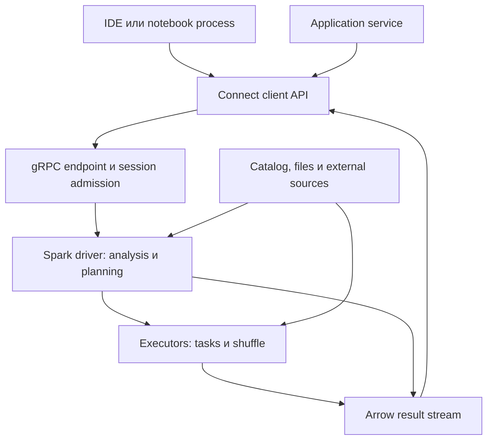
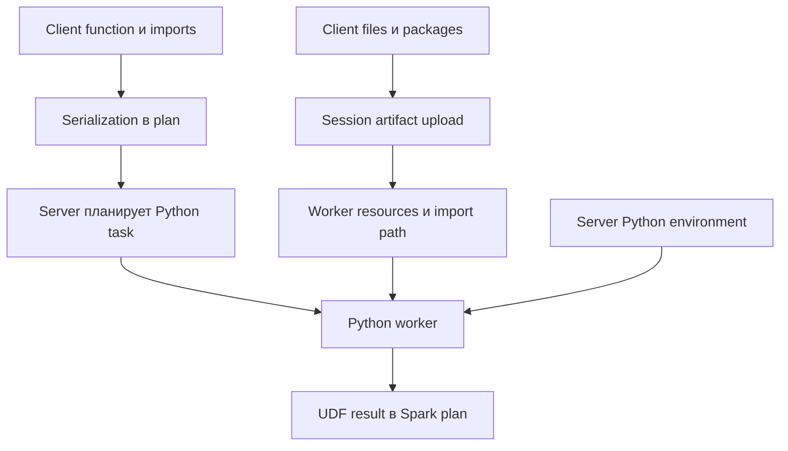
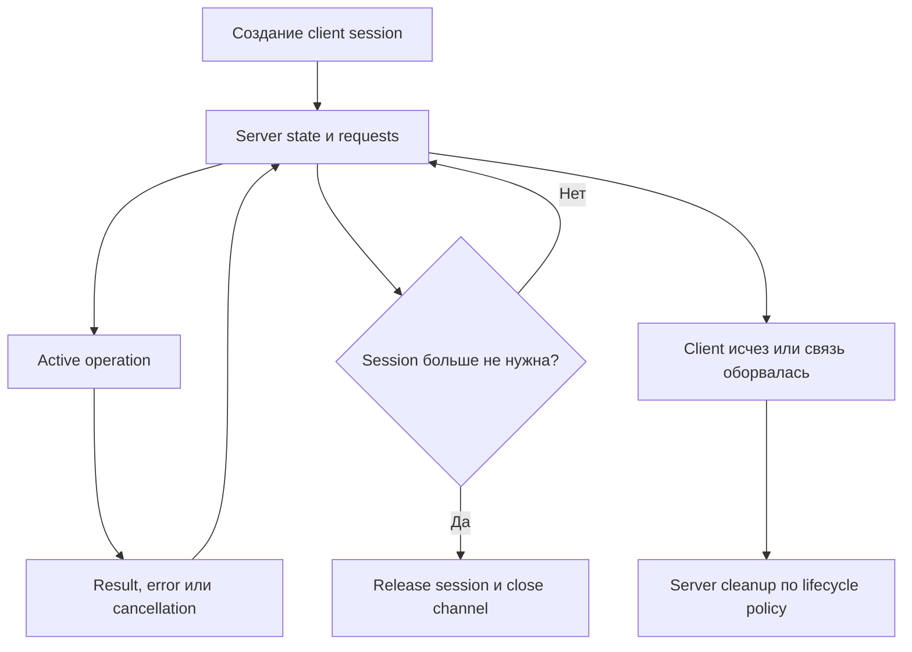
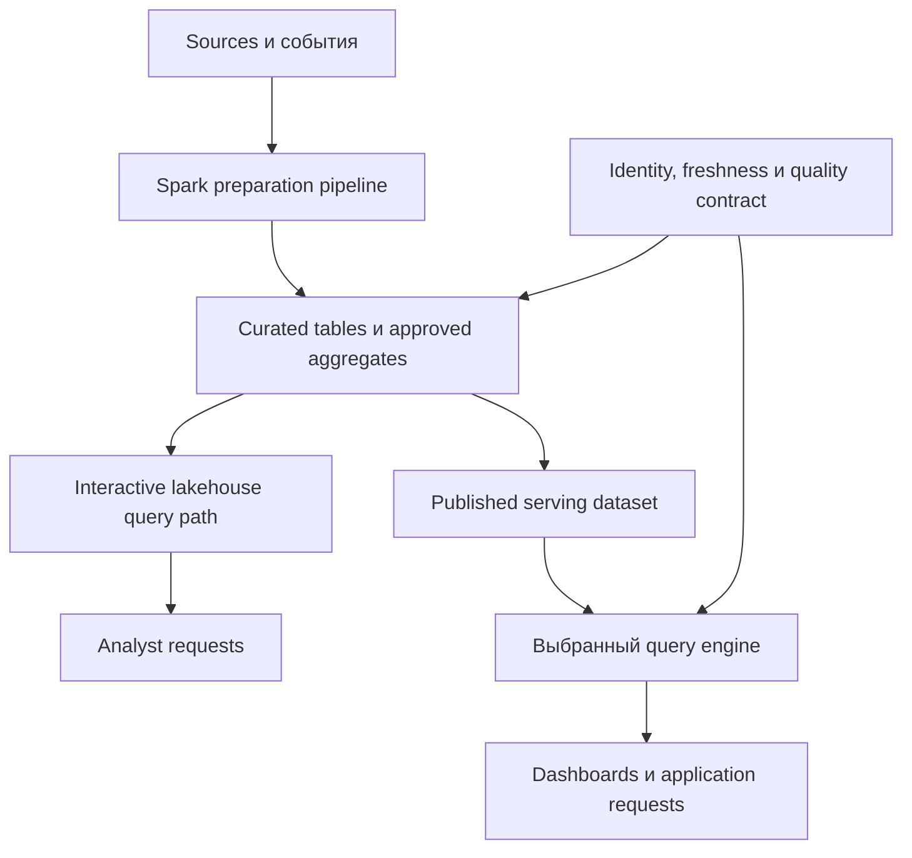

# 25. Spark Connect и распределённые SQL-сервисы

Основной язык примеров — **Python / PySpark**. Дополнительно используются **Java и Scala** для JVM-клиентов. Проверенное окружение: **Apache Spark 4.2.0, Python 3.12, JDK 17, Scala 2.13, Linux**. Connect Server и клиент работают в разных процессах. Лёгкий Python-клиент не требует локальной Java или Spark JAR; серверу JVM и его зависимости нужны.

**Цель раздела:** понимать протокол удалённого доступа, размещение кода и данных, состояние сессий, поддерживаемые API и эксплуатационные границы. Особенно важно различать Connect JDBC, JDBC через Thrift Server и JDBC data source самого Spark.

| Способ работы | Что передаётся | Кто выполняет Spark computation |
| --- | --- | --- |
| PySpark Classic | Вызовы локального JVM API через Py4J | Driver приложения и его executors |
| Spark Connect | Logical plans и commands через gRPC | Connect Server/driver и executors его приложения |
| Connect JDBC | SQL через JDBC adapter поверх Connect | Connect Server |
| Thrift Server | HiveServer2 sessions и SQL operations | Spark application, обслуживающее Thrift endpoint |
| Spark SQL CLI | SQL внутри запущенного CLI application | Driver этого приложения и его executors |
| Livy | REST requests: sessions, statements, batches | Applications, запускаемые внешним сервисом |

**Как пользоваться примерами**

- Лаборатории работают с синтетическими данными и loopback. Connect и Thrift без полноценной пользовательской authentication здесь доступны только на одной машине.
- Серверы проверялись в `local[2]`: Spark использует локальные executor threads, а отдельный клиент действительно обращается по сетевому протоколу. Это не доказательство deployment с отдельными executor hosts.
- Paths в `spark.read` относятся к storage, доступному серверу/executors; paths в upload API — к файлам клиента. Совпадение paths на одной машине не означает доступ на разных hosts.
- Shell variables задаются отдельно в каждом терминале. В новом терминале восстанови `SPARK_HOME`; для лаборатории B задай `CONNECT_LAB_DIR` абсолютным путём каталога, созданного при server launch.
- Python-, Java- и Scala-лаборатории выполнены с настоящими серверами. Livy REST, внешний TLS/proxy/IdP и managed platforms приведены как инфраструктурные шаблоны.
- Дата проверок — **14 октября 2026 года, Europe/Moscow**. Для другого runtime проверяй совместимость клиента, сервера, JDBC driver и платформы отдельно.

**Содержание**

1. [Архитектура Spark Connect](#connect-architecture)
2. [Подключение клиента](#client-connection)
3. [API и ограничения Connect](#connect-api)
4. [Пользовательский код и artifacts](#code-artifacts)
5. [Эксплуатация Connect](#connect-operations)
6. [Spark SQL CLI и Thrift Server](#sql-cli-thrift)
7. [Другие способы удалённого доступа](#other-remote-access)

<a id="connect-architecture"></a>

## Архитектура Spark Connect

### Разделение client process и Spark driver

Spark Connect отделяет программу пользователя от серверного Spark driver. Клиент может находиться в IDE, notebook, web service или контейнере; сервер принимает запросы и использует ресурсы своего Spark application.

У PySpark Classic Python driver тоже находится в отдельном от JVM процессе, но обращается через локальный Py4J gateway. Connect меняет границу взаимодействия: клиент описывает вычисление сетевым протоколом и не получает произвольный доступ к объектам driver JVM.



| Ресурс | Где расходуется |
| --- | --- |
| Python objects и pandas result | Client process |
| Analysis, query coordination, session metadata | Server driver |
| Scan, joins, shuffle, UDF tasks | Server-side execution |
| Передача plans/results/artifacts | Client, server и network |
| Credentials для remote storage read | У серверных data clients по модели платформы |

Разделение облегчает обновление client environment и debugging. Оно не устраняет server bottlenecks: сложный plan может перегрузить общий driver, а большой `collect()` — память клиента. Много клиентов также конкурируют за общие серверные ресурсы.

**Самопроверка:** где должны быть credentials для `spark.read.parquet("s3a://...")`? На какой машине материализуется pandas DataFrame?

[Connect architecture](https://spark.apache.org/docs/4.2.0/spark-connect-overview.html), [application development](https://spark.apache.org/docs/4.2.0/app-dev-spark-connect.html).

### Unresolved logical plans как протокол взаимодействия

Клиент строит logical plan: чтение relation, выражения, filters, aggregations и другие transformations. Ссылки на tables/columns могут оставаться unresolved до анализа на сервере. Их смысл определяется server catalog, schema и SQL configuration.

Например, цепочка `range → withColumn → groupBy → agg` описывает вычисление, но не назначает tasks конкретным executors. Сервер разрешает names/types, оптимизирует plan через Catalyst и строит physical execution.

| Фаза | Содержание |
| --- | --- |
| Client plan | Декларативное описание operations |
| Server analysis | Разрешение relations, columns, functions и types |
| Optimization | Преобразование logical plan |
| Physical planning | Выбор operators и распределения |
| Execution | Jobs, stages, tasks и получение результата |

Лаборатория A ниже группирует 1000 IDs по пяти buckets и проверяет сумму 499500. Это обычное Spark computation, инициированное удалённым client.

Большинство transformations ленивы, но не все API откладывают RPC до `collect()`. Schema introspection, configuration, upload artifacts и commands могут обращаться к серверу сразу. `explain()` также получает серверный plan. SQL commands имеют собственную семантику исполнения.

Изменение temporary view или current catalog между построением и анализом unresolved reference может изменить результат. Для production запросов нужны понятные naming и session-state contracts.

**Практика:** сравни построение plan, запрос schema, `explain("formatted")` и action. Какие вызовы требуют round trip?

[DataFrame.explain](https://spark.apache.org/docs/4.2.0/api/python/reference/pyspark.sql/api/pyspark.sql.DataFrame.explain.html), [SparkSession.sql](https://spark.apache.org/docs/4.2.0/api/python/reference/pyspark.sql/api/pyspark.sql.SparkSession.sql.html).

### Protocol Buffers, gRPC и Arrow results

У этих технологий разные обязанности. **Protocol Buffers** задаёт структуры сообщений; **gRPC** передаёт requests, metadata и streams; **Apache Arrow** представляет columnar batches результатов и часть передаваемых данных.

| Компонент | Что даёт | Чего не гарантирует |
| --- | --- | --- |
| Protobuf messages | Форму protocol operations/fields | Поддержку нового operation старым сервером |
| gRPC | RPC и streaming transport | Полную authentication/authorization платформу |
| Arrow batches | Эффективную передачу typed data | Неограниченные results без memory costs |
| Client conversion | Row/pandas/другой результат | Одинаковые преобразования всех типов во всех clients |

Arrow не является обязательным storage format исходных tables. Spark может читать Parquet/JDBC/Kafka, выполнять shuffle своими механизмами и вернуть конечный результат через Arrow.

Streaming batches не превращает `collect()` в bounded-memory API: он собирает клиентский список. `toPandas()` материализует pandas result. Server buffers, retention и backpressure также имеют свои costs.

Proxy должен поддерживать HTTP/2/gRPC, long-running streams, trailers и cancellation. Ограничения одного message, одного batch и всего result различаются. Успешный `SELECT 1` не проверяет decimals, timestamps, nested types или large values.

**Самопроверка:** почему уменьшение Arrow batch size не ограничивает общий объём `toPandas()`?

[Connect protocol](https://spark.apache.org/docs/4.2.0/spark-connect-overview.html), [Arrow format](https://arrow.apache.org/docs/format/Columnar.html).

### Session-based client API

Session связывает requests с серверным состоянием: SQL configuration, temporary objects, registered functions и artifacts. Это логическая область внутри server application, а не отдельная JVM, OS user или cloud role.

В Python Connect 4.2 `builder.remote(...).create()` создаёт новую session. `getOrCreate()` может вернуть existing active/default session. Builder с другим business user сам по себе не обеспечивает переключение tenant.

| Состояние | Область |
| --- | --- |
| Local temporary view | Создавшая session |
| SQL configuration | Соответствующая session |
| Global temporary view | Application-level `global_temp` |
| Permanent table | Shared catalog/storage и их policies |
| Driver/executor resources | Server application/cluster |
| OS/cloud identity | Runtime identity по модели платформы |

Лаборатория A проверяет две sessions: local view первой недоступна второй, time zones независимы, global temporary view читается обеими. Это проверка Spark state, а не доказательство пользовательской authorization.

Session ID нельзя считать единственным удостоверением caller. Endpoint должен контролировать ownership, reattachment и доступ к session resources. Connection pooling требует reset state между business requests.

**Практика:** создай одинаковое имя local view с разными fixtures в двух sessions; сравни global view и permanent table.

[Builder.create](https://spark.apache.org/docs/4.2.0/api/python/reference/pyspark.sql/api/pyspark.sql.SparkSession.builder.create.html), [getOrCreate](https://spark.apache.org/docs/4.2.0/api/python/reference/pyspark.sql/api/pyspark.sql.SparkSession.builder.getOrCreate.html).

### Connect Server и обычное распределённое выполнение на executors

Connect не переносит Spark tasks на клиентский ноутбук. Endpoint обслуживает серверное application, а обычный Spark scheduler распределяет computation по executors выбранного deployment.

| Фаза | Исполнитель |
| --- | --- |
| Построение client plan | Client library |
| Resolution и planning | Server driver |
| Scheduling и task retries | Server Spark runtime |
| Python/JVM user code | Server-side workers/executors |
| Source read и output write | Server-side data clients |
| Обработка возвращённого result | Client process |

Server запускается с подходящим `--master` и ресурсами. Standalone/YARN/Kubernetes изменяют allocation/deployment, а не превращают gRPC client в executor. В `local[2]` задачи исполняются локальными threads; отдельные hosts в этой лаборатории не проверялись.

`spark.read.parquet("/data/events")` описывает серверный path. Наличие этого каталога только на клиенте недостаточно. В distributed deployment local path должен иметь осмысленный scope для участников выполнения.

Driver/executor resources задаются server deployment. Client builder configuration не является надёжным запросом перераспределения общего application.

**Самопроверка:** как отличить client network failure от storage denial на executor? Почему серверу нужна JVM, а pure Python client может работать без неё?

[Cluster overview](https://spark.apache.org/docs/4.2.0/cluster-overview.html), [Connect configuration](https://spark.apache.org/docs/4.2.0/configuration.html#spark-connect).

### Различия Connect и PySpark Classic

Общий DataFrame стиль скрывает разные implementation boundaries. Миграцию проверяют по реальным operations, а не по одному import `SparkSession`.

| Вопрос | Classic | Connect |
| --- | --- | --- |
| Driver JVM | Локальный gateway | Remote server driver |
| RDD/SparkContext | Доступны | Прямые APIs не поддержаны |
| `_jdf`, `_jvm` | Используются private integrations | Не дают доступ к remote JVM |
| Runtime/deployment | Управляется submission приложения | Управляется server deployment |
| Client environment | Обычно Spark distribution и Java | Возможен `pyspark-client` без JAR/Java |
| Session stop | Обычно остановка SparkContext приложения | Освобождение remote session; external server остаётся |

Functions, DataFrame и SQL часто переносимы. Libraries, создающие SparkContext, вызывающие RDD operations или использующие private JVM bridge, требуют адаптации.

Отделение client dependencies не устанавливает эти dependencies автоматически в Python UDF workers. Server-side user code остаётся отдельной packaging и security задачей.

**Практика по теме:** составь карту client/server/data paths приложения. **Вопросы для самопроверки:** что unresolved; какие роли у Protobuf/gRPC/Arrow; где session state; где выполняется UDF; какие Classic APIs мешают переносу?

[Connect differences](https://spark.apache.org/docs/4.2.0/spark-connect-overview.html#how-spark-connect-client-applications-differ-from-classic-spark-applications).

<a id="client-connection"></a>

## Подключение клиента

### SparkSession.builder.remote и SPARK_REMOTE

`SparkSession.builder.remote(connection_string)` явно выбирает endpoint. `SPARK_REMOTE` позволяет выбрать Connect при создании session через обычный client API.

В лаборатории ниже connection читается из `os.environ['SPARK_REMOTE']`. Тип session содержит `.connect.`; затем выполняется реальный action. Само создание client object не всегда доказывает reachability сервера.

| Действие | Что проверить |
| --- | --- |
| Выбор `remote` | Правильный endpoint и client mode |
| `getOrCreate` | Не переиспользована ли прежняя session |
| `create` | Явное создание независимой session |
| Короткий action | Server reachability и expected result |
| `stop` | Ownership session и cleanup |

Выбирай runtime mode до создания нужной session. Смешивание существующего Classic context и remote builder в одном процессе усложняет lifecycle и может быть запрещено.

Для readiness нужен небольшой запрос с ожидаемым результатом и ограниченным временем проверки. Не делай автоматический fallback на Classic, если remote endpoint недоступен: это меняет compute, data paths и identity.

**Практика:** сравни session type и result при explicit `remote` и установленном `SPARK_REMOTE`; проверь недоступный port.

[Builder.remote](https://spark.apache.org/docs/4.2.0/api/python/reference/pyspark.sql/api/pyspark.sql.SparkSession.builder.remote.html), [quickstart](https://spark.apache.org/docs/4.2.0/api/python/getting_started/quickstart_connect.html).

### Connection string, endpoint и TLS

Connect URI имеет схему `sc://`; она сама по себе не обещает encryption. Local example — `sc://localhost:15002`, дополнительные параметры идут после `/;`.

| URI/config | Назначение |
| --- | --- |
| `sc://localhost:15002` | Loopback endpoint без внешнего TLS |
| `sc://connect.example:443/;use_ssl=true` | TLS endpoint по правилам client trust |
| URI с `token` | Bearer metadata supported authentication path |
| Custom channel builder | Специализированные credentials/options |

В Python 4.2 `use_ssl=true` выбирает SSL channel; token также влияет на secure-channel selection. Для буквального `localhost` без `use_ssl=true` используется специальный gRPC local-credentials path. Он не является внешним TLS deployment. Добавление `use_ssl=false` не следует считать универсальным отключением всех secure-channel rules.

Для внешнего endpoint проверяй certificate chain, SAN/hostname, expiry и authentication. Connection string с token может попасть в logs, exceptions или shell history; не печатай его целиком.

`spark.ssl.rpc.enabled` защищает иной channel — внутренний Spark transport. Он не включает автоматически TLS внешнего Connect gRPC endpoint. При TLS termination proxy downstream channel задаётся отдельно.

**Самопроверка:** где завершается TLS? Почему protocol username/session ID не удостоверяют пользователя?

[Python channel implementation](https://github.com/apache/spark/blob/v4.2.0/python/pyspark/sql/connect/client/core.py), [Spark Security](https://spark.apache.org/docs/4.2.0/security.html).

### PySpark client и JVM/Scala client по версии

Python client предоставляет DataFrame/SQL APIs; Scala/JVM client поддерживает typed Dataset в своей version matrix. Общий протокол не означает одинаковую поверхность APIs каждого языка.

| Client | Что учитывать |
| --- | --- |
| Python | Supported DataFrame/SQL/UDF/streaming/ML methods |
| Scala/JVM | Encoders, typed operations и class delivery |
| Connect JDBC | JDBC adapter и его limitations |
| Third-party client | Реально реализованные operations/types |

Connect появился с Spark 3.4, Scala support расширен с 3.5, JDBC module присутствует в source с 4.1. В этой главе проверена matrix 4.2 client → 4.2 server; она не доказывает совместимость всех 3.x/4.x combinations.

JVM artifact использует Scala binary suffix, например `spark-connect-client-jvm_2.13`. Version, dependencies и JDK выбираются совместно. Наличие source module не гарантирует публикацию любого release во всяком repository.

В проверенной Spark distribution JVM/JDBC client JAR находились в `jars/connect-repl`; именно этот комплект использован для Java/Scala laboratories. В build tool используй approved repository и согласованные coordinates.

**Практика:** зафиксируй client/server versions, Scala binary version и JDBC driver version отдельно.

[JVM guide](https://spark.apache.org/docs/4.2.0/spark-connect-overview.html#use-spark-connect-in-standalone-applications), [JDBC module](https://github.com/apache/spark/blob/v4.2.0/sql/connect/client/jdbc/pom.xml).

### Лёгкий pyspark-client и требования его окружения

`pyspark-client` — pure Python distribution для remote Connect. Она поставляет client APIs и protocol dependencies, но не предназначена для запуска собственного local Spark server.

| Package | Назначение |
| --- | --- |
| `pyspark` | Полная distribution, включая Spark JAR |
| `pyspark[connect]` | Полная distribution плюс Connect dependencies |
| `pyspark-connect` | Connect default с зависимостью от полного PySpark |
| `pyspark-client` | Remote-only client без server JAR/JRE |

Документация 4.2 задаёт Python 3.10+; проверялся Python 3.12. Нужны совместимые pandas, PyArrow, grpcio, grpcio-status и Protobuf-related packages. Их wheels и versions зависят от Python/OS.

**Два отдельных окружения для лабораторий:**

```bash
python3 -m venv .venv-spark-server
.venv-spark-server/bin/python -m pip install "pyspark==4.2.0"

python3 -m venv .venv-connect-client
.venv-connect-client/bin/python -m pip install \
  "pyspark-client==4.2.0" "pandas==2.2.3"

SPARK_HOME="$(.venv-spark-server/bin/python -c \
  'from pathlib import Path; import pyspark; print(Path(pyspark.__file__).parent)')"
PYSPARK_PYTHON="$(pwd)/.venv-spark-server/bin/python"
export SPARK_HOME PYSPARK_PYTHON
```

Не смешивай `pyspark` и `pyspark-client` в одном venv: distributions используют общий Python namespace. Проверяй фактический import path и package manifest.

Лаборатория A импортировала pure client, проверила отсутствие его `jars` directory и успешно работала при недоступных для client process Java path/JAVA_HOME. Server запускался из отдельной полной distribution. Smoke tests выполняются отдельными `.py` scripts.

**Самопроверка:** почему `remote("local[2]")` не является универсальным server launcher для pure client?

[Installation](https://spark.apache.org/docs/4.2.0/api/python/getting_started/install.html#python-spark-connect-client).

### Локальное тестирование Connect Server

Foreground launch позволяет остановить именно учебный server через `Ctrl+C`. Нужны JDK 17, подготовленный `SPARK_HOME` и свободный port 15002.

```bash
CONNECT_LAB_DIR="$(mktemp -d)"
SPARK_LOCAL_IP=127.0.0.1 "$SPARK_HOME/bin/spark-submit" \
  --master "local[2]" \
  --driver-memory 768m \
  --class org.apache.spark.sql.connect.service.SparkConnectServer \
  --conf spark.connect.grpc.binding.address=127.0.0.1 \
  --conf spark.connect.grpc.binding.port=15002 \
  --conf spark.ui.enabled=false \
  --conf spark.python.use.daemon=false \
  --conf "spark.sql.warehouse.dir=$CONNECT_LAB_DIR/warehouse" \
  "$SPARK_HOME/jars/spark-connect_2.13-4.2.0.jar"
```

Полная distribution также предоставляет `sbin/start-connect-server.sh`; набор pip wrappers может отличаться. Здесь используется проверенный server entrypoint через `spark-submit`.

**Лаборатория A `connect_basic_lab.py`:**

```python
import json
import os
from pathlib import Path

import pyspark
from pyspark.errors import AnalysisException, PySparkAttributeError
from pyspark.sql import SparkSession, functions as F

remote = os.environ['SPARK_REMOTE']
assert not (Path(pyspark.__file__).parent / 'jars').exists()
first = SparkSession.builder.remote(remote).create()
second = SparkSession.builder.remote(remote).create()
try:
    assert '.connect.' in type(first).__module__ + '.'
    assert first.version == '4.2.0'
    values = first.range(1000, numPartitions=4)
    result = values.withColumn('bucket', F.col('id') % 5).groupBy('bucket').agg(
        F.count('*').alias('n'), F.sum('id').alias('total')
    ).collect()
    assert len(result) == 5
    assert sum(r.n for r in result) == 1000
    assert sum(r.total for r in result) == 499500

    first.createDataFrame([(1, "O'Reilly"), (2, 'Kazan')], 'id LONG, city STRING') \
        .createOrReplaceTempView('connect_fixture')
    assert first.sql('SELECT id FROM connect_fixture WHERE city = :city',
                     args={'city': "O'Reilly"}).first().id == 1
    assert first.sql('SELECT id FROM IDENTIFIER(:name) WHERE city = :city',
                     args={'name': 'connect_fixture', 'city': 'Kazan'}).first().id == 2
    try:
        second.sql('SELECT * FROM connect_fixture').collect()
    except AnalysisException as error:
        assert error.getCondition() == 'TABLE_OR_VIEW_NOT_FOUND'
    else:
        raise AssertionError('Local temporary view crossed the session boundary')

    first.conf.set('spark.sql.session.timeZone', 'UTC')
    second.conf.set('spark.sql.session.timeZone', 'Asia/Tokyo')
    assert first.conf.get('spark.sql.session.timeZone') == 'UTC'
    assert second.conf.get('spark.sql.session.timeZone') == 'Asia/Tokyo'
    first.range(2).createOrReplaceGlobalTempView('connect_shared_fixture')
    assert second.sql('SELECT COUNT(*) AS n FROM global_temp.connect_shared_fixture').first().n == 2
    reused = SparkSession.builder.remote(remote).getOrCreate()
    assert reused is first

    denied = []
    for name, read in [
        ('sparkContext', lambda: first.sparkContext),
        ('RDD', lambda: values.rdd),
        ('Py4J DataFrame', lambda: values._jdf),
        ('driver JVM', lambda: first._jvm),
    ]:
        try:
            read()
        except PySparkAttributeError as error:
            assert error.getCondition() == 'JVM_ATTRIBUTE_NOT_SUPPORTED'
            denied.append(name)
        else:
            raise AssertionError(f'Unsupported API was unexpectedly exposed: {name}')
    first.stop()
    assert second.range(3).count() == 3
    print(json.dumps({'client_without_jars': True, 'groups': 5, 'rows': 1000,
                      'sum_id': 499500, 'local_view_isolated': True,
                      'global_view_shared': True, 'server_survives_session_stop': True,
                      'unsupported_apis': denied}, ensure_ascii=False))
finally:
    first.stop()
    second.stop()
```

**Другой терминал:**

```bash
SPARK_REMOTE=sc://localhost:15002 \
  .venv-connect-client/bin/python connect_basic_lab.py
```

Проверены 5 групп, 1000 строк и сумма IDs 499500, parameter binding с quote, constant allowed identifier, session isolation, shared global view и unsupported Classic APIs. После `first.stop()` вторая session продолжила работу.

Identifier в этом примере заранее выбран приложением. Parameter binding не выдаёт authorization на произвольный resource. Установка port в автоматическом harness использовала свободный динамический port с той же launch semantics.

**Практика:** повтори unknown-view и unsupported-API cases; проверь, что server не уничтожен отказом одного query.

[Server guide](https://spark.apache.org/docs/4.2.0/spark-connect-overview.html#download-and-start-spark-server-with-spark-connect), [configuration](https://spark.apache.org/docs/4.2.0/configuration.html#spark-connect).

### Совместимость версий клиента и сервера

Protocol decoupling позволяет обновлять client/server отдельно, но не обещает поддержку любой комбинации releases. Сериализация нового operation ещё не означает наличие его server implementation.

| Измерение | Проверка |
| --- | --- |
| Protocol/API | Server понимает нужные operations |
| SQL semantics | ANSI, identifiers, functions и type changes |
| Arrow/Protobuf | Serialization/runtime compatibility |
| Python user code | Minor version, cloudpickle и packages workers |
| JVM user code | Scala binary version, JDK/classes/dependencies |
| Platform | Proxy, extensions, policies и access mode |

`spark.version` сообщает server version; client package manifest фиксируется отдельно. Method, существующий в IDE, может не работать на старом endpoint.

Regression suite включает result correctness, decimals/timestamps/nulls/nested types, sessions, artifacts/UDF, errors/cancel и writes. `SELECT 1` не проверяет streaming, model persistence или external connectors.

Для upgrade сохраняй baseline fixtures и expected semantics. Нельзя распространять результаты этой главы 4.2→4.2 на непроверенные version pairs.

**Самопроверка:** где возникнет ошибка нового operation на старом server? Как узнать отдельно версии client и server?

[Connect evolution](https://spark.apache.org/docs/4.2.0/spark-connect-overview.html), [SQL migration](https://spark.apache.org/docs/4.2.0/sql-migration-guide.html).

### Spark Connect JDBC driver с Spark 4.1: подключение JDBC-клиента к Connect Server (добавлено по проверке полноты)

Connect JDBC позволяет JDBC-программе отправлять SQL в Connect Server. Это отдельный adapter, отличающийся от Hive JDBC для Thrift и от JDBC source, через который Spark читает внешнюю database.

| Поле | Connect JDBC |
| --- | --- |
| Driver class | `org.apache.spark.sql.connect.client.jdbc.SparkConnectDriver` |
| URL | `jdbc:sc://localhost:15002` |
| Wire protocol | Connect/gRPC |
| Module | `spark-connect-client-jdbc_2.13` |
| Endpoint | Connect Server без отдельного Thrift Server |

Module проверен в source tree 4.1. Runtime лаборатории использует комплект 4.2. JDBC interfaces знакомы, но поддержанная часть JDBC contract требует отдельного изучения.

**`ConnectJdbcLab.java`:** server из лаборатории A продолжает работать.

```java
import java.sql.Connection;
import java.sql.DriverManager;
import java.sql.ResultSet;
import java.sql.SQLException;
import java.sql.SQLFeatureNotSupportedException;
import java.sql.Statement;

public class ConnectJdbcLab {
    static void require(boolean condition, String message) {
        if (!condition) throw new AssertionError(message);
    }

    public static void main(String[] args) throws Exception {
        Class.forName("org.apache.spark.sql.connect.client.jdbc.SparkConnectDriver");
        try (Connection first = DriverManager.getConnection(args[0]);
             Connection second = DriverManager.getConnection(args[0]);
             Statement a = first.createStatement();
             Statement b = second.createStatement()) {
            try (ResultSet rows = a.executeQuery(
                    "SELECT CAST(42 AS BIGINT) AS answer, CAST(12.50 AS DECIMAL(10,2)) AS amount")) {
                require(rows.next(), "No row returned");
                require(rows.getLong("answer") == 42, "Wrong BIGINT");
                require(rows.getBigDecimal("amount").toPlainString().equals("12.50"), "Wrong DECIMAL");
                require(!rows.next(), "Unexpected extra row");
            }
            a.execute("CREATE OR REPLACE TEMP VIEW connect_jdbc_fixture AS SELECT 7 AS value");
            try (ResultSet rows = a.executeQuery("SELECT value FROM connect_jdbc_fixture")) {
                require(rows.next() && rows.getInt(1) == 7, "Missing own temporary view");
            }
            try {
                b.executeQuery("SELECT value FROM connect_jdbc_fixture");
                throw new AssertionError("Temporary view crossed JDBC connections");
            } catch (Exception expected) {
                require(expected.getMessage().contains("TABLE_OR_VIEW_NOT_FOUND"), "Unexpected SQL failure");
            }
            a.setMaxRows(2);
            int count = 0;
            try (ResultSet rows = a.executeQuery("SELECT id FROM range(10)")) {
                while (rows.next()) count++;
            }
            require(count == 2, "setMaxRows did not limit rows");
            require(first.getAutoCommit(), "Expected auto-commit");
            require(!first.getMetaData().supportsTransactions(), "Unexpected transaction support");
            try {
                first.prepareStatement("SELECT ?");
                throw new AssertionError("PreparedStatement unexpectedly supported");
            } catch (SQLFeatureNotSupportedException expected) {}
            try {
                a.setQueryTimeout(1);
                throw new AssertionError("Query timeout unexpectedly supported");
            } catch (SQLFeatureNotSupportedException expected) {}
            System.out.println("CONNECT_JDBC_ROWS_TYPES_SESSIONS_LIMITS_UNSUPPORTED_APIS_PASS");
        }
    }
}
```

**Source-file launch на JDK 17:** classpath использует клиентский комплект проверенной distribution; на Windows separator другой.

```bash
CONNECT_CLIENT_CP="$SPARK_HOME/jars/connect-repl/*:$SPARK_HOME/jars/*"
java --add-opens=java.base/java.nio=ALL-UNNAMED \
  --class-path "$CONNECT_CLIENT_CP" \
  --source 17 ConnectJdbcLab.java \
  jdbc:sc://localhost:15002
```

Проверены BIGINT/DECIMAL, isolation двух connections, max rows, auto-commit и expected unsupported prepare/timeout APIs. `--add-opens` относится к Arrow/JVM access path runtime, а не к data permissions или authentication.

[Driver 4.1](https://github.com/apache/spark/blob/v4.1.0/sql/connect/client/jdbc/src/main/java/org/apache/spark/sql/connect/client/jdbc/SparkConnectDriver.java), [driver 4.2](https://github.com/apache/spark/blob/v4.2.0/sql/connect/client/jdbc/src/main/java/org/apache/spark/sql/connect/client/jdbc/SparkConnectDriver.java).

### Сессия, аутентификация и совместимость клиента с сервером (добавлено по проверке полноты)

JDBC connection создаёт Connect session. Close завершает соответствующий lifecycle; pooling сохраняет session state между business requests и требует reset policy.

| Проверка | Зачем |
| --- | --- |
| Expected authenticated principal | Не перепутан protocol user с identity |
| Pool initialization/reset | Не сохранены чужие config/views/current schema |
| Driver/server versions | Совместимы operations и adapters |
| Metadata/type APIs | BI tool получает нужный contract |
| Close/cancel/network failure | Известны cleanup и operation outcome |

В 4.2 `SparkConnectConnection` строит клиент из environment и connection string. Переданный `Properties info` нельзя считать автоматически использованным username/password authentication: сигнатура `DriverManager.getConnection(url, user, password)` сама по себе этого не доказывает.

Выбирай поддержанный driver/proxy auth path и проверяй principal на backend. Общий bearer token не разделяет пользователей, даже когда каждому выдан отдельный connection.

Проверь `getLong`, `getBigDecimal`, null/`wasNull`, timestamps, nested types и metadata. Успешный Python conversion не доказывает тот же type contract JDBC.

**Самопроверка:** что сохраняет pooled connection? Где подтверждается caller identity?

[Connection implementation](https://github.com/apache/spark/blob/v4.2.0/sql/connect/client/jdbc/src/main/scala/org/apache/spark/sql/connect/client/jdbc/SparkConnectConnection.scala).

### Различия настройки и возможностей Spark Connect JDBC и JDBC через Thrift Server (добавлено по проверке полноты)

Оба adapter предоставляют JDBC, но используют разные wire protocols и server APIs. Driver определяется endpoint contract, а не только словом Spark в connection dialog.

| Свойство | Connect JDBC 4.2 | JDBC через Thrift Server |
| --- | --- | --- |
| Driver | SparkConnectDriver | Совместимый HiveDriver |
| URL | `jdbc:sc://...` | `jdbc:hive2://...` |
| Protocol | Connect/gRPC | HiveServer2/Thrift, binary/HTTP |
| Authentication | Connect client/proxy path | HiveServer2 transport/auth settings |
| Session | Connect session | Thrift SQL session |
| PreparedStatement | Не поддержан в проверенной реализации | Hive JDBC implementation; quote test выполнен |
| `setQueryTimeout` | Бросает `SQLFeatureNotSupportedException` | Проверены timeout cancellation и следующий query |
| Transactions | Multi-statement JDBC transaction не предоставлена | Нельзя предполагать database transactions из-за JDBC |
| BI compatibility | Проверить methods/types/errors | Проверить driver/server/tool matrix |

Connect JDBC сообщает `jdbcCompliant=false`. Ограничены prepare, query timeout, savepoints и другие interfaces. `setMaxRows` ограничивает result rows, но не гарантирует короткий scan или latency.

В source существует `cancel()`, однако его наличие не доказывает timely interruption каждого in-flight execute/fetch path. Timing и server terminal state проверяются отдельно. Позднейшая cancellation laboratory использует Connect session API.

Некоторые error paths adapter могут поднимать Spark exceptions за пределами `SQLException`. Поэтому Java probe проверяет expected unknown-view error через более широкий wrapper. Реальный pool/BI tool должен обработать эту semantics.

**Практика по теме:** подключи Python, JVM/Scala и JDBC clients, составь matrix versions/protocols/types/session state. **Вопросы для самопроверки:** что выбирает `remote`; какой package без JAR; где TLS; зачем `create`; чем `jdbc:sc` отличается от `jdbc:hive2`; какие JDBC methods реально поддержаны?

[Statement implementation](https://github.com/apache/spark/blob/v4.2.0/sql/connect/client/jdbc/src/main/scala/org/apache/spark/sql/connect/client/jdbc/SparkConnectStatement.scala), [Thrift guide](https://spark.apache.org/docs/4.2.0/sql-distributed-sql-engine.html).

<a id="connect-api"></a>

## API и ограничения Connect

### Поддержка DataFrame, SQL и Dataset по клиенту

Connect работает со структурированными plans, но языковые clients предоставляют разные abstractions. Python DataFrame не становится typed Scala Dataset из-за смены transport.

| API | Python Connect | Scala/JVM Connect |
| --- | --- | --- |
| DataFrame transformations | Supported methods/functions | Supported Dataset/Row APIs |
| SQL | `spark.sql` и catalog/session paths | SQL и JVM interfaces |
| Typed Dataset | Нет Scala-style compile-time typing | Encoders и typed operations |
| UDF/user functions | Serialized Python code и worker packages | Classes/closures и их доставка |
| Private hooks | Проверяются отдельно | Не заменяют server extension API |

Проверяй отметку **Supports Spark Connect** у конкретного API. Общая поддержка DataFrame не гарантирует каждый недавно добавленный method, parameter или function.

Typed Dataset выполняется на сервере; encoder задаёт representation values. User-defined `map` дополнительно требует доступности classes. Проверенная Scala laboratory с `as[Long]`, `map` и ClassFinder приведена ниже.

SQL values передавай через supported `args`/parameter markers. Resource identifiers выбирай из разрешённого inventory и используй поддержанный `IDENTIFIER` path. Ни binding, ни naming API не выдают data grants.

**Практика:** составь inventory всех APIs workload и fixtures с null/decimal/timestamp/nested types; отметь непроверенные server operations.

[API reference](https://spark.apache.org/docs/4.2.0/api/python/reference/index.html), [SparkSession.sql](https://spark.apache.org/docs/4.2.0/api/python/reference/pyspark.sql/api/pyspark.sql.SparkSession.sql.html).

### Отсутствие прямого RDD API и доступа к SparkContext

У Connect client нет прямого `SparkContext`, `RDD` и `DataFrame.rdd` path. Это иной уровень execution control, не входящий в обычный logical-plan contract.

В лаборатории A обращения к `spark.sparkContext` и `df.rdd` отклонены с `JVM_ATTRIBUTE_NOT_SUPPORTED`. Сервер при этом продолжает обслуживать normal queries.

| Старый pattern | Возможный перенос |
| --- | --- |
| RDD `map/filter` для SQL-like logic | Built-in DataFrame expressions |
| `mapPartitions` | Supported pandas/Arrow APIs, если подходит contract |
| `sc.addPyFile` | Session artifact API |
| Job group/cancel group | Supported Connect tags/cancellation |
| `sc.getConf`/application ID | Session config и server observability |
| Custom scheduler/plugin logic | Server extension либо Classic application |

Перенос требует проверки semantics. Arbitrary partition function не всегда заменяется aggregation/UDF без изменения ordering, batching, dependencies и side effects.

Отсутствие клиентского RDD API не удаляет partitions, stages и shuffle из Spark engine. Ограничивается API boundary, а нормальная распределённая execution model остаётся.

**Самопроверка:** какие operations библиотеки действительно требуют RDD, а какие используют его только как старую implementation detail?

[Connect differences](https://spark.apache.org/docs/4.2.0/spark-connect-overview.html#how-spark-connect-client-applications-differ-from-classic-spark-applications).

### Отсутствие доступа к JVM driver через Py4J

Connect client не обращается к remote driver как к локальному Py4J gateway. `_jdf`, `_jvm`, `_jsc` и похожие private fields не становятся remote APIs.

| Pattern | Зависимость |
| --- | --- |
| `df._jdf.queryExecution()` | Локальный JVM Dataset object |
| `spark._jvm.some.Class` | Gateway и соответствующий classpath |
| Java object в client closure | Не является автоматически server artifact |
| Patch JVM settings | Может нарушать shared runtime boundary |

Для plans используй public `explain`, для SQL/session config — supported APIs. Custom server functionality добавляется через documented extension/connector mechanism выбранной платформы.

Лаборатория A отклоняет обе private-field попытки и затем выполняет normal query. Это помогает выявить несовместимую integration до production.

Library, проверяющая поддержку Connect чтением `_jdf`, уже зависит от private implementation. Предпочитай явный runtime contract и supported compatibility APIs; error об attribute не следует лечить обходом security boundary.

**Практика:** найди `_jdf`, `_jvm`, `_jsc` и `SparkContext` в своих dependencies и проверь фактические code paths.

[Connect API boundary](https://spark.apache.org/docs/4.2.0/spark-connect-overview.html), [explain](https://spark.apache.org/docs/4.2.0/api/python/reference/pyspark.sql/api/pyspark.sql.DataFrame.explain.html).

### Server-side конфигурация и session-level параметры

Server deployment settings и SQL configuration session имеют разные scopes. Master, driver heap, executor allocation, binding и interceptors общего server задаются владельцем инфраструктуры.

| Configuration | Где задавать |
| --- | --- |
| Master и driver/executor resources | Server submission/runtime |
| gRPC address/port/message limits | Connect server configuration |
| Catalog/connectors/extensions | Server environment |
| `spark.sql.session.timeZone` | Session config при разрешённом change |
| `spark.sql.shuffle.partitions` | Supported session SQL scope |
| Authentication/admission policy | Endpoint/platform controls |

Client `builder.config(...)` не обязан менять static server setting. В implementation есть application rules и silent paths; успешный builder call не доказывает requested allocation.

Проверяй `spark.conf.isModifiable(key)` в supported API и фактическое чтение value после изменения. Deployment resources проверяются на сервере/cluster manager, а не через клиентский dictionary.

В лаборатории две time zones задаются и читаются независимо. Это доказательство конкретного session-level setting, а не независимости всех SparkConf/environment variables.

Новый setting не обязан менять уже запущенный streaming query или прежнее analyzed state. Нужно учитывать lifecycle operation.

**Самопроверка:** кто может увеличить driver heap? Когда нужен server restart вместо session config update?

[RuntimeConfig](https://spark.apache.org/docs/4.2.0/api/python/reference/pyspark.sql/api/pyspark.sql.conf.RuntimeConfig.html), [Connect settings](https://spark.apache.org/docs/4.2.0/configuration.html#spark-connect).

### Поддержка streaming, UDF и ML API в конкретной версии

Эти API families развиваются отдельно. Поддержка `readStream` не гарантирует любой sink/listener/callback; поддержка `spark.ml` не открывает legacy RDD-based `spark.mllib` через Connect.

| Family | Что проверять |
| --- | --- |
| Python UDF | Serialization, Python version, worker imports |
| pandas/Arrow UDF | Batch types и library/runtime compatibility |
| Streaming | Source/sink, checkpoint, trigger, progress/control |
| Callbacks/listeners | Server environment и restrictions конкретной версии |
| DataFrame ML | Estimator/Transformer, fit/transform и model persistence |
| Custom ML/library | Classes/packages и private/RDD dependencies |

**Лаборатория B `connect_features_lab.py`:** UDF artifacts, pandas result, ML Pipeline и конечный streaming query. Input должен существовать на server side.

Для одной машины подготовь fixture в `CONNECT_LAB_DIR`, созданном при server launch. Этот шаг не является upload в произвольный remote cluster.

```bash
python3 - "$CONNECT_LAB_DIR" <<'PY'
import json
import sys
from pathlib import Path

root = Path(sys.argv[1]) / "input"
root.mkdir(mode=0o700, exist_ok=True)
(root / "part.json").write_text(
    "\n".join(json.dumps({"id": i}) for i in range(3)) + "\n",
    encoding="utf-8",
)
PY
```

```python
import argparse
import json
import os
import tempfile
import uuid
from pathlib import Path
from zipfile import ZipFile

from pyspark.ml import Pipeline
from pyspark.ml.feature import StandardScaler, VectorAssembler
from pyspark.sql import SparkSession, functions as F

parser = argparse.ArgumentParser()
parser.add_argument('--server-root', required=True)
args = parser.parse_args()
server_root = Path(args.server_root)
spark = SparkSession.builder.remote(os.environ['SPARK_REMOTE']).create()
query = None
try:
    client_root = Path(tempfile.mkdtemp(prefix='connect-client-artifacts-'))
    client_root.chmod(0o700)
    archive = client_root / 'hero_math.zip'
    with ZipFile(archive, 'w') as package:
        package.writestr('hero_math.py', 'def add_two(value):\n    return value + 2\n')
    bonus = client_root / 'bonus.txt'
    bonus.write_text('10', encoding='utf-8')
    spark.addArtifacts(str(archive), pyfile=True)
    spark.addArtifact(str(bonus), file=True)

    @F.udf('long')
    def apply_uploaded(value):
        from pathlib import Path
        from hero_math import add_two
        from pyspark import SparkFiles
        extra = int(Path(SparkFiles.get('bonus.txt')).read_text())
        return add_two(value) + extra

    actual = spark.range(3).select(apply_uploaded('id').alias('value')).orderBy('value').collect()
    assert [r.value for r in actual] == [12, 13, 14]
    assert spark.range(4).toPandas()['id'].tolist() == [0, 1, 2, 3]

    data = spark.createDataFrame([(1.0, 2.0), (3.0, 4.0)], ['a', 'b'])
    pipeline = Pipeline(stages=[
        VectorAssembler(inputCols=['a', 'b'], outputCol='features'),
        StandardScaler(inputCol='features', outputCol='scaled', withMean=True, withStd=True),
    ])
    model = pipeline.fit(data)
    rows = model.transform(data).select('scaled').collect()
    assert len(rows) == 2 and all(len(row.scaled) == 2 for row in rows)
    assert abs(rows[0].scaled[0] + 2 ** -0.5) < 1e-10

    name = 'connect_stream_' + uuid.uuid4().hex
    query = (
        spark.readStream.schema('id LONG').json(str(server_root / 'input'))
        .writeStream.format('memory').queryName(name).outputMode('append')
        .option('checkpointLocation', str(server_root / ('checkpoint-' + name)))
        .trigger(availableNow=True).start()
    )
    assert query.awaitTermination(30)
    summary = spark.sql(f'SELECT COUNT(*) AS n, SUM(id) AS total FROM {name}').first()
    assert (summary.n, summary.total) == (3, 3)
    progress = query.recentProgress
    progress_rows = sum(p.numInputRows for p in progress)
    assert progress_rows == 3
    print(json.dumps({'uploaded_udf_values': [r.value for r in actual],
                      'arrow_to_pandas': True, 'ml_pipeline_fit_transform': True,
                      'stream_rows': summary.n, 'stream_sum': summary.total,
                      'progress_input_rows': progress_rows}))
finally:
    if query is not None and query.isActive:
        query.stop()
    spark.stop()
```

```bash
SPARK_REMOTE=sc://localhost:15002 \
  .venv-connect-client/bin/python connect_features_lab.py \
  --server-root "$CONNECT_LAB_DIR"
```

Проверены UDF values `[12, 13, 14]`, pandas IDs `[0, 1, 2, 3]`, Pipeline fit/transform, 3 stream rows с суммой 3.

В 4.2 progress — `StreamingQueryProgress`. Используем `.numInputRows`, учитывающую source progress; словарное поле может не содержать вычисленную aggregate value. Last batch может иметь ноль input rows. `recentProgress` покрывает всю маленькую лабораторию, но является bounded history, а не вечным cumulative counter.

`awaitTermination(30)` ограничивает ожидание клиента. Это не универсальный server deadline. Незавершённый query останавливается в `finally`. Memory sink тестовый, не durable production output. После лаборатории удаляются только принадлежащие ей synthetic directories.

**Практика:** добавь null/empty input, checkpoint restart и model save/load в supported platform. Не распространяй этот Pipeline smoke test на все estimators.

[StreamingQuery](https://spark.apache.org/docs/4.2.0/api/python/reference/pyspark.ss/api/pyspark.sql.streaming.StreamingQuery.html), [StreamingQueryProgress implementation](https://github.com/apache/spark/blob/v4.2.0/python/pyspark/sql/streaming/listener.py), [ML guide](https://spark.apache.org/docs/4.2.0/ml-guide.html).

### Проверка поддерживаемости библиотек, использующих private JVM fields

Compatibility определяется фактическими operations. Pure SQL/DataFrame wrapper может работать; helper с private JVM bridge — отказать после первого вызова несмотря на successful install/import.

| Проверка | Evidence |
| --- | --- |
| Import | Package и imports доступны |
| Construction | Не требуется Classic context |
| Transformation/action | Поддержаны plan и server operation |
| JVM hooks | Есть supported remote alternative |
| Dependencies | Worker/driver получает нужный код |
| Writes/errors/cancel | Проверены operational paths |

Поиск `_jdf`/`_jvm` полезен как индикатор, но не окончательный verdict. Path может быть условным, а новая version — иметь remote implementation. Проверяй maintainer documentation и representative workflow.

В своей библиотеке отделяй transformation functions от runtime/deployment code. Передавай session/DataFrame явно; не создавай global SparkContext при import. Фиксируй Classic/Connect matrix в tests и release notes.

Для unsupported low-level API выбирай documented server extension, separate Classic application или адаптацию integration. Замены одной `.master(...)` на `.remote(...)` может быть недостаточно.

**Практика по теме:** выполни representative workflow библиотеки с actual remote client, включая UDF/write/failure. **Вопросы для самопроверки:** какой family supported; где encoder; почему private fields не работают; какие settings static; что доказывает streaming/ML smoke test?

[Application development](https://spark.apache.org/docs/4.2.0/app-dev-spark-connect.html).

<a id="code-artifacts"></a>

## Пользовательский код и artifacts

### Передача Python-функций и зависимостей

Built-in expressions передают описание операции. Python UDF дополнительно передаёт serialized function и требует worker environment на server side. Cloudpickle не переносит весь virtualenv клиента в executor image.



| Dependency | Доставка/проверка |
| --- | --- |
| Small pure Python function | Serialized closure с контролем captures |
| Python module/zip | Supported pyfile artifact |
| Native extension | Installed compatible worker environment |
| Large lookup data | Storage/join либо controlled data distribution |
| Network/API client | Worker imports, egress, credentials и retries |
| Secret | Approved identity/secret mechanism без capture |

Не захватывай session, открытый socket, unpicklable object или huge pandas data без анализа serialization. Внешний module должен существовать там, где выполняется import.

Лаборатория B импортирует `hero_math` внутри worker UDF и читает uploaded file. Client import сам по себе такой проверки не даёт.

Python minor versions и serialized-code dependencies должны быть совместимы. Native wheels зависят от OS/architecture/ABI; zip с sources не решает этот вопрос.

**Самопроверка:** что сериализуется вместе с closure? Какая dependency нужна только client, а какая worker?

[UDF API](https://spark.apache.org/docs/4.2.0/api/python/reference/pyspark.sql/api/pyspark.sql.functions.udf.html), [packaging](https://spark.apache.org/docs/4.2.0/api/python/tutorial/python_packaging.html).

### addArtifact и доступные способы доставки файлов

Artifact API загружает клиентские files в supported session resource path. Это отличается от `spark.read`, описывающего server-side data access. В Python 4.2 `addArtifacts` имеет alias `addArtifact`; оба проверены.

| Artifact | Intent | Дальнейшее использование |
| --- | --- | --- |
| `.py`/`.zip`/`.egg` | `pyfile=True` | Worker Python import path |
| Ordinary file | `file=True` | Worker resource, например через SparkFiles |
| Supported archive | `archive=True` | Extraction/distribution по runtime rules |
| JVM JAR | JAR artifact path | Classes/resources в supported loader scope |

В laboratory zip добавлен через `addArtifacts(..., pyfile=True)`, text file — через `addArtifact(..., file=True)`. `SparkFiles.get` вызывается внутри worker. Клиентский local path не подменяет distributed resource location.

Не совмещай несовместимые flags. Extraction archive не равна installation wheel: unpacking не гарантирует dependency resolution или native ABI compatibility.

Upload расходует network/storage и расширяет trusted code/data inventory. Проверяй источник, integrity, basename/version behavior и lifecycle. Не передавай secrets или production raw data через artifacts ради удобства.

**Практика:** проверь worker import/file lookup и conflicts одинаковых basenames в конкретном runtime; не предполагай replacement semantics без теста.

[addArtifacts](https://spark.apache.org/docs/4.2.0/api/python/reference/pyspark.sql/api/pyspark.sql.SparkSession.addArtifacts.html), [SparkFiles.get](https://spark.apache.org/docs/4.2.0/api/python/reference/api/pyspark.SparkFiles.get.html).

### JVM classes, ClassFinder и class loaders

Typed JVM operations могут содержать user-defined code. Server/executors нужны его classes; client build output не появляется на сервере автоматически.

ClassFinder помогает обнаружить и передать compiled/generated class files. `REPLClassDirMonitor` — documented implementation для каталога classes. Зависимые JAR доставляются отдельно через artifact API.

**Проверенный `ConnectDatasetLab.scala`:** второй argument — absolute directory с результатом компиляции.

```scala
import org.apache.spark.sql.connect.SparkSession
import org.apache.spark.sql.connect.client.REPLClassDirMonitor

object ConnectDatasetLab {
  def main(args: Array[String]): Unit = {
    val spark = SparkSession.builder().remote(args(0)).create()
    try {
      import spark.implicits._
      spark.registerClassFinder(new REPLClassDirMonitor(args(1)))
      val values = spark.range(6).as[Long]
      val doubled = values.map(value => value * 2).collect().sorted
      assert(doubled.sameElements(Array(0L, 2L, 4L, 6L, 8L, 10L)))
      println("SCALA_DATASET_CLASSFINDER_MAP_PASS")
    } finally {
      spark.close()
    }
  }
}
```

**Компиляция/запуск с комплектом distribution:**

```bash
SCALA_CLASS_DIR="$(mktemp -d)"
CONNECT_CLIENT_CP="$SPARK_HOME/jars/connect-repl/*:$SPARK_HOME/jars/*"
java -Dscala.usejavacp=true --class-path "$CONNECT_CLIENT_CP" \
  scala.tools.nsc.Main \
  -classpath "$CONNECT_CLIENT_CP" \
  -d "$SCALA_CLASS_DIR" ConnectDatasetLab.scala

java --add-opens=java.base/java.nio=ALL-UNNAMED \
  --class-path "$SCALA_CLASS_DIR:$CONNECT_CLIENT_CP" \
  ConnectDatasetLab sc://localhost:15002 "$SCALA_CLASS_DIR"
```

Проверены `as[Long]`, registration ClassFinder и server-side `map`, результат `[0, 2, 4, 6, 8, 10]`. В обычном проекте build tool формирует classes/dependency paths; здесь использован установленный client комплект.

Class loader имеет session/artifact scope и parent delegation rules. Это не OS sandbox и не гарантия безопасной совместной загрузки любых conflicting/native libraries. Core/platform classes требуют отдельного контроля.

**Самопроверка:** чем ClassFinder отличается от JAR upload? Почему одного compiled class на клиенте недостаточно?

[ClassFinder guide](https://spark.apache.org/docs/4.2.0/spark-connect-overview.html#use-spark-connect-in-standalone-applications), [JVM client source](https://github.com/apache/spark/tree/v4.2.0/sql/connect/client/jvm).

### Изоляция зависимостей клиентского и серверного окружения

Connect отделяет IDE/web/notebook dependencies клиента от driver JVM. Но код, исполняемый на server, требует собственного controlled environment.

| Environment | Содержимое |
| --- | --- |
| Python client | Client API, gRPC/Arrow и local application libraries |
| JVM client | Client artifacts, Scala/JDK и application classes |
| Server driver | Spark/Connect, catalogs/connectors/extensions |
| Python worker | Executable, packages и native dependencies |
| Session artifacts | Uploaded files/classes/modules supported operations |

Library для HTTP handler клиента не нужна executor, пока handler не сериализуется в UDF. И наоборот, native library внутри UDF нужна worker даже при использовании built-in expressions в остальном plan.

Сохраняй inventory по execution location: versions, integrity/provenance, ABI, import behavior и cleanup. Notebook `%pip` зависит от semantics платформы и не является универсальным Connect API.

Session-specific artifacts могут уменьшать namespace conflicts, но shared runtime credentials, memory, native libraries и parent classpath остаются отдельными boundaries. Изолированные имена packages не равны изолированным permissions.

**Практика:** пометь каждую dependency как client-only, driver, worker или artifact и проверь missing-worker-package failure на synthetic input.

### Размер query plan и gRPC message limits

Размер dataset и размер serialized request различаются. Plan чтения большого Parquet dataset может быть небольшим, а literal arrays, client-created data или deep expression tree — создавать huge message и дорогой analysis.

| Ограничение | Документированный default 4.2 | Scope |
| --- | --- | --- |
| `spark.connect.grpc.maxInboundMessageSize` | 134217728 bytes, 128 MiB | Один incoming message |
| `spark.connect.grpc.arrow.maxBatchSize` | 4 MiB | Целевой outgoing Arrow batch с estimation rules |
| Client/proxy limits | Зависят от deployment | Соответствующий transport hop |
| Depth/analysis limits | Не сводятся к bytes | Protobuf/Catalyst/driver work |

Проверяй effective deployment values. Proxy может иметь меньший limit, artifacts — другой streaming path. Увеличение inbound limit не исправляет глубокий plan, client OOM или unbounded result collection.

Client-created DataFrames могут использовать local-relation upload/cache paths версии. Это не устраняет initial materialization у клиента и не превращает huge Python list в хороший distributed ingestion design.

Большой loop `withColumn` может углубить plan; independent expressions часто лучше описать одним `select`/`withColumns`. Huge `isin` list стоит сравнить с lookup dataset/join, проверив semantics и access.

**Практика:** раздели client build time, analysis latency, transport failure и execution cost. Не увеличивай executor heap до определения слоя `RESOURCE_EXHAUSTED`.

[Message settings](https://spark.apache.org/docs/4.2.0/configuration.html#spark-connect), [withColumns](https://spark.apache.org/docs/4.2.0/api/python/reference/pyspark.sql/api/pyspark.sql.DataFrame.withColumns.html).

### Недоверенный пользовательский код и права server-side исполнения

Connect ограничивает direct driver-object access, но UDF, typed user code, artifacts и extensions остаются execution capabilities. Они входят в threat model сервера.

| Возможность | Потенциальный scope |
| --- | --- |
| SQL/DataFrame query | Data/compute, разрешённые engine/platform |
| Python/JVM user code | Runtime files/network/credentials в process scope |
| Dependency upload | Library code и import/class behavior |
| Shared privileged role | Использование её data permissions arbitrary code |
| Class loader | Namespace mechanism, не полный sandbox |

Shared server token не создаёт per-user data policy. Separate sessions не обязательно имеют separate IAM identities. Arbitrary code под raw-reader credential может использовать paths вне approved SQL view.

Платформа определяет допустимые APIs, code/dependency admission, runtime identity, data policies, egress и resource budgets. Для недоверенных tenants могут потребоваться отдельные applications/processes/access modes.

TLS и отсутствие Py4J защищают другие boundaries и не доказывают tenant isolation. Проверяй ownership session, direct storage access и credentials delivery positive/negative tests.

**Практика по теме:** доставь synthetic module/file и typed class, составь trust inventory. **Вопросы для самопроверки:** что сериализуется; что делает artifact flag; зачем ClassFinder; где native package; чем plan size отличается от scan size; какими правами работает UDF?

[Spark Security](https://spark.apache.org/docs/4.2.0/security.html), [Connect](https://spark.apache.org/docs/4.2.0/spark-connect-overview.html).

<a id="connect-operations"></a>

## Эксплуатация Connect

### Аутентификация через внешнюю инфраструктуру и proxy

Production endpoint должен удостоверять caller, связывать identity с session и передавать проверенный контекст до authorization point. Proxy/IdP/interceptor — части дизайна, а не только закрытый port.

| Граница | Что проверить |
| --- | --- |
| Client → proxy | TLS, signature/issuer/audience/expiry credential |
| Proxy → Connect | Trusted route, backend auth и identity mapping |
| Caller → session | Запрет доступа к чужому session ID |
| Session → data | Actual principal и enforced policies |
| Direct backend | Нет обхода обязательного gateway |
| Rotation/revocation | Поведение выданных credentials и живых sessions |

В source Spark 4.2 есть pre-shared bearer-token interceptor и `SPARK_CONNECT_AUTHENTICATE_TOKEN`. Internal key `spark.connect.authenticate.token` нельзя считать универсальным стабильным IAM API. Это gate на знание общего token, а не per-user RBAC.

Loopback probe этой главы запускал server со свежим случайным token. No token/wrong token дали gRPC `UNAUTHENTICATED`, correct token позволил count 5. Значения не печатались. Проверены gate и конкретный client path; внешний TLS/proxy и per-user mapping не проверялись.

Proxy должен сохранять HTTP/2/gRPC metadata, streams, trailers и deadlines. Requests к независимым server processes требуют подходящего session/operation routing: arbitrary balancing не восстанавливает lost session state.

Client username или `X-User` без проверки не удостоверяют identity. Incoming identity headers очищаются gateway, а backend доверяет проверенному контексту только через trusted route.

**Практика:** проверь no/wrong/expired credentials, wrong audience, чужую session и direct backend access. Под какой principal выполнен storage read?

[Authentication design](https://spark.apache.org/docs/4.2.0/spark-connect-overview.html#client-application-authentication), [token implementation](https://github.com/apache/spark/blob/v4.2.0/sql/connect/server/src/main/scala/org/apache/spark/sql/connect/config/Connect.scala), [Security](https://spark.apache.org/docs/4.2.0/security.html).

### Session lifecycle и очистка ресурсов

Session имеет owner и правила закрытия. Сервер удерживает temporary objects, artifacts и operation/result resources; client — channel и local objects. Их lifecycle связан, но не идентичен.



| Resource | Управление |
| --- | --- |
| Session/channel | Supported `stop`/close владельца |
| Streaming query | Явный stop либо передача ownership платформе |
| Cached data | Persistence/`unpersist` по contract |
| Temp views/functions | Cleanup/reset перед передачей pooled caller |
| Artifacts/models | Session cleanup и server retention |
| Output/checkpoint | Отдельный storage lifecycle |

У external remote server `spark.stop()` освобождает эту session, server продолжает работу. Если конкретный client автоматически создал local Connect server, closing lifecycle может завершить и его. Не переносить одно правило на все launch modes.

Python 4.2 описывает `stop()` как best-effort/idempotent. Отсутствие exception не доказывает удаления каждого remote resource при аварии связи; нужны server cleanup policy и terminal-state inspection.

Не выполняй application-wide cache/global cleanup ради одного user без проверки scope. Permanent/global objects и outputs не обязаны удаляться вместе с session.

**Самопроверка:** почему исчезновение client process не доказывает остановки всех operations? Что должно пережить session close?

[stop API](https://spark.apache.org/docs/4.2.0/api/python/reference/pyspark.sql/api/pyspark.sql.SparkSession.stop.html), [lifecycle implementation](https://github.com/apache/spark/blob/v4.2.0/python/pyspark/sql/connect/session.py).

### Cancellation, deadlines и ошибки связи

Cancellation просит остановить operation; deadline ограничивает lifecycle на конкретном слое; network failure означает потерю связи. Disconnect не сообщает автоматически, завершён ли query и произошёл ли commit.

| Механизм | Scope |
| --- | --- |
| Client wait timeout | Ожидание caller |
| gRPC/proxy deadline | Request/transport hop |
| `interruptTag`/`interruptOperation` | Supported operations Connect session |
| Orchestrator timeout | Task процесса оркестрации |
| Server budget | Admission/concurrency/compute по platform |

`spark.rpc.askTimeout` относится к внутренним Spark RPC, а Thrift query timeout — к другому endpoint. Они не являются общим deadline любого Connect request.

**Лаборатория C `connect_cancel_lab.py`:** tag задаётся в thread, запускающем query; control thread отменяет operation и проверяет дальнейшую работоспособность session.

```python
import json
import os
import threading
import time
import uuid

from pyspark.sql import SparkSession, functions as F

spark = SparkSession.builder.remote(os.environ['SPARK_REMOTE']).create()
tag = 'cancel-lab-' + uuid.uuid4().hex
started = threading.Event()
outcome = {}


@F.udf('long')
def slow_value(value):
    import time
    time.sleep(5)
    return value


def run_query():
    spark.addTag(tag)
    try:
        started.set()
        spark.range(8, numPartitions=2).select(slow_value('id')).collect()
        outcome['unexpected_success'] = True
    except Exception as error:
        outcome['error_type'] = type(error).__name__
        outcome['condition'] = error.getCondition() if hasattr(error, 'getCondition') else None
    finally:
        spark.removeTag(tag)


worker = threading.Thread(target=run_query, daemon=True)
try:
    worker.start()
    assert started.wait(5)
    deadline = time.monotonic() + 15
    interrupted = []
    while time.monotonic() < deadline:
        interrupted = spark.interruptTag(tag)
        if interrupted:
            break
        time.sleep(0.1)
    assert interrupted, 'No running operation found to interrupt'
    worker.join(timeout=20)
    assert not worker.is_alive(), 'Cancelled client call did not finish within the lab limit'
    assert 'error_type' in outcome and 'unexpected_success' not in outcome
    assert spark.range(2).count() == 2
    print(json.dumps({'interrupted_operations': len(interrupted),
                      'client_call_finished': True, 'session_still_works': True,
                      'outcome': outcome}))
finally:
    if worker.is_alive():
        spark.interruptAll()
        worker.join(timeout=10)
    spark.stop()
```

```bash
SPARK_REMOTE=sc://localhost:15002 \
  .venv-connect-client/bin/python connect_cancel_lab.py
```

Проверено: interrupted один operation, client получил condition `OPERATION_CANCELED`, следующий count вернул 2. Tag не является credential или global kill switch.

Прерывание registered operation не гарантирует мгновенного прекращения всех native/Python functions или внешних side effects. Проверяй tasks, server operation state, commits и resource release. При disconnect сначала выясняется outcome, затем возможность recovery/retry.

**Практика:** проверь cancel до tasks, во время execution и во время fetch; отдельно — недоступный control channel.

[interruptTag](https://spark.apache.org/docs/4.2.0/api/python/reference/pyspark.sql/api/pyspark.sql.SparkSession.interruptTag.html), [interruptOperation](https://spark.apache.org/docs/4.2.0/api/python/reference/pyspark.sql/api/pyspark.sql.SparkSession.interruptOperation.html), [addTag](https://spark.apache.org/docs/4.2.0/api/python/reference/pyspark.sql/api/pyspark.sql.SparkSession.addTag.html).

### Retry RPC и различие с повторным исполнением job

Повторное получение stream для известного operation и новый запуск logical query — разные действия. Connect execution/reattachment mechanisms ограничены state и lifecycle выбранной версии.

| Уровень | Что повторяется | Риск |
| --- | --- | --- |
| Transport retry | Request/stream exchange | Нужна request idempotency |
| Reattachment | Result/state известного execution | State может быть утрачен |
| Spark task retry | Task внутри job | Повтор UDF/external side effects |
| Новый action | Новое query execution | Тот же plan не равен тому же operation |
| Pipeline retry | Business workload/interval | Duplicate writes и external effects |

Server restart может уничтожить session/operation state. Reattach, отправленный на другой independent server, не восстанавливает его автоматически. Срок удержания results и buffers должен соответствовать reconnect policy.

Нельзя бесконечно повторять `write.append` на любой exception. Первый attempt мог commit, но caller потерял acknowledgement; второй action добавит данные ещё раз.

Writes требуют table/storage commit contract и business idempotency: stable batch/run identity, interval keys, проверка published state и controlled replay. ACID table format не дедуплицирует любой repeated append автоматически.

Даже read-query может иметь side effects через user code. Deterministic fixture count безопаснее повторять, чем UDF, вызывающий внешний API.

**Самопроверка:** какие state/results сохранены для reattach? Как отличить failed write от lost acknowledgement?

[Reattachment client](https://github.com/apache/spark/blob/v4.2.0/python/pyspark/sql/connect/client/reattach.py), [execution settings](https://github.com/apache/spark/blob/v4.2.0/sql/connect/server/src/main/scala/org/apache/spark/sql/connect/config/Connect.scala).

### Мультитенантность и реальные границы изоляции

Connect отделяет client processes и часть session state. Полная tenant isolation требует identity, data policies, runtime boundaries, resource budgets и control-plane security.

| Session-specific | Может оставаться shared |
| --- | --- |
| Local temp views | Global objects/permanent catalog |
| SQL configuration | Driver JVM и cluster application |
| Artifact/model references | Parent classpath/native libraries |
| Client channel/state | Server files/network/credentials |
| Operation IDs/tags | Compute capacity/storage grants |

Независимые time zones не доказывают независимые cloud roles. Shared privileged credential может обслуживать всех users, если platform не реализует enforced identity model.

Admission учитывает concurrent sessions/queries, driver analysis, result size/retention, artifacts и external connections. Scheduler fairness не заменяет user budgets на дорогие queries.

Более сильное разделение достигается отдельными applications/processes/runtime identities либо supported managed modes. Выбор зависит от доверия к arbitrary code и требуемых boundaries.

**Практика:** два test tenants проверяют чужую session/view/artifact/raw path и resource pressure. Сохрани evidence отдельно для каждого layer.

[Security](https://spark.apache.org/docs/4.2.0/security.html), [scheduling](https://spark.apache.org/docs/4.2.0/job-scheduling.html).

### Отладка клиентского кода и observability сервера

IDE debugger видит client construction, serialization, RPC initiation и result handling. Catalyst execution и worker UDF требуют server-side logs/UI/metrics.

| Симптом | Где искать |
| --- | --- |
| Import/expression construction | Client traceback/environment |
| Unknown table/column/type | Server analysis/error condition |
| Unauthenticated/denied | Endpoint identity/admission/data policy |
| Unavailable/deadline | Network/proxy/server lifecycle и operation outcome |
| Worker import failure | Artifacts и executor environment |
| Long scan/shuffle | Server plans/stages/metrics |
| Client OOM/slow fetch | Result size/conversion/client memory |

Связывай run/request ID, tags, доступные session/operation identifiers, SQL execution и server application. `spark.sparkContext.applicationId` на Connect client недоступен; mapping берётся из server/platform observability.

Измеряй build/serialization, RPC, queue/analysis/execution и transfer/conversion отдельно. Total latency не объясняет отказавший слой. Repeated schema introspection в loop способна создавать лишние RPC.

Exceptions могут включать SQL literals, paths и URI. Redaction config не гарантирует удаления всех values из traceback/notebook output. Логируй conditions/IDs/timings без raw credentials.

**Практика по теме:** собери timeline small query, analysis failure, cancel и reconnect. **Вопросы для самопроверки:** кто authenticates; что завершает stop; чем deadline отличается от cancel; какой retry повторяет write; что shared у tenants; где worker logs?

[Monitoring](https://spark.apache.org/docs/4.2.0/monitoring.html), [explain](https://spark.apache.org/docs/4.2.0/api/python/reference/pyspark.sql/api/pyspark.sql.DataFrame.explain.html).

<a id="sql-cli-thrift"></a>

## Spark SQL CLI и Thrift Server

### spark-sql для интерактивных и скриптовых запросов

`spark-sql` запускает Spark SQL application и выполняет SQL. CLI не подключается к существующему Thrift Server; для HiveServer2 нужен соответствующий client, например Beeline.

| Option | Назначение |
| --- | --- |
| `-e 'SQL'` | Query из command line |
| `-f file.sql` | Script file |
| `-i init.sql` | Initialization statements |
| `--database` | Initial database/schema |
| `--hivevar`, `--define` | Text substitution |
| `-S` | Silent mode |

**Проверенный `cli_queries.sql`:**

```sql
CREATE OR REPLACE TEMP VIEW cli_orders AS
SELECT * FROM VALUES ('Moscow', 100), ('Moscow', 150), ('Kazan', 80)
AS t(city, amount_cents);

SELECT city, SUM(amount_cents) AS revenue_cents
FROM cli_orders
GROUP BY city
ORDER BY city;

SELECT COUNT(*) AS n, SUM(id) AS total FROM range(10);
```

**Новый working directory отделяет embedded metastore/warehouse лаборатории:**

```bash
SQL_SCRIPT_PATH="$(pwd)/cli_queries.sql"
SQL_LAB_DIR="$(mktemp -d)"
(
  cd "$SQL_LAB_DIR" || exit 1
  SPARK_LOCAL_IP=127.0.0.1 "$SPARK_HOME/bin/spark-sql" \
    --master "local[2]" \
    --driver-memory 512m \
    --conf spark.ui.enabled=false \
    --conf "spark.sql.warehouse.dir=$SQL_LAB_DIR/warehouse" \
    -S -f "$SQL_SCRIPT_PATH"
)
```

Результат: Kazan 80, Moscow 250, count 10, sum 45. Query output и diagnostic logs могут идти в разные streams; проверяется process exit code.

Variable substitution не является parameter binding. Свободный input в `${hivevar:...}` не становится безопасным literal. Для production scripts фиксируй initialization, identity, catalog, failure behavior и idempotency writes.

**Самопроверка:** какой driver выполняет script? Почему успешный exit не заменяет business quality checks?

[CLI guide](https://spark.apache.org/docs/4.2.0/sql-distributed-sql-engine-spark-sql-cli.html).

### Spark Thrift Server и HiveServer2 protocol

Thrift Server предоставляет HiveServer2-compatible session/operation protocol поверх Spark SQL. Он остаётся application с driver, executors, catalog и общими operational resources.

| Компонент | Роль |
| --- | --- |
| JDBC/ODBC driver | Client implementation protocol/types |
| HiveServer2 transport | Binary Thrift или supported HTTP |
| Session/operation manager | Connections, SQL state, execution/fetch |
| Driver | Analysis/planning/scheduling/results |
| Executors | Distributed SQL computation |

Полная distribution содержит `sbin/start-thriftserver.sh`. Ниже проверенный foreground class launch с loopback listener и независимыми sessions.

```bash
THRIFT_LAB_DIR="$(mktemp -d)"
(
  cd "$THRIFT_LAB_DIR" || exit 1
  SPARK_LOCAL_IP=127.0.0.1 \
  HIVE_SERVER2_THRIFT_BIND_HOST=127.0.0.1 \
  HIVE_SERVER2_THRIFT_PORT=10000 \
  "$SPARK_HOME/bin/spark-submit" \
    --master "local[2]" \
    --driver-memory 768m \
    --class org.apache.spark.sql.hive.thriftserver.HiveThriftServer2 \
    --conf spark.ui.enabled=false \
    --conf spark.sql.hive.thriftServer.singleSession=false \
    --conf "spark.sql.warehouse.dir=$THRIFT_LAB_DIR/warehouse" \
    "$SPARK_HOME/jars/spark-hive-thriftserver_2.13-4.2.0.jar"
)
```

Этот non-secure example не удостоверяет username. Он предназначен только для одной машины; production auth задаётся отдельной supported configuration. Останови именно учебный foreground process через `Ctrl+C`.

Remote deployment дополнительно требует metastore/storage, identity/delegation, driver compatibility и scheduling. Availability и session-state recovery не решаются одним listener flag.

**Практика:** проверь listener, short query, session close и server terminal state; для HTTP нужны matching server/client settings.

[Distributed SQL Engine](https://spark.apache.org/docs/4.2.0/sql-distributed-sql-engine.html), [HiveServer2](https://hive.apache.org/docs/latest/admin/setting-up-hiveserver2/).

### Подключение через JDBC/ODBC и Beeline

Thrift JDBC использует `jdbc:hive2://host:port/database`. Connect JDBC — `jdbc:sc://...` и другой adapter. Наличие одинакового SQL не делает URLs взаимозаменяемыми.

**Проверенный Beeline probe:**

```bash
"$SPARK_HOME/bin/beeline" \
  --silent=true \
  --outputformat=csv2 \
  -u jdbc:hive2://127.0.0.1:10000/default \
  -n lab-user -p '' \
  -e 'SELECT COUNT(*) AS n, SUM(id) AS total FROM range(10);'
```

Получена CSV row `10,45`. Empty password относится только к insecure loopback mode. Production secrets не передаются literal values в argv/history.

| Client path | Что проверить |
| --- | --- |
| Binary Hive JDBC | Version, port и SASL/auth mode |
| HTTP Hive JDBC | `transportMode=http`, matching `httpPath`/listener |
| TLS | Trust/client parameters driver/platform |
| Kerberos/другая auth | Principal mapping и credentials |
| ODBC/BI | Types, metadata и fetch behavior |

Для уже настроенного HTTP endpoint возможен URL `jdbc:hive2://sql.example:10001/default;transportMode=http;httpPath=cliservice`. Он не включает автоматически TLS/auth.

**`ThriftJdbcLab.java`:** sessions, config, quote parameter и controlled query timeout.

```java
import java.sql.Connection;
import java.sql.DriverManager;
import java.sql.PreparedStatement;
import java.sql.ResultSet;
import java.sql.SQLException;
import java.sql.Statement;

public class ThriftJdbcLab {
    static void require(boolean condition, String message) {
        if (!condition) throw new AssertionError(message);
    }

    public static void main(String[] args) throws Exception {
        Class.forName("org.apache.hive.jdbc.HiveDriver");
        try (Connection first = DriverManager.getConnection(args[0], "lab-user", "");
             Connection second = DriverManager.getConnection(args[0], "lab-user", "");
             Statement a = first.createStatement();
             Statement b = second.createStatement()) {
            a.setQueryTimeout(15);
            try (ResultSet rows = a.executeQuery("SELECT COUNT(*) AS n, SUM(id) AS total FROM range(10)")) {
                require(rows.next() && rows.getLong("n") == 10 && rows.getLong("total") == 45,
                        "Unexpected aggregate");
            }
            a.execute("CREATE OR REPLACE TEMP VIEW thrift_fixture AS SELECT 9 AS value");
            try (ResultSet rows = a.executeQuery("SELECT value FROM thrift_fixture")) {
                require(rows.next() && rows.getInt(1) == 9, "Missing own temporary view");
            }
            try {
                b.executeQuery("SELECT value FROM thrift_fixture");
                throw new AssertionError("Temporary view crossed Thrift sessions");
            } catch (SQLException expected) {
                require(expected.getMessage().contains("TABLE_OR_VIEW_NOT_FOUND"), "Unexpected SQL failure");
            }
            a.execute("SET spark.sql.session.timeZone=UTC");
            b.execute("SET spark.sql.session.timeZone=Asia/Tokyo");
            try (ResultSet rows = a.executeQuery("SET spark.sql.session.timeZone")) {
                require(rows.next() && rows.getString(2).equals("UTC"), "Session configuration leaked");
            }
            try (PreparedStatement statement = first.prepareStatement("SELECT ? AS city")) {
                statement.setString(1, "O'Reilly");
                try (ResultSet rows = statement.executeQuery()) {
                    require(rows.next() && rows.getString(1).equals("O'Reilly"), "Parameter quoting failed");
                }
            }
            try (Statement bounded = first.createStatement()) {
                bounded.setQueryTimeout(1);
                try {
                    bounded.executeQuery("SELECT SUM(SIN(id)) AS total FROM range(1000000000)");
                    throw new AssertionError("Expensive synthetic query finished without the expected timeout");
                } catch (SQLException expected) {
                    String message = expected.getMessage().toLowerCase();
                    require(message.contains("cancel") || message.contains("timeout")
                            || message.contains("timed") || message.contains("interrupted"),
                            "Unexpected timeout-test failure");
                }
            }
            try (ResultSet rows = b.executeQuery("SELECT 1 AS alive")) {
                require(rows.next() && rows.getInt(1) == 1, "Server did not survive query timeout");
            }
            System.out.println("THRIFT_JDBC_QUERY_PARAMETERS_SESSIONS_CONFIG_PASS");
        }
    }
}
```

```bash
java --class-path "$SPARK_HOME/jars/*" \
  --source 17 ThriftJdbcLab.java \
  jdbc:hive2://127.0.0.1:10000/default
```

Quote test относится к конкретной Hive PreparedStatement implementation. Он не доказывает database-style server prepared-plan cache или multi-statement transactions.

**Самопроверка:** какой wire protocol выбран driver? Почему Beeline aggregate не проверяет весь ODBC/BI metadata contract?

[Thrift JDBC guide](https://spark.apache.org/docs/4.2.0/sql-distributed-sql-engine.html#running-the-thrift-jdbcodbc-server).

### Session isolation, temporary objects и конфигурация

Документированный default `spark.sql.hive.thriftServer.singleSession=false` создаёт separate session state для connections при общем application.

| Состояние | Обычные separate sessions |
| --- | --- |
| Local temporary views | Своя session |
| Current database/SQL config | Session-specific |
| Global temporary objects | Application-level scope |
| Permanent tables | Shared catalog и policies |
| Driver/executors/cache infrastructure | Общие resources |

При `singleSession=true` connections делят temp views, function registries, SQL configuration и current database. Не включай этот режим случайно ради одной compatibility ошибки многопользовательского deployment.

Лаборатория проверяет собственную view и отказ второй connection, а также разные time zones. Connection pool должен иметь initialization/reset, cleanup abandoned connections и правила ownership operations.

Изоляция view не является data authorization. Shared service identity или direct-file access могут открывать raw data другим путём. Одно имя session не заменяет grants и enforced identity mapping.

**Практика:** сравни local/global objects, current database, functions/config в обычном режиме и отдельном контролируемом `singleSession=true` тесте.

[singleSession](https://spark.apache.org/docs/4.2.0/configuration.html).

### Аутентификация, authorization и query limits

Authentication определяет caller, authorization ограничивает actions/data, budgets защищают compute/source services. Нужны согласованные controls, а не только successful JDBC login.

| Control | Enforcement |
| --- | --- |
| Transport authentication | Supported HiveServer2/server-driver path |
| Data authorization | Catalog/storage/policy под actual principal |
| Query/session admission | Gateway/server/platform |
| JDBC statement timeout | Driver protocol и server operation |
| Server query timeout | Thrift-specific settings |
| Resource isolation | Scheduler/application/container budgets |

В 4.2 есть `spark.sql.thriftServer.queryTimeout`; default без positive timeout не ограничивает execution. Client/server values согласуются по documented rules реализации.

Java laboratory задаёт `setQueryTimeout(1)` для generated-range `SUM(SIN(id))`. Query был отменён, следующий короткий query прошёл. Это проверка Thrift path, не performance benchmark и не универсальный Connect timeout.

Тест не создаёт billion-row table: range описывает generated input. Timeout ограничивает computation, outer harness дополнительно ограничивал процесс. Не запускай такой probe на shared production server.

Kerberos/LDAP/custom auth зависят от integration/transport. `NONE`/`NOSASL` не должны становиться автоматическим workaround. SQL grants имеют силу лишь в engine/catalog с реальным enforcement.

`LIMIT`, max rows и fetch size не гарантируют короткий scan/join. Data grant не означает unlimited concurrency.

**Самопроверка:** кто enforcing policy? Что происходит с remote query после client timeout? Какой scope у Thrift setting?

[Thrift timeout](https://spark.apache.org/docs/4.2.0/configuration.html), [Security](https://spark.apache.org/docs/4.2.0/security.html).

### BI-инструменты, concurrent queries и нагрузка на driver

BI tool выполняет metadata discovery, validation, previews, widgets, refresh/retries и fetch. Visible chart query — лишь часть workload.

| Нагрузка | Последствие |
| --- | --- |
| Много connections | State, threads, cleanup pressure |
| Сложные plans | Driver analysis CPU/memory |
| Concurrent queries | Competing compute/shuffle/source connections |
| Huge results | Buffers/network/retention/client memory |
| Aggressive refresh/retry | Duplicate work/source pressure |
| Metadata discovery | Catalog latency и дополнительные calls |

Больше executors не исправляет любой driver bottleneck. Отдельно ограничиваются admission/concurrency, results и source connections; scheduling учитывает workload priorities.

FAIR scheduling помогает распределять application resources, но не гарантирует per-user quotas без identity mapping/admission. Shared driver failure затрагивает его clients.

Для dashboards измеряй p50/p95/p99 latency, queue time, concurrent users, metadata overhead, cold/warm state, cancel и memory peaks. Один query в пустом cluster не подтверждает capacity.

Если interactive fetch не нужен, большой result можно публиковать в controlled storage dataset. Один fetch-size parameter не превращает unbounded export в дешёвый preview.

**Практика по теме:** выполни CLI/JDBC probes и составь realistic dashboard load scenario. **Вопросы для самопроверки:** где CLI driver; какой protocol Thrift; что доказывает Beeline; что shared; кто enforcing permissions; почему driver bottleneck?

[Scheduling](https://spark.apache.org/docs/4.2.0/job-scheduling.html), [tuning](https://spark.apache.org/docs/4.2.0/tuning.html).

<a id="other-remote-access"></a>

## Другие способы удалённого доступа

### Apache Livy как внешний REST/session service

Livy — внешний сервис управления remote Spark execution. REST API описывает interactive sessions/statements и batch submissions. Это другой control protocol, чем Connect logical plans или HiveServer2 SQL operations.

| REST path | Назначение |
| --- | --- |
| `POST /sessions` | Создать interactive session |
| `GET /sessions/{id}` | Получить state/metadata |
| `POST /sessions/{id}/statements` | Выполнить code statement |
| `GET /sessions/{id}/statements/{statementId}` | Получить state/output statement |
| `POST /sessions/{id}/statements/{statementId}/cancel` | Запросить cancellation |
| `DELETE /sessions/{id}` | Завершить принадлежащую caller session |
| `POST /batches` | Submit отдельное application |
| `GET /batches/{id}` | Проверить batch outcome |

**Шаблон `session-request.json`:** нужен existing Livy deployment с supported Spark/Python matrix.

```json
{
  "kind": "pyspark",
  "name": "synthetic-guide-session",
  "driverMemory": "1g",
  "executorMemory": "1g",
  "conf": {
    "spark.sql.shuffle.partitions": "4"
  }
}
```

**POST template:** `LIVY_BASE` — approved URL. Private curl config задаёт TLS/auth платформы без отключения certificate verification; credentials не передаются literal argument.

```bash
curl --config "$LIVY_CURL_CONFIG" --fail-with-body \
  --request POST \
  --header 'Content-Type: application/json' \
  --data-binary @session-request.json \
  "$LIVY_BASE/sessions"
```

Сохрани returned session ID, дождись state `idle`, отправь body `{"kind":"pyspark","code":"spark.range(5).count()"}` на соответствующий statements endpoint и poll state/output. `available` означает наличие response; output status `ok`/`error` проверяется отдельно.

HTTP success создания session не доказывает successful query. Ошибка может появиться при allocation, interpreter initialization или statement execution. Timeout polling должен приводить к определённой cleanup/recovery процедуре, а не бесконечному ожиданию.

Это **инфраструктурный шаблон**, не выполненный Livy deployment. REST forms сверены с официальной документацией; Livy service в лаборатории отсутствовал. Перед запуском проверяются auth, owner/impersonation policy, compatibility и lifecycle.

**Самопроверка:** какие IDs и states должен сохранить caller? Где узнаётся фактический query outcome?

[Livy REST API](https://livy.apache.org/docs/latest/rest-api.html).

### Notebook platforms и managed remote execution

Notebook — интерфейс пользователя. Под ним могут находиться Classic driver, Connect client, Livy session, managed runtime или separate submission API. Наличие cells не определяет execution model.

| Вопрос платформе | Практический смысл |
| --- | --- |
| Где обычный Python cell? | Client notebook process или server runtime |
| Где Spark action/UDF? | Data access, dependencies и observability |
| Кто владеет session/compute? | Attach/close/restart и tenant boundaries |
| Какова data identity? | Effective storage/catalog permissions |
| Что делает install package? | Client, driver, worker или artifact scope |
| Как связаны versions? | Client/runtime/access-mode compatibility |

Databricks Connect — пример platform-specific client на Spark Connect с дополнениями для compute modes и Unity Catalog. Его требования/permissions определяются продуктом и runtime, а не только Apache Spark version.

Managed platform может добавить authentication, policies, autoscaling, artifact delivery и cleanup. Их наличие проверяют в supported mode/API. Знакомый `spark` object не обещает идентичное vanilla поведение.

Interactive notebook и scheduled job часто имеют разные owner, attached compute, dependency locks, credentials и cancel semantics. Export cells в script не переносит эти controls автоматически.

**Практика:** составь execution/identity map notebook platform и запусти synthetic fixtures через supported client. Какие dependencies нужны отдельно worker?

[Databricks Connect](https://docs.databricks.com/aws/en/dev-tools/databricks-connect/), [Spark Connect](https://spark.apache.org/docs/4.2.0/spark-connect-overview.html).

### Connect, Thrift и Livy: различие протоколов и задач

Выбор начинается с client contract: DataFrame/Dataset, JDBC SQL или REST execution lifecycle. Использование одного Spark engine не делает interfaces взаимозаменяемыми.

| Свойство | Connect | Thrift Server | Livy |
| --- | --- | --- | --- |
| Wire protocol | gRPC + Protobuf plans/commands | HiveServer2/Thrift | REST/JSON control |
| Типичный client | Python/JVM app, IDE | JDBC/ODBC/BI/Beeline | Orchestrator/notebook/backend |
| Input abstraction | Plans, SQL, supported code | SQL statements | Code snippets или application file/args |
| Session | Logical session у server | SQL session у application | Interactive sessions и separate batches |
| Result | Arrow streams и conversion | ResultSet/fetch | Statement output/status или batch metadata/logs |
| Deployment role | Endpoint application | SQL-serving application | Внешний session/submission service |

Connect JDBC добавляет JDBC interface к Connect column. JDBC — application-facing API; driver/URL определяют реальный wire protocol. `jdbc:sc` не превращает Connect Server в HiveServer2.

REST batch service управляет submit/observe/cancel и не обязан отдавать большой output как JSON. BI SQL client обычно не передаёт arbitrary application main class; typed client нужен для другого contract.

Сравни identity/session ownership, API/types, cancellation, retries и policies до выбора. Одинаковый fixture result не доказывает одинаковые operational properties.

**Самопроверка:** кто создаёт application, а кто обслуживает sessions existing application? Какой driver нужен для каждого URL?

[Connect](https://spark.apache.org/docs/4.2.0/spark-connect-overview.html), [Thrift](https://spark.apache.org/docs/4.2.0/sql-distributed-sql-engine.html), [Livy](https://livy.apache.org/docs/latest/rest-api.html).

### Интерактивные сессии и изолированные batch submissions

Interactive session сохраняет state для исследования. Batch submission запускает фиксированный artifact/entrypoint с inputs, output contract и terminal outcome.

| Свойство | Interactive session | Separate batch application |
| --- | --- | --- |
| Startup cost | Амортизируется между queries | Обычно у каждого submission |
| State | Temp objects/config/models | Восстанавливается из code/config/input |
| Resources | Shared/long-lived по платформе | Scope submitted application |
| Reproducibility | Зависит от hidden session history | Удобнее фиксировать release/args |
| Failure scope | Server/session lifecycle | Application плюс shared infrastructure |
| Identity | Session/platform model | Execution identity submission |

Separate application не даёт абсолютной physical isolation: nodes, queue, storage и network могут оставаться общими. Boundary определяется deployment policy.

**Livy `batch-request.json`:** application уже находится в разрешённом storage и поддерживает args.

```json
{
  "file": "hdfs:///apps/sales/releases/v1/daily_sales.py",
  "name": "sales-synthetic-interval",
  "args": [
    "--interval-start", "2026-10-13T00:00:00Z",
    "--interval-end", "2026-10-14T00:00:00Z"
  ],
  "driverMemory": "1g",
  "executorMemory": "2g"
}
```

POST идёт на `/batches`. Caller сохраняет batch/application IDs, poll status, получает logs и проверяет data result. Submission success не доказывает commit.

Lost POST response требует выяснить, создан ли уже application, прежде чем повторять submission. Timeout orchestrator task не гарантирует remote cancellation; нужна explicit supported cancel и terminal-state проверка.

**Практика:** преобразуй sequence notebook cells в immutable entrypoint с interval args; опиши duplicate-submission и commit recovery.

[Livy batches](https://livy.apache.org/docs/latest/rest-api.html#post-batches), [Spark submission](https://spark.apache.org/docs/4.2.0/submitting-applications.html).

### Serving аналитики и выбор отдельного query engine

Spark подходит для distributed transformations, ETL, ML и многих interactive workloads. Serving layer выбирается по latency, concurrency, freshness, data model и operational cost. Наличие SQL endpoint не гарантирует SLA.

| Требование | Что оценить |
| --- | --- |
| Large batch transformations | Write/commit, recovery и compute |
| Interactive lakehouse | Scans, SQL/API, concurrency и catalog policy |
| Repeated dashboards | Aggregates, caching/materialization и refresh |
| Low-latency/high-concurrency | Engine architecture, layout/indexes, admission |
| Fresh analytics | Ingestion/update semantics и lag |
| Multiple sources | Connectors/pushdown/source budgets |

Trino — пример distributed SQL по heterogeneous sources, ClickHouse — column-oriented OLAP DBMS, Druid — система с ingestion/query-serving services и segments. Это архитектурные примеры, не универсальный speed ranking.



Serving dataset — новая copy с consistency, retention и access requirements. Определи lag, late updates/deletes, replay и согласованность metrics с source of truth.

Benchmark должен воспроизводить query shapes, data volume/layout, concurrency, cold/warm state, update rate и failures. Сравни p95/p99 latency, throughput и total operational cost своего workload. Чужой vendor benchmark не заменяет эту проверку.

Новый heavyweight Spark application на каждое маленькое действие может иметь значительный startup overhead. Варианты — governed shared SQL service, prepared outputs или отдельный serving engine согласно contract.

**Итоговая практика:** спроектируй pipeline, IDE/notebook access и BI serving для synthetic sales dataset. Зафиксируй protocols, identities, session boundaries, dependencies, timeout/cancel/retry и observability; проверь correctness/compatibility/load.

**Вопросы для самопроверки:**

1. Где client process, driver, executors и storage credentials?
2. Что unresolved и когда нужен server round trip?
3. Какие разные роли у Protobuf, gRPC и Arrow?
4. Какие state/resources session-specific, а какие shared?
5. Почему pure client без JDK работает, но UDF требует worker environment?
6. Какие Classic/private JVM patterns мешают миграции?
7. Чем `jdbc:sc` и `jdbc:hive2` отличаются по protocol и supported methods?
8. Почему artifact upload не равен installation virtualenv или sandbox?
9. Как различаются deadline, cancellation, reattachment и repeated write?
10. Когда нужен interactive session, separate batch или другой serving design?

[Trino](https://trino.io/docs/current/overview.html), [ClickHouse](https://clickhouse.com/docs/get-started/about/intro), [Druid architecture](https://druid.apache.org/docs/latest/design/architecture/).

**Выполненные проверки и границы доказательств**

| Проверка | Результат |
| --- | --- |
| Python Connect 4.2 → server 4.2 | Separate processes; 5 groups, 1000 rows, sum 499500 |
| Pure Python client | Нет JAR directory; client работал без доступного Java path/JAVA_HOME |
| SQL parameters | Quote value и constant allowed identifier вернули expected rows |
| Sessions | Local views/config separate; global view shared; server пережил session stop |
| Classic APIs | SparkContext, RDD, `_jdf`, `_jvm` отклонены expected condition |
| UDF/artifacts | Module zip/data file доставлены; `[12, 13, 14]` |
| Arrow/pandas | Small result корректно преобразован |
| ML | VectorAssembler + StandardScaler Pipeline fit/transform |
| Streaming | AvailableNow: 3 rows, sum 3; progress/control проверены |
| Cancellation | Один interrupted operation, `OPERATION_CANCELED`, session сохранила работу |
| Scala | Typed Dataset/ClassFinder/map: `[0, 2, 4, 6, 8, 10]` |
| Connect JDBC | BIGINT/DECIMAL, sessions/max rows и unsupported prepare/timeout |
| SQL CLI | Kazan 80, Moscow 250; count 10/sum 45 |
| Thrift JDBC/Beeline | Queries, two sessions/config, quote binding, CSV `10,45` |
| Thrift deadline | Timeout 1s отменил expensive generated-range query; следующий query прошёл |
| Authentication gate | No/wrong token → `UNAUTHENTICATED`; correct token → count 5 |

Учебные services остановлены после checks. Multi-host Connect/Thrift execution, внешний TLS/proxy/IdP, cloud IAM/catalog policies, реальный ODBC/BI deployment и Livy service здесь не выполнялись. Их формы/настройки явно описаны как **инфраструктурные шаблоны**, а не deployment proof.

Локальные результаты подтверждают конкретную 4.2 matrix. Permissions, scaling, isolation и recovery production platform проверяются под фактическими runtime identities и supported modes. Синтетические fixtures не содержат реальных персональных данных или credentials.
