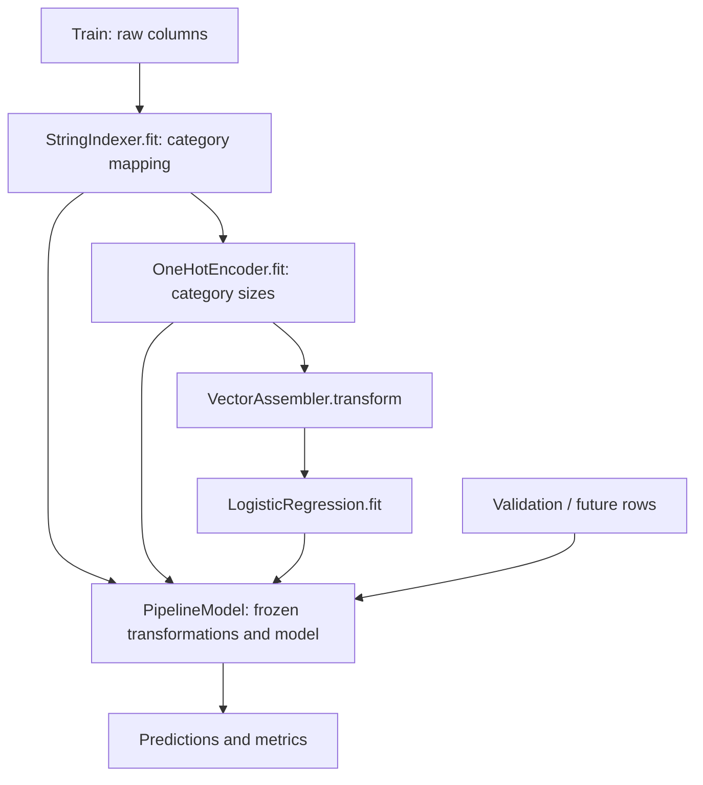
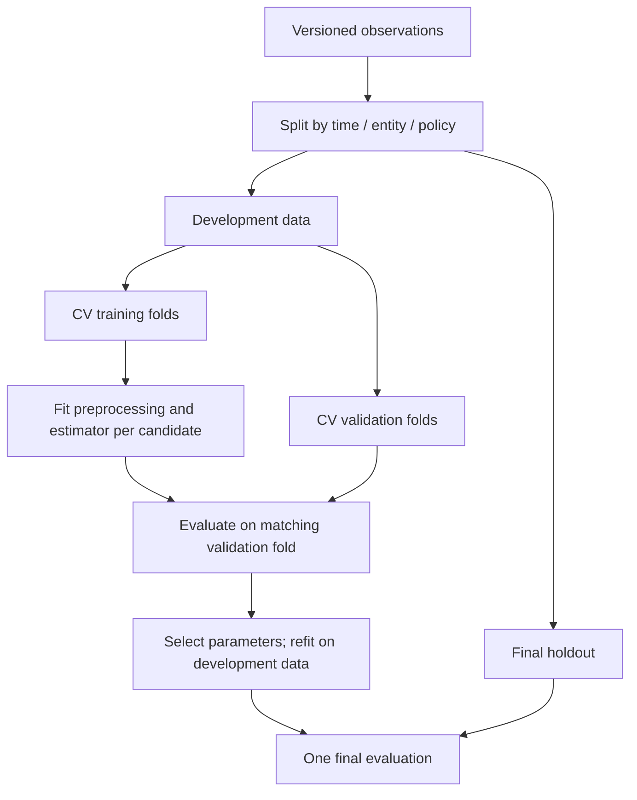
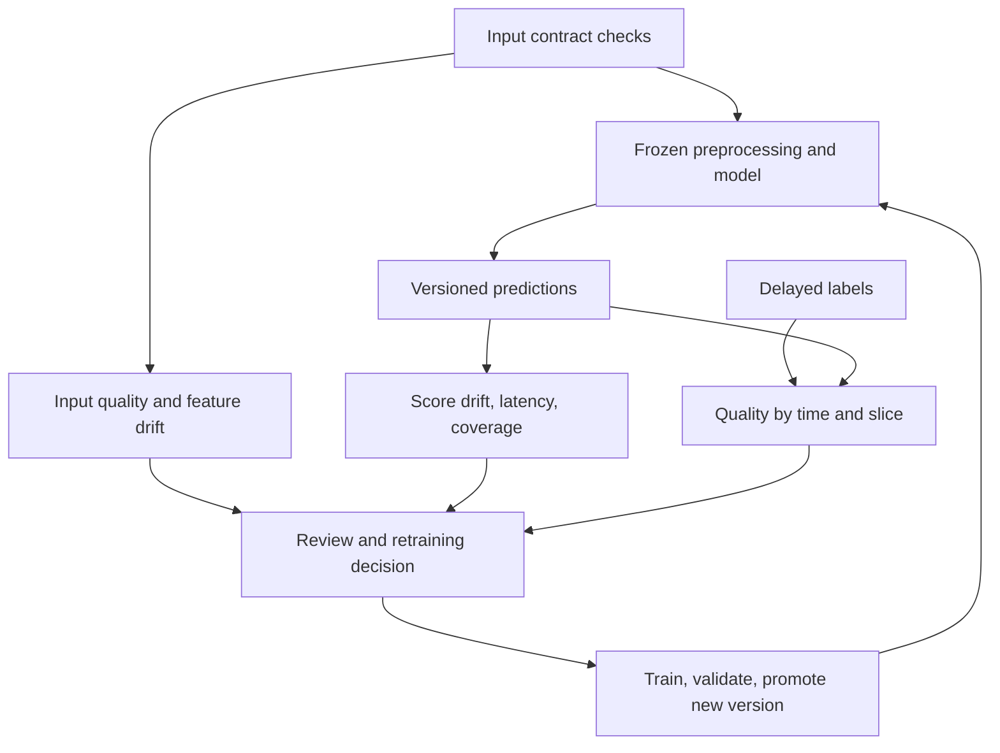

# 26. Машинное обучение и MLlib

Основной язык примеров — **Python / PySpark**. Базовое окружение: **Apache Spark 4.2.0, Python 3.12, JDK 17, Linux**. Здесь рассматривается прежде всего DataFrame API `pyspark.ml` в **Spark Classic**. Доступность конкретного ML API через Spark Connect проверяй отдельно для версии клиента и сервера; наличие класса в Classic не доказывает поддержку удалённого вызова.

**Цель раздела:** собрать воспроизводимый цикл от сырых данных до проверенного артефакта модели; понимать, какие операции обучаются, где возникает утечка данных, как интерпретировать метрики и сколько ресурсов стоит обучение.

MLlib особенно полезна, когда исходные данные уже находятся в Spark, а подготовка признаков, обучение и пакетный инференс должны работать с распределёнными DataFrames. Распределённый API не означает, что любой размер вектора или любая модель помещаются в память: коэффициенты, матрицы статистик и результаты некоторых операций материализуются на driver либо целиком внутри отдельных tasks.

**Как выполнять примеры**

- Создай отдельное окружение с Java 17 и `python -m pip install "pyspark==4.2.0" numpy scipy`. У Python executors должны быть совместимые зависимости.
- Python-блоки выполняются **по порядку в одном notebook/kernel**, начиная с инициализации ниже. Блоки с подписью **«шаблон интеграции»** требуют внешней инфраструктуры и отдельно обозначены.
- Используются маленькие синтетические данные и `local[2]`. Проверки подтверждают контракты API и результатов, но не доказывают качество модели на реальной задаче, масштабируемость кластера или совместимость внешнего serving runtime.
- `collect()`, `first()` и `toArray()` в лабораториях ограничены маленькими fixtures. Не переноси их на полный production dataset без оценки размера результата.
- Результаты оптимизации могут немного различаться из-за порядка суммирования и реализации линейной алгебры. Проверяй числовые допуски и смысловые свойства, а не побитовое равенство коэффициентов.
- Проверки выполнены **14 октября 2026 года**. Ссылки Apache Spark зафиксированы на версии **4.2.0**; внешние интеграции имеют собственный цикл версий.

```python
import math
import os
import tempfile
from pathlib import Path

os.environ.setdefault("SPARK_LOCAL_IP", "127.0.0.1")
from pyspark.sql import SparkSession, functions as F
from pyspark.ml.linalg import Vectors, VectorUDT
from pyspark.ml.functions import vector_to_array, array_to_vector

spark = (
    SparkSession.builder.master("local[2]")
    .appName("spark-zero-to-hero-section-26")
    .config("spark.ui.enabled", "false")
    .config("spark.driver.memory", "512m")
    .config("spark.driver.bindAddress", "127.0.0.1")
    .config("spark.driver.host", "127.0.0.1")
    .config("spark.python.use.daemon", "false")
    .config("spark.sql.session.timeZone", "UTC")
    .config("spark.sql.shuffle.partitions", "2")
    .config("spark.default.parallelism", "2")
    .getOrCreate()
)
spark.sparkContext.setLogLevel("ERROR")
assert spark.version == "4.2.0", spark.version
lab_dir = Path(tempfile.mkdtemp(prefix="spark-ml-26-"))
print("Spark", spark.version, "artifacts:", lab_dir)
```

**Содержание**

1. [Модель MLlib](#mllib-model)
2. [Числовые и категориальные признаки](#numeric-categorical)
3. [Текстовые признаки](#text-features)
4. [Снижение размерности и отбор признаков](#dimension-selection)
5. [Классификация и регрессия](#classification-regression)
6. [Кластеризация и рекомендации](#clustering-recommendations)
7. [Статистические инструменты](#statistics)
8. [Evaluation и tuning](#evaluation-tuning)
9. [Production ML pipeline](#production-ml)

<a id="mllib-model"></a>

## Модель MLlib

### DataFrame-based spark.ml и legacy spark.mllib

MLlib — название библиотеки машинного обучения Spark целиком. `org.apache.spark.ml` и `pyspark.ml` — её основной DataFrame API. `org.apache.spark.mllib` и `pyspark.mllib` — старый RDD API в режиме сопровождения: он нужен для существующих приложений и отдельных инструментов, но новые pipeline обычно строят на `spark.ml`.

DataFrame объединяет признаки, labels, идентификаторы и служебные поля в одной схеме. Это помогает использовать SQL для подготовки выборок и единый контракт `fit`/`transform` для алгоритмов. Catalyst оптимизирует доступные SQL/DataFrame операции; само обучение остаётся специализированным алгоритмом с итерациями, агрегированием и собственными ограничениями памяти.

| Задача | Предпочтительный API | Существенная граница |
| --- | --- | --- |
| Новая цепочка подготовки и обучения | `pyspark.ml` | Именованные столбцы, Pipeline, persistence |
| Старый RDD-based код | `pyspark.mllib` | Отдельные типы vectors/models, другой API |
| SQL-подготовка training dataset | `pyspark.sql` | Доступность признака на момент prediction важнее удобства join |
| Legacy distributed matrix | `pyspark.mllib.linalg.distributed` | Не является универсальной заменой DataFrame или GPU tensor |

Не смешивай `pyspark.ml.linalg.Vector` и `pyspark.mllib.linalg.Vector` в одной схеме без явного преобразования. Одинаковое содержимое не делает Python-классы взаимозаменяемыми. В примерах раздела `Vectors` импортируется из `pyspark.ml.linalg`; legacy импорт появится отдельно и с другим именем.

**Самопроверка:** почему факт «данные лежат в DataFrame» ещё не означает, что fitting полностью выражен SQL plan?

Источники: [MLlib guide](https://spark.apache.org/docs/4.2.0/ml-guide.html), [DataFrame ML API](https://spark.apache.org/docs/4.2.0/api/python/reference/pyspark.ml.html).

### DenseVector, SparseVector и vector columns

Многие алгоритмы читают один столбец `features` типа `VectorUDT`, а не набор отдельных SQL-столбцов. `DenseVector` хранит все значения; `SparseVector` — размерность, индексы и значения ненулевых координат. Размерность относится ко всему пространству признаков, а не к числу ненулевых элементов.

```python
dense = Vectors.dense([0.0, 2.0, 0.0, 5.0])
sparse = Vectors.sparse(4, [1, 3], [2.0, 5.0])
assert dense == sparse
assert sparse.size == 4 and sparse.numNonzeros() == 2

vectors_df = spark.createDataFrame([(1, dense), (2, sparse)], ["id", "features"])
assert isinstance(vectors_df.schema["features"].dataType, VectorUDT)
vectors_df.select("id", vector_to_array("features").alias("values")).show()

arrays_df = spark.createDataFrame([(1, [0.0, 2.0, 0.0, 5.0])], ["id", "values"])
assert arrays_df.select(array_to_vector("values").alias("features")).first().features == dense
```

Для sparse нужны корректные, уникальные, возрастающие индексы в диапазоне `[0, dimension)`. Все строки обучающего и scoring dataset должны соответствовать одному порядку признаков. Модель с четырьмя коэффициентами не узнает, что второй и третий признаки случайно поменяли местами.

| Свойство | Что проверять |
| --- | --- |
| Тип | `VectorUDT`, а не `array<double>`, если алгоритм требует vector |
| Размерность | Одинаковая между train, validation и inference |
| Порядок | Зафиксированный assembler/словарь/manifest признаков |
| Числа | Политика `NULL`, `NaN`, бесконечности и допустимого диапазона |
| Metadata | Имена, число признаков, признак categorical/nominal, где нужен алгоритму |

Преобразование sparse в array делает представление плотным: миллион координат — примерно 8 MB только числовых значений одной строки в `float64`, без накладных расходов. Удобный debug output легко становится причиной OOM.

API: [Vectors](https://spark.apache.org/docs/4.2.0/api/python/reference/api/pyspark.ml.linalg.Vectors.html), [vector_to_array](https://spark.apache.org/docs/4.2.0/api/python/reference/api/pyspark.ml.functions.vector_to_array.html), [array_to_vector](https://spark.apache.org/docs/4.2.0/api/python/reference/api/pyspark.ml.functions.array_to_vector.html).

### Transformer, Estimator и Model

`Transformer.transform(df)` строит преобразованный DataFrame. Например, `VectorAssembler` объединяет столбцы без обучения. `Estimator.fit(df)` изучает данные и возвращает `Model`, который сам является Transformer. Например, scaler изучает средние и стандартные отклонения, а затем применяет их к новым строкам.

| Объект | Пример | Что получается |
| --- | --- | --- |
| Transformer | `Tokenizer`, `VectorAssembler` | Новый DataFrame при `transform` |
| Estimator | `StringIndexer`, `StandardScaler`, `LogisticRegression` | Обученный Model при `fit` |
| Model | `StringIndexerModel`, `StandardScalerModel`, `LogisticRegressionModel` | Преобразование с зафиксированным состоянием |

`fit()` обычно запускает Spark jobs. `transform()` часто возвращает ленивый plan, фактическая работа происходит при action, но универсально считать каждый transform полностью ленивым нельзя: стадии могут анализировать данные или выполнять вспомогательные вычисления.

```python
from pyspark.ml.feature import VectorAssembler, StandardScaler

tiny = spark.createDataFrame([(1.0, 10.0), (3.0, 30.0), (5.0, 50.0)], ["x", "y"])
assembler = VectorAssembler(inputCols=["x", "y"], outputCol="features")
assembled = assembler.transform(tiny)
scaler = StandardScaler(inputCol="features", outputCol="scaled", withMean=False)
scaler_model = scaler.fit(assembled)
assert scaler_model.std.size == 2
assert scaler_model.transform(assembled).count() == 3
```

Не вызывай `fit()` на каждом inference batch ради получения «актуальных» scaling statistics: координаты модели начнут означать другое. Переобучение — отдельный цикл с новой версией артефакта и оценкой качества.

API: [Transformer](https://spark.apache.org/docs/4.2.0/api/python/reference/api/pyspark.ml.Transformer.html), [Estimator](https://spark.apache.org/docs/4.2.0/api/python/reference/api/pyspark.ml.Estimator.html), [Model](https://spark.apache.org/docs/4.2.0/api/python/reference/api/pyspark.ml.Model.html).

### Params, ParamMap и names of input/output columns

Параметр MLlib принадлежит конкретному экземпляру стадии. В PySpark ParamMap обычно выражают словарём `{stage.param: value}`. Это позволяет различать, например, `regParam` двух классификаторов одного типа. Значения, переданные в `fit`/`transform`, перекрывают параметры экземпляра для этого вызова; defaults имеют меньший приоритет.

Входы и выходы — тоже параметры: `inputCol`, `inputCols`, `featuresCol`, `labelCol`, `predictionCol`. Их названия определяют зависимости стадий. Повторное использование уже занятого выходного имени может закончиться ошибкой схемы или незаметной путаницей при ручном пересоздании столбцов.

```python
from pyspark.ml.classification import LogisticRegression

lr_demo = LogisticRegression(maxIter=10, regParam=0.1,
                             featuresCol="features", labelCol="label")
override = {lr_demo.maxIter: 15, lr_demo.regParam: 0.2}
configured = lr_demo.copy(override)
assert configured.getMaxIter() == 15
assert lr_demo.getMaxIter() == 10
assert configured.getFeaturesCol() == "features"
print(configured.explainParam("regParam"))
```

Для эксперимента сохраняй **фактическую** карту параметров после применения defaults и overrides, UID стадий и Spark version. Один JSON вида `{"maxIter": 15}` не описывает весь pipeline и может стать неоднозначным после добавления ещё одной модели.

API: [Params](https://spark.apache.org/docs/4.2.0/api/python/reference/api/pyspark.ml.param.Params.html), [LogisticRegression](https://spark.apache.org/docs/4.2.0/api/python/reference/api/pyspark.ml.classification.LogisticRegression.html).

### Pipeline и PipelineModel

`Pipeline` — Estimator, содержащий упорядоченные стадии. После `fit(train)` он возвращает `PipelineModel`, в котором обучаемые стадии заменены их models. Цепочка может иметь зависимости по нескольким столбцам, но стадии всё равно перечисляются в топологическом порядке. Каждый stage должен быть отдельным экземпляром с собственным UID.

Ниже первый сквозной pipeline: категории → one-hot, числовой столбец → assembler, затем logistic regression. Train и test заданы явно: так небольшой fixture гарантированно содержит оба класса в train, а test включает неизвестную категорию.

```python
from pyspark.ml import Pipeline
from pyspark.ml.feature import StringIndexer, OneHotEncoder

raw_train = spark.createDataFrame([
    (1, 18.0, "web", 0.0), (2, 23.0, "store", 0.0),
    (3, 27.0, "web", 0.0), (4, 31.0, "store", 1.0),
    (5, 38.0, "web", 1.0), (6, 44.0, "store", 1.0),
    (7, 29.0, "web", 1.0), (8, 35.0, "store", 0.0),
], ["id", "age", "channel", "label"])
raw_test = spark.createDataFrame([
    (101, 25.0, "mobile", 0.0), (102, 40.0, "web", 1.0)
], raw_train.schema)

channel_indexer = StringIndexer(inputCol="channel", outputCol="channel_idx",
                                handleInvalid="keep", stringOrderType="alphabetAsc")
channel_ohe = OneHotEncoder(inputCols=["channel_idx"], outputCols=["channel_vec"],
                            dropLast=False, handleInvalid="keep")
raw_assembler = VectorAssembler(inputCols=["age", "channel_vec"], outputCol="features")
raw_lr = LogisticRegression(maxIter=20, regParam=0.1)
raw_pipeline = Pipeline(stages=[channel_indexer, channel_ohe, raw_assembler, raw_lr])
pipeline_model = raw_pipeline.fit(raw_train)
pipeline_predictions = pipeline_model.transform(raw_test)
assert pipeline_predictions.count() == 2
assert "probability" in pipeline_predictions.columns
assert len(pipeline_model.stages) == 4
pipeline_predictions.select("id", "channel", "prediction", "probability").show()
```



Pipeline уменьшает риск различий между обучением и инференсом, но не исправляет ошибочный join, label leakage или временное разделение. Если fitted scaler создан на всех данных до помещения в pipeline, утечка уже произошла.

API: [Pipeline](https://spark.apache.org/docs/4.2.0/api/python/reference/api/pyspark.ml.Pipeline.html), [PipelineModel](https://spark.apache.org/docs/4.2.0/api/python/reference/api/pyspark.ml.PipelineModel.html).

### Разделение подготовки данных, обучения и инференса

Подготовка данных включает формирование наблюдения, label, временных границ, joins и очистку. Обучение изучает параметры только на разрешённой training выборке. Инференс использует зафиксированные преобразования и модель; label ему обычно не нужен.

| Слой | Пример | Что версионировать |
| --- | --- | --- |
| Dataset construction | «Покупка в следующие 7 дней» и признаки до момента запроса | Snapshot, SQL, ключи, event time, окно label |
| Learned preprocessing | Imputer, vocabulary, scaler | Fitted stages вместе с моделью |
| Model training | Коэффициенты и hyperparameters | Run, код, seed, split manifest, evaluator |
| Inference | `PipelineModel.transform` | Model version, input contract, output lineage |

```python
unlabeled = raw_test.drop("label")
scored_unlabeled = pipeline_model.transform(unlabeled)
assert "label" not in scored_unlabeled.columns
assert scored_unlabeled.select("prediction").count() == 2
```

Разделяй данные до fitting любых статистик, способных запомнить distribution или target. Для временной задачи признаки должны быть доступны на `prediction_time`, а label — созреть после него; позднее поступившие события и backfill требуют политики доступности данных.

**Практика:** добавь новый канал в test, затем поменяй `handleInvalid` индексатора на `error`. Объясни, почему ошибка возникает при scoring. Добавь numeric scaler в pipeline и докажи, что его statistics не меняются от экстремальных значений test.

**Самопроверка:** чем сохранённый Estimator отличается от сохранённого Model? Какие стадии должны переобучаться внутри каждого CV fold? Почему отсутствие `label` при inference допустимо для приведённого pipeline?

<a id="numeric-categorical"></a>

## Числовые и категориальные признаки

### VectorAssembler и VectorIndexer

`VectorAssembler` объединяет числовые, boolean и vector столбцы в один vector в заданном порядке. Он не кодирует строковые категории и не обучает scaling. `VectorIndexer` изучает отдельные координаты vector и помечает координаты с небольшим числом уникальных значений как categorical. Это особенно полезно для деревьев, которые читают categorical metadata.

```python
from pyspark.ml.feature import VectorIndexer, VectorSizeHint

numeric = spark.createDataFrame([
    (0, 10.0, 0.0), (1, 20.0, 1.0), (2, 30.0, 0.0), (3, 40.0, 1.0)
], ["id", "amount", "segment"])
num_assembler = VectorAssembler(inputCols=["amount", "segment"], outputCol="features")
numeric_vectors = num_assembler.transform(numeric)
vindex = VectorIndexer(inputCol="features", outputCol="indexed", maxCategories=2,
                       handleInvalid="keep").fit(numeric_vectors)
assert set(vindex.categoryMaps) == {1}
assert vindex.transform(numeric_vectors).first().indexed.size == 2

# Для vector-столбца без информации о длине можно задать проверяемый size hint.
hinted = VectorSizeHint(inputCol="features", size=2, handleInvalid="error").transform(numeric_vectors)
assert hinted.schema["features"].metadata["ml_attr"]["num_attrs"] == 2
```

Небольшое число уникальных значений не доказывает семантику категории: возраст в маленькой выборке тоже может оказаться categorical. Для high-cardinality признака сам поиск distinct и category maps стоит ресурсов. Явная схема признаков надёжнее автоматической догадки.

`VectorAssembler(handleInvalid="keep")` может пропустить `NaN` в vector, но последующий алгоритм не обязан его принимать. `skip` меняет состав выборки и метрики; `error` полезен для строгого контракта. Для входных vectors с неизвестной длиной используй metadata/`VectorSizeHint`, особенно вместе с `keep`.

API: [VectorAssembler](https://spark.apache.org/docs/4.2.0/api/python/reference/api/pyspark.ml.feature.VectorAssembler.html), [VectorIndexer](https://spark.apache.org/docs/4.2.0/api/python/reference/api/pyspark.ml.feature.VectorIndexer.html), [VectorSizeHint](https://spark.apache.org/docs/4.2.0/api/python/reference/api/pyspark.ml.feature.VectorSizeHint.html).

### StringIndexer и IndexToString

`StringIndexer` обучает соответствие категория → индекс. По умолчанию порядок зависит от частот, поэтому нельзя считать, что индекс `1.0` навсегда означает одну бизнес-категорию. Для воспроизводимого порядка есть `alphabetAsc`/`alphabetDesc`, но даже алфавитный порядок меняется при изменении словаря.

```python
from pyspark.ml.feature import IndexToString

categories = spark.createDataFrame([("b",), ("a",), ("a",)], ["category"])
cat_model = StringIndexer(inputCol="category", outputCol="category_idx",
                          stringOrderType="alphabetAsc", handleInvalid="keep").fit(categories)
cat_test = spark.createDataFrame([("a",), ("z",), (None,)], "category string")
indexed_categories = cat_model.transform(cat_test)
assert cat_model.labelsArray[0] == ["a", "b"]
assert sorted(r.category_idx for r in indexed_categories.collect()) == [0.0, 2.0, 2.0]

decoder = IndexToString(inputCol="category_idx", outputCol="decoded",
                        labels=cat_model.labelsArray[0] + ["__UNKNOWN__"])
assert decoder.transform(indexed_categories).where("decoded = '__UNKNOWN__'").count() == 2
```

| `handleInvalid` | Новая категория / `NULL` | Последствие |
| --- | --- | --- |
| `error` | Ошибка | Сигнал нарушения контракта |
| `skip` | Строка удаляется | Нужно учитывать coverage и смещение выборки |
| `keep` | Дополнительный индекс после train vocabulary | Нужна согласованная обработка downstream |

Для target labels индексацию сохраняют и используют при обратном преобразовании prediction. Не обучай decoder на test. Unseen target в evaluation — повод проверить постановку задачи; механически считать его обычным обученным классом нельзя.

API: [StringIndexer](https://spark.apache.org/docs/4.2.0/api/python/reference/api/pyspark.ml.feature.StringIndexer.html), [IndexToString](https://spark.apache.org/docs/4.2.0/api/python/reference/api/pyspark.ml.feature.IndexToString.html).

### OneHotEncoder и неизвестные категории

One-hot encoding убирает искусственный числовой порядок категорий: индекс `2` не должен автоматически означать «вдвое больше», чем `1`. `OneHotEncoder` — Estimator: изучает количество категорий, в том числе по metadata, затем создаёт sparse vectors.

`dropLast=True` сокращает одну координату. Это может быть удобно для линейной модели с intercept, но требует понимания all-zero encoding. При `handleInvalid="keep"` encoder резервирует дополнительную invalid category; если именно она последняя и `dropLast=True`, она кодируется нулями.

```python
ohe_train = spark.createDataFrame([(0.0,), (1.0,)], ["idx"])
ohe_test = spark.createDataFrame([(0.0,), (1.0,), (2.0,)], ["idx"])
ohe_model = OneHotEncoder(inputCols=["idx"], outputCols=["encoded"],
                          handleInvalid="keep", dropLast=True).fit(ohe_train)
encoded = {r.idx: r.encoded for r in ohe_model.transform(ohe_test).collect()}
assert ohe_model.categorySizes == [2]
assert encoded[1.0].numNonzeros() == 1
assert encoded[2.0].numNonzeros() == 0
assert encoded[2.0].size == 2
```

Если перед encoder стоит `StringIndexer(handleInvalid="keep")`, его unknown bucket уже отражён в metadata как отдельная категория. Это **не обязательно** тот же bucket, который encoder добавляет для собственного invalid input. Проверяй размерность и конкретный vector новой строки, а не выводи поведение только из слова `keep`.

В первом pipeline используется `dropLast=False`: это делает разные buckets явными. Цена — дополнительная координата и возможная линейная зависимость с intercept; regularization и выбор encoding оценивают вместе. Ни один вариант не отменяет мониторинг доли неизвестных категорий.

API: [OneHotEncoder](https://spark.apache.org/docs/4.2.0/api/python/reference/api/pyspark.ml.feature.OneHotEncoder.html).

### StandardScaler, MinMaxScaler, MaxAbsScaler и Normalizer

Scaling меняет геометрию задачи. KMeans, PCA, LSH и регуляризованные линейные модели чувствительны к масштабу. Для деревьев монотонное scaling обычно не даёт того же эффекта, что для distance-based алгоритма.

| Преобразование | Смысл | Важное ограничение |
| --- | --- | --- |
| `StandardScaler` | Деление на sample standard deviation, опционально вычитание mean | `withMean=True` создаёт dense output |
| `MinMaxScaler` | Перенос train min/max в заданный диапазон | Test может выйти за диапазон; sparse output обычно становится dense |
| `MaxAbsScaler` | Деление на train maximum absolute value каждой координаты | Сохраняет нули и удобно для sparse |
| `Normalizer` | Норма каждой отдельной строки становится 1 | Не учит статистики dataset; нулевой vector остаётся нулевым |

```python
from pyspark.ml.feature import MinMaxScaler, MaxAbsScaler, Normalizer

scale_df = spark.createDataFrame([
    (Vectors.sparse(2, [0], [1.0]),),
    (Vectors.dense([3.0, 4.0]),),
    (Vectors.dense([5.0, 8.0]),),
], ["features"])
for estimator in [
    StandardScaler(inputCol="features", outputCol="scaled", withMean=True, withStd=True),
    MinMaxScaler(inputCol="features", outputCol="scaled"),
    MaxAbsScaler(inputCol="features", outputCol="scaled"),
]:
    fitted = estimator.fit(scale_df)
    assert fitted.transform(scale_df).first().scaled.size == 2

normalized = Normalizer(inputCol="features", outputCol="unit", p=2.0).transform(scale_df)
assert all(abs(r.unit.norm(2) - 1.0) < 1e-10 for r in normalized.collect())
```

Не выбирай `withMean=True` для огромного sparse text vector без расчёта памяти. Для константных координат масштабирование имеет специальные правила: не рассчитывай получить содержательную дисперсию из константы. Встроенная standardization некоторых estimators не делает внешний scaler обязательным; оценивай весь preprocessing contract, включая regularization и interpretability.

API: [StandardScaler](https://spark.apache.org/docs/4.2.0/api/python/reference/api/pyspark.ml.feature.StandardScaler.html), [MinMaxScaler](https://spark.apache.org/docs/4.2.0/api/python/reference/api/pyspark.ml.feature.MinMaxScaler.html), [MaxAbsScaler](https://spark.apache.org/docs/4.2.0/api/python/reference/api/pyspark.ml.feature.MaxAbsScaler.html), [Normalizer](https://spark.apache.org/docs/4.2.0/api/python/reference/api/pyspark.ml.feature.Normalizer.html).

### Imputer, Bucketizer и QuantileDiscretizer

`Imputer` обучает значения замены числовых пропусков: mean, median или mode. Это не кодировщик строковых категорий. `Bucketizer` применяет заданные границы без fitting. `QuantileDiscretizer` изучает приблизительные quantile boundaries, поэтому его тоже обучают только на train.

```python
from pyspark.ml.feature import Imputer, Bucketizer, QuantileDiscretizer

missing = spark.createDataFrame([(1, 1.0), (2, None), (3, 3.0), (4, float("nan"))],
                                 "id int, value double")
imputer_model = Imputer(inputCols=["value"], outputCols=["filled"], strategy="median",
                        relativeError=0.0).fit(missing)
imputed = imputer_model.transform(missing)
assert imputed.where(F.col("filled").isNull() | F.isnan("filled")).count() == 0

bucketed = Bucketizer(splits=[-float("inf"), 2.0, float("inf")],
                      inputCol="filled", outputCol="bucket").transform(imputed)
assert {r.bucket for r in bucketed.collect()} <= {0.0, 1.0}
quantiles = QuantileDiscretizer(numBuckets=2, inputCol="filled", outputCol="qbucket",
                               relativeError=0.0).fit(imputed)
assert quantiles.transform(imputed).count() == 4
```

У `Bucketizer` интервалы идут как `[a, b)`, последний включает правую границу. Значение вне заданных splits — ошибка; `handleInvalid="keep"` относится к `NaN` и не заменяет необходимость покрыть допустимый диапазон. Для полной числовой оси удобно использовать `-inf` и `inf`.

Median в распределённом API может быть приближённой; точность управляется `relativeError`. `relativeError=0` в лаборатории повышает стоимость и не является универсальным production default. Повторяющиеся значения могут уменьшить фактическое число quantile buckets. Полностью пустой признак или специальный missing sentinel требуют явной политики, а не слепого fitting.

Пропуск сам может быть сигналом: при необходимости добавь indicator до imputation. Проверяй, не означает ли он «значение ещё не было известно на момент прогноза».

API: [Imputer](https://spark.apache.org/docs/4.2.0/api/python/reference/api/pyspark.ml.feature.Imputer.html), [Bucketizer](https://spark.apache.org/docs/4.2.0/api/python/reference/api/pyspark.ml.feature.Bucketizer.html), [QuantileDiscretizer](https://spark.apache.org/docs/4.2.0/api/python/reference/api/pyspark.ml.feature.QuantileDiscretizer.html).

### Binarizer, PolynomialExpansion и Interaction

`Binarizer` сравнивает число с threshold: строго больше порога → `1`, иначе → `0`. `PolynomialExpansion` создаёт степени и произведения координат до заданной степени. `Interaction` строит взаимодействия входных признаков, используя numeric и categorical metadata.

```python
from pyspark.ml.feature import Binarizer, PolynomialExpansion, Interaction

expanded_input = spark.createDataFrame([(0.5, Vectors.dense([2.0, 3.0]))], ["x", "v"])
binarized = Binarizer(inputCol="x", outputCol="flag", threshold=0.5).transform(expanded_input)
assert binarized.first().flag == 0.0
poly = PolynomialExpansion(inputCol="v", outputCol="poly", degree=2).transform(expanded_input)
assert poly.first().poly.size == 5  # Две линейные + три квадратичные координаты.
interaction_ready = VectorAssembler(inputCols=["v"], outputCol="v_meta").transform(expanded_input)
interacted = Interaction(inputCols=["x", "v_meta"], outputCol="cross").transform(interaction_ready)
assert list(interacted.first().cross) == [1.0, 1.5]
```

Число polynomial terms быстро растёт: для `d` исходных признаков и степени `p` без свободного члена оно равно `C(d+p,p)-1`. При `d=1000`, `p=2` получается 501500 координат. Это меняет размер coefficients, регуляризацию и стоимость каждого прохода.

Interaction требует attributes для vector inputs: сырому vector без metadata недостаточно только правильной длины. В примере VectorAssembler создаёт metadata координат. Перемножение двух случайных идентификаторов не создаёт полезный continuous signal. Для categorical взаимодействий сначала зафиксируй смысл категорий и metadata; для высоких порядков рассмотри hashing либо factorization machines, учитывая их собственные ограничения.

API: [Binarizer](https://spark.apache.org/docs/4.2.0/api/python/reference/api/pyspark.ml.feature.Binarizer.html), [PolynomialExpansion](https://spark.apache.org/docs/4.2.0/api/python/reference/api/pyspark.ml.feature.PolynomialExpansion.html), [Interaction](https://spark.apache.org/docs/4.2.0/api/python/reference/api/pyspark.ml.feature.Interaction.html).

### VectorSlicer и выбор групп признаков

`VectorSlicer` выбирает координаты по индексам либо именам из metadata. Это Transformer: он не знает, какие признаки полезны по target. Имена удобны для читаемого контракта, но требуют сохранённых атрибутов; indices требуют отдельного manifest порядка.

```python
from pyspark.ml.feature import VectorSlicer

sliced = VectorSlicer(inputCol="features", outputCol="amount_only", indices=[0]).transform(numeric_vectors)
assert sliced.first().amount_only.size == 1
assert sliced.orderBy("id").first().amount_only[0] == 10.0
```

Для ablation study исключай целую группу признаков и повторяй evaluation на одном split. Сравнивай не только качество, но и стоимость вычисления группы, freshness, долю missing и риск leakage. Нельзя выбрать группу по test и продолжать считать test независимым.

**Практика:** собери pipeline `Imputer → StringIndexer → OneHotEncoder → VectorAssembler → model` для данных с `NULL` и неизвестными категориями. Зафиксируй размерность features, количество сохранённых строк и долю unknown. Сравни `dropLast` и `withMean` по фактическому типу output vectors.

**Самопроверка:** чем `VectorIndexer` отличается от `VectorAssembler`? Почему новый maximum в test может дать `MinMaxScaler` значение больше 1? В каком месте pipeline обучаются quantile boundaries? Когда выбор по имени невозможен после потери metadata?

API: [VectorSlicer](https://spark.apache.org/docs/4.2.0/api/python/reference/api/pyspark.ml.feature.VectorSlicer.html).

<a id="text-features"></a>

## Текстовые признаки

### Tokenizer и RegexTokenizer

`Tokenizer` приводит текст к нижнему регистру и разделяет по whitespace. `RegexTokenizer` позволяет задать pattern, минимальную длину token, lowercase и интерпретацию pattern как разделителей (`gaps=True`) либо самих tokens (`gaps=False`). Это правила разбиения строк, а не языковая модель, лемматизатор или tokenizer конкретной LLM.

```python
from pyspark.ml.feature import Tokenizer, RegexTokenizer

documents = spark.createDataFrame([
    (1, "Spark and SQL power data pipelines", 1.0),
    (2, "SQL and Spark process data", 1.0),
    (3, "Cats and dogs play outside", 0.0),
    (4, "Dogs play and cats sleep", 0.0),
], ["id", "text", "label"])
simple_tokens = Tokenizer(inputCol="text", outputCol="simple_words").transform(documents)
tokenizer = RegexTokenizer(inputCol="text", outputCol="words", pattern=r"\W+",
                            minTokenLength=2, toLowercase=True)
tokenized = tokenizer.transform(documents)
assert tokenized.orderBy("id").first().words[0] == "spark"
assert simple_tokens.count() == 4
```

Для русского текста отдельно проверь Unicode, дефисы, числа, `ё`, пунктуацию, домены и identifiers. Стандартное разбиение может разорвать артикул `AB-123` и смешать `C++` с другой сущностью. `NULL` нормализуй по явному правилу до tokenization; пустой документ — отдельный допустимый или отклоняемый случай.

API: [Tokenizer](https://spark.apache.org/docs/4.2.0/api/python/reference/api/pyspark.ml.feature.Tokenizer.html), [RegexTokenizer](https://spark.apache.org/docs/4.2.0/api/python/reference/api/pyspark.ml.feature.RegexTokenizer.html).

### StopWordsRemover и NGram

`StopWordsRemover` удаляет заданные tokens. Встроенный список доступен по языку, но правильный список зависит от задачи: отрицание может быть критично для sentiment, а короткие слова — частью product name. `NGram` строит последовательности из `n` соседних tokens; это локальный порядок, который bag-of-words теряет.

```python
from pyspark.ml.feature import StopWordsRemover, NGram

remover = StopWordsRemover(inputCol="words", outputCol="clean_words",
                           stopWords=["and"], caseSensitive=False)
cleaned_text = remover.transform(tokenized)
grams = NGram(n=2, inputCol="clean_words", outputCol="bigrams").transform(cleaned_text)
assert "and" not in cleaned_text.first().clean_words
assert "spark sql" in grams.orderBy("id").first().bigrams
assert len(StopWordsRemover.loadDefaultStopWords("russian")) > 0
```

Удаление stop words перед NGram меняет соседство: фраза может появиться из слов, которые не стояли рядом в исходном документе. Зафиксируй порядок стадий как часть model contract. Если после очистки tokens меньше `n`, output NGram пустой; downstream feature extractor должен корректно это обрабатывать.

API: [StopWordsRemover](https://spark.apache.org/docs/4.2.0/api/python/reference/api/pyspark.ml.feature.StopWordsRemover.html), [NGram](https://spark.apache.org/docs/4.2.0/api/python/reference/api/pyspark.ml.feature.NGram.html).

### CountVectorizer и HashingTF

`CountVectorizer.fit` изучает словарь train corpus, а model считает частоты известных tokens. `HashingTF` отображает tokens в фиксированное пространство без fitting словаря. Hash collisions означают, что разные tokens могут получить одну координату; увеличение `numFeatures` уменьшает вероятность коллизий, но увеличивает стоимость модели.

```python
from pyspark.ml.feature import CountVectorizer, HashingTF

count_model = CountVectorizer(inputCol="clean_words", outputCol="counts",
                              vocabSize=100, minDF=1.0).fit(cleaned_text)
counted_text = count_model.transform(cleaned_text)
hash_tf = HashingTF(inputCol="clean_words", outputCol="tf", numFeatures=64)
hashed_text = hash_tf.transform(cleaned_text)
assert "spark" in count_model.vocabulary
assert hashed_text.first().tf.size == 64
```

| Критерий | CountVectorizer | HashingTF |
| --- | --- | --- |
| Обучение словаря | Требуется | Не требуется |
| Неизвестный token | Игнорируется, если отсутствует в vocabulary | Хешируется в существующее пространство |
| Объяснение координаты | Можно сопоставить с token | Возможны несколько tokens в одной координате |
| Размер | Ограничивается vocabulary | Фиксирован `numFeatures` |

`minDF`/`maxDF` управляют частотой по документам, `minTF` — порогом внутри документа; абсолютные и относительные режимы зависят от значения параметра. Не перепутай document frequency и число появлений token. Для hashing обычно выбирают степень двойки, но размер подбирают по качеству и ресурсам, а не по привычке.

API: [CountVectorizer](https://spark.apache.org/docs/4.2.0/api/python/reference/api/pyspark.ml.feature.CountVectorizer.html), [HashingTF](https://spark.apache.org/docs/4.2.0/api/python/reference/api/pyspark.ml.feature.HashingTF.html).

### IDF и TF-IDF

IDF уменьшает вклад tokens, встречающихся во многих документах. Spark использует сглаживание: `idf(t) = log((N+1)/(df(t)+1))`. TF описывает конкретный документ, а IDF — статистику training corpus. Поэтому `IDF` является Estimator, даже если перед ним стоит stateless `HashingTF`.

```python
from pyspark.ml.feature import IDF

idf_model = IDF(inputCol="tf", outputCol="tfidf", minDocFreq=1).fit(hashed_text)
tfidf_text = idf_model.transform(hashed_text)
assert idf_model.numDocs == 4
assert idf_model.idf.size == 64
assert tfidf_text.first().tfidf.size == 64
```

При hashing IDF считается по hashed coordinates: коллизия влияет не только на TF, но и на document frequency. Частый token может «подавить» редкий, попавший в тот же bucket. `minDocFreq` отсекает вес слишком редких координат; это не тот же механизм, что ограничение vocabulary в CountVectorizer.

Для cosine-like сравнения после TF-IDF часто применяют L2 Normalizer. Пустой документ остаётся нулевым; расстояния и downstream model должны иметь явную политику для таких строк.

API: [IDF](https://spark.apache.org/docs/4.2.0/api/python/reference/api/pyspark.ml.feature.IDF.html).

### Word2Vec

`Word2Vec` изучает dense vector каждого слова по контекстам. `Word2VecModel.transform` для документа выдаёт агрегированный vector слов, а не contextual embedding всей фразы. Такой vector не различает все варианты порядка слов и не эквивалентен embedding современной sentence model.

```python
from pyspark.ml.feature import Word2Vec

word_model = Word2Vec(inputCol="clean_words", outputCol="document_embedding",
                      vectorSize=4, minCount=1, maxIter=2, numPartitions=1,
                      seed=26).fit(cleaned_text)
assert word_model.getVectors().count() == len(count_model.vocabulary)
assert word_model.transform(cleaned_text).first().document_embedding.size == 4
```

`minCount` исключает редкие слова из изучаемого словаря. Неизвестные слова не получают новый обученный embedding при transform. Проверяй документы, полностью состоящие из OOV tokens, и долю известных слов; нулевой/неинформативный output не должен незаметно считаться хорошим представлением.

Training Word2Vec зависит от corpus, partitions и seed. Сохраняй model и tokenizer вместе, а не рассчитывай заново получить ту же геометрию из имени алгоритма. Четыре документа выше нужны для проверки API, а не для осмысленных semantic similarities.

API: [Word2Vec](https://spark.apache.org/docs/4.2.0/api/python/reference/api/pyspark.ml.feature.Word2Vec.html), [Word2VecModel](https://spark.apache.org/docs/4.2.0/api/python/reference/api/pyspark.ml.feature.Word2VecModel.html).

### FeatureHasher и hashing collisions

`FeatureHasher` работает с несколькими SQL-столбцами. Числовой признак передаёт своё значение, а категориальный кодируется с учётом имени столбца и категории. Через `categoricalCols` можно явно объявить numeric-valued column категорией; без этого код `42` может быть ошибочно прочитан как величина.

```python
from pyspark.ml.feature import FeatureHasher

hash_rows = spark.createDataFrame([(10.0, "web", 1), (20.0, "store", 2)],
                                  ["amount", "channel", "region_code"])
feature_hasher = FeatureHasher(inputCols=["amount", "channel", "region_code"],
                               categoricalCols=["region_code"],
                               outputCol="hashed_features", numFeatures=32)
assert feature_hasher.transform(hash_rows).first().hashed_features.size == 32

# Коллизия гарантирована принципом Дирихле: 100 tokens и только 8 buckets.
small_hash = HashingTF(numFeatures=8)
occupied = {small_hash.indexOf(f"token_{i}") for i in range(100)}
assert len(occupied) <= 8 < 100
```

Фиксированный размер удобен для evolving vocabulary, но не гарантирует качество и не обеспечивает анонимизацию исходных категорий. Monitor collisions на представительной выборке tokens, а качество — на независимых данных. Для интерпретации сохраняй contract входных столбцов и версию hashing pipeline.

API: [FeatureHasher](https://spark.apache.org/docs/4.2.0/api/python/reference/api/pyspark.ml.feature.FeatureHasher.html).

### Контроль словаря и train/test leakage

Обучение vocabulary, IDF или Word2Vec на test раскрывает распределение будущих данных. Даже без labels это может сделать offline оценку оптимистичной относительно реально доступного training corpus. Допустимость заранее доступного внешнего corpus должна быть явной частью постановки, а не скрытым исключением.

```python
future_text = spark.createDataFrame([(99, "unseen_unique_token", 1.0)], documents.schema)
future_clean = remover.transform(tokenizer.transform(future_text))
future_counts = count_model.transform(future_clean)
assert future_counts.first().counts.numNonzeros() == 0
assert "unseen_unique_token" not in count_model.vocabulary
```

| Уровень контроля | Что сохранять / измерять |
| --- | --- |
| Tokenization | Pattern, lowercase, language rules, stop words |
| Vocabulary | Артефакт, training snapshot, size, пороги частот |
| Scoring coverage | Доля OOV tokens, пустых документов, unknown language |
| Evaluation | Time/group split, дубликаты документов, источники near-duplicates |

Дубликаты одного текста в train и test создают утечку через содержание, даже когда `IDF.fit` выполнен правильно. Для документов одного пользователя или шаблона может требоваться group split. Измеряй не только AUC, но и качество на новых topics/sources.

**Практика:** сравни CountVectorizer и HashingTF с 8, 64 и 1024 buckets на одном split. Добавь в test новый token и полный дубликат train document. Раздельно измерь vocabulary coverage и predictive metric; объясни, какая проблема решается каждым измерением.

**Самопроверка:** какие стадии текстового pipeline имеют fitted state? Почему IDF после hashing всё равно нужно учить на train? Чем Word2Vec document vector отличается от contextual sentence embedding?

<a id="dimension-selection"></a>

## Снижение размерности и отбор признаков

### PCA и ограничение размера матрицы признаков

PCA ищет линейные направления большой дисперсии. Это unsupervised преобразование: большая дисперсия не гарантирует связь с target. Значение `k` ограничивает число output coordinates; масштаб исходных признаков и наличие почти константных столбцов существенно влияют на результат.

```python
from pyspark.ml.feature import PCA

selection_df = spark.createDataFrame([
    (float(i % 2), Vectors.dense([float(i % 2), float(i), 1.0]))
    for i in range(12)
], ["label", "features"])
pca_model = PCA(k=2, inputCol="features", outputCol="pca_features").fit(selection_df)
assert pca_model.pc.numRows == 3 and pca_model.pc.numCols == 2
assert len(pca_model.explainedVariance) == 2
assert pca_model.transform(selection_df).first().pca_features.size == 2
```

Входная матрица распределена по строкам, но это не означает отсутствие квадратичных структур по числу признаков. Конкретный путь вычисления зависит от размерности и реализации: covariance/eigendecomposition и промежуточные структуры могут быть узким местом. Даже плотная матрица components имеет `d × k` элементов; при большом `d` её доставка и применение дороги.

Не собирай feature matrix на driver ради вызова `numpy.linalg`. Не подавай миллион sparse text coordinates в PCA с предположением «Spark всё распределит». Рассмотри предварительное сокращение vocabulary, отбор признаков или другую representation и измерь memory/spill.

PCA обучает направления на центрированных статистиках, но `PCAModel.transform` выполняет проекцию входного vector. Если нужен именно centered projection, сделай centering явно в сохранённом pipeline, учитывая densification. Не предполагай, что model сама вычитает сохранённый train mean при каждом transform.

API: [PCA](https://spark.apache.org/docs/4.2.0/api/python/reference/api/pyspark.ml.feature.PCA.html), [PCAModel](https://spark.apache.org/docs/4.2.0/api/python/reference/api/pyspark.ml.feature.PCAModel.html).

### ChiSqSelector и UnivariateFeatureSelector

Supervised selectors используют label и поэтому особенно чувствительны к leakage. `ChiSqSelector` оценивает зависимость категориальных признаков и categorical label. Нельзя считать произвольную continuous координату готовой категорией только потому, что API принимает vector.

`UnivariateFeatureSelector` позволяет указать `featureType` и `labelType`. В зависимости от сочетания используются chi-square, ANOVA F-test или regression F-test. Результат — оценка каждого признака отдельно; полезное взаимодействие двух поодиночке слабых признаков может быть потеряно.

```python
from pyspark.ml.feature import ChiSqSelector, UnivariateFeatureSelector

chi_input = spark.createDataFrame([
    (float(i % 2), Vectors.dense([float(i % 2), float((i // 2) % 2)]))
    for i in range(20)
], ["label", "features"])
chi_selector = ChiSqSelector(numTopFeatures=1, featuresCol="features",
                             labelCol="label", outputCol="selected").fit(chi_input)
assert chi_selector.selectedFeatures == [0]

uni = (UnivariateFeatureSelector(featuresCol="features", labelCol="label",
                                 outputCol="selected", selectionMode="numTopFeatures")
       .setFeatureType("categorical").setLabelType("categorical")
       .setSelectionThreshold(1))
uni_model = uni.fit(chi_input)
assert uni_model.selectedFeatures == [0]
```

`numTopFeatures` задаёт бюджет; `fpr`, `fdr`, `fwe` — разные правила статистического отбора и контроля ошибок. Это не взаимозаменяемые способы получить одно «p < 0.05». Большая выборка делает статистически значимыми очень слабые эффекты; окончательный выбор проверяй по downstream quality и стоимости.

Помещай selector внутрь pipeline, который передаётся CrossValidator. Предварительный selection по всем labels до CV даёт утечку, даже если классификатор на каждом fold обучается заново.

API: [ChiSqSelector](https://spark.apache.org/docs/4.2.0/api/python/reference/api/pyspark.ml.feature.ChiSqSelector.html), [UnivariateFeatureSelector](https://spark.apache.org/docs/4.2.0/api/python/reference/api/pyspark.ml.feature.UnivariateFeatureSelector.html).

### VarianceThresholdSelector

`VarianceThresholdSelector` удаляет координаты с variance не выше порога. Label не используется: это быстрый unsupervised фильтр, а не проверка predictive power. Сравнивать variance исходного дохода в рублях и binary indicator бессмысленно без учёта шкал.

```python
from pyspark.ml.feature import VarianceThresholdSelector

variance_model = VarianceThresholdSelector(featuresCol="features", outputCol="variable",
                                            varianceThreshold=0.0).fit(selection_df)
assert variance_model.selectedFeatures == [0, 1]
assert variance_model.transform(selection_df).first().variable.size == 2
```

Константа в train может стать переменной в production. Удалённая координата при этом не появится обратно: нужна новая версия preprocessing/model. Измеряй input drift до selector, иначе изменение скрытого признака останется незаметным. После StandardScaler многие ненулевые variances становятся одинаковыми, и смысл порога меняется.

API: [VarianceThresholdSelector](https://spark.apache.org/docs/4.2.0/api/python/reference/api/pyspark.ml.feature.VarianceThresholdSelector.html).

### LSH для приближённого поиска соседей

Locality-Sensitive Hashing группирует похожие objects в hash buckets и сокращает число сравнений. Это candidate generation, а не обещание найти все ближайшие объекты. `approxNearestNeighbors` ищет кандидатов рядом с query; `approxSimilarityJoin` строит пары между datasets с distance threshold.

| Выбор | Эффект |
| --- | --- |
| Больше hash tables | Обычно выше recall, больше storage и candidate comparisons |
| Слишком широкие buckets | Много кандидатов, skew и приближение к дорогому join |
| Слишком узкие buckets | Меньше кандидатов, риск пропуска соседей |
| Неправильная distance | Быстрый поиск по не той семантике |

Проверяй recall@k против exact baseline на небольшой репрезентативной выборке. После приближённого candidate generation можно применить точный reranking по нужной metric, но он не вернёт кандидата, потерянного на первом этапе.

В self-join исключай пару объекта с самим собой и решай, нужны ли обе пары `(a,b)`/`(b,a)`. У duplicate vectors distance равна нулю, но это могут быть разные записи: фильтр должен использовать ID, а не только distance.

API: [BRP nearest-neighbor methods](https://spark.apache.org/docs/4.2.0/api/python/reference/api/pyspark.ml.feature.BucketedRandomProjectionLSHModel.html), [MinHash model methods](https://spark.apache.org/docs/4.2.0/api/python/reference/api/pyspark.ml.feature.MinHashLSHModel.html).

### BucketedRandomProjectionLSH и MinHashLSH

`BucketedRandomProjectionLSH` предназначен для Euclidean distance. `MinHashLSH` использует Jaccard distance по множествам ненулевых координат; величины ненулевых значений не превращают его в weighted Jaccard. У MinHash входной vector должен иметь хотя бы одну ненулевую координату.

```python
from pyspark.ml.feature import BucketedRandomProjectionLSH, MinHashLSH

neighbors = spark.createDataFrame([
    (1, Vectors.dense([0.0, 0.0])),
    (2, Vectors.dense([0.1, 0.1])),
    (3, Vectors.dense([8.0, 8.0])),
], ["id", "features"])
brp_model = BucketedRandomProjectionLSH(inputCol="features", outputCol="hashes",
                                       bucketLength=2.0, numHashTables=3, seed=26).fit(neighbors)
nearest = brp_model.approxNearestNeighbors(neighbors, Vectors.dense([0.0, 0.0]), 2)
assert nearest.orderBy("distCol").first().id == 1

sets_df = spark.createDataFrame([
    (1, Vectors.sparse(5, [0, 2], [1.0, 1.0])),
    (2, Vectors.sparse(5, [0, 2, 3], [1.0, 1.0, 1.0])),
    (3, Vectors.sparse(5, [4], [1.0])),
], ["id", "features"])
minhash = MinHashLSH(inputCol="features", outputCol="hashes", numHashTables=4, seed=26).fit(sets_df)
set_nearest = minhash.approxNearestNeighbors(sets_df, Vectors.sparse(5, [0, 2], [1.0, 1.0]), 2)
assert abs(set_nearest.orderBy("distCol").first().distCol) < 1e-12
similar_pairs = minhash.approxSimilarityJoin(sets_df, sets_df, 0.5, distCol="jaccard_distance")
assert similar_pairs.where("datasetA.id = 1 AND datasetB.id = 1").count() == 1
```

Для embeddings cosine ranking часто сводят к Euclidean ranking после L2 normalization ненулевых vectors; threshold нужно пересчитать, а нулевые vectors обработать отдельно. Для MinHash сначала выбери корректную set representation: token counts по величине игнорируются, hashing collisions меняют само множество.

API: [BucketedRandomProjectionLSH](https://spark.apache.org/docs/4.2.0/api/python/reference/api/pyspark.ml.feature.BucketedRandomProjectionLSH.html), [MinHashLSH](https://spark.apache.org/docs/4.2.0/api/python/reference/api/pyspark.ml.feature.MinHashLSH.html).

### Trade-off точности, числа признаков и стоимости модели

Сокращение features может уменьшить время обучения, размер артефакта и latency. Одновременно оно может убрать редкий, но важный сигнал. Значение `k`, vocabulary size или selector threshold выбирай по тому же validation protocol, что и параметры модели.

| Изменение | Измерение качества | Измерение стоимости |
| --- | --- | --- |
| PCA `k` | Downstream metric, стабильность по slices | `d × k`, transform latency, dense output |
| Feature selection | Metric и качество редкого класса | Число координат, время fit, размер coefficients |
| Hash space | Collision sensitivity, OOV slices | Vector dimension и memory модели |
| LSH tables/buckets | Recall@k против exact baseline | Candidate count, skew, shuffle bytes |

**Практика:** сравни baseline, variance filtering и supervised selection внутри одного CV protocol. Для LSH построи exact top-k на 1000 objects, затем измерь recall@k, число найденных кандидатов и время. Не подбирай параметры на финальном test.

**Самопроверка:** почему высокая explained variance PCA не гарантирует высокий AUC? Почему `ChiSqSelector.fit` до CV — утечка? Чем Jaccard distance отличается от Euclidean для count vectors? Почему число найденных LSH соседей может быть меньше запрошенного?

<a id="classification-regression"></a>

## Классификация и регрессия

### LogisticRegression и LinearRegression

Logistic regression моделирует вероятность класса, linear regression — числовой отклик. Общий линейный score не делает задачи одинаковыми: отличаются loss, допустимые labels, output columns и evaluator. Для классификации важны `rawPrediction`, `probability` и итоговая `prediction`; последнее уже зависит от decision rule.

Создадим отдельные fixtures. У них преднамеренно простой сигнал: далее проверяется работоспособность алгоритмов и контракт схемы, а не доказательство превосходства одной модели.

```python
from pyspark.ml.regression import LinearRegression

classification = spark.createDataFrame([
    (i, float((i % 10) >= 5), Vectors.dense([float(i % 10), float((i * 3) % 7)]))
    for i in range(80)
], ["id", "label", "features"])
cls_train = classification.where("id < 60")
cls_test = classification.where("id >= 60")
logistic_model = LogisticRegression(maxIter=20, regParam=0.1, elasticNetParam=0.0).fit(cls_train)
cls_predictions = logistic_model.transform(cls_test)
assert cls_predictions.count() == 20
assert cls_predictions.first().probability.size == 2

regression = spark.createDataFrame([
    (i, 1.0 + 2.0 * (i / 10.0) + 0.5 * (i % 3),
     Vectors.dense([i / 10.0, float(i % 3)]))
    for i in range(1, 31)
], ["id", "label", "features"])
reg_train = regression.where("id <= 20")
reg_test = regression.where("id > 20")
linear_model = LinearRegression(maxIter=20, regParam=0.0, solver="normal").fit(reg_train)
reg_predictions = linear_model.transform(reg_test)
assert abs(linear_model.coefficients[0] - 2.0) < 1e-6
assert abs(linear_model.coefficients[1] - 0.5) < 1e-6
```

| Параметр | Роль |
| --- | --- |
| `regParam` | Сила regularization; влияет на bias/variance и устойчивость |
| `elasticNetParam` | Доля L1 относительно L2 для поддерживающих её алгоритмов |
| `fitIntercept` | Наличие свободного члена |
| `standardization` | Внутренняя стандартизация в поддерживаемых линейных estimators |
| `maxIter`, `tol` | Бюджет и критерий остановки оптимизации |

Для multinomial LogisticRegression используй `coefficientMatrix` и `interceptVector`, а не бинарные `coefficients`/`intercept`. Training summary помогает диагностике оптимизации, но её metric не заменяет оценку на holdout. Singular features, сильная корреляция и отсутствие regularization могут сделать коэффициенты нестабильными даже при небольшом prediction error.

API: [LogisticRegression](https://spark.apache.org/docs/4.2.0/api/python/reference/api/pyspark.ml.classification.LogisticRegression.html), [LinearRegression](https://spark.apache.org/docs/4.2.0/api/python/reference/api/pyspark.ml.regression.LinearRegression.html).

### GeneralizedLinearRegression и AFTSurvivalRegression

Generalized linear model связывает условное среднее target с линейным predictor через link function. `family` выбирают по задаче и support target, а не по лучшей training metric среди несовместимых distributions. Например, Poisson подходит для count response, а gamma требует положительного отклика.

`AFTSurvivalRegression` решает survival-задачу с правым censoring. `label` — положительная длительность; `censor=1.0` означает наблюдавшееся событие, `censor=0.0` — censored observation. Не путай имя столбца с интуитивной трактовкой «1 = всё обрезано». Реализация Spark использует Weibull AFT model.

```python
from pyspark.ml.regression import GeneralizedLinearRegression, AFTSurvivalRegression

counts = spark.createDataFrame([
    (float(1 + (i % 5)), Vectors.dense([float(i % 4), float(i % 3)]))
    for i in range(20)
], ["label", "features"])
glm_model = GeneralizedLinearRegression(family="poisson", link="log",
                                        maxIter=10, regParam=0.1).fit(counts)
assert all(r.prediction > 0.0 for r in glm_model.transform(counts).collect())

survival = spark.createDataFrame([
    (2.0, 1.0, Vectors.dense([0.0])),
    (3.0, 0.0, Vectors.dense([0.5])),
    (4.0, 1.0, Vectors.dense([1.0])),
    (6.0, 1.0, Vectors.dense([1.5])),
    (7.0, 0.0, Vectors.dense([2.0])),
    (9.0, 1.0, Vectors.dense([2.5])),
], ["label", "censor", "features"])
aft_model = AFTSurvivalRegression(maxIter=20, quantileProbabilities=[0.5, 0.9],
                                 quantilesCol="quantiles").fit(survival)
assert aft_model.transform(survival).first().quantiles.size == 2
```

Обычный RMSE по наблюдённым durations не является корректной полной оценкой survival model: censored label — нижняя граница неизвестного event time. Нужны метрики и validation protocol, учитывающие censoring; универсального survival evaluator в стандартном наборе `pyspark.ml.evaluation` здесь не предполагается.

У GeneralizedLinearRegression есть ограничения на число features и допустимые family/link combinations; в Spark 4.2 API указывается предел 4096 features. Это особенно важно после one-hot encoding. Не пытайся решить его увеличением числа executors.

API: [GeneralizedLinearRegression](https://spark.apache.org/docs/4.2.0/api/python/reference/api/pyspark.ml.regression.GeneralizedLinearRegression.html), [AFTSurvivalRegression](https://spark.apache.org/docs/4.2.0/api/python/reference/api/pyspark.ml.regression.AFTSurvivalRegression.html).

### DecisionTree, RandomForest и Gradient-Boosted Trees

Дерево разбивает feature space по условиям. Random forest объединяет несколько деревьев с рандомизацией; gradient boosting последовательно добавляет деревья, исправляющие остаточные ошибки выбранной loss. В Spark есть отдельные классы classifier и regressor, а не один универсальный `DecisionTree` Estimator для обеих задач.

```python
from pyspark.ml.classification import DecisionTreeClassifier, RandomForestClassifier, GBTClassifier
from pyspark.ml.regression import DecisionTreeRegressor, RandomForestRegressor, GBTRegressor

tree_classifiers = [
    DecisionTreeClassifier(maxDepth=3, seed=26),
    RandomForestClassifier(numTrees=3, maxDepth=3, seed=26),
    GBTClassifier(maxIter=3, maxDepth=2, seed=26),
]
for estimator in tree_classifiers:
    fitted = estimator.fit(cls_train)
    assert fitted.transform(cls_test).count() == 20

tree_regressors = [
    DecisionTreeRegressor(maxDepth=3, seed=26),
    RandomForestRegressor(numTrees=3, maxDepth=3, seed=26),
    GBTRegressor(maxIter=3, maxDepth=2, seed=26),
]
for estimator in tree_regressors:
    assert estimator.fit(reg_train).transform(reg_test).count() == 10
```

| Настройка | Последствие |
| --- | --- |
| `maxDepth` | Растут сложность, риск переобучения и размер дерева |
| `maxBins` | Детализация splits, стоимость histogram statistics; должно хватать для categorical cardinality |
| `numTrees` у RF | Больше деревьев, больше обучения и inference |
| `maxIter`, `stepSize` у GBT | Число boosting steps и размер шага |
| `minInstancesPerNode`, `minInfoGain` | Ограничение слишком мелких/слабых разбиений |

GBTClassifier поддерживает **бинарную**, а не произвольную multiclass classification. RF и DecisionTree поддерживают multiclass. Для categorical признаков передавай корректную metadata: ordinal numeric code без неё может быть интерпретирован как continuous.

Feature importance деревьев — модельная статистика, не причинный эффект; correlated features могут делить importance, а высокая cardinality менять её интерпретацию. Для эксплуатации дополни её permutation/ablation проверкой на отдельной выборке.

API: [DecisionTreeClassifier](https://spark.apache.org/docs/4.2.0/api/python/reference/api/pyspark.ml.classification.DecisionTreeClassifier.html), [RandomForestClassifier](https://spark.apache.org/docs/4.2.0/api/python/reference/api/pyspark.ml.classification.RandomForestClassifier.html), [GBTClassifier](https://spark.apache.org/docs/4.2.0/api/python/reference/api/pyspark.ml.classification.GBTClassifier.html), [tree regressors](https://spark.apache.org/docs/4.2.0/api/python/reference/pyspark.ml.html#regression).

### NaiveBayes и LinearSVC

Naive Bayes моделирует class-conditional распределения признаков с допущением условной независимости. В Spark доступны multinomial, Bernoulli, complement и Gaussian варианты; требования к входным значениям зависят от варианта. Для multinomial/complement нужны неотрицательные признаки, для Bernoulli — binary representation. Gaussian — отдельная модель для continuous features, а не повод подавать отрицательные TF-IDF в multinomial.

`LinearSVC` обучает бинарный линейный classifier с hinge loss. Он выдаёт margin/rawPrediction и prediction, но не стандартный `probability` column. Нельзя называть margin откалиброванной вероятностью.

```python
from pyspark.ml.classification import NaiveBayes, LinearSVC

# Fixture classification имеет только неотрицательные features.
nb_model = NaiveBayes(modelType="multinomial", smoothing=1.0).fit(cls_train)
assert nb_model.transform(cls_test).first().probability.size == 2
svc_model = LinearSVC(maxIter=10, regParam=0.1).fit(cls_train)
svc_predictions = svc_model.transform(cls_test)
assert "rawPrediction" in svc_predictions.columns
assert "probability" not in svc_predictions.columns
```

Для text baseline multinomial NB часто удобен по стоимости, но его probability может быть плохо calibrated. Для SVC порог margin и отдельную calibration model подбирают на разрешённой validation выборке. Если probability нужна для расчёта ожидаемой стоимости решения, наличие rank quality недостаточно.

API: [NaiveBayes](https://spark.apache.org/docs/4.2.0/api/python/reference/api/pyspark.ml.classification.NaiveBayes.html), [LinearSVC](https://spark.apache.org/docs/4.2.0/api/python/reference/api/pyspark.ml.classification.LinearSVC.html).

### MultilayerPerceptronClassifier и OneVsRest

`MultilayerPerceptronClassifier` — feed-forward neural classifier. `layers` задаёт input dimension, hidden layers и output dimension; последняя должна соответствовать числу классов. Это не универсальная deep learning platform для произвольных архитектур.

`OneVsRest` обучает отдельный бинарный classifier для каждого класса и объединяет решения. Стоимость растёт с числом классов; raw scores отдельных classifiers не следует автоматически интерпретировать как согласованные multiclass probabilities.

```python
from pyspark.ml.classification import MultilayerPerceptronClassifier, OneVsRest

mlp_model = MultilayerPerceptronClassifier(layers=[2, 3, 2], maxIter=10,
                                          blockSize=16, seed=26).fit(cls_train)
assert mlp_model.transform(cls_test).count() == 20
ovr_model = OneVsRest(classifier=LogisticRegression(maxIter=5, regParam=0.1),
                      parallelism=1).fit(cls_train)
assert len(ovr_model.models) == 2
assert ovr_model.transform(cls_test).count() == 20
```

Scaling входов влияет на оптимизацию MLP. Следи за числом weights: уже первый dense layer с `d` входами и `h` neurons требует примерно `d × h` параметров. Для большого sparse vocabulary это может быть существенно дороже линейной модели. Увеличение `parallelism` OneVsRest не создаёт отдельные executor pools для каждого класса.

API: [MultilayerPerceptronClassifier](https://spark.apache.org/docs/4.2.0/api/python/reference/api/pyspark.ml.classification.MultilayerPerceptronClassifier.html), [OneVsRest](https://spark.apache.org/docs/4.2.0/api/python/reference/api/pyspark.ml.classification.OneVsRest.html).

### Factorization Machines при поддержке API

Factorization machines моделируют парные interactions через low-rank factors. Вместо независимого веса для каждой пары признаков используется скалярное произведение их latent vectors. Это уменьшает число параметров с квадратичного порядка до примерно `d × factorSize`, но не делает модель бесплатной.

В PySpark 4.2.0 доступны `FMClassifier` для binary classification и `FMRegressor` для regression. Конкретный runtime/Connect endpoint проверяй отдельно. FMs здесь не являются ALS: входом служит feature vector произвольных объектов, а не только user/item interactions.

```python
from pyspark.ml.classification import FMClassifier
from pyspark.ml.regression import FMRegressor

fm_classifier = FMClassifier(factorSize=2, maxIter=5, stepSize=0.01,
                             regParam=0.1, seed=26)
fm_cls_model = fm_classifier.fit(cls_train)
assert fm_cls_model.transform(cls_test).first().probability.size == 2
fm_reg_model = FMRegressor(factorSize=2, maxIter=5, stepSize=0.01,
                           regParam=0.1, seed=26).fit(reg_train)
assert all(math.isfinite(r.prediction) for r in fm_reg_model.transform(reg_test).collect())
```

Scale numeric features и проверь solver/step size: большие величины и interactions могут дестабилизировать optimization. Dimension после hashing/one-hot определяет размер factors; сохраняй mapping вместе с моделью. Если нужного класса нет в целевой версии, выбирай подтверждённый алгоритм, а не импорт из похожего стороннего package.

API: [FMClassifier](https://spark.apache.org/docs/4.2.0/api/python/reference/api/pyspark.ml.classification.FMClassifier.html), [FMRegressor](https://spark.apache.org/docs/4.2.0/api/python/reference/api/pyspark.ml.regression.FMRegressor.html).

### Weights, class imbalance, regularization и thresholds

Class imbalance влияет на обучение, evaluation и решение по порогу — это три разные задачи. `weightCol` меняет вклад строки в loss у поддерживающего его estimator. Threshold меняет decision rule уже обученной модели. Regularization ограничивает сложность и не заменяет ни веса, ни корректную metric.

```python
weighted_train = cls_train.withColumn("weight", F.when(F.col("label") == 1.0, 3.0).otherwise(1.0))
weighted_model = LogisticRegression(maxIter=15, regParam=0.1,
                                     weightCol="weight").fit(weighted_train)
at_half = weighted_model.transform(cls_test).select("id", "prediction")
high_threshold_model = weighted_model.copy({weighted_model.threshold: 0.8})
at_high = high_threshold_model.transform(cls_test).select("id", "prediction")
assert at_high.where("prediction = 1.0").count() <= at_half.where("prediction = 1.0").count()
```

| Проблема | Что делать |
| --- | --- |
| Редкий positive class | PR metrics, per-class recall/precision, достаточное число positives в folds |
| Разная бизнес-цена ошибок | Threshold по validation и cost function |
| Изменение prevalence | Проверка calibration, slice metrics и новой operating point |
| Oversampling / duplicated observations | Делать только внутри train; сохранять независимость holdout |
| Вес отражает sampling design | Отдельно обосновать веса training и evaluation |

Проверяй `hasParam("weightCol")` и смысл поддержки у выбранного алгоритма, а не передавай вес всем Estimators по привычке. При class weights probability может перестать соответствовать исходной prevalence. Выбирай threshold на validation, фиксируй его и только затем оценивай test.

**Самопроверка:** почему повышение threshold не улучшает ROC AUC той же scoring function? Почему weighted accuracy и обычная accuracy отвечают на разные вопросы?

### Ограничения алгоритма по типу задачи и labels

Labels должны соответствовать математической задаче. Для обычных classifiers используются class indices `0..K-1`, а не произвольные business IDs; для некоторых binary algorithms — строго `0/1`. Непрерывный target нельзя превратить в класс простым cast без постановки задачи.

| Алгоритм | Target / input contract | Типичная ошибка |
| --- | --- | --- |
| LogisticRegression | Binary или multinomial class labels | Принимать rawPrediction за probability |
| LinearSVC, GBTClassifier, FMClassifier | Binary labels | Передать три класса |
| DecisionTree/RF/MLP/OneVsRest | Multiclass при корректной dimension/metadata | Перепутать business label и индекс |
| LinearRegression | Числовой regression target | Использовать accuracy |
| Poisson GLR | Неотрицательный count-like response | Выбрать family для отрицательного target |
| Gamma GLR / AFT | Положительный response / duration | Нули, отрицательные values, неверный censor |
| Multinomial NaiveBayes | Неотрицательные features | Centering, давший отрицательные TF-IDF |

До fit проверяй label domain, finite values, features dimension и наличие классов в каждом training fold. Для trees проверяй categorical cardinality относительно `maxBins`; для MLP — соответствие `layers[0]` и `layers[-1]`. Ошибка во входном contract обычно важнее тонкой настройки optimizer.

**Практика:** реализуй baseline LogisticRegression и RF на одном реальном split. Добавь проверку labels и features до fit. Сравни PR AUC, recall редкого класса при заданном precision, fit time и размер model artifact. Не выбирай победителя по training summary.

**Самопроверка:** какой classifier из таблицы не имеет стандартного probability output? Что меняется при multinomial LR? Почему survival regression нельзя честно оценить обычным RMSE по censored durations?

<a id="clustering-recommendations"></a>

## Кластеризация и рекомендации

### KMeans и BisectingKMeans

KMeans минимизирует расстояния до cluster centers; BisectingKMeans строит разбиение через последовательное деление clusters. Оба требуют числовую representation с осмысленной геометрией. ID объекта, записанный числом в features, не становится полезной координатой.

```python
from pyspark.ml.clustering import KMeans, BisectingKMeans

cluster_data = spark.createDataFrame([
    (i, Vectors.dense([x, y])) for i, (x, y) in enumerate([
        (0.0, 0.0), (0.2, 0.1), (-0.1, 0.2), (0.1, -0.1),
        (8.0, 8.0), (8.2, 8.1), (7.9, 8.2), (8.1, 7.9),
    ])
], ["id", "features"])
kmeans_model = KMeans(k=2, seed=26, maxIter=10).fit(cluster_data)
cluster_predictions = kmeans_model.transform(cluster_data)
assert len(kmeans_model.clusterCenters()) == 2
assert cluster_predictions.select("prediction").distinct().count() == 2
bisect_model = BisectingKMeans(k=2, seed=26, maxIter=10).fit(cluster_data)
assert bisect_model.transform(cluster_data).count() == 8
```

KMeans позволяет выбирать Euclidean/cosine distance по доступному API. В cosine режиме нужны ненулевые vectors и согласованная evaluator distance. Centroids и cluster IDs не имеют стабильного бизнес-смысла между переобучениями: «кластер 0» новой модели может соответствовать прежнему «кластеру 1».

Проверяй sizes, устойчивость к seed, outliers и изменение preprocessing. Большой silhouette не доказывает, что clusters полезны для маркетингового решения: нужны external validation или downstream experiment.

API: [KMeans](https://spark.apache.org/docs/4.2.0/api/python/reference/api/pyspark.ml.clustering.KMeans.html), [BisectingKMeans](https://spark.apache.org/docs/4.2.0/api/python/reference/api/pyspark.ml.clustering.BisectingKMeans.html).

### GaussianMixture и PowerIterationClustering

Gaussian mixture даёт мягкое распределение принадлежности к компонентам. В отличие от distance до одного centroid, она моделирует covariance каждой Gaussian component. Стоимость full covariance растёт примерно как `k × d²`; увеличение числа executors не отменяет размерности параметров.

PowerIterationClustering (PIC) работает с графом pairwise similarities, а не с обычной feature matrix. Ему нужны source ID, destination ID и неотрицательный similarity weight. Подготовка всех попарных similarities сама может быть дороже clustering.

```python
from pyspark.ml.clustering import GaussianMixture, PowerIterationClustering

gmm_model = GaussianMixture(k=2, seed=26, maxIter=5).fit(cluster_data)
gmm_predictions = gmm_model.transform(cluster_data)
assert abs(sum(gmm_model.weights) - 1.0) < 1e-8
assert abs(sum(gmm_predictions.first().probability) - 1.0) < 1e-8

similarity_graph = spark.createDataFrame([
    (0, 1, 1.0), (1, 2, 1.0), (0, 2, 0.8),
    (3, 4, 1.0), (4, 5, 1.0), (3, 5, 0.8), (2, 3, 0.01)
], "src long, dst long, weight double")
pic = PowerIterationClustering(k=2, maxIter=10, initMode="degree", weightCol="weight")
pic_assignments = pic.assignClusters(similarity_graph)
assert pic_assignments.count() == 6
```

PIC в PySpark использует `assignClusters`, а не обещанный по аналогии `fit(...).transform(...)` для новых points. Не все MLlib инструменты являются обычной парой Estimator/Model. Для out-of-sample assignment понадобится отдельное обоснованное решение.

У GMM маленькие или вырожденные clusters могут приводить к численной нестабильности. Проверяй scaling, число независимых observations и log-likelihood на validation; фиксированный небольшой `maxIter` лаборатории — только smoke test.

API: [GaussianMixture](https://spark.apache.org/docs/4.2.0/api/python/reference/api/pyspark.ml.clustering.GaussianMixture.html), [PowerIterationClustering](https://spark.apache.org/docs/4.2.0/api/python/reference/api/pyspark.ml.clustering.PowerIterationClustering.html).

### LDA и тематическое моделирование

Latent Dirichlet Allocation моделирует документ как смесь topics, а topic — как распределение слов. Вход — vector неотрицательных word counts. Не считай TF-IDF, signed embeddings или произвольную standardized vector автоматически корректным LDA input.

```python
from pyspark.ml.clustering import LDA

lda_model = LDA(k=2, maxIter=3, optimizer="online", seed=26,
                featuresCol="counts", topicDistributionCol="topics").fit(counted_text)
topic_documents = lda_model.transform(counted_text)
assert topic_documents.first().topics.size == 2
assert lda_model.describeTopics(maxTermsPerTopic=3).count() == 2
topic_words = [
    (r.topic, [count_model.vocabulary[i] for i in r.termIndices])
    for r in lda_model.describeTopics(maxTermsPerTopic=3).collect()
]
print(topic_words)
```

Важен общий vocabulary index: без сохранённого CountVectorizerModel числа из `termIndices` теряют смысл. `online` и `em` имеют разные вычислительные свойства; distributed model может хранить дополнительное состояние. `topicsMatrix()` материализует матрицу vocabulary × topics — сначала оцени размер.

Perplexity/likelihood не равны читаемости topics. Для выбора `k` используй held-out evaluation, стабильность и экспертную интерпретацию. Четыре документа из примера не дают оснований присваивать устойчивые бизнес-названия найденным темам.

API: [LDA](https://spark.apache.org/docs/4.2.0/api/python/reference/api/pyspark.ml.clustering.LDA.html).

### ALS для explicit и implicit feedback

ALS раскладывает user-item interaction matrix в latent factors. В explicit режиме модель приближает ratings. В implicit режиме величина взаимодействия задаёт confidence в предпочтении, а отсутствие события не становится достоверным отрицательным feedback. Это разные objective functions, поэтому их predictions нельзя одинаково интерпретировать как «ожидаемый рейтинг».

```python
from pyspark.ml.recommendation import ALS

ratings = spark.createDataFrame([
    (u, item, float(1 + ((u * 2 + item) % 5)))
    for u in range(4) for item in range(5)
], "user int, item int, rating float")
als_model = ALS(rank=2, maxIter=3, regParam=0.1, seed=26,
                 userCol="user", itemCol="item", ratingCol="rating",
                 coldStartStrategy="nan").fit(ratings)
assert als_model.userFactors.count() == 4
assert als_model.itemFactors.count() == 5

implicit_model = ALS(rank=2, maxIter=2, regParam=0.1, seed=26,
                      implicitPrefs=True, alpha=10.0,
                      userCol="user", itemCol="item", ratingCol="rating").fit(ratings)
assert implicit_model.transform(ratings).count() == 20
recommendations = als_model.recommendForAllUsers(3)
assert len(recommendations.first().recommendations) == 3
```

| Параметр / input | Что контролировать |
| --- | --- |
| `rank` | Размер latent vectors, качество и memory |
| `regParam` | Regularization; реализация использует ALS-WR scaling |
| `implicitPrefs`, `alpha` | Правильная семантика confidence |
| User/item IDs | Значения должны помещаться в 32-bit integer; mapping сохраняется отдельно |
| `numUserBlocks`, `numItemBlocks` | Обмен factors, partitioning, cluster resources |
| Checkpoint / storage levels | Стоимость итераций, lineage и восстановление |

Business strings/64-bit IDs отображай в стабильные integer IDs через версионируемую таблицу, а не через случайную перенумерацию каждого batch. Hashing ID в int без контроля collisions смешивает разных пользователей. Перед fit агрегируй repeated interactions по выбранной семантике, учитывая event time.

`recommendForAllUsers` не является готовым production recommender: отдельно нужны eligibility, исключение уже виденных items, availability, diversity и tie-breaking. После фильтрации top-k может укоротиться — запрашивай достаточный candidate pool и измеряй coverage.

API: [ALS](https://spark.apache.org/docs/4.2.0/api/python/reference/api/pyspark.ml.recommendation.ALS.html), [ALSModel](https://spark.apache.org/docs/4.2.0/api/python/reference/api/pyspark.ml.recommendation.ALSModel.html).

### Cold-start strategy и новые пользователи или items

ALS не имеет factors для ID, отсутствовавшего в train. По умолчанию такие predictions — `NaN`. `coldStartStrategy="drop"` удаляет строки с неизвестным user/item из transform output: это удобно для определённых evaluator calls, но может искусственно улучшить metric и уменьшить scoring coverage.

```python
unknown_pairs = spark.createDataFrame([(0, 0), (999, 0), (0, 999)], "user int, item int")
nan_scored = als_model.transform(unknown_pairs)
assert nan_scored.where(F.isnan("prediction")).count() == 2
warm_only_model = als_model.copy({als_model.coldStartStrategy: "drop"})
warm_scored = warm_only_model.transform(unknown_pairs)
assert warm_scored.count() == 1
assert abs(warm_scored.count() / unknown_pairs.count() - 1 / 3) < 1e-12
```

| Случай | Возможная стратегия |
| --- | --- |
| Новый user, известные items | Popularity/context baseline, onboarding preferences |
| Известный user, новый item | Content features или отдельный candidate source |
| Оба неизвестны | Общий fallback и сбор feedback |
| Ошибка ID mapping | Исправление contract, а не маскировка fallback |

Сообщай две метрики: качество на warm subset и долю объектов, где оно применимо. Если финальная система имеет fallback, оценивай её end-to-end вместе с fallback. Удалять cold rows из test и сравнивать результат с системой, обслуживающей всех users, некорректно.

### Оценка кластеризации и ranking quality

Clustering без labels оценивают internal criteria и устойчивостью; recommender — порядком релевантных items по пользователю и свойствами выдачи. Низкий RMSE ratings не гарантирует высокий top-k ranking quality, а высокий silhouette не доказывает полезность сегментов.

```python
from pyspark.ml.evaluation import ClusteringEvaluator, RankingEvaluator

silhouette = ClusteringEvaluator(featuresCol="features", predictionCol="prediction",
                                 metricName="silhouette", distanceMeasure="squaredEuclidean")
cluster_score = silhouette.evaluate(cluster_predictions)
assert -1.0 <= cluster_score <= 1.0

# RankingEvaluator ждёт УЖЕ упорядоченные item IDs, не scores и не массив ALS structs.
ranking_fixture = spark.createDataFrame([
    ([1.0, 2.0, 3.0], [1.0, 3.0]),
    ([4.0, 5.0, 6.0], [5.0]),
], "prediction array<double>, label array<double>")
ndcg = RankingEvaluator(metricName="ndcgAtK", k=3).evaluate(ranking_fixture)
assert 0.0 <= ndcg <= 1.0
```

Для корректной offline recommendation evaluation оставляй будущие interactions в holdout, исключай training positives из candidates и явно определяй доступный каталог. Sampling negatives меняет смысл metric: ranking среди 100 sampled items и ranking полного каталога не сопоставляются без оговорок.

Обычно измеряют NDCG@k/MAP/recall@k, coverage users/items, novelty, diversity, popularity bias и latency. Учитывай, что отсутствие interaction — неполная разметка релевантности, а исторические показы несут exposure bias.

**Практика:** построй temporal holdout для user-item событий. Сравни popularity baseline и ALS, сообщи warm/cold coverage, NDCG@10 и долю выдач с 10 доступными уникальными items. Для clustering измерь устойчивость составов после смены seed и scaling.

**Самопроверка:** почему `drop` может улучшить RMSE без улучшения системы? Почему labels RankingEvaluator — массив items, а не class label? Чем PIC input отличается от KMeans input? Почему GaussianMixture особенно дорога при большой dimension?

API: [ClusteringEvaluator](https://spark.apache.org/docs/4.2.0/api/python/reference/api/pyspark.ml.evaluation.ClusteringEvaluator.html), [RankingEvaluator](https://spark.apache.org/docs/4.2.0/api/python/reference/api/pyspark.ml.evaluation.RankingEvaluator.html).

<a id="statistics"></a>

## Статистические инструменты

### Correlation и covariance

Correlation оценивает силу зависимости в выбранном смысле, covariance — совместное изменение в исходных единицах. Pearson correlation чувствительна к линейной зависимости и выбросам; Spearman использует ranks и подходит для монотонной зависимости. Ни одна из них сама по себе не устанавливает причинность.

```python
from pyspark.ml.stat import Correlation

stats_df = spark.createDataFrame([
    (1.0, 2.0, Vectors.dense([1.0, 2.0])),
    (2.0, 4.0, Vectors.dense([2.0, 4.0])),
    (3.0, 6.0, Vectors.dense([3.0, 6.0])),
    (4.0, 8.0, Vectors.dense([4.0, 8.0])),
], ["x", "y", "features"])
pearson = Correlation.corr(stats_df, "features", "pearson").first()[0]
assert abs(pearson[0, 1] - 1.0) < 1e-12
spearman = Correlation.corr(stats_df, "features", "spearman").first()[0]
assert abs(spearman[0, 1] - 1.0) < 1e-12
assert abs(stats_df.stat.cov("x", "y") - 10.0 / 3.0) < 1e-12
assert abs(stats_df.stat.corr("x", "y") - 1.0) < 1e-12
```

`Correlation.corr` возвращает DataFrame с **одной локальной matrix** внутри результата. Для `d` признаков матрица содержит `d²` чисел: при `d=10000` это примерно 800 MB только doubles, до overhead. API с DataFrame на выходе не гарантирует, что результат распределён по строкам матрицы.

Spearman требует ranking/sorting и может быть заметно дороже Pearson. При повторных действиях уместно persist очищенные входные данные, затем unpersist. Константные признаки и нечисловые значения требуют отдельной обработки; корреляция константы может быть неопределённой.

API: [Correlation](https://spark.apache.org/docs/4.2.0/api/python/reference/api/pyspark.ml.stat.Correlation.html), [DataFrame.cov и alias stat.cov](https://spark.apache.org/docs/4.2.0/api/python/reference/pyspark.sql/api/pyspark.sql.DataFrame.cov.html).

### Chi-square, Kolmogorov–Smirnov и другие доступные tests

Chi-square проверяет независимость категориальных переменных через частоты. Kolmogorov–Smirnov в `pyspark.ml.stat` сравнивает одномерную выборку с заданным распределением; здесь используется normal distribution. Это не готовая универсальная двухвыборочная drift detector для любых columns.

```python
from pyspark.ml.stat import ChiSquareTest, KolmogorovSmirnovTest

chi_result = ChiSquareTest.test(chi_input, "features", "label", flatten=True)
assert chi_result.count() == 2
assert all(0.0 <= r.pValue <= 1.0 for r in chi_result.collect())

ks_input = spark.createDataFrame([(-1.0,), (-0.5,), (0.0,), (0.5,), (1.0,)], ["sample"])
ks_result = KolmogorovSmirnovTest.test(ks_input, "sample", "norm", 0.0, 1.0).first()
assert 0.0 <= ks_result.pValue <= 1.0
```

| Инструмент | Где доступен в рассматриваемом Python API | Ограничение интерпретации |
| --- | --- | --- |
| Chi-square independence | `pyspark.ml.stat.ChiSquareTest` | Нужны categorical variables и подходящие expected counts |
| One-sample KS | `pyspark.ml.stat.KolmogorovSmirnovTest` | Continuous null distribution; ties и оценка параметров на той же выборке меняют стандартную калибровку |
| F-test / ANOVA feature selection | `UnivariateFeatureSelector` при соответствующих types | Выбор каждого признака отдельно; не универсальный Python `ANOVATest` class |
| Дополнительные RDD statistics | `pyspark.mllib.stat.Statistics` | Legacy API и отдельные input types |

Не выдумывай Python-класс по имени Scala API: в проверенном `pyspark.ml.stat` нет публичных `ANOVATest` и `FValueTest`. Если нужен другой тест, проверь доступный язык/API либо обоснованно используй внешнюю библиотеку на ограниченных агрегатах/выборке.

`p < 0.05` не измеряет размер эффекта и не доказывает полезность признака. При тысячах tests учитывай multiple testing, зависимость наблюдений и достаточность counts. Временная автокорреляция и повторные события пользователя нарушают простое предположение независимых observations.

API: [ChiSquareTest](https://spark.apache.org/docs/4.2.0/api/python/reference/api/pyspark.ml.stat.ChiSquareTest.html), [KolmogorovSmirnovTest](https://spark.apache.org/docs/4.2.0/api/python/reference/api/pyspark.ml.stat.KolmogorovSmirnovTest.html), [Statistics](https://spark.apache.org/docs/4.2.0/api/python/reference/api/pyspark.mllib.stat.Statistics.html).

### Summarizer для vector columns

`Summarizer` вычисляет statistics по каждой координате vector. Он удобен для контроля preprocessing: count, mean, variance, extrema, число ненулевых значений и нормы. В отличие от full correlation matrix размер результата обычно линейный по feature dimension, но при миллионах координат и он значителен.

```python
from pyspark.ml.stat import Summarizer

summary_row = stats_df.select(
    Summarizer.metrics("count", "mean", "variance", "numNonZeros")
    .summary(F.col("features")).alias("summary")
).first().summary
assert summary_row["count"] == 4  # Row.count — метод tuple, поэтому нужен доступ по ключу.
assert abs(summary_row.mean[0] - 2.5) < 1e-12
assert list(summary_row.numNonZeros) == [4.0, 4.0]

weighted_stats = stats_df.withColumn("weight", F.lit(1.0))
weighted_mean = weighted_stats.select(
    Summarizer.mean(F.col("features"), F.col("weight")).alias("mean")
).first().mean
assert weighted_mean == summary_row.mean
```

Используй один `metrics(...).summary(...)` для группы statistics вместо множества отдельных полных проходов. Для sparse input нулевые координаты участвуют в statistics; отсутствие координаты не равно пропущенному наблюдению. Для weighted summaries заранее проверь допустимость weights и смысл denominator у variance.

Сравнение mean/variance train и production полезно, но не замечает все виды drift: две distributions могут иметь одинаковые первые моменты и разную форму. Для categorical features нужны frequencies и unknown rate, для text — coverage и document lengths.

API: [Summarizer](https://spark.apache.org/docs/4.2.0/api/python/reference/api/pyspark.ml.stat.Summarizer.html).

### Распределённые матрицы и ограничения legacy linear algebra API

Legacy API содержит `RowMatrix`, `IndexedRowMatrix`, `CoordinateMatrix`, `BlockMatrix`. Они представляют разные формы размещения матрицы; выбор влияет на доступные операции и shuffle. Они не являются NumPy arrays с автоматически распределённой любой операцией.

| Представление | Содержимое RDD | Для чего удобно |
| --- | --- | --- |
| RowMatrix | Rows без гарантированного row ID | Row statistics, некоторые factorization methods |
| IndexedRowMatrix | `(row index, vector)` | Когда нужен явный индекс строки |
| CoordinateMatrix | `(row, column, value)` | Sparse entries и преобразование в blocks |
| BlockMatrix | `((blockRow, blockCol), local matrix)` | Block operations, включая multiplication |

```python
from pyspark.mllib.linalg import Vectors as LegacyVectors
from pyspark.mllib.linalg.distributed import RowMatrix, CoordinateMatrix, MatrixEntry

legacy_rows = spark.sparkContext.parallelize([
    LegacyVectors.dense([1.0, 2.0]), LegacyVectors.dense([2.0, 4.0]),
    LegacyVectors.dense([3.0, 6.0]), LegacyVectors.dense([4.0, 8.0]),
], 2)
row_matrix = RowMatrix(legacy_rows)
covariance = row_matrix.computeCovariance()
assert covariance.numRows == 2
assert abs(covariance[0, 1] - 10.0 / 3.0) < 1e-10

coordinate = CoordinateMatrix(spark.sparkContext.parallelize([
    MatrixEntry(0, 0, 2.0), MatrixEntry(1, 1, 3.0)
]), numRows=2, numCols=2)
blocks = coordinate.toBlockMatrix(rowsPerBlock=1, colsPerBlock=1)
product = blocks.multiply(blocks).toLocalMatrix()  # Только fixture 2 × 2!
assert product[0, 0] == 4.0 and product[1, 1] == 9.0
```

Распределены входные строки/blocks, но `computeCovariance()` возвращает локальную matrix. SVD может возвращать distributed `U`, а singular values и `V` — локальные; проверяй каждую часть результата. Формальные ограничения числа columns и практическая память могут остановить операцию задолго до нехватки объёма всего кластера.

Block multiplication требует согласованных размеров blocks и может породить большой промежуточный shuffle. `toLocalMatrix` собирает результат на driver. Доступ через `sparkContext`/RDD делает эту лабораторию Classic-specific; не переноси её напрямую в Connect.

API: [RowMatrix](https://spark.apache.org/docs/4.2.0/api/python/reference/api/pyspark.mllib.linalg.distributed.RowMatrix.html), [CoordinateMatrix](https://spark.apache.org/docs/4.2.0/api/python/reference/api/pyspark.mllib.linalg.distributed.CoordinateMatrix.html), [BlockMatrix](https://spark.apache.org/docs/4.2.0/api/python/reference/api/pyspark.mllib.linalg.distributed.BlockMatrix.html).

### Численная устойчивость и стоимость materialization

Floating-point addition неассоциативна. Разный partitioning и порядок reductions могут изменить последние знаки coefficients и metrics. Это не автоматически ошибка, но существенное расхождение требует проверки conditioning, convergence, переполнений и входных данных.

| Риск | Пример | Практический контроль |
| --- | --- | --- |
| Плохая conditioning | Почти дублирующиеся features | Scaling, regularization, проверка covariance на малой размерности |
| Переполнение / `NaN` | Огромные values и polynomial interactions | Finite checks, bounds, transform contract |
| Driver OOM | Full correlation matrix / `collect` embeddings | Расчёт размера результата до action |
| Executor OOM | Dense vector из sparse / большой local block | Dimension budget и профилирование output representation |
| Повторные scans | Несколько summary actions по сложному plan | Согласованный persist и своевременный unpersist |

Оценка `8 × d²` для dense double matrix — только нижняя граница числового storage; копии JVM/Python/NumPy, serialization и временные buffers повышают потребление. Для sparse алгоритмов учитывай `nnz`, но не считай, что sparse input гарантирует sparse intermediate state.

**Практика:** до вычисления correlation matrix рассчитай memory budget для 100, 10000 и 100000 features. Проверь, какие возвращаемые объекты локальные. Добавь в признаки константу и сильный outlier, объясни изменение statistics и необходимости очистки.

**Самопроверка:** почему DataFrame с одной строкой может содержать огромный результат? Почему одинаковый seed не гарантирует одинаковые последние биты? Какие statistics нельзя интерпретировать без учёта missing policy?

<a id="evaluation-tuning"></a>

## Evaluation и tuning

### BinaryClassificationEvaluator и MulticlassClassificationEvaluator

Binary evaluator оценивает **scores**, а multiclass evaluator обычно использует class predictions; для `logLoss` нужен probability vector. Передача `prediction` вместо score в ROC/PR evaluator уничтожает значительную часть ranking information.

```python
from pyspark.ml.evaluation import BinaryClassificationEvaluator, MulticlassClassificationEvaluator

roc_evaluator = BinaryClassificationEvaluator(labelCol="label", rawPredictionCol="rawPrediction",
                                              metricName="areaUnderROC")
pr_evaluator = BinaryClassificationEvaluator(labelCol="label", rawPredictionCol="rawPrediction",
                                             metricName="areaUnderPR")
roc_auc = roc_evaluator.evaluate(cls_predictions)
pr_auc = pr_evaluator.evaluate(cls_predictions)
accuracy = MulticlassClassificationEvaluator(metricName="accuracy").evaluate(cls_predictions)
positive_recall = MulticlassClassificationEvaluator(metricName="recallByLabel",
                                                    metricLabel=1.0).evaluate(cls_predictions)
log_loss = MulticlassClassificationEvaluator(metricName="logLoss",
                                             probabilityCol="probability").evaluate(cls_predictions)
assert all(0.0 <= x <= 1.0 for x in [roc_auc, pr_auc, accuracy, positive_recall])
assert log_loss >= 0.0
assert roc_evaluator.isLargerBetter()
```

| Метрика | Что отвечает | Что может скрыть |
| --- | --- | --- |
| ROC AUC | Общая способность ранжировать positive выше negative | Низкую precision при редком positive |
| PR AUC | Precision/recall ranking при данной prevalence | Не переносится между populations без учёта prevalence |
| Accuracy | Доля верных hard labels | Провал minority class |
| `f1` в Multiclass evaluator | Взвешенный по support F1 классов | Не является автоматически macro-F1 или F1 positive class |
| `recallByLabel`, `precisionByLabel`, `fMeasureByLabel` | Качество указанного класса | Остальные классы и coverage |
| Log loss | Качество вероятностных predictions | Калибровку по конкретным slices нужно изучать отдельно |

Binary scores должны иметь согласованную ориентацию positive class `1.0`; у vector rawPrediction evaluator использует соответствующую binary координату. Для exact маленького baseline можно задать `numBins=0`; default approximation и наличие ties учитывай при сравнении с другой библиотекой.

**Самопроверка:** почему две модели с одинаковой accuracy могут иметь разный PR AUC? Почему `f1` без указания per-class metric может быть не тем показателем, который ожидает бизнес?

API: [BinaryClassificationEvaluator](https://spark.apache.org/docs/4.2.0/api/python/reference/api/pyspark.ml.evaluation.BinaryClassificationEvaluator.html), [MulticlassClassificationEvaluator](https://spark.apache.org/docs/4.2.0/api/python/reference/api/pyspark.ml.evaluation.MulticlassClassificationEvaluator.html).

### RegressionEvaluator, ClusteringEvaluator и RankingEvaluator

Каждый evaluator предполагает свой output contract. Числовой prediction, cluster ID и ranked list items — разные структуры. Проверь не только имена столбцов, но и тип, порядок элементов, допустимость пустых labels и смысл единицы усреднения.

```python
from pyspark.ml.evaluation import RegressionEvaluator

rmse_evaluator = RegressionEvaluator(labelCol="label", predictionCol="prediction", metricName="rmse")
rmse = rmse_evaluator.evaluate(reg_predictions)
mae = RegressionEvaluator(metricName="mae").evaluate(reg_predictions)
r2 = RegressionEvaluator(metricName="r2").evaluate(reg_predictions)
assert rmse < 1e-6 and mae < 1e-6
assert abs(r2 - 1.0) < 1e-6
assert not rmse_evaluator.isLargerBetter()
```

| Evaluator | Примеры metrics | Направление |
| --- | --- | --- |
| RegressionEvaluator | RMSE, MSE, MAE, R², explained variance | Error меньше лучше; R²/variance больше лучше |
| ClusteringEvaluator | Silhouette, с согласованной distance | Больше лучше |
| RankingEvaluator | MAP, NDCG@k, precision@k, recall@k | Больше лучше |

R² может быть отрицательным: prediction хуже константного baseline по определению metric. RMSE имеет единицы target, MSE — квадрат единиц. При heavy tails отдельно анализируй slices и большие ошибки; маленький общий MAE может скрыть дорогой редкий провал.

Для ranking массив predictions должен быть упорядочен по score; дубликаты item IDs удаляй по явно выбранному правилу. `collect_list` после shuffle не гарантирует порядок: сортируй structs по score с детерминированным tie-break, затем извлекай IDs. Иначе metric измерит случайный порядок.

API: [RegressionEvaluator](https://spark.apache.org/docs/4.2.0/api/python/reference/api/pyspark.ml.evaluation.RegressionEvaluator.html), [RankingEvaluator](https://spark.apache.org/docs/4.2.0/api/python/reference/api/pyspark.ml.evaluation.RankingEvaluator.html).

### TrainValidationSplit и CrossValidator

`TrainValidationSplit` обучает каждую конфигурацию на одной training части и оценивает на одной validation части. `CrossValidator` повторяет это по folds. После выбора оба инструмента переобучают лучший Estimator на всех данных, переданных в `fit`, а не возвращают произвольную модель одного fold.

Финальный test в `fit` tuner не передаётся. Ниже preprocessing находится **внутри** Estimator pipeline: scaler на каждом CV training fold обучается отдельно. Для маленького fixture fold assignment задан явно и содержит оба класса.

```python
from pyspark.ml.tuning import CrossValidator, TrainValidationSplit, ParamGridBuilder

cv_scaler = StandardScaler(inputCol="features", outputCol="cv_features", withMean=False)
cv_lr = LogisticRegression(featuresCol="cv_features", maxIter=8)
cv_pipeline = Pipeline(stages=[cv_scaler, cv_lr])
small_grid = ParamGridBuilder().addGrid(cv_lr.regParam, [0.01, 0.1]).build()
cv_data = cls_train.withColumn("fold", (F.floor(F.col("id") / 10) % 2).cast("int"))
cross_validator = CrossValidator(estimator=cv_pipeline, estimatorParamMaps=small_grid,
                                 evaluator=roc_evaluator, numFolds=2, foldCol="fold",
                                 parallelism=1, seed=26, collectSubModels=False)
cv_model = cross_validator.fit(cv_data)
assert len(cv_model.avgMetrics) == 2
assert cv_model.transform(cls_test).count() == 20
best_validation_auc = max(cv_model.avgMetrics)
final_test_auc = roc_evaluator.evaluate(cv_model.transform(cls_test))
assert 0.0 <= final_test_auc <= 1.0

tvs = TrainValidationSplit(estimator=cv_pipeline, estimatorParamMaps=small_grid,
                            evaluator=roc_evaluator, trainRatio=0.75,
                            parallelism=1, seed=26, collectSubModels=False)
tvs_model = tvs.fit(cls_train)
assert len(tvs_model.validationMetrics) == 2
```



Лучший CV score — оптимистичная оценка выбранной конфигурации после поиска. Чем шире поиск, тем сильнее риск подгонки под validation. Для честной оценки процесса поиска используют независимый test или nested protocol. Default random TVS/CV не является автоматически подходящим для temporal или grouped dataset.

API: [CrossValidator](https://spark.apache.org/docs/4.2.0/api/python/reference/api/pyspark.ml.tuning.CrossValidator.html), [TrainValidationSplit](https://spark.apache.org/docs/4.2.0/api/python/reference/api/pyspark.ml.tuning.TrainValidationSplit.html).

### ParamGridBuilder и стоимость комбинаций

Grid — декартово произведение наборов значений, а не список независимых советов optimizer. Если перебираются три значения `regParam`, два `elasticNetParam` и два размера representation, получится `3 × 2 × 2 = 12` configurations.

```python
budget_grid = (ParamGridBuilder()
               .addGrid(cv_lr.regParam, [0.01, 0.1, 1.0])
               .addGrid(cv_lr.elasticNetParam, [0.0, 1.0])
               .addGrid(cv_scaler.withStd, [False, True])
               .build())
assert len(budget_grid) == 12
folds = 3
estimated_fits = len(budget_grid) * folds + 1
assert estimated_fits == 37  # 36 fold fits и финальный refit.
```

Считать только model fits мало: каждый pipeline fit может повторять vocabulary learning, feature selection, scaling и scans. Размеры representations влияют на стоимость неодинаково. Сначала измерь несколько representative configurations и оцени budget; затем расширяй поиск там, где виден полезный сигнал.

`collectSubModels=True` сохраняет модели всех combinations/folds и может сильно увеличить driver memory и объём артефактов. Для обычного поиска оставляй его выключенным; сохраняй aggregated metrics, params и выбранную model. Не запускай полный grid из budget-примера, если нужно только проверить арифметику.

API: [ParamGridBuilder](https://spark.apache.org/docs/4.2.0/api/python/reference/api/pyspark.ml.tuning.ParamGridBuilder.html).

### Fold column, seed и временное разделение данных

`foldCol` CrossValidator должен содержать integer fold indices от `0` до `numFolds-1`. При нём именно пользователь задаёт membership. Seed нужен для поддерживающих его random operations, но не восстанавливает потерянный snapshot, изменившийся source или иной split policy.

```python
fold_distribution = cv_data.groupBy("fold", "label").count().collect()
assert {(r.fold, r.label) for r in fold_distribution} == {
    (0, 0.0), (0, 1.0), (1, 0.0), (1, 1.0)
}

# Пример временного membership: обе labels присутствуют в каждом интервале.
dated = classification.withColumn("event_day", F.floor(F.col("id") / 10).cast("int"))
time_train = dated.where("event_day < 4")
time_valid = dated.where("event_day >= 4 AND event_day < 6")
time_test = dated.where("event_day >= 6")
assert time_train.count() + time_valid.count() + time_test.count() == 80
assert time_train.agg(F.max("event_day")).first()[0] < time_valid.agg(F.min("event_day")).first()[0]
```

Fold по номеру временного блока **не превращает** обычный k-fold CV в walk-forward: training complement validation fold всё ещё может содержать будущее относительно него. Для causal time evaluation используй явные последовательные `train before cutoff → validate after cutoff` циклы и при необходимости gap/embargo для перекрывающихся labels.

Для group split присваивай fold по entity и проверяй отсутствие пересечения entity между train и validation. При этом наличие истории известного user в train может быть допустимо для одной задачи и утечкой для другой; split должен моделировать будущий сценарий, а не универсальное правило.

Сохраняй split manifest по стабильному observation ID. `randomSplit(seed=...)` не обещает тот же membership после изменения входных данных, partitions или upstream nondeterminism.

### Параллельный подбор и ограничения ресурсов

`parallelism` tuner определяет, сколько fits запускаются одновременно управляющим процессом. Это не число executors на одну модель и не гарантированное ускорение. Fits конкурируют за cores, memory, cached datasets, shuffle и driver coordination.

| Ресурс | Что происходит при росте parallelism |
| --- | --- |
| CPU | Несколько optimizers и Spark jobs конкурируют за tasks |
| Executor memory | Больше одновременно используемых blocks и model state |
| Driver memory | Больше активных fit objects и metadata |
| Storage/network | Повторные scans, shuffle и запись intermediate state |
| Fairness | Одна конфигурация может задерживать остальные; важны scheduler pools |

Практический старт: один fit, затем 2–4 concurrent fits при наличии headroom и измерении throughput. Для больших models оптимальным может остаться `parallelism=1`. Внешний orchestrator может запускать разные training applications с отдельными resource limits, но тогда нужен общий manifest экспериментов.

Кэшируй стабильную, общую для folds подготовку только если она не учит запрещённые statistics. Stateless parsing и фильтрация по контракту могут быть вынесены; fitted scaler/selector на всём development dataset до CV — нет. Сохраняй только нужные columns и освобождай cache после tuning.

### Leakage, reproducibility и выбор корректной метрики

Leakage возникает через label, время, сущность, preprocessing и сам процесс выбора модели. Pipeline защищает лишь часть границ. Например, столбец «заказ доставлен» предсказывает покупку идеально, но может быть известен только после неё.

| Проверка | Конкретный вопрос |
| --- | --- |
| Availability | Известно ли значение на prediction time, включая задержку поступления? |
| Joins | Использована ли версия dimension/feature, доступная тогда? |
| Duplicates | Нет ли одной сущности/дубликата по обе стороны split вопреки сценарию? |
| Fitting | В какой части данных обучены vocabulary, imputer, selector? |
| Selection | Не выбран ли threshold или hyperparameter по test? |
| Metric | Совпадают ли positive class, unit of averaging, coverage и business cost? |
| Reproduction | Есть ли snapshot, split manifest, code/dependencies и полный fitted artifact? |

**Практика:** проведи небольшой grid search внутри pipeline. Заранее посчитай fits и измерь elapsed time. Повтори с явным temporal validation вместо random CV; объясни расхождение. Сохрани отдельно validation metric, final test metric и правила выбора threshold.

**Самопроверка:** что происходит с best estimator после CV? Почему `foldCol=month` не обеспечивает обучение только на прошлом? Что нужно сохранить кроме seed? Почему preprocessing с labels нельзя закэшировать после fitting на всём development set?

<a id="production-ml"></a>

## Production ML pipeline

### Сохранение и загрузка models и PipelineModel

Сохраняй обученную цепочку целиком, если inference начинается с raw columns. Отдельный LogisticRegressionModel не содержит StringIndexer vocabulary и assembler order, оставшихся за пределами артефакта. `Pipeline.save` сохраняет recipe Estimator, а `PipelineModel.save` — fitted state.

```python
from pyspark.ml import PipelineModel

model_path = str(lab_dir / "raw_pipeline_model")
pipeline_model.write().save(model_path)
loaded_pipeline = PipelineModel.load(model_path)

before = pipeline_model.transform(raw_test).select(
    "id", "prediction", vector_to_array("probability").alias("p")
).orderBy("id").collect()
after = loaded_pipeline.transform(raw_test).select(
    "id", "prediction", vector_to_array("probability").alias("p")
).orderBy("id").collect()
assert len(before) == len(after)
for a, b in zip(before, after):
    assert a.id == b.id and a.prediction == b.prediction
    assert all(abs(x - y) < 1e-12 for x, y in zip(a.p, b.p))

# Отдельно можно сохранить только финальную model, если preprocessing contract хранится отдельно.
lr_model_path = str(lab_dir / "logistic_model")
logistic_model.write().save(lr_model_path)
from pyspark.ml.classification import LogisticRegressionModel
assert LogisticRegressionModel.load(lr_model_path).coefficients == logistic_model.coefficients
```

Spark model artifact — каталог metadata/data, а не один файл pickle. На кластере path должен быть доступен нужным участникам через поддерживаемую filesystem. Local `/tmp` этой лаборатории не является shared production storage. `.overwrite()` явно разрешает замену существующего path; для release предпочтительнее immutable version path и отдельный указатель на активную версию.

Сохраняй рядом manifest: Spark/Python/JDK versions, dependencies, code commit, snapshot, feature contract, label definition, split policy, params, metric и threshold. Не включай credentials в Params или manifest. Model artifacts загружай из доверенного источника: некоторые форматы/custom stages способны нести исполняемую логику.

API: [PipelineModel persistence](https://spark.apache.org/docs/4.2.0/api/python/reference/api/pyspark.ml.PipelineModel.html), [LogisticRegressionModel](https://spark.apache.org/docs/4.2.0/api/python/reference/api/pyspark.ml.classification.LogisticRegressionModel.html), [ML model security](https://spark.apache.org/docs/4.2.0/ml-security.html).

### Совместимость model artifacts между версиями Spark

Для стандартного Spark ML persistence документация обещает backward loading в minor/patch versions и best effort между major versions; release notes могут оговаривать изменения. Это не обещание стабильного внутреннего формата metadata или загрузки нового артефакта старым runtime.

| Изменение | Что нужно проверить |
| --- | --- |
| Patch/minor upgrade | Release notes, load, schema, golden predictions с tolerance |
| Major upgrade | Migration guide, все stages, serialization, numerical behavior |
| Python custom stages | Импортируемый module path, code package и dependencies |
| Scala/Java custom stages | JAR, binary compatibility, Spark/Scala versions |
| Смена SQL-подготовки | Types, timezone, casts, category mapping, feature order |
| Смена внешнего serving runtime | Поддержка каждой стадии и output semantics |

Golden dataset должен включать не только несколько обычных строк, но и unknown categories, missing, zero vectors, граничные значения и сохранённый input schema. Проверяй probability/score в допуске, hard prediction и coverage. Успешная загрузка каталога не доказывает semantic equivalence.

Для rollback держи старый артефакт и совместимый runtime. Не переписывай один model path при каждом deploy: иначе невозможно надёжно связать historical predictions с реально использованной версией.

Источник: [ML persistence compatibility](https://spark.apache.org/docs/4.2.0/ml-pipeline.html#backwards-compatibility-for-ml-persistence), [ML migration guide](https://spark.apache.org/docs/4.2.0/ml-migration-guide.html).

### Custom Transformer/Estimator и persistence

Custom Transformer реализует `_transform`, Estimator — `_fit`, возвращающий Model. Контракт включает Params, schema checks и сериализацию. `DefaultParamsReadable`/`DefaultParamsWritable` сохраняют **параметры**, но не произвольное Python state, обученные массивы или внешние файлы автоматически.

Ниже небольшой Estimator обучает mean одного numeric column. Model хранит один scalar как Param. Код помещается в импортируемый module: класс, определённый только в notebook `__main__`, ненадёжен для восстановления в другом процессе.

```python
import sys

custom_source = '''
from pyspark.ml import Estimator, Model
from pyspark.ml.param import Param, Params, TypeConverters
from pyspark.ml.param.shared import HasInputCol, HasOutputCol
from pyspark.ml.util import DefaultParamsReadable, DefaultParamsWritable
from pyspark.sql import functions as F
from pyspark.sql.types import NumericType

def check_columns(dataset, input_col, output_col):
    if input_col not in dataset.columns:
        raise ValueError("Missing input column: " + input_col)
    if not isinstance(dataset.schema[input_col].dataType, NumericType):
        raise TypeError("Input must be numeric")
    if output_col in dataset.columns:
        raise ValueError("Output column already exists: " + output_col)

class MeanCenterModel(Model, HasInputCol, HasOutputCol,
                      DefaultParamsReadable, DefaultParamsWritable):
    mean = Param(Params._dummy(), "mean", "learned mean", TypeConverters.toFloat)

    def __init__(self, inputCol="x", outputCol="centered", mean=0.0):
        super().__init__()
        self._setDefault(mean=0.0)
        self._set(inputCol=inputCol, outputCol=outputCol, mean=mean)

    def _transform(self, dataset):
        check_columns(dataset, self.getInputCol(), self.getOutputCol())
        return dataset.withColumn(self.getOutputCol(),
            F.col(self.getInputCol()).cast("double") - F.lit(self.getOrDefault(self.mean)))

class MeanCenterer(Estimator, HasInputCol, HasOutputCol,
                   DefaultParamsReadable, DefaultParamsWritable):
    def __init__(self, inputCol="x", outputCol="centered"):
        super().__init__()
        self._set(inputCol=inputCol, outputCol=outputCol)

    def _fit(self, dataset):
        check_columns(dataset, self.getInputCol(), self.getOutputCol())
        mean = dataset.agg(F.avg(self.getInputCol()).alias("mean")).first().mean
        if mean is None:
            raise ValueError("No non-null training values")
        import math
        if not math.isfinite(mean):
            raise ValueError("Non-finite training mean")
        return MeanCenterModel(self.getInputCol(), self.getOutputCol(), float(mean))
'''
custom_module = lab_dir / "ml26_stages.py"
custom_module.write_text(custom_source, encoding="utf-8")
sys.path.insert(0, str(lab_dir))
from ml26_stages import MeanCenterer, MeanCenterModel

custom_pipeline_model = Pipeline(stages=[MeanCenterer(inputCol="x", outputCol="centered")]).fit(tiny)
assert abs(custom_pipeline_model.transform(tiny).agg(F.avg("centered")).first()[0]) < 1e-12
custom_path = str(lab_dir / "custom_pipeline")
custom_pipeline_model.write().save(custom_path)
loaded_custom = PipelineModel.load(custom_path)
assert loaded_custom.stages[0].getOrDefault(loaded_custom.stages[0].mean) == 3.0
assert loaded_custom.transform(tiny).orderBy("x").first().centered == -2.0
```

Это учебная реализация: она сохраняет scalar state и явно проверяет основные columns. Production stage должен документировать `NULL`/`NaN` policy, output type, copy semantics и совместимость. Для больших learned objects реализуй MLReader/MLWriter с отдельными data files либо используй подходящий встроенный Model.

При восстановлении в чистом процессе установи module под тем же импортируемым именем; сам каталог model не включает Python source этого примера. Если `_transform` содержит UDF, зависимости требуются также Python workers; SQL-expression transformation выше выполняет арифметику JVM expressions и не запускает custom Python UDF на каждой строке.

**Практика:** загрузить custom pipeline в новом процессе с установленным module, проверить failure при отсутствии module и добавить отдельную политику для `NaN`. Не считай загрузку в том же notebook достаточным deployment test.

API: [DefaultParamsReadable](https://spark.apache.org/docs/4.2.0/api/python/reference/api/pyspark.ml.util.DefaultParamsReadable.html), [DefaultParamsWritable](https://spark.apache.org/docs/4.2.0/api/python/reference/api/pyspark.ml.util.DefaultParamsWritable.html).

### MLflow как внешний tracking/registry layer

MLflow — внешний проект, а не встроенный Spark scheduler или model evaluator. Tracking связывает runs, params, metrics и artifacts; Registry добавляет управляемую идентичность версий и процесс promotion. Сохранение модели в MLflow не создаёт автоматически serving endpoint, мониторинг качества или point-in-time dataset.

| Что хранить | Пример |
| --- | --- |
| Run metadata | Code commit, Spark runtime, dataset snapshot, split manifest |
| Parameters | Pipeline configuration и фактические overrides |
| Metrics | Validation/test отдельно, coverage, fit duration, slice metrics |
| Artifacts | Fitted pipeline, feature contract, golden inputs/outputs |
| Registry decision | Model version, критерий promotion, ответственный workflow |

**Шаблон интеграции — не выполнялся в лаборатории:** требуется совместимая версия MLflow и настроенный tracking backend/artifact storage. В проверенной документации Spark flavor у `mlflow.spark.log_model` используется `artifact_path`; не переноси параметр `name` из примеров других flavors без проверки сигнатуры установленного package.

```python
# Шаблон интеграции: отдельное окружение с MLflow и доступным backend.
import mlflow
import mlflow.spark

mlflow.set_tracking_uri("https://mlflow.example.org")
with mlflow.start_run(run_name="spark-ml-26"):
    mlflow.log_params({"spark_version": spark.version, "split_policy": "explicit_fixture"})
    mlflow.log_metric("test_roc_auc", final_test_auc)
    mlflow.spark.log_model(cv_model.bestModel, artifact_path="spark_pipeline")
```

Credentials передавай через принятую на платформе authentication, а не в коде notebook. Проверь доступность temporary DFS и artifact storage для Spark runtime: локальный client path и shared cluster path не равнозначны. У Spark flavor pyfunc wrapper может создавать SparkContext: Python callable не означает scoring без Spark dependencies. Он не доказывает переносимость любой custom stage в иной engine.

Источник: [MLflow Spark API](https://mlflow.org/docs/latest/api_reference/python_api/mlflow.spark.html), [MLflow Model Registry](https://mlflow.org/docs/latest/ml/model-registry/).

### Feature store и point-in-time correctness

Feature store помогает версионировать определения и доставлять признаки, но корректность training join остаётся инженерным контрактом. Для каждой observation нужен value, который был доступен **на её prediction time**. Event time и время фактической доступности различаются: поздний backfill нельзя задним числом подставлять в прошлую training строку как известное тогда значение.

Ниже feature snapshot выбирается по `feature_time`, но дополнительно ограничивается `available_at`. Observation ID задаёт единицу training строки. `revision` делает tie-break явным; в реальном источнике он должен однозначно определять версию записи.

```python
from pyspark.sql import Window

observations = spark.createDataFrame([
    (1, "u1", "2026-01-03 00:00:00"),
    (2, "u1", "2026-01-05 00:00:00"),
], ["observation_id", "entity_id", "prediction_time"])
observations = observations.withColumn("prediction_time", F.to_timestamp("prediction_time"))
feature_history = spark.createDataFrame([
    ("u1", "2026-01-02 00:00:00", "2026-01-02 01:00:00", 1, 10.0),
    ("u1", "2026-01-01 00:00:00", "2026-01-04 00:00:00", 2, 999.0),
    ("u1", "2026-01-04 00:00:00", "2026-01-04 01:00:00", 3, 20.0),
], ["entity_id", "feature_time", "available_at", "revision", "value"])
feature_history = (feature_history
                   .withColumn("feature_time", F.to_timestamp("feature_time"))
                   .withColumn("available_at", F.to_timestamp("available_at")))
o, h = observations.alias("o"), feature_history.alias("h")
candidate_features = o.join(h, (
    (F.col("o.entity_id") == F.col("h.entity_id"))
    & (F.col("h.feature_time") <= F.col("o.prediction_time"))
    & (F.col("h.available_at") <= F.col("o.prediction_time"))
), "left").select("o.*", "h.feature_time", "h.available_at", "h.revision", "h.value")
latest_available = Window.partitionBy("observation_id").orderBy(
    F.col("feature_time").desc_nulls_last(),
    F.col("available_at").desc_nulls_last(), F.col("revision").desc_nulls_last()
)
point_in_time = (candidate_features.withColumn("rn", F.row_number().over(latest_available))
                 .where("rn = 1").drop("rn"))
assert {r.observation_id: r.value for r in point_in_time.collect()} == {1: 10.0, 2: 20.0}
```

Для window aggregates нужны те же ограничения доступности каждого входного события, а не только последнего snapshot. Добавь TTL/freshness по постановке, timezone policy, обработку удалений и исправлений. История с сегодняшним состоянием таблицы не восстанавливает automatically то, что сервис видел в прошлом.

Online/offline parity включает одинаковые definitions, time windows, defaults и ID mapping. Сравнивай не только схемы, но и значения на одних observation IDs. Feature store конкретного проекта может требовать дополнительных timestamp fields и своих правил materialization.

Источник: [Feast point-in-time joins](https://docs.feast.dev/getting-started/concepts/point-in-time-joins). SQL-пример выше — самостоятельная иллюстрация двух временных ограничений, а не вызов Feast API.

### Batch inference, monitoring и drift

Batch inference загружает одну выбранную model version на application и применяет её к dataset. Не делай `fit` внутри scoring tasks или каждой micro-batch без отдельного training protocol. `PipelineModel` не превращается в continuously learning model от передачи новых строк.

```python
batch_id = "fixture-2026-10-14"
model_version = "section26-v1"
scored_batch = (loaded_pipeline.transform(raw_test.drop("label"))
                .select("id", "prediction", vector_to_array("probability").alias("probability"))
                .withColumn("batch_id", F.lit(batch_id))
                .withColumn("model_version", F.lit(model_version)))
batch_output_path = str(lab_dir / "batch_predictions")
scored_batch.write.mode("errorifexists").parquet(batch_output_path)
restored_scores = spark.read.parquet(batch_output_path)
assert restored_scores.count() == 2
assert restored_scores.select("model_version").distinct().first()[0] == model_version
```

В production идемпотентность задаётся ключом вроде `(observation_id, model_version)` и транзакционной политикой sink. Запись Parquet в новый path в примере не доказывает exactly-once при повторах orchestration. Для `foreachBatch` отдельно проектируй commit/deduplication, batch ID и фиксацию model version на retry.



| Слой мониторинга | Примеры |
| --- | --- |
| Data quality | NULL/NaN, dimension, invalid categories, freshness, duplicate IDs |
| Feature drift | Frequencies, quantiles, OOV/unknown rate, stable sample statistics |
| Prediction drift | Score distribution, positive rate, confidence, fallback rate |
| Observed quality | Metrics после созревания labels, per-class/per-group quality |
| Operations | Throughput, latency, retries, OOM, cost на batch |

Drift — сигнал изменения распределения, а не автоматическое доказательство падения качества. Concept drift относится к изменению связи inputs/target и может проявиться только после labels. Мониторинг должен учитывать seasonality, delay labels и stable sampling; retraining проходит тот же независимый validation и promotion процесс.

### MLeap/PMML и ограниченная переносимость конкретных моделей

MLeap и PMML решают отдельные задачи portability, но не экспортируют произвольный Spark application. MLeap поддерживает собственный набор transformers/models и bundle format. PMML описывает ограниченный набор моделей/преобразований; Spark guide по PMML export относится к конкретным **RDD-based** model types.

| Вариант | Что проверять до выбора |
| --- | --- |
| Native Spark ML persistence | Совместимый Spark runtime и все custom dependencies |
| MLeap bundle | Версия exporter/runtime, поддержка каждой стадии, нужный язык и numerics |
| PMML | Поддержка конкретного model class, transformations и PMML evaluator |
| Отдельная реализация scorer | Точный feature contract, probability/threshold semantics, golden parity |

Не вызывай `toPMML` на любом `pyspark.ml.PipelineModel` по аналогии со старым примером. Наличие exporter для final linear model не означает, что он включит SQL joins, Python UDF, словарь и custom preprocessing. Проверяй end-to-end parity на raw inputs, включая unknown/missing, а не только coefficients.

При отсутствии подтверждённой поддержки оставь batch scoring в Spark либо выбери другой явно совместимый serving path. В этой лаборатории MLeap/PMML runtimes не устанавливались; compatibility matrix и performance требуют отдельного integration test выбранных версий.

Источники: [MLeap project и supported transformers](https://github.com/combust/mleap), [Spark PMML export](https://spark.apache.org/docs/4.2.0/mllib-pmml-model-export.html).

### Когда Spark используется для подготовки данных, а обучение выполняется отдельно

Spark может заканчивать работу на reproducible training dataset. Это разумно, когда нужна архитектура или optimizer вне MLlib, GPU training, специализированная boosting library либо data volume после агрегации уже подходит другой среде.

| Spark отвечает за | Training platform отвечает за | Общий contract |
| --- | --- | --- |
| Read, cleaning, deduplication, joins | Model architecture и optimizer | Observation ID и label definition |
| Point-in-time features | Training loop, checkpoints, accelerator topology | Snapshot и split membership |
| Versioned Parquet/features | Model artifact и dependencies | Feature order, dtype, categorical mapping |
| Batch inference dataset | Predictor implementation | Golden inputs/outputs и model version |

```python
# Экспортируем явные columns и split membership, сохраняя их связь по observation ID.
training_export = (classification
                    .select("id", "label", vector_to_array("features").alias("features_array"))
                    .withColumn("split", F.when(F.col("id") < 60, "train").otherwise("test")))
export_path = str(lab_dir / "external_training_dataset")
training_export.write.mode("errorifexists").parquet(export_path)
exported = spark.read.parquet(export_path)
assert exported.count() == 80
assert exported.select(F.size("features_array").alias("n")).distinct().first().n == 2
```

Array export выше подходит маленькой dense representation; для огромных sparse features он расточителен. Тогда выбирай формат, сохраняющий indices/values/dimension, и явный контракт reader. Не объединяй весь dataset в один файл и не делай `toPandas()` ради удобного вызова training API, если размер не помещается в память.

Фиксируй число/размер файлов, compression, partitioning и dtype, ожидаемые downstream loader. Если внешнее обучение использует иной preprocessing, нужно либо перенести fitted state, либо обучить его внутри того же validation protocol; повторный scaler на всех экспортированных train+test опять создаёт leakage.

**Итоговая практика:** подготовь versioned dataset с temporal split, собери Pipeline, выполни небольшой tuning и одну final evaluation. Сохрани model и manifest, восстанови их в чистом процессе, сравни golden predictions. Выполни batch scoring с unknown category и запоздалым feature update; сообщи качество, coverage и модельную версию каждой строки. Добавь план rollback и критерий повторного обучения.

**Самопроверка:** что необходимо для загрузки Python custom stage в другом процессе? Почему native model persistence не равно переносимости в PMML? Чем event time отличается от available time? Почему drift не должен автоматически запускать promotion? Когда выгоднее сохранить Parquet dataset и обучать модель вне Spark?

**Что проверено в примерах**

Выполнены **52 локальных Python-блока**; в коде приведено **136 assertions**. Числовые, категориальные и текстовые transformations; selectors и PCA; LSH; основные classifier/regressor families; KMeans, BisectingKMeans, GMM, PIC, LDA и ALS; statistics и legacy matrices; evaluators; CrossValidator с двумя folds и TrainValidationSplit; native и custom persistence; point-in-time join; batch scoring и Parquet export.

| Проверка | Подтверждённый результат |
| --- | --- |
| Heading contract | 9 тем, 60 пунктов; названия и порядок совпадают с README |
| Unknown category | Новая категория проходит сохранённый raw pipeline; invalid bucket encoder проверен отдельно |
| Native persistence | В новом Python/JVM процессе восстановлены pipeline и golden probabilities с допуском `1e-12` |
| Custom persistence | Без Python module загрузка отклоняется; с module восстановлен learned mean и transform |
| PCA semantics | Результат transform совпадает с умножением на components без неявного вычитания mean |
| Point-in-time | Поздно доступная запись исключена из прошлого observation |
| GitHub Markdown | Проверены heading levels, fences, anchors, 96 внешних URL и синтаксис трёх Mermaid-схем |

Ограничения: `local[2]`, синтетические данные, один Spark runtime. Метрики этих fixtures не являются результатами benchmark качества. MLflow, MLeap/PMML serving и production feature store — отдельно описанные интеграции, не выполненные deployments.

После лаборатории освободи ресурсы. `lab_dir` содержит только созданные этой сессией fixtures и model artifacts; удаляй его после изучения результатов.

```python
spark.catalog.clearCache()
spark.stop()
print("Section 26: examples completed")
```
