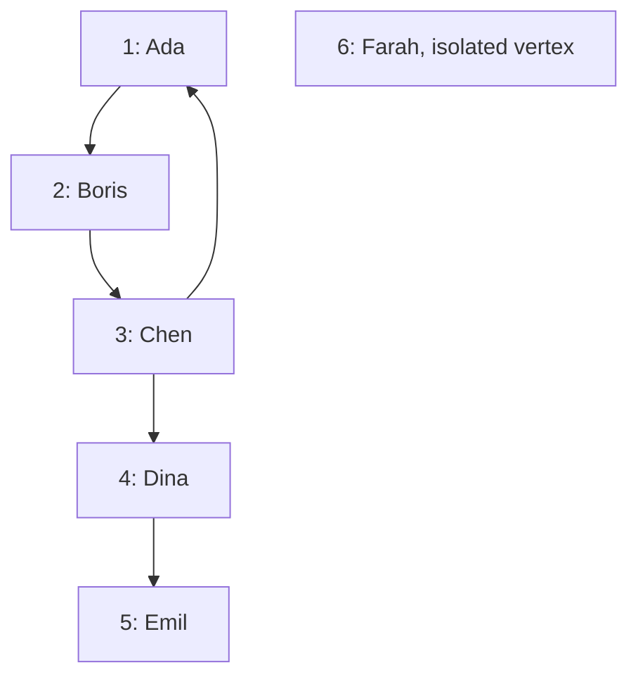
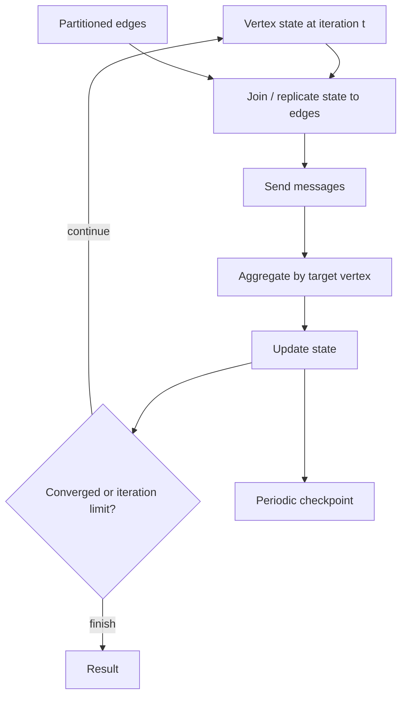
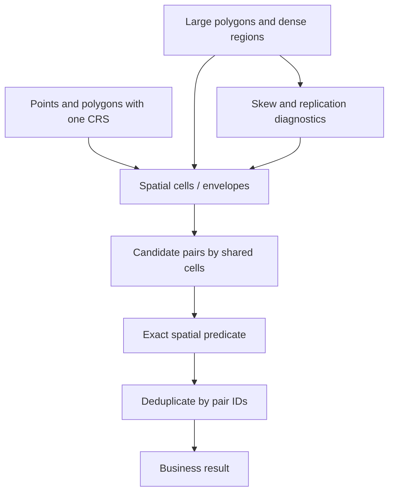
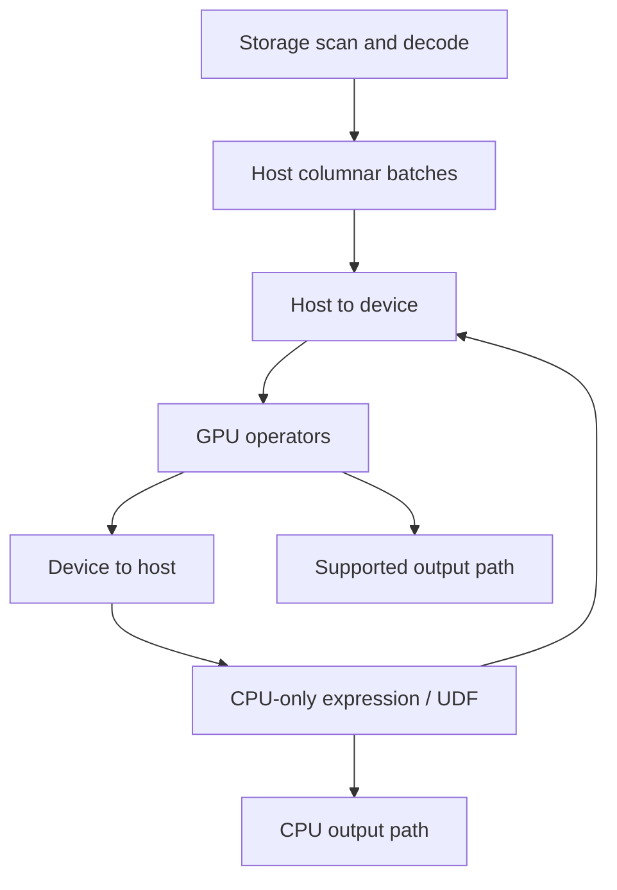
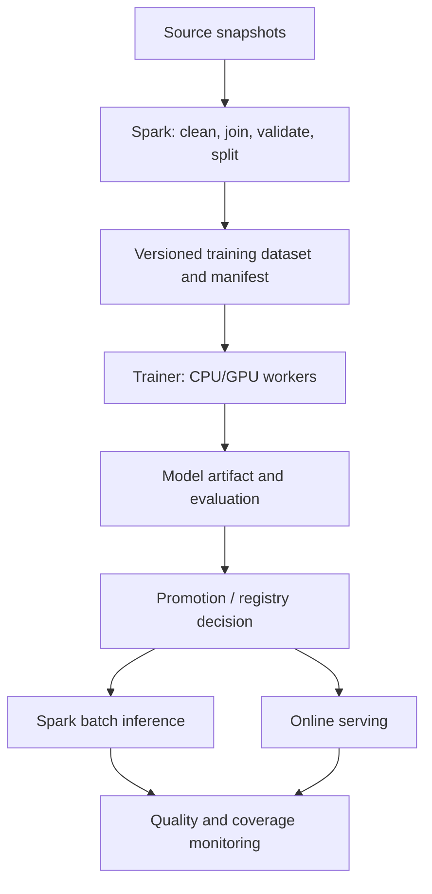
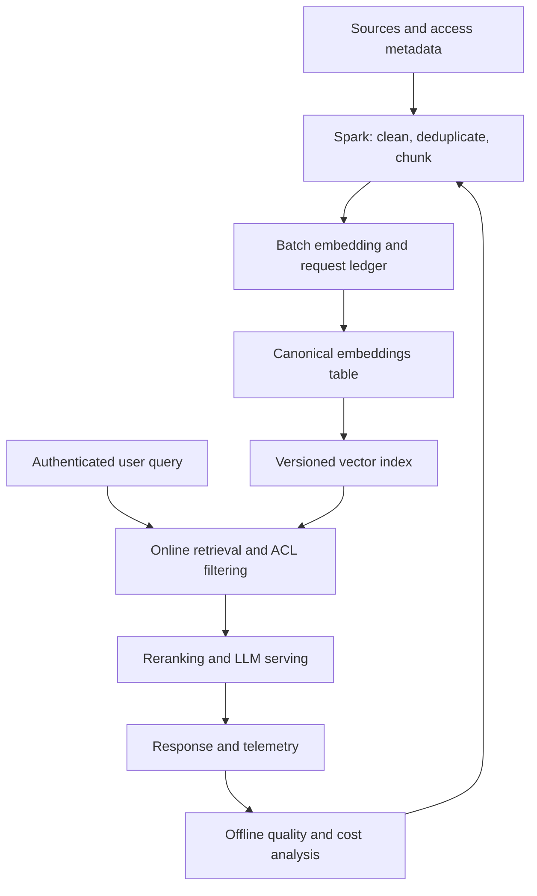

# 27. Графы, геоданные, GPU и интеграции с AI

Основное окружение — **Apache Spark 4.2.0, Scala 2.13, Python 3.12, JDK 17, Linux**. Для выполненных Python-примеров использованы NumPy 2.3.5, pandas 2.2.3, PyArrow 26.0.0, PyTorch 2.14.1+cpu и Tokenizers 0.23.3. Примеры используют PySpark, SQL и Scala. GraphX выполняется через Scala API; GraphFrames подключается отдельно. GPU, spatial extensions и training frameworks имеют собственную совместимость и не становятся частью Spark от наличия похожего имени API.

**Цель раздела:** выбирать модель данных и движок для графов, пространственных задач и AI pipelines; понимать стоимость shuffle, репликации, передачи CPU/GPU и внешних запросов; сохранять воспроизводимость и корректность при повторах.

| Компонент | Роль | Проверяемая граница |
| --- | --- | --- |
| GraphX | Распределённые graph algorithms на RDD | Scala/JVM, Classic; отдельная модель от SQL |
| GraphFrames 0.12.3 | Графы поверх DataFrames и graph algorithms | Python package и JVM artifacts одной версии |
| Native geometry/geography | SQL types, WKB, SRID, Parquet | Небольшой подтверждённый набор `ST_*` |
| Apache Sedona | Внешние spatial operators и оптимизации | Своя матрица Spark/Scala и собственное представление geometry |
| RAPIDS / cuDF plugin | GPU execution поддерживаемых SQL operators | Plugin, Spark build, GPU и CUDA/driver совместимы |
| TorchDistributor | Запуск PyTorch processes из Spark | Data loading и training loop реализует приложение |
| Batch inference | Модель в Python workers, Arrow batches | Memory, schema, model version и retries |
| LLM / embeddings pipeline | Корпус, chunks, embeddings и доставка | Tokenizer/model revision, quota, privacy и idempotency |

**Организация лабораторий**

- Python-блоки без пометки «шаблон» выполняй по порядку в одной сессии. Scala-блоки темы GraphX — по порядку в **отдельном** `spark-shell`; там уже доступны `spark` и `sc`.
- GraphFrames: установи `graphframes-py==0.12.3`; JVM coordinate — `io.graphframes:graphframes-spark4_2.13:0.12.3`. Его runtime dependency `graphframes-graphx-spark4_2.13` должен разрешиться вместе с core.
- Для Arrow inference нужны NumPy, pandas и PyArrow; для CPU training — PyTorch. Выполненный training/checkpoint smoke test однопроцессный; двухпроцессный DDP показан отдельным шаблоном.
- Все datasets синтетические. `local[2]` проверяет выполнение API и взаимодействие локальных processes, но не сетевую топологию нескольких hosts, производительность GPU или надёжность production deployment.
- GPU, DDP, Horovod и hosted inference сценарии отделены от выполненных лабораторий. Наличие шаблона не является отчётом о выполненном benchmark. Sedona SQL проверена отдельно на Spark 4.1.3.
- Дата сверки API — **14 октября 2026 года**. Ссылки Spark зафиксированы на 4.2.0; для внешних проектов проверяй текущие release notes перед обновлением.

```python
import os
import sys
import math
import json
import hashlib
import tempfile
from pathlib import Path

os.environ.setdefault("SPARK_LOCAL_IP", "127.0.0.1")
os.environ.setdefault("PYSPARK_PYTHON", sys.executable)
from pyspark.sql import SparkSession, functions as F, types as T, Window

builder = (SparkSession.builder.master("local[2]")
           .appName("spark-zero-to-hero-27")
           .config("spark.ui.enabled", "false")
           .config("spark.driver.memory", "512m")
           .config("spark.driver.host", "127.0.0.1")
           .config("spark.driver.bindAddress", "127.0.0.1")
           .config("spark.sql.shuffle.partitions", "2")
           .config("spark.sql.session.timeZone", "UTC")
           .config("spark.python.worker.reuse", "true"))
builder = builder.config("spark.python.use.daemon", "false")
# Для offline окружения можно заранее доставить оба GraphFrames JAR и указать paths через запятую.
if os.environ.get("GRAPHFRAMES_JARS"):
    builder = builder.config("spark.jars", os.environ["GRAPHFRAMES_JARS"])
else:
    builder = builder.config("spark.jars.packages", "io.graphframes:graphframes-spark4_2.13:0.12.3")
spark = builder.getOrCreate()
spark.sparkContext.setLogLevel("ERROR")
assert spark.version == "4.2.0", spark.version
lab_dir = Path(tempfile.mkdtemp(prefix="spark-27-"))
spark.sparkContext.setCheckpointDir(str(lab_dir / "checkpoints"))
```

На настоящем кластере loopback-настройки driver из этого блока не подходят: используй адреса deployment и shared checkpoint storage. Local paths здесь относятся к одной машине.

**Содержание**

1. [Основы распределённых графов](#graph-foundations)
2. [GraphX](#graphx)
3. [GraphFrames](#graphframes)
4. [Геопространственная обработка](#geospatial)
5. [GPU-ускорение SQL и DataFrame workloads](#gpu-sql)
6. [Распределённое обучение внешних моделей](#distributed-training)
7. [Инференс моделей](#inference)
8. [LLM и embeddings workflows](#llm-embeddings)

<a id="graph-foundations"></a>

## Основы распределённых графов

### Vertices, edges и свойства графа

Граф связывает объекты через отношения. Vertex — пользователь, счёт, устройство, страница или перекрёсток; edge — перевод, посещение, ссылка или участок дороги. У vertices и edges могут быть attributes: тип объекта, timestamp, weight, статус, длина дороги.

В табличном представлении нужны две relations: vertices с уникальным `id`, edges с `src`, `dst` и свойствами. Не превращай каждую таблицу с foreign keys в граф без задачи: несколько joins часто дешевле и понятнее отдельного iterative algorithm.

```python
vertices = spark.createDataFrame([
    (1, "Ada", 34), (2, "Boris", 28), (3, "Chen", 42),
    (4, "Dina", 31), (5, "Emil", 24), (6, "Farah", 37),
], "id long, name string, age int").cache()
edges = spark.createDataFrame([
    ("e12", 1, 2, 1.0), ("e23", 2, 3, 1.0), ("e31", 3, 1, 1.0),
    ("e34", 3, 4, 2.0), ("e45", 4, 5, 1.0),
], "edge_id string, src long, dst long, weight double").cache()
assert vertices.count() == 6 and edges.count() == 5
```



Vertex 6 существует, хотя у него нет edges. Если построить vertices только через distinct endpoints, isolated objects исчезнут. Для рекомендаций, risk scoring и coverage это может быть существенной ошибкой.

**Самопроверка:** какая relation задаёт полный набор объектов? Что означает `weight`: стоимость пути, сила связи или число событий? Один algorithm может интерпретировать его иначе другого.

### Directed, undirected и multigraph models

Directed edge `a → b` имеет направление: перевод денег, подписка, гиперссылка. Undirected отношение симметрично, например взаимное соединение. Multigraph допускает несколько edges между одной парой vertices; каждое событие может иметь собственный ID и timestamp.

| Модель | Хранение | Что нельзя делать автоматически |
| --- | --- | --- |
| Directed | Одна запись `src,dst` для направления | Добавлять обратное ребро без семантики |
| Undirected, canonical pair | `min(a,b), max(a,b)` | Удваивать weight при повторной симметризации |
| Undirected, two directions | По записи на каждое направление | Считать каждую запись отдельной бизнес-связью |
| Multigraph | Несколько events на пару | `dropDuplicates(src,dst)` с потерей событий |
| Simple weighted graph | Одна агрегированная связь | Суммировать weights, если это не имеет смысла |

```python
canonical_pairs = (edges.select(F.least("src", "dst").alias("a"),
                                 F.greatest("src", "dst").alias("b"))
                    .dropDuplicates())
bidirectional = (edges.select("src", "dst")
                  .unionByName(edges.select(F.col("dst").alias("src"), F.col("src").alias("dst")))
                  .dropDuplicates())
assert canonical_pairs.count() == 5 and bidirectional.count() == 10
```

Self-loop, parallel edge и обратный edge — разные случаи. Их обработка зависит от algorithm: triangle counting обычно требует simple undirected semantics, а сумма денежных переводов должна сохранять количество и сумму исходных events.

### Идентификаторы вершин и referential integrity

ID должен быть стабильным, уникальным и одинаково типизированным во всех relations. GraphX использует `VertexId`, то есть `Long`; GraphFrames поддерживает DataFrame IDs, но algorithm и выбранный backend могут вводить дополнительные требования и стоимость index mapping.

`monotonically_increasing_id()` не является устойчивым business mapping между перерасчётами. Hash business key в Long может столкнуться с collisions; такой mapping требует проверки и сохранения, если от него зависит идентичность объектов.

```python
assert vertices.where(F.col("id").isNull()).count() == 0
assert vertices.groupBy("id").count().where("count > 1").count() == 0
assert edges.where(F.col("src").isNull() | F.col("dst").isNull()).count() == 0
assert edges.join(vertices.select(F.col("id").alias("src")), "src", "left_anti").count() == 0
assert edges.join(vertices.select(F.col("id").alias("dst")), "dst", "left_anti").count() == 0
```

В GraphX отсутствующий vertex attribute может быть создан через default value при построении Graph. Это не замена data quality проверке: ошибочная ссылка превратится в vertex с default attributes. В GraphFrames тоже не полагайся на constructor как на полноценный foreign-key validator.

Договорись, что делать с удалённой вершиной, изменением business ID и поздним edge. Обычно нужен quarantine/quality report с причиной, а не тихое исчезновение endpoint во внутреннем join.

### Degree skew и supernodes

Degree — число инцидентных edges; у directed graph различают in-degree и out-degree. Supernode с миллионами соседей может сосредоточить сообщения, join fan-out или огромный результат motif query в одном месте.

```python
out_degree = edges.groupBy("src").count().withColumnRenamed("count", "out_degree")
in_degree = edges.groupBy("dst").count().withColumnRenamed("count", "in_degree")
assert out_degree.where("src = 3").first().out_degree == 2
assert vertices.join(out_degree, vertices.id == out_degree.src, "left").where("id = 6").first().out_degree is None
```

| Причина нагрузки | Контроль |
| --- | --- |
| Реальный hub | Degree quantiles, active edges и объём сообщений на итерацию |
| Ошибочный общий ID | Проверка sentinel IDs вроде `unknown`, пустой строки или `0` |
| Many-to-many motif | Ограничение length, selective filters, оценка candidate count |
| Повторные events | Обоснованная агрегация по pair/time window |

Обычный `repartition(1000)` не гарантирует устранение hub skew. Vertex cuts могут распределить edges hub, но увеличивают репликацию vertex attributes. Sampling соседей или capping degree меняют algorithm и результат; это допустимое приближение только с явным критерием качества.

### Итеративные алгоритмы, shuffle и checkpointing

Graph algorithm часто многократно обновляет состояние вершин и передаёт сообщения по edges. Даже когда исходные relations читаются один раз, каждая итерация может требовать shuffle, joins и materialization. Стоимость зависит от active subgraph, объёма messages и размера state, а не только от числа vertices.

Cache сокращает повторные вычисления; checkpoint обрывает lineage. Надёжный checkpoint хранится в shared storage и переживает потерю executor, local checkpoint полагается на локальные cached blocks. Они решают разные задачи.



**Практика:** добавь duplicate edge, self-loop, isolated vertex и отсутствующий endpoint. Определи правила нормализации до запуска algorithm. Создай hub и сравни degree distribution, task durations и shuffle относительно равномерного graph.

**Самопроверка:** чем checkpoint отличается от cache? Почему большой hub остаётся проблемой после увеличения partitions? Как удаление parallel edges может изменить исходную задачу?

Источник: [GraphX overview](https://spark.apache.org/docs/4.2.0/graphx-programming-guide.html), [RDD persistence/checkpoint](https://spark.apache.org/docs/4.2.0/rdd-programming-guide.html).

<a id="graphx"></a>

## GraphX

### Graph, VertexRDD, EdgeRDD и triplets

GraphX представляет property graph как `Graph[VD, ED]`: attributes vertices имеют тип `VD`, attributes edges — `ED`. `VertexRDD` содержит `(VertexId, VD)`, `EdgeRDD` — `Edge[ED]`; `triplets` связывает edge с attributes обоих endpoints.

Следующие Scala-блоки составляют одну лабораторию. Открой Spark 4.2 `spark-shell --master local[2]`; для периодического Pregel checkpoint можно передать `--conf spark.graphx.pregel.checkpointInterval=2` до создания SparkContext.

```scala
import org.apache.spark.graphx._
import org.apache.spark.graphx.lib.ShortestPaths
import org.apache.spark.rdd.RDD

case class Person(name: String, age: Int)
val vertexRows: RDD[(VertexId, Person)] = sc.parallelize(Seq(
  1L -> Person("Ada", 34), 2L -> Person("Boris", 28),
  3L -> Person("Chen", 42), 4L -> Person("Dina", 31),
  5L -> Person("Emil", 24), 6L -> Person("Farah", 37)
), 2)
val edgeRows: RDD[Edge[Double]] = sc.parallelize(Seq(
  Edge(1L, 2L, 1.0), Edge(2L, 3L, 1.0), Edge(3L, 1L, 1.0),
  Edge(3L, 4L, 2.0), Edge(4L, 5L, 1.0)
), 2)
val graph = Graph(vertexRows, edgeRows, Person("MISSING", -1)).cache()
sc.setCheckpointDir(java.nio.file.Files.createTempDirectory("graphx-27-").toString)
assert(graph.vertices.count() == 6L)
assert(graph.edges.count() == 5L)
assert(graph.triplets.filter(t => t.srcId == 3L && t.dstId == 4L).first().srcAttr.name == "Chen")
```

Triplets удобны, но расширяют edge relation attributes vertices. Если vertex содержит большой документ или embedding, его репликация к edges может стать очень дорогой. Храни компактный graph state, а тяжёлые payload присоединяй к финальному результату.

API: [Graph](https://spark.apache.org/docs/4.2.0/api/scala/org/apache/spark/graphx/Graph.html), [VertexRDD](https://spark.apache.org/docs/4.2.0/api/scala/org/apache/spark/graphx/VertexRDD.html), [EdgeRDD](https://spark.apache.org/docs/4.2.0/api/scala/org/apache/spark/graphx/EdgeRDD.html).

### mapVertices, mapEdges и mapTriplets

Эти transformations изменяют attributes, сохраняя graph topology. `mapVertices` видит vertex ID и attribute; `mapEdges` — edge; `mapTriplets` — endpoints и их attributes. Выбирай минимально необходимый доступ: это помогает GraphX не передавать лишние данные.

```scala
val aged = graph.mapVertices((id, p) => p.copy(age = p.age + 1))
val doubledWeights = graph.mapEdges(e => e.attr * 2.0)
val namedEdges = graph.mapTriplets(t => s"${t.srcAttr.name}->${t.dstAttr.name}")
assert(aged.vertices.filter(_._1 == 1L).first()._2.age == 35)
assert(doubledWeights.edges.filter(e => e.srcId == 3L && e.dstId == 4L).first().attr == 4.0)
assert(namedEdges.edges.count() == graph.edges.count())
```

Вызовы не меняют исходный `graph` на месте. Если сохранять много версий через cache, необходимо освобождать ненужные graphs; иначе краткий notebook постепенно занимает память всем набором промежуточных vertex/edge RDDs.

`mapTriplets` не нужен, если операция зависит только от edge weight. Обращение к обоим endpoint attributes расширяет replicated view и увеличивает traffic на graph с hubs.

### subgraph, mask, groupEdges и joinVertices

`subgraph` фильтрует vertices/edges; удаление vertex удаляет также инцидентные edges. `mask` оставляет пересечение topology с другим graph, сохраняя attributes исходного. `joinVertices` обновляет attributes совпавших IDs; unmatched vertices сохраняются. `groupEdges` объединяет parallel edges заданной функцией, когда они размещены совместно.

```scala
val adultSubgraph = graph.subgraph(vpred = (id, p) => p.age >= 30)
assert(adultSubgraph.vertices.count() == 4L)
val masked = graph.mask(adultSubgraph)
assert(masked.edges.count() == adultSubgraph.edges.count())

val ageUpdates = sc.parallelize(Seq(1L -> 40, 99L -> 50))
val updated = graph.joinVertices(ageUpdates)((id, person, age) => person.copy(age = age))
assert(updated.vertices.filter(_._1 == 1L).first()._2.age == 40)
assert(updated.vertices.count() == 6L) // joinVertices не добавляет vertex 99.

val parallelGraph = Graph(vertexRows, edgeRows.union(sc.parallelize(Seq(Edge(1L, 2L, 3.0)))),
                          Person("MISSING", -1))
val grouped = parallelGraph.partitionBy(PartitionStrategy.RandomVertexCut).groupEdges(_ + _)
assert(grouped.edges.filter(e => e.srcId == 1L && e.dstId == 2L).first().attr == 4.0)
```

Выбор merge function — бизнес-правило. Для суммы переводов подходит сложение; для shortest path из параллельных альтернатив может понадобиться minimum cost. Сложение расстояний альтернативных дорог создаст неверный graph.

Duplicate updates одной вершины нормализуй до join: неопределённый выбор одной записи не должен решать версию attribute. Для mask сравни ID semantics и направление edges в обоих graphs.

API: [Graph operations](https://spark.apache.org/docs/4.2.0/api/scala/org/apache/spark/graphx/GraphOps.html).

### aggregateMessages и сообщения между вершинами

`aggregateMessages` отправляет сообщения вдоль edges и сводит их по получателю. Размер aggregate должен оставаться управляемым: сумма/count полезны, список всех соседей hub может не поместиться в память.

```scala
val incomingAges = graph.aggregateMessages[(Int, Double)](
  ctx => ctx.sendToDst((1, ctx.srcAttr.age.toDouble)),
  (a, b) => (a._1 + b._1, a._2 + b._2),
  TripletFields.Src
)
val avgIncomingAge = incomingAges.mapValues { case (n, total) => total / n }
assert(avgIncomingAge.filter(_._1 == 2L).first()._2 == 34.0)
assert(!incomingAges.map(_._1).collect().contains(6L))
```

Isolated vertices и vertices без входящих сообщений отсутствуют в message VertexRDD; если нужен полный output, присоедини его к исходным vertices с default. `TripletFields.Src` сообщает, что требуются source attributes; не запрашивай `All` автоматически.

Merge должен быть ассоциативным и желательно коммутативным с учётом числовых допусков. Конкатенация неограниченного списка создаёт memory hotspot и часто скрывает необходимость другого algorithm.

API: [EdgeContext](https://spark.apache.org/docs/4.2.0/api/scala/org/apache/spark/graphx/EdgeContext.html), [TripletFields](https://spark.apache.org/docs/4.2.0/api/scala/org/apache/spark/graphx/TripletFields.html).

### Pregel API и итеративное вычисление

Pregel повторяет vertex update, message generation и message aggregation до отсутствия сообщений или достижения лимита. В weighted single-source shortest path состояние — лучшая известная distance, сообщение — более короткая candidate distance.

```scala
val sourceId = 1L
val initialDistances = graph.mapVertices((id, _) => if (id == sourceId) 0.0 else Double.PositiveInfinity)
val shortestFromOne = initialDistances.pregel(
  Double.PositiveInfinity, maxIterations = 20, activeDirection = EdgeDirection.Out
)(
  (id, distance, message) => math.min(distance, message),
  triplet => {
    val candidate = triplet.srcAttr + triplet.attr
    if (candidate < triplet.dstAttr) Iterator((triplet.dstId, candidate))
    else Iterator.empty
  },
  (a, b) => math.min(a, b)
)
assert(shortestFromOne.vertices.filter(_._1 == 5L).first()._2 == 5.0)
assert(shortestFromOne.vertices.filter(_._1 == 6L).first()._2.isPosInfinity)
```

Здесь веса неотрицательны. Negative cycles могут не дать сходимости; лимит итераций лишь остановит работу, но не докажет корректность distances. `activeDirection` должен соответствовать зависимости algorithm: неправильно выбранный режим способен пропустить нужные edge updates.

Не путай termination с «достаточно точным результатом»: PageRank использует численную tolerance, shortest paths — отсутствие улучшений, label propagation — иной критерий/iteration budget. Checkpoint interval и shared checkpoint directory задаются отдельно от max iterations.

API: [Pregel](https://spark.apache.org/docs/4.2.0/api/scala/org/apache/spark/graphx/Pregel$.html).

### PartitionStrategy, vertex cuts и репликация вершин

GraphX размещает edges по partitions и реплицирует необходимые vertex attributes к их endpoints. Vertex cut распределяет edges одной вершины, поэтому high-degree vertex может присутствовать в нескольких partitions.

| Стратегия | Идея | Цена / ограничение |
| --- | --- | --- |
| `RandomVertexCut` | Hash ordered endpoint pair | Parallel edges одной пары совместно; обратная пара может уйти в другое место |
| `CanonicalRandomVertexCut` | Hash canonical endpoint pair | Обе ориентации пары совместно |
| `EdgePartition1D` | Размещение по source | Out-degree hub может создать skew |
| `EdgePartition2D` | Двумерное распределение endpoints | Компромисс replication и balancing |

```scala
val partitioned = graph.partitionBy(PartitionStrategy.EdgePartition2D, 2).cache()
assert(partitioned.edges.partitions.length == 2)
assert(partitioned.edges.count() == 5L)
```

Выбирай по measured edge distribution и algorithm. Количество partitions само по себе не показывает replication factor, active vertex traffic и размер state. Изменение partition strategy также стоит shuffle, поэтому оно должно окупаться последующими итерациями.

API: [PartitionStrategy](https://spark.apache.org/docs/4.2.0/api/scala/org/apache/spark/graphx/PartitionStrategy$.html).

### PageRank, connected components, triangle count и shortest paths

| Algorithm | Результат | Семантическая граница |
| --- | --- | --- |
| PageRank | Центральность по directed links | Не business importance и не causal influence |
| Connected components | Компоненты связности | Обычно weak connectivity, направление не разделяет компоненту |
| Triangle count | Число треугольников вокруг vertex | Требует корректной simple/undirected интерпретации |
| `ShortestPaths` | Hop distances **к** выбранным landmarks | Не использует edge weights как стоимость |
| Custom weighted Pregel | Distance **от** source с заданной cost | Отдельная реализация и требования к weights |

```scala
val ranks = graph.pageRank(0.001)
assert(ranks.vertices.count() == 6L)
assert(ranks.vertices.map(_._2).collect().forall(x => x.isFinite && x > 0.0))
val components = graph.connectedComponents().vertices.collect().toMap
assert(components(1L) == components(5L))
assert(components(6L) != components(1L))
val triangles = graph.triangleCount().vertices.collect().toMap
assert(triangles(1L) == 1 && triangles(2L) == 1 && triangles(3L) == 1)
val hopsToFive = ShortestPaths.run(graph, Seq(5L)).vertices.collect().toMap
assert(hopsToFive(1L)(5L) == 4)
assert(!hopsToFive(6L).contains(5L))
```

Не проверяй сумму GraphX PageRank через предположение, что она обязательно равна 1: API имеет свою normalization semantics. PageRank не начинает учитывать денежный weight только потому, что edge attribute — Double. Для weighted ranking нужна соответствующая реализация.

У triangle algorithms есть pre-canonicalized варианты с дополнительными требованиями к orientation и duplicate edges. Не заменяй ими обычный `triangleCount` без подготовки topology.

API: [PageRank](https://spark.apache.org/docs/4.2.0/api/scala/org/apache/spark/graphx/lib/PageRank$.html), [ConnectedComponents](https://spark.apache.org/docs/4.2.0/api/scala/org/apache/spark/graphx/lib/ConnectedComponents$.html), [TriangleCount](https://spark.apache.org/docs/4.2.0/api/scala/org/apache/spark/graphx/lib/TriangleCount$.html), [ShortestPaths](https://spark.apache.org/docs/4.2.0/api/scala/org/apache/spark/graphx/lib/ShortestPaths$.html).

### Scala API, RDD-based execution и границы применения

GraphX удобен для Scala/JVM batch graph analytics и custom message passing. Его graph state — RDD-based: Catalyst не оптимизирует внутренний Pregel loop как SQL query. У PySpark нет штатного эквивалентного GraphX API; доступ к Java gateway из Python не делает его поддерживаемым Python интерфейсом.

Для превращения graph result в таблицу используй явную схему и stable ID mapping. Не передавай весь graph на driver через `collect` ради последующего DataFrame construction: лаборатория делает это лишь для шести vertices.

```scala
partitioned.unpersist(blocking = false)
shortestFromOne.unpersist(blocking = false)
ranks.unpersist(blocking = false)
graph.unpersist(blocking = false)
```

**Практика:** реализуй minimum weighted distance и сравни с hop distance на пути, где меньше edges означает большую стоимость. Проверь disconnected vertex. Сравни `EdgePartition1D` и `EdgePartition2D` на hub graph по skew и traffic.

**Самопроверка:** какие attributes доступны в triplet? Почему `joinVertices` не добавляет новую вершину? Когда достаточно `mapEdges`, а когда нужен `mapTriplets`? Почему `ShortestPaths` не заменяет weighted Dijkstra/Pregel?

<a id="graphframes"></a>

## GraphFrames

### Внешняя библиотека и совместимость package с Spark

GraphFrames — отдельный проект. Python wrapper должен соответствовать JVM implementation; один `pip install` не доставляет JVM graph algorithms в classpath. В лаборатории используется 0.12.3 для Spark 4 / Scala 2.13, включая runtime GraphFrames-GraphX dependency.

| Слой | Что сверять |
| --- | --- |
| Python | `graphframes-py`, interpreter и PySpark version |
| JVM | `graphframes-spark4_2.13`, та же версия release |
| Runtime dependency | `graphframes-graphx-spark4_2.13` доступен executors |
| Deployment | Classic либо отдельно настроенная Connect extension |
| Algorithm | Наличие параметров и backend в этой версии |

GraphFrames теперь имеет отдельную Connect extension; наличие Connect support не означает, что Classic JAR автоматически расширит любой managed Connect endpoint. GraphFrames-GraphX — внутренний fork проекта, а не повод подменить все Spark GraphX JARs.

```python
from importlib.metadata import version
from graphframes import GraphFrame
assert version("graphframes-py") == "0.12.3"
gf = GraphFrame(vertices, edges)
assert gf.vertices.count() == 6 and gf.edges.count() == 5
```

Источники: [installation и coordinates](https://graphframes.io/02-quick-start/01-installation.html), [Python API](https://graphframes.io/api/python/graphframes.html).

### Vertices/edges как DataFrames

У vertices обязателен `id`, у edges — `src` и `dst`. Остальные columns являются properties и участвуют в обычных filters, joins и projection. Columns с reserved names проверяй по документации версии; переименование business fields часто проще обхода конфликтов.

```python
assert {"id"} <= set(gf.vertices.columns)
assert {"src", "dst"} <= set(gf.edges.columns)
gf.inDegrees.orderBy("id").show()
gf.outDegrees.orderBy("id").show()
older = gf.filterVertices("age >= 30")
assert older.vertices.count() == 4
assert older.edges.count() == 2  # 3 -> 1 и 3 -> 4.
```

DataFrame schema не доказывает referential integrity: проверки из первой темы всё ещё нужны. В частности, uniqueness `id` важна для понятного смысла motif matches и algorithms.

`inDegrees`/`outDegrees` могут не возвращать строку с нулевой degree. Для полного отчёта left join к vertices и `coalesce(0)` предпочтительнее догадки, что отсутствие строки означает отсутствие объекта.

API: [basic operations](https://graphframes.io/04-user-guide/02-basic-operations.html), [reserved columns](https://graphframes.io/04-user-guide/14-special-columns.html).

### Motif finding и graph pattern queries

Motif описывает структурный pattern: `(a)-[e]->(b); (b)-[f]->(c)`. Результат — DataFrame с nested structs `a`, `b`, `c`, `e`, `f`; к нему применяются filters по properties и ID.

```python
paths2 = (gf.find("(a)-[e]->(b); (b)-[f]->(c)")
            .where("a.id != c.id"))
assert paths2.where("a.id = 1 AND c.id = 3").count() == 1
assert paths2.where("a.id = 3 AND c.id = 5").count() == 1
assert paths2.count() == 5
```

Разные имена `a` и `c` сами по себе не гарантируют разные vertices. Ограничение `a.id != c.id` задаётся явно. Parallel edges увеличивают multiplicity matches: `distinct` в конце может скрыть проблему и добавить дорогой shuffle.

Pattern length и degree определяют fan-out. Сначала применяй selective filters по edge type/time и vertex properties, затем строй motif. Для variable-length interactive traversal по запросу пользователя специализированный graph database часто удобнее batch joins.

API: [motif finding](https://graphframes.io/04-user-guide/04-motif-finding.html).

### BFS, connected components, PageRank и label propagation

BFS ищет кратчайшие по числу edges paths, удовлетворяющие start/end predicates и ограничениям. Connected components группируют связанность; PageRank ранжирует link topology; label propagation даёт community labels по итеративному обновлению соседей.

```python
bfs_paths = gf.bfs(fromExpr="id = 1", toExpr="id = 5", maxPathLength=4)
assert bfs_paths.count() == 1
components_df = gf.connectedComponents(checkpointInterval=2)
components_map = {r.id: r.component for r in components_df.select("id", "component").collect()}
assert components_map[1] == components_map[5] != components_map[6]
ranked_graph = gf.pageRank(resetProbability=0.15, maxIter=5)
assert ranked_graph.vertices.where("pagerank IS NULL").count() == 0
communities = gf.labelPropagation(maxIter=3)
assert communities.count() == 6
```

PageRank задавай либо fixed iterations, либо tolerance согласно API; не смешивай оба режима без понимания. Community numeric label не является устойчивым business name, а результат label propagation может зависеть от tie-breaking и iteration budget.

BFS `maxPathLength` ограничивает поиск, но не гарантирует маленький output: несколько shortest paths на graph с fan-out всё ещё могут дать много строк. Weighted cost не используется только от наличия столбца `weight`.

API: [traversals/connectivity](https://graphframes.io/04-user-guide/05-traversals.html), [centrality](https://graphframes.io/04-user-guide/03-centralities.html), [community detection](https://graphframes.io/04-user-guide/06-graph-clustering.html).

### aggregateMessages и Pregel при поддержке версии

В GraphFrames сообщения описываются Column expressions, а не Python callback на каждую вершину. `AggregateMessages` даёт доступ к source, destination, edge и message; Pregel добавляет iterative state.

```python
from graphframes.lib import AggregateMessages as AM, Pregel

neighbor_ages = gf.aggregateMessages(F.sum(AM.msg).alias("incoming_age_sum"),
                                     sendToDst=AM.src["age"])
assert neighbor_ages.where("id = 2").first().incoming_age_sum == 34

# Weighted distances от vertex 1; не полагаемся на legacy Python API GraphX.
gf_distances = (gf.pregel
    .setMaxIter(6)
    .setCheckpointInterval(2)
    .withVertexColumn("distance", F.when(F.col("id") == 1, F.lit(0.0)).otherwise(F.lit(float("inf"))),
                      F.least(F.col("distance"), F.coalesce(Pregel.msg(), F.lit(float("inf")))))
    .sendMsgToDst(Pregel.src("distance") + Pregel.edge("weight"))
    .required_src_columns("distance")
    .required_edge_columns("weight")
    .aggMsgs(F.min(Pregel.msg()))
    .run())
assert gf_distances.where("id = 5").first().distance == 5.0
assert math.isinf(gf_distances.where("id = 6").first().distance)
```

В GraphFrames 0.12+ дополнительные edge properties нужно объявлять через `required_edge_columns`: по умолчанию сохраняются только endpoints. Без `weight` в этом списке выражение сообщения не разрешается. Пример посылает сообщения на каждой итерации, включая `inf`, и останавливается по лимиту. Оптимизация отправки только при улучшении требует аккуратного выражения и политики termination; не выдавай fixed iterations за доказанную convergence.

Python API не означает, что expressions выполняются Python UDFs. По возможности оставляй state updates SQL expressions: это сохраняет схему, планирование и JVM execution. Большой array соседей в message по-прежнему может перегрузить memory.

API: [message passing](https://graphframes.io/04-user-guide/09-aggregate-messages.html), [Pregel](https://graphframes.io/04-user-guide/10-pregel.html).

### GraphFrames checkpoints и очистка промежуточных данных

Algorithms могут persist intermediate state и возвращать persisted results. После materialization нужного output освобождай results через `unpersist()`. Не очищай cache до action, если рассчитываешь избежать повторного полного расчёта.

```python
assert gf_distances.count() == 6
for result in [components_df, communities, neighbor_ages, gf_distances]:
    result.unpersist()
ranked_graph.unpersist()
```

`connectedComponents(..., use_local_checkpoints=True)` и Pregel local checkpoint options имеют другую отказоустойчивость, чем shared reliable checkpoint. Настройка пути нужна до algorithm; `localCheckpoint` без durable storage не является безопасным восстановлением после потери nodes.

Удалять checkpoint files следует по жизненному циклу application/run и retention policy. Не запускай рекурсивное удаление общего checkpoint root соседних applications. Cached graph state также не заменяет сохранение финальных результатов в таблицу.

### Сравнение GraphFrames, GraphX и специализированной graph database

| Критерий | GraphFrames | GraphX | Graph database |
| --- | --- | --- | --- |
| Модель | DataFrames и graph API | RDD property graph | Persistent graph с query engine |
| Типичная задача | Batch patterns и analytics рядом с SQL | Custom iterative Scala algorithms | Interactive traversal / graph application |
| Язык | Python/Scala и expressions | Scala/JVM | Query language / client API продукта |
| Интеграция с lakehouse | Естественные DataFrame joins | Явное преобразование relations/RDD | Отдельная загрузка и синхронизация |
| Latency | Batch/application overhead | Batch/application overhead | Зависит от продукта, indexes и query |

Spark не становится transactional graph service от построения GraphFrame. Если нужны миллионы коротких пользовательских traversals, оцени модель запросов, indexes, transactions и operational requirements отдельного сервиса. Если нужен ночной PageRank на lakehouse snapshot, Spark может быть подходящим batch engine.

**Практика:** найди motif «перевод → перевод» с ограничением времени и различными endpoints; проверь multiplicity parallel events. Сопоставь GraphFrames weighted Pregel с GraphX результатом. Освободи cached results и измерь, какие actions запускают пересчёт.

**Самопроверка:** почему pip package недостаточен? Где motif допускает одну вершину под двумя именами? Чем BFS отличается от weighted shortest path? Что именно теряется при local checkpoint после отказа executor?

<a id="geospatial"></a>

## Геопространственная обработка

### Точки, геометрии, координатные системы и CRS

Spatial value — это shape **в определённой системе координат**. Point, LineString, Polygon, MultiPolygon описывают topology; CRS задаёт смысл координат, единицы и проекцию. Пара `(37.6, 55.7)` без contract порядка осей и CRS недостаточна для вычисления расстояния.

| Понятие | Значение | Типичная ошибка |
| --- | --- | --- |
| Geometry | Planar representation | Считать degree difference расстоянием в метрах |
| Geography | Географические координаты | Подменить spherical/geodesic semantics плоской формулой |
| CRS | Coordinate Reference System | Присоединить данные с разными CRS без преобразования |
| SRID | Идентификатор CRS в registry движка | Считать любое целое допустимым кодом |
| WKT / WKB | Текстовое / бинарное представление shape | Решить, что обычный WKB автоматически хранит CRS |

Spark 4.2 использует longitude/latitude order для географических координат соответствующих OGC overrides. Это не разрешение угадывать порядок исходного CSV: источник может поставлять `lat, lon`, а не `x, y`.

Ниже маленький encoder стандартного 2D Point WKB. Это генератор fixture, не полноценный geometry parser.

```python
import struct

def point_wkb(x, y):
    return struct.pack("<BIdd", 1, 1, float(x), float(y))

point_bytes = point_wkb(1.0, 2.0)
assert point_bytes.hex().upper() == "0101000000000000000000F03F0000000000000040"
```

Reprojection меняет координаты; присвоение SRID меняет metadata интерпретации. Эти операции нельзя заменять друг другом. В частности, degree-valued Point нельзя превратить в корректный meter-valued Point простым `ST_SetSrid(...,3857)`.

Источники: [geospatial types](https://spark.apache.org/docs/4.2.0/sql-ref-geospatial-types.html), [Sedona CRS transformations](https://sedona.apache.org/latest/api/sql/CRS-Transformation/).

### GeometryType и GeographyType в Spark 4.2: допустимые SRID и семантика координат (добавлено по проверке полноты)

В Spark 4.2 оба типа параметризованы SRID: `GEOMETRY(4326)`, `GEOGRAPHY(4326)` либо `(ANY)`. Непараметризованный SQL type `GEOMETRY` здесь не является корректной декларацией. В PySpark используются `T.GeometryType(4326)` и `T.GeographyType(4326)`.

| Тип | Допустимые SRIDs | Семантика |
| --- | --- | --- |
| Geometry | Registry SRIDs, включая projected/geographic и специальный 0 | Cartesian shape; geographic SRID сам не включает spherical operations |
| Geography | Geographic SRIDs registry | Longitude/latitude; интерполяция edges spherical |
| Geometry(0) | Фиксированный unspecified SRID | Не то же самое, что произвольный SRID каждой строки |

```python
native_wkb_input = spark.range(1).select(F.lit(1).cast("long").alias("id"),
                                        F.lit(bytearray(point_bytes)).alias("wkb"))
native_geo = native_wkb_input.select(
    "id", F.st_geomfromwkb("wkb", 4326).alias("geom"), F.st_geogfromwkb("wkb").alias("geog")
)
assert native_geo.schema["geom"].dataType == T.GeometryType(4326)
assert native_geo.schema["geog"].dataType == T.GeographyType(4326)
srids = native_geo.select(F.st_srid("geom").alias("g"), F.st_srid("geog").alias("h")).first()
assert srids.g == srids.h == 4326

def expect_spark_error(action, expected_text):
    try:
        action()
    except Exception as error:
        assert expected_text in str(error), str(error)
    else:
        raise AssertionError("Expected Spark error: " + expected_text)

expect_spark_error(
    lambda: spark.sql("SELECT st_geomfromwkb(X'" + point_bytes.hex() + "',99999)").collect(),
    "ST_INVALID_SRID_VALUE",
)
```

Registry входит в Spark release и не обновляется автоматически вместе с внешней EPSG/PROJ базой. Geography с projected SRID вроде 3857 недопустима. При WKB parsing geography проверяет longitude/latitude bounds; geometry не превращает координаты в geographic только потому, что они похожи на degrees.

Проверка structural WKB validity не решает все задачи topology: например, валидность polygon для конкретной spatial operation и качество геокодирования требуют собственных checks. `NULL` и empty geometry имеют разный смысл.

API: [GeometryType](https://spark.apache.org/docs/4.2.0/api/python/reference/pyspark.sql/api/pyspark.sql.types.GeometryType.html), [GeographyType](https://spark.apache.org/docs/4.2.0/api/python/reference/pyspark.sql/api/pyspark.sql.types.GeographyType.html), [st_geogfromwkb](https://spark.apache.org/docs/4.2.0/api/python/reference/pyspark.sql/api/pyspark.sql.functions.st_geogfromwkb.html).

### Фиксированный SRID столбца и ограничения хранения mixed-SRID типов; выбор между нативными возможностями и spatial extensions (добавлено по проверке полноты)

Fixed-SRID type обещает один SRID для всех non-null values. `GEOMETRY(ANY)` допускает разные SRIDs в query, но native storage имеет ограничения. В проверенном Parquet writer Spark 4.2 mixed type не сохраняется, даже если это удобно для временного объединения relations.

```python
native_geo_path = str(lab_dir / "native_geospatial")
native_geo.write.mode("errorifexists").parquet(native_geo_path)
native_geo_restored = spark.read.parquet(native_geo_path)
assert native_geo_restored.schema["geom"].dataType == T.GeometryType(4326)
assert native_geo_restored.select(F.st_srid("geom")).first()[0] == 4326

mixed_geo = spark.createDataFrame([
    (bytearray(point_bytes), 4326), (bytearray(point_bytes), 3857)
], "wkb binary, srid int").select(F.st_geomfromwkb("wkb", F.col("srid")).alias("geom"))
assert mixed_geo.schema["geom"].dataType == T.GeometryType("ANY")
expect_spark_error(lambda: mixed_geo.write.parquet(str(lab_dir / "mixed_not_supported")),
                   "UNSUPPORTED_DATA_TYPE_FOR_DATASOURCE")
```

Варианты нормализации: корректно reproject в общий CRS и fixed type; разделить datasets по CRS; хранить явные `wkb`, `srid` как обычные columns с собственным contract. Последний вариант — обычный binary transport, а не автоматическое сохранение native geospatial semantics.

Не делай `ST_SetSrid` для «исправления» реально разных CRS: это переименует координаты. Native type удобен для SRID-aware хранения и доступных функций; spatial extension нужна, когда требуются отсутствующие predicates, transformations, spatial join optimization или raster operations.

Parquet, GeoParquet и поддержка geometry конкретным table format/connector — не одно и то же. Наличие типа в Spark не доказывает поддержку внешним reader или любой версией Delta/Iceberg connector. Проверяй round-trip именно своей связки.

Источник: [SRID and stored values](https://spark.apache.org/docs/4.2.0/sql-ref-geospatial-types.html#srid-and-stored-values), [Parquet data source](https://spark.apache.org/docs/4.2.0/sql-data-sources-parquet.html).

### Apache Sedona и другие внешние spatial extensions

Sedona добавляет spatial SQL/functions, spatial joins, partitioning/indexing и raster capabilities. Её `GeometryUDT` и native Spark `GeometryType` — разные контракты. Совпадение имени `ST_*` не доказывает одинаковые input/output types или implementation.

На дату проверки у Sedona 1.9.1 опубликованы Spark/Scala-specific coordinates, включая Spark 4.1 / Scala 2.13. Для воспроизводимой лаборатории ниже используется **отдельное окружение Spark 4.1.3**, Python package `apache-sedona==1.9.1` и JVM artifact `org.apache.sedona:sedona-spark-shaded-4.1_2.13:1.9.1`. Это не заявление о поддержке произвольного Spark 4.2 deployment.

Следующий блок выполняется **в новом Python процессе**, отдельно от основной сессии. Установи в его окружение `pyspark==4.1.3` и `apache-sedona==1.9.1`. Для данных planar fixtures GeoTools не требуется; дополнительные raster/CRS capabilities проверяй по release documentation.

```python
# Sedona: отдельная сессия Spark 4.1.3, не основной kernel Spark 4.2.
import os
import sys
os.environ.setdefault("SPARK_LOCAL_IP", "127.0.0.1")
os.environ.setdefault("PYSPARK_PYTHON", sys.executable)
from sedona.spark import SedonaContext

sedona_builder = (SedonaContext.builder().master("local[2]")
    .appName("sedona-section-27")
    .config("spark.ui.enabled", "false")
    .config("spark.driver.memory", "512m")
    .config("spark.python.use.daemon", "false")
    .config("spark.sql.shuffle.partitions", "2"))
if os.environ.get("SEDONA_JAR"):
    sedona_builder = sedona_builder.config("spark.jars", os.environ["SEDONA_JAR"])
else:
    sedona_builder = sedona_builder.config("spark.jars.packages",
        "org.apache.sedona:sedona-spark-shaded-4.1_2.13:1.9.1")
sedona_spark = SedonaContext.create(sedona_builder.getOrCreate())
assert sedona_spark.version == "4.1.3"
sedona_spark.sparkContext.setLogLevel("ERROR")

sedona_spark.sql("""CREATE OR REPLACE TEMP VIEW zones AS
    SELECT 'z1' AS zone_id, ST_GeomFromWKT('POLYGON((0 0,0 2,2 2,2 0,0 0))') AS geom""")
sedona_spark.sql("""CREATE OR REPLACE TEMP VIEW points AS
    SELECT * FROM VALUES
      (1, ST_Point(1.0D,1.0D)), (2, ST_Point(3.0D,3.0D)), (3, ST_Point(0.0D,1.0D))
    AS p(point_id, geom)""")
contained = sedona_spark.sql("""SELECT p.point_id, z.zone_id
    FROM points p JOIN zones z ON ST_Contains(z.geom,p.geom)""")
covered = sedona_spark.sql("""SELECT p.point_id, z.zone_id
    FROM points p JOIN zones z ON ST_Covers(z.geom,p.geom)""")
assert {r.point_id for r in contained.collect()} == {1}
assert {r.point_id for r in covered.collect()} == {1,3}
distance = sedona_spark.sql("SELECT ST_Distance(ST_Point(0D,0D),ST_Point(3D,4D)) d").first().d
assert distance == 5.0
covered.explain("formatted")
sedona_spark.stop()
```

Для совместного использования native и extension функций избегай неоднозначного разрешения имён; где применимо, `system.builtin` позволяет явно обратиться к native Spark function. Передавай между представлениями WKB и SRID по проверенному contract, а не через Python cast разных geometry classes.

Источники: [Sedona coordinates](https://sedona.apache.org/latest/setup/maven-coordinates/), [Python installation](https://sedona.apache.org/latest/setup/install-python/), [Sedona predicates/functions](https://sedona.apache.org/latest/api/sql/Geometry-Functions/#predicates).

### Spatial joins, distance queries и spatial indexes

Spatial join сначала ищет candidate pairs по пространственной близости/envelopes, затем применяет точный predicate. Bounding boxes ускоряют отбор, но не заменяют точный `Contains`, `Intersects` или distance rule.

| Запрос | Предикат / операция | Что уточнить |
| --- | --- | --- |
| Point in polygon | Contains / Covers | Попадает ли boundary point в результат? |
| Пересечение зон | Intersects / intersection geometry | Касание границ и invalid shapes |
| В радиусе | Distance <= threshold | Метры или координатные единицы? |
| Nearest neighbours | kNN / candidate + rerank | Геодезическая metric, ties, eligibility |

Sedona fixture показывает разницу: Point на границе исключён `Contains`, но включён `Covers`. Это не косметика: выбор влияет на доставку, тарификацию и отнесение событий к административной зоне.

Spatial index обычно локален определённой partition/отношению; его построение, репликация и повторное использование стоят ресурсов. Broadcast маленькой polygon relation может быть выгоден, но «маленькая» означает serialized size и сложность geometries, а не только число строк.

Проверяй physical plan: ожидаемый spatial join operator/index должен присутствовать в выбранной версии. Python UDF, сравнивающая каждую пару geometries, часто скрывает оптимизируемый predicate и превращает задачу в дорогой Cartesian join.

Источник: [Sedona spatial joins](https://sedona.apache.org/latest/tutorial/concepts/spatial-joins/), [distance semantics](https://sedona.apache.org/latest/tutorial/concepts/distance-spark/), [query optimization](https://sedona.apache.org/latest/api/sql/Optimizer/).

### Spatial partitioning и обработка skew

Hash partitioning по ID не сохраняет пространственную близость. Spatial partitioning делит пространство по cells/regions, иногда реплицируя geometry в пересекающиеся partitions. После candidate join повторённые пары требуется свести по устойчивым business IDs.



Огромный polygon может пересекать почти все cells; плотный городской центр — содержать большинство points. Поэтому равная площадь tiles не означает равное число comparisons. Измеряй candidate count, geometry byte size, vertices per polygon и durations hot tasks.

Разбиение сложной geometry на части способно улучшить баланс, но требует сохранения original ID и правильной реконструкции semantics. Для covers/contains отдельные fragments и holes нужно обрабатывать особенно аккуратно. Spatial `repartition` extension не равнозначен обычному `df.repartition(n)`.

**Практика:** добавь большой polygon и cluster points в одной области. Сравни число candidate pairs и exact matches; проверь duplicate pair IDs после репликации. Отдельно измерь стоимость сложной geometry с большим числом vertices.

Источник: [Sedona spatial RDD tuning](https://sedona.apache.org/latest/tutorial/rdd/).

### Raster/vector data и форматы обмена

Vector data — discrete shapes; raster — grid pixels/cells с bands, resolution, transform, CRS и nodata. Raster «в Parquet» не становится простым scalar column: размер tile, decoding и геопривязка определяют вычисление.

| Формат | Применение | Contract |
| --- | --- | --- |
| WKT | Debug/обмен небольшой geometry | CRS отдельно, parsing overhead |
| WKB | Binary geometry transport | SRID отдельно, если формат его не несёт |
| GeoJSON | Обмен features и properties | Coordinate conventions, размер text, nested schema |
| GeoParquet | Columnar geospatial datasets | Geo metadata, CRS, geometry encoding и reader compatibility |
| Shapefile | Legacy vector exchange | Набор связанных files, типы/encoding и ограничения формата |
| GeoTIFF / COG | Raster и range reads | Bands, CRS, nodata, tile layout и overviews |

Для raster pipelines выбирай tile size по памяти и доступу к storage. Один гигантский raster row может перегрузить task; слишком мелкие tiles увеличивают metadata и scheduling overhead. Сравнение raster values без учёта nodata и alignment grids даёт неверные aggregates.

GeoParquet reader и native Spark Parquet geospatial annotations сверяй по спецификации и версиям. Успешный binary round-trip ещё не доказывает, что другой движок восстановит CRS и type semantics.

Источники: [GeoParquet specification](https://geoparquet.org/releases/v1.1.0/), [Sedona raster functions](https://sedona.apache.org/latest/api/sql/Raster-Functions/), [Sedona GeoParquet](https://sedona.apache.org/latest/tutorial/files/geoparquet-sedona-spark/).

### Геопространственные функции Spark по доступности версии: нативные ST_*, WKT/WKB и сохранение геоданных в Parquet; Spark 4.2+ (дополнено по проверке полноты)

Заголовок сохранён из README; конкретный набор functions определяет runtime. В проверенном upstream Spark 4.2 доступны пять native `ST_*` functions ниже. `ST_Distance`, `ST_Contains` и `ST_GeomFromWKT` нельзя объявлять native только по аналогии с Sedona или коммерческой платформой.

| Native Spark function | Назначение |
| --- | --- |
| `st_geomfromwkb(wkb[, srid])` | Geometry, default SRID 0 |
| `st_geogfromwkb(wkb)` | Geography, SRID 4326 |
| `st_asbinary(geo[, endianness])` | WKB; NDR/XDR byte order |
| `st_srid(geo)` | Чтение SRID |
| `st_setsrid(geo, srid)` | Новый SRID без reprojection coordinates |

```python
registered_st = {r.function.lower() for r in spark.sql("SHOW FUNCTIONS LIKE 'st_*'").collect()}
assert {"st_geomfromwkb", "st_geogfromwkb", "st_asbinary", "st_srid", "st_setsrid"} <= registered_st
assert "st_distance" not in registered_st  # В основной сессии Sedona не регистрировалась.
roundtrip = native_geo.select(F.st_asbinary("geom").alias("wkb")).first().wkb
assert bytes(roundtrip) == point_bytes
relabelled = native_geo.select(F.st_srid(F.st_setsrid("geom", 3857)).alias("srid")).first()
assert relabelled.srid == 3857
```

WKT support в этом разделе показан в Sedona-сессии. Для native Spark 4.2 используй проверенный WKB путь; функцию, которой нет в registry, сначала предоставь через подтверждённую extension. Не копируй `ST_*` из vendor documentation без указания движка.

**Практика:** сохрани native fixed-SRID geometry/geography в Parquet и проверь schema/WKB/SRID после чтения. Убедись, что mixed type writer отклоняет. В отдельной Sedona-сессии сравни boundary predicates и проверь plan join.

**Самопроверка:** почему `ST_SetSrid` не исправляет degree-valued coordinates в meter CRS? Чем `GEOMETRY(0)` отличается от `GEOMETRY(ANY)`? Почему spatial index не отменяет exact predicate? Какие types нельзя считать взаимозаменяемыми между Spark и Sedona?

API: [native st_geomfromwkb](https://spark.apache.org/docs/4.2.0/api/python/reference/pyspark.sql/api/pyspark.sql.functions.st_geomfromwkb.html), [st_asbinary](https://spark.apache.org/docs/4.2.0/api/python/reference/pyspark.sql/api/pyspark.sql.functions.st_asbinary.html), [st_setsrid](https://spark.apache.org/docs/4.2.0/api/python/reference/pyspark.sql/api/pyspark.sql.functions.st_setsrid.html).

<a id="gpu-sql"></a>

## GPU-ускорение SQL и DataFrame workloads

### RAPIDS Accelerator for Apache Spark как внешний plugin

RAPIDS Accelerator заменяет поддерживаемые части physical plan GPU implementations. В актуальной документации проект переименован в **NVIDIA cuDF plugin for Apache Spark**; названия `rapids-4-spark` artifacts и многих `spark.rapids.*` настроек сохранены. Заголовок темы оставлен как в README.

Plugin ускоряет подходящие DataFrame/SQL operations. Он не переносит автоматически GraphX Pregel, произвольный Python UDF, PyTorch model или HTTP requests на GPU. Для каждого из этих workloads нужен собственный GPU path.

| Проверка | Пример |
| --- | --- |
| Spark build | Upstream 4.2.0 или конкретный vendor runtime в compatibility matrix |
| Scala binary version | Для Spark 4 — 2.13 artifact |
| Plugin version | Например, 26.08.1 с опубликованной поддержкой Spark 4.2.0 |
| GPU/runtime | Supported hardware, driver, CUDA variant, Linux requirements |
| Classpath | Plugin JAR доступен driver/executors |
| Query | Нужные operators, types и formats реально поддержаны |

**Инфраструктурный шаблон, на GPU не запускался.** Перед ним установи совместимые driver/CUDA dependencies и настрой GPU discovery для выбранного cluster manager. `job.py` — твой SQL/DataFrame application.

```bash
spark-submit \
  --jars /opt/plugins/rapids-4-spark_2.13-26.08.1.jar \
  --conf spark.plugins=com.nvidia.spark.SQLPlugin \
  --conf spark.executor.cores=4 \
  --conf spark.executor.resource.gpu.amount=1 \
  --conf spark.executor.resource.gpu.discoveryScript=/opt/spark/getGpusResources.sh \
  --conf spark.task.resource.gpu.amount=0.25 \
  --conf spark.rapids.sql.concurrentGpuTasks=2 \
  --conf spark.rapids.sql.explain=NOT_ON_GPU \
  job.py
```

Это пример для среды с discovery script, а не универсальный Kubernetes manifest. В Kubernetes device plugin, resource vendor и container visibility настраиваются по deployment. Одного `spark.executor.resource.gpu.amount=1` недостаточно, чтобы GPU физически появился в контейнере.

Источники: [NVIDIA download/compatibility](https://nvidia.github.io/cudf-spark/docs/download.html), [getting started](https://docs.nvidia.com/cudf-spark/latest/getting-started/on-premise.html).

### Поддерживаемые operators и fallback на CPU

В одном query могут чередоваться GPU и CPU operators. Причиной fallback бывает неподдерживаемый expression/type, UDF, format, semantic incompatibility или версия runtime. Проверяй **фактический** plan с включённым plugin, а не только стартовый log «plugin loaded».

```python
# CPU baseline, пригодный для дальнейшего сравнения с отдельным GPU application.
gpu_baseline_input = spark.range(0, 1000).withColumn("group_id", F.col("id") % 10)
gpu_baseline = gpu_baseline_input.groupBy("group_id").agg(F.sum("id").alias("total"))
assert gpu_baseline.count() == 10
assert gpu_baseline.agg(F.sum("total")).first()[0] == 499500
gpu_baseline.explain("formatted")
```

При GPU запуске сохрани plan и `spark.rapids.sql.explain=NOT_ON_GPU` diagnostics. Названия GPU operators и переходов зависят от версии; их нужно читать вместе с supported-operators matrix. Сравни итоговый materialized result, а не только наличие `Gpu*` в plan.

Если после каждого GPU operator стоит CPU UDF, transfers могут съесть выигрыш. Переписывание UDF в эквивалентные built-in expressions иногда полезнее тонкой настройки GPU memory. Убедись, что semantic equivalence подтверждена, включая `NULL`, timezone и overflow.

Источник: [supported operators](https://nvidia.github.io/cudf-spark/docs/supported_ops.html), [compatibility](https://nvidia.github.io/cudf-spark/docs/compatibility.html).

### Columnar GPU execution и стоимость CPU/GPU transfers

GPU эффективно обрабатывает достаточно большие columnar batches. Цена включает decoding, преобразование representation, host-to-device transfer, kernels, device-to-host transfer и serialization результата. Ускорение kernel в 20 раз не даёт такого же end-to-end ускорения, если kernel занимал 5% elapsed time.



| Workload | Возможность выигрыша | Возможное ограничение |
| --- | --- | --- |
| Большие supported joins/aggregates | Параллельные columnar kernels | Shuffle, skew и memory |
| Маленькие короткие queries | Низкая amortization overhead | Scheduling и transfers |
| CPU Python UDF между стадиями | Частые выходы из GPU path | Arrow/Python и data conversion |
| Storage-bound scan | GPU может простаивать | Throughput object storage/network |

Профилируй критический путь целиком: input bytes, CPU, GPU utilization, transfers, shuffle и output. Сравнение двух runtimes с разными file sizes/cache/partitioning не изолирует эффект GPU.

### GPU memory, batching и spill

GPU VRAM, host memory и pinned memory — отдельные бюджеты. Размер одного batch зависит от реальных values: variable-length strings, arrays и skewed groups могут быть значительно тяжелее средней строки.

| Настройка / показатель | Роль |
| --- | --- |
| `spark.rapids.sql.batchSizeBytes` | Целевой размер GPU batches; не жёсткая гарантия peak memory |
| `spark.rapids.sql.concurrentGpuTasks` | Сколько tasks одновременно использует GPU через plugin |
| `spark.rapids.memory.pinnedPool.size` | Host pinned memory pool, с учётом container memory budget |
| Spill metrics | Признак давления VRAM/host/storage и дополнительного I/O |
| Peak batch / group size | Может определять OOM сильнее общего числа строк |

Меньший batch снижает peak memory, но увеличивает overhead. Большая concurrency повышает utilization до момента конкуренции за VRAM. Spill помогает некоторым operations пережить нехватку памяти, но не гарантирует успех любой oversized allocation.

Pinned memory не бесплатна: она расходует host memory и должна учитываться в memory overhead/container limits. Включение GPU не отменяет Python worker memory, если query содержит Python code.

Источник: [plugin configuration](https://nvidia.github.io/cudf-spark/docs/configs.html), [tuning guide](https://docs.nvidia.com/cudf-spark/latest/tuning-guide.html).

### Resource discovery и concurrent GPU tasks

Spark resource scheduling отвечает за назначение GPU addresses tasks; plugin semaphore ограничивает фактическую GPU concurrency внутри executor. Это разные уровни. Доля `spark.task.resource.gpu.amount=0.25` — scheduling admission, а не аппаратная четверть VRAM.

При одной GPU на executor этот пример позволяет Spark назначать до четырёх tasks по GPU resource budget; `concurrentGpuTasks=2` ограничивает активное GPU исполнение plugin. Ограничение CPU cores или другой ресурс может уменьшить фактическую concurrency.

| Уровень | Пример ответственности |
| --- | --- |
| Cluster manager | Выделить executor node/container с GPU |
| Discovery / device plugin | Сообщить доступные GPU addresses |
| Spark task scheduler | Назначить resources task |
| RAPIDS/cuDF plugin | Управлять GPU execution и memory внутри executor |
| Python/PyTorch process | Правильно выбрать видимую CUDA device, если он запускается отдельно |

Не полагайся на ordinal GPU `0` из driver как на правильный device ID каждого worker. Container remapping и `CUDA_VISIBLE_DEVICES` могут изменить локальную нумерацию. Для Python inference ресурсов Spark недостаточно: library должна использовать назначенный device и корректно ограничивать process concurrency.

Источник: [Spark custom resource scheduling](https://spark.apache.org/docs/4.2.0/configuration.html#custom-resource-scheduling-and-configuration-overview).

### Проверка численной корректности и реальной стоимости ускорения

Performance validation начинается с одинакового input snapshot и equivalent output semantics. Integer results можно сравнить точно при отсутствии overflow; floating-point aggregates требуют обоснованного absolute/relative tolerance из-за порядка reductions и implementation differences.

Проверяй row coverage, keys, schema, `NULL`/`NaN`, timestamps, decimal overflow и величину ошибок по slices. Просто сравнить один aggregate «в среднем примерно одинаково» недостаточно.

| Измерение | Что зафиксировать |
| --- | --- |
| Correctness | Key-level comparison, tolerances, boundary fixtures |
| Elapsed time | От чтения до materialized output, одинаковая cache policy |
| Cost | Цена nodes × runtime, GPU utilization и простаивание |
| Resources | Peak VRAM/host memory, spill, shuffle, transfers |
| Stability | Повторные запуски и большой skewed input |

**Практика:** сохрани CPU baseline query/result, запусти тот же snapshot на совместимом GPU runtime, проверь output и plan. Добавь unsupported expression и измерь эффект fallback. Подбери batch/concurrency по memory и стоимости, не только по максимальной GPU utilization.

**Самопроверка:** ускорит ли SQL plugin Python PyTorch training? Чем task resource fraction отличается от VRAM quota? Почему один CPU UDF может испортить выигрыш GPU query? Когда GPU node дешевле по итоговой стоимости, хотя дороже за час?

<a id="distributed-training"></a>

## Распределённое обучение внешних моделей

### Spark для подготовки training datasets

Spark хорошо подходит для joins, aggregation, очистки и построения versioned training snapshots. Training loop можно запускать на Spark resources либо на отдельной platform. Граница должна сохранять observation ID, features, labels, split membership и temporal availability.

```python
training_rows = (spark.range(0, 16)
    .withColumn("x", (F.col("id").cast("double") / 7.5) - 1.0)
    .withColumn("label", 2.0 * F.col("x") + 1.0)
    .withColumn("split", F.when(F.col("id") < 12, "train").otherwise("test")))
training_path = str(lab_dir / "training_snapshot")
training_rows.write.mode("errorifexists").parquet(training_path)
assert spark.read.parquet(training_path).count() == 16
```

Эта таблица иллюстрирует dataset delivery. Следующий DDP smoke test использует собственный маленький tensor fixture для проверки запуска и synchronization; он не является оценкой качества на test этой таблицы.

Не делай `toPandas()` всего dataset только ради вызова familiar trainer. Выбери sharded files/reader с явным contract dtype и partitioning. Если каждый training rank прочитает весь snapshot, distributed training может просто повторять одни и те же observations.

### TorchDistributor и PyTorch distributed training

`TorchDistributor.run` запускает training function/file через PyTorch distributed launch. Он не превращает произвольную `model.fit` в корректный data-parallel algorithm: process group, DDP, sharding данных и checkpointing реализуются training code.

Шаблон ниже запускает **два CPU processes на одной машине**, `local_mode=True`, backend Gloo. Установи PyTorch в текущем Python environment. В проверочной среде launcher создал процессы, но Gloo остановился при создании TCP device с `Operation not permitted`; полного DDP обучения здесь не выполнено. На GPU выбирают подходящий backend/device configuration и проводят отдельный hardware test.

```python
# Шаблон: двухпроцессный DDP требует среды, разрешающей сетевые операции Gloo.
from pyspark.ml.torch.distributor import TorchDistributor

def train_linear_ddp(steps, checkpoint_path, local_loopback=False):
    import os
    import torch
    import torch.distributed as dist
    from torch.nn.parallel import DistributedDataParallel as DDP
    from datetime import timedelta

    torch.set_num_threads(1)
    torch.manual_seed(27)
    if local_loopback:
        os.environ["MASTER_ADDR"] = "127.0.0.1"
        os.environ.setdefault("GLOO_SOCKET_IFNAME", "lo")
    dist.init_process_group(backend="gloo", timeout=timedelta(seconds=45))
    try:
        rank, world = dist.get_rank(), dist.get_world_size()
        x_all = torch.linspace(-1.0, 1.0, 16).reshape(-1, 1)
        x = x_all[rank::world]
        y = 2.0 * x + 1.0
        model = torch.nn.Linear(1, 1)
        ddp = DDP(model)
        optimizer = torch.optim.SGD(ddp.parameters(), lr=0.1)
        for step in range(steps):
            optimizer.zero_grad()
            loss = torch.mean((ddp(x) - y) ** 2)
            loss.backward()
            optimizer.step()
        with torch.no_grad():
            full_loss = torch.mean((model(x_all) - (2.0*x_all+1.0)) ** 2).item()
        if rank == 0:
            torch.save({"model": model.state_dict(), "optimizer": optimizer.state_dict(),
                        "step": steps, "world_size": world, "torch_rng": torch.get_rng_state()},
                       checkpoint_path)
        dist.barrier()
        return {"world_size": world, "loss": full_loss,
                "weight": model.weight.item(), "bias": model.bias.item()}
    finally:
        dist.destroy_process_group()

torch_checkpoint_path = str(lab_dir / "linear_ddp_checkpoint.pt")
# torchrun --local-addr через поддерживаемый launcher environment, только для одной Linux-машины.
os.environ["PET_LOCAL_ADDR"] = "127.0.0.1"
os.environ["GLOO_SOCKET_IFNAME"] = "lo"
ddp_result = TorchDistributor(num_processes=2, local_mode=True, use_gpu=False).run(
    train_linear_ddp, 120, torch_checkpoint_path, True)
assert ddp_result["world_size"] == 2
assert ddp_result["loss"] < 1e-4
assert abs(ddp_result["weight"] - 2.0) < 0.02
assert abs(ddp_result["bias"] - 1.0) < 0.02
```

Вызов возвращает результат rank 0, а не список ответов всех ranks. `PET_LOCAL_ADDR` задаёт адрес узла launcher до запуска workers; `local_loopback=True` фиксирует адрес и внутри training process. Эти loopback настройки относятся к одной Linux-машине. На нескольких hosts используй доступные всем ranks addresses/interfaces, убери локальные environment overrides и передай `False`. `local_mode=False` переносит launch на executors; тогда нужны одинаковые packages, network/rendezvous reachability, совместимые resources и shared input/checkpoint storage. Локальный path driver из примера для разных hosts не подходит.

Для реального dataset используй корректный `DistributedSampler`/sharded reader, `sampler.set_epoch(epoch)` там, где требуется, и согласованное число collective steps. Неравные tail batches могут приводить к зависанию collectives или требовать специальной join strategy.

API: [TorchDistributor](https://spark.apache.org/docs/4.2.0/api/python/reference/api/pyspark.ml.torch.distributor.TorchDistributor.html), [PyTorch distributed](https://docs.pytorch.org/docs/stable/distributed.html), [DistributedDataParallel](https://docs.pytorch.org/docs/stable/generated/torch.nn.parallel.DistributedDataParallel.html).

### Barrier scheduling и запуск workers

Barrier execution запускает tasks стадии совместно и позволяет синхронизацию. Для training world недостаточно, чтобы cluster когда-нибудь выделил нужное число slots: они должны быть доступны одновременно. Autoscaling/dynamic allocation и конкурирующие applications могут нарушить ожидаемую topology.

```python
from pyspark import BarrierTaskContext

def barrier_probe(iterator):
    list(iterator)  # Небольшой fixture; production iterator не собираем целиком.
    context = BarrierTaskContext.get()
    ranks = sorted(context.allGather(str(context.partitionId())))
    context.barrier()
    yield (context.partitionId(), len(ranks))

barrier_result = spark.sparkContext.parallelize([1, 2], 2).barrier().mapPartitions(barrier_probe).collect()
assert sorted(barrier_result) == [(0, 2), (1, 2)]
```

Barrier scheduling и PyTorch collectives — разные уровни. Первый координирует Spark tasks; второй обменивается tensors между ranks. Успешная Spark barrier не доказывает исправность NCCL, network fabric или доступность dataset shard.

При failure одного rank training job обычно требует согласованного restart группы; нельзя безоговорочно продолжать оставшиеся ranks с потерянным участником. Не размещай отдельные вызовы Spark jobs внутри executor training function: SparkContext принадлежит driver.

API: [RDD.barrier](https://spark.apache.org/docs/4.2.0/api/python/reference/api/pyspark.RDD.barrier.html), [BarrierTaskContext](https://spark.apache.org/docs/4.2.0/api/python/reference/api/pyspark.BarrierTaskContext.html).

### Horovod и другие внешние integrations по совместимости

Horovod предоставляет свои collective training APIs и Spark integration. Его estimator/run interface, framework versions, MPI/Gloo/NCCL build и data loader dependencies проверяются как единая связка. Старое условие «pyspark >= 2.3» в документации не означает автоматически поддержку Spark 4.2 и Python 3.12.

| Интеграция | Что она добавляет | Что остаётся проверить |
| --- | --- | --- |
| TorchDistributor + DDP | Launch и стандартный PyTorch data parallelism | Dataset sharding, collectives, restart |
| Horovod on Spark | Estimator/run wrapper и collectives Horovod | Native build, frameworks, serialization и Spark version |
| Distributed boosting integration | Training trees на Spark partitions | Специфичный estimator и compatible binary/runtime |
| Отдельный Kubernetes/HPC trainer | Независимая training topology | Доставка snapshot, credentials, checkpoint lineage |

Для переносимого проекта фиксируй versions и минимальный integration test: два workers, один epoch, checkpoint/reload и корректное число обработанных observations. Не меняй backend только по сходству названий `Estimator`/`fit`.

В этой лаборатории Horovod не устанавливался. Его API не подставляется вместо DDP в выполненный пример без отдельной проверки.

Источник: [Horovod on Spark](https://horovod.readthedocs.io/en/stable/spark_include.html).

### Checkpoint models, restart и topology

Training checkpoint — состояние для продолжения оптимизации: weights, optimizer/scheduler, step/epoch, RNG и необходимые сведения о data cursor/sampler. Serving artifact обычно меньше и содержит только нужное для inference. Spark checkpoint RDD/plan не сохраняет PyTorch optimizer автоматически.

Ниже выполненный **однопроцессный CPU smoke test**: он независимо проверяет обучение и checkpoint round-trip, не подменяя проверку distributed collectives.

```python
import torch

torch.set_num_threads(1)
torch.manual_seed(27)
cpu_model = torch.nn.Linear(1, 1)
cpu_optimizer = torch.optim.SGD(cpu_model.parameters(), lr=0.1)
cpu_x = torch.linspace(-1.0, 1.0, 16).reshape(-1, 1)
cpu_y = 2.0 * cpu_x + 1.0
for cpu_step in range(120):
    cpu_optimizer.zero_grad()
    cpu_loss = torch.mean((cpu_model(cpu_x) - cpu_y) ** 2)
    cpu_loss.backward()
    cpu_optimizer.step()
assert cpu_loss.item() < 1e-4
torch_checkpoint_path = str(lab_dir / "linear_cpu_checkpoint.pt")
torch.save({"model": cpu_model.state_dict(), "optimizer": cpu_optimizer.state_dict(),
            "step": 120, "world_size": 1, "torch_rng": torch.get_rng_state()}, torch_checkpoint_path)
saved_training = torch.load(torch_checkpoint_path, map_location="cpu", weights_only=True)
assert saved_training["step"] == 120 and saved_training["world_size"] == 1
restored_torch_model = torch.nn.Linear(1, 1)
restored_torch_model.load_state_dict(saved_training["model"])
with torch.no_grad():
    assert abs(restored_torch_model(torch.tensor([[0.5]])).item() - 2.0) < 0.03
```

| State | Зачем нужен при resume |
| --- | --- |
| Model/optimizer | Продолжить от тех же параметров и momentum/state |
| Scheduler / scaler | Learning rate и mixed-precision dynamics |
| Epoch/step и data cursor | Не пропустить и не задвоить observations |
| RNG / sampler | Воспроизвести sampling/shuffle, где это возможно |
| World size / sharding | Понять, совместим ли checkpoint с новой topology |

Запись делай через поддерживаемый storage commit protocol: partial checkpoint не должен считаться готовым. Rank 0 write подходит replicated DDP state в примере; sharded optimizers/models требуют всех нужных shards и manifest.

Изменение world size может изменить global batch size, optimizer trajectory и data partitioning. Elastic restart — отдельная возможность training stack, а не гарантия от Spark retry. Не загружай произвольный untrusted pickle; выбирай подтверждённый формат и режим загрузки для своего artifact.

Источник: [PyTorch saving/loading](https://docs.pytorch.org/tutorials/beginner/saving_loading_models.html).

### Отдельные ML training platforms и границы роли Spark

Spark может завершать работу на подготовленном dataset и возобновляться при batch scoring. Training platform управляет accelerator topology, long-lived workers, distributed optimizer и model checkpoints; orchestrator связывает эти процессы по versioned contracts.



**Практика:** выполни CPU checkpoint smoke test, восстанови model и проверь prediction. В среде с доступным Gloo запусти двухпроцессный DDP шаблон. Затем экспортируй собственный training snapshot с manifest и опиши sharding для двух ranks. Для настоящего multi-host запуска проверь одновременно slots, rendezvous network и shared storage.

**Самопроверка:** что делает TorchDistributor, а что DDP? Почему два ranks не должны читать весь training dataset без намеренного replication? Чем Spark checkpoint отличается от model checkpoint? Что меняется при restart с другим world size?

<a id="inference"></a>

## Инференс моделей

### Загрузка модели один раз на worker или iterator

Модель обычно дороже загрузить, чем применить к одной строке. Инициализируй predictor внутри worker factory или в начале iterator UDF, затем обрабатывай batches. Не загружай weights из object storage на каждый row.

«Один раз на worker» не означает один раз на executor навсегда. Executor запускает несколько Python processes; process может перезапуститься, model cache — вытесниться, task — повториться. Contract должен переносить повторную загрузку без побочного изменения результата.

Для воспроизводимого inference примера создадим отдельный tiny NumPy artifact с двумя weights. Это проверка доставки модели и batch contract; она не выдаётся за LLM или продолжение предыдущего однопризнакового DDP обучения.

```python
import numpy as np
from pyspark import SparkFiles

model_file = lab_dir / "linear_cpu_v1.npz"
np.savez(model_file, weights=np.array([2.0, -1.0], dtype=np.float32), bias=np.float32(0.5))
model_metadata = {
    "version": "linear-cpu-v1", "file": model_file.name,
    "sha256": hashlib.sha256(model_file.read_bytes()).hexdigest(),
    "dimension": 2, "dtype": "float32",
}
model_metadata_bc = spark.sparkContext.broadcast(model_metadata)
spark.sparkContext.addFile(str(model_file))

def make_numpy_predict():
    import hashlib
    import numpy as np
    from pyspark import SparkFiles
    metadata = model_metadata_bc.value
    path = SparkFiles.get(metadata["file"])
    with open(path, "rb") as stream:
        assert hashlib.sha256(stream.read()).hexdigest() == metadata["sha256"]
    with np.load(path, allow_pickle=False) as artifact:
        weights = artifact["weights"].copy()
        bias = float(artifact["bias"])
    assert weights.shape == (metadata["dimension"],)

    def predict(matrix):
        matrix = np.asarray(matrix, dtype=np.float32)
        assert matrix.ndim == 2 and matrix.shape[1] == metadata["dimension"]
        return (matrix @ weights + bias).astype(np.float32)
    return predict
```

Factory замыкает компактную metadata/broadcast handle, а не SparkSession или JVM Model object. Model files здесь доставляет SparkFiles; в production учитывай artifact size, executor disk и cache/retention.

### Pandas/Arrow batches и predict_batch_udf

`predict_batch_udf` вызывает factory predictor в Python worker и преобразует Spark columns в NumPy batches. Для flattened tensor column нужно указать `input_tensor_shapes`; result shape и dtype должны соответствовать `return_type`.

```python
from pyspark.ml.functions import predict_batch_udf

spark.conf.set("spark.sql.execution.arrow.maxRecordsPerBatch", "2")
batch_input = spark.range(4).withColumn("features", F.array(
    F.col("id").cast("float"), (F.col("id") + 1).cast("float")))
batch_predict = predict_batch_udf(make_numpy_predict, return_type=T.FloatType(),
                                  batch_size=2, input_tensor_shapes=[[2]])
batch_predictions = batch_input.withColumn("score", batch_predict("features")).cache()
batch_values = batch_predictions.orderBy("id").select("id", "score").collect()
assert len(batch_values) == 4
assert all(abs(r.score - (r.id - 0.5)) < 1e-6 for r in batch_values)
```

| Размер | Что контролирует |
| --- | --- |
| Spark partition | Объём работы task и parallelism |
| Arrow records per batch | Передача JVM ↔ Python и промежуточная память |
| `predict_batch_udf(batch_size=...)` | Число observations в одном predictor call |
| Model/token batch | Реальная memory inference; для текста зависит от длины tokens |

Pandas UDF с iterator тоже может держать model state между batches своего вызова; обычный row UDF лишает inference выгод batching. Однако Arrow не делает Python code автоматически GPU-enabled и не гарантирует zero-copy во всех переходах.

Выбери политику `NULL`, invalid dimension и nonfinite inputs **до** вызова модели. Иначе ошибка одной строки может повторно уронить целую partition. Не включай silent truncation features для «починки» размерности.

API: [predict_batch_udf](https://spark.apache.org/docs/4.2.0/api/python/reference/api/pyspark.ml.functions.predict_batch_udf.html), [Arrow/Pandas guide](https://spark.apache.org/docs/4.2.0/api/python/tutorial/sql/arrow_pandas.html).

### CPU/GPU batching и ограничение памяти модели

Memory budget включает weights, input tensors, activations, output tensors, framework allocator и промежуточные copies. Для текстового transformer дополнительно важны максимальная sequence length и padding: два batches по 32 текста могут различаться по памяти в разы.

| Подход | Выгода | Ограничение |
| --- | --- | --- |
| Fixed row batch | Простое управление | Не учитывает lengths и variable-size inputs |
| Token budget batch | Контролирует общий объём текста | Нужен тот же tokenizer и ограничения sequence length |
| Bucketing по length | Меньше padding | Shuffle/order management и reproducible IDs |
| Несколько Python workers на GPU | Потенциально больше throughput | Несколько копий weights и OOM |
| Quantized/mixed precision model | Меньше memory / выше speed | Quality и numeric parity нужно проверить |

CPU BLAS/PyTorch threads на каждом worker могут вызвать oversubscription: четыре tasks, каждый с 16 threads, конкурируют за те же cores. Настраивай thread counts совместно со Spark task concurrency.

На GPU используй назначенные resources, корректный device mapping и framework inference mode. GPU model inference — отдельный путь от SQL RAPIDS plugin. Удаление Python references также не означает немедленного возврата всей VRAM allocator pool системе.

### Broadcast metadata и безопасная доставка model artifacts

Broadcast подходит для компактных immutable metadata, dictionaries и небольших arrays, но не для любого model object. JVM-backed Spark ML model нельзя механически сериализовать в Python closure и ожидать корректного исполнения на workers.

В примере broadcast содержит версию, имя, hash и dimension; model file доставляется отдельно и проверяется перед загрузкой. Checksum подтверждает совпадение bytes с известным manifest, но сам по себе не подтверждает доверие к автору manifest.

| Механизм | Для чего использовать |
| --- | --- |
| Broadcast | Небольшие metadata, lookup tables, thresholds |
| SparkFiles / preinstalled artifact | Управляемые local model files |
| Immutable object storage URI | Большие weights с cache и проверкой version/hash |
| Container image / package | Reproducible dependencies, native libraries |
| Secret mechanism платформы | Короткоживущие credentials, без записи в model metadata |

Не загружай модель по mutable URI `latest` независимо в каждом task: один batch может получить несколько версий. Разреши version → immutable artifact один раз на уровне application/run, затем передай этот contract всем workers.

API: [SparkContext.addFile](https://spark.apache.org/docs/4.2.0/api/python/reference/api/pyspark.SparkContext.addFile.html), [SparkFiles.get](https://spark.apache.org/docs/4.2.0/api/python/reference/api/pyspark.SparkFiles.get.html), [Broadcast](https://spark.apache.org/docs/4.2.0/api/python/reference/api/pyspark.Broadcast.html).

### Версия модели, input schema и reproducibility

Input schema включает не только SQL type, но и feature order, dimension, dtype, units, tokenizer/normalization и missing policy. Два arrays одинаковой длины с разным порядком координат формально проходят schema, но означают разные observations.

```python
finite_features = F.forall("features", lambda x: (
    x.isNotNull() & ~F.isnan(x) & (F.abs(x) != F.lit(float("inf")))))
valid_input = batch_input.where(
    F.col("features").isNotNull() & (F.size("features") == model_metadata["dimension"]) & finite_features)
assert valid_input.count() == 4
versioned_predictions = (batch_predictions
    .withColumn("model_version", F.lit(model_metadata["version"]))
    .withColumn("model_sha256", F.lit(model_metadata["sha256"])))
scores_path = str(lab_dir / "versioned_predictions")
versioned_predictions.write.mode("errorifexists").parquet(scores_path)
assert spark.read.parquet(scores_path).select("model_version").distinct().first()[0] == "linear-cpu-v1"
```

Golden test проверяет known inputs, outputs с tolerance, coverage и failure policy. Для GPU/quantized deployments допуск обосновывается качеством задачи. Ошибка вероятности на `1e-3` может быть безвредна в одном ranking и критична рядом с decision threshold.

Сохраняй runtime dependencies, model checksum, code commit, input snapshot и scoring batch ID. Seed важен, но не заменяет фиксированную версию weights и tokenizer.

### Идемпотентность результата и повторные попытки задач

Spark может повторить task из-за failure; speculative execution может создать конкурентные attempts. Чистая функция input → score обычно переносит это хорошо. Запись во внешний API внутри predictor создаёт повторяемый side effect.

```python
prediction_requests = versioned_predictions.withColumn("input_hash", F.sha2(F.to_json("features"), 256))
prediction_requests = prediction_requests.withColumn("prediction_key", F.sha2(F.concat_ws(
    "|", F.col("id").cast("string"), F.col("model_version"), F.col("input_hash")), 256))
replayed = prediction_requests.unionByName(prediction_requests)
deduplicated = replayed.dropDuplicates(["prediction_key"])
assert replayed.count() == 8 and deduplicated.count() == 4
assert deduplicated.select("prediction_key").distinct().count() == 4
```

Это устраняет повторы **внутри данного DataFrame**, но не обеспечивает atomic upsert во внешнюю систему между runs. Для sink нужны unique key/transactional merge/idempotency support и согласованный commit protocol. Разные payload под одним key следует отклонять или version, а не произвольно выбирать одну строку.

Model version фиксируется для retry того же batch. Если между attempts загрузить «новую latest», одинаковый request key может соответствовать разным predictions. Не используй Spark partition ID или task attempt ID как постоянный business prediction key.

**Практика:** доставь immutable model file, проверь checksum на worker и batch outputs. Добавь invalid dimension/NaN в quarantine до UDF. Повтори запись одного scoring batch и докажи идемпотентность выбранного sink, а не только `dropDuplicates` внутри plan.

**Самопроверка:** почему один executor может иметь несколько копий модели? Чем Arrow batch отличается от model batch? Какие objects можно broadcast? Что нужно сохранить для воспроизведения prediction через полгода?

<a id="llm-embeddings"></a>

## LLM и embeddings workflows

### Подготовка корпусов, очистка и дедупликация текстов

Корпус требует provenance, прав доступа, версии source и правил удаления. Нормализация whitespace/lowercase может помочь deduplication, но способна изменить код, формулы, имена и смысл текста. Выбирай её по corpus, а не как универсальную «очистку для LLM».

```python
corpus = spark.createDataFrame([
    ("d1", "Spark builds reliable data pipelines"),
    ("d2", "  Spark  builds reliable data pipelines\n"),
    ("d3", "Graph analytics discovers relationships between entities"),
], "document_id string, text string")
normalized_corpus = (corpus.withColumn("normalized_text", F.lower(F.trim(F.regexp_replace("text", r"\s+", " "))))
    .withColumn("content_hash", F.sha2("normalized_text", 256)))
dedup_window = Window.partitionBy("content_hash").orderBy("document_id")
unique_corpus = (normalized_corpus.withColumn("rn", F.row_number().over(dedup_window))
    .where("rn = 1").drop("rn").cache())
assert unique_corpus.count() == 2
```

Сохрани mapping исходных document IDs к canonical content: удаление дубликата не должно уничтожать provenance или разные ACL. Для near-duplicates применяй отдельный метод с оценкой precision/recall; одинаковый hash ловит только exact equality после выбранной нормализации.

Не объединяй доступы разных tenants только потому, что текст совпал. Global deduplication допустима лишь при сохранении правильных authorization boundaries и references.

### Chunking, tokenization и контроль размеров записей

Chunk size измеряй tokenizer выбранной модели, учитывая special tokens и prompt overhead. Количество characters или whitespace words не равно числу model tokens. Overlap помогает сохранять контекст, но увеличивает стоимость и число похожих результатов retrieval.

Следующий fixture использует локальный **WordLevel tokenizer**, а не tokenizer внешней LLM. Установи `tokenizers==0.23.3`. Его явный vocabulary позволяет проверить token windows, offsets и стабильные chunk IDs без скачивания модели.

```python
from tokenizers import Tokenizer
from tokenizers.models import WordLevel
from tokenizers.pre_tokenizers import Whitespace

fixture_words = "spark builds reliable data pipelines graph analytics discovers relationships between entities".split()
vocabulary = {"[UNK]": 0, **{word: i + 1 for i, word in enumerate(fixture_words)}}
fixture_tokenizer = Tokenizer(WordLevel(vocabulary, unk_token="[UNK]"))
fixture_tokenizer.pre_tokenizer = Whitespace()
tokenizer_file = lab_dir / "fixture_tokenizer.json"
fixture_tokenizer.save(str(tokenizer_file))
tokenizer_revision = hashlib.sha256(tokenizer_file.read_bytes()).hexdigest()

def token_chunks(text, tokenizer, max_tokens=4, overlap=1):
    assert 0 <= overlap < max_tokens
    encoded = tokenizer.encode(text, add_special_tokens=False)
    result = []
    start = 0
    while start < len(encoded.ids):
        end = min(start + max_tokens, len(encoded.ids))
        char_start, char_end = encoded.offsets[start][0], encoded.offsets[end - 1][1]
        result.append((start, end, text[char_start:char_end], encoded.ids[start:end]))
        if end == len(encoded.ids):
            break
        start = end - overlap
    return result

chunk_rows = []
for row in unique_corpus.orderBy("document_id").collect():  # Только два fixture documents.
    for start, end, text, ids in token_chunks(row.normalized_text, fixture_tokenizer):
        identity = f"{row.content_hash}|{tokenizer_revision}|{start}|{end}|chunk-v1"
        chunk_rows.append((hashlib.sha256(identity.encode()).hexdigest(), row.document_id,
                           row.content_hash, start, end, text, ids))
chunks = spark.createDataFrame(chunk_rows, "chunk_id string, document_id string, content_hash string, "
    "token_start int, token_end int, chunk_text string, token_ids array<int>").cache()
assert chunks.count() == 4
assert chunks.where(F.size("token_ids") > 4).count() == 0
assert chunks.select("chunk_id").distinct().count() == 4
```

В production перенеси chunking в partition/iterator processing с загрузкой tokenizer один раз на process. Не собирай corpus на driver. Сохраняй source offsets, chunker version и tokenizer revision; после смены нормализации старые offsets могут больше не относиться к исходному документу.

У длинного документа много chunks; ограничивай максимальный документ, число chunks и bytes одного row. Для таблиц/кода/разделов полезнее structural chunking с token budget, чем механическое окно через границы всех структур.

Источники: [Tokenizer API](https://huggingface.co/docs/tokenizers/pipeline), [Encoding offsets](https://huggingface.co/docs/tokenizers/api/encoding). Конкретные вызовы выше дополнительно проверяются на зафиксированном package 0.23.3.

### Batch embeddings и фиксация версии модели

Embedding contract включает model ID **и revision**, tokenizer, pooling, dimension, dtype, normalization, input prefix/task instruction и maximum length. Две модели с dimension 768 не создают совместимое пространство только из-за одинаковой длины output.

Для проверки SQL/storage ниже используются **контрольные трёхмерные vectors**, вычисленные из token IDs. Они проверяют pipeline contract, но не являются semantic embeddings и не подходят для оценки retrieval relevance.

```python
embedding_revision = "fixture-token-stats-v1"
embedded_chunks = (chunks
    .withColumn("embedding", F.array(
        F.size("token_ids").cast("float"),
        F.aggregate("token_ids", F.lit(0), lambda total, value: total + value).cast("float"),
        F.length("chunk_text").cast("float")))
    .withColumn("embedding_model", F.lit(embedding_revision))
    .withColumn("tokenizer_revision", F.lit(tokenizer_revision)))
assert embedded_chunks.schema["embedding"].dataType.elementType == T.FloatType()
assert embedded_chunks.where(F.size("embedding") != 3).count() == 0
```

Для настоящей модели применяй batch predictor/tokenizer её release, проверь `[batch, dimension]`, finite values и agreement с reference implementation на golden inputs. Не меняй pooling или normalization между documents и queries.

Batch API может вернуть responses в другом порядке или частично завершиться. Связывай outputs через request/custom ID и проверяй missing/duplicate responses; позиционное `zip` без гарантии порядка опасно.

### SQL-функции расстояния, сходства, нормы и нормализации векторов в Spark 4.2 (добавлено по проверке полноты)

В проверенном Spark 4.2 functions зарегистрированы в SQL; отдельные Python wrappers `F.vector_*` в используемом package отсутствуют. Вызывай их через `F.expr` или `spark.sql`, не создавая Python UDF для элементарной vector arithmetic.

| Function | Смысл | Лучший результат |
| --- | --- | --- |
| `vector_l2_distance(a,b)` | Euclidean distance | Меньше |
| `vector_inner_product(a,b)` | Dot product | Обычно больше для согласованной задачи |
| `vector_cosine_similarity(a,b)` | Cosine similarity | Больше |
| `vector_norm(a[,degree])` | L1/L2/infinity norm | Не является retrieval quality metric |
| `vector_normalize(a[,degree])` | Vector единичной нормы | Правило preprocessing |

```python
vector_names = {r.function.lower() for r in spark.sql("SHOW FUNCTIONS LIKE 'vector_*'").collect()}
assert {"vector_l2_distance", "vector_inner_product", "vector_cosine_similarity",
        "vector_norm", "vector_normalize", "vector_sum", "vector_avg"} <= vector_names
vector_example = spark.sql("""SELECT
    vector_l2_distance(array(1F,2F),array(4F,6F)) AS distance,
    vector_inner_product(array(1F,2F),array(3F,4F)) AS dot,
    vector_cosine_similarity(array(1F,0F),array(1F,0F)) AS cosine,
    vector_norm(array(3F,4F)) AS norm,
    vector_normalize(array(3F,4F)) AS normalized""").first()
assert vector_example.distance == 5.0 and vector_example.dot == 11.0
assert vector_example.cosine == 1.0 and vector_example.norm == 5.0
assert all(abs(a-b) < 1e-6 for a,b in zip(vector_example.normalized, [0.6,0.8]))
normalized_embeddings = embedded_chunks.withColumn("unit_embedding", F.expr("vector_normalize(embedding)"))
```

Input/output здесь `array<float>`/FLOAT, не MLlib `VectorUDT`. Для MLlib vector используй явное `vector_to_array(..., dtype="float32")`, если такое преобразование соответствует precision contract.

Для L2-normalized nonzero vectors squared Euclidean distance равно `2 - 2*cosine`. Это позволяет сопоставлять ranking, но не произвольно подменять thresholds. Точный SQL comparison всех pairs имеет квадратичную стоимость; наличие native distance function не создаёт ANN index.

Чтобы проверить contract **своего** runtime, выполни `DESCRIBE FUNCTION EXTENDED vector_cosine_similarity`: он показывает signature и version metadata даже при неполной индексации новой функции в web guide.

Источники: [DESCRIBE FUNCTION](https://spark.apache.org/docs/4.2.0/sql-ref-syntax-aux-describe-function.html), [SQL functions reference](https://spark.apache.org/docs/4.2.0/sql-ref-functions-builtin.html), [vector_to_array](https://spark.apache.org/docs/4.2.0/api/python/reference/api/pyspark.ml.functions.vector_to_array.html).

### Агрегаты суммы и среднего по векторам (добавлено по проверке полноты)

`vector_sum` и `vector_avg` вычисляют element-wise aggregate внутри группы; vectors должны иметь одинаковую dimension. Среднее может быть полезным centroid, но average document embedding не обязательно является хорошей representation сложного документа.

```python
vector_aggregates = spark.sql("""SELECT vector_sum(v) AS total, vector_avg(v) AS mean
    FROM VALUES (array(1F,2F)), (array(3F,4F)), (CAST(NULL AS ARRAY<FLOAT>)) t(v)""").first()
assert vector_aggregates.total == [4.0, 6.0]
assert vector_aggregates.mean == [2.0, 3.0]
document_centroids = normalized_embeddings.groupBy("document_id", "embedding_model").agg(
    F.expr("vector_avg(unit_embedding)").alias("centroid"), F.count("*").alias("chunk_count"))
assert document_centroids.count() == 2
```

Группируй минимум по model revision/dimension contract: усреднять vectors из разных embedding spaces бессмысленно. Если требуется weighted mean по token counts, `vector_avg` сам не применит эти weights; нужен отдельный проверенный aggregate.

Среднее единичных vectors обычно не имеет единичной нормы. Если downstream metric ожидает normalized centroid, нормализуй результат заново и обработай нулевой centroid. Overlap chunks может завысить вес повторённого текста.

### Контракты размерности, числовой точности и NULL; применение к embeddings (добавлено по проверке полноты)

Эти функции Spark 4.2 имеют строгий `ARRAY<FLOAT>` contract: `array<double>` не принимается автоматически. SQL literals `1F` и явный cast делают выбор precision видимым; простое `array(1.0,2.0)` может дать DECIMAL, а Python список floats обычно — DOUBLE.

```python
expect_spark_error(lambda: spark.sql("SELECT vector_norm(array(1D,2D))").collect(),
                   "DATATYPE_MISMATCH")
expect_spark_error(lambda: spark.sql("SELECT vector_l2_distance(array(1F),array(1F,2F))").collect(),
                   "VECTOR_DIMENSION_MISMATCH")
null_rules = spark.sql("""SELECT
    vector_norm(CAST(NULL AS ARRAY<FLOAT>)) AS missing,
    vector_inner_product(array(1F,CAST(NULL AS FLOAT)),array(1F,2F)) AS missing_coordinate,
    vector_cosine_similarity(array(0F,0F),array(1F,0F)) AS zero_cosine,
    vector_normalize(array(0F,0F)) AS zero_normalized,
    vector_norm(CAST(array() AS ARRAY<FLOAT>)) AS empty_norm,
    vector_normalize(CAST(array() AS ARRAY<FLOAT>)) AS empty_normalized""").first()
assert null_rules.missing is None and null_rules.missing_coordinate is None
assert null_rules.zero_cosine is None and null_rules.zero_normalized is None
assert null_rules.empty_norm == 0.0 and null_rules.empty_normalized == []
all_missing = spark.sql("""SELECT vector_sum(v) AS total, vector_avg(v) AS mean
    FROM VALUES (CAST(NULL AS ARRAY<FLOAT>)) t(v)""").first()
assert all_missing.total is None and all_missing.mean is None
```

| Случай, проверенный в 4.2 | Результат / действие |
| --- | --- |
| Разная dimension | Ошибка, не усечение до minimum length |
| NULL vector | NULL для рассмотренных scalar functions |
| NULL coordinate | Dot product возвращает NULL; не замена координаты нулём |
| Nonempty zero vector | Cosine/normalize возвращают NULL |
| Empty vector | Norm 0, normalized empty array; это не корректный model embedding нужной dimension |
| NULL rows в vector aggregate | Пропускаются; группа только NULL даёт NULL |
| Float32 | Нужны tolerance и проверка precision loss |

До записи и поиска проверяй fixed dimension, `NULL`, `NaN`, infinity и norm policy. Не объявляй все функции одинаково NULL-tolerant без отдельной проверки: пример фиксирует конкретные contracts. Float32 summation также чувствительна к порядку reductions.

### Внешние inference APIs, rate limits и batching

Spark parallelism не равен допустимому API throughput. Сто partitions по одному запросу в секунду дают до ста запросов в секунду, а retries могут поднять нагрузку ещё выше. Лимиты считаются по requests, tokens, concurrent requests и tenant/account policies.

Практическая архитектура: подготовить versioned requests в Spark, сохранить ledger, отправлять через управляемый dispatcher/очередь с глобальной quota и объединять responses по stable request ID. Для поддерживающего это provider асинхронный batch endpoint может лучше соответствовать offline workload.

Следующий локальный тест **не отправляет сетевые запросы**: transport внедряется как функция, чтобы проверить retry policy и idempotency key.

```python
import time

def request_batch_with_retry(send, payload, request_key, sleep=time.sleep, max_attempts=3):
    for attempt in range(max_attempts):
        response = send(payload, request_key)
        status = response["status"]
        if status == 200:
            return response["body"]
        if status not in {429, 502, 503, 504}:
            raise RuntimeError(f"Non-retryable HTTP status: {status}")
        if attempt + 1 == max_attempts:
            raise RuntimeError("Retry budget exhausted")
        delay = response.get("retry_after_seconds", min(8.0, 2.0 ** attempt))
        sleep(max(0.0, float(delay)))

attempt_keys, requested_delays = [], []
def fake_transport(payload, key):
    attempt_keys.append(key)
    if len(attempt_keys) == 1:
        return {"status": 429, "retry_after_seconds": 0.25}
    return {"status": 200, "body": {"count": len(payload)}}

response = request_batch_with_retry(fake_transport, ["chunk-a", "chunk-b"],
                                     "stable-request-27", sleep=requested_delays.append)
assert response["count"] == 2 and requested_delays == [0.25]
assert attempt_keys == ["stable-request-27", "stable-request-27"]
```

Production transport добавляет timeouts, provider-specific headers/error parsing, bounded jitter, cancellation и global token/rate budget. `Retry-After` может быть датой, а не только seconds. Повтор после timeout неоднозначен: provider мог уже выполнить и тарифицировать запрос. Stable key помогает только при фактической поддержке idempotency сервером.

Не делай платный вызов в обычной Spark UDF без ledger и стратегии side effects. Cache не является durable request log; повторная materialization после потери cache может повторить все calls.

### Запись embeddings в таблицы и внешние vector stores

Храни canonical embeddings в versioned relation с provenance, а vector index рассматривай как serving projection. Row обычно содержит chunk ID, document/version, embedding model revision, dimension/dtype, ACL references и embedding vector.

```python
embedding_records = (normalized_embeddings
    .withColumn("embedding_dimension", F.size("unit_embedding"))
    .withColumn("record_id", F.sha2(F.concat_ws("|", "chunk_id", "embedding_model", "tokenizer_revision"), 256)))
embedding_path = str(lab_dir / "embedding_records")
embedding_records.write.mode("errorifexists").parquet(embedding_path)
embedding_readback = spark.read.parquet(embedding_path)
assert embedding_readback.count() == 4
assert embedding_readback.select("record_id").distinct().count() == 4
assert embedding_readback.where("embedding_dimension != 3").count() == 0
```

| Слой | Ответственность |
| --- | --- |
| Canonical table | Rebuild, lineage, deletion tracking и versioned bytes |
| Export/upsert job | Stable record ID, bounded batches, retries и reconciliation |
| Vector store/index | ANN configuration, filters, metric и serving availability |
| Retrieval service | Query embedding той же revision, ACL, reranking и response contract |

`upsert` API конкретного store не предполагается универсальным. Проверь размер batch, byte limits, retryable statuses, partial success и delete semantics. При смене модели обычно нужен новый index/namespace или явная миграция, а не смешение spaces в существующем index.

### Контроль стоимости, качества, retry и privacy

Стоимость зависит от числа новых chunks, tokens, model/GPU hours, overlap, повторных запросов и индексации. Deduplication снижает объём, но хранение request results и повторное использование embeddings требуют учёта model/tokenizer revision и допустимости данных.

| Категория | Контроль |
| --- | --- |
| Cost | New/reused chunks, tokens, retries, cost per corpus revision |
| Quality | Recall@k/NDCG на размеченных queries, latency, reranker contribution |
| Data quality | Empty/truncated texts, unsupported language, nonfinite vectors |
| Reliability | Missing/duplicate responses, retry budget, ledger status |
| Privacy | Source permissions, tenant/ACL propagation, allowed external providers |
| Deletion | Удалить document, chunks, embeddings, index records и cached projections по policy |

Embedding не является гарантированно анонимным представлением исходного текста. Не отправляй secrets/PII во внешний сервис только потому, что результат будет vector. Hash content тоже не отменяет исходные права доступа.

Corpus text — недоверенные данные. Инструкции внутри retrieved document не должны становиться командами data pipeline, источником credentials или разрешением на side effects. Это особенно важно для RAG/agent workflows поверх подготовленного корпуса.

**Практика:** оцени token budget с overlap до вызова реальной модели. Проведи controlled retrieval evaluation на queries с labels, а не на toy vectors этого раздела. Повтори export с теми же record IDs, затем удали документ и проверь все производные projections.

### Разделение Spark data pipeline и интерактивного LLM serving

Spark подготавливает и обновляет corpus, chunks, embeddings, metadata и offline quality reports. Интерактивный service отвечает за authentication, retrieval authorization, query embedding, reranking, LLM generation, streaming response и короткий latency budget.



Не запускай Spark application на каждый пользовательский chat request ради одной vector search. При этом online service не должен самостоятельно менять offline model/index revision без согласованного rollout: query и corpus embeddings обязаны оставаться совместимыми.

**Итоговая практика:** подготовь graph snapshot с quality checks, сравни GraphX/GraphFrames результаты; выполни native spatial round-trip и отдельный Sedona join; обучи CPU fixture и сделай batch inference с immutable artifact. Затем собери versioned chunks/embeddings pipeline с request ledger, dimension checks и repeatable export. DDP, GPU benchmark и внешний provider запускаются отдельно на подходящей инфраструктуре с измерением качества и стоимости.

**Самопроверка:** чем tokenizer revision отличается от model name? Почему vector distance function не создаёт ANN index? Как fixed request key связан с retry и оплатой? Где применяются ACL? Что должно измениться при смене embedding model dimension или pooling?

**Результаты проверки примеров**

Выполнены **32 Python-блока основной лаборатории Spark 4.2**, **один отдельный Python-блок Sedona/Spark 4.1.3** и **8 Scala-блоков GraphX**, скомпилированных и запущенных как приложение. Fixtures проверяют API и contracts; это не performance benchmark или доказательство качества реальной ML/LLM модели.

| Проверка | Результат |
| --- | --- |
| Структура README | Все 8 тем и 56 пунктов, без перестановок и переименований |
| GraphX | Transformations, messages, weighted Pregel, PageRank, components, triangles и hop paths выполнены |
| GraphFrames 0.12.3 | Motifs, BFS, components, PageRank, label propagation и Pregel выполнены; edge properties объявлены явно |
| Native geospatial | WKB/SRID и fixed-SRID Parquet round-trip выполнены; mixed-SRID write отклонён ожидаемо |
| Sedona 1.9.1 / Spark 4.1.3 | Boundary semantics Contains/Covers, planar distance и spatial join plan проверены |
| CPU PyTorch | Однопроцессное обучение и checkpoint/reload выполнены |
| Spark barrier | Две локальные tasks синхронизировались через BarrierTaskContext |
| Arrow inference | Artifact доставлен на workers, checksum проверен, batch predictions совпали с fixture |
| Tokenization / vectors | Token windows, float32 contract, dimension errors, NULL/zero/empty cases и aggregates проверены |
| Export / retry | Predictions/embeddings записаны в Parquet; retry policy проверена локальным transport fixture |
| GitHub Markdown | Три уровня заголовков, anchors, fences, 68 внешних URLs и шесть Mermaid-схем проверены |

**Что не подтверждено запуском:** GPU SQL performance; multi-host training; успешное DDP обучение через Gloo; Horovod; real semantic embeddings; внешние платные APIs и vector store deployment. TorchDistributor создал локальные training processes, но среда отклонила сетевую операцию Gloo с `Operation not permitted`; этот пример оставлен шаблоном. Mock transport не доказывает поддержку idempotency конкретным provider.

**Завершение лаборатории**

```python
batch_predictions.unpersist()
unique_corpus.unpersist()
chunks.unpersist()
vertices.unpersist()
edges.unpersist()
model_metadata_bc.destroy()
spark.catalog.clearCache()
spark.stop()
```

Artifacts находятся в `lab_dir`: fixtures, native geometry Parquet, model/tokenizer files, predictions и embedding records. Удаляй только свой каталог после проверки результатов; для shared storage используй retention policy.
