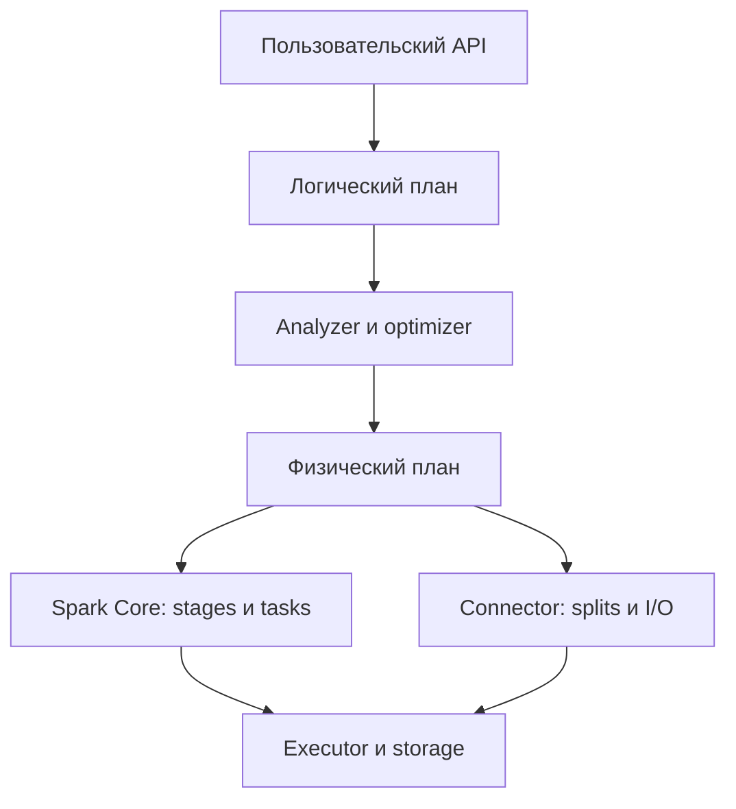
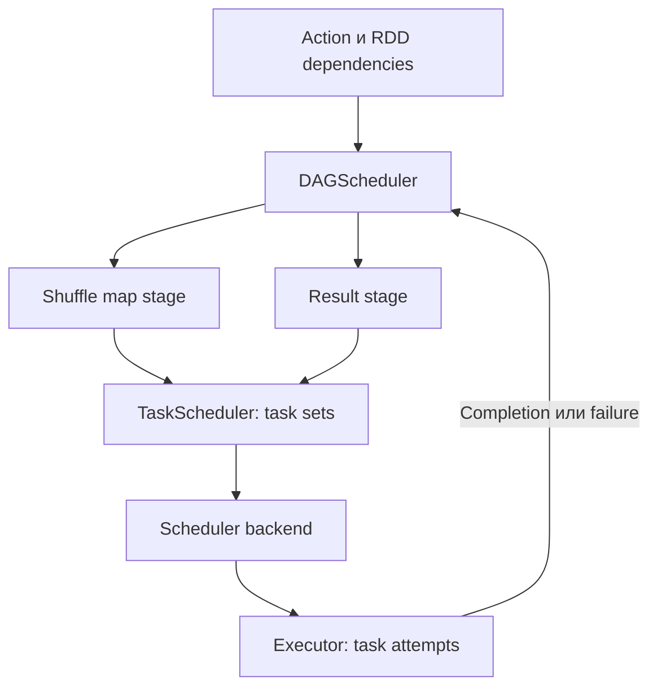
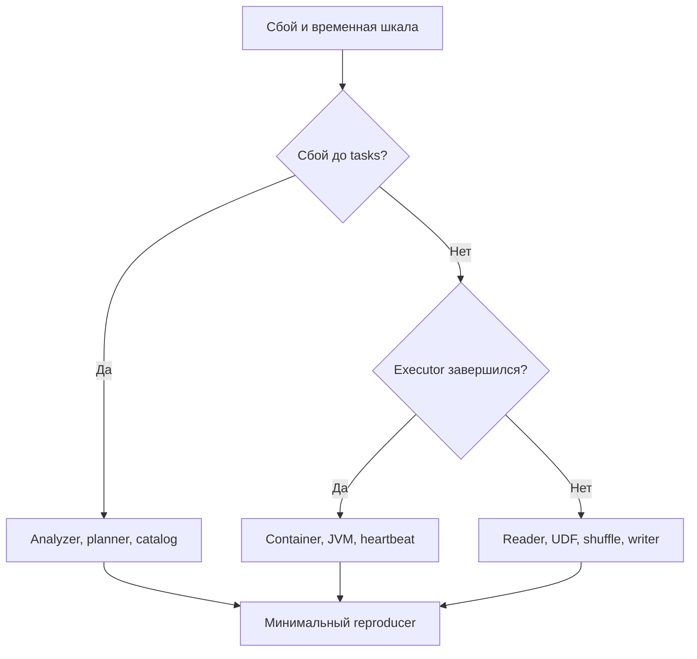
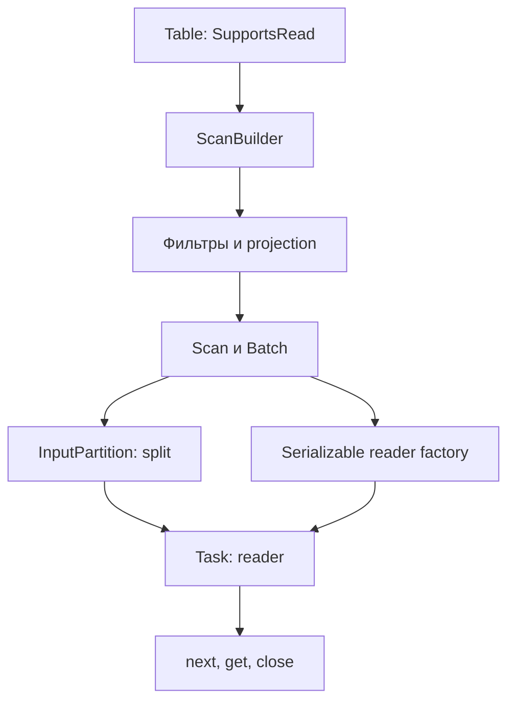
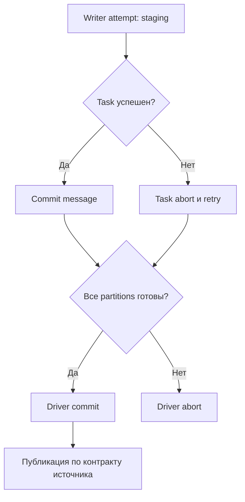
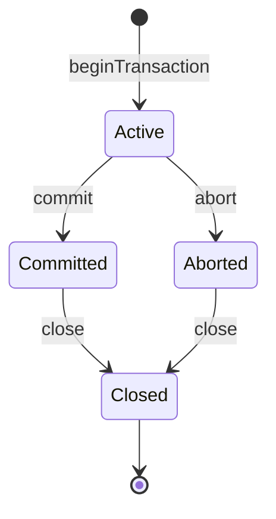
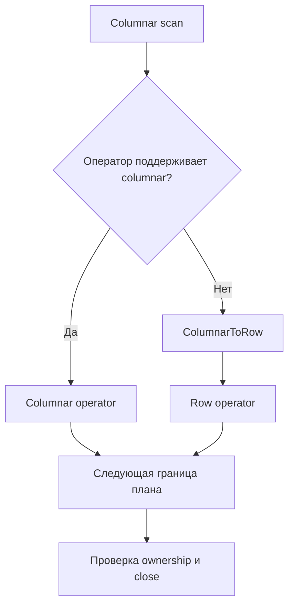

# 28. Расширения Spark и изучение исходного кода

Базовая версия — **Apache Spark 4.2.0**, **Scala 2.13.18**, **Python 3.12**, **JDK 17**, **Spark Classic**, Linux. Проверки выполнены **15 октября 2026 года**. Версия зафиксирована намеренно: расширение Catalyst, shuffle или Connect server нужно сверять с конкретной сборкой Spark.

**Цель раздела:** научиться находить путь от запроса и наблюдаемого сбоя к исходникам, выбирать подходящую точку расширения, реализовать учебные источники данных и проверить корректность их контрактов. Знание исходников полезно даже без изменения Spark: оно помогает отличать причину инцидента от последнего сообщения в стеке.

**Как выполнять примеры**

- Python-блоки с метками `P01`, `P02` и далее выполняются по порядку в одном процессе. Начальная настройка находится в теме Python Data Source API. Маленькие результаты можно собирать на driver.
- Scala-блоки `S01`–`S08` составляют **один** файл `Lab28.scala`: скопируй их в порядке появления. Инструкции сборки и запуска находятся в конце раздела. Отдельный блок с `package` допустим только в начале файла.
- Блоки с пометкой **«шаблон»** описывают действия в checkout Spark или внешней инфраструктуре. Полная сборка Spark, Docker integration tests, внешний shuffle service и Connect server plugin здесь не запускались.
- JVM-лаборатория проверяет чтение, pushdown, pruning, статистики, запись commit messages, Catalyst expression/rule, plugin и TaskContext. Python-лаборатория проверяет batch reader/writer и streaming reader с AvailableNow и восстановлением из checkpoint. Подробные результаты приведены в конце.
- Учебный JVM sink считает строки через commit messages; Python sink публикует manifest на локальной файловой системе. Это ограниченные модели протокола, а не готовые production connectors.

**Содержание**

1. [Устройство исходного проекта](#source-layout)
2. [Изучение Spark Core](#spark-core)
3. [Data Source V2: чтение](#dsv2-read)
4. [Data Source V2: запись и каталоги](#dsv2-write)
5. [Python Data Source API](#python-datasource)
6. [Catalyst extensions](#catalyst)
7. [Plugins и низкоуровневые integrations](#plugins)
8. [Работа с Apache Spark как open-source проектом](#contributing)

<a id="source-layout"></a>

## Устройство исходного проекта

### Модули core, sql, catalyst, streaming, mllib и python

Spark — многомодульный проект. Каталог на верхнем уровне не всегда соответствует одной Maven-библиотеке. В частности, Catalyst находится **внутри `sql/`**, а `sql/api` отделён от реализации Classic. Прежде чем читать класс, определи его слой: пользовательский контракт, логическое представление, физическое выполнение или инфраструктура.

| Путь в исходниках | Содержание | С чего начать чтение |
| --- | --- | --- |
| `core/` | RDD, jobs/stages/tasks, scheduling, storage | `SparkContext`, `DAGScheduler`, `Executor` |
| `sql/api/` | Общие SQL-типы и API | `SparkSession`, `DataType`, `Row` |
| `sql/catalyst/` | Выражения, логические планы, анализ и оптимизация, connector interfaces | `LogicalPlan`, `Expression`, `Rule`, `connector` |
| `sql/core/` | Реализация Spark SQL Classic, физические операторы, execution | `QueryExecution`, `SparkPlan`, `DataSourceV2Strategy` |
| `sql/connect/` | Протокол, server/client для Spark Connect | `proto`, `server`, `common`, `client` по дереву версии |
| `streaming/` | Legacy DStreams | `StreamingContext`; это не весь Structured Streaming |
| `sql/core/.../streaming/` | Structured Streaming execution | `MicroBatchExecution`, source/sink integration |
| `mllib/`, `mllib-local/` | Распределённое ML и локальная линейная алгебра | Pipeline/stages, векторы и матрицы |
| `python/pyspark/` | Python API, Classic/Connect реализации и Python workers | `sql/classic`, `sql/connect`, `sql/worker` |
| `common/`, `resource-managers/` | Общие библиотеки, network, YARN/Kubernetes integration | По стеку и используемому backend |

Удобный маршрут для SQL: публичный метод → логический узел → analyzer/optimizer → strategy → physical operator → RDD/tasks. Для ошибки сети маршрут иной: executor → transport/RPC → endpoint → scheduler reaction. Не пытайся прочитать весь репозиторий линейно.



**Практика:** найди `BatchScanExec`, его input RDD и вызов reader factory. Запиши по одному классу на каждый переход. **Самопроверка:** почему поиск Structured Streaming только в каталоге `streaming/` пропустит основную реализацию?

### Scala/Java sources и Python wrappers

Scala используется во многих внутренних компонентах. Java-интерфейсы удобны для независимых JVM connectors, но их реализация может обрабатывать внутренние значения Spark. Например, DS V2 возвращает `InternalRow`, а не пользовательский `Row`. Для строки внутри `InternalRow` нужен соответствующий внутренний тип, например `UTF8String`; обычная Java-строка не всегда взаимозаменяема с ним.

Python API тоже неоднороден. Classic часто строит вызов JVM через Py4J; код Python UDF и Python data source reader исполняется в Python workers. Connect строит сериализованный запрос к серверу. Поэтому выражение «Python — wrapper над JVM» не объясняет, где выполняется конкретный метод.

**Трассировка одного вызова:** найди `DataFrame.select` в Classic → посмотри, как передаются columns → найди реализацию JVM `Dataset.select` → узел `Project` → правила обработки projection. Затем сравни с `python/pyspark/sql/connect/dataframe.py`: транспорт и построение плана будут другими.

```bash
# Шаблон: выполнять из checkout Spark нужного тега; команды поиска не запускают сборку.
rg -n 'def select|class DataFrame' python/pyspark/sql/classic/dataframe.py
rg -n 'class Project|case class Project' sql/catalyst/src/main/scala
rg -n 'class BatchScanExec|createReaderFactory' sql/core/src/main/scala
rg -n 'class DataSourceReader|def pushFilters' python/pyspark/sql/datasource.py
```

**Самопроверка:** куда ставить breakpoint, если JVM план построен, а ошибка возникает при импортировании Python-библиотеки на worker?

### Сборка Spark и выбор профилей

Сборка самого Spark и сборка extension — разные задачи. Для extension обычно достаточно зависимостей `spark-sql`/`spark-core` с областью `provided` и совместимого Scala binary suffix `_2.13`. Пересобирать весь Spark ради добавления `TableProvider` не требуется. Spark и Scala не стоит включать целиком в fat JAR: дубликаты классов создают трудные ошибки class loading.

При изменении исходников Spark нужен checkout конкретного тега/ветки, поддерживаемые JDK и build tools, достаточно RAM и доступ к artifact repositories. Для 4.2.0 документация сборки указывает Java 17/21/25, Scala 2.13 и Maven 3.9.15. Требования **сборки** проверяй отдельно от требований запуска готового дистрибутива.

```bash
# Шаблон: полная сборка Spark из исходников, здесь не выполнялась.
git clone https://github.com/apache/spark.git
cd spark
git checkout v4.2.0
./build/mvn -DskipTests package

# Только если эти integrations нужны в создаваемом дистрибутиве:
./dev/make-distribution.sh --name lab --tgz -Pyarn -Pkubernetes -Phive -Phive-thriftserver
```

| Выбор | Когда нужен | Что он не гарантирует |
| --- | --- | --- |
| `-pl` и `-am` | Собрать выбранный Maven module и зависимости | Наличие всех ранее собранных test artifacts |
| `-Pyarn` | Компоненты YARN | Рабочую конфигурацию реального YARN-кластера |
| `-Pkubernetes` | Kubernetes integration | Доступный API server и корректный image |
| `-Phive`, `-Phive-thriftserver` | Hive/Thrift integration | Совместимость любого внешнего metastore |
| `-DskipTests` | Быстро получить артефакт | Проверенную корректность изменения |

Фиксируй SHA checkout, JDK, профили, dependency overrides и полный build log. «Собрано на моей машине» без этих сведений слабо помогает повторить результат.

Источник: [Building Spark 4.2.0](https://spark.apache.org/docs/4.2.0/building-spark.html).

### Локальные integration tests и dev tools

Выбирай минимальный тест, который пересекает изменённую границу. Правило optimizer проверяется на планах и результатах; источник данных — ещё на сериализации factory, удалённом выполнении и повторных попытках; JDBC connector — на настоящем протоколе и типах целевой базы.

```bash
# Шаблоны из рабочего checkout: suite/module нужно сверить с этой веткой.
./build/sbt 'catalyst/testOnly *YourRuleSuite'
./build/sbt 'sql/testOnly *YourDataSourceSuite'
./python/run-tests --python-executables=python3 --modules=pyspark-sql
./dev/scalastyle
./dev/lint-python

# Docker suites требуют Docker и заранее собранных artifacts:
./build/mvn test -Pdocker-integration-tests -pl :spark-docker-integration-tests_2.13
```

`YourRuleSuite` и `YourDataSourceSuite` — явные placeholders. Для реального patch возьми имя существующего suite из соседнего файла. `local[2]` проверяет сериализацию и несколько tasks, но executor живёт в том же JVM-процессе; сетевые сбои и независимые classpaths требуют другого тестового уровня.

**Практика:** составь матрицу из unit test, local Spark test и integration test для коннектора HTTP API. Для каждого уровня укажи один дефект, который не поймают остальные. Инструкции: [Developer tools](https://spark.apache.org/developer-tools.html).

### Public, developer, experimental и internal API

Java-модификатор `public` разрешает доступ компилятору, но сам по себе не делает API стабильным контрактом Spark. Читай документацию класса, аннотации, `Since`, package visibility и замечания о совместимости.

| Категория | Как понимать | Практическое действие |
| --- | --- | --- |
| Документированный public API | Основной контракт пользователя | Проверять deprecations и migration guide |
| `DeveloperApi` | Расширение на более низком уровне | Проверять точные сигнатуры при обновлении |
| `Experimental`, `Evolving` | Контракт с оговорками о развитии | Проверять обе стороны integration и тестировать по версиям |
| `private[spark]`, недокументированные internals | Деталь реализации | Ограничить зависимость адаптером, пересобирать и выполнять regression suite |
| `SparkSessionExtensions` | Специально открытая точка для нестабильных SQL internals | Не обещать binary compatibility на основании доступности класса |

Различай **source compatibility**, **binary compatibility**, **семантику результата** и **совместимость сохранённых данных/checkpoint**. Перекомпилировавшийся connector всё ещё может неверно сравнивать NULL или преждевременно публиковать staging data.

**Практика:** для каждой зависимости будущего extension выпиши статус API, целевые версии Spark и тест, который обнаружит нарушение контракта. Сверяй [versioning policy](https://spark.apache.org/versioning-policy.html) и конкретный Javadoc: общая политика не отменяет оговорку конкретного класса.

<a id="spark-core"></a>

## Изучение Spark Core

### DAGScheduler, TaskScheduler и scheduler backends

`DAGScheduler` рассматривает вычисление на уровне RDD dependencies и stages. Shuffle dependency образует важную границу: downstream tasks нужны результаты соответствующего map stage. `TaskScheduler` управляет task sets, доступными slots, locality, попытками и взаимодействует с backend. Scheduler backend связывает планирование Spark с executor resources выбранного режима запуска.

SQL optimizer не назначает task конкретному executor. Он создаёт физический план, который в итоге порождает RDD computation; ниже начинается планирование Core. AQE может изменить SQL-план на основании уже полученной статистики, но это другой уровень решения.



Для чтения исходников начни с `DAGScheduler.submitJob`, обработки событий, создания/отправки stage, затем перейди к `TaskSchedulerImpl` и backend своего cluster manager. Названия методов и event classes сверяй на теге 4.2.0; это internal API.

**Самопроверка:** почему повтор одного task и повтор map stage после потери shuffle outputs — разные события?

### Task execution и TaskContext

Task — исполнение части работы в конкретной попытке. Один partition может быть вычислен несколько раз: retry, speculation, повторный action. `partitionId` не является глобальным идентификатором бизнес-записи или уникальным ключом внешнего side effect.

`TaskContext` даёт контекст текущей попытки: stage/partition, attempt number, task attempt ID, local properties. На driver вне task контекста нет. На JVM доступны listeners завершения/ошибки task; они нужны для освобождения ресурсов, но не заменяют commit protocol и могут не отработать при аварийном завершении процесса.

В Scala-лаборатории ниже `mapPartitions` возвращает `(partitionId, attemptNumber, sum)`. Проверяется состав partitions и сумма, но не конкретные task attempt IDs: они зависят от запуска. На Python не переноси JVM-only методы контекста без проверки.

**Практика:** спроектируй ключ попытки записи `(queryId, partitionId, taskAttemptId)` и отдельный ключ логической публикации. Объясни, почему для дедупликации batch нужно знать оба уровня. API: [TaskContext](https://spark.apache.org/docs/4.2.0/api/java/org/apache/spark/TaskContext.html).

### BlockManager и управление распределёнными blocks

`BlockManager` хранит и передаёт blocks, связанные с cache, broadcast и другими частями runtime. На executor локальный manager взаимодействует с memory/disk stores; master хранит сведения о расположении blocks. Это не централизованное долговременное хранилище всех данных Spark.

Потеря cached partition обычно означает возможность пересчитать его по lineage. Потеря shuffle output может потребовать повторного map computation. Потеря checkpoint или исходных данных имеет другую семантику восстановления. Поэтому сообщение «block not found» нужно связывать с **типом block**, storage level и стадией выполнения.

| Наблюдение | Где искать дальше | Вопрос для проверки |
| --- | --- | --- |
| Частые cache misses | `BlockManager`, eviction, `MemoryStore`, план повторных actions | Сохраняется ли тот же Dataset/RDD и достаточно ли storage memory? |
| `FetchFailed` после удаления executor | Shuffle reader, metadata locations, executor loss | Кто должен сохранять shuffle files в этой конфигурации? |
| Высокий disk spill | Execution memory, sorter/aggregator, skew | Это промежуточный spill или cache на диске? |
| Большой broadcast на каждом executor | Broadcast implementation и SQL join plan | Правильно ли оценён размер и нужен ли broadcast? |

**Самопроверка:** почему `cache()` и надёжный checkpoint не дают одинаковой устойчивости к удалению исходного источника?

### ShuffleManager и map output tracking

`ShuffleManager` отвечает за реализацию shuffle: writers/readers, регистрацию shuffle и связь с block resolver. `MapOutputTracker` сообщает, где находятся map outputs и как downstream tasks могут их получить. Метаданные адресов и сами байты данных — разные части системы.

Читай путь в обе стороны: запись map task → status output → регистрация местоположения; затем reduce-side fetch → lookup metadata → transport → чтение/десериализация. Конкретная реализация, например sort shuffle, и конфигурация remote shuffle могут менять путь.

При `FetchFailed` сформулируй три гипотезы: неверные/устаревшие locations, исчезнувшие files/executor, ошибка передачи/чтения. Повышение retry count не выбирает между ними. Нужны executor lifecycle events, block IDs, адреса и первая причина ошибки.

**Практика:** свяжи один shuffle ID из event log с `Exchange` в SQL-плане и map stage в UI. Затем найди соответствующий shuffle reader в исходниках.

### RPC environment, heartbeats и executor lifecycle

RPC endpoints передают управляющие сообщения: регистрацию, статус, heartbeats. Передача blocks использует отдельные сетевые компоненты; успешный heartbeat не доказывает доступность конкретного shuffle file. Executor может зависнуть из-за GC, потерять связь, быть удалён cluster manager или завершиться с OOM — внешне это часто сходится к «executor lost».

Полезный маршрут: `CoarseGrainedExecutorBackend` и driver backend → `Executor` → `HeartbeatReceiver` → реакция scheduler. Смотри также cluster manager events: Spark видит часть причины, а контейнерный runtime может знать точный exit code.

**Диагностический порядок:** сравни timestamp последнего heartbeat с длительностью GC/CPU throttling; проверь завершение process/container; сопоставь network errors; только после этого оцени timeout. Увеличенный timeout иногда скрывает перегрузку и удлиняет восстановление.

**Самопроверка:** чем отличаются «executor не ответил вовремя» и «операционная система убила executor» с точки зрения доказательств и исправления?

### Переход от наблюдаемого сбоя к соответствующему участку исходников

Начинай с минимального наблюдаемого факта: какой query/stage/task, какая попытка, какой executor, какой error condition и что произошло первым. Последний `SparkException: Job aborted` часто лишь поднимает нижележащую ошибку.



**Рабочий шаблон расследования:**

1. Сохранить версию, SHA/vendor build, конфигурации, plan и первую цепочку `Caused by`.
2. Найти класс из стека именно в соответствующем source tag; номера строк сравнивать только с этой сборкой.
3. Найти место выбрасывания ошибки, callers и условия перехода в эту ветку.
4. Прочитать соседний test suite: он часто лучше объясняет инвариант, чем комментарий метода.
5. Проверить гипотезу уменьшением данных/плана или failure injection; сохранить и успешный контрольный вариант.

**Практика:** разбери ошибку reader так, чтобы итогом было утверждение «неверно сериализован объект partition» с воспроизводящим примером, а не просто «упал Spark». **Самопроверка:** какие данные позволят отличить дефект connector от падения внешнего сервиса?

<a id="dsv2-read"></a>

## Data Source V2: чтение

### TableProvider, Table и capabilities

Data Source V2 разделяет идентификацию таблицы, согласование плана и исполнение I/O. `TableProvider` — точка входа для `spark.read.format(...).options(...).load()`. У класса должен быть доступный конструктор без аргументов. Для вызова по полному имени класса service registration не требуется; короткое имя JVM datasource обычно требует `DataSourceRegister` и записи в `META-INF/services`.

`Table` описывает схему и возможности. Реализация `SupportsRead` предоставляет scan builder, а `capabilities()` объявляет поддерживаемые режимы. Если объявлен `BATCH_READ`, scan обязан предоставлять batch path. Нельзя включить `MICRO_BATCH_READ`, оставив `toMicroBatchStream` неподдерживаемым.

Ниже начинается сквозной JVM connector. Он генерирует диапазон `[0, end)` с колонкой `id BIGINT NOT NULL`, принимает только append в учебный counting sink и умеет row/columnar reads. Значение `end` ограничено миллионом для безопасности учебного примера. Options из `CaseInsensitiveStringMap` регистронезависимы; обычная Java map такого свойства не имеет автоматически.

**S01 — начало `Lab28.scala`, imports и таблица.**

```scala
// S01
package lab28

import java.util.{Map => JMap, Set => JSet, EnumSet, OptionalLong}
import java.util.concurrent.atomic.AtomicLong
import org.apache.spark.{SparkContext, TaskContext, TaskFailedReason}
import org.apache.spark.api.plugin._
import org.apache.spark.scheduler.{SparkListener, SparkListenerTaskEnd}
import org.apache.spark.sql.{SparkSession, SparkSessionExtensions}
import org.apache.spark.sql.types._
import org.apache.spark.sql.util.CaseInsensitiveStringMap
import org.apache.spark.sql.connector.catalog._
import org.apache.spark.sql.connector.catalog.transactions._
import org.apache.spark.sql.connector.expressions.Transform
import org.apache.spark.sql.connector.read._
import org.apache.spark.sql.connector.write._
import org.apache.spark.sql.sources.{Filter, GreaterThanOrEqual}
import org.apache.spark.sql.catalyst.InternalRow
import org.apache.spark.sql.catalyst.expressions._
import org.apache.spark.sql.catalyst.expressions.codegen.CodegenFallback
import org.apache.spark.sql.catalyst.plans.logical.LogicalPlan
import org.apache.spark.sql.catalyst.rules.Rule

object Counters {
  val committed = new AtomicLong(0)
  val pluginTasks = new AtomicLong(0)
  val listenerTasks = new AtomicLong(0)
}

class RangeProvider extends TableProvider {
  override def inferSchema(o: CaseInsensitiveStringMap): StructType =
    StructType(Seq(StructField("id", LongType, false)))
  override def getTable(s: StructType, p: Array[Transform], o: JMap[String,String]): Table =
    new RangeTable(inferSchema(new CaseInsensitiveStringMap(o)),
      Option(o.get("end")).getOrElse("10").toLong,
      Option(o.get("columnar")).contains("true"))
}
class RangeTable(s: StructType, end: Long, columnar: Boolean) extends Table with SupportsRead with SupportsWrite {
  require(end >= 0 && end <= 1000000)
  override def name(): String = "lab28.range"
  override def schema(): StructType = s
  override def capabilities(): JSet[TableCapability] =
    EnumSet.of(TableCapability.BATCH_READ, TableCapability.BATCH_WRITE)
  override def newScanBuilder(o: CaseInsensitiveStringMap): ScanBuilder = new RangeBuilder(s,end,columnar)
  override def newWriteBuilder(info: LogicalWriteInfo): WriteBuilder = new WriteBuilder {
    override def build(): Write = new Write {
      override def toBatch(): BatchWrite = new CountWrite
    }
  }
}
```

`Table.schema()` оставлен в лаборатории как совместимый простой путь; в 4.2 смотри также `columns()` и новые metadata interfaces. Deprecated overload может продолжать работать, но для production connector нужно выбирать актуальный контракт целевой версии. Provider сам фиксирует схему и не объявляет поддержку произвольной external schema.

**Самопроверка:** чем отличаются отсутствие capability и исключение при исполнении уже обещанной capability? API: [TableProvider](https://spark.apache.org/docs/4.2.0/api/java/org/apache/spark/sql/connector/catalog/TableProvider.html), [Table](https://spark.apache.org/docs/4.2.0/api/java/org/apache/spark/sql/connector/catalog/Table.html).

### ScanBuilder, Scan и Batch

`ScanBuilder` — изменяемый объект согласования: Spark сообщает фильтры и требуемые колонки, затем вызывает `build()`. `Scan` должен отражать **результат** согласования: правильную `readSchema`, описание и физический путь чтения. `Batch` планирует splits и создаёт factory.

| Объект | Где используется | Какое состояние хранить |
| --- | --- | --- |
| `ScanBuilder` | Планирование | Принятые pushdowns, projection, согласованные options |
| `Scan` | План и переход к execution | Зафиксированную схему и описание выбранного чтения |
| `Batch` | Подготовка batch execution | Partition plan и factory |
| `InputPartition` | Передача split на executor | Сериализуемые границы чтения |
| `PartitionReader` | Task | Открытый клиент, курсор и текущую строку/batch |

Не открывай соединение с БД в конструкторе factory на driver с ожиданием передать socket на executor. Factory должна передавать конфигурацию для создания клиента. Сам план может строиться несколько раз; вызов `build()` не означает начало чтения или успешное завершение action.



**Практика:** выпиши, какие объекты учебного connector изменяются при `WHERE id >= 7`, а какие создаются заново. API: [Scan](https://spark.apache.org/docs/4.2.0/api/java/org/apache/spark/sql/connector/read/Scan.html).

### InputPartition и PartitionReaderFactory

Partition — **описание split**, а не готовые данные. Пример: snapshot ID, диапазон ключей и URI объекта. Один спланированный input partition обычно соответствует одной read task; повторные попытки этой task используют тот же логический split. Границы обязаны не терять и не дублировать данные: удобно явно выбрать полуинтервалы `[lo, hi)`.

`PartitionReader.next()` переводит курсор к следующему элементу; `get()` возвращает текущий элемент; `close()` освобождает ресурсы. `get()` не должен сам неявно читать следующую запись. Если reader повторно использует буфер строки, потребитель не должен сохранять ссылку на него как на независимую копию.

**S02 — builder, splits, row reader и статистики.** Код также реализует pushdown и pruning, разобранные ниже.

```scala
// S02
class RangeBuilder(s: StructType, end: Long, columnar: Boolean) extends ScanBuilder
    with SupportsPushDownFilters with SupportsPushDownRequiredColumns {
  private var required = s
  private var lower = 0L
  private var pushed = Array.empty[Filter]
  override def pushFilters(fs: Array[Filter]): Array[Filter] = {
    pushed = fs.collect { case f @ GreaterThanOrEqual("id", _: Long) => f }
    lower = pushed.foldLeft(0L) {
      case (v, GreaterThanOrEqual(_, n: Long)) => math.max(v,n)
      case (v, _) => v
    }
    fs.filterNot(pushed.contains)
  }
  override def pushedFilters(): Array[Filter] = pushed
  override def pruneColumns(r: StructType): Unit = { required = r }
  override def build(): Scan = new RangeScan(required,math.min(lower,end),end,columnar)
}
case class Split(lo: Long, hi: Long) extends InputPartition
class RangeScan(s: StructType, lo: Long, hi: Long, columnar: Boolean) extends Scan with Batch
    with SupportsReportStatistics {
  override def readSchema(): StructType = s
  override def description(): String = s"LabRange[$lo,$hi) columns=${s.fieldNames.mkString(",")}" 
  override def toBatch(): Batch = this
  override def planInputPartitions(): Array[InputPartition] = {
    val mid = lo + (hi-lo)/2
    Array(Split(lo,mid),Split(mid,hi))
  }
  override def createReaderFactory(): PartitionReaderFactory =
    if(columnar) new ColumnFactory(s.isEmpty) else new RangeFactory(s.isEmpty)
  override def estimateStatistics(): Statistics = new Statistics {
    override def sizeInBytes(): OptionalLong = OptionalLong.of((hi-lo)*8L)
    override def numRows(): OptionalLong = OptionalLong.of(hi-lo)
  }
}
class RangeFactory(empty: Boolean) extends PartitionReaderFactory {
  override def createReader(p: InputPartition): PartitionReader[InternalRow] = {
    val split = p.asInstanceOf[Split]
    new PartitionReader[InternalRow] {
      private var pos = split.lo-1
      override def next(): Boolean = { pos += 1; pos < split.hi }
      override def get(): InternalRow = if(empty) InternalRow.empty else InternalRow(pos)
      override def close(): Unit = ()
    }
  }
}
```

Два splits создаются и при пустом диапазоне: оба корректно возвращают `false` из `next()`. Это простая учебная политика; production connector может вернуть пустой список partitions, если это соответствует его контракту. Пустая required schema также корректна: для count всё ещё требуется правильное число строк, поэтому reader выдаёт нужное число `InternalRow.empty`.

`preferredLocations()` у input partition — подсказка scheduler о hosts, а не гарантия размещения и не декларация SQL partitioning. API: [PartitionReaderFactory](https://spark.apache.org/docs/4.2.0/api/java/org/apache/spark/sql/connector/read/PartitionReaderFactory.html).

### Columnar reads и передача preferred partitioning

При columnar read reader возвращает `ColumnarBatch`. Это меняет контракт памяти: нужно корректно освобождать vectors, понимать время жизни batch и не выдавать уже закрытый буфер. В примере размер batch ограничен четырьмя строками, чтобы было видно переключение batches.

**S03 — columnar factory.** `OnHeapColumnVector` относится к внутренней реализации Spark, поэтому эта учебная factory привязана к 4.2.0.

```scala
// S03
class ColumnFactory(empty: Boolean) extends PartitionReaderFactory {
  override def supportColumnarReads(p: InputPartition): Boolean = true
  override def createReader(p: InputPartition): PartitionReader[InternalRow] =
    throw new UnsupportedOperationException("columnar-only factory")
  override def createColumnarReader(p: InputPartition)
      : PartitionReader[org.apache.spark.sql.vectorized.ColumnarBatch] = {
    val split=p.asInstanceOf[Split]
    new PartitionReader[org.apache.spark.sql.vectorized.ColumnarBatch] {
      private var pos=split.lo
      private var batch: org.apache.spark.sql.vectorized.ColumnarBatch = null
      override def next(): Boolean = {
        if(batch != null) { batch.close(); batch=null }
        if(pos >= split.hi) return false
        val n=math.min(4L,split.hi-pos).toInt
        val cols: Array[org.apache.spark.sql.vectorized.ColumnVector] =
          if(empty) Array.empty else {
            val v=new org.apache.spark.sql.execution.vectorized.OnHeapColumnVector(n,LongType)
            (0 until n).foreach(i => v.putLong(i,pos+i)); Array(v)
          }
        batch=new org.apache.spark.sql.vectorized.ColumnarBatch(cols,n)
        pos += n; true
      }
      override def get(): org.apache.spark.sql.vectorized.ColumnarBatch = batch
      override def close(): Unit = { if(batch != null) {batch.close();batch=null} }
    }
  }
}
```

Scan выбирает factory по option `columnar=true`. В проверке выполняются и полное чтение, и `count()`, где projection может стать пустой. В колоннарном варианте пустая схема представлена batch без vectors, но с корректным числом строк.

Не смешивай три разных понятия:

| Механизм | Что сообщает | Последствие неверного объявления |
| --- | --- | --- |
| `InputPartition.preferredLocations()` | Желательные hosts | Потеря locality, обычно без изменения ответа |
| `SupportsReportPartitioning.outputPartitioning()` | Гарантированную SQL-организацию выходных данных | Spark может убрать нужный shuffle и получить неправильный результат |
| `SupportsReportOrdering.outputOrdering()` | Гарантированную сортировку scan output | Spark может убрать необходимую сортировку |

Preferred partitioning из названия пункта нужно понимать как реальные возможности конкретного scan API: здесь нет универсального «попросить Spark считать источник уже hash-partitioned». Сообщать partitioning следует только при доказуемой гарантии, с корректными transforms/keys и metadata partitions. Storage Partition Join дополнительно зависит от версий, конфигураций и совместимости обоих источников.

**Самопроверка:** можно ли объявить hash partitioning по `id`, если источник просто делится на два последовательных диапазона? API: [SupportsReportPartitioning](https://spark.apache.org/docs/4.2.0/api/java/org/apache/spark/sql/connector/read/SupportsReportPartitioning.html).

### SupportsPushDownFilters, required columns и другие pushdowns

`pushFilters(filters)` возвращает **остаточные фильтры**, которые Spark должен применить после scan. `pushedFilters()` сообщает принятые фильтры, в том числе используемые только для грубого pruning. Один фильтр может одновременно быть pushed и residual: например, file statistics отсекли невозможные файлы, но не проверили каждую строку.

В S02 принимается только `GreaterThanOrEqual("id", Long)`. Источник действительно ограничивает нижнюю границу; остальные filters возвращаются Spark. Проверка `id >= 7 AND id % 2 = 1` должна дать `[7, 9]`: первая часть может уйти в connector, вторая остаётся у Spark.

`pruneColumns(requiredSchema)` — отдельный контракт. Возвращаемая строка должна иметь ровно схему scan **в правильном порядке**. Если внешнему API нужны дополнительные поля для применения filters, connector может читать их внутренне, но не обязан включать их в выходной `readSchema`.

**Опасные ошибки:**

- удалить фильтр из residual, но не применить его;
- применить приблизительный predicate как точный;
- забыть SQL NULL/NaN/collation semantics;
- передать исходную схему при фактическом column pruning;
- обработать первую часть OR как самостоятельный обязательный фильтр.

**Практика:** добавь поддержку `id < upper`, проверь равные границы, `upper < 0`, пустой результат и смешанный предикат с остатком. API: [SupportsPushDownFilters](https://spark.apache.org/docs/4.2.0/api/java/org/apache/spark/sql/connector/read/SupportsPushDownFilters.html).

### Pushdown aggregates, limits и runtime filters при поддержке

Каждый дополнительный pushdown — обещание сохранить семантику. Нельзя возвращать `true` только потому, что внешний backend понимает похожий SQL.

| Возможность | Контракт | Что проверить |
| --- | --- | --- |
| `SupportsPushDownAggregates` | Принять aggregation и сообщить complete/partial | Типы результата, grouping, NULL, COUNT, частичное объединение |
| `SupportsPushDownLimit` | Согласовать limit и partial pushdown | Глобальная граница и локальные splits — разные вещи |
| `SupportsPushDownTopN` | Сортировка плюс limit | Направление, NULL ordering, collations, ties |
| `SupportsPushDownOffset` | Пропуск результата | Полноту и устойчивость порядка во внешней системе |
| `SupportsRuntimeV2Filtering` | Принять runtime predicates через scan | Когда можно перепланировать partitions и что уже прочитано |

Для partial aggregate Spark может повторно агрегировать результат источника. Например, несколько частичных `MIN` можно объединить через `MIN`, но усреднять средние без весов неверно. Если residual filter должен примениться к исходным строкам, преждевременная агрегация может уничтожить нужные данные.

Runtime filter приходит позднее обычного predicate pushdown. Не сохраняй изменяемый глобальный filter в singleton: два запроса могут читать разные snapshots и иметь разные runtime values. Научись сначала корректно отказаться от неподдерживаемой оптимизации.

**Самопроверка:** почему `LIMIT 5` на каждом из десяти splits не равен глобальному `LIMIT 5`? API: [Aggregates](https://spark.apache.org/docs/4.2.0/api/java/org/apache/spark/sql/connector/read/SupportsPushDownAggregates.html), [Limit](https://spark.apache.org/docs/4.2.0/api/java/org/apache/spark/sql/connector/read/SupportsPushDownLimit.html), [Runtime filtering](https://spark.apache.org/docs/4.2.0/api/java/org/apache/spark/sql/connector/read/SupportsRuntimeV2Filtering.html).

### Statistics и проверка корректности pushed predicates

`SupportsReportStatistics` сообщает оценку scan после pushdowns. В S02 диапазон известен точно, поэтому `numRows = hi - lo`, а `sizeInBytes` — простая оценка восемь байт на `id`. Это не измерение полного heap footprint, network bytes или размера файла. Для неизвестной величины возвращай отсутствие оценки, а не выдуманный ноль.

Неверные statistics обычно ведут к плохому плану, а неверный точный pushdown — к неверному ответу. Проверять их нужно независимо. Наличие `PushedFilters` в explain доказывает участие механизма в планировании, но не полноту результата.

**Минимальная матрица correctness:** пустой источник; все/ни одна строки; границы split; отрицательные и большие числа; NULL и NaN при поддерживаемых типах; AND/OR; residual; projection без filter column; повтор action; retries; изменение источника между planning и read.

В JVM-лаборатории сравниваются конкретные `id`, а не только `count`. Python-лаборатория ниже сравнивает pushdown path с тем же источником, который возвращает все фильтры в residual. Для production теста сравнивай мультимножества и схему: одинаковая сумма строк не исключает потерю одной записи и дублирование другой.

**Практика:** намеренно исключи запись ровно на границе двух splits. Покажи тест, который падает, хотя суммарная выручка могла бы остаться прежней. API: [SupportsReportStatistics](https://spark.apache.org/docs/4.2.0/api/java/org/apache/spark/sql/connector/read/SupportsReportStatistics.html).

<a id="dsv2-write"></a>

## Data Source V2: запись и каталоги

### WriteBuilder, BatchWrite и DataWriterFactory

Путь записи симметричен чтению, но имеет отдельную фазу публикации. `SupportsWrite.newWriteBuilder(info)` получает logical write information, в том числе schema/options/query ID. `WriteBuilder.build()` создаёт `Write`, а `Write.toBatch()` — `BatchWrite`. Factory сериализуется на executors; отдельный `DataWriter` обрабатывает одну partition attempt.

**S04 — учебный counting sink.** Он потребляет все строки, возвращает число строк в commit message и суммирует только выбранные сообщения на driver. Данные после этого нигде не сохраняются: это проверка механики API.

```scala
// S04
case class CountMessage(rows: Long) extends WriterCommitMessage
class CountFactory extends DataWriterFactory {
  override def createWriter(partitionId: Int, taskId: Long): DataWriter[InternalRow] =
    new DataWriter[InternalRow] {
      private var n=0L
      override def write(row: InternalRow): Unit = { n += 1 }
      override def commit(): WriterCommitMessage = CountMessage(n)
      override def abort(): Unit = ()
      override def close(): Unit = ()
    }
}
class CountWrite extends BatchWrite {
  override def createBatchWriterFactory(i: PhysicalWriteInfo): DataWriterFactory = new CountFactory
  override def commit(ms: Array[WriterCommitMessage]): Unit =
    Counters.committed.set(ms.collect { case CountMessage(n) => n }.sum)
  override def abort(ms: Array[WriterCommitMessage]): Unit = ()
}
```

Writer factory не захватывает `SparkSession` или driver counters. `Counters.committed` изменяется только на driver в `BatchWrite.commit`. Этот принцип важен и за пределами `local`: static singleton на executor не является общим состоянием кластера.

Builder не реализует truncate/overwrite mix-ins, поэтому для лаборатории используется `.mode("append")`. Поддержку append нельзя автоматически трактовать как поддержку overwrite, dynamic overwrite и schema evolution.

**Самопроверка:** почему создание `DataWriter` на driver вместо сериализуемой factory сломает жизненный цикл внешнего соединения? API: [WriteBuilder](https://spark.apache.org/docs/4.2.0/api/java/org/apache/spark/sql/connector/write/WriteBuilder.html).

### Commit messages, commit и abort

Task-level `DataWriter.commit()` сообщает, что попытка подготовила свой результат. Driver-level `BatchWrite.commit(messages)` публикует результат всей операции по протоколу источника. Commit message должен быть маленьким serializable descriptor — пути staging files, row counts, checksums, токен внешней транзакции. Не возвращай в нём все записанные строки.



Spark commit coordinator уменьшает риск одновременного commit нескольких speculative attempts одной partition, но не создаёт транзакционность внешнего HTTP API. Во внешнем sink нужны собственные staging/visibility/deduplication rules.

`abort(messages)` получает в том числе `null`: сообщения могли не дойти до driver. Abort — best effort, а падение процесса может не дать его вызвать вообще. После ошибки driver commit состояние внешнего источника может быть неопределённым; безусловно повторять запись опасно. Spark повторяет неуспешные tasks, но не обязан автоматически повторять целую неуспешную writing job.

**Практика:** для object storage опиши публикацию manifest, восстановление после падения между публикацией и ответом driver, и сбор orphan files. API: [BatchWrite](https://spark.apache.org/docs/4.2.0/api/java/org/apache/spark/sql/connector/write/BatchWrite.html).

### Распределение и ordering requirements

`RequiresDistributionAndOrdering` реализуется объектом **`Write`**, а не произвольным writer. Connector может потребовать clustered/ordered distribution и сортировку внутри partitions; Spark добавляет нужные exchanges/sorts. Указанные требования должны соответствовать тому, что writer действительно умеет обрабатывать.

Пример задачи: все строки одного ключа должны попасть в одну writer partition и внутри неё идти по event time. Самостоятельный вызов `repartition` пользователем может помочь, но connector, корректность которого зависит от этой организации, должен формально объявить требования и проверить выполненный план.

Обратное направление — reporting layout при чтении — не заменяет требования записи. Также hash distribution не гарантирует равные размеры partitions при skew. Sort может добавить spill и заметную стоимость даже при уменьшении числа файлов.

**Практика:** сравни планы записи без требований, с clustered distribution и с дополнительным ordering. Укажи, какой этап нужен для корректности, а какой выбран ради размера файлов. API: [RequiresDistributionAndOrdering](https://spark.apache.org/docs/4.2.0/api/java/org/apache/spark/sql/connector/write/RequiresDistributionAndOrdering.html).

### StreamingRead/StreamingWrite и offsets/epochs

В названии пункта `StreamingRead` обозначает направление интеграции. На JVM конкретные контракты — `SparkDataStream`, `MicroBatchStream`, `ContinuousStream` и связанные interfaces. Не нужно искать универсальный класс `StreamingRead` по аналогии с `StreamingWrite`.

Micro-batch source хранит воспроизводимые offsets и планирует partitions для заданного интервала. Offset должен сериализоваться, переживать restart и однозначно определять данные с учётом retention, partition discovery и snapshot semantics. Внешний cursor, который истекает через минуту, нельзя автоматически считать надёжным checkpoint offset.

`StreamingWrite` создаёт streaming writer factory; публикация/отмена получают `epochId`. Sink обязан обрабатывать повтор той же логической эпохи без неконтролируемых дубликатов. Для ключа дедупликации важна также идентичность query/checkpoint: один номер эпохи в двух независимых запросах не обозначает одну операцию.

| Событие | Source | Sink |
| --- | --- | --- |
| Retry task | Снова выдать тот же split | Отделить staging разных attempts |
| Restart query | Восстановить чтение от сохранённого offset | Распознать повтор уже опубликованной эпохи |
| Новые partitions | Определить starting offset по политике | Сохранить детерминированный ключ операции |
| Retention потерял нужные данные | Явно диагностировать разрыв | Не скрыть неполноту успешным commit |

**Самопроверка:** достаточно ли одного checkpoint, если внешняя система не умеет атомарную публикацию или идемпотентную запись? API: [MicroBatchStream](https://spark.apache.org/docs/4.2.0/api/java/org/apache/spark/sql/connector/read/streaming/MicroBatchStream.html), [StreamingWrite](https://spark.apache.org/docs/4.2.0/api/java/org/apache/spark/sql/connector/write/streaming/StreamingWrite.html).

### Row-level operations и требования UPDATE/DELETE/MERGE

Поддержка batch read/write не означает поддержку row-level DML. Для простого удаления connector может реализовать `SupportsDeleteV2`; для переписывания данных используется `SupportsRowLevelOperations` и `RowLevelOperationBuilder`. Дополнительные delta interfaces позволяют передавать изменения строк, если источник умеет применять их корректно.

Есть два принципиальных режима. При group/file rewrite нужно прочитать **все** строки затронутой группы, включая неизменённые, и сохранить их в новом результате. При delta write нужны идентификаторы строк, тип операции, корректная обработка before/after и возможности storage engine.

**Пример ошибки:** файл содержит заказы `A, B, C`; UPDATE касается только `B`. Если scan вернёт только `B`, а writer заменит весь файл, `A` и `C` исчезнут. Это дефект контракта connector, хотя само UPDATE-выражение вычислено правильно.

Проверяй также конфликтующие writers, одинаковые source keys в MERGE, NULL в keys, schema evolution и isolation. SQL parser, который понимает `MERGE`, не доказывает поддержку операции таблицей.

**Практика:** создай failure matrix для copy-on-write UPDATE: падение чтения, падение одного writer, конфликт metadata swap. Для каждого состояния укажи, какой snapshot виден читателям. API: [SupportsRowLevelOperations](https://spark.apache.org/docs/4.2.0/api/java/org/apache/spark/sql/connector/catalog/SupportsRowLevelOperations.html).

### CatalogPlugin, TableCatalog и SupportsNamespaces

`CatalogPlugin` — корневой контракт: Spark создаёт plugin и вызывает `initialize(name, options)`. `TableCatalog` добавляет управление таблицами, `SupportsNamespaces` — namespaces. Настройки `spark.sql.catalog.<name>.*` передаются экземпляру каталога; идентификатор может иметь несколько частей namespace.

```properties
# Шаблон: com.example.AnalyticsCatalog должен быть реализован и доставлен на сервер/driver.
spark.sql.catalog.analytics=com.example.AnalyticsCatalog
spark.sql.catalog.analytics.endpoint=https://catalog.example.invalid
```

SQL `analytics.finance.orders` разрешается через каталог `analytics`, namespace `finance`, table `orders`; конкретный connector может поддерживать и более глубокие namespaces. Не разбивай идентификатор простым `split(".")`: SQL identifiers могут быть quoted и содержать точки.

В 4.2 изучай актуальные overloads metadata API: `TableInfo`, columns и properties. Старые методы с `StructType` или `Column[]` могут быть deprecated bridges. При реализации используй точные сигнатуры из Javadoc и проверяй, какой overload вызывает Spark.

Каталог отвечает не только за list/load: нужны корректные exceptions для отсутствующей/существующей таблицы, thread safety, caching invalidation, authorization и связь metadata с data commit. Наличие записи в metastore не доказывает, что соответствующие files опубликованы атомарно.

**Самопроверка:** почему `loadTable` и `createTable` нельзя безопасно реализовать через одну изменяемую глобальную map без изоляции между sessions? API: [TableCatalog](https://spark.apache.org/docs/4.2.0/api/java/org/apache/spark/sql/connector/catalog/TableCatalog.html), [SupportsNamespaces](https://spark.apache.org/docs/4.2.0/api/java/org/apache/spark/sql/connector/catalog/SupportsNamespaces.html).

### StagingTableCatalog и atomic table creation/replacement

`StagingTableCatalog` позволяет готовить создание/замену таблицы до окончательной публикации. Возвращаемый `StagedTable` предоставляет `commitStagedChanges()` и `abortStagedChanges()`. Цель — согласовать metadata и данные CTAS/RTAS.

Без staging замена может пройти последовательность drop → create → write. Если write падает, прежняя таблица уже удалена. Со staging connector готовит новую версию отдельно и атомарно переключает metadata только после успешной подготовки. Атомарность самого переключения обязан обеспечить каталог/хранилище.

Это **не** автоматическая транзакция для всех последующих statements. Не объединяй CTAS staging, batch commit и multi-operation transaction в одно обещание.

**Практика:** воспроизведи отказ во время RTAS на connector, который используешь. Проверь, остаётся ли старая версия доступной и не виден ли частичный новый результат. Здесь RTAS на внешнем каталоге не выполнялся. API: [StagingTableCatalog](https://spark.apache.org/docs/4.2.0/api/java/org/apache/spark/sql/connector/catalog/StagingTableCatalog.html).

### Data Source V2 Transaction API в Spark 4.2+: жизненный цикл begin, commit и abort (добавлено по проверке полноты)

В 4.2.0 определён `TransactionalCatalogPlugin`. Его `beginTransaction(TransactionInfo)` возвращает `org.apache.spark.sql.connector.catalog.transactions.Transaction`. Это opt-in API каталога; поддержка обычного `TableCatalog` не включает его автоматически.

Жизненный цикл: создать transaction → получить её `catalog()` → выполнить чтения/записи в контексте этого каталога → `commit()` при успехе либо `abort()` при ошибке → `close()` для освобождения ресурсов. `abort` и `close` должны быть идемпотентными. Закрытие требуется и при исключении из commit/abort.



**S05 — контрактная модель жизненного цикла.** Она компилируется против реальных 4.2 interfaces и проверяется прямыми вызовами. Здесь нет TableCatalog, хранения данных, конфликтов и выполнения SQL-транзакции. Отказ `registerScans` намеренный.

```scala
// S05
// Контрактная модель: не реализация транзакционного хранилища.
class ContractCatalog extends TransactionalCatalogPlugin {
  override def initialize(n: String,o: CaseInsensitiveStringMap): Unit = ()
  override def name(): String = "contract"
  override def beginTransaction(info: TransactionInfo): Transaction = new ContractTransaction(this)
}
class ContractTransaction(cat: CatalogPlugin) extends Transaction {
  var state="active"
  var closed=false
  override def catalog(): CatalogPlugin = cat
  override def registerScans(scans: Array[Scan]): Boolean = false
  override def commit(): Unit = {
    if(state != "active") throw new IllegalStateException("transaction already finished")
    state="committed"
  }
  override def abort(): Unit = { if(state == "active") state="aborted" }
  override def close(): Unit = { closed=true }
}
```

Guard состояния в модели выдаёт `IllegalStateException` для повторного commit после завершения. Production-реализация дополнительно должна гарантировать сохранность подготовленных данных и разрешение конфликтов. Ни эта модель, ни наличие интерфейса в JAR не доказывают, что любой `BEGIN`/несколько SQL statements получат общую транзакцию в выбранной платформе.

API: [TransactionalCatalogPlugin](https://spark.apache.org/docs/4.2.0/api/java/org/apache/spark/sql/connector/catalog/TransactionalCatalogPlugin.html), [Transaction](https://spark.apache.org/docs/4.2.0/api/java/org/apache/spark/sql/connector/catalog/transactions/Transaction.html).

### Отслеживание чтений и записей в рамках транзакции подключаемого каталога (добавлено по проверке полноты)

`Transaction.catalog()` возвращает каталог, который отвечает за отслеживание read/write operations в данной транзакции. Это позволяет connector проверять конфликты на commit. Важно сохранять snapshot/version identity и достаточную информацию о прочитанных данных/предикатах, а не только факт вызова `loadTable`.

Особый случай — reuse cache. `registerScans(Scan[])` предлагает зарегистрировать materialized scans в read set. Connector должен либо принять **весь** набор и вернуть `true`, либо вернуть `false`, не меняя read set. Если cached data относятся к неподходящему snapshot или источник не умеет проверить их происхождение, безопасный отказ предпочтительнее фиктивного согласия.

Записи тоже меняют смысл: если `BatchWrite` выполняется внутри такой transaction, его commit подготавливает данные долговременно, но **не должен делать их видимыми внешним читателям**. Публикация происходит при commit внешней transaction. Иначе несколько успешных операций успеют стать видимыми до окончательного решения.

**Самопроверка:** почему «writer закончил запись files» и «transaction commit сделал новую версию видимой» — разные события? **Практика:** добавь в проект connector журнал read snapshots, staged writes и финального решения; исключи из него credentials.

### Границы атомарности нескольких операций и ответственность connector; отсутствие универсальных транзакций для любых источников и каталогов (добавлено по проверке полноты)

Transaction API — механизм интеграции, а не универсальный координатор всех ресурсов. Connector определяет поддерживаемую область: одну таблицу, набор таблиц своего каталога, внешнюю database transaction или иной управляемый metadata boundary. Spark не может самостоятельно откатить отправленный HTTP request или произвольный Python side effect.

| Сценарий | Что требуется доказать |
| --- | --- |
| Две записи в одном поддерживаемом каталоге | Общий transaction context, staged visibility и единый commit |
| Два разных каталога | Документированный межкаталожный протокол; его наличие нельзя предполагать |
| Таблица плюс Kafka/HTTP side effect | Согласование внешней системы: outbox, идемпотентность или recovery workflow |
| Concurrent updates | Isolation/conflict detection и политика повторной попытки |
| Commit succeeded, ответ потерян | Определение исхода по transaction ID, безопасный повтор/lookup |
| Падение процесса до abort | Recovery staged state и eventual cleanup |

Проверка нескольких операций должна включать внешнего concurrent reader, отказ между операциями и конфликтующий commit. Последовательные успешные `save()` этого не проверяют. Уровни isolation также нельзя выводить из названия `Transaction`.

**Практика:** сформулируй точное обещание атомарности используемого connector в одном предложении: какие объекты, какой момент видимости, какие отказы и какая проверка outcome. Если эти границы неизвестны, не объявляй ACID для всего пайплайна.

### ViewCatalog, FunctionCatalog и ProcedureCatalog по версии

Разные catalog mix-ins открывают разные типы объектов. Не стоит делать общий вывод о SQL-поддержке только по наличию Java-интерфейса. В 4.2 каталог, который одновременно предоставляет tables и views, должен учитывать новый общий контракт `RelationCatalog`; напрямую совместить `TableCatalog` и `ViewCatalog` без него нельзя.

| Interface | Назначение | Версионная оговорка |
| --- | --- | --- |
| `ViewCatalog` | Lifecycle metadata представлений | Javadoc и sources 4.2 содержат SQL resolution/DDL integration; обзорная DS V2 страница имеет устаревшую оговорку |
| `FunctionCatalog` | Загрузка функций через `UnboundFunction` и binding к input types | Проверять type binding и вычисление bound function |
| `ProcedureCatalog` | Загрузка/перечисление процедур | Проверять `UnboundProcedure`, параметры, выход и SQL `CALL` выбранной версии |

Function и procedure не взаимозаменяемы: функция участвует в выражении запроса, процедура может иметь отдельные параметры, вывод и side effects. Metadata view также не равны session temporary views, созданным `createOrReplaceTempView`.

**Практика:** для каталога, который реально используешь, проверь по одному SQL-вызову каждого заявленного типа объекта. Явно укажи unsupported варианты. Документация: [DS V2 catalog interfaces](https://spark.apache.org/docs/4.2.0/sql-data-sources-v2.html#catalog-interfaces), [ViewCatalog](https://spark.apache.org/docs/4.2.0/api/java/org/apache/spark/sql/connector/catalog/ViewCatalog.html).

<a id="python-datasource"></a>

## Python Data Source API

### DataSource, DataSourceReader и DataSourceWriter

Python Data Source API введён в Spark 4.0. Он позволяет описать источник/приёмник на Python, но не отменяет распределённое выполнение. `DataSource` выбирает schema и создаёт reader/writer. `DataSourceReader` планирует input partitions и выдаёт rows. `DataSourceWriter` пишет partition attempt и возвращает commit message; финальное решение принимается на driver стороне.

Сначала создадим окружение. Для повторения достаточно `pyspark==4.2.0`, совместимых NumPy/pandas/PyArrow и Java 17. В этой проверке использованы Python 3.12.14, NumPy 2.5.4, pandas 2.2.3 и PyArrow 26.0.0. Рабочий Python должен быть доступен исполнителям. В кластере настройка `PYSPARK_PYTHON=sys.executable` подходит только при одинаковом пути к окружению на всех узлах.

**P01 — начало Python-лаборатории.**

```python
# P01
import os, sys, tempfile, json, uuid
from pathlib import Path
from dataclasses import dataclass

os.environ["SPARK_LOCAL_IP"] = "127.0.0.1"
os.environ["PYSPARK_PYTHON"] = sys.executable
from pyspark.sql import SparkSession, functions as F
from pyspark.sql.datasource import (
    DataSource,
    DataSourceReader,
    DataSourceWriter,
    InputPartition,
    WriterCommitMessage,
    EqualTo,
    DataSourceStreamReader,
)
from pyspark.sql.streaming.datasource import (
    ReadMaxRows,
    ReadAllAvailable,
    SupportsTriggerAvailableNow,
)
from pyspark.sql.types import StructType, StructField, LongType, StringType
from pyspark import TaskContext
from pyspark.serializers import CloudPickleSerializer

spark = (
    SparkSession.builder.master("local[2]")
    .appName("section28-python")
    .config("spark.ui.enabled", "false")
    .config("spark.driver.memory", "512m")
    .config("spark.driver.host", "127.0.0.1")
    .config("spark.driver.bindAddress", "127.0.0.1")
    .config("spark.python.use.daemon", "false")
    .config("spark.sql.shuffle.partitions", "2")
    .config("spark.sql.python.filterPushdown.enabled", "true")
    .getOrCreate()
)
spark.sparkContext.setLogLevel("ERROR")
lab = Path(tempfile.mkdtemp(prefix="spark28-"))
SCHEMA = StructType(
    [StructField("id", LongType(), False), StructField("label", StringType(), True)]
)
```

**P02 — fixture source.** Он генерирует десять строк, специально оставляя NULL в `label` для `id`, кратных трём. Reader поддерживает узкий точный pushdown равенства по `id`; остальные predicates остаются Spark. Options `push=false` выключает принятие фильтров именно в нашем reader для контрольного сравнения.

```python
# P02
@dataclass
class FixturePartition(InputPartition):
    lo: int
    hi: int
    accepted: tuple = ()


class FixtureReader(DataSourceReader):
    def __init__(self, end=10, accept=True):
        self.end = end
        self.accept = accept
        self.accepted = ()

    def pushFilters(self, filters):
        accepted = []
        residual = []
        for f in filters:
            if (
                self.accept
                and isinstance(f, EqualTo)
                and f.attribute == ("id",)
                and type(f.value) is int
            ):
                accepted.append(f)
            else:
                residual.append(f)
        self.accepted = tuple(accepted)
        return residual

    def partitions(self):
        m = self.end // 2
        return [
            FixturePartition(0, m, self.accepted),
            FixturePartition(m, self.end, self.accepted),
        ]

    def read(self, partition):
        for i in range(partition.lo, partition.hi):
            if all(i == f.value for f in partition.accepted):
                yield (i, None if i % 3 == 0 else f"g{i % 2}")


class FixtureSource(DataSource):
    @classmethod
    def name(cls):
        return "fixture28"

    def schema(self):
        return SCHEMA

    def reader(self, schema):
        n = int(self.options.get("end", "10"))
        if not 0 <= n <= 1000000:
            raise ValueError("end outside fixture bound")
        return FixtureReader(n, self.options.get("push", "true").lower() == "true")
```

Reader не держит `SparkSession`, DataFrame, lock или открытый socket. Это сериализуемая конфигурация и выбранные predicates. `read()` выдаёт tuples в порядке schema. Выход с другим количеством полей — ошибка контракта.

API: [Python Data Source guide](https://spark.apache.org/docs/4.2.0/api/python/tutorial/sql/python_data_source.html), [DataSourceReader](https://spark.apache.org/docs/4.2.0/api/python/reference/pyspark.sql/api/pyspark.sql.datasource.DataSourceReader.html).

### Регистрация источника и options

Регистрация `spark.dataSource.register(FixtureSource)` связывает Python-класс с именем `fixture28` в session. Вызов `format` должен использовать это имя. Не рассчитывай, что регистрация в одном notebook автоматически установит connector в любой другой session или SQL service.

**P03 — регистрация, чтение и пустой источник.**

```python
# P03
spark.dataSource.register(FixtureSource)


def fixture(push=True):
    return spark.read.format("fixture28").option("push", str(push).lower()).load()


assert [r.id for r in fixture().orderBy("id").collect()] == list(range(10))
assert spark.read.format("fixture28").option("end", "0").load().count() == 0
```

`self.options` — не место для живого driver объекта. Значения options нужно разобрать, проверить и преобразовать к простому состоянию reader. Ограничение `end` защищает пример от случайного создания неограниченного диапазона, но не заменяет полноценную валидацию production API.

Не передавай tokens в строку `description`, логи и explain. Для внешних источников нужны способы выдачи credentials executor-side и их обновления; сериализация секрета в closure не решает lifecycle доступа.

**Практика:** добавь option `partitions`, проверь ноль, отрицательные числа, нечисловую строку и число partitions больше числа строк. **Самопроверка:** что произойдёт с connector, если новый worker не сможет импортировать модуль с классом reader?

### Разделение чтения на input partitions

В P02 `FixturePartition` содержит `lo`, `hi` и принятые filters. Два интервала `[0, end//2)` и `[end//2, end)` покрывают весь диапазон без пересечения. `read()` исполняется на worker для конкретного partition descriptor; он не должен заново выбирать произвольный диапазон на основании текущего времени.

В реальном источнике желательно планировать partitions по snapshot и стабильным границам: object keys, key ranges, pagination segments, shard IDs. `OFFSET/LIMIT` pagination по изменяемой таблице без snapshot может пропускать и повторять строки. Больше partitions не всегда быстрее: внешний сервис имеет rate limits, connection limits и стоимость запросов.

| Поле partition descriptor | Можно передавать | Почему |
| --- | --- | --- |
| URI, snapshot ID, диапазон ключей | Да | Достаточно для повторного создания чтения |
| Небольшой immutable predicate | Да | Можно воспроизвести фильтрацию на worker |
| Cursor, если он сериализуем и стабилен на retry | После проверки | Сам факт сериализуемости не гарантирует срок жизни |
| Открытый DB connection, iterator HTTP response | Нет как универсальный подход | Привязан к процессу/сетевому состоянию |
| Весь dataset в descriptor | Технически иногда возможно, опасно для масштабирования | Данные уходят через planning/serialization вместо распределённого I/O |

**Практика:** для REST API с десятью shards спроектируй partitions так, чтобы retry одной task не запускал повтор всех shards. **Самопроверка:** как доказать полноту partitions без запуска всего production dataset?

### DataSourceReader.pushFilters с Spark 4.1: поддержанные фильтры и возврат residual filters для Spark (добавлено по проверке полноты)

`pushFilters` появился в 4.1. Список входных filters интерпретируется как AND. Метод возвращает **необработанные либо требующие повторной проверки** filters. В 4.2 каждый возвращаемый residual должен быть одним из входных объектов **по ссылке**; не создавай его похожую копию.

API использует классы `EqualTo`, `GreaterThan`, `IsNull`, `In`, строковые filters и другие документированные варианты; column path представлен tuple, например `("address", "city")`. Не сравнивай его со строкой `"address.city"`: quoted field с точкой и nested field — разные случаи.

OR выражение не следует самостоятельно делить на обязательные predicates. Входной набор зависит от того, что смог безопасно извлечь Spark. Для `id = 2 OR label IS NULL` наш connector должен сохранить все потенциально подходящие строки, а Spark применит весь residual.

В начальной конфигурации включён `spark.sql.python.filterPushdown.enabled=true`. В 4.2 override `pushFilters` при выключенном механизме может привести к явной ошибке `DATA_SOURCE_PUSHDOWN_DISABLED`. Поэтому для baseline используется option нашего источника `push=false`, а не отключение механизма Spark.

**P04 — сравнение результатов двух путей.** Сравниваются сами отсортированные rows, включая NULL и multiplicity, а не только count.

```python
# P04
predicates = [
    "id = 4",
    "id = 4 AND label = 'g0'",
    "id = 3 AND label IS NULL",
    "id = 2 OR label IS NULL",
    "id = 4 AND id % 2 = 0",
    "label IS NOT NULL",
    "id = 2 AND id = 3",
]
for p in predicates:
    a = fixture().filter(p).orderBy("id").collect()
    b = fixture(False).filter(p).orderBy("id").collect()
    assert a == b, (p, a, b)
```

Если reader не может воспроизвести SQL-семантику некоторого типа — например, collation-sensitive string comparison — верни filter в residual. Быстрее получить полный правильный ответ важнее, чем убрать `Filter` из плана любой ценой. API: [pushFilters](https://spark.apache.org/docs/4.2.0/api/python/reference/pyspark.sql/api/pyspark.sql.datasource.DataSourceReader.pushFilters.html).

### Сериализация reader и доставка зависимостей: передача выбранных фильтров в partitions()/read(), сериализуемость состояния и тестирование полноты результата (дополнено по проверке полноты)

Сериализация — часть correctness, а не только deployment. Решение о pushdown принимается на стадии planning. Если filter сохранён в одном Python worker, но потерялся при передаче reader/partitions, Spark уже может удалить его из остаточного плана. Результат станет неверным.

P02 явно помещает `accepted` в каждый descriptor. Worker применяет именно `partition.accepted`, а не читает случайный global variable. Это особенно полезно для прозрачности теста; реальный connector может сериализовать конфигурацию reader иначе, но обязан сохранить тот же смысл.

**P05 — проверка round trip состояния.** Используется Spark CloudPickleSerializer; затем чтение запускается по восстановленным descriptors.

```python
# P05
r = FixtureReader()
f = EqualTo(("id",), 4)
assert r.pushFilters([f]) == []
parts = CloudPickleSerializer().loads(CloudPickleSerializer().dumps(r.partitions()))
assert [row for part in parts for row in r.read(part)] == [(4, "g0")]
```

Этот unit test дополняет реальный `spark.read` из P03/P04. Он не доказывает доступность стороннего wheel на удалённом executor. Для production доставляй модуль и зависимости через согласованный Python environment/container, проверяй imports на worker и совместимость native libraries.

**Практика:** добавь в reader несериализуемый lock и убедись, что тест это выявляет. Затем перенеси создание runtime ресурса внутрь `read()` и освобождай его в `finally`. Для HTTP reader дополнительно проверь timeout, retry policy и повторение страниц.

### Streaming reader/writer APIs по версии

Python streaming source может реализовать `streamReader(schema)` → `DataSourceStreamReader` либо упрощённый `simpleStreamReader(schema)` → `SimpleDataSourceStreamReader`. Первый вариант явно работает с offsets/partitions; второй имеет другой lifecycle и не является механической заменой первого.

| Контракт | Основные методы | Версионная граница |
| --- | --- | --- |
| `DataSourceStreamReader` | `initialOffset`, `latestOffset`, `partitions(start,end)`, `read`, `commit`, `stop` | Базовый streaming API с 4.0 |
| `SimpleDataSourceStreamReader` | `initialOffset`, `read(start)`, `readBetweenOffsets`, `commit` по API версии | Упрощённый путь; проверять replay |
| `DataSourceStreamWriter` | `write(iterator)`, `commit(messages,batchId)`, `abort(messages,batchId)` | Python streaming sink |
| Admission control | `getDefaultReadLimit`, `latestOffset(start,limit)`, `reportLatestOffset` | Новая форма с 4.2 |
| AvailableNow mix-in | `SupportsTriggerAvailableNow.prepareForTriggerAvailableNow` | Явная поддержка в Python 4.2 API |

В 4.0/4.1 reader мог иметь `latestOffset(self)` без аргументов. В 4.2 у нового connector используй форму с `start` и `limit`; существующие реализации имеют механизм совместимости, но новые параметры не нужно игнорировать.

Writer получает `batchId` в driver commit/abort; это не аргумент `write(iterator)`. Не придумывай сигнатуру `write(iterator, epochId)` по аналогии с JVM factory. Для повторов нужны устойчивый query identity и собственный протокол sink.

**Самопроверка:** каким образом source повторно прочитает уже спланированный batch после падения, если данные удалены из внешней системы? API: [DataSourceStreamReader](https://spark.apache.org/docs/4.2.0/api/python/reference/pyspark.sql/api/pyspark.sql.datasource.DataSourceStreamReader.html).

### Admission control и AvailableNow для Python streaming reader с Spark 4.2 (добавлено по проверке полноты)

Admission control выбирает объём **следующего** micro-batch. `getDefaultReadLimit()` сообщает начальный limit из options; `latestOffset(start, limit)` обязан уважать переданный движком limit. Для `ReadMaxRows` поле называется **`max_rows`**. Если движок передал `ReadAllAvailable`, нельзя по привычке оставлять собственный max rows из options.

AvailableNow дополнительно фиксирует целевую границу в `prepareForTriggerAvailableNow()`. После этого source должен вести себя так, будто новые данные выше границы не поступают, и в конце возвращать offset, равный start. Иначе конечный query может никогда не завершиться.

**P06 — конечный поток с half-open offsets.** `{"next": 7}` означает, что строки с `id < 7` уже входят в прочитанный диапазон; следующий batch начинается с `id=7`.

```python
# P06
@dataclass
class OffsetPartition(InputPartition):
    lo: int
    hi: int


class FiniteReader(DataSourceStreamReader, SupportsTriggerAvailableNow):
    def __init__(self, end, max_rows):
        self.end = end
        self.max_rows = max_rows
        self.target = None

    def initialOffset(self):
        return {"next": 0}

    def prepareForTriggerAvailableNow(self):
        self.target = self.end

    def getDefaultReadLimit(self):
        return ReadMaxRows(self.max_rows)

    def latestOffset(self, start, limit):
        high = self.end if self.target is None else self.target
        if isinstance(limit, ReadAllAvailable):
            return {"next": high}
        if isinstance(limit, ReadMaxRows):
            return {"next": min(start["next"] + limit.max_rows, high)}
        raise ValueError(f"unsupported read limit: {limit}")

    def reportLatestOffset(self):
        return {"next": self.end}

    def partitions(self, start, end):
        return [OffsetPartition(start["next"], end["next"])]

    def read(self, partition):
        for i in range(partition.lo, partition.hi):
            yield (i,)

    def commit(self, end):
        pass

    def stop(self):
        pass


class FiniteSource(DataSource):
    @classmethod
    def name(cls):
        return "finite28"

    def schema(self):
        return StructType([StructField("id", LongType(), False)])

    def streamReader(self, schema):
        return FiniteReader(int(self.options["end"]), int(self.options.get("maxrows", "3")))
```

`self.target` в реальном источнике должен соответствовать устойчивому snapshot/high watermark. В fixture источник конечен и детерминирован. `reportLatestOffset()` сообщает доступную границу для status; она не заменяет согласование границы batch через `latestOffset`.

**P07 — тест лимита, границы AvailableNow и restart.** Первый запуск пишет 0–6 в Parquet порциями 3, 3 и 1; второй с тем же checkpoint получает end=10 и дописывает 7–9. Source identity и offset schema сохраняются.

```python
# P07
spark.dataSource.register(FiniteSource)
probe = FiniteReader(7, 3)
probe.prepareForTriggerAvailableNow()
probe.end = 100
assert probe.latestOffset({"next": 0}, ReadAllAvailable()) == {"next": 7}
assert probe.latestOffset({"next": 6}, ReadMaxRows(3)) == {"next": 7}
assert probe.latestOffset({"next": 7}, ReadMaxRows(3)) == {"next": 7}
for end in (7, 10):
    stream = (
        spark.readStream.format("finite28")
        .option("end", str(end))
        .option("maxrows", "3")
        .load()
    )
    q = (
        stream.writeStream.format("parquet")
        .option("path", str(lab / "stream-out"))
        .option("checkpointLocation", str(lab / "checkpoint"))
        .trigger(availableNow=True)
        .start()
    )
    assert q.awaitTermination(90)
    assert q.exception() is None
    assert all(p["numInputRows"] <= 3 for p in q.recentProgress)
    assert sorted(r.id for r in spark.read.parquet(str(lab / "stream-out")).collect()) == list(
        range(end)
    )
    print("STREAM_OK", end, [p["numInputRows"] for p in q.recentProgress], flush=True)
```

Проверка `probe.end=100` после подготовки доказывает, что новый high watermark не сдвигает уже зафиксированный target. Проверка реального query отдельно подтверждает интеграцию с engine. `ReadMinRows` требует особого внимания: бесконечное ожидание минимальной порции противоречит завершению AvailableNow на небольшом остатке.

**Практика:** добавь тест restart, когда target уже достигнут, и тест пустого источника. Для настоящего source проверь появление новых shards после restart. API: [latestOffset](https://spark.apache.org/docs/4.2.0/api/python/reference/pyspark.sql/api/pyspark.sql.datasource.DataSourceStreamReader.latestOffset.html), [getDefaultReadLimit](https://spark.apache.org/docs/4.2.0/api/python/reference/pyspark.sql/api/pyspark.sql.datasource.DataSourceStreamReader.getDefaultReadLimit.html).

### Commit/abort, повторные попытки и тестирование connector

Ниже Python sink демонстрирует разделение записи files и публикации manifest. Каждый worker пишет файл с уникальным именем; driver получает paths/counts и публикует список принятых files. Читатель должен смотреть **только на manifest**, иначе увидит незавершённые и лишние attempts.

**Ограничение лаборатории:** один writing job на новый локальный каталог; все процессы видят одну файловую систему. Spark вызывается в append mode, но повторное накопление нескольких jobs, concurrent writers, object storage commit и process-crash recovery здесь не реализованы. Это не универсальный append sink. `os.replace` относится к локальной файловой системе и не переносится как атомарная операция на S3.

**P08 — writer и регистрация sink.**

```python
# P08
@dataclass
class FileMessage(WriterCommitMessage):
    path: str
    rows: int


class ManifestWriter(DataSourceWriter):
    def __init__(self, path):
        self.path = path

    def write(self, iterator):
        root = Path(self.path)
        root.mkdir(parents=True, exist_ok=True)
        part = root / f"{uuid.uuid4().hex}.jsonl"
        n = 0
        with part.open("w", encoding="utf-8") as out:
            for row in iterator:
                out.write(json.dumps(row.asDict(), ensure_ascii=False) + "\n")
                n += 1
        return FileMessage(str(part), n)

    def commit(self, messages):
        files = sorted(m.path for m in messages if m is not None)
        tmp = Path(self.path) / f"manifest-{uuid.uuid4().hex}.tmp"
        tmp.write_text(json.dumps({"files": files, "rows": sum(m.rows for m in messages if m)}))
        os.replace(tmp, Path(self.path) / "manifest.json")

    def abort(self, messages):
        for m in messages:
            if m is not None:
                Path(m.path).unlink(missing_ok=True)


class ManifestSink(DataSource):
    @classmethod
    def name(cls):
        return "manifest28"

    def writer(self, schema, overwrite):
        if overwrite:
            raise ValueError("overwrite is not supported by this laboratory sink")
        return ManifestWriter(self.options["path"])


spark.dataSource.register(ManifestSink)
```

**P09 — запись и проверка публикации, затем прямой abort test.** Проверяется содержимое всех опубликованных files и отсутствие manifest у отменённой подготовки.

```python
# P09
sink = lab / "sink"
spark.range(8).write.format("manifest28").option("path", str(sink)).mode("append").save()
manifest = json.loads((sink / "manifest.json").read_text())
assert manifest["rows"] == 8
rows = [
    json.loads(line)["id"]
    for p in manifest["files"]
    for line in Path(p).read_text().splitlines()
]
assert sorted(rows) == list(range(8))
a = lab / "abort"
a.mkdir()
orphan = a / "part"
orphan.write_text("partial")
w = ManifestWriter(str(a))
w.abort([None, FileMessage(str(orphan), 1)])
w.abort([None])
assert not orphan.exists() and not (a / "manifest.json").exists()
```

При реальном падении worker driver может получить `None` вместо сообщения о partial file. Поэтому этот abort удаляет только **известные** paths; unreported orphans требуют отдельного безопасного cleanup по job/attempt metadata и retention. Нельзя удалять все «старые» files без доказательства, что они не входят в опубликованный snapshot.

**Проверки production connector:** повтор task, speculative attempts, потерянный commit response, повтор logical job, падение после staging, ошибка финального commit, abort с `None`, истёкшие credentials, empty partitions, source retention. Наши direct abort tests не имитируют crash процесса и не доказывают exactly-once при таких отказах.

API: [DataSourceWriter](https://spark.apache.org/docs/4.2.0/api/python/reference/pyspark.sql/api/pyspark.sql.datasource.DataSourceWriter.html).

### Различия Python Data Source API и JVM Data Source V2

Python API интегрирован с механизмами Spark, но не предоставляет каждое JVM mix-in API через одноимённый Python-класс.

| Критерий | Python Data Source | JVM Data Source V2 |
| --- | --- | --- |
| Основной код | Python reader/writer | Java/Scala connector interfaces |
| Обмен значениями | Python rows/Arrow path по контракту | `InternalRow` или `ColumnarBatch` |
| Pushdown | Python Filter API конкретной версии | Набор scan mix-ins: filters, aggregates, TopN и др. |
| Каталог и DDL | Нельзя выводить полную поддержку из регистрации source | `TableCatalog`, namespaces и другие catalog interfaces |
| Row-level DML | Проверять реальные возможности API | Специальные row-level interfaces |
| Runtime dependencies | Python на workers и установленные packages | JVM classpath, shading и binary compatibility |
| Транзакции 4.2 | Не возникают из наличия Python commit | Отдельный opt-in transaction API каталога |
| Основная стоимость | Python workers, serialization, external I/O | JVM processing, conversion, external I/O |

Выбирай Python, когда важны Python SDK и достаточно предоставляемых контрактов. Выбирай JVM, когда требуются глубокая catalog integration, columnar execution, дополнительные pushdowns или тесная связь с planner. В обоих случаях throughput и корректность нужно измерять.

**P10 — завершение Python-лаборатории.**

```python
# P10
spark.stop()
```

**Практика по теме:** расширь fixture типом Decimal и добавь equality cases с NULL. Поддерживай pushdown только после сравнения с SQL baseline. **Самопроверка:** какие три теста нужны, чтобы отделить ошибку сериализации, доставки зависимостей и SQL-семантики фильтра?

<a id="catalyst"></a>

## Catalyst extensions

### SparkSessionExtensions и injection points

`SparkSessionExtensions` открывает точки внедрения SQL-расширений: rules, parser, functions, strategies и columnar transformations. Класс помечен `DeveloperApi`, `Experimental`, `Unstable`; его документация не обещает стабильную совместимость internals.

Extension подключается до создания новой session через `spark.sql.extensions` либо builder `withExtensions` на JVM. JAR должен быть доступен driver/server и executors, если они исполняют новые expressions/operators. Добавление конфигурации в уже существующую session через `getOrCreate()` может не пересоздать нужные компоненты.

| Точка внедрения | Когда подходит |
| --- | --- |
| `injectResolutionRule` | Дополнительное разрешение логического плана |
| `injectPostHocResolutionRule` | Преобразование после resolution |
| `injectCheckRule` | Проверка analyzed plan с диагностикой |
| `injectOptimizerRule` | Эквивалентное улучшение analyzed logical plan |
| `injectPlannerStrategy` | Перевод нового logical node в physical plan |
| `injectParser` | Расширение разбора SQL с delegation |
| `injectFunction`, `injectTableFunction` | Регистрация scalar/table functions на Catalyst уровне |
| `injectColumnar` | Замена/дополнение columnar physical execution |
| AQE hooks | Изменения соответствующего этапа adaptive execution |

Builder callback не должен предполагать, что `SparkSession` уже полностью инициализирована. Ранний доступ к `sessionState` может создать рекурсивную инициализацию. Несколько extensions могут влиять друг на друга: фиксируй порядок, проверяй composition и конфликты имён.

**Практика:** для будущей задачи выбери самый узкий hook и объясни, почему обычного API или connector mix-in недостаточно. API: [SparkSessionExtensions](https://spark.apache.org/docs/4.2.0/api/scala/org/apache/spark/sql/SparkSessionExtensions.html).

### Analyzer rules и optimizer rules

Analyzer приводит логический план к разрешённой форме: имена, атрибуты, типы, функции. Optimizer преобразует уже проанализированный план с сохранением результата. Неправильно добавлять resolution logic в optimizer и надеяться, что нужный unresolved node туда дойдёт.

Правило реализует `Rule[LogicalPlan]`; оно может применяться в batch многократно. Поэтому полезны свойства: детерминированное преобразование, идемпотентность, ограниченный рост дерева и сохранение attribute identity/type/nullability. Если каждое применение оборачивает node ещё одним таким же node, fixed-point batch не сойдётся.

В лаборатории `LabIdentity(child)` возвращает ровно child value. `RemoveLabIdentity` удаляет эту оболочку, не меняя вычисление. Правило специально узкое: оно не переписывает произвольное сложение/умножение, где ANSI overflow, Decimal precision и NULL могут нарушить «очевидную» алгебру.

**Что проверять у optimizer rule:** одинаковые rows и schema; отсутствие extension node после оптимизации; повторное применение не меняет plan; алиасы/exprIds остаются корректными; NULL, empty input и недетерминированные children сохраняют смысл. Сравнение только строк `explain` не доказывает эквивалентность.

**Самопроверка:** почему `x * 0 → 0` неверно для nullable `x`? Что изменится для NaN и нестандартного numeric type?

### Custom expressions, functions и physical strategies

Custom expression — узел Catalyst с типом, nullability, children и правилами вычисления. SQL function registry связывает имя и builder этого узла. Это отличается от Python UDF и от JDBC/SQL function внешней database.

**S06 — expression, rule, parser wrapper и регистрация extension.** Parser включён в тот же блок для сборки одного файла и разобран следующим пунктом.

```scala
// S06
case class LabIdentity(child: Expression) extends UnaryExpression with CodegenFallback {
  override def dataType: DataType = child.dataType
  override def nullable: Boolean = child.nullable
  override protected def nullSafeEval(v: Any): Any = v
  override protected def withNewChildInternal(c: Expression): LabIdentity = copy(child=c)
}
object RemoveLabIdentity extends Rule[LogicalPlan] {
  override def apply(p: LogicalPlan): LogicalPlan = p.transformAllExpressions {
    case LabIdentity(c) => c
  }
}
class LabParser(delegate: org.apache.spark.sql.catalyst.parser.ParserInterface)
    extends org.apache.spark.sql.catalyst.parser.ParserInterface {
  private def rewrite(sql: String): String =
    if(sql.trim.equalsIgnoreCase("LAB RANGE")) "SELECT id FROM range(3)" else sql
  override def parsePlan(s: String): LogicalPlan = delegate.parsePlan(rewrite(s))
  override def parseQuery(s: String): LogicalPlan = delegate.parseQuery(rewrite(s))
  override def parseExpression(s: String): Expression = delegate.parseExpression(s)
  override def parseTableIdentifier(s: String): org.apache.spark.sql.catalyst.TableIdentifier =
    delegate.parseTableIdentifier(s)
  override def parseFunctionIdentifier(s: String): org.apache.spark.sql.catalyst.FunctionIdentifier =
    delegate.parseFunctionIdentifier(s)
  override def parseMultipartIdentifier(s: String): Seq[String] = delegate.parseMultipartIdentifier(s)
  override def parseRoutineParam(s: String): StructType = delegate.parseRoutineParam(s)
  override def parseTableSchema(s: String): StructType = delegate.parseTableSchema(s)
  override def parseDataType(s: String): DataType = delegate.parseDataType(s)
}

class LabExtensions extends (SparkSessionExtensions => Unit) {
  override def apply(e: SparkSessionExtensions): Unit = {
    e.injectFunction((
      org.apache.spark.sql.catalyst.FunctionIdentifier("lab_identity"),
      new ExpressionInfo(classOf[LabIdentity].getName,"lab_identity"),
      (args: Seq[Expression]) => {
        require(args.size == 1, "lab_identity requires one argument")
        LabIdentity(args.head)
      }))
    e.injectOptimizerRule(_ => RemoveLabIdentity)
    e.injectParser((_, parser) => new LabParser(parser))
  }
}
```

`LabIdentity` принимает один child любого поддерживаемого Catalyst типа и возвращает его без преобразования. `nullSafeEval` вызывается для ненулевого значения; обработка NULL следует контракту `UnaryExpression`. `withNewChildInternal` позволяет Catalyst корректно перестраивать дерево.

Custom physical strategy нужна, когда новый logical operator требует собственного выполнения. Она возвращает подходящий `SparkPlan` или пустой набор, если node ей не принадлежит. Дочерние планы нельзя исполнять через `collect()` на driver: strategy должна встроить распределённое выполнение, объявить output, partitioning/ordering и корректно обработать exchanges.

**Практика:** прежде чем писать physical operator, сравни реализацию через встроенные expressions/SQL. Если требуется свой node, определи его output contract и regression test на несколько partitions. В этом разделе собственный physical strategy не реализован.

### Parser extensions и SQL syntax

`LabParser` перехватывает только целую команду `LAB RANGE`, игнорируя регистр и внешние пробелы, и делегирует её как `SELECT id FROM range(3)`. Все остальные запросы проходят исходному parser. Проверка `SELECT 'LAB RANGE'` подтверждает, что строковый литерал не переписывается.

Это учебный пример delegation, а не parser полноценного языка. Production extension должен учитывать comments, quoted identifiers, параметры, source positions, ошибки и взаимодействие с другими grammar rules. Глобальная замена текста через `.replace("...", "...")` может изменить литералы и комментарии.

`ParserInterface` растёт между версиями. Например, у 4.2 нужно реализовать и `parseRoutineParam`; список абстрактных методов нельзя безопасно копировать из статьи о Spark 3.x. Default methods, включая работу с параметрами, тоже нужно оценить для целевой syntax.

**Практика:** добавь отрицательные тесты `LAB RANGE extra`, строковый literal и обычный запрос с CTE. Изменение parser не заменяет authorization: новый синтаксис должен проходить обычные правила доступа и анализа.

### Columnar rules и переходы row/columnar

`injectColumnar` добавляет `ColumnarRule` на physical plan. В отличие от columnar reader, это возможность менять исполнение операторов и границы представления. Важно понимать `ColumnarToRow`/`RowToColumnar`: переходы имеют CPU/memory cost и требования к lifetime buffers.



Замена оператора на columnar реализацию требует сохранить output attributes, schema, ordering, partitioning, SQL semantics и cancellation. Нельзя объявить `supportsColumnar=true`, оставив неподдерживаемым путь выполнения batches. Неправильный `close` может приводить к use-after-close, утечке off-heap или повторному освобождению.

В лаборатории **выполнен columnar data source**, но не реализован `ColumnarRule` для замены произвольных operators. Это разные уровни extension. Для такого rule нужны отдельные tests на смешанный план, AQE, spill, fallback и ограничения памяти.

**Самопроверка:** может ли «больше columnar operators» замедлить запрос из-за дополнительных переходов и копирования? Как это измерить?

### Code generation, nullability и determinism custom expression

Catalyst использует свойства expression для оптимизации и генерации кода. Неверное свойство может дать тихое искажение результата, даже если `eval()` выглядит правильным.

| Свойство | Ошибка | Возможный результат |
| --- | --- | --- |
| `nullable` | Указано `false`, но expression возвращает NULL | Пропуск null checks, неправильные значения/ошибка |
| `deterministic` | Функция читает время/случайность, но объявлена deterministic | Недопустимый reuse/перенос вычисления |
| `foldable` | Зависимость от runtime state скрыта | Вычисление один раз вместо нужной частоты |
| `dataType` | Возвращаемое runtime значение другого типа | Ошибка internal representation или записи |
| Children и `withNewChildInternal` | Теряются новые children | Старые attribute references и неправильное дерево |
| Codegen path | Отличается от interpreted semantics | Разные ответы при настройке codegen |

`LabIdentity` наследует determinism от child и использует `CodegenFallback`: это **не собственная реализация генерируемого Java-кода**. В тесте есть direct `eval()` и `UnsafeProjection` с nullable bound input: generated wrapper вызывает fallback и проверяется для 11 и NULL. Отдельно проверяется недетерминированный child `Rand`.

Если реализуешь `doGenCode`, сравни interpreted и generated paths на всех edge cases, включая NULL и ошибки. Производительность fallback оценивай отдельно: функциональная корректность не доказывает скорость.

**Практика:** создай expression, возвращающее nullable Decimal, и составь тесты nullability/type/overflow до оптимизации скорости. Исходники: `Expression.scala`, `UnaryExpression` и `CodegenFallback` в `spark-catalyst` sources нужной версии.

### Версионная нестабильность internal APIs

Extension может компилироваться против 4.2.0 и не загружаться в другой сборке из-за изменения constructor, trait method, package или Scala collections ABI. `NoSuchMethodError` означает несовпадение binary contract; увеличение executor memory не исправит его.

Храни internal dependencies в небольшом adapter module, собирай JAR отдельно под целевые версии и запускай результат **в той же** Spark distribution, которая будет на кластере. Простейшая компиляция не проверяет classloader isolation, analyzer order, AQE interactions и semantic changes.

**Практическая матрица:** Spark patch/minor, JDK, Scala suffix, Classic/Connect server, AQE on/off, codegen, типы данных, совместное использование с другими extensions. Vendor runtime проверяй по его реальным artifacts: номер «основано на Spark» не гарантирует тождественный internal ABI.

**Самопроверка:** какие зависимости должны быть `provided`, а какие нужно доставить вместе с extension? Где применить shading, чтобы не затенить собственные классы Spark?

<a id="plugins"></a>

## Plugins и низкоуровневые integrations

### SparkPlugin, DriverPlugin и ExecutorPlugin

`SparkPlugin` создаёт driver и executor компоненты. Они существуют на уровне приложения/executor lifecycle, а не отдельного SQL expression. Подключение — через `spark.plugins` до запуска SparkContext. Один из компонентов может отсутствовать, если он не нужен.

**S07 — минимальный plugin.** Он считает успешные task callbacks. В `local[2]` executor находится в JVM driver, поэтому тест видит один `Counters` singleton. В настоящем кластере каждый executor имеет собственный экземпляр: такие счётчики нельзя напрямую читать на driver как глобальную сумму.

```scala
// S07
class LabPlugin extends SparkPlugin {
  override def driverPlugin(): DriverPlugin = new DriverPlugin {}
  override def executorPlugin(): ExecutorPlugin = new ExecutorPlugin {
    override def onTaskSucceeded(): Unit = { Counters.pluginTasks.incrementAndGet(); () }
  }
}
```

Для production telemetry используй `PluginContext.metricRegistry()` и/или предусмотренный обмен с driver component. Из `DriverPlugin.init` можно вернуть небольшие extra configuration values, которые получат executor plugins. Не передавай объект клиента/соединения в map строк.

Driver/server JAR и executor classpaths должны содержать plugin и его runtime dependencies. Проверяй plugin на реальном deploy mode, особенно если он загружает native library или обращается к node-local resources.

API: [SparkPlugin](https://spark.apache.org/docs/4.2.0/api/java/org/apache/spark/api/plugin/SparkPlugin.html), [DriverPlugin](https://spark.apache.org/docs/4.2.0/api/java/org/apache/spark/api/plugin/DriverPlugin.html).

### Executor metrics, listeners и lifecycle hooks

Executor plugin hooks `onTaskStart`, `onTaskSucceeded`, `onTaskFailed` выполняются около task execution. Driver `SparkListener` получает события jobs/stages/tasks через listener infrastructure. SQL `QueryExecutionListener` — ещё один уровень наблюдения, связанный с SQL execution, а не универсальный listener любой операции кластера.

| Механизм | Что наблюдает | Ограничение |
| --- | --- | --- |
| Executor plugin callback | Текущую task на executor | Нельзя делать долгий blocking network request на каждую task |
| Executor metrics registry | Локальные показатели компонента | Метрики регистрируются на предусмотренном этапе init |
| Driver SparkListener | Асинхронные Spark events | Может отставать; очередь и обработка имеют стоимость |
| QueryExecutionListener | SQL execution | Это не commit callback внешнего storage |
| TaskContext completion listener | Завершение одной попытки | Не является надёжной публикацией бизнес-результата |

В S08 driver listener увеличивает счётчик task end events. Он нужен для демонстрации hook, но exact число не фиксируется: AQE, дополнительные actions и внутренняя структура задач могут его менять. Зафиксирован только положительный результат plugin callback; listener значение выводится для наблюдения.

**Практика:** измерь overhead пустого listener и listener, который синхронно отправляет HTTP запрос. Затем перенеси отправку в ограниченную очередь с явно определённой политикой переполнения. API: [ExecutorPlugin](https://spark.apache.org/docs/4.2.0/api/java/org/apache/spark/api/plugin/ExecutorPlugin.html).

### Shuffle plugins и внешние shuffle services

Shuffle integration глубже обычного `SparkPlugin`. Замена `ShuffleManager`, plugin для shuffle data I/O и external shuffle service решают разные задачи и имеют разные точки подключения. Не устанавливай произвольный `SparkPlugin` с ожиданием, что он автоматически перехватит shuffle writers.

| Компонент | Роль | Где живёт |
| --- | --- | --- |
| `ShuffleManager` | Управление shuffle read/write внутри Spark | Driver/executor runtime |
| `ShuffleDataIO` | Расширение конкретного слоя shuffle storage/I/O | Runtime с собственными interfaces |
| External shuffle service | Сохранение/выдача локальных shuffle files после ухода executor по поддерживаемой модели | Отдельный сервис узла/cluster manager integration |
| Remote shuffle system | Вынос shuffle storage/обслуживания в отдельную систему | По документации конкретного проекта |

В 4.2 конфигурации `spark.shuffle.manager`, `spark.shuffle.sort.io.plugin.class` и `spark.shuffle.service.enabled` относятся к разным механизмам. Сам флаг `spark.shuffle.service.enabled=true` не разворачивает сервис. Dynamic allocation также имеет несколько допустимых способов обеспечить shuffle availability: выбранный путь нужно проверять целиком.

**Практика:** удаление executor во время shuffle должно сохранить правильность результата и обеспечить объяснимое восстановление. Измерь fetch latency, retries, network bytes и orphan cleanup. Такие инфраструктурные tests здесь не выполнялись. Источник: [Spark configuration](https://spark.apache.org/docs/4.2.0/configuration.html#shuffle-behavior).

### Connect protocol extensions при поддержке версии

Connect protocol extension выполняется на серверной границе протокола. Это другой механизм, чем `SparkPlugin`, и установка Python package на клиент не регистрирует server-side обработчик.

В sources 4.2.0 registry загружает configured plugin classes. Проверены следующие interfaces и ключи:

| Interface | Сигнатура | Конфигурация server |
| --- | --- | --- |
| `RelationPlugin` | `Optional<LogicalPlan> transform(byte[], SparkConnectPlanner)` | `spark.connect.extensions.relation.classes` |
| `ExpressionPlugin` | `Optional<Expression> transform(byte[], SparkConnectPlanner)` | `spark.connect.extensions.expression.classes` |
| `CommandPlugin` | `boolean process(byte[], SparkConnectPlanner)` | `spark.connect.extensions.command.classes` |

Plugin должен иметь подходящий конструктор без аргументов, распознавать только собственный payload и корректно отказываться от неизвестного. Не предполагается один общий `transform(Any)` на всех трёх interfaces: комментарии, protobuf envelope и действительная JVM-сигнатура нужно различать.

**Шаблон интеграции:** клиент упаковывает версионированный protobuf payload; сервер распознаёт type/version и валидирует его; planner строит logical node; обычный анализ и исполнение применяют ограничения сервера. Не передавай произвольный исполняемый код в payload как «простой extension».

Проверяй malformed payload, неизвестную версию, размеры, вложенность, unsupported client/server combinations и authorization. Здесь проверены source definitions/registry, но Connect server с custom payload не запускался.

Исходники: `sql/connect/server/.../plugin` и `sql/connect/server/.../config/Connect.scala` в артефакте [spark-connect 4.2.0 sources](https://repo.maven.apache.org/maven2/org/apache/spark/spark-connect_2.13/4.2.0/spark-connect_2.13-4.2.0-sources.jar).

### Изоляция ошибок plugin и влияние на приложение

Не все hooks имеют одинаковую error policy. В `ExecutorPlugin.onTaskStart` и связанных task callbacks исключения ловятся, логируются и подавляются согласно Javadoc. Напротив, init может блокировать запуск executor; дорогое выполнение callback задерживает каждую task даже без исключений. `TaskContext` completion listener имеет другую семантику и его ошибка способна привести к failure task.

Поэтому нельзя делать из подавляемого plugin exception механизм принудительного запрета бизнес-операции. Проверка доступа/корректности должна находиться на пути, который по контракту действительно завершает операцию ошибкой.

**Практические меры:** bounded queues, timeout, ограничение retries, отдельное runtime state per executor, безопасное закрытие threads/clients, минимальная работа в callbacks. Не лови `Throwable` без разбора, продолжая использовать потенциально повреждённое состояние.

**Практика:** составь таблицу `hook → thread → propagation → timeout → cleanup`. Для каждого injected failure проверь, что произошло с задачей, приложением и telemetry. Источники: [ExecutorPlugin](https://spark.apache.org/docs/4.2.0/api/java/org/apache/spark/api/plugin/ExecutorPlugin.html), [TaskContext](https://spark.apache.org/docs/4.2.0/api/java/org/apache/spark/TaskContext.html).

### Тестирование совместимости и стоимости extension

Расширение должно доказывать три вещи: тот же правильный результат, предсказуемое восстановление и приемлемую стоимость. «Приложение не упало» недостаточно. Для connector нужны полнота/дубликаты и schema; для rule — эквивалентность; для plugin — bounded overhead и lifecycle.

**S08 — main и assertions сквозной JVM-лаборатории.** Этот блок завершает файл `Lab28.scala`.

```scala
// S08
object Lab28 {
  def main(args: Array[String]): Unit = {
    val spark = SparkSession.builder().appName("extensions-28")
      .config("spark.ui.enabled","false")
      .config("spark.sql.shuffle.partitions","2")
      .config("spark.sql.extensions",classOf[LabExtensions].getName)
      .config("spark.plugins",classOf[LabPlugin].getName).getOrCreate()
    spark.sparkContext.setLogLevel("ERROR")
    spark.sparkContext.addSparkListener(new SparkListener {
      override def onTaskEnd(e: SparkListenerTaskEnd): Unit = {
        Counters.listenerTasks.incrementAndGet(); ()
      }
    })
    val df=spark.read.format(classOf[RangeProvider].getName).option("end","10").load()
    assert(df.count()==10)
    val columns=spark.read.format(classOf[RangeProvider].getName)
      .option("columnar","true").option("end","10").load()
    assert(columns.collect().map(_.getLong(0)).sorted.toSeq == (0L until 10L))
    assert(columns.count()==10)
    assert(spark.sql("LAB RANGE").collect().map(_.getLong(0)).sameElements(Array(0L,1L,2L)))
    assert(spark.sql("SELECT 'LAB RANGE'").head().getString(0)=="LAB RANGE")
    assert(df.filter("id >= 7 AND id % 2 = 1").collect().map(_.getLong(0)).sorted.sameElements(Array(7L,9L)))
    val plan=df.filter("id >= 7").queryExecution.executedPlan.toString
    assert(plan.contains("LabRange[7,10)"),plan)
    assert(df.filter("id >= 20").count()==0)
    df.write.format(classOf[RangeProvider].getName).mode("append").save()
    assert(Counters.committed.get()==10)
    assert(spark.sql("SELECT lab_identity(7) AS x, lab_identity(CAST(NULL AS INT)) AS y").head().toSeq==Seq(7,null))
    val q=spark.sql("SELECT lab_identity(id) FROM range(4)")
    assert(!q.queryExecution.optimizedPlan.toString.contains("lab_identity"))
    assert(q.collect().map(_.getLong(0)).sameElements(Array(0L,1L,2L,3L)))
    assert(LabIdentity(Literal.create(null,LongType)).eval()==null)
    assert(LabIdentity(Literal(3L)).eval()==3L)
    val generated=UnsafeProjection.create(Seq(LabIdentity(BoundReference(0,LongType,true))))
    assert(generated(InternalRow(11L)).getLong(0)==11L)
    assert(generated(InternalRow(null)).isNullAt(0))
    assert(LabIdentity(Literal(3L)).deterministic)
    assert(!LabIdentity(Rand(Literal(0L))).deterministic)
    val ids=spark.sparkContext.parallelize(0 until 4,2).mapPartitions { xs =>
      val c=TaskContext.get(); Iterator((c.partitionId(),c.attemptNumber(),xs.sum))
    }.collect()
    assert(ids.map(_._1).sorted.sameElements(Array(0,1)))
    assert(ids.map(_._3).sum==6)
    val c=new ContractCatalog
    val info=new TransactionInfo { override def id(): String="test" }
    val t=c.beginTransaction(info).asInstanceOf[ContractTransaction]
    assert(!t.registerScans(Array.empty));t.commit();t.abort();t.close();t.close()
    assert(t.state=="committed" && t.closed)
    val a=c.beginTransaction(info).asInstanceOf[ContractTransaction];a.abort();a.abort();a.close()
    assert(a.state=="aborted")
    assert(Counters.pluginTasks.get()>0)
    println(s"LAB28_OK committed=${Counters.committed.get()} pluginTasks=${Counters.pluginTasks.get()} listenerTasks=${Counters.listenerTasks.get()}")
    spark.stop()
  }
}
```

**Сборка без отдельного Maven-проекта.** Установи PySpark 4.2.0 в активное Python environment либо используй тот же набор Spark JARs. Следующий блок компилирует восемь Scala-фрагментов, упаковывает `.class` в JAR и запускает `spark-submit`. Нужны `java`, Scala compiler JAR в distribution и файл `Lab28.scala` в текущем каталоге.

```python
# B01: отдельный процесс после сохранения S01–S08 в Lab28.scala.
import os
import subprocess
import zipfile
from pathlib import Path
import pyspark

work = Path.cwd()
spark_home = Path(pyspark.__file__).resolve().parent
classes = work / "lab28-classes"
classes.mkdir(exist_ok=True)
jar = work / "lab28.jar"
classpath = str(spark_home / "jars" / "*")
env = os.environ | {"SPARK_LOCAL_IP": "127.0.0.1"}
subprocess.run(
    [
        "java",
        "-cp",
        classpath,
        "scala.tools.nsc.Main",
        "-usejavacp",
        "-d",
        str(classes),
        str(work / "Lab28.scala"),
    ],
    check=True,
    env=env,
)
with zipfile.ZipFile(jar, "w") as archive:
    for item in classes.rglob("*.class"):
        archive.write(item, item.relative_to(classes))
subprocess.run(
    [
        str(spark_home / "bin" / "spark-submit"),
        "--master",
        "local[2]",
        "--driver-memory",
        "512m",
        "--class",
        "lab28.Lab28",
        str(jar),
    ],
    check=True,
    env=env,
)
```

Использование Python `zipfile` здесь лишь упаковывает JAR; Scala компилирует настоящий compiler 2.13.18. Для обычной разработки удобнее Maven/SBT со Spark dependencies в `provided`, CI и артефактами под конкретную версию runtime.

**Нагрузочная проверка extension:** одинаковые dataset/snapshot/config; прогрев; несколько измерений; результат с extension и baseline; planning/execution time отдельно; CPU/GC/spill/network; metadata calls; число переходов row/columnar; throughput внешнего источника. Для listener измеряй также очередь и пропущенные события. Лабораторные timings на маленьком `local[2]` здесь не выдаются за benchmark.

**Самопроверка:** как отличить ускорение scan от сокращения объёма входных данных из-за ошибки pushdown?

<a id="contributing"></a>

## Работа с Apache Spark как open-source проектом

### Issue tracker, SPIPs и обсуждение изменений

Spark использует открытый issue tracker, GitHub PR и обсуждения сообщества. Перед созданием нового issue найди похожие симптомы, учитывая версию, component и конкретный error condition. Два одинаковых верхнеуровневых `Job aborted` ещё не означают один баг.

SPIP — процесс согласования существенного изменения архитектуры/API, а не обязательная процедура для исправления опечатки. Для крупного предложения опиши проблему, альтернативы, compatibility и способы проверки до масштабной реализации. Внешняя библиотека иногда является подходящим местом для функции, которая не должна входить в ядро Spark.

**Практика:** выбери одно обсуждение из своей области, найди исходное требование, спорный tradeoff и окончательное решение. Не отправляй patch только ради формального участия: полезнее небольшой воспроизводимый regression test.

Официальные страницы: [Contributing](https://spark.apache.org/contributing.html), [SPIPs](https://spark.apache.org/improvement-proposals.html), [Apache Spark JIRA](https://issues.apache.org/jira/projects/SPARK).

### Минимальный воспроизводимый пример бага

Хороший reproducer содержит маленькие синтетические входы, точную схему, версии, существенные конфигурации, одно действие, expected и actual result. Удали credentials, private paths и зависимости, которые не влияют на сбой. Если ошибка возникает только с connector, зафиксируй и его artifact/version.

**Шаблон описания issue:**

```text
Spark / Java / Scala / Python / connector versions:
Exact build or commit:
Classic or Connect; local or cluster deploy mode:
Relevant SQL and runtime configurations:
Minimal input rows and schema:
Steps to reproduce:
Expected result and its rationale:
Actual result / error condition / first cause:
Plan and small relevant log excerpt:
Known good and known bad versions:
```

Для предполагаемой ошибки pushdown построй контроль без принятого filter и сравни мультимножества. Например, fixture из Python-темы даёт одинаковую схему и данные двум путям; отличие ровно в согласовании pushdown. Если сравнивать два разных источника, можно ошибочно принять изменение snapshot за баг optimizer.

**Практика:** уменьши вход с миллиона строк до десяти, сохранив неправильный ответ. Затем убери половину transforms, которые не нужны для воспроизведения. **Самопроверка:** какое независимое объяснение подтверждает expected result?

### Regression test, benchmark и проверка совместимости

Regression test обязан падать на версии с дефектом и проходить после исправления по причине исправленного поведения. Тест, проверяющий только отсутствие исключения, не подходит для потери строк. Для SQL учитывай schema, NULL, duplicates и типы; для source — boundaries/retry; для writer — visibility и outcome commit.

Ниже **шаблон** теста внутри Spark source tree. `YourSuite` и fixture нужно встроить в существующие test helpers нужного module; это не отдельный компилируемый файл лаборатории.

```scala
// Шаблон regression test для Spark SQL test suite; не входит в Lab28.scala.
// test("SPARK-XXXXX: preserve rows at the split boundary") {
//   val actual = readConnectorFixture(end = 10).where("id >= 4")
//   val expected = spark.range(4, 10)
//   checkAnswer(actual, expected)
// }
```

Если изменение касается производительности, нужен воспроизводимый benchmark и проверка ответа. Снижение времени из-за пропущенных records — дефект, а не оптимизация. Отдельно проверь source/binary compatibility, изменённые defaults, SQL semantics и записанные artifacts.

**Практика:** для одной правки сформулируй correctness assertion и измеряемую performance hypothesis. Объясни, какие данные могут опровергнуть каждую из них.

### Чтение commit history и release notes

История полезна для поиска мотивации и границы регрессии. Сначала найди соответствующий symbol и test, затем commit/PR/issue. Изменение нескольких строк без контекста review может выглядеть произвольным, хотя оно защищает важный edge case.

```bash
# Шаблон: выполнять в checkout Spark; здесь команды истории не запускались.
git log --oneline -- sql/catalyst/src/main/java/org/apache/spark/sql/connector/catalog/transactions

git log -S 'registerScans' -- sql/catalyst/src/main

git blame -L 20,95 v4.2.0 -- sql/catalyst/src/main/java/org/apache/spark/sql/connector/catalog/transactions/Transaction.java
```

Release notes дают карту изменений, но не заменяют Javadoc и source. При проверке раздела обнаружен показательный случай: обзорная DS V2 страница ещё называет ViewCatalog неинтегрированным work in progress, тогда как Javadoc, release notes 4.2 и опубликованные sources содержат интеграцию представлений. Поэтому окончательный вывод нужно строить по целевому контракту и реализации, а для эксплуатации — подтвердить SQL-тестом своего каталога.

**Самопроверка:** почему совпадение названия API в release notes и installed JAR не доказывает, что внешний connector уже его поддерживает? Источник: [Release notes 4.2.0](https://spark.apache.org/releases/spark-release-4-2-0.html).

### Подготовка patch и соблюдение contribution guidelines

Сделай небольшой patch вокруг одной проверяемой проблемы. Добавь regression test, объясни изменение поведения и его причину, обнови relevant docs/migration guidance при необходимости. Соблюдай стиль соседнего кода и текущие project guidelines.

```bash
# Шаблон локальной подготовки; PR автоматически не создаётся.
git switch -c fix-connector-boundary
# Внеси исправление и regression test.
git diff --check
git diff --stat
# Выполни выбранный suite и relevant lint из checkout.
```

В PR описании полезны четыре конкретные вещи: trigger, прежний неправильный результат, новое поведение, выполненная проверка. Если меняется ответ SQL, это нужно сказать прямо. Не называй поведенческое изменение «рефакторингом» ради простоты review.

**Практика:** напиши PR description для ошибки `hi` vs `hi-1` в split boundary и укажи, что нужно сделать пользователю с ранее неполными данными. **Самопроверка:** какие generated files и snapshot changes реально нужны в diff, а какие появились случайно?

### Проверка исправления в нужной ветке Spark

Исправление в основной ветке не означает наличие в уже установленном релизе. Проверь target branch, issue fix version, реальный commit, артефакт и vendor packaging. Backport может иметь другой SHA и адаптированный test.

**Шаблон проверки ветки:** найди patch commit → сравни релизные теги → проверь наличие соответствующего изменения/теста → собери нужную ветку → выполни reproducer на полученном artifact → повтори в целевом cluster environment. При невозможности переноса исправления документируй безопасный workaround и его ограничения.

**Итоговая практика раздела**

1. Реализуй reader ограниченного внешнего API с явными splits и узким pushdown; сравни весь результат с baseline.
2. Добавь sink со staging и атомарной публикацией по возможностям выбранного storage; проверь потерю ответа commit.
3. Добавь один Catalyst rule, докажи эквивалентность и идемпотентность на NULL/duplicates/empty input.
4. Проследи failure из event log до исходников и подготовь минимальный reproducer с regression test.
5. Оформи таблицу целевых версий и явно опиши, что проверено локально, что в integration environment, а что пока остаётся гипотезой.

**Вопросы для самопроверки по разделу**

- Какие объекты reader создаются на driver, какие сериализуются и где открывается внешний клиент?
- Почему pushed predicate иногда остаётся residual, и как проверить полноту результата?
- Чем отличаются task commit, batch commit, staged table commit и transaction commit?
- Что должно произойти с read set, если `registerScans` отказался принимать набор?
- Как AvailableNow заканчивается при продолжающемся поступлении данных?
- Какие свойства expression могут сделать оптимизацию неверной при корректном `eval()`?
- Какие hooks подавляют исключения, а какие способны завершить task ошибкой?
- Что доказывает `local[2]`, а какие отказы требуют нескольких процессов/узлов?

**Проверка примеров и границы результата**

| Проверка | Полученный результат | Граница доказательства |
| --- | --- | --- |
| Компиляция JVM extension | Scala 2.13.18, Spark 4.2.0, Java 17.0.20 | Только эта версия ABI |
| JVM row/columnar scans | Одинаковые `id=0..9`; count=10; пустая проекция корректна | Маленький synthetic source |
| JVM pushdown и residual | Для `id >= 7 AND id % 2 = 1` получены 7 и 9; для `id >= 20` — 0 строк | Узкий filter/type contract |
| JVM writer commit messages | Сумма принятых сообщений — 10 строк | Counting sink не хранит данные |
| Catalyst function/rule/parser | NULL сохранён, identity устранена, `LAB RANGE` возвращает 0–2, literal не меняется | Нет нового physical strategy |
| Expression generated wrapper | `UnsafeProjection`: 11 и NULL; determinism учитывает child | Использован CodegenFallback |
| Plugin, listener, TaskContext | Task callbacks/contexts получены в local[2] | Нет отдельного executor JVM |
| Transaction lifecycle model | commit/abort/close и отказ registerScans | Прямые вызовы; без SQL transaction/real catalog |
| Python batch source | Диапазон и пустой источник корректны; 7 predicates совпали с baseline | Native external SDK не используется |
| Python serialization | Accepted predicate пережил CloudPickle round trip | Не проверяет remote dependency deployment |
| Python manifest sink | Опубликованы все 8 id; direct abort удаляет известный partial file | Один job, локальная FS, без crash/retry integration |
| Python AvailableNow | 7 строк: batches 3+3+1 | Устойчивый synthetic high watermark |
| Python restart | С тем же checkpoint дописаны только 7–9; итог 0–9 | Нет retention/shard changes внешнего сервиса |

Проверены также точные заголовки и порядок README, закрытие code fences, Mermaid syntax и ссылки на официальные API. Полная сборка Spark, Docker suites, настоящий транзакционный каталог, remote shuffle, custom Connect server payload, кластерные отказы и performance benchmark не выполнялись; соответствующие части обозначены как шаблоны или задания.
