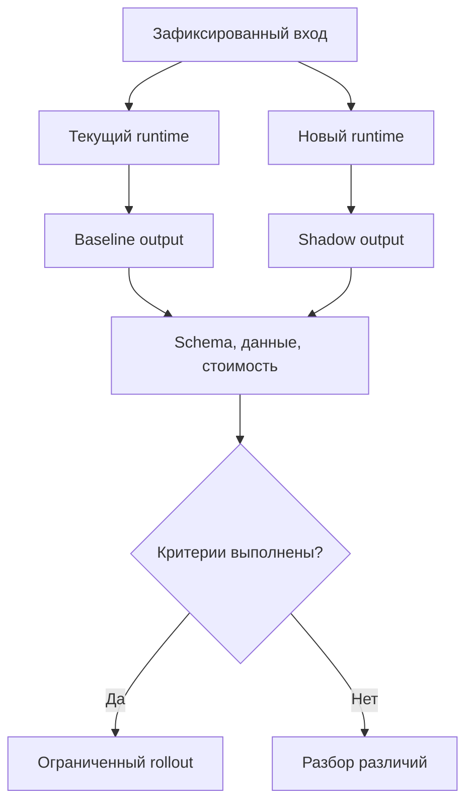
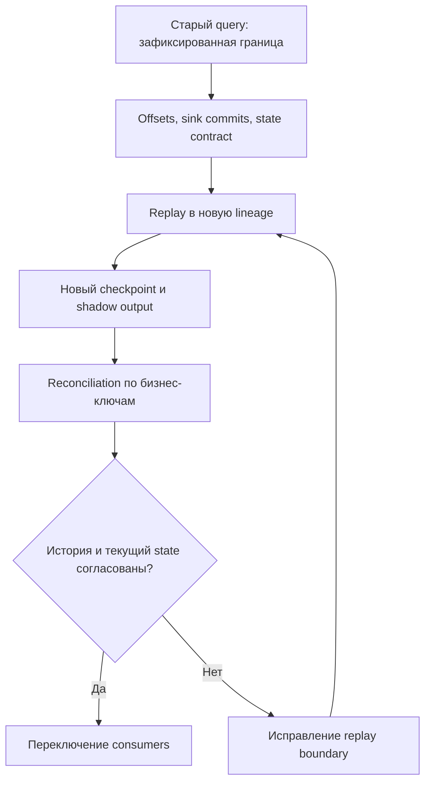
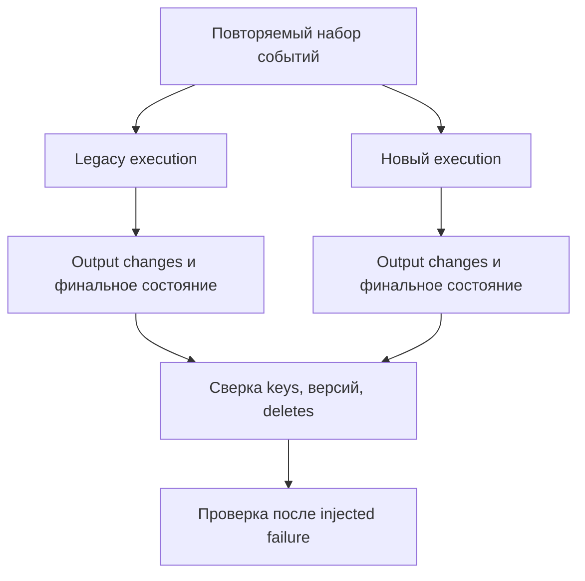
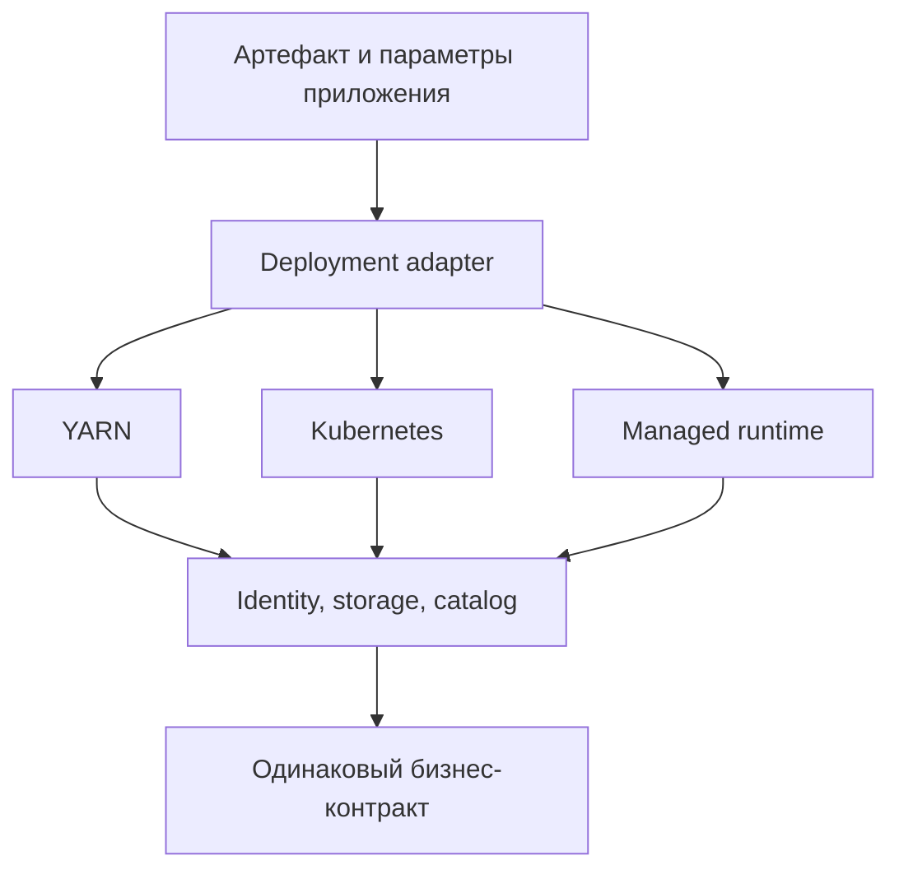
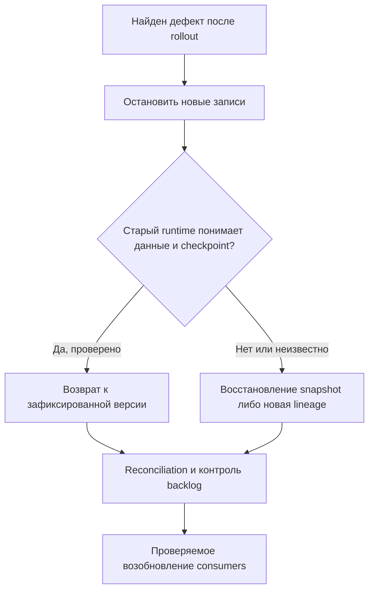

# 29. Миграции, совместимость и legacy

Основной язык примеров — **Python / PySpark**. Целевое учебное окружение: **Apache Spark 4.2.0, Python 3.12.14, JDK 17.0.20, Spark Classic, Linux**. Для сравнения отдельно установлен и выполнен **Spark 3.5.9**. Проверки проведены **15 октября 2026 года**. Scala-пример DStreams использует Scala 2.13 из дистрибутива Spark 4.2.0.

**Цель раздела:** обновлять Spark и переносить приложения так, чтобы сохранялись бизнес-результат, доступ к данным, возможность восстановления и понятный путь отката. Успешный import или старт driver — только начало проверки совместимости.

У миграции есть несколько независимых направлений: runtime и зависимости; API и SQL-семантика; сохранённые данные и table protocols; streaming checkpoints; инфраструктура и identity. Обновление одного направления может закрыть путь назад по другому. Например, старый runtime запускается, но уже не понимает features таблицы, включённые новым writer.

**Как выполнять примеры**

- Python-блоки `P01`–`P27` выполняются **по порядку в одном процессе** на Spark 4.2.0. Все данные синтетические; `collect()` используется только для маленьких fixtures. Сохраняемые каталоги создаются в новом временном пространстве.
- `V01` — отдельный самостоятельный файл `version_probe.py`. Он запускается в **двух разных Python environments/процессах**. Нельзя установить два PySpark поверх друг друга и считать это корректным dual run.
- `S01` — отдельный файл `Legacy29.scala`; `B01` компилирует и запускает его. Queue DStream демонстрирует API и накопление состояния, но не recovery внешнего источника.
- Блоки с пометкой **«шаблон»** требуют своих connector, каталога, Connect server или платформы. Их нельзя выдавать за выполненный интеграционный тест; границы фактических проверок перечислены в конце.
- Миграционные defaults сравниваются на новых sessions без пользовательских overrides соответствующих ключей. Внешние `spark-defaults.conf`, vendor runtime и настройки платформы могут изменить наблюдаемые значения.

**P01 — начальная настройка лаборатории и вспомогательные проверки.** Нужны PySpark 4.2.0 и совместимые NumPy, pandas, PyArrow; в проверенном окружении pandas 2.2.3 и PyArrow 26.0.0. Для локальной лаборатории достаточно `python -m pip install 'pyspark==4.2.0' 'pandas==2.2.3' 'pyarrow==26.0.0' numpy` и Java 17.

```python
# P01
import json
import os
import sys
import tempfile
import shutil
from contextlib import contextmanager
from pathlib import Path
from importlib.metadata import version

os.environ.setdefault("SPARK_LOCAL_IP", "127.0.0.1")
os.environ["PYSPARK_PYTHON"] = sys.executable
from pyspark.sql import SparkSession, functions as F, types as T

spark = (
    SparkSession.builder.master("local[2]")
    .appName("migration-lab-29")
    .config("spark.ui.enabled", "false")
    .config("spark.driver.memory", "512m")
    .config("spark.driver.host", "127.0.0.1")
    .config("spark.driver.bindAddress", "127.0.0.1")
    .config("spark.python.use.daemon", "false")
    .config("spark.sql.shuffle.partitions", "2")
    .config("spark.sql.session.timeZone", "UTC")
    .getOrCreate()
)
spark.sparkContext.setLogLevel("ERROR")
assert spark.version == "4.2.0"
lab = Path(tempfile.mkdtemp(prefix="spark29-"))


@contextmanager
def sql_options(**options):
    previous = {key: spark.conf.get(key) for key in options}
    try:
        for key, value in options.items():
            spark.conf.set(key, str(value))
        yield
    finally:
        for key, value in previous.items():
            spark.conf.set(key, value)


def expect_error(action, condition):
    try:
        action()
    except Exception as error:
        get_condition = getattr(error, "getCondition", None)
        actual = get_condition() if get_condition else None
        assert actual == condition or condition in str(error), (actual, str(error)[:200])
        return
    raise AssertionError(f"Expected {condition}")
```

`sql_options` временно меняет только существующие runtime SQL-настройки и возвращает прежние значения. Он не подходит для статических startup settings. `expect_error` проверяет конкретное условие ошибки; перехват любого исключения без проверки причины может скрыть поломанный тест.

**Содержание**

1. [Планирование обновления Spark](#upgrade-planning)
2. [Миграция SQL и форматов данных](#sql-formats)
3. [Миграция API и приложений](#application-api)
4. [Миграция streaming и table protocols](#streaming-protocols)
5. [Legacy Spark Streaming: DStreams](#dstreams)
6. [Исторические компоненты и API](#legacy-components)
7. [Перенос между платформами](#platform-migration)

<a id="upgrade-planning"></a>

## Планирование обновления Spark

### Migration guides для SQL, PySpark, Core, ML и streaming

Начинай с точной пары **исходная версия → целевая версия**, включая patch level и vendor build. При переходе 3.5 → 4.2 нужно прочитать изменения 3.5 → 4.0, 4.0 → 4.1 и 4.1 → 4.2. Заголовок «upgrading to latest» не фиксирует воспроизводимый контракт.

| Руководство | Что искать | Пример риска |
| --- | --- | --- |
| SQL/DataFrame | Coercion, defaults, parsing, DDL, JDBC types | Тот же CAST завершает job ошибкой |
| PySpark | Python, pandas, Arrow, сериализация и доступность API | UDF получает другой dtype |
| Core | JVM, cluster managers, scheduling, deployment | Использованный manager удалён |
| MLlib | Алгоритмы, persistence, модели и численная семантика | Загруженная модель даёт другой прогноз |
| Structured Streaming | Recovery, offsets, state и triggers | Новый план не может продолжить checkpoint |
| Connector/vendor release notes | Protocol, extensions, ограничения runtime | Connector не собран под новый Spark |

Заведи журнал решений: изменение → затронутые workloads → проверка → временная настройка, если нужна → срок её удаления. Разделяй документированный новый результат, исправление correctness bug и неожиданную регрессию. Для багфикса «старый ответ» не всегда является правильным эталоном.

**Практика:** выбери пять изменений, которые пересекаются с твоим приложением, и для каждого напиши минимальный запрос или сценарий восстановления. **Самопроверка:** почему SQL migration guide нужно читать и для Structured Streaming?

Источники: [SQL](https://spark.apache.org/docs/4.2.0/sql-migration-guide.html), [PySpark](https://spark.apache.org/docs/4.2.0/api/python/migration_guide/pyspark_upgrade.html), [Core](https://spark.apache.org/docs/4.2.0/core-migration-guide.html), [ML](https://spark.apache.org/docs/4.2.0/ml-migration-guide.html), [Structured Streaming](https://spark.apache.org/docs/4.2.0/streaming/ss-migration-guide.html).

### Изменение требований Java, Scala и Python

Совместимость Spark — сочетание нескольких runtimes. Совпадающий major Python не гарантирует наличие native wheel для архитектуры executor; совместимый JDK не делает Scala 2.12 JAR совместимым с Scala 2.13.

| Линия Spark | Базовые требования из документации | Что отдельно проверять |
| --- | --- | --- |
| 3.5.x | Java 8/11/17 с оговорками; Scala 2.12/2.13 по сборке; Python 3.8+ | Какой Scala suffix у конкретного distribution |
| 4.0 | Java 17/21; Scala 2.13; Python 3.9+ | Исключение Java 8/11, Scala 2.12 и Python 3.8 |
| 4.1 | Python 3.10+; pandas минимум 2.2.0, PyArrow минимум 15.0.0 | Native dependencies и Python на всех executors |
| 4.2.0 | Java 17/21/25; Scala 2.13; Python 3.10+; PyArrow минимум 18.0.0 | Включённые Arrow paths и изменённые defaults |

Это ориентир требований линии, а не обещание поддержки любого сочетания верхних версий библиотек. Фиксируй реально проверенный lockfile и image digest. Client, driver, executor и worker могут использовать разные filesystem paths; среда notebook не доказывает окружение remote worker.

**P02 — сохраняем versions и существенные settings.**

```python
# P02
runtime = {name: version(name) for name in ["pyspark", "numpy", "pandas", "pyarrow"]}
settings = {
    key: spark.conf.get(key)
    for key in [
        "spark.sql.ansi.enabled",
        "spark.sql.session.timeZone",
        "spark.sql.caseSensitive",
        "spark.sql.storeAssignmentPolicy",
        "spark.sql.execution.arrow.pyspark.enabled",
        "spark.sql.streaming.stateStore.providerClass",
    ]
}
(lab / "runtime.json").write_text(json.dumps({"packages": runtime, "sql": settings}, indent=2))
assert settings["spark.sql.ansi.enabled"] == "true"
```

Проверяй также CPU architecture, libc, BLAS, timezone database, Hadoop/cloud SDK и JDBC drivers. Для Java/Scala полезен отдельный dependency report. Runtime manifest должен сопровождать артефакт приложения и результаты regression suite.

**Самопроверка:** почему wheel, успешно установившийся на Mac разработчика, ничего не доказывает про Linux executor? Источники: [Spark 3.5.9 overview](https://spark.apache.org/docs/3.5.9/), [Spark 4.2.0 overview](https://spark.apache.org/docs/4.2.0/), [PySpark upgrade requirements](https://spark.apache.org/docs/4.2.0/api/python/migration_guide/pyspark_upgrade.html).

### Совместимость connectors, plugins и table formats

Проверяй не одну версию Spark, а комбинацию: Spark release, Scala suffix, connector artifact, storage protocol, catalog, JDK и дополнительные extensions. Connector, который использует Catalyst internals, может иметь более узкую совместимость, чем приложение на public DataFrame API.

| Слой | Что зафиксировать | Минимальная проверка |
| --- | --- | --- |
| Connector JAR | Group/artifact/version, `_2.12`/`_2.13`, transitive dependencies | Load, read, write и error path |
| Catalog | Реализация, endpoint, identity, namespaces | Разрешение таблиц и разрешения доступа |
| Table format | Library version, protocol/features, metadata | Старые данные и результат новой записи |
| Plugin/extension | Точный runtime ABI и startup settings | Инициализация, реальная нагрузка и fallback |
| Cloud/Hadoop client | Совместимость SDK и filesystem implementation | Listing, чтение, commit, retry credentials |
| JDBC | Driver version и mapping типов | Decimal/timestamp/NULL, predicate pushdown |

Не подбирай «похожий» JAR для Spark 4.1 с ожиданием, что 4.2 обязательно сработает. Если официальная compatibility matrix не включает target, это нерешённый вопрос, требующий поддержки проекта или собственных integration tests. Успех одного SELECT не покрывает MERGE, streaming и concurrent writes.

**Практика:** составь bill of materials для одного production job и отметь, какие зависимости связаны с binary ABI, а какие — с format protocol. Источники форматов: [Delta releases](https://docs.delta.io/releases/), [Iceberg Spark getting started](https://iceberg.apache.org/docs/latest/spark-getting-started/), [Hudi quick start](https://hudi.apache.org/quickstart/).

### Изменение defaults и SQL semantics

Defaults — часть поведения приложения, даже когда ключ не указан в коде. Новый parser, timezone, case sensitivity или join optimization может затронуть результат, диагностику и нагрузку. Отдельно проверяй defaults, установленные платформой поверх Apache Spark.

В выполненном сравнении получились следующие результаты:

| Проверка | Spark 3.5.9 | Spark 4.2.0 |
| --- | --- | --- |
| `spark.sql.ansi.enabled` | `false` | `true` |
| `spark.sql.legacy.timeParserPolicy` | `EXCEPTION` | `CORRECTED` |
| `spark.sql.maxSinglePartitionBytes` | `9223372036854775807b` | `134217728b` (128 MiB) |
| `spark.sql.execution.arrow.pyspark.enabled` | `false` | `true` |
| `spark.sql.execution.pythonUDF.arrow.enabled` | `false` | `true` |
| `CAST('bad' AS INT)` | NULL | `CAST_INVALID_INPUT` |
| `2147483647 + 1` | `-2147483648` | `ARITHMETIC_OVERFLOW` |
| `try_cast('bad' AS INT)` | NULL | NULL |
| Grand total grouping set над пустым входом | Ноль строк | Одна строка: `count=0` |
| Fraction `.123456789` после parsing/format | `123456` | `123456` |

Разница между нулём строк и одной строкой `count=0` принципиальна для downstream joins и отчётов. Поэтому regression suite должен включать empty input, а не только «обычный хороший день». Изменение `maxSinglePartitionBytes` влияет на planning/partitioning; его нельзя оценить только по равенству результата.

Фиксировать всё старое конфигурацией навсегда тоже плохо: вместе со старым поведением можно сохранить дефект или потерять поддерживаемый путь выполнения. Сначала определи нужный бизнес-контракт, затем выбирай настройки и исправление кода.

**Практика:** найди три defaults, которые приложение использует неявно. Для каждого реши, должен ли он стать явным параметром, тестом или принятым новым поведением. **Самопроверка:** почему одинаковый physical plan не является необходимым условием успешной миграции?

### Regression suite на реальных данных

Нужны два слоя: маленькие fixtures для edge cases и репрезентативные snapshots реальных данных. Fixtures быстро объясняют дефект; реальные распределения обнаруживают skew, редкие типы и стоимость. Не сравнивай результаты, прочитав изменяющуюся базу в разные моменты.

Проверяй schema и порядок колонок, NULL, дубликаты, бизнес-ключи, агрегаты, временные границы, ошибки и side effects. Случайная выборка может пропустить редкий corrupted file; одни агрегаты — компенсирующиеся потери и дубли. Hash/checksum удобен для первичного отбора несовпавших partitions, но не заменяет точное сравнение.

**P03 — точное сравнение мультимножеств.** `exceptAll` сохраняет multiplicity. Порядок строк здесь не является бизнес-контрактом; порядок и типы колонок проверяются schema equality.

```python
# P03
def assert_same_bag(left, right):
    assert left.schema == right.schema, (left.schema, right.schema)
    assert left.exceptAll(right).limit(1).count() == 0, "left has unmatched rows"
    assert right.exceptAll(left).limit(1).count() == 0, "right has unmatched rows"


left = spark.sql("SELECT * FROM VALUES (1), (1), (2) AS t(id)")
right = spark.sql("SELECT * FROM VALUES (2), (1), (1) AS t(id)")
assert_same_bag(left, right)
bad = spark.sql("SELECT * FROM VALUES (1), (2), (2) AS t(id)")
assert left.count() == bad.count()
try:
    assert_same_bag(left, bad)
except AssertionError:
    pass
else:
    raise AssertionError("Comparison missed changed multiplicity")
```

Для больших объёмов сравнивай по partitions/периодам и бизнес-ключам, сохраняя конкретные unmatched records в ограниченном audit dataset. Для float сначала определи абсолютный/относительный tolerance и обработку NaN/Infinity; `round` не является универсальной проверкой эквивалентности.

**V01 — самостоятельный probe двух версий.** Он сохраняет defaults, результаты пяти запросов и общий бизнес-контракт с детерминированной дедупликацией. Кроме того, он может записать/прочитать Parquet. Это лабораторный fixture; реальные snapshots подставляются отдельным integration suite.

```python
# V01: отдельный файл version_probe.py; запускается в каждом окружении Spark.
import argparse
import json
import os
import platform
import sys
from pathlib import Path
from pyspark.sql import SparkSession

parser = argparse.ArgumentParser()
parser.add_argument("--output", required=True)
parser.add_argument("--write-parquet")
parser.add_argument("--read-parquet")
args = parser.parse_args()
os.environ.setdefault("SPARK_LOCAL_IP", "127.0.0.1")
os.environ["PYSPARK_PYTHON"] = sys.executable
spark = (
    SparkSession.builder.master("local[2]")
    .appName("migration-probe-29")
    .config("spark.ui.enabled", "false")
    .config("spark.driver.memory", "512m")
    .config("spark.driver.host", "127.0.0.1")
    .config("spark.driver.bindAddress", "127.0.0.1")
    .config("spark.python.use.daemon", "false")
    .config("spark.sql.shuffle.partitions", "2")
    .config("spark.sql.session.timeZone", "UTC")
    .getOrCreate()
)
spark.sparkContext.setLogLevel("ERROR")


def capture(sql):
    try:
        frame = spark.sql(sql)
        return {
            "rows": [r.asDict() for r in frame.collect()],
            "schema": frame.schema.jsonValue(),
        }
    except Exception as error:
        method = getattr(error, "getCondition", None) or getattr(error, "getErrorClass", None)
        return {"error": method() if method else type(error).__name__}


keys = [
    "spark.sql.ansi.enabled",
    "spark.sql.legacy.timeParserPolicy",
    "spark.sql.maxSinglePartitionBytes",
    "spark.sql.execution.arrow.pyspark.enabled",
    "spark.sql.execution.pythonUDF.arrow.enabled",
    "spark.sql.session.timeZone",
]
report = {
    "spark": spark.version,
    "python": platform.python_version(),
    "java": spark.sparkContext._jvm.java.lang.System.getProperty("java.version"),
    "defaults": {k: spark.conf.get(k) for k in keys},
}
report["probes"] = {
    "bad_cast": capture("SELECT CAST('bad' AS INT) AS x"),
    "overflow": capture("SELECT CAST(2147483647 AS INT) + 1 AS x"),
    "tolerant_cast": capture("SELECT TRY_CAST('bad' AS INT) AS x, TRY_CAST('42' AS INT) AS y"),
    "empty_grouping": capture(
        "SELECT count(*) AS n FROM (SELECT 1 AS x WHERE false) t GROUP BY GROUPING SETS (())"
    ),
    "microseconds": capture(
        "SELECT date_format(TIMESTAMP '2024-01-01 00:00:00.123456789', 'SSSSSS') AS fraction"
    ),
}
# Общий бизнес-контракт задан явно, независимо от defaults версии.
spark.conf.set("spark.sql.ansi.enabled", "true")
spark.sql("""CREATE OR REPLACE TEMP VIEW raw_orders AS
 SELECT * FROM VALUES
 (1, 'm', 100L, 'ok', 1, 11), (1, 'm', 120L, 'ok', 2, 12),
 (2, 'k', 50L, 'ok', 1, 21), (3, CAST(NULL AS STRING), 30L, 'ok', 1, 31),
 (4, 'm', 70L, 'cancelled', 1, 41)
 AS t(order_id, city, cents, status, version, event_id)""")
result = spark.sql("""WITH ranked AS (
 SELECT *, row_number() OVER (PARTITION BY order_id ORDER BY version DESC, event_id DESC) AS rn
 FROM raw_orders)
 SELECT city, sum(cents) AS total_cents, count(*) AS orders
 FROM ranked WHERE rn = 1 AND status = 'ok' GROUP BY city""")
rows = sorted(
    [r.asDict() for r in result.collect()],
    key=lambda r: (r["city"] is not None, r["city"] or ""),
)
assert rows == [
    {"city": None, "total_cents": 30, "orders": 1},
    {"city": "k", "total_cents": 50, "orders": 1},
    {"city": "m", "total_cents": 120, "orders": 1},
], rows
report["contract"] = {"rows": rows, "schema": result.schema.jsonValue()}
if args.write_parquet:
    result.write.mode("errorifexists").parquet(args.write_parquet)
if args.read_parquet:
    loaded = spark.read.parquet(args.read_parquet)
    loaded_rows = sorted(
        [r.asDict() for r in loaded.collect()],
        key=lambda r: (r["city"] is not None, r["city"] or ""),
    )
    assert loaded_rows == rows
    report["read_back"] = {"rows": loaded_rows, "schema": loaded.schema.jsonValue()}
Path(args.output).write_text(json.dumps(report, ensure_ascii=False, indent=2), encoding="utf-8")
spark.stop()
print("VERSION_PROBE_OK", report["spark"], args.output)
```

```bash
# Шаблон подготовки двух изолированных environments.
python3 -m venv env35
python3 -m venv env42
env35/bin/python -m pip install 'pyspark==3.5.9'
env42/bin/python -m pip install 'pyspark==4.2.0' 'pandas==2.2.3' 'pyarrow==26.0.0' numpy

# V01 сохранить как version_probe.py; пути должны быть новыми.
env35/bin/python version_probe.py --output report35.json --write-parquet /tmp/migration29/parquet35
env42/bin/python version_probe.py --output report42.json --read-parquet /tmp/migration29/parquet35 --write-parquet /tmp/migration29/parquet42
env35/bin/python version_probe.py --output report35-read42.json --read-parquet /tmp/migration29/parquet42
```

Три вызова V01 выполнены в подготовленных окружениях. Общие rows и schema совпали; Parquet прочитан в обе стороны. Это не доказывает forward compatibility любых новых типов или features таблиц. Сравнение versions/defaults умышленно допускает ожидаемые различия; общий бизнес-контракт содержит assertions.

**Практика:** добавь в V01 refund, NULL amount, конфликтующие версии и пустой snapshot. Ожидаемый результат сначала определи независимо от старого Spark.

### Dual run, shadow validation и controlled rollout

Dual run запускает две реализации на одном логическом входе; shadow output не становится production output автоматически. Нужны отдельные destination paths/tables и независимые checkpoints. Два streaming writers не должны одновременно владеть одним checkpoint или без согласования писать в один sink.



**P04 — маленький manifest shadow run.** Это пример структуры audit record. Значения checks здесь следуют выполненным лабораторным assertions; в production они должны поступать из реальных результатов suite, а не выставляться константами.

```python
# P04
manifest = {
    "dataset": "orders_daily",
    "logical_version": 2,
    "run_id": "migration-29-001",
    "input_snapshot": "fixture-snapshot-001",
    "source_cutoff": "2026-10-01T00:00:00Z",
    "output": str(lab / "shadow" / "orders_daily"),
    "runtime": runtime,
    "checks": {"schema": True, "bag": True, "business_rules": True},
}
assert all(manifest["checks"].values())
(lab / "shadow-manifest.json").write_text(json.dumps(manifest, indent=2))
```

Rollout можно ограничить набором datasets, partition dates, tenants или долей независимых jobs. Для stateful streaming процент трафика сам по себе не решает вопрос полноты state и порядка событий. Определи период наблюдения, критерии abort и способ переключить потребителей на согласованный output.

**Самопроверка:** что сравнивать, если новый runtime исправляет ошибку старого SQL, и старый output уже известен как неправильный? **Практика:** опиши rollout одной витрины с контрольным snapshot, cutover boundary и проверяемым rollback point.

<a id="sql-formats"></a>

## Миграция SQL и форматов данных

### ANSI defaults, overflow и invalid casts

С Spark 4.0 `spark.sql.ansi.enabled` включён по умолчанию. Некорректное преобразование строки и переполнение целого могут завершить вычисление ошибкой там, где 3.5 возвращал NULL или обёрнутое значение. Это особенно заметно на «грязных» источниках, которые раньше молча попадали в отчёт.

Нужно выбрать политику: строго отклонять запись, сохранять reject dataset, допускать NULL с метрикой качества или явно исправлять значение. Отключение ANSI не является нейтральным способом «починить job»: оно меняет семантику.

**P05 — строгая ошибка и явный tolerant path.**

```python
# P05
with sql_options(**{"spark.sql.ansi.enabled": "true"}):
    expect_error(lambda: spark.sql("SELECT CAST('bad' AS INT)").collect(), "CAST_INVALID_INPUT")
    expect_error(lambda: spark.sql("SELECT 2147483647 + 1").collect(), "ARITHMETIC_OVERFLOW")
    r = spark.sql(
        "SELECT try_cast('bad' AS INT) AS parsed, try_add(2147483647, 1) AS total"
    ).first()
    assert r.parsed is None and r.total is None
    assert spark.conf.get("spark.sql.storeAssignmentPolicy") == "ANSI"
```

`try_cast` и `try_add` возвращают NULL для соответствующих ошибок преобразования/арифметики, но не исправляют неверный business input. Сохраняй исходную строку, причину отклонения и счётчик rejects. Некоторые ошибки анализа типов остаются ошибками даже у tolerant functions.

`spark.sql.storeAssignmentPolicy` — отдельная настройка вставки в таблицы. Она не становится `LEGACY` автоматически при выключении `ansi.enabled`. Также результат зависит от конкретной операции: целочисленное wraparound и Decimal overflow не следует объединять в одно правило.

**Практика:** для поля `amount` обработай `"12.30"`, пустую строку, NULL, текст и значение вне Decimal precision; отдельно проверь запись в таблицу более узкого типа. Источник: [ANSI compliance](https://spark.apache.org/docs/4.2.0/sql-ref-ansi-compliance.html).

### Datetime parsing и календарное rebasing

Это два разных механизма. **Parsing** интерпретирует строку по шаблону и parser policy. **Rebasing** согласует историческое представление дат/времени в некоторых файлах, записанных движками с разными календарями. Исправлять неверный rebase через другой string pattern бессмысленно.

**P06 — явный формат и ошибка календарной даты.**

```python
# P06
with sql_options(**{"spark.sql.legacy.timeParserPolicy": "CORRECTED"}):
    parsed = spark.sql("""SELECT
      to_date('2024-02-29', 'yyyy-MM-dd') AS valid,
      try_to_timestamp('2023-02-29', 'yyyy-MM-dd') AS invalid""").first()
    assert str(parsed.valid) == "2024-02-29" and parsed.invalid is None
```

В 4.0 default `spark.sql.legacy.timeParserPolicy` сменился с `EXCEPTION` на `CORRECTED`. Это не означает, что неверная дата обязательно станет NULL при любом вызове: важны ANSI mode и выбор функции. В примере используется `try_to_timestamp`, чтобы tolerant policy была явной.

Для исторического Parquet проверяй `spark.sql.parquet.datetimeRebaseModeInRead/Write` и отдельные `int96RebaseModeInRead/Write`; у Avro свои ключи. В Spark 4.0 старые rebasing settings с префиксом `spark.sql.legacy` удалены. Просто оставить старый ключ в конфигурации недостаточно.

**P07 — round trip древней даты в двух write modes.**

```python
# P07
for mode in ("CORRECTED", "LEGACY"):
    with sql_options(**{"spark.sql.parquet.datetimeRebaseModeInWrite": mode}):
        ancient = spark.sql("SELECT DATE '1500-01-01' AS d")
        path = str(lab / f"ancient-{mode.lower()}")
        ancient.write.mode("errorifexists").parquet(path)
        assert str(spark.read.parquet(path).first().d) == "1500-01-01"
```

Эти файлы записаны Spark 4.2 и содержат сведения о writer/rebase. Reader может использовать metadata для корректной интерпретации. Тест **не эмулирует** произвольный файл Spark 2.4, Hive или стороннего writer без metadata. Для таких файлов нужны реальные fixtures с известным календарным смыслом и проверка нескольких дат по обе стороны исторической границы.

**Самопроверка:** почему принудительный read mode не обязательно изменит результат файла с распознанной writer metadata? Источники: [datetime patterns](https://spark.apache.org/docs/4.2.0/sql-ref-datetime-pattern.html), [Parquet rebasing](https://spark.apache.org/docs/4.2.0/sql-data-sources-parquet.html#data-source-option), [SQL migration guide](https://spark.apache.org/docs/4.2.0/sql-migration-guide.html).

### Timestamp precision и timezone behavior

Сначала определи смысл поля: момент времени или локальные дата/время. `TimestampType`/LTZ представляет момент, отображаемый в session timezone; `TimestampNTZType` представляет локальное время без привязки к зоне. Простое переименование типа может изменить бизнес-смысл.

**P08 — один момент в двух зонах и независимое wall-clock время.**

```python
# P08
with sql_options(**{"spark.sql.session.timeZone": "UTC"}):
    utc = spark.sql("""SELECT
      unix_micros(TIMESTAMP '2024-01-01 00:00:00+00:00') AS micros,
      date_format(TIMESTAMP '2024-01-01 00:00:00.123456789', 'SSSSSS') AS fraction,
      CAST(TIMESTAMP_NTZ '2024-01-01 00:00:00' AS STRING) AS wall""").first()
with sql_options(**{"spark.sql.session.timeZone": "Europe/Moscow"}):
    moscow = spark.sql("""SELECT
      unix_micros(TIMESTAMP '2024-01-01 00:00:00+00:00') AS micros,
      CAST(TIMESTAMP '2024-01-01 00:00:00+00:00' AS STRING) AS shown,
      CAST(TIMESTAMP_NTZ '2024-01-01 00:00:00' AS STRING) AS wall""").first()
assert utc.micros == moscow.micros and utc.fraction == "123456"
assert moscow.shown == "2024-01-01 03:00:00" and utc.wall == moscow.wall
```

Одинаковый `unix_micros` подтверждает один момент, хотя строковое отображение отличается. Сравнение timestamps через Python `datetime` без учёта локальной зоны процесса может добавить ещё один слой преобразования; в тесте используются SQL epoch и SQL string representation.

Spark поддерживает microsecond precision; parsing может принять больше fractional digits и отбросить лишнюю точность. Значение с `.123456789` в тесте становится `.123456`, а не сохраняет nanoseconds. Внешние JDBC types, Arrow timestamp units и Parquet INT96 требуют отдельной проверки.

| Сценарий | Что проверить |
| --- | --- |
| Событие с UTC offset | Совпадение момента после чтения/записи |
| Локальное расписание | Правильный NTZ/zone contract |
| DST overlap/gap | Явную политику неоднозначных и отсутствующих времён |
| JDBC TIMESTAMP/TIMESTAMPTZ | Реальный mapping driver и Spark release |
| Фракция выше microseconds | Допустимость усечения и round trip |

**Практика:** добавь fixtures около перехода DST в выбранной зоне и перепроверь обе версии приложения. Не используй сегодняшнее системное время как expected result. Документация: [data types](https://spark.apache.org/docs/4.2.0/sql-ref-datatypes.html), [datetime patterns](https://spark.apache.org/docs/4.2.0/sql-ref-datetime-pattern.html).

### Изменения type coercion, NULL и name resolution

Один и тот же SQL-текст может быть разобран в другой набор типов и объектов. Неявное приведение строки к числу, case-insensitive resolution, временное представление и новая search path способны изменить ответ без изменения входных files.

**P09 — трёхзначная логика и чувствительность имён.**

```python
# P09
r = spark.sql(
    "SELECT NULL = NULL AS ordinary, NULL <=> NULL AS safe, 1 NOT IN (2, NULL) AS anti"
).first()
assert r.ordinary is None and r.safe is True and r.anti is None
with sql_options(**{"spark.sql.caseSensitive": "false"}):
    assert spark.sql("SELECT id FROM (SELECT 1 AS ID)").first()[0] == 1
with sql_options(**{"spark.sql.caseSensitive": "true"}):
    expect_error(
        lambda: spark.sql("SELECT id FROM (SELECT 1 AS ID)").collect(),
        "UNRESOLVED_COLUMN.WITH_SUGGESTION",
    )
```

`NOT IN` с NULL не равен обычному anti join по ненулевому множеству. При переносе RDD/SQL или замене UDF встроенным выражением сначала зафиксируй нужную NULL-политику. Null-safe equality `<=>` полезно там, где NULL считается одинаковым значением, но это отдельное бизнес-решение.

Указывай casts на границах источника, объединения datasets и записи. Схемы должны проверяться до сравнения строк: результат `DECIMAL(10,2)` и `DOUBLE` с похожим отображением не эквивалентен во всех последующих операциях.

В 4.2 появился opt-in SQL PATH, а также `system.builtin`/`system.session` и связанные правила resolution. Двухчастное имя `session.x` нельзя без проверки считать обычной persistent schema. Для важных объектов используй квалифицированные identifiers и тесты, где temporary/persistent names намеренно совпадают. У дублирующихся CTE names также изменились проверки.

**Практика:** воспроизведи коллизию temporary view и persistent table в тестовом catalog. Объясни, какой объект должен разрешиться и почему. Источники: [NULL semantics](https://spark.apache.org/docs/4.2.0/sql-ref-null-semantics.html), [name resolution](https://spark.apache.org/docs/4.2.0/sql-ref-name-resolution.html).

### Collations, VARIANT и новые типы по версии

Новый тип в API не означает автоматической поддержки всеми file formats, connectors, expressions и client libraries. Поддержка чтения тоже не доказывает поддержку partitioning, grouping, equality join или записи обратно старым reader.

**P10 — проверка семантики новых возможностей и доступности типа.**

```python
# P10
r = spark.sql("""SELECT
 'Spark' = 'spark' AS binary_equal,
 collate('Spark', 'UTF8_LCASE') = collate('spark', 'UTF8_LCASE') AS folded_equal,
 variant_get(parse_json('{"a":7}'), '$.a', 'int') AS a""").first()
assert r.binary_equal is False and r.folded_equal is True and r.a == 7
expect_error(
    lambda: spark.sql("SELECT CAST('12:34:56' AS TIME)").collect(), "UNSUPPORTED_TIME_TYPE"
)
```

`UTF8_LCASE` в этом fixture делает сравнение строк нечувствительным к регистру; default binary comparison остаётся иным. Collation может изменить группы, join cardinality и уникальность keys. Нельзя считать такую смену только косметическим улучшением сортировки.

`VARIANT` — отдельное представление semi-structured данных. `parse_json` и `variant_get` не равны неограниченному Python dict без schema contract. Проверяй отсутствующее поле, JSON null против SQL NULL, вложенные числа и поддержку записи.

В проверенной стандартной конфигурации Spark 4.2 `CAST(... AS TIME)` выдаёт `UNSUPPORTED_TIME_TYPE`: тип находится за внутренней настройкой. Этот отрицательный тест намеренно показывает, почему нельзя обещать доступность по одному упоминанию в release notes. Включение internal flag не является универсальным миграционным решением.

**Практика:** составь матрицу `type → операции → formats → readers → fallback`. Для старого потребителя можно экспортировать нормализованное представление, но явно зафиксируй потерю точности/смысла. API: [collate](https://spark.apache.org/docs/4.2.0/api/python/reference/pyspark.sql/api/pyspark.sql.functions.collate.html), [variant_get](https://spark.apache.org/docs/4.2.0/api/python/reference/pyspark.sql/api/pyspark.sql.functions.variant_get.html).

### Legacy configuration как временный механизм совместимости

Legacy flag полезен, когда позволяет ограниченно пережить переход и проверить новый контракт. У него должны быть владелец, причина, затронутые datasets, regression test и условие удаления. Не копируй из старого кластера все ключи `legacy.*` без разбора.

**P11 — ограниченная область действия и обязательное восстановление setting.**

```python
# P11
key = "spark.sql.legacy.timeParserPolicy"
original = spark.conf.get(key)
with sql_options(**{key: "LEGACY"}):
    assert spark.conf.get(key) == "LEGACY"
assert spark.conf.get(key) == original
```

| Решение | Когда уместно | Риск |
| --- | --- | --- |
| Исправить данные/код | Новое поведение соответствует нужному контракту | Потребуется backfill и согласование consumers |
| Временно включить legacy flag | Есть документированный bridge и срок удаления | Следующий release может удалить ключ |
| Зафиксировать старый runtime | Нет проверенного migration path | Ограниченное время сопровождения и зависимости |
| Новая lineage/output version | Меняется смысл или несовместим state | Стоимость replay и переключения consumers |

`spark.conf.set` может принять пользовательский ключ, который никто не читает. Наличие строки в configuration dump не доказывает, что setting поддерживается и действует. Проверяй документацию версии и эффект отдельным запросом.

**Самопроверка:** чем отличается возврат прежнего поведения parser от отключения проверки, предотвращающей потерю/дублирование данных?

### Проверка ранее записанных файлов и таблиц

Новая версия должна прочитать не только новый sample. Составь corpus: старые writers, схемы до/после evolution, nullable nested structs, Decimal, ancient dates, timestamp encodings, codecs и corrupted inputs с выбранной политикой ошибок. Не смешивай проверку формата files и metadata table format.

**P12 — маленькая проверка типов и значений сохранённого Parquet.**

```python
# P12
sample = spark.sql(
    "SELECT 1L AS id, CAST(12.30 AS DECIMAL(10,2)) AS amount, TIMESTAMP_NTZ '2024-01-01 12:30:00' AS local_ts"
)
path = str(lab / "existing-parquet")
sample.write.mode("errorifexists").parquet(path)
loaded = spark.read.parquet(path)
assert [(f.name, f.dataType) for f in sample.schema] == [
    (f.name, f.dataType) for f in loaded.schema
]
assert sample.collect() == loaded.collect()
```

После чтения файла nullability может отличаться от исходного DataFrame: у file reader свой контракт. В этом тесте типы/имена и значения проверяются отдельно; в business comparison P03 schema equality строже. Выбирай уровень сравнения явно, а не отключай все schema assertions после первого несовпадения.

Для таблицы дополнительно проверь catalog properties, partition transforms, hidden metadata columns, statistics, access controls и time travel. Прямое чтение каталога с Parquet files внутри Delta/Iceberg/Hudi обходит transaction metadata и может показать удалённые или незавершённые rows.

**Практика:** сделай read-only прогон corpus на target runtime, сохрани manifest файлов и конкретные несовпавшие partitions. Источник: [Parquet](https://spark.apache.org/docs/4.2.0/sql-data-sources-parquet.html).

<a id="application-api"></a>

## Миграция API и приложений

### Deprecated и removed APIs

Deprecated API ещё может работать, но имеет обозначенный путь замены. Removed API уже отсутствует либо перестало обслуживаться. `hasattr`/import проверяет только присутствие symbol, а не все его семантические гарантии.

**P13 — минимальная проверка присутствия двух методов.**

```python
# P13
assert callable(getattr(type(sample), "registerTempTable", None))
assert callable(getattr(type(sample), "createOrReplaceTempView", None))
```

Это не повод сохранять старый вызов. Для каждого deprecated symbol найди replacement, проверь version added/changed и поведение на fixtures. При removed methods нужны изменения кода, а не подавление warnings.

Полезный аудит сочетает поиск по исходникам приложения, runtime warnings и execution coverage. Ищи старые `registerTempTable`, `SQLContext`/`HiveContext`, `.rdd`, `._jdf`, `._jvm`, `databricks.koalas`, старые package coordinates и legacy configurations. Совпадение строки — кандидат на review, а не автоматическая ошибка: например, `.rdd` остаётся допустимым Classic API для некоторых задач.

**Практика:** составь таблицу `old symbol → replacement → semantic difference → executed test`. API: [registerTempTable](https://spark.apache.org/docs/4.2.0/api/python/reference/pyspark.sql/api/pyspark.sql.DataFrame.registerTempTable.html).

### registerTempTable → createOrReplaceTempView: перенос старых Spark SQL-примеров и области видимости временных представлений 

`registerTempTable` deprecated с 2.0; для такого сценария используй `createOrReplaceTempView`. Важно перенести не только имя метода, но и предположения об области видимости. Local temporary view относится к session; global temporary view существует в общей области приложения через namespace `global_temp`.

**P14 — замена, переопределение имени и границы sessions.**

```python
# P14
sample.createOrReplaceTempView("migrated_orders")
spark.range(2).createOrReplaceTempView("migrated_orders")
assert spark.table("migrated_orders").count() == 2
other = spark.newSession()
assert not other.catalog.tableExists("migrated_orders")
spark.range(3).createGlobalTempView("shared_orders29")
assert other.table("global_temp.shared_orders29").count() == 3
spark.catalog.dropTempView("migrated_orders")
spark.catalog.dropGlobalTempView("shared_orders29")
```

`newSession()` разделяет SQL session state, но использует тот же SparkContext. Поэтому global view виден другой session в этом приложении, а local view — нет. Ни один из вариантов не является надёжной persistent table после завершения приложения.

Не используй «temp table» как неявный staging storage между независимыми Airflow tasks или Connect sessions: материализуй результат в согласованном persistent location/table. Для Connect также нужно учитывать remote session lifecycle и reconnect policy.

**Практика:** перепиши старый tutorial с двумя `SQLContext` и покажи, где находятся session boundaries в новой реализации. API: [createOrReplaceTempView](https://spark.apache.org/docs/4.2.0/api/python/reference/pyspark.sql/api/pyspark.sql.DataFrame.createOrReplaceTempView.html), [createGlobalTempView](https://spark.apache.org/docs/4.2.0/api/python/reference/pyspark.sql/api/pyspark.sql.DataFrame.createGlobalTempView.html).

### RDD-heavy код → DataFrame/SQL при сохранении семантики

Перенос начинается с контракта transformations: ключи, duplicate policy, NULL, порядок, types и state. DataFrame aggregation обычно удобнее оптимизируется, но не делает произвольную RDD-логику автоматически эквивалентной.

**P15 — эквивалентная целочисленная агрегация.**

```python
# P15
pairs = [("a", 2), ("a", 3), ("b", 4)]
rdd_result = sorted(
    spark.sparkContext.parallelize(pairs, 2).reduceByKey(lambda a, b: a + b).collect()
)
df = spark.createDataFrame(pairs, "key string, value long")
df_result = sorted(
    (r.key, r.total) for r in df.groupBy("key").agg(F.sum("value").alias("total")).collect()
)
assert rdd_result == df_result == [("a", 5), ("b", 4)]
```

Это небольшие integers без NULL и overflow. Python integers имеют произвольную точность, а Spark `LongType` — ограниченный диапазон; при больших суммах механическая замена может изменить поведение. Для float меняется порядок суммирования. Для Python `None` и SQL NULL также нужно отдельно определить политику.

`zipWithIndex`, `groupByKey` с произвольным Python iterator, побочные эффекты `foreachPartition` и stateful processing требуют отдельного дизайна. Номер partition и порядок обхода RDD не являются устойчивым business ordering после нового shuffle/AQE.

**Практика:** перенеси RDD deduplication в window с полным deterministic tie-breaker. Проверь конфликтующие версии, одинаковые timestamps и NULL keys. **Самопроверка:** почему `dropDuplicates(['id'])` не задаёт, какая бизнес-версия записи победит?

### PySpark Classic → Spark Connect

Connect меняет границу выполнения: клиент строит план и общается с server по протоколу, а не работает в JVM driver через Py4J. Публичные DataFrame transformations подходят для переноса лучше, чем доступ к `SparkContext` и private JVM fields.

**P16 — выделяем transformation без привязки к runtime.** Выполнено на Classic; для Connect нужен отдельный server-side integration test.

```python
# P16
def portable_totals(frame):
    return frame.groupBy("key").agg(F.sum("value").alias("total"))


assert sorted((r.key, r.total) for r in portable_totals(df).collect()) == df_result
```

```python
# Шаблон: отдельный клиент с установленными Connect dependencies и доступным сервером.
# from pyspark.sql import SparkSession
# remote = SparkSession.builder.remote('sc://localhost:15002').getOrCreate()
# remote_frame = remote.createDataFrame([('a', 2), ('a', 3)], 'key string, value long')
# assert portable_totals(remote_frame).first().total == 5
```

| Аспект | Что проверить при переносе |
| --- | --- |
| `.rdd`, `SparkContext`, `._jdf` | Поддерживаемый DataFrame replacement или server library |
| Files и artifacts | Где находится путь: client, driver или executor |
| UDF dependencies | Доставку кода/окружения на сервер и workers |
| Lazy validation | Ошибка может появиться позже, при analysis/action |
| Sessions | Temp views, credentials, lifecycle и reconnect |
| Client/server versions | Поддержку конкретных операций обеими сторонами |

В release notes 4.2 есть «RDD API compatibility», но речь о DataFrame alternatives, например `zipWithIndex` и JSON/input APIs, а не о полном переносе Classic RDD runtime в Connect. В установленном Python 4.2 `Connect DataFrame.rdd` остаётся неподдерживаемым. Не делай вывод по названию release feature.

Источники: [Connect overview](https://spark.apache.org/docs/4.2.0/spark-connect-overview.html), [application development](https://spark.apache.org/docs/4.2.0/app-dev-spark-connect.html), [4.2 release notes](https://spark.apache.org/releases/spark-release-4-2-0.html).

### Pandas/Arrow behavior и зависимости Python

PySpark 4.x меняет требования к pandas/Arrow и некоторые границы преобразования типов. В 4.2 Arrow paths включены по умолчанию для ряда операций; это затрагивает environments и UDF, даже если код пользователя не вызывает PyArrow напрямую.

Особенно проверь nullable integers: pandas UDF в 4.2 может получить extension dtype `Int64` вместо исторического `float64` при NULL. Не определяй business schema по incidental dtype одного batch. Отдельно проверяй `NaN`, `pd.NA`, timezone-aware timestamps, Decimal и binary values.

**P17 — UDF, не зависящая от предположения о float64, и проверка NULL при toPandas.**

```python
# P17
import pandas as pd
from pyspark.sql.functions import pandas_udf


@pandas_udf("long")
def add_one_nullable(series: pd.Series) -> pd.Series:
    return (series.fillna(0) + 1).astype("int64")


nullable = spark.sql("SELECT * FROM VALUES (1L), (CAST(NULL AS BIGINT)), (3L) AS t(x)")
assert sorted(r.y for r in nullable.select(add_one_nullable("x").alias("y")).collect()) == [
    1,
    2,
    4,
]
pdf = nullable.toPandas()
assert len(pdf) == 3 and int(pdf["x"].isna().sum()) == 1
```

У этой UDF намеренная политика: NULL становится нулём перед прибавлением единицы. Если бизнес-правило требует сохранить NULL, код должен быть другим. Одинаковая длина pandas result и входа также не доказывает, что типы и позиции NULL совпали.

При миграции фиксируй Arrow optimization settings, проверяй Python dependencies на executor и запускай UDF реальной task. `toPandas()` собирает данные на client/driver: лабораторный пример мал; на production dataset сначала оцени размер.

**Практика:** добавь в suite nullable Decimal и timezone timestamp, сравни schema/value/null masks. Источник: [PySpark upgrade guide](https://spark.apache.org/docs/4.2.0/api/python/migration_guide/pyspark_upgrade.html), [Arrow guide](https://spark.apache.org/docs/4.2.0/sql-pyspark-pandas-with-arrow.html).

### JVM binary compatibility и пересборка artifacts

JVM может загрузить класс и всё равно получить `NoSuchMethodError` при первом обращении к изменённому методу. Scala binary version особенно важна: artifact `_2.12` нельзя считать совместимым с runtime `_2.13`.

Для public API приложение может иметь более широкий диапазон совместимости, чем Catalyst extension. Для internal APIs пересобирай под target runtime и выполняй тест с его настоящими JARs. Проверь shading и classpath: два Jackson/Guava/Netty набора не становятся безопасными только потому, что каждый отдельно существует.

```xml
<!-- Шаблон Maven dependency: версия и suffix должны соответствовать runtime. -->
<dependency>
  <groupId>org.apache.spark</groupId>
  <artifactId>spark-sql_2.13</artifactId>
  <version>4.2.0</version>
  <scope>provided</scope>
</dependency>
```

Spark dependencies обычно предоставляет runtime; упаковка второй копии Spark в fat JAR может породить class identity conflicts. Собственные внешние dependencies доставляй согласованным способом, проверяя, что их видят и driver, и executors.

**Практика:** сохрани dependency tree старого/нового приложения, найди изменения ABI и один transitive dependency conflict. Источники: [versioning policy](https://spark.apache.org/versioning-policy.html), [submitting applications](https://spark.apache.org/docs/4.2.0/submitting-applications.html).

### Замена private API поддерживаемыми interfaces

Private поля часто появляются ради explain, metadata или обхода отсутствующего public метода. Перед переносом выпиши, зачем нужно каждое обращение. Диагностику можно перевести на `explain`, schema/catalog API, listener или event logs; глубокую интеграцию — на поддерживаемые connector/extension interfaces с отдельным version adapter.

**P18 — используем public explain и проверяем результат отдельно.**

```python
# P18
plan_input = spark.range(5).filter("id >= 2").select("id")
assert [r.id for r in plan_input.collect()] == [2, 3, 4]
plan_input.explain(mode="formatted")
```

Текст physical plan может меняться без изменения ответа. Не делай business correctness test зависимым от точной строки `WholeStageCodegen` или номера expression ID. Если тест проверяет оптимизацию, используй отдельные структурные assertions и ограничь их конкретной версией.

Для небольшого migration probe допустимо отдельно читать JVM version как диагностику Classic, но не строить на private Py4J access переносимую бизнес-логику. Если public replacement отсутствует, это архитектурное ограничение, которое нужно назвать и изолировать.

**Самопроверка:** какой реальный контракт нужен твоему коду вместо `df._jdf.queryExecution()` — выполнить запрос, получить план или внедрить собственный operator?

<a id="streaming-protocols"></a>

## Миграция streaming и table protocols

### Checkpoint compatibility между версиями

Checkpoint содержит больше, чем cursor: query metadata, source offsets, commit logs и state, зависящий от operators/encoding. Нельзя оценить совместимость только по тому, что новая версия умеет прочитать JSON offset file.

У каждого checkpoint должен быть **один активный writer**. Для rehearsal копируют согласованный checkpoint остановленного запроса в изолированное окружение, фиксируют source retention и выбирают безопасный sink. Копия живого каталога без согласованности может содержать файлы разных моментов.

**P19 — restart одного stateless query в 4.2.0.** Проверяется сохранение query ID, изменение run ID и отсутствие повторной записи уже обработанных input files.

```python
# P19
stream_in = lab / "stream-input"
stream_in.mkdir()


def add_events(name, values):
    temporary = lab / f"{name}.tmp"
    temporary.write_text("".join(json.dumps(v) + "\n" for v in values))
    os.replace(temporary, stream_in / f"{name}.json")


stream_schema = "id long, key string, value long"
stream_out = lab / "stream-output"
checkpoint = lab / "checkpoint"


def start_copy(cp):
    return (
        spark.readStream.schema(stream_schema)
        .json(str(stream_in))
        .writeStream.format("parquet")
        .option("path", str(stream_out))
        .option("checkpointLocation", str(cp))
        .trigger(availableNow=True)
        .start()
    )


add_events("first", [{"id": 1, "key": "a", "value": 2}, {"id": 2, "key": "a", "value": 3}])
q = start_copy(checkpoint)
assert q.awaitTermination(90)
first_id = str(q.id)
first_run = str(q.runId)
add_events("second", [{"id": 3, "key": "b", "value": 4}])
q = start_copy(checkpoint)
assert q.awaitTermination(90)
assert str(q.id) == first_id and str(q.runId) != first_run
assert sorted(r.id for r in spark.read.parquet(str(stream_out)).collect()) == [1, 2, 3]
```

Это тест **внутри одной версии**, а не доказательство совместимости 3.5 checkpoint с 4.2. Межверсионный restart должен проверяться для реального плана, connector, state и storage. Новый query ID при новом checkpoint меняет идентичность потока и может повлиять на deduplication sink.

| Что сохранять до обновления | Зачем |
| --- | --- |
| Runtime/config/dependency manifest | Воспроизвести старый executor/driver |
| Согласованный checkpoint snapshot | Проверить recovery и иметь точку возврата |
| Source offsets и retention horizon | Оценить возможность replay |
| Sink commits/transaction identifiers | Связать progress и опубликованные данные |
| План, schema и state operator layout | Проверить допустимость continuation |

**Практика:** напиши recovery rehearsal с остановкой, копированием и проверкой outcome каждого batch. Источники: [recovery semantics](https://spark.apache.org/docs/4.2.0/streaming/apis-on-dataframes-and-datasets.html#recovery-semantics-after-changes-in-a-streaming-query), [streaming migration](https://spark.apache.org/docs/4.2.0/streaming/ss-migration-guide.html).

### Schema evolution stateful operators

Input schema, output schema и **state schema** — три разных контракта. Добавить nullable input column иногда можно без изменения state; поменять grouping keys или набор aggregates обычно означает другое state layout. Rename поля не становится безопасным только потому, что тип совпал.

**P20 — restart stateful aggregation с неизменной схемой.** В первом запуске state даёт `a=5, b=4`; после нового события и restart — `a=6, b=4`.

```python
# P20
state_cp = lab / "state-checkpoint"
snapshots = []


def capture_state(batch, batch_id):
    snapshots.append((batch_id, {r.key: r.total for r in batch.collect()}))


def start_state():
    return (
        spark.readStream.schema(stream_schema)
        .json(str(stream_in))
        .groupBy("key")
        .agg(F.sum("value").alias("total"))
        .writeStream.outputMode("complete")
        .foreachBatch(capture_state)
        .option("checkpointLocation", str(state_cp))
        .trigger(availableNow=True)
        .start()
    )


q = start_state()
assert q.awaitTermination(90)
assert snapshots[-1][1] == {"a": 5, "b": 4}
add_events("third", [{"id": 4, "key": "a", "value": 1}])
q = start_state()
assert q.awaitTermination(90)
assert snapshots[-1][1] == {"a": 6, "b": 4}
```

`foreachBatch` здесь собирает два ключа в driver list для assertions. Это лабораторный observer, без гарантий production sink. Он не хранит результат между завершениями Python-процесса; надёжность state проверяется через checkpoint Spark, а долговременный output требует собственного commit protocol.

Для обычных aggregations/deduplication/stream-stream joins не меняй grouping/equality keys и state types произвольно. Новые stateful APIs и encoding modes могут иметь документированную schema evolution, но она ограничена конкретным API, версией и типом изменения. Поддержка evolution не означает возможность заменить любой старый state на произвольный новый.

**Практика:** классифицируй изменения: добавить input поле, изменить ключ, добавить aggregate, изменить timeout, поменять output label. Для каждого укажи, затрагивается ли state и где это проверяется. **Самопроверка:** почему schema evolution Lakehouse sink не мигрирует автоматически state query?

### State store provider и настройки состояния

State store provider определяет, как Spark хранит и восстанавливает state. Локальные RocksDB files на executor и надёжный checkpoint — разные части пути. Потеря local cache должна быть покрыта recovery; потеря checkpoint не заменяется наличием живой RocksDB directory на другом узле.

В P02 записывается `spark.sql.streaming.stateStore.providerClass`; P20 выполнен с default HDFS-backed provider стандартного Spark 4.2.0. **Смена provider в этом тесте не выполнялась.** Нельзя произвольно поменять HDFS-backed на RocksDB для существующего checkpoint и объявить state мигрированным.

Проверяй также state partitioning/shuffle partitions, encoding, compression, maintenance/snapshot settings и memory budget. Некоторые настройки фиксируются checkpoint; часть допустима для restart. Решение должно опираться на документацию именно target release и test с реальным state.

У RocksDB changelog checkpointing есть свой documented migration path для поддерживаемых версий. Переключение его режима не эквивалентно смене provider. Проверяй размер state, restore time, upload lag, размер checkpoint, memory/native overhead и обработку отказа executor.

**Практика:** сравни время первого batch после restart с обычным steady-state batch и объясни источник разницы. Документация: [state store](https://spark.apache.org/docs/4.2.0/streaming/apis-on-dataframes-and-datasets.html#state-store).

### Изменение query plan и допустимость продолжения checkpoint

Правило «с тем же checkpoint можно менять что угодно, пока schema результата прежняя» неверно. На recovery влияют source identity, stateful operators, sink и конфигурация. Даже допустимое изменение filter меняет семантику **будущих** данных и не пересчитывает уже выданную историю автоматически.

| Изменение | Как оценивать |
| --- | --- |
| Rate limit источника | Часто допускается; проверить source-specific contract |
| Projection/filter без изменения state | Часть случаев поддерживается; проверить output и прошлую историю |
| Grouping/join/deduplication keys | Обычно несовместимое изменение state |
| Output directory file sink | Нельзя механически заменить при продолжении прежнего checkpoint |
| Topic/path/тип источника | Нужна отдельная проверка source identity/retention |
| Новые stable source names в 4.2 | Документированный отдельный механизм; не применять правила старого positional mapping вслепую |

В 4.2 появились named streaming sources и sink-related log changes. В Python проверен `DataStreamReader.name(source_name)`; доступность sink naming зависит от языка/API. Это позволяет некоторым новым режимам управлять source identity, но не даёт общей свободы менять state schema. Учитывай и совместимость checkpoint после включения новых форматов logs.

**P21 — fault injection только на отдельной лабораторной копии.** У копии удаляется metadata file, а offsets/commits остаются. Spark 4.2 должен отклонить такой restart.

```python
# P21
broken = lab / "checkpoint-missing-metadata"
shutil.copytree(checkpoint, broken)
assert (broken / "metadata").exists()
(broken / "metadata").unlink()
failed_query = None
try:
    expect_error(
        lambda: start_copy(broken).awaitTermination(90),
        "STREAMING_CHECKPOINT_MISSING_METADATA_FILE",
    )
finally:
    for active in spark.streams.active:
        active.stop()
```

Условие `STREAMING_CHECKPOINT_MISSING_METADATA_FILE` защищает от молчаливой генерации новой query identity при существующем progress. Выключать проверку, чтобы job «снова стартовал», опасно для sink deduplication. Исследуй происхождение потери metadata и выбери восстановление согласованного checkpoint либо новую lineage.

**Самопроверка:** почему автоматическое создание нового query ID может повторно записать уже committed batch? Источники: [streaming migration 4.2](https://spark.apache.org/docs/4.2.0/streaming/ss-migration-guide.html), [release notes: source/sink naming](https://spark.apache.org/releases/spark-release-4-2-0.html).

### Protocol upgrade Delta/Iceberg/Hudi и совместимость readers

Версия connector library и версия table protocol/format — разные числа. Обновление библиотеки может читать старую таблицу без upgrade, а включение одной новой table feature — отрезать старый reader. Проверяй всех consumers, включая Trino, Flink, BI connectors, CDC и backfill tools.

| Формат | Что сохранять в inventory | Что проверить до включения features |
| --- | --- | --- |
| Delta | Reader/writer protocol и feature lists | Все readers/writers понимают включённые features |
| Iceberg | Format version, metadata/snapshot, delete files/features | Engines поддерживают именно этот format/features |
| Hudi | Table version, timeline/metadata, table type и services | Поддержку reader/writer и официальный upgrade/downgrade path |

```sql
-- Шаблоны read-only inspection в соответствующем catalog/runtime.
-- Команды не выполнялись без внешних connectors и таблиц.
-- Delta:
DESCRIBE DETAIL analytics.orders;
-- Iceberg: metadata table; синтаксис идентификатора зависит от catalog.
SELECT * FROM analytics.db.orders.snapshots;
```

Для Hudi проверяй table metadata и поддерживаемые inspection commands/CLI конкретного release. Не редактируй вручную `.hoodie` или protocol JSON, чтобы «понизить версию»: это не переписывает данные и может нарушить инварианты.

У Delta для части features есть специальный `DROP FEATURE` workflow, но это не универсальное понижение любой таблицы. Может потребоваться rewrite и ожидание retention; отключение свойства не обязательно удаляет feature из protocol. У Iceberg format evolution и Hudi downgrade свои правила. Поэтому план отката подтверждается **до** новой записи и table feature activation.

**Практика:** составь матрицу всех readers одной таблицы и проверь её после тестового upgrade в отдельной копии. Реальные protocol upgrades в этой лаборатории не выполнялись. Источники: [Delta feature compatibility](https://docs.delta.io/versioning/), [Delta drop feature](https://docs.delta.io/delta-drop-feature/), [Iceberg specification](https://iceberg.apache.org/spec/), [Hudi CLI](https://hudi.apache.org/docs/cli/).

### Новая query lineage, replay и reconciliation при несовместимой миграции

Если state/checkpoint continuation не поддерживается, создай новый checkpoint и новую output lineage. Но сначала выбери starting boundary: начальные offsets, snapshot, event-time cutoff и объём state history. Начать «с текущего момента» недостаточно для состояния, которое зависит от прошлых событий.



**P22 — маленький replay с явной event identity.** Он демонстрирует deduplication повторно доставленного события; это batch fixture, а не бесконечное хранение всех ключей в streaming state.

```python
# P22
raw = spark.sql("""SELECT * FROM VALUES
 ('e1', 'a', 2L, '2024-01-01T00:00:01Z'),
 ('e2', 'a', 3L, '2024-01-01T00:00:02Z'),
 ('e2', 'a', 3L, '2024-01-01T00:00:02Z') AS t(event_id, key, value, event_time)""")
replayed = raw.dropDuplicates(["event_id"]).groupBy("key").agg(F.sum("value").alias("total"))
assert replayed.first().total == 5
```

Для bounded streaming deduplication нужны watermark/retention и политика событий позже допустимого горизонта. Для upsert sink может быть важнее `(business_key, source_sequence)`, чем один `event_id`. Определи tie-breaker и порядок применения updates/deletes.

Reconciliation проверяет не только count: ключи, актуальные версии, deletes, суммы, временные границы и остаточный backlog. Для неидемпотентного внешнего side effect нужен отдельный recovery/outbox protocol. Replay нельзя считать безопасным, пока не определён sink outcome повторов.

**Практика:** запланируй перенос stateful CDC-пайплайна с двухнедельным replay и опиши, как исключить двойной billing. **Самопроверка:** почему sink batch ID из нового checkpoint не заменяет старую бизнес-идентичность события?

<a id="dstreams"></a>

## Legacy Spark Streaming: DStreams

### StreamingContext и Discretized Streams

DStream представляет последовательность RDD по micro-batch intervals. `StreamingContext` строит граф transformations и запускает scheduler через `start()`. Это предыдущее поколение streaming engine; для нового приложения обычно выбирают Structured Streaming, а DStreams изучают для сопровождения существующего кода и осмысленного переноса.

Отличай контексты: `SparkContext` управляет Core, `StreamingContext` — DStreams graph, `SparkSession` — современный SQL/DataFrame вход. DStream не является streaming DataFrame, и его checkpoint не становится Structured Streaming checkpoint после смены import.

**S01 — самостоятельная Scala-лаборатория.** Две RDD-порции содержат `a,a,b` и `a,b`. Проверяются накопительный state, трёхсекундное окно и `mapWithState` snapshots; ожидается `a=3,b=2` на соответствующем шаге.

```scala
// S01: отдельный файл Legacy29.scala; Spark Classic 4.2.0, Scala 2.13.
package lab29
import java.nio.file.Files
import java.util.concurrent.{CountDownLatch, TimeUnit}
import scala.collection.mutable
import org.apache.spark.{SparkConf, SparkContext}
import org.apache.spark.rdd.RDD
import org.apache.spark.streaming.{Seconds, StreamingContext, State, StateSpec}

object DriverSignals {
  val cumulative = new CountDownLatch(1)
  val window = new CountDownLatch(1)
  val mapped = new CountDownLatch(1)
}

object Legacy29 {
  def main(args: Array[String]): Unit = {
    val conf = new SparkConf().setAppName("legacy-streaming-29")
      .set("spark.ui.enabled", "false").set("spark.default.parallelism", "2")
    val sc = new SparkContext(conf)
    sc.setLogLevel("ERROR")
    val ssc = new StreamingContext(sc, Seconds(1))
    ssc.checkpoint(Files.createTempDirectory("dstream29-").toString)
    val input = mutable.Queue[RDD[String]](
      sc.parallelize(Seq("a", "a", "b"), 2),
      sc.parallelize(Seq("a", "b"), 2))
    val words = ssc.queueStream(input, oneAtATime = true).map(word => (word, 1L))
    val cumulative = words.updateStateByKey[Long] {
      (values: Seq[Long], previous: Option[Long]) => Some(previous.getOrElse(0L) + values.sum)
    }
    cumulative.foreachRDD { rdd =>
      val current = rdd.collect().toMap
      if(current.get("a").contains(3L) && current.get("b").contains(2L)) DriverSignals.cumulative.countDown()
    }
    words.reduceByKeyAndWindow((a: Long, b: Long) => a + b, Seconds(3), Seconds(1))
      .foreachRDD { rdd =>
        val current = rdd.collect().toMap
        if(current.get("a").contains(3L) && current.get("b").contains(2L))
          DriverSignals.window.countDown()
      }
    val spec = StateSpec.function[String, Long, Long, (String, Long)] {
      (key: String, value: Option[Long], state: State[Long]) =>
        val total = state.getOption().getOrElse(0L) + value.getOrElse(0L)
        state.update(total)
        (key, total)
    }
    words.mapWithState(spec).stateSnapshots().foreachRDD { rdd =>
      val current = rdd.collect().toMap
      if(current.get("a").contains(3L) && current.get("b").contains(2L))
        DriverSignals.mapped.countDown()
    }
    ssc.start()
    try {
      assert(DriverSignals.cumulative.await(30, TimeUnit.SECONDS), "updateStateByKey")
      assert(DriverSignals.window.await(30, TimeUnit.SECONDS), "window")
      assert(DriverSignals.mapped.await(30, TimeUnit.SECONDS), "mapWithState")
      println("DSTREAM29_OK a=3 b=2")
    } finally {
      ssc.stop(stopSparkContext = true, stopGracefully = false)
    }
  }
}
```

`CountDownLatch` находится в отдельном driver singleton, чтобы не захватывать несериализуемый объект локальной переменной в checkpointed graph closure. На driver `foreachRDD` делает bounded `collect()`; такой приём не предназначен для production-sized данных.

Queue input удобен для проверки API, но не воспроизводит внешний replayable source. Checkpoint в S01 нужен stateful DStream operations; восстановление `queueStream` после process failure не проверяется и не обещается.

Источник: [Spark Streaming guide](https://spark.apache.org/docs/4.2.0/streaming-programming-guide.html).

### Receiver-based и direct sources

Receiver-based source запускает receiver task, которая принимает данные и складывает blocks. Ему нужны execution resources и работающий driver/executor lifecycle. Если все slots заняты receivers, обработке batches может не хватить ресурсов.

Direct Kafka integration строит чтение по диапазонам offsets без отдельного receiver. Это другой recovery path, но слово direct само по себе не даёт end-to-end exactly-once: нужно согласовать offsets и внешнюю запись. Используемая Kafka integration library также должна соответствовать Spark/Scala версии.

| Вопрос | Receiver-based | Direct Kafka DStream |
| --- | --- | --- |
| Как поступают данные | Receiver принимает поток | Tasks читают offset ranges |
| Какие ресурсы нужны | Slots для receiver и обработки | Processing slots и Kafka clients |
| Что важно для восстановления | Source guarantees, receiver blocks/WAL | Replay offsets, retention и sink outcome |
| Где rate limits | Receiver-specific settings | Kafka partition-specific limits |

Не смешивай direct DStreams `KafkaUtils.createDirectStream` со Structured Streaming `spark.readStream.format('kafka')`: различаются API, checkpoint и настройки. Kafka broker version compatibility не означает совместимости arbitrary connector JAR.

**Практика:** найди в старом job фактический source class, dependency coordinates и способ фиксации offsets. Источник: [legacy Kafka integration](https://spark.apache.org/docs/4.2.0/streaming-kafka-0-10-integration.html).

### Window operations и updateStateByKey/mapWithState

DStream window выбирает несколько RDD-порций по batch time. Window duration и slide должны согласовываться с batch interval. Это не автоматическое event-time окно по timestamp внутри записи; late event может попасть по времени поступления в другой результат.

`updateStateByKey` получает новые значения и прежний state, может поддерживать состояние ключей между batches и требует checkpoint. Нужно определить удаление ненужных keys; иначе state растёт бесконечно. `mapWithState` использует `StateSpec`/`State` и другой контракт обновления/timeouts. Он не является Python-методом с любой JVM-сигнатурой: S01 написан на Scala намеренно.

В S01 `stateSnapshots()` проверяет накопленные totals, тогда как обычный mapped output отражает вызовы state function. При переносе важно знать, какой из этих outputs фактически использовал downstream код.

**B01 — сборка и запуск S01.** Сохрани `Legacy29.scala` и этот Python-блок в одном рабочем каталоге с доступным PySpark 4.2.0. Compiler берётся из Spark JARs.

```python
# B01: отдельный запуск после сохранения S01 в Legacy29.scala.
import os
import subprocess
import zipfile
from pathlib import Path
import pyspark

work = Path.cwd()
spark_home = Path(pyspark.__file__).resolve().parent
classes = work / "legacy29-classes"
classes.mkdir(exist_ok=True)
jar = work / "legacy29.jar"
env = os.environ | {"SPARK_LOCAL_IP": "127.0.0.1"}
subprocess.run(
    [
        "java",
        "-cp",
        str(spark_home / "jars" / "*"),
        "scala.tools.nsc.Main",
        "-usejavacp",
        "-d",
        str(classes),
        str(work / "Legacy29.scala"),
    ],
    check=True,
    env=env,
)
with zipfile.ZipFile(jar, "w") as archive:
    for item in classes.rglob("*.class"):
        archive.write(item, item.relative_to(classes))
subprocess.run(
    [
        str(spark_home / "bin" / "spark-submit"),
        "--master",
        "local[2]",
        "--driver-memory",
        "512m",
        "--class",
        "lab29.Legacy29",
        str(jar),
    ],
    check=True,
    env=env,
)
```

**Практика:** добавь key timeout и продумай повторное появление ключа после удаления. При переносе в Structured Streaming выбери aggregation, `transformWithState` или другой доступный stateful API на основании семантики, а не схожего названия.

API: [PairDStreamFunctions](https://spark.apache.org/docs/4.2.0/api/scala/org/apache/spark/streaming/dstream/PairDStreamFunctions.html), [StateSpec](https://spark.apache.org/docs/4.2.0/api/scala/org/apache/spark/streaming/StateSpec.html).

### Checkpointing, receiver WAL и recovery

DStreams checkpoint включает metadata графа и данные, нужные для восстановления state/lineage. Metadata checkpoint сериализует часть приложения, поэтому несовместимое изменение classes/closures может помешать restart. Не считай такой checkpoint переносимым snapshot business state произвольной версии.

Receiver WAL сохраняет принятые receiver данные в надёжное хранилище при соответствующей конфигурации и источнике. Это отличается от metadata checkpoint, Kafka offset replay и checkpoint Structured Streaming. Ни один из этих механизмов не делает внешний sink транзакционным автоматически.

**Шаблон настройки старого приложения:** `spark.streaming.receiver.writeAheadLog.enable=true` задаётся до запуска и сопровождается надёжным checkpoint directory, поддержкой source и проверкой recovery. Сам флаг без проверки storage/commit path не является гарантией.

В старом проекте ищи `StreamingContext.getOrCreate`, checkpoint interval, source construction и параметры сериализованных closures. Тестируй driver restart, executor loss и partial sink commit отдельно. S01 queue fixture этого не покрывает.

**Самопроверка:** что восстановится из metadata checkpoint, если внешняя система уже удалила непрочитанные данные? **Практика:** составь recovery map из source log, receiver WAL, graph checkpoint, state RDD и sink audit.

### Backpressure и особенности scheduling legacy streaming

DStreams processing time должен укладываться в доступный интервал или backlog будет расти. Если batch processing в среднем дольше batch interval, увеличение числа одновременно ожидающих batches не устраняет дефицит throughput.

Backpressure регулирует ingestion на основании наблюдаемой нагрузки в поддерживаемых sources. Это не механизм удаления state, не гарантия SLA и не компенсация недоступного sink. Начальные rates, receiver limits, Kafka direct limits и processing concurrency нужно читать как разные настройки.

Следи за scheduling delay, processing delay, input records, queue backlog, executor utilization, GC и sink latency. Нужны отдельные ресурсы для receivers и compute; изменение batch interval влияет на нагрузку, state updates и output granularity.

**Практика:** для существующего DStream сохрани timeline из десяти batches и вычисли, растёт ли задержка. Затем найди ограничение: receiver, чтение Kafka, shuffle, state или sink. **Самопроверка:** почему низкая input rate не всегда означает, что backlog исчез?

Документация: [DStreams performance tuning](https://spark.apache.org/docs/4.2.0/streaming-programming-guide.html#performance-tuning).

### spark.streaming.receiver.maxRate и spark.streaming.kafka.maxRatePerPartition: область действия legacy DStreams и отличие от maxOffsetsPerTrigger Structured Streaming 

Эти settings относятся к разным источникам и разным единицам ограничения. Переименование ключа без изменения модели не даст эквивалентной нагрузки.

| Настройка | Механизм | Область и единицы |
| --- | --- | --- |
| `spark.streaming.receiver.maxRate` | Receiver-based DStreams | Максимальная скорость records/second на receiver |
| `spark.streaming.kafka.maxRatePerPartition` | Legacy direct Kafka DStreams | Rate messages/second на Kafka partition |
| `maxOffsetsPerTrigger` | Structured Streaming Kafka source option | Общий бюджет offsets на trigger, распределяемый по topic partitions |
| `maxFilesPerTrigger` | Structured Streaming file source option | Число новых files на trigger |
| `maxBytesPerTrigger` | Поддерживаемые file sources/версии | Byte budget с оговорками источника |

```python
# Шаблон: нужен Kafka connector, broker и свои параметры; здесь не запускался.
# kafka_events = (
#     spark.readStream.format('kafka')
#     .option('kafka.bootstrap.servers', 'broker.example.invalid:9092')
#     .option('subscribe', 'events')
#     .option('maxOffsetsPerTrigger', '100000')
#     .load()
# )
```

Offsets не равны байтам, а trigger budget не равен точной скорости в секунду. При `processingTime=10 seconds` и лимите 100000 нельзя обещать 10000 records/second независимо от processing time, available backlog и размера сообщений. AvailableNow может выполнять несколько batches до выбранной границы.

**Практика:** перенеси rate policy старого job с двадцатью Kafka partitions и объясни расчёт начального trigger budget. После запуска измерь фактический bytes/second и latency. Источники: [configuration](https://spark.apache.org/docs/4.2.0/configuration.html), [Structured Streaming Kafka options](https://spark.apache.org/docs/4.2.0/streaming/structured-streaming-kafka-integration.html).

### Миграция DStreams на Structured Streaming

Начинай с semantic inventory старого графа: source replay, batch interval, window time model, state function, timeout, late data, output meaning, sink idempotency. Затем проектируй новое представление. «Один старый метод → один новый» часто не существует.

| Старый сценарий | Возможный новый путь | Что нужно согласовать |
| --- | --- | --- |
| Stateless map/filter | DataFrame expressions | Типы, NULL и UDF поведение |
| Batch-time window | Event-time window либо сохранение arrival-time модели | Границы, late data и watermark |
| `updateStateByKey` totals | Streaming aggregation или custom state | Lifetime keys и output mode |
| `mapWithState` business state | Поддерживаемый stateful API | Timeouts, timer semantics, schema |
| `foreachRDD` | Sink или `foreachBatch` | Повторы, batch identity и transaction |
| Direct Kafka offsets | Structured Streaming source checkpoint | Starting boundary и recovery policy |

У нового запроса новый checkpoint. Историю state можно восстановить replay/snapshot + согласованной догрузкой, но нельзя передать старый DStream checkpoint как `checkpointLocation`. Если меняется arrival-time на event-time, результирующие окна могут различаться **намеренно** — это должно быть согласовано, а не замаскировано.

P22 показывает только один кирпичик replay: event identity и deduplication. P19/P20 показывают restart нового query. Полный перенос требует source/sink integration test на реальных offsets и late events.

**Практика:** составь mapping старого графа с явным указанием unsupported/неэквивалентных мест и планом backfill.

### Проверка различий output semantics и гарантий доставки

Старый `foreachRDD` мог выводить весь snapshot состояния каждый batch, только изменённые keys или отдельные side effects. Structured Streaming `append`, `update` и `complete` имеют свои ограничения и семантику. Равенство конечной суммы не доказывает равенство последовательности output changes.

Проверь sequence событий: первое появление key, update, duplicate, late event, timeout, delete/retraction, restart между вычислением и внешней записью. Сравнивай и итоговую таблицу, и audit последовательности commits там, где она важна.



Гарантия source, processing state и sink — отдельные слои. Checkpoint не предотвращает повтор HTTP side effect, если запрос успел выполниться, а commit подтверждение потерялось. Для такого сценария нужны устойчивые idempotency keys, транзакция или outbox/reconciliation.

**Самопроверка:** почему переход complete → append способен оставить у потребителя неверные текущие значения? **Практика:** опиши ожидаемый output двух batches с duplicate и одного restart для каждого режима.

<a id="legacy-components"></a>

## Исторические компоненты и API

### Mesos как исторический cluster manager и отсутствие в актуальном наборе

Mesos встречается в старых Spark deployment guides и конфигурациях `mesos://...`. В Spark 3.2 его поддержка была deprecated, а в Spark 4.0 удалена. Поэтому перенос старого submit script на Spark 4.2 требует выбора другого deployment backend, а не только обновления download URL.

Для актуального Apache Spark рассматривают Standalone, YARN и Kubernetes; managed service добавляет свою инфраструктуру и ограничения. Замена cluster manager меняет packaging, resource requests, discovery, identity, storage mounts и lifecycle executors. Старые параметры Mesos нельзя механически перевести в одноимённые Kubernetes настройки.

**План переноса legacy job:** зафиксировать старые ресурсы и filesystem assumptions; выбрать target backend; подготовить артефакт/image и credentials; проверить read/write; выполнить regression/performance suite; отдельно проверить executor loss и driver recovery. Сохрани исходный deployment manifest как исторический reference, но не как рабочую конфигурацию target.

**Самопроверка:** почему старый `--master mesos://...` не исправится добавлением `--deploy-mode cluster`? Источники: [Core migration guide](https://spark.apache.org/docs/4.2.0/core-migration-guide.html), [cluster overview](https://spark.apache.org/docs/4.2.0/cluster-overview.html).

### RDD-based MLlib и границы его сопровождения

MLlib в целом не deprecated. Её RDD-based API `spark.mllib` находится в maintenance mode: исправления ошибок сохраняются, развитие сосредоточено на DataFrame API `spark.ml`. Это отличается от удаления всего ML из Spark и от запрета RDD для любых задач.

При переносе модели нужно сохранить не только алгоритм, но и подготовку features: порядок координат, label mapping, категоризации, scaling, handling missing values и seed. Совпадающее имя estimator не гарантирует одинаковые defaults или побитовый результат обучения.

**P23 — перенос sparse vector без превращения в dense array.**

```python
# P23
from pyspark.mllib.linalg import Vectors as LegacyVectors
from pyspark.ml.linalg import SparseVector

old_vector = LegacyVectors.sparse(1000, {2: 1.0, 999: 3.0})
new_vector = old_vector.asML()
assert isinstance(new_vector, SparseVector)
assert new_vector.size == 1000 and new_vector.numNonzeros() == 2
assert new_vector[2] == 1.0 and new_vector[999] == 3.0
```

`asML()` переводит representation vector, но **не конвертирует произвольный сохранённый legacy model** в новый PipelineModel. Для model migration используй поддержку конкретного алгоритма, golden predictions и numerical tolerance. Иногда безопаснее заново обучить и явно выпустить новую model version.

Не применяй `toArray()` ко всем sparse vectors большой размерности ради удобства: это может резко увеличить memory footprint. Проверяй и metadata feature columns, важную для downstream Pipeline stages.

**Практика:** загрузи сохранённую модель в поддерживаемой среде, зафиксируй predictions на golden feature dataset и сравни с целевой реализацией. В этом разделе conversion модели не выполняется. Источники: [MLlib guide/status](https://spark.apache.org/docs/4.2.0/ml-guide.html), [ML migration](https://spark.apache.org/docs/4.2.0/ml-migration-guide.html), [legacy SparseVector API](https://spark.apache.org/docs/4.2.0/api/python/reference/api/pyspark.mllib.linalg.SparseVector.html).

### SparkR: поддержка и deprecated status по версии

В Spark 4.2 SparkR ещё описан как доступный R frontend, но deprecated с Spark 4.0 и планируется к удалению в будущей версии. «Deprecated» не означает «уже отсутствует»; обещать конкретный срок удаления без release evidence нельзя.

Существующий проект на SparkR требует inventory: SparkR functions, UDF/R environment, package versions, model persistence, Arrow integration и используемая платформа. Решение о переносе зависит от того, где важен R code: интерактивный анализ, статистические libraries или production ETL.

Возможные пути — сохранить временно поддерживаемый runtime, вынести подготовку данных в SQL/PySpark, оставить R для ограниченного локального анализа либо использовать отдельно поддерживаемую R integration. У каждой альтернативы нужно проверить dependencies и данные на границе. Имена функций нельзя переводить автоматически без проверки индексов, NA/NULL, факторов и timestamps.

**Практика:** выбери три SparkR transformations из реального проекта, опиши input/output contract и создай golden dataset для переноса. R runtime и SparkR examples здесь не запускались. Источник: [SparkR 4.2.0](https://spark.apache.org/docs/4.2.0/sparkr.html).

### Koalas и переход к Pandas API on Spark

Koalas стал основой pandas API on Spark. Импорт `databricks.koalas` заменяется на `pyspark.pandas`, но нужно проверить и renamed/removed aliases, а не только одну строку import. Например, `.pandas_api()` — современная граница перехода из Spark DataFrame; старые Koalas aliases в новых releases удалялись.

Pandas API on Spark остаётся распределённым API с собственными execution costs. Index alignment, default index, order-dependent operations, actions и переход в pandas могут добавить shuffle или собрать данные локально. Совместимость синтаксиса не означает одинаковую стоимость.

**P24 — минимальный smoke test.** Опция обхода ANSI guard ограничена только данным fixture с маленькими целыми числами и не меняет автоматически весь production SQL-контракт.

```python
# P24
import pyspark.pandas as ps

with ps.option_context("compute.fail_on_ansi_mode", False):
    psdf = ps.DataFrame({"x": [1, 2, 3]})
    assert int(psdf["x"].sum()) == 6
```

Для реального переноса проверь поведение в ANSI mode и settings выбранной версии. Нельзя глобально выключить проверки и считать все операции pandas API корректными. Отдельно проверяй missing labels, dtype changes, index semantics и expensive operations.

**Практика:** перенеси небольшой Koalas pipeline, сохрани index/NULL/ordering requirements и сравни итог с pandas на ограниченном sample. Источники: [Koalas migration](https://spark.apache.org/docs/latest/api/python/migration_guide/koalas_to_pyspark.html), [PySpark upgrade](https://spark.apache.org/docs/4.2.0/api/python/migration_guide/pyspark_upgrade.html).

### Старые HiveContext/SQLContext и унификация через SparkSession

`SparkSession` объединяет основной вход в SQL/DataFrame operations. Старые примеры с `SQLContext(sc)` и `HiveContext(sc)` нужно переносить вместе с настройками catalog и Hive support. Один `SparkSession.builder.getOrCreate()` не переносит автоматически metastore connection, authorization и warehouse location.

```python
# Шаблон: отдельное приложение с нужными Hive dependencies и конфигурацией metastore.
# from pyspark.sql import SparkSession
# spark = (
#     SparkSession.builder.appName('migrated-hive-job')
#     .enableHiveSupport()
#     .getOrCreate()
# )
```

`enableHiveSupport` не означает «доступ ко всем корпоративным Hive tables настроен». Нужны совместимые dependencies, credentials, storage access, catalog settings и права. `getOrCreate()` может вернуть уже существующую session; startup configuration должна быть согласована до её создания.

Проверяй различие local temp view, global temp view и persistent catalog object. Сценарий P14 показывает границы sessions; для persistent tables нужен отдельный integration test с выбранным catalog/metastore.

**Практика:** перепиши старый notebook так, чтобы создание session и configuration были явными, а transformations принимали DataFrame аргументом. API: [SparkSession](https://spark.apache.org/docs/4.2.0/api/python/reference/pyspark.sql/api/pyspark.sql.SparkSession.html).

### Delta Live Tables и платформенные декларативные pipelines: история и отличия от Apache SDP

Delta Live Tables — историческое название платформенного продукта Databricks, продолженного в линейке Lakeflow pipelines. Apache Spark Declarative Pipelines, SDP, — компонент Apache Spark со своим открытым API и runtime. Наличие похожих decorators не делает продукты полностью взаимозаменяемыми.

В современных примерах встречается `from pyspark import pipelines as dp`; старые платформенные examples использовали `dlt`. На платформе могут продолжать поддерживаться старые имена, но это не делает `dlt` частью произвольного Apache Spark installation.

| Область | Что проверить при переносе |
| --- | --- |
| Dataset decorators и reads | Наличие в Apache API и target runtime |
| Expectations/data quality | Не является ли это платформенным расширением |
| CDC и apply-changes APIs | Конкретные semantics и доступность функции |
| Managed materialization | Кто управляет таблицей, refresh и checkpoints |
| Pipeline configuration | Project spec, deployment settings и identity |
| UI, orchestration, permissions | Возможности платформы, не выводимые из Python import |

```python
# Шаблон определения для настроенного SDP project; не выполнять как обычный batch job.
# from pyspark import pipelines as dp
# @dp.materialized_view
# def cleaned_orders():
#     return spark.read.table('raw.orders').filter('amount_cents >= 0')
```

Dataset definition возвращает DataFrame; запуск `collect`, `save` или `start` внутри такого определения нарушает ожидаемую декларативную модель. При переносе проверь весь lifecycle: orchestration, refresh, CDC, recovery и governance. SDP pipeline здесь не запускался.

**Самопроверка:** какие зависимости остаются платформенными, если код уже заменил `import dlt` на `pipelines`? Источники: [Apache SDP](https://spark.apache.org/docs/4.2.0/declarative-pipelines-programming-guide.html), [Databricks language reference/comparison](https://docs.databricks.com/aws/en/ldp/developer/python-ref), [история DLT](https://docs.databricks.com/aws/en/ldp/concepts/where-is-dlt).

### Устаревшие конфигурации и инструкции из старых статей

Статья может правильно описывать Spark своей эпохи и быть неверной для текущего runtime. Признаки, которые требуют проверки: Java 8 для Spark 4, Scala `_2.11`/`_2.12`, Mesos, старые Hadoop filesystem aliases, `registerTempTable`, Koalas imports и несуществующие legacy keys.

Проверяй инструкцию по пяти координатам: версия Spark, язык/API, deployment mode, connector version и дата. Затем находи официальный replacement и выполняй минимальный пример. Дата публикации не заменяет точную версию; свежая статья может копировать старые snippets.

**Практический аудит:** раздели настройки на действующие explicit requirements, действующие defaults, временные legacy bridges, неизвестные custom keys и удалённые параметры. Удаление параметра выполняй после проверки эффекта: он мог управлять vendor extension, которого нет в Apache docs.

Не заменяй старый artifact URL только номером версии: group/artifact ID, Scala suffix и модульная структура могли измениться. Не копируй пакетный UDF example в Connect client без проверки доставки кода и backend.

**Практика:** возьми одну старую инструкцию, составь migration diff и отметь, какие её предположения больше не выполняются. **Самопроверка:** почему запись ключа в Environment UI не доказывает, что Spark использует его при выполнении?

<a id="platform-migration"></a>

## Перенос между платформами

### Open-source Spark и vendor-specific APIs

Раздели приложение на переносимое ядро transformations и platform adapters. В ядре — публичные DataFrame/SQL операции и бизнес-контракт; в adapters — secrets, catalog paths, deployment, managed ingestion, observability и специфичные functions. Это уменьшает объём миграционного изменения и делает тесты понятнее.

Vendor runtime может добавлять optimizer, catalog, security, table features и собственные commands. Указание «Spark 4.x» в интерфейсе платформы не означает тождество upstream artifacts. Сравни реальный build, supported API, defaults и limits.

| Зависимость | Возможный переносимый контракт |
| --- | --- |
| Vendor secrets helper | Получение identity/credentials через adapter |
| Managed table path | Явное logical dataset name и catalog mapping |
| Специфичная SQL function | Эквивалентное public expression либо documented fallback |
| Vendor notebook utility | Параметры/выходы job через orchestrator interface |
| Платформенный CDC pipeline | Контракт changes/upserts, sequence и recovery |

**Практика:** выпиши все platform-specific imports и SQL commands. Для каждого сохрани функциональный тест, прежде чем выбирать replacement. Не объявляй переносимым код, который работает только благодаря неявному catalog текущего notebook.

### Переход YARN ↔ Kubernetes ↔ managed service

Основные transformations могут остаться прежними, но deployment contract меняется. На YARN важны distributed cache, Hadoop configs и Kerberos/delegation; на Kubernetes — images, pod resources, service accounts и volumes; managed service добавляет свои runtime/image/version restrictions.



| Проверка | Почему её нельзя пропустить |
| --- | --- |
| Driver/executor classpaths и Python | Notebook environment не равен worker environment |
| Resource units/limits | Heap, native memory и container limit отличаются |
| Local disk и shuffle lifecycle | Временные files могут исчезать при уходе pod/node |
| Network/DNS | Driver должен быть доступен executors по нужному адресу |
| Submit/deploy mode | Client/cluster меняет местоположение driver |
| Dependency delivery | JAR/wheel/image должны попадать в нужные процессы |

Нельзя одновременно изменить runtime, cluster manager, table protocol и бизнес-логику без промежуточных контрольных точек: станет трудно локализовать причину расхождений. Выбирай последовательность по независимым границам риска и фиксируй доказательства каждого этапа.

**Практика:** перенеси один read-only batch job, затем добавь изолированную запись и failure tests. Реальные YARN/Kubernetes/cloud deployments в лаборатории не выполнялись. Источники: [YARN](https://spark.apache.org/docs/4.2.0/running-on-yarn.html), [Kubernetes](https://spark.apache.org/docs/4.2.0/running-on-kubernetes.html).

### Изменение identity, storage paths и catalog

У пользователя notebook, service principal job и executor pod могут быть разные identities. Тест «я открыл таблицу в UI» не доказывает, что новая production identity умеет list/read/write/delete staging objects и обновлять catalog metadata.

Составь явное mapping: logical dataset → catalog/namespace/table → storage location → owner/readers/writers → credential mechanism. Absolute local path, HDFS URI, `s3a://`, `abfss://` и `gs://` не взаимозаменяемы простой заменой префикса. У connectors свои dependencies, semantics commit и retry.

```yaml
# Шаблон mapping, а не конфигурация конкретной платформы.
datasets:
  orders_daily:
    source_snapshot: fixture-snapshot-001
    old_identifier: old_catalog.finance.orders_daily
    new_identifier: new_catalog.finance.orders_daily
    validation_output: isolated_migration.orders_daily_shadow
```

Проверяй default catalog, current namespace, case sensitivity, identifier quoting и table ownership. При переносе внешней таблицы выясни, кто управляет lifecycle данных при DROP. Обновление metadata без переноса permissions может привести и к отказу доступа, и к непреднамеренному расширению прав.

**Практика:** от имени целевого job проверь read, isolated write, commit, cleanup и отказ в неразрешённой операции. Не расширяй права до admin только ради прохождения теста. **Самопроверка:** какие операции storage нужны writer кроме записи data files?

### Сохранение бизнес-семантики и стабильных identifiers

Стабильный identifier должен зависеть от бизнес-идентичности и версии её канонического представления, а не от случайного UUID, partition ID или текущего расположения файла. Перенос storage не должен сам по себе менять ключ заказчика, события или logical dataset.

**P25 — детерминированный идентификатор логической загрузки.** Это пример формирования ключа; идемпотентность создаётся sink protocol, который этот ключ использует.

```python
# P25
import hashlib

logical_key = ["orders_daily", "2026-10-01", "schema-v2"]


def logical_id(parts):
    canonical = json.dumps(parts, ensure_ascii=False, separators=(",", ":"))
    return hashlib.sha256(canonical.encode("utf-8")).hexdigest()


stable_id = logical_id(logical_key)
assert stable_id == logical_id(logical_key.copy())
assert stable_id != logical_id(logical_key + ["other"])
```

Для реальных identifiers определи нормализацию Unicode/case, timezone, leading zeros, NULL и разделители либо canonical serialization. Хеш не исправляет неустойчивый input contract. У файлов может измениться path при compaction, поэтому `input_file_name` не всегда подходит как идентичность бизнес-события.

Сохраняй deduplication keys, source sequence, deletes, effective timestamps и исторические границы. После миграции consumer должен понимать, получил он продолжение прежней истории, новый snapshot или новую версию модели данных.

**Практика:** перенеси набор событий с повторной доставкой и изменёнными paths; докажи, что logical event IDs остались прежними, а новые версии отличимы. **Самопроверка:** почему одинаковый batch ID в двух независимых checkpoints не означает одну бизнес-операцию?

### Проверка производительности и стоимости после переноса

Сравни одинаковый snapshot, code path, correctness contract и уровень параллелизма, который имеет смысл для платформы. Отдельно измеряй startup, planning, execution, restore и внешние I/O. Быстрое вычисление после долгого cold start может всё равно ухудшить SLA коротких jobs.

Стоимость — не только executor hours: driver, storage requests, network/egress, state checkpoints, retries, managed service charges и простаивающие ресурсы. Для сравнения фиксируй принятые тарифы и region; выдуманные лабораторные numbers не являются ценами облака.

**P26 — пример арифметики tradeoff на условных числах.**

```python
# P26
metrics = {
    "baseline": {"seconds": 120, "cost": 0.40},
    "candidate": {"seconds": 90, "cost": 0.45},
}
latency_ratio = metrics["candidate"]["seconds"] / metrics["baseline"]["seconds"]
cost_ratio = metrics["candidate"]["cost"] / metrics["baseline"]["cost"]
assert latency_ratio == 0.75 and cost_ratio == 1.125
```

В примере latency уменьшилась на 25%, а стоимость выросла на 12.5%. Это не «хуже» или «лучше» без SLA, бюджета и business value. Для реального решения нужны несколько запусков, cold/warm сценарии, объём входа и распределение task durations.

| Метрика | Что помогает обнаружить |
| --- | --- |
| End-to-end duration | Cold start, очередь, computation и sink |
| p50/p95 task duration, skew | Неравномерность partitions |
| Shuffle/spill/GC | Неудачный план или нехватку ресурсов |
| Source/sink requests и bytes | Стоимость connector и small files |
| State size/restore time | Цена streaming recovery |
| Cost per processed unit | Сравнение с поправкой на объём и качество результата |

**Практика:** составь отчёт одного job с равенством результата, длительностью, стоимостью и объяснением главного изменения. Timing локальных fixtures здесь не выдаётся за performance benchmark.

### План отката с учётом записанных данных и checkpoints

Rollback — согласованный возврат **runtime, кода, metadata, данных и progress**, а не только старого container tag. Если новый writer включил protocol feature или новый query продвинул checkpoint, старый runtime может уже не уметь продолжить работу.



| До cutover нужно зафиксировать | Что это позволяет сделать |
| --- | --- |
| Старый artifact/image и configuration | Повторить прежний runtime |
| Snapshot/table version и feature inventory | Проверить, доступен ли путь чтения назад |
| Остановленный checkpoint и source offsets | Определить progress boundary |
| Sink commit/audit record | Не повторить уже опубликованные side effects |
| Retention/source replay window | Оценить реальность восстановления |
| Проверенные процедуры restore/switch | Выполнить конкретный план, а не импровизировать |

Возврат таблицы к snapshot не всегда откатывает protocol/features и не возвращает consumed Kafka offsets или отправленные уведомления. Файлы, удалённые retention/VACUUM/cleaner, могут сделать time travel невозможным. Не планируй rollback дольше доступного recovery horizon без отдельного сохранения исходных данных.

**P27 — завершение основной Python-лаборатории.**

```python
# P27
spark.stop()
print("MAIN29_OK", lab, flush=True)
```

**Итоговая практика раздела**

1. Подготовь migration dossier одного приложения: source/target runtime, dependencies, SQL settings, catalogs, datasets, checkpoint/state и consumers.
2. Выполни V01 на обеих версиях и добавь свои correctness fixtures; отдельно классифицируй ожидаемые и неожиданные различия.
3. Организуй shadow output на согласованном snapshot, сохрани schema/bag/business checks и cost evidence.
4. Выполни recovery rehearsal stateful query и injected failure около sink commit на изолированных ресурсах.
5. Проверь table protocol/readers до включения новых features и подготовь rollback с конкретными boundary/snapshot/retention.
6. Для legacy DStream опиши эквивалентный новый contract: time model, state, output mode, identity и replay.

**Вопросы для самопроверки**

- Какие изменения относятся к API compatibility, какие — к data protocol, а какие — к SQL semantics?
- Почему нельзя сравнивать два результата, прочитав изменяемый источник в разные моменты?
- Когда равный count скрывает ошибку, и что даёт `exceptAll`?
- Как ANSI mode отличается от store assignment policy?
- Почему новая query identity важна для exactly-once sink?
- Когда можно продолжить checkpoint, а когда нужна новая lineage?
- Чем отличается DStream batch-time window от event-time window с watermark?
- Почему `DROP FEATURE`, snapshot restore и смена runtime tag — разные операции?
- Какие проверки должны выполняться с identity production job?
- Что именно откатывается, если новый runtime уже записал данные?

**Выполненные проверки и границы лаборатории**

| Проверка | Результат | Ограничение |
| --- | --- | --- |
| Spark 3.5.9 → 4.2.0 | V01 выполнен в независимых environments | CPython 3.12, Java 17, Classic local[2] |
| SQL defaults и edge cases | Зафиксированы ожидаемые различия ANSI, parser, Arrow и empty grouping | Не все изменения migration guide |
| Общий бизнес-контракт | Rows и schema полностью совпали | Синтетические orders, без внешнего JDBC |
| Parquet между версиями | 4.2 прочитал output 3.5; 3.5 прочитал output 4.2 | Только проверенные простые types/features |
| Точное сравнение | Перестановка строк принята, изменение multiplicity отклонено | Fixtures ограничены по размеру |
| ANSI/date/time/NULL/collation/VARIANT | Assertions прошли; TIME default path отклонён ожидаемой ошибкой | TIME не включался через internal flag |
| Ancient Parquet | CORRECTED/LEGACY round trip сохранил дату | Файлы Spark 4.2 с writer metadata |
| Temp views и sessions | Local view изолирован, global view виден другой session приложения | Не persistent external catalog |
| RDD → DataFrame | Одинаковые sums по двум ключам | Нет overflow/float edge cases |
| Arrow/pandas | Nullable integer UDF и NULL при toPandas проверены | Маленькие batches |
| Streaming stateless restart | Query ID сохранён, run ID изменён, id 1–3 без повторов | Restart внутри 4.2.0 |
| Streaming state restart | Состояние `a=5,b=4` продолжено до `a=6,b=4` | Тот же state schema/provider |
| Checkpoint без metadata | `STREAMING_CHECKPOINT_MISSING_METADATA_FILE` | Отдельная disposable копия |
| DStreams Scala | Window, updateStateByKey и mapWithState дали `a=3,b=2` | Queue fixture, без source recovery |
| Legacy vector/pandas API | Sparse representation сохранён; pandas API sum=6 | Без конвертации legacy model |

Проверены структура README, три уровня заголовков, syntax Mermaid, code fences и доступность ссылок. Межверсионное продолжение streaming checkpoint, реальные table protocol upgrades/downgrades, Kafka/WAL recovery, Connect server, SparkR, Hive metastore, SDP и перенос YARN/Kubernetes/managed service **не выполнялись**; соответствующие места обозначены как шаблоны, ограничения или задания. Локальная длительность выполнения не используется как production benchmark.
