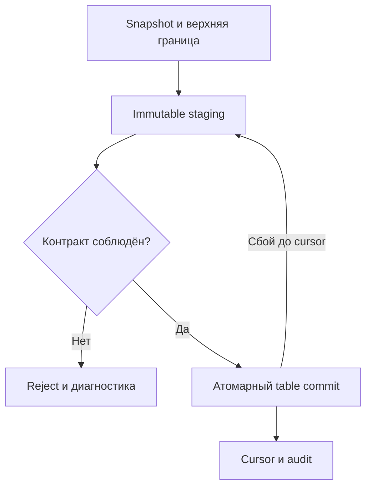
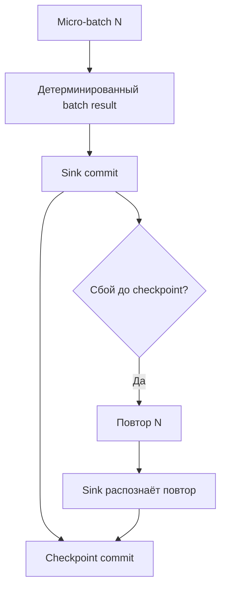
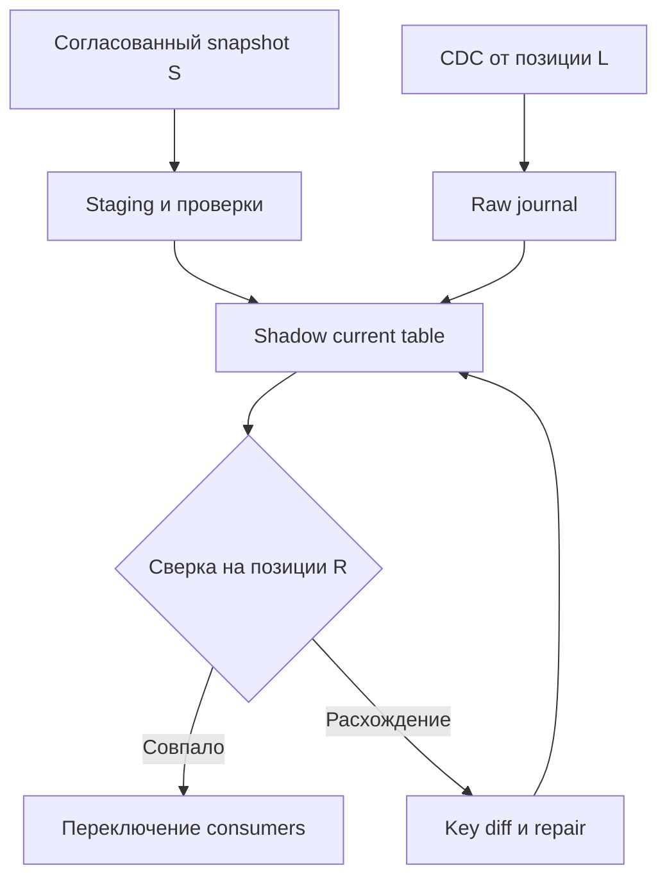
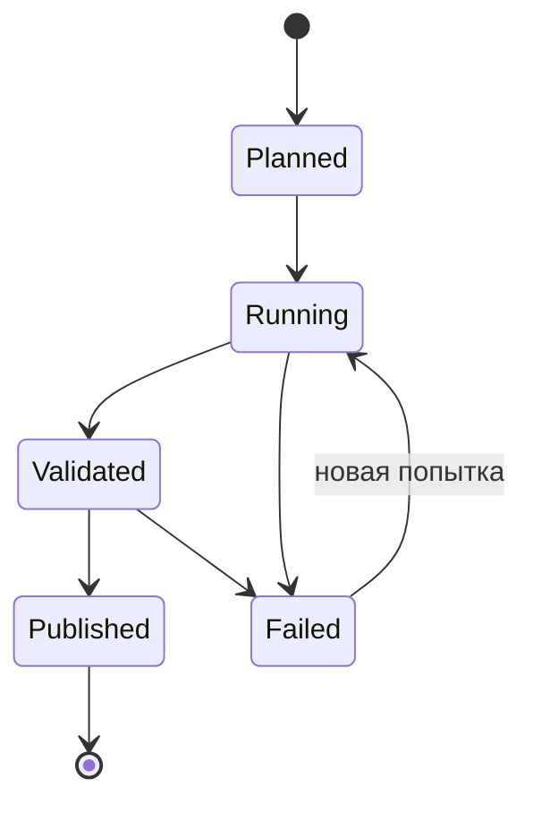
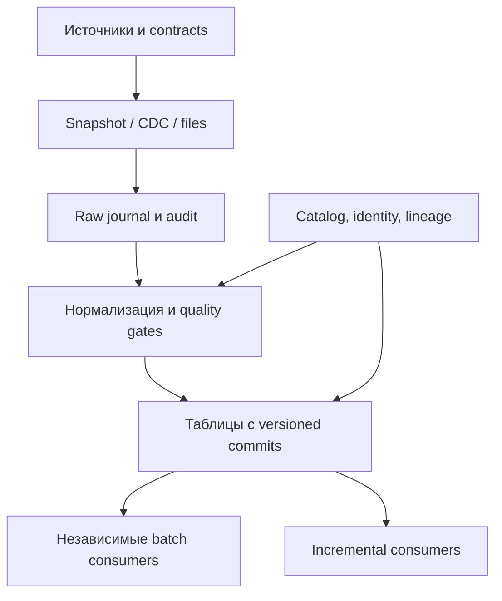
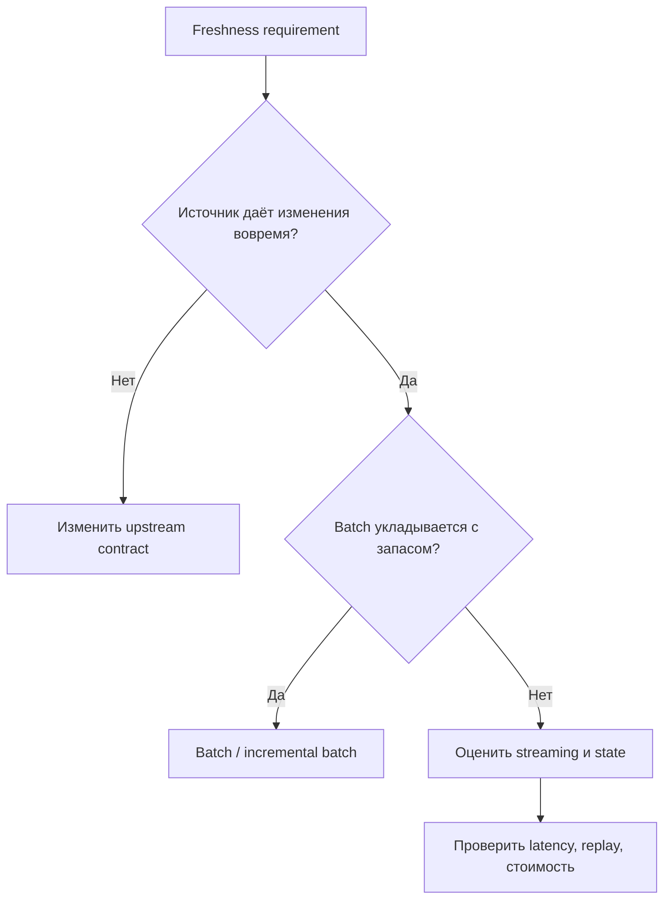
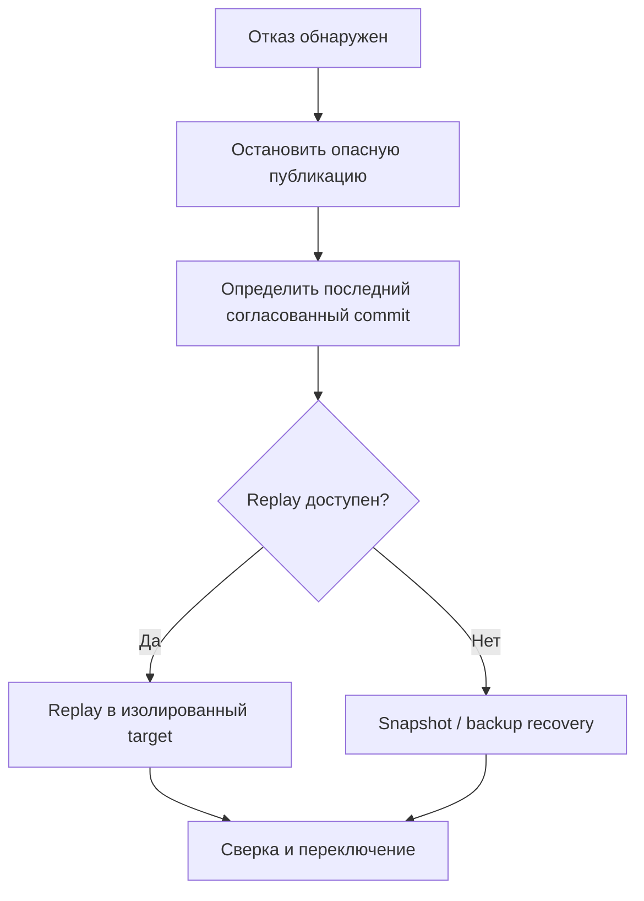
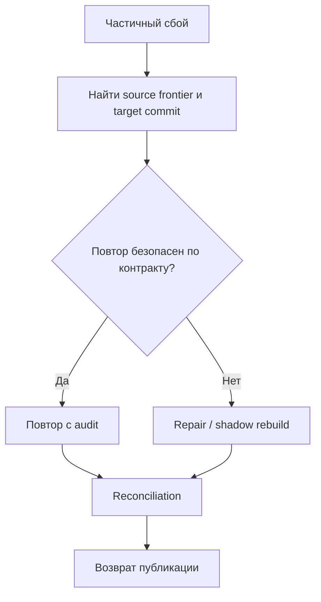

# 30. Практические проекты и критерии уровня Senior

Основной язык примеров — **Python / PySpark**. Базовый стенд: **Apache Spark 4.2.0, Python 3.12.14, JDK 17.0.20, Linux, Spark Classic**. Scala-пример использует Scala 2.13.18 из дистрибутива Spark. Для Lakehouse-практики отдельно выполнена совместимая связка **Spark 3.5.9 + Delta Lake 3.3.2 + Scala 2.12**. Проверки проведены **16 октября 2026 года**. Это зафиксированные учебные окружения, а не утверждение, что любой connector совместим с самой новой версией Spark.

**Цель раздела:** превратить знания предыдущих разделов в результаты, которые другой инженер может воспроизвести, проверить, доставить и восстановить после сбоя. Проект завершён, когда выполнен его контракт и есть доказательства этого. Наличие большого количества настроек, строк кода или технологий само по себе не показывает уровень Senior.

Первые проекты дают основу; следующие добавляют повторные попытки, состояние, конкурентную запись и эксплуатацию. Не требуется собирать все технологии в одну систему. Выбери один сквозной сценарий, например обработку заказов, и расширяй его независимыми проверяемыми работами. Для каждой работы зафиксируй вход, семантику результата, границу атомарности, условия повтора и владельца данных.

**Как выполнять примеры**

| Обозначение | Как запускать | Что проверяет |
| --- | --- | --- |
| `P01`–`P23` | Собрать Python-блоки с этими метками в порядке появления в один файл; Spark 4.2.0 | Batch, joins, RDD, модель CDC, оптимизация, ML, Python Data Source |
| `S01`, `B01` | Отдельные `Aggregation30.scala` и `build_scala.py` рядом; выполнить `B01` | Typed Dataset, Aggregator, Encoders, сравнение с RDD и DataFrame |
| `Q01`–`Q05` | Отдельный Python-файл, Spark 4.2.0, pandas и PyArrow | File replay, watermark-дедупликация, checkpoint restart, custom state, RocksDB metrics |
| `D01`–`D06` | Отдельный Python-файл и отдельное окружение Spark 3.5.9 / Delta 3.3.2 | Настоящий Delta MERGE, tombstones, evolution, time travel, append-конкуренция, compaction |
| `C01`–`C02` | Отдельный Python-файл, PySpark Connect 4.2.0 | Локальный Connect server, удалённый DataFrame API и изоляция sessions |
| «Шаблон» | Адаптировать под собственные сервисы и учётные данные | План интеграции, который требует отдельной проверки на целевой платформе |

Не выполняй наборы `P`, `Q`, `D`, `C` одновременно в одном интерпретаторе: настройки session и зависимости различаются. Внутри набора блоки зависят от предыдущих. Для `P` порядок меток в тексте местами отличается от числового: `P21` относится к доставке; сохраняй **порядок появления**. `collect()` и полные `exceptAll` ниже применяются к маленьким fixtures; в production объём проверки и сбор на driver нужно ограничивать.

Установка базового окружения: `python -m pip install 'pyspark==4.2.0' 'pandas==2.2.3' 'pyarrow==26.0.0' numpy`. Для Connect используй `python -m pip install 'pyspark[connect]==4.2.0'` и совместимые версии его зависимостей. Не переносить эти команды без lock-файла в production. В проверенном стенде дополнительно установлены NumPy 2.5.4, grpcio 1.84.0, grpcio-status 1.84.0, googleapis-common-protos 1.75.5, protobuf 7.36.2. Для запуска нужен доступный `java`.

**P01 — общий стенд и сравнение мультимножеств строк.** Настройки `local[2]`, двух shuffle partitions и отключённого Python daemon подобраны для лаборатории. Они не являются рекомендацией размера production-кластера.

```python
# P01
import json
import os
import sys
import tempfile
import hashlib
from pathlib import Path
from decimal import Decimal
from itertools import product

os.environ.setdefault("SPARK_LOCAL_IP", "127.0.0.1")
os.environ["PYSPARK_PYTHON"] = sys.executable
from pyspark.sql import SparkSession, Window, functions as F, types as T

spark = (
    SparkSession.builder.master("local[2]")
    .appName("projects-30-core")
    .config("spark.ui.enabled", "false")
    .config("spark.driver.memory", "512m")
    .config("spark.driver.host", "127.0.0.1")
    .config("spark.driver.bindAddress", "127.0.0.1")
    .config("spark.python.use.daemon", "false")
    .config("spark.sql.shuffle.partitions", "2")
    .config("spark.sql.session.timeZone", "UTC")
    .getOrCreate()
)
spark.sparkContext.setLogLevel("ERROR")
assert spark.version == "4.2.0"
lab = Path(tempfile.mkdtemp(prefix="projects30-"))


def same_bag(a, b):
    assert a.columns == b.columns
    assert [f.dataType for f in a.schema] == [f.dataType for f in b.schema]
    assert a.exceptAll(b).limit(1).count() == 0
    assert b.exceptAll(a).limit(1).count() == 0
```

`same_bag` сравнивает имена и типы колонок, а затем строки с их кратностью в обе стороны. Проверка не требует одинакового порядка строк и намеренно не сравнивает nullability. Если nullability, metadata полей или порядок результата входят в контракт, проверь их отдельно. Равенство `count()` и одной суммы недостаточно: ошибки могут взаимно компенсироваться.

**Содержание**

1. [Первый batch-проект: отчёт по файлу](#batch-project)
2. [Проект SQL и DataFrame: аналитические витрины](#analytics-project)
3. [Проект RDD и Dataset: распределённое агрегирование](#aggregation-project)
4. [Инкрементальный batch-пайплайн](#incremental-project)
5. [Потоковая обработка Kafka](#kafka-project)
6. [CDC-пайплайн](#cdc-project)
7. [Проект произвольного состояния](#state-project)
8. [Исследование оптимизации](#optimization-project)
9. [Проект Lakehouse и обслуживание таблиц](#lakehouse-project)
10. [Production-доставка Spark-приложения](#delivery-project)
11. [Проект Spark Connect или Declarative Pipelines](#remote-project)
12. [ML, графовый или GPU-проект](#ml-project)
13. [Проект расширения Spark](#extension-project)
14. [System design и инженерные решения](#system-design)
15. [Критерии готовности Senior](#senior-criteria)

<a id="batch-project"></a>

## Первый batch-проект: отчёт по файлу

### CSV/JSON → явная схема → очистка → агрегаты → Parquet

**Задача:** по выгрузке заказов рассчитать выручку оплаченных заказов по клиенту. Входной файл считается неизменяемым snapshot; одна строка представляет один заказ. Повторные версии заказа относятся к следующему проекту. Деньги представлены `DECIMAL`, а не `double`: округление и переполнение входят в контракт.

Раздели транспортную и бизнес-схему. CSV хранит текст, поэтому сначала удобно получить строки, затем явно преобразовать суммы и классифицировать ошибки. Это сохраняет исходное значение `oops`, которое потерялось бы после простого CAST в NULL. `FAILFAST` отвечает за ошибки чтения, но не заменяет бизнес-валидацию. Отрицательная корректно распарсенная сумма может быть недопустимой для заказа и допустимой для возврата — это решение предметной области.

| Поле | Вход | Контракт |
| --- | --- | --- |
| `order_id` | STRING | Непустой идентификатор, уникальность проверяется отдельно |
| `customer_id` | STRING | Обязательный клиент |
| `amount_raw` | STRING | Преобразуется в DECIMAL(12,2); NULL, переполнение и нечисловой текст отклоняются |
| `status` | STRING | `paid` либо `cancelled` |
| `revenue` | Результат SUM | Сумма только оплаченных валидных заказов |

**P02 — минимальное ядро преобразования и публикация в новый каталог.**

```python
# P02
csv_schema = "order_id string, customer_id string, amount_raw string, status string"
csv_path = lab / "orders.csv"
csv_path.write_text("""order_id,customer_id,amount_raw,status
o1,c1,10.00,paid
o2,c2,5.00,paid
o3,c1,oops,paid
o4,c3,,paid
o5,c2,-1.00,paid
o6,,3.00,paid
o7,c2,2.00,cancelled
""")


def prepare_orders(path):
    raw = (
        spark.read.schema(csv_schema)
        .option("header", True)
        .option("mode", "FAILFAST")
        .csv(str(path))
    )
    typed = raw.withColumn("amount", F.expr("try_cast(amount_raw as decimal(12,2))"))
    reason = (
        F.when(F.col("order_id").isNull(), "missing_order_id")
        .when(F.col("customer_id").isNull(), "missing_customer_id")
        .when(F.col("amount").isNull(), "invalid_amount")
        .when(F.col("amount") < 0, "negative_amount")
        .when(
            ~F.col("status").isin("paid", "cancelled") | F.col("status").isNull(),
            "invalid_status",
        )
    )
    checked = typed.withColumn("reject_reason", reason).cache()
    valid = checked.filter("reject_reason IS NULL")
    rejected = checked.filter("reject_reason IS NOT NULL")
    report = (
        valid.filter("status = 'paid'")
        .groupBy("customer_id")
        .agg(F.sum("amount").alias("revenue"))
    )
    return checked, valid, rejected, report


checked, valid, rejected, report = prepare_orders(csv_path)
output = lab / "report"
report.write.mode("errorifexists").parquet(str(output))
```

В примере `reject_reason` содержит первую найденную ошибку. Если нужен полный отчёт по качеству, сформируй массив всех причин; иначе число ошибок по причинам нельзя трактовать как число всех нарушений. Для строк с пробелами, пустым `order_id`, нестандартным десятичным разделителем и лишней точностью добавь явную политику: trim, reject или нормализация. `try_cast` не реализует её автоматически. Например, округление до двух знаков нужно согласовать отдельно.

Для JSON Lines зафиксируй схему входа и режим ошибок аналогично: `spark.read.schema(schema).json(path)`. JSON-объект с числом и JSON-объект с текстом в одном поле не обязаны удовлетворять одному контракту. Не включай `multiLine=true`, если producer пишет по объекту в строке. Официальные параметры: [CSV](https://spark.apache.org/docs/4.2.0/sql-data-sources-csv.html), [JSON](https://spark.apache.org/docs/4.2.0/sql-data-sources-json.html).

Промышленная версия записывает rejects с идентификатором входного файла и run ID в отдельное защищённое место. Локальное ядро оставляет их DataFrame для проверки. Завершённая работа должна объяснять, кто исправляет rejects и когда их допустимо переобработать.

### Локальный запуск и проверка результата

Локальный запуск должен проверять результат, а не только возвращать exit code 0. В данном fixture семь входных строк: три валидны, четыре отклонены; валидный отменённый заказ не участвует в выручке. Поэтому число агрегированных групп не равно числу валидных заказов.

**P03 — проверка сохранённого результата, а не промежуточного DataFrame.**

```python
# P03
actual = {r.customer_id: r.revenue for r in spark.read.parquet(str(output)).collect()}
assert actual == {"c1": Decimal("10.00"), "c2": Decimal("5.00")}
assert checked.count() == valid.count() + rejected.count() == 7
assert rejected.count() == 4
```

Сначала проверь сохранённую схему и строки на маленьком эталоне. Затем добавь следующие случаи:

| Сценарий | Ожидание |
| --- | --- |
| Вход существует, но содержит только cancelled | Типизированный пустой отчёт, валидные строки не превращаются в rejects |
| Одинаковая строка дважды | Явное решение: отклонить дубликат или учитывать дважды по контракту |
| Повторный запуск в тот же output path | Ошибка `errorifexists`; опубликованный результат не затёрт |
| Другая перестановка входных строк | Те же группы и суммы |
| Сломанный CSV-файл | Контролируемый сбой чтения, отсутствие принятой публикации |

Для самостоятельного файла ядра сохрани `P01`–`P05` и добавь `spark.stop()` в конце; полный набор `P` останавливает session в `P23`. При запуске через `spark-submit` зависимости должны быть доступны и driver, и executors. Режим `local[2]` полезен для логики, но не проверяет сетевые сбои, удалённое storage и различия окружений workers.

### Обработка NULL, некорректных типов и пустого входа

Различай четыре ситуации: путь не найден; в каталоге нет файлов; есть файл только с заголовком; строки существуют, но все отклонены. Они требуют разных сообщений и не всегда одинакового exit code. Пустая бизнес-выборка может быть нормальным результатом, а отсутствие обязательного snapshot — инцидентом.

В SQL трёхзначная логика: `amount < 0` при NULL не даёт `true`. Поэтому NULL проверяется до числового условия. Аналогично `NOT status IN (...)` не отбрасывает NULL без отдельной обработки. `coalesce(amount, 0)` не исправляет повреждённую сумму: он превращает неизвестное значение в настоящее нулевое и искажает отчёт.

**P04 — пустой типизированный вход и чтение пустого Parquet-результата.**

```python
# P04
empty_csv = lab / "empty.csv"
empty_csv.write_text("order_id,customer_id,amount_raw,status\n")
e_checked, e_valid, e_rejected, e_report = prepare_orders(empty_csv)
assert e_checked.count() == e_rejected.count() == e_report.count() == 0
e_report.write.mode("errorifexists").parquet(str(lab / "empty-report"))
assert spark.read.parquet(str(lab / "empty-report")).count() == 0
e_checked.unpersist()
checked.unpersist()
```

Не подменяй этот тест `spark.createDataFrame([], schema)` во всех случаях: такой DataFrame не проверит reader, заголовок и поведение writer. Добавь отдельно тест отсутствующего файла. Для критичных сумм проверь переполнение SUM и фактический тип результата: Spark расширяет тип decimal-агрегата, и контракт downstream должен принимать этот тип.

**Практика:** дополни валидацию пустых и пробельных идентификаторов, выведи распределение rejects по причинам, сохрани его рядом с audit. Публикуй только после проверки `input = valid + rejected`. Не объявляй строку валидной только потому, что reader смог её прочитать.

### README с примером входа и командой запуска

README проекта — интерфейс для следующего инженера. Он должен позволять воспроизвести результат без устных пояснений: версия runtime, схема входа, примеры хороших и плохих строк, команда запуска, параметры, ожидаемые значения и способ очистки учебных данных. Укажи, где появляются rejects и что происходит при существующем output.

**P05 — минимальный текст контракта.** Команда внутри текста показывает целевой CLI `batch_report.py`; реализацию CLI с `argparse` нужно добавить при упаковке проекта. Она не является командой запуска всего сборного набора `P`.

```python
# P05
readme = """Input: order_id, customer_id, amount_raw, status.
Amounts: DECIMAL(12,2); malformed/NULL/negative values go to rejects.
Cancelled rows are valid records excluded from paid revenue.
Output: customer_id, revenue. Empty input produces an empty typed report.
Run: spark-submit batch_report.py --input orders.csv --output report-new-run
Acceptance: c1=10.00, c2=5.00; input=7, valid=3, rejects=4.
"""
(lab / "PROJECT_README.txt").write_text(readme)
```

Для законченной работы добавь к README один проверенный вызов собственного CLI и его фактический вывод. Укажи, что сумма — в валюте источника и смешивать валюты без отдельного ключа запрещено. Если исходные данные персональные, вместо реального примера используй синтетический.

**Критерии приёмки:** явная схема; контролируемые ошибки; правильный пустой результат; проверка сохранённого Parquet; воспроизводимый запуск. **Самопроверка:** почему `count()` не заменяет сверку строк? Почему `cancelled` не является невалидной записью? Какие ошибки обнаруживает `FAILFAST`, а какие должна обнаружить бизнес-логика?

<a id="analytics-project"></a>

## Проект SQL и DataFrame: аналитические витрины

### Несколько источников, joins и оконные вычисления

**Задача:** обогатить заказы историческим регионом клиента и построить выручку по регионам. Входы — версии заказов и история клиента. Гранулярность результата до агрегации: **одна последняя версия заказа**, обогащённая **одной версией клиента на дату события**.

Не начинай с join. Сначала запиши ключи и cardinality: `order_id` уникален после выбора версии; `(customer_id, valid_from)` уникален в истории; интервалы клиента не пересекаются. Если эти предпосылки нарушены, LEFT JOIN может размножить строки и завысить выручку без единой ошибки исполнения.

**P06 — оконный выбор версии и temporal join.**

```python
# P06
orders = spark.sql("""SELECT * FROM VALUES
 ('o1','c1',10.00D,1,'e1',DATE '2024-01-15'),
 ('o1','c1',12.00D,2,'e2',DATE '2024-01-15'),
 ('o2','c2',5.00D,1,'e3',DATE '2024-01-20'),
 ('o3','c1',8.00D,1,'e4',DATE '2024-03-01')
 AS t(order_id,customer_id,amount,source_version,event_id,event_date)""").withColumn(
    "amount", F.col("amount").cast("decimal(12,2)")
)
latest = (
    orders.withColumn(
        "rn",
        F.row_number().over(
            Window.partitionBy("order_id").orderBy(F.desc("source_version"), F.desc("event_id"))
        ),
    )
    .filter("rn=1")
    .drop("rn")
)
dim = spark.sql("""SELECT * FROM VALUES
 ('c1','north',DATE '2024-01-01',DATE '2024-02-01'),
 ('c1','south',DATE '2024-02-01',CAST(NULL AS DATE)),
 ('c2','east',DATE '2024-01-01',CAST(NULL AS DATE))
 AS t(customer_id,region,valid_from,valid_to)""")


def temporal_join(facts, dimension):
    a = facts.alias("f")
    b = dimension.alias("d")
    return a.join(
        b,
        (F.col("f.customer_id") == F.col("d.customer_id"))
        & (F.col("f.event_date") >= F.col("d.valid_from"))
        & (F.col("d.valid_to").isNull() | (F.col("f.event_date") < F.col("d.valid_to"))),
        "left",
    )


enriched = temporal_join(latest, dim).select("f.*", "d.region")
```

Окно `row_number` здесь выбирает бизнес-версию, а не случайный экземпляр после shuffle. В учебных данных дата — DATE. Если источник содержит timestamp, зафиксируй timezone, тип timestamp и момент смены атрибута. Сравнение по календарной дате может неверно обогатить событие в день переезда.

Дополнительный проектный вариант: третий источник с курсами валют. Для него тоже требуется временной ключ и политика отсутствующего курса. Нельзя заполнить неизвестный курс единицей только ради успешного завершения job. Оконный API: [window syntax](https://spark.apache.org/docs/4.2.0/sql-ref-syntax-qry-select-window.html).

### Детерминированная дедупликация и исторические справочники

`dropDuplicates(['order_id'])` не выражает «последняя версия»: он не обещает, какая строка останется. Нужен полный, согласованный с источником порядок. В примере порядок `(source_version DESC, event_id DESC)` детерминирован на fixture. В реальном контракте одинаковые `source_version` с разными payload часто должны вызывать ошибку, а не разрешаться лексикографическим выбором event ID.

Историю интерпретируем полуоткрытыми интервалами `[valid_from, valid_to)`. На границе 1 февраля применяется новая версия. Открытый конец — NULL; это не «дата неизвестна», а специально оговорённая текущая версия. Разделяй valid time, то есть время действия факта в бизнесе, и system time, то есть время, когда система о нём узнала.

| Нарушение | Риск | Реакция проекта |
| --- | --- | --- |
| Пересекающиеся интервалы | Два региона одному заказу | Блокировать публикацию и показать ключ |
| Пробел в истории | Регион NULL | Явный unknown либо reject по SLA |
| Два изменения с одним effective time | Неоднозначная версия | Source sequence или конфликт |
| История пришла после фактов | Ранее опубликованный регион устарел | Пересчёт затронутого периода |

**Практика:** построить проверку пересечений через `lead(valid_from)` по клиенту, отдельно проверить отрицательные/нулевые интервалы и несколько открытых концов. Проверка только `max(valid_from)` не обнаруживает старые пересечения. Добавь fixture с событием ровно на границе и с неизвестным клиентом.

### Контроль cardinality и сверка агрегатов

Контроль выполняется на нескольких уровнях: уникальность ключа фактов; число строк до/после enrichment; число unmatched; сумма до/после join; распределение по ключам; сверка опубликованной витрины. LEFT JOIN сохраняет факты при отсутствии справочника, но не гарантирует сохранение числа строк при нескольких совпадениях.

**P07 — положительный контракт и намеренно испорченный справочник.**

```python
# P07
assert latest.count() == enriched.count() == 3
assert enriched.filter("region IS NULL").count() == 0
assert enriched.agg(F.sum("amount")).first()[0] == Decimal("25.00")
bad_dim = dim.unionByName(dim.limit(1))
assert temporal_join(latest, bad_dim).count() > latest.count()
```

Полезный audit: `input_versions`, `latest_orders`, `joined_rows`, `unmatched_orders`, `paid_amount_before`, `paid_amount_after`, `dimension_conflicts`. Не путай количество отфильтрованных старых версий с количеством rejects. Для денежных показателей сравнивай decimal точно; для вычислений с плавающей точкой заранее согласуй абсолютный/относительный допуск и политику NaN.

Для больших витрин полное сравнение может быть дорогим. Тогда используй многоуровневую сверку: инварианты на всём объёме, exact diff по затронутым партициям и выборку пограничных ключей. Hash и checksum полезны как индикатор, но коллизии и изменение сериализации не позволяют считать их математическим доказательством равенства.

### Сравнение SQL- и DataFrame-реализаций

SQL и DataFrame должны реализовывать один контракт. Отличие синтаксиса не является причиной ожидать разную бизнес-семантику. Сравни имена, типы, NULL и строки с их кратностью; затем посмотри планы. Разные планы допустимы, если результат и эксплуатационные требования совпадают.

**P08 — независимые выражения одного temporal join и агрегации.**

```python
# P08
latest.createOrReplaceTempView("latest_orders30")
dim.createOrReplaceTempView("customer_history30")
sql_mart = spark.sql("""SELECT d.region,sum(f.amount) AS revenue
 FROM latest_orders30 f LEFT JOIN customer_history30 d
 ON f.customer_id=d.customer_id AND f.event_date>=d.valid_from
 AND (d.valid_to IS NULL OR f.event_date<d.valid_to)
 GROUP BY d.region""")
df_mart = enriched.groupBy("region").agg(F.sum("amount").alias("revenue"))
same_bag(sql_mart, df_mart)
assert {r.region: r.revenue for r in sql_mart.collect()} == {
    "north": Decimal("12.00"),
    "south": Decimal("8.00"),
    "east": Decimal("5.00"),
}
```

На эталоне ожидаются `north=12.00`, `south=8.00`, `east=5.00`. Ошибочная реализация, выбирающая текущий регион для всех дат, дала бы другой результат. Это полезнее теста, в котором клиент никогда не меняет регион.

**Практика:** добавь SQL- и DataFrame-варианты накопительной суммы по клиенту с явно заданным frame, проверь равные timestamps и deterministic tie-breaker. **Критерии приёмки:** один grain; доказанная cardinality; временные границы; равенство двух реализаций; отрицательный тест с размножением строк. **Самопроверка:** когда одинаковые суммы скрывают ошибку join? Почему ORDER BY внутри window не сортирует весь output? Почему SCD2-справочник нельзя просто дедуплицировать по customer ID?

<a id="aggregation-project"></a>

## Проект RDD и Dataset: распределённое агрегирование

### PairRDD, mapPartitions и custom aggregation

**Задача:** по ключу получить число операций и сумму в минимальных денежных единицах. Состояние агрегата — `(count, sum)`. Такой буфер компактный и комбинируется без необходимости переносить все исходные значения одного ключа на driver.

**P09 — PairRDD и обработка целой партиции.**

```python
# P09
pairs = [("a", 100), ("a", 200), ("b", 50), ("b", -10)]
rdd = spark.sparkContext.parallelize(pairs, 2)


def add_value(state, value):
    return (state[0] + 1, state[1] + value)


def merge_stats(a, b):
    return (a[0] + b[0], a[1] + b[1])


rdd_stats = dict(rdd.aggregateByKey((0, 0), add_value, merge_stats).collect())
assert rdd_stats == {"a": (2, 300), "b": (2, 40)}


def partition_stats(rows):
    count = total = 0
    for _, amount in rows:
        count += 1
        total += amount
    yield (count, total)


parts = rdd.mapPartitions(partition_stats).collect()
assert (sum(x[0] for x in parts), sum(x[1] for x in parts)) == (4, 340)
```

`mapPartitions` получает iterator, поэтому не превращай его без необходимости в `list`. В этом примере функция выдаёт одну статистику даже для пустой партиции. Если в реальном проекте нужен внешний клиент, его создают на партицию и закрывают в `finally`; такой клиент нельзя сериализовать с driver и считать общим для executors.

PairRDD — принятое название RDD пар `(key, value)`; в Python это не отдельный пользовательский класс. `aggregateByKey` разделяет добавление элемента и слияние буферов. Буфер суммы предпочтительнее `groupByKey().mapValues(list)`, когда сами значения не нужны. Стоимость всё равно зависит от числа ключей, skew и объёма shuffle.

### Typed Dataset и Encoders в Scala/Java

Типизированный Dataset доступен в Scala/Java; Python DataFrame не становится `Dataset[Sale]` от наличия type hints. Для учебного Scala-проекта определим `Aggregator[Sale, Stats, Stats]`. Encoder задаёт представление типа на границе JVM-объектов и Spark SQL; он не заменяет бизнес-валидацию сумм.

**S01 — самостоятельный файл `Aggregation30.scala`.**

```scala
// S01: сохранить целиком в Aggregation30.scala.
package lab30
import org.apache.spark.sql.{SparkSession, Encoder, Encoders}
import org.apache.spark.sql.expressions.Aggregator
import org.apache.spark.sql.functions._

case class Sale(key: String, cents: Long)
case class Stats(n: Long, sum: Long)
class Total extends Aggregator[Sale, Stats, Stats] with Serializable {
  def zero: Stats = Stats(0L, 0L)
  def reduce(b: Stats, a: Sale): Stats = Stats(b.n + 1, b.sum + a.cents)
  def merge(a: Stats, b: Stats): Stats = Stats(a.n + b.n, a.sum + b.sum)
  def finish(b: Stats): Stats = b
  def bufferEncoder: Encoder[Stats] = Encoders.product[Stats]
  def outputEncoder: Encoder[Stats] = Encoders.product[Stats]
}
object Aggregation30 {
  def main(args: Array[String]): Unit = {
    val spark = SparkSession.builder.appName("aggregation30")
      .config("spark.ui.enabled", "false")
      .config("spark.sql.shuffle.partitions", "2").getOrCreate()
    spark.sparkContext.setLogLevel("ERROR")
    import spark.implicits._
    val input = Seq(Sale("a",100), Sale("a",200), Sale("b",50), Sale("b",-10))
    val ds = input.toDS()
    val total = new Total
    val typed = ds.groupByKey(_.key).agg(total.toColumn).collect().toMap
    val pairs = spark.sparkContext.parallelize(input, 2).map(s => (s.key,s.cents))
    val rdd = pairs.aggregateByKey(Stats(0,0))(
      (b,v) => Stats(b.n+1,b.sum+v), total.merge).collect().toMap
    val df = ds.groupBy("key").agg(count(lit(1)).as("n"),sum("cents").as("sum"))
      .collect().map(r => r.getString(0) -> Stats(r.getLong(1),r.getLong(2))).toMap
    assert(typed == Map("a" -> Stats(2,300), "b" -> Stats(2,40)))
    assert(typed == rdd && typed == df)
    val states = Seq(Stats(0,0), Stats(1,100), Stats(2,-20))
    for(a <- states; b <- states; c <- states)
      assert(total.merge(total.merge(a,b),c) == total.merge(a,total.merge(b,c)))
    assert(ds.groupByKey(_.key).agg(total.toColumn).collect().toMap == typed)
    ds.groupByKey(_.key).agg(total.toColumn).explain("formatted")
    spark.stop()
    println("SCALA30_OK")
  }
}
```

**B01 — учебная компиляция без sbt через compiler из установленного PySpark.** Сохрани блок в `build_scala.py` рядом с `Aggregation30.scala` и запусти Python этого Spark-окружения. Для production используй обычный Maven/sbt/Gradle build, зафиксированные coordinates и Spark dependencies со scope `provided`.

```python
# B01: отдельный запуск рядом с Aggregation30.scala в окружении Spark 4.2.0.
import os
import subprocess
import zipfile
from pathlib import Path
import pyspark

work = Path.cwd()
spark_home = Path(pyspark.__file__).resolve().parent
classes = work / "aggregation30-classes"
classes.mkdir(exist_ok=True)
jar = work / "aggregation30.jar"
env = os.environ | {"SPARK_LOCAL_IP": "127.0.0.1"}
subprocess.run(
    [
        "java",
        "-cp",
        str(spark_home / "jars" / "*"),
        "scala.tools.nsc.Main",
        "-usejavacp",
        "-d",
        str(classes),
        str(work / "Aggregation30.scala"),
    ],
    check=True,
    env=env,
)
with zipfile.ZipFile(jar, "w") as archive:
    for item in classes.rglob("*.class"):
        archive.write(item, item.relative_to(classes))
subprocess.run(
    [
        str(spark_home / "bin" / "spark-submit"),
        "--master",
        "local[2]",
        "--driver-memory",
        "512m",
        "--class",
        "lab30.Aggregation30",
        str(jar),
    ],
    check=True,
    env=env,
)
```

Scala binary version должна совпадать с артефактами кластера; суффиксы `_2.12` и `_2.13` не взаимозаменяемы. Данный пример собран и выполнен на 2.13.18. В Java аналогичный буфер можно описать JavaBean и использовать `Encoders.bean`, но Java-вариант здесь не выдаётся за отдельно выполненный пример. Официальный контракт: [Aggregator и Encoders](https://spark.apache.org/docs/4.2.0/sql-ref-functions-udf-aggregate.html).

### Сравнение с DataFrame по плану, корректности и стоимости

Сравни три реализации на одном input snapshot. Сначала точное значение: `a → (2,300)`, `b → (2,40)`. Затем план и профиль. DataFrame позволяет optimizer видеть выражения SUM/COUNT. Произвольная Scala-функция и Python RDD закрывают больше логики от SQL optimizer; Python RDD также добавляет сериализацию и отдельный Python execution path.

| Реализация | Что проверить в плане/метриках | Когда оправдана |
| --- | --- | --- |
| DataFrame SUM/COUNT | Partial/final aggregate, Exchange, shuffle | Обычная реляционная агрегация |
| Typed Aggregator | Объектные границы, encoder, aggregate buffers | Специальный типизированный агрегат |
| PairRDD | Partitioner, stages, shuffle bytes, Python time | Логика, неудобная в SQL API, с измеренным основанием |

Не делай вывод «RDD быстрее» по одному короткому запуску после прогрева JVM. Зафиксируй размер и распределение ключей, число partitions, runtime, ресурсы, cold/warm cache и повторения. Сравнивай выполненные actions, а не время построения lazy DataFrame. План без action может не содержать финальных решений AQE.

### Проверка ассоциативности агрегата и повторного выполнения

Распределённый агрегат должен корректно объединять частичные буферы в разном порядке. Для данного `(count,sum)` нейтральный элемент `(0,0)`, merge ассоциативен и коммутативен в принятой области значений. Вычисление среднего как «среднее средних» без весов этому контракту не соответствует.

**P10 — проверка свойства, DataFrame-эталона и повтора.**

```python
# P10
states = [(0, 0), (1, 100), (2, -20)]
for a, b, c in product(states, repeat=3):
    assert merge_stats(merge_stats(a, b), c) == merge_stats(a, merge_stats(b, c))
frame = spark.createDataFrame(pairs, "key string, cents long")
df_stats = {
    r.key: (r.n, r.total)
    for r in frame.groupBy("key")
    .agg(F.count("*").alias("n"), F.sum("cents").alias("total"))
    .collect()
}
assert rdd_stats == df_stats
assert dict(rdd.aggregateByKey((0, 0), add_value, merge_stats).collect()) == rdd_stats
```

Этот конечный набор проверок не является доказательством свойства для всех чисел. Объясни его алгебраически и добавь генеративные тесты с пустыми partitions, разным разбиением и отрицательными значениями. Для JVM Long отдельно проверь переполнение: математическая сумма может выйти за диапазон типа. Для double порядок слияния влияет на округление; не обещай побитовое равенство без специальной реализации.

Повтор вычисления с тем же input должен возвращать тот же результат. Отправка платежа или HTTP-запись из `reduce` нарушит эту модель: task может быть повторён. Вынеси побочные эффекты в sink с отдельным контрактом идемпотентности.

**Практика:** реализуй агрегат дисперсии через корректно сливаемый буфер и сравни с built-in `var_pop` с допуском. **Самопроверка:** почему fold с делением на два ломается при другом дереве слияния? Где создаётся нейтральный буфер? Как доказать, что retry task не удвоит внешний эффект?

<a id="incremental-project"></a>

## Инкрементальный batch-пайплайн

### JDBC/source snapshot → staging → Lakehouse table

**Задача:** ежедневно обновлять актуальное состояние заказов из транзакционного источника. Контракт должен определять согласованную границу чтения, стабильный набор изменений и атомарную публикацию. Условие `updated_at > yesterday` без этих деталей не является полноценным инкрементальным протоколом.

Полезно разделить три артефакта: immutable staging с идентификатором extraction; целевую таблицу; control record с границей успешно опубликованного интервала. Сначала извлечение и проверки, затем commit в таблицу, затем продвижение cursor. Сбой между commit и cursor допускает повтор чтения, поэтому target merge должен быть идемпотентным.



JDBC partitioning разбивает чтение, но само по себе не создаёт общий snapshot для нескольких соединений. `lowerBound`/`upperBound` для partition column определяют stride, а не полный бизнес-фильтр выгрузки. Нужные предикаты периода задай явно; способ snapshot isolation согласуй с СУБД. См. [официальный JDBC guide](https://spark.apache.org/docs/4.2.0/sql-data-sources-jdbc.html).

**P11 — локальная модель target state и повторной доставки.** Она проверяет семантику выбора source sequence, но не JDBC и не атомарность storage; настоящий Delta MERGE выполняется в блоках `D`.

```python
# P11
def check_sequence_conflicts(frame):
    conflicts = (
        frame.groupBy("id", "seq")
        .agg(F.countDistinct(F.to_json(F.struct("payload", "deleted"))).alias("versions"))
        .filter("versions>1")
    )
    assert conflicts.limit(1).count() == 0, "Conflicting payload for the same id/sequence"


def merge_latest(current, incoming):
    combined = current.unionByName(incoming)
    check_sequence_conflicts(combined)
    w = Window.partitionBy("id").orderBy(F.desc("seq"))
    return combined.withColumn("rn", F.row_number().over(w)).filter("rn=1").drop("rn")


state_schema = "id long, seq long, payload string, deleted boolean"
base = spark.sql("SELECT 1L AS id,1L AS seq,'old' AS payload,false AS deleted")
page = spark.sql("""SELECT * FROM VALUES
 (1L,2L,'new',false),(2L,1L,'other',false) AS t(id,seq,payload,deleted)""")
current = merge_latest(base, page).cache()
current.count()
same_bag(current, merge_latest(current, page))
```

`seq` в модели — монотонная версия **в пределах бизнес-ключа**, уже нормализованная upstream. Запрещены NULL-ключи, NULL-sequence и разные payload при одной версии. Обе одинаковые копии события допустимы. При принятии внешнего источника эти предпосылки нужно проверить, а не считать следствием типа LONG.

### Cursor, lookback window и идемпотентность

Для источника с `updated_at` и стабильным ID cursor может иметь вид `(timestamp, id)` с лексикографическим сравнением. Верхнюю границу фиксируют до чтения; её семантика зависит от транзакций источника. Lookback повторно читает часть прошлого и помогает при ограниченной задержке фиксации, но не ловит изменения, произвольно датированные старым временем.

| Сценарий | Требование |
| --- | --- |
| Две строки с одинаковым timestamp | Дополнительный стабильный ключ либо повторное чтение границы |
| Сбой после target commit | Повтор страницы не меняет бизнес-состояние |
| Delete без `updated_at` в текущей таблице | CDC/tombstone или snapshot reconciliation |
| Late update вне lookback | Отдельный repair/backfill-процесс |
| Два одновременных scheduler run | Lease/lock или допустимый конкурентный commit-протокол |

**P12 — tombstone и защита от восстановления удалённого старой версией.**

```python
# P12
updates = spark.sql("""SELECT * FROM VALUES
 (1L,3L,CAST(NULL AS STRING),true),(1L,2L,'new',false)
 AS t(id,seq,payload,deleted)""")
after_delete = merge_latest(current, updates).cache()
after_delete.count()
late = spark.sql("SELECT 1L AS id,1L AS seq,'old' AS payload,false AS deleted")
final_state = merge_latest(after_delete, late)
assert final_state.filter("id=1").first().deleted is True
assert [r.id for r in final_state.filter("NOT deleted").collect()] == [2]
```

Если физически удалить строку вместе с последним `seq`, поздний старый insert может снова её создать. Поэтому модель сохраняет tombstone с версией, а потребителям отдаёт `NOT deleted`. Это не политика вечного хранения персональных данных: срок и способ удаления payload, tombstones и резервных копий определяются отдельно. Для учебного pipeline достаточно показать, где хранится барьер версии после удаления payload.

### SCD Type 1/2 и обработка late updates

SCD Type 1 хранит актуальные атрибуты. SCD Type 2 сохраняет интервальную историю. Late update требует определить, меняет ли оно прошлый интервал по valid time или только текущее знание системы. Простой «закрой текущую строку и вставь новую» ломает историю, если событие за февраль пришло после мартовского.

**P13 — пересборка затронутого ключа из полного журнала изменений.**

```python
# P13
changes = spark.sql("""SELECT * FROM VALUES
 (1L,DATE '2024-01-01','bronze',1L),
 (1L,DATE '2024-03-01','gold',3L),
 (1L,DATE '2024-02-01','silver',2L)
 AS t(id,effective_from,tier,seq)""")
history = changes.withColumn(
    "valid_to",
    F.lead("effective_from").over(Window.partitionBy("id").orderBy("effective_from", "seq")),
)
rows = history.orderBy("effective_from").collect()
assert [r.tier for r in rows] == ["bronze", "silver", "gold"]
assert str(rows[0].valid_to) == "2024-02-01" and rows[-1].valid_to is None
```

Здесь сохранены все события ключа и уникальны effective timestamps. При одинаковом `effective_from` сначала выбери победителя по source sequence или отклони конфликт. Затем построй `lead` и проверь непересекающиеся интервалы. Алгоритм не утверждает, что late events можно правильно вставлять, имея только текущую строку.

| Вид состояния | Вход для repair | Проверка |
| --- | --- | --- |
| Type 1 | Последняя согласованная версия каждого ключа | Максимальный source sequence |
| Type 2 | Полная релевантная история затронутых ключей | Полуоткрытые непересекающиеся интервалы |
| Бивременная история | Valid time + system time | Можно восстановить знание на прошлый момент |

**Практика:** добавь повтор февральского события, исправление его payload с большей source sequence и событие до первой известной версии. Объясни, какие партиции потребителей надо пересчитать и почему равенство текущей таблицы ещё не доказывает равенство истории.

### Backfill, audit metrics и reconciliation

Backfill должен использовать тот же бизнес-контракт, но отдельный диапазон, staging и ограничения нагрузки. Запуск за старый период не должен откатывать актуальный cursor. Удобно отделить «режим извлечения» от «функции применения изменений»: backfill меняет чтение, а правила sequence и tombstones остаются общими.

**P14 — минимальный audit локальной модели.**

```python
# P14
audit = {
    "input_rows": page.count(),
    "output_keys": current.count(),
    "deleted_keys": after_delete.filter("deleted").count(),
}
assert audit == {"input_rows": 2, "output_keys": 2, "deleted_keys": 1}
(lab / "incremental-audit.json").write_text(json.dumps(audit))
```

Для реального pipeline audit дополняется snapshot ID, cursor from/to, input digest, rejects, inserts/updates/deletes/ignored, target commit version, временем публикации и code digest. Не вычисляй количество updates простым `output_count - input_count`: обновление существующего ключа не меняет cardinality.

Reconciliation сравнивает источник и target на **согласованном срезе**. Если источник продолжает меняться, разница сама по себе не доказывает потерю данных. Сначала сравни counts и суммы по диапазонам, затем найди отсутствующие/лишние ключи и payload diff. Repair должен проходить те же проверки и иметь собственный audit.

**Критерии приёмки:** стабильная extraction boundary; безопасный повтор после частичного сбоя; late updates; сохранённые delete barriers; backfill без порчи cursor; reconciliation на одном snapshot. **Самопроверка:** почему timestamp-only cursor теряет строки? Что произойдёт при сбое между commit и cursor? Какие удаления не обнаружит обычный JDBC SELECT текущего состояния?

<a id="kafka-project"></a>

## Потоковая обработка Kafka

### Kafka → parsing → validation → windows → sink

**Задача:** принимать события заказов, публиковать минутные показатели и сохранять возможность воспроизведения. На входе нужны event ID, бизнес-ключ, время события и payload; транспортные `topic`, `partition`, `offset` сохраняются для диагностики. Kafka timestamp и время бизнес-события могут отличаться.

Сначала выбери sink и контракт обновления. Для append-вывода закрытых окон результат задерживается до продвижения watermark. Для update-вывода потребителю нужен upsert по ключу окна; обычный append в JDBC-таблицу удвоит обновлённый агрегат. Quarantine должен иметь самостоятельную публикацию и связь с исходным offset.

**Шаблон Kafka-чтения для Spark 4.2.0.** Нужен connector `org.apache.spark:spark-sql-kafka-0-10_2.13:4.2.0` и совместимое окружение; SASL/TLS и секреты добавляются средствами платформы. Этот блок не выполнялся с реальным broker.

```python
# Шаблон; выполнить только после настройки Kafka и connector.
def kafka_events(spark, brokers, topic):
    envelope_schema = (
        "event_id string, key string, value long, event_time timestamp"
    )
    transport = (
        spark.readStream.format("kafka")
        .option("kafka.bootstrap.servers", brokers)
        .option("subscribe", topic)
        .option("startingOffsets", "earliest")
        .option("failOnDataLoss", "true")
        .load()
    )
    parsed = transport.select(
        "topic", "partition", "offset",
        F.col("timestamp").alias("kafka_timestamp"),
        F.col("value").cast("string").alias("raw_payload"),
        F.from_json(F.col("value").cast("string"), envelope_schema).alias("event"),
    )
    good = parsed.filter(
        "event.event_id IS NOT NULL AND event.key IS NOT NULL "
        "AND event.value IS NOT NULL AND event.event_time IS NOT NULL"
    )
    return good.select("topic", "partition", "offset", "event.*")
```

Это минимальный positive path, а не готовая система качества: `parsed` с невалидными обязательными полями требуется сохранить в rejects. Не скрывай ошибки `filter` без счётчика и сырого сообщения. Kafka tombstone имеет NULL value и отличается от JSON с ошибками. Настройки offsets, ограничения и гарантии описаны в [Kafka integration guide](https://spark.apache.org/docs/4.2.0/streaming/structured-streaming-kafka-integration.html).

**Q01 — исполняемый replay той же формы события через file source.** Сохрани блоки `Q` в отдельный файл. Файлы помещаются во входной каталог атомарным rename на локальном filesystem. Для object storage требуется поддерживаемый способ публикации, а не предположение об атомарном POSIX rename.

```python
# Q01: отдельный процесс Spark 4.2.0, локальный file replay вместо Kafka.
import os
import sys
import json
import tempfile
import time
from pathlib import Path

os.environ["SPARK_LOCAL_IP"] = "127.0.0.1"
os.environ["PYSPARK_PYTHON"] = sys.executable
from pyspark.sql import SparkSession, functions as F, Row
from pyspark.sql.streaming.stateful_processor import StatefulProcessor

spark = (
    SparkSession.builder.master("local[2]")
    .appName("stream30")
    .config("spark.driver.memory", "512m")
    .config("spark.ui.enabled", "false")
    .config("spark.driver.host", "127.0.0.1")
    .config("spark.driver.bindAddress", "127.0.0.1")
    .config("spark.python.use.daemon", "false")
    .config("spark.sql.shuffle.partitions", "2")
    .config("spark.sql.session.timeZone", "UTC")
    .config("spark.sql.streaming.noDataMicroBatches.enabled", "false")
    .config(
        "spark.sql.streaming.stateStore.providerClass",
        "org.apache.spark.sql.execution.streaming.state.RocksDBStateStoreProvider",
    )
    .getOrCreate()
)
spark.sparkContext.setLogLevel("ERROR")
root = Path(tempfile.mkdtemp(prefix="stream30-"))
source = root / "input"
source.mkdir()


def publish(directory, name, rows):
    pending = root / (name + ".pending")
    pending.write_text("".join(json.dumps(r) + "\n" for r in rows))
    pending.rename(directory / name)


schema = "event_id string, key string, value long, event_time timestamp"
publish(
    source,
    "a.json",
    [
        {"event_id": "e1", "key": "a", "value": 2, "event_time": "2024-01-01T00:00:00Z"},
        {"event_id": "e1", "key": "a", "value": 2, "event_time": "2024-01-01T00:00:00Z"},
        {"event_id": "e2", "key": "b", "value": 5, "event_time": "2024-01-01T00:00:01Z"},
    ],
)
events = spark.readStream.schema(schema).json(str(source))
```

File replay делает тест быстрым и детерминированным, но не проверяет Kafka ACL, broker retention, consumer offsets и поведение connector при потере данных. Эти проверки входят в интеграционную приёмку проекта.

### Watermark, duplicates и stream-stream join

Watermark — механизм ограничения состояния и обработки запаздывания, а не расписание «подождать ровно десять минут». Продвижение зависит от наблюдаемого event time. Если новые события не приходят, append-агрегат закрытого по настенным часам окна может ещё не появиться.

**Q02 — дедупликация event ID внутри watermark и restart с тем же checkpoint.**

```python
# Q02
dedup = events.withWatermark("event_time", "10 minutes").dropDuplicatesWithinWatermark(
    ["event_id"]
)
out = root / "dedup"
checkpoint = root / "checkpoint"


def run_dedup():
    q = (
        dedup.writeStream.format("parquet")
        .outputMode("append")
        .option("path", str(out))
        .option("checkpointLocation", str(checkpoint))
        .trigger(availableNow=True)
        .start()
    )
    q.awaitTermination(120)
    assert not q.isActive and q.exception() is None
    return str(q.id), str(q.runId), q.recentProgress


qid, run1, progress1 = run_dedup()
assert spark.read.parquet(str(out)).count() == 2
publish(
    source,
    "b.json",
    [
        {"event_id": "e2", "key": "b", "value": 5, "event_time": "2024-01-01T00:00:01Z"},
        {"event_id": "e3", "key": "a", "value": 3, "event_time": "2024-01-01T00:00:02Z"},
    ],
)
qid2, run2, progress2 = run_dedup()
assert qid == qid2 and run1 != run2
assert sorted(r.event_id for r in spark.read.parquet(str(out)).collect()) == ["e1", "e2", "e3"]
```

На первом запуске остаются `e1`, `e2`; на втором новая копия `e2` не добавляет строку, а `e3` добавляет. Эта проверка не доказывает дедупликацию за бесконечный период. После удаления старого state повтор события может снова стать новым; срок гарантии должен соответствовать задержкам источника и договорённости с sink.

**Q03 — окно с проверяемым итогом.** Для учебного просмотра выбран memory sink и complete mode: он позволяет увидеть ещё открытые окна. Memory sink не является production sink; complete mode этого теста не демонстрирует ограничение состояния окон watermark.

```python
# Q03
windows = (
    events.withWatermark("event_time", "10 minutes")
    .dropDuplicatesWithinWatermark(["event_id"])
    .groupBy(F.window("event_time", "1 minute"), "key")
    .agg(F.sum("value").alias("total"))
)
q = (
    windows.writeStream.format("memory")
    .queryName("windows30")
    .outputMode("complete")
    .option("checkpointLocation", str(root / "windows-cp"))
    .trigger(availableNow=True)
    .start()
)
q.awaitTermination(120)
assert q.exception() is None and not q.isActive
assert {r.key: r.total for r in spark.table("windows30").collect()} == {"a": 5, "b": 5}
```

Для stream-stream join выбери, например, impressions → clicks: одинаковый `ad_id`, click от impression до impression + 10 минут. Нужны watermark на обоих входах и конечный event-time диапазон в join condition. Для outer join это также влияет на момент выдачи строки без пары. Ограничения видов join и output mode проверяй по [Structured Streaming API guide](https://spark.apache.org/docs/4.2.0/streaming/apis-on-dataframes-and-datasets.html).

| Сценарий join | Что нужно доказать |
| --- | --- |
| Click раньше impression по порядку доставки | Пара найдена по event time в пределах состояния |
| Несколько clicks на impression | Согласована cardinality: все пары или отдельная агрегация |
| Очень поздний click | Политика late-event repair, а не молчаливая потеря |
| Один поток остановился | Понятно поведение общего watermark и роста state |
| Ключ с огромным числом событий | Измерен размер state и нагрузка на горячую partition |

**Практика:** реализуй этот join на двух file replay inputs, затем повтори на Kafka. Добавь будущий timestamp: один ошибочный event time способен преждевременно продвинуть watermark. До stateful-оператора введи согласованную проверку допустимого диапазона времени, оставив возможность легитимного replay.

### Checkpoint, restart и проверка гарантий sink

Checkpoint принадлежит конкретному логическому запросу и должен храниться в устойчивом storage. Нельзя делить один каталог между двумя активными queries. Исходные offsets и состояние не являются резервной копией результата; sink имеет собственную точку commit.

В `Q02` query ID сохраняется, run ID меняется, а Parquet file sink после restart содержит три уникальных события. Проверяется настоящий restart на локальном файловом checkpoint. Не переносить этот вывод на любой JDBC/HTTP sink: `foreachBatch` по умолчанию допускает повтор callback при recovery.



Если sink дедуплицирует по batch ID, используй составной namespace `(pipeline identity, checkpoint generation, batch ID)`. Новый checkpoint начинает новую историю batch IDs; один числовой ID недостаточен. Альтернатива — merge по бизнес-ключу и source version. Для нескольких независимых sinks атомарность каждого не даёт общей транзакции между ними.

**Fault injection:** прерви процесс после фактического sink commit до завершения callback; восстанови с тем же checkpoint; сравни результат с эталоном. Затем создай новый checkpoint и проверь явно выбранный replay. Не удаляй production checkpoint «чтобы запрос стартовал» без анализа последствий.

### Наблюдаемость lag, state size и freshness

Три времени отвечают на разные вопросы: Kafka lag — сколько offsets ещё не прочитано; processing latency — как долго выполняется batch; business freshness — насколько свежа доступная потребителю информация. Маленький lag не помогает, если upstream сутки не публикует данные.

| Сигнал | Источник | Решение |
| --- | --- | --- |
| End offsets и lag по partition | Kafka + query progress | Backlog, skew между partitions |
| Input/processed rows per second | Query progress | Успевает ли query за поступлением |
| Batch duration и trigger interval | Query progress | Есть ли накопление очереди |
| `numRowsTotal`, memory/state bytes | `stateOperators` | Растёт ли state без границы |
| Watermark и поздние строки | Query progress, quality audit | Соответствует ли задержка договорённости |
| Последняя успешная публикация и event time | Target audit | Выполнен ли freshness SLO |

Не вычисляй lag только как разницу суммарных offsets: partitions имеют независимые последовательности, могут добавляться, а retention меняет earliest offset. Сохраняй метрики с `queryId`, `runId`, batch ID и pipeline version; payload клиентов в логи не нужен.

**Критерии приёмки:** validation/quarantine, согласованная late policy, restart, duplicate test, sink contract, alerts на freshness и state growth. **Самопроверка:** почему watermark не является гарантией мгновенного удаления state? Когда Kafka sink допускает дубликаты? Что проверил локальный file replay, а что ещё нужно доказать на broker?

<a id="cdc-project"></a>

## CDC-пайплайн

### Debezium/source CDC → Kafka → актуальная таблица

**Задача:** получить актуальное состояние заказов из журнала изменений, включая удаления. Раздели ingest неизменяемых CDC-событий и применение изменений в current table. Raw-журнал позволяет расследовать ошибку parser и пересобрать состояние без обращения к уже очищенному WAL источника.

Envelope зависит от connector и настроек converters. Debezium обычно передаёт operation, before/after и source metadata, но нельзя жёстко предполагать наличие JSON-обёртки `payload`: при другой конфигурации сериализации её может не быть. Версию connector и schema registry subjects включают в контракт.

| Слой | Сохраняемый минимум | Назначение |
| --- | --- | --- |
| Raw CDC | Оригинальный key/value, topic/partition/offset, ingest time | Replay и диагностика |
| Normalized changes | Business key, op, source ordering token, payload, schema version | Независимость target от транспорта |
| Current state | Последний token и актуальный payload/tombstone | Быстрое чтение потребителями |
| Audit | Диапазон input offsets и target commit | Сверка и восстановление |

Для PostgreSQL обоснуй publication, replica identity, snapshot mode и retention replication slot. Обслуживание источника — часть проекта, а не задача «где-то у DBA»: остановленный consumer способен удерживать WAL. Детали envelope и snapshot: [официальный PostgreSQL connector guide](https://debezium.io/documentation/reference/stable/connectors/postgresql.html).

### Insert/update/delete и source sequence

Различай create, update, delete и snapshot read. Kafka tombstone для compaction и Debezium delete event — разные сообщения. Delete содержит семантику удаления строки; следующий NULL value может обслуживать очистку Kafka log. Нормализатор должен интерпретировать их согласно выбранному connector.

Порядок Kafka offsets определён внутри partition. Он не создаёт глобальный порядок по всем partitions и не заменяет source sequence. `ts_ms` — timestamp, а не гарантированно уникальный идентификатор изменения. Для одного бизнес-ключа нужен доказанный порядок из источника: token может быть составным, включая позицию журнала и порядок события в транзакции.

В модели `P11`–`P12` LONG `seq` уже является таким нормализованным per-key порядком. Это упрощение fixture, **не инструкция преобразовать любой PostgreSQL LSN или transaction ID в один timestamp**. Обновление ключа может потребовать delete старого ключа и insert нового; транзакция из нескольких ключей не становится атомарной для consumers автоматически.

| Изменение | Current table | Сохраняемый барьер |
| --- | --- | --- |
| Insert с новой версией | Вставить | Source token |
| Update с большей версией | Обновить | Новый source token |
| Delete с большей версией | Tombstone, payload можно очистить | Delete token |
| Точный повтор | Не менять бизнес-состояние | Прежний token |
| Старая версия | Игнорировать с audit | Более новый token |
| Тот же token, другой payload | Остановить/карантин | Диагностика конфликта |

### Тестовые сценарии duplicate delivery и нарушения порядка CDC

Тестируй не только счастливый порядок `insert → update → delete`. Обязательные перестановки: update до insert; delete до старого update; повтор delete; повтор одной страницы; разные payload при одной версии. Результат должен совпадать с сортированным по source order эталоном, если именно такой контракт выбран.

**P15 — отрицательный тест конфликта.** `merge_latest` проверяет конфликт до выбора победителя; иначе row_number мог бы молча скрыть повреждение источника.

```python
# P15
conflict = spark.sql("SELECT 1L AS id,2L AS seq,'different' AS payload,false AS deleted")
try:
    merge_latest(current, conflict)
except AssertionError:
    pass
else:
    raise AssertionError("Conflicting source sequence was accepted")
```

Эта проверка видит только версии, представленные в объединённом наборе current + page. Если конфликтующая старая версия давно вытеснена из current, для её обнаружения нужен raw-журнал или отдельный реестр event identity. Не обещай обнаружение всех исторических конфликтов одним текущим `seq`.

Перед настоящим MERGE сведите вход к одной строке на target key, сохранив tombstones и отбросив старые версии по согласованной политике. Несколько source rows, совпадающих с одним target row, могут сделать MERGE неоднозначным. Предварительная дедупликация должна быть детерминированной; `dropDuplicates` без порядка эту задачу не решает.

**Практика:** сгенерируй 100 ключей с несколькими версиями, перемешай страницы, продублируй часть доставок и сравни final state с batch-эталоном. Отдельно проверь два изменения одного ключа в одной source transaction. В локальном наборе реально выполнены duplicate, late-after-delete и conflict fixtures; Debezium и Kafka требуют интеграционного стенда.

### Snapshot reconciliation и recovery после сбоя

Snapshot и последующий CDC должны иметь согласованную точку перехода. Если сначала прочитать текущие строки, а потом «начать Kafka с latest», между этими действиями можно потерять изменения. Используй протокол snapshot connector или явно доказанный source boundary.



Recovery-план должен отвечать, доступны ли ещё исходные log positions. Если Kafka retention или WAL уже не содержит нужный участок, restart checkpoint не восстановит исчезнувшие данные: потребуется новый snapshot и согласование с CDC. Укажи время, через которое простой consumer перестаёт быть восстанавливаемым обычным replay.

Reconciliation включает текущие ключи, payload, deletes и прогресс source token. Одинаковое количество строк не доказывает, что удалён правильный ключ. Для каталога текущего состояния подготовь shadow rebuild и управляемое переключение; независимых consumers уведомляют через versioned contract, а не заменой файлов под уже открытым snapshot.

**Критерии приёмки:** delete не теряется; старое изменение не воскрешает строку; конфликты диагностируются; snapshot/CDC boundary доказана; recovery вне retention описан и проверен на стенде. **Самопроверка:** почему Kafka offset не всегда source version? Что происходит с транзакцией, распределённой по нескольким keys? Каких данных не хватает для rebuild, если сохранена только current table?

<a id="state-project"></a>

## Проект произвольного состояния

### StateProcessor для сессий, таймеров или бизнес-правил

Название пункта сохранено из README. В Python API Spark используется класс **`StatefulProcessor`**. Выберем бизнес-правило: поддерживать сумму по ключу между micro-batches. Это проще сессий, но позволяет исследовать жизненный цикл состояния и восстановление.

Состояние должно находиться в state store, а не в обычном поле Python-объекта. Поле `self.total` ниже — handle на `ValueState`; Python dict в `self` не получил бы нужных checkpoint/retry semantics. `init` объявляет state variables; `handleInputRows` обрабатывает iterator событий одного ключа.

**Q04 — ValueState, processing-time TTL и restart.** Этот блок продолжает набор `Q`. Сумма не дедуплицирует произвольные повторные бизнес-события: на входе нужны уникальные события либо отдельная дедупликация. Повтор micro-batch после сбоя и новая доставка того же event ID — разные случаи.

```python
# Q04
class RunningTotal(StatefulProcessor):
    def init(self, handle):
        self.total = handle.getValueState("total", "value long", ttlDurationMs=60000)

    def handleInputRows(self, key, rows, timerValues):
        previous = self.total.get()[0] if self.total.exists() else 0
        total = previous + sum(row.value for row in rows)
        self.total.update((total,))
        yield Row(key=key[0], total=total)


state_input = root / "state-input"
state_input.mkdir()
publish(state_input, "s1.json", [{"key": "a", "value": 2}, {"key": "b", "value": 5}])
state_source = spark.readStream.schema("key string,value long").json(str(state_input))
stateful = state_source.groupBy("key").transformWithState(
    statefulProcessor=RunningTotal(),
    outputStructType="key string,total long",
    outputMode="Update",
    timeMode="ProcessingTime",
)
state_cp = root / "state-cp"
observed = []
state_progress = []


def consume(batch, batch_id):
    observed.extend((r.key, r.total) for r in batch.collect())


def run_state():
    q = (
        stateful.writeStream.foreachBatch(consume)
        .outputMode("update")
        .option("checkpointLocation", str(state_cp))
        .trigger(availableNow=True)
        .start()
    )
    q.awaitTermination(60)
    assert not q.isActive and q.exception() is None
    state_progress.extend(q.recentProgress)


run_state()
publish(state_input, "s2.json", [{"key": "a", "value": 3}])
run_state()
assert ("a", 2) in observed and ("a", 5) in observed and ("b", 5) in observed
```

При втором запуске значение `a` становится 5, а не 3: состояние восстановлено из checkpoint. Лабораторный `foreachBatch` собирает маленький output в список driver и не является устойчивым sink. При аварийном повторе callback список может получить повторную запись. Доказательство устойчивой публикации требуется отдельно от доказательства восстановления state.

В этом коротком тесте в `Q01` специально отключены no-data micro-batches: `spark.sql.streaming.noDataMicroBatches.enabled=false`. Поэтому AvailableNow завершает обработку доступного входа без бесконечного ожидания processing-time обслуживания TTL. Это **лабораторное ограничение**: оно не подходит для проверки истечения TTL и таймеров при простое. Для production верни обычное обслуживание no-data batches и проверь его влияние на latency/стоимость. API и допустимые callbacks: [TransformWithState](https://spark.apache.org/docs/4.2.0/streaming/structured-streaming-transform-with-state.html).

### TTL, bounded state и late events

TTL 60 секунд в примере задаёт ограниченное время жизни неактивной state variable. Это меняет бизнес-семантику: после истечения прежняя сумма больше не обязана участвовать в результате. Если требуется сумма «за всё время», такой TTL некорректен; нужен долговременный агрегат или другой протокол.

Небольшой буфер на ключ ещё не гарантирует bounded total state. Миллионы новых активных ключей создадут миллионы буферов. ListState без ограничения числа событий одного ключа тоже способен вырасти независимо от TTL. Сформулируй границы по числу активных ключей, размеру значения и длительности удержания.

| Механизм | Что ограничивает | Чего не обещает |
| --- | --- | --- |
| Watermark | Event-time горизонт поддерживаемой логики | Истечение по настенным часам без прогресса событий |
| Processing-time TTL | Срок неактивного значения state | Корректность late business event после удаления state |
| Event-time timer | Срабатывание по прогрессу event time | Мгновенную реакцию при остановке входа |
| Ограничение per-key buffer | Объём одного ключа | Верхнюю границу числа ключей |
| Retention raw-журнала | Возможность replay | Автоматический repair результата |

Фактический короткий тест `Q04` проверяет объявление TTL и восстановление до его истечения, **не проверяет истечение через 60 секунд**. Для такого теста удерживай stream работающим, продвигай время выбранного режима и проверяй именно наблюдаемое отсутствие/новое значение state; не используй длительный sleep как единственный oracle. Добавь late event после expiry и зафиксируй, требуется ли repair.

**Практика:** замени сумму сессионным правилом с inactivity gap. Введи таймер, удаляй устаревший таймер при продлении сессии, проверь один итог на сессию. Таймеры регистрируют в допустимом callback, а не в `init`; при restart их поведение проверяют отдельным сценарием.

### RocksDB metrics и исследование роста состояния

В `Q01` выбран RocksDB state store provider до создания запроса. RocksDB хранит state вне JVM heap, но это не делает память, локальные диски и checkpoint I/O бесплатными. Следи за native memory, диском, checkpoint latency и размером state по partition.

**Q05 — сбор фактически возвращённых custom metrics.**

```python
# Q05
operators = [
    o for p in progress1 + progress2 + state_progress for o in p.get("stateOperators", [])
]
assert operators and any(o.get("numRowsTotal", 0) > 0 for o in operators)
metric_names = sorted({k for o in operators for k in o.get("customMetrics", {})})
assert any("rocksdb" in name.lower() for name in metric_names)
(root / "metrics.json").write_text(
    json.dumps({"operators": operators, "custom_metric_names": metric_names}, default=str)
)
spark.stop()
print("STREAM30_OK", root, metric_names, flush=True)
```

Набор имён metric зависит от runtime и оператора. Код не предполагает одну вечную схему метрик; он сохраняет реально полученные `customMetrics` и проверяет наличие RocksDB-метрик в данном стенде. Production dashboard должен обрабатывать отсутствие отдельной метрики после обновления и иметь тест на свою telemetry schema.

Исследование проведи с тремя нагрузками: фиксированный набор ключей с повторными обновлениями; непрерывно новые ключи; горячий ключ с крупным значением. Измеряй state rows/bytes, checkpoint time, processing throughput и RSS. Сравнение только heap usage пропускает существенную часть ресурсов RocksDB.

**Артефакт исследования:** график state size по времени вместе с input cardinality и watermark/TTL; таблица настроек; точки restart; объяснение, где ожидается плато. Если плато не наступает, выясни причину: постоянно обновляемые ключи, неподходящий output mode, отсутствие watermark progress или логическая утечка в структуре state.

### Миграция схемы состояния и replay strategy

State schema — сохранённый контракт. Переименование state variable, изменение типа или группирующего ключа может сделать старый checkpoint непригодным. Не редактируй бинарные файлы state вручную и не отключай проверки только ради старта.

Для проекта выбери один из доказуемых путей: совместимое изменение, официально поддержанное выбранной версией; новый checkpoint с rebuild из raw; shadow query с новой схемой и сравнением; экспорт/импорт initial state, если API и семантика позволяют. Прочитай [streaming migration guide](https://spark.apache.org/docs/4.2.0/streaming/ss-migration-guide.html) и recovery restrictions конкретного оператора.

| Этап | Проверяемый результат |
| --- | --- |
| Зафиксировать старое состояние | Query/code version, offsets, watermark, state schema |
| Подготовить новый query | Новая state schema, независимые checkpoint и output |
| Replay до общего рубежа | Одинаковый input frontier, учтён late horizon |
| Сравнить | Бизнес-результат, timers, cardinality, сроки публикации |
| Переключить | Один владелец публикации, понятный rollback |
| Завершить | Старые checkpoints удаляются только после срока возврата |

**Критерии приёмки:** объяснены границы state, повтор событий и expiry; выполнен restart; есть фактические metrics; миграция не требует угадывать содержимое checkpoint. **Самопроверка:** почему Python-поле объекта не заменяет ValueState? Чем TTL отличается от watermark? Как восстановить пропущенные события после уменьшения TTL, если raw retention уже истёк?

<a id="optimization-project"></a>

## Исследование оптимизации

### Нагрузка со skew, small files, тяжёлым join и spill

**Задача:** ускорить реальный узкий участок и доказать сохранение результата. Подготовь воспроизводимый generator, input snapshot и четыре независимых профиля: skew по join key; много маленьких файлов; большой shuffle join; давление на память со spill. Одна синтетическая таблица не обязана проявлять все четыре проблемы одновременно.

В локальном примере 20 000 строк, из них 90% попадает в ключ 0. Это проверка корректности preaggregation; её объём не предназначен для доказательства spill или промышленного ускорения. Чтобы воспроизвести spill, нужно контролируемо увеличивать данные и уменьшать доступную память на отдельном стенде, сохраняя безопасность соседних workloads.

**P16 — baseline и уменьшение объёма до join.**

```python
# P16
skew = spark.range(20000).selectExpr(
    "CASE WHEN id<18000 THEN 0 ELSE id % 20 END AS key", "1L AS amount"
)
dimension = spark.range(20).selectExpr(
    "id AS key", "concat('g',cast(id AS string)) AS group_name"
)
baseline = skew.join(dimension, "key").groupBy("group_name").agg(F.sum("amount").alias("total"))
pre = skew.groupBy("key").agg(F.sum("amount").alias("amount"))
optimized = pre.join(F.broadcast(dimension), "key").select(
    "group_name", F.col("amount").alias("total")
)
same_bag(baseline, optimized)
assert optimized.agg(F.sum("total")).first()[0] == 20000
```

Здесь у каждого key ровно одна группа справочника. Поэтому предварительная SUM по key и join эквивалентны join и последующей SUM по group. Если разные keys имеют один `group_name`, после preaggregation потребуется ещё одна SUM по group. Если join не one-to-one, такое преобразование может менять кратность и результат.

| Профиль | Наблюдаемая проблема | Нужное доказательство |
| --- | --- | --- |
| Skew | Долгий хвост небольшого числа tasks | Размеры partitions и распределение task duration |
| Small files | Listing/open overhead, много мелких tasks | Число/размер файлов, scan time |
| Большой join | Shuffle, network, sort | Объём каждой стороны и join strategy |
| Spill | Дополнительный disk I/O, GC/latency | Spill bytes и профиль памяти, а не догадка по времени |

### Baseline, explain и Spark UI evidence

Baseline должен быть правильным и реалистичным. Сравнение с намеренно испорченным Cartesian product мало говорит о настройке реального pipeline. Сохрани SQL text или код, input commit, runtime, конфигурацию, executor shape и выполненный action.

План до выполнения объясняет выбранные операторы; Spark UI и event log показывают фактические stages, tasks и адаптацию. При AQE initial plan может отличаться от final plan. В evidence должны быть не только картинки: приложи event log/application ID, SQL execution ID и таблицу наблюдений без чувствительных данных. Для локального smoke-теста UI отключён; production evidence — отдельное задание.

| Показатель | Baseline | Candidate | Как интерпретировать |
| --- | --- | --- | --- |
| Wall-clock p50/p95 | Из повторов | Из тех же условий | Влияние на SLA и вариативность |
| Executor core-hours | Из resource accounting | Аналогично | Стоимость compute |
| Input/shuffle bytes | По stages | По stages | Изменение физической работы |
| Max task / median task | По tasks | По tasks | Признак хвоста/skew |
| Spill / GC / failed tasks | Из метрик | Из метрик | Перенос bottleneck и устойчивость |
| Correctness diff | 0 | 0 | Условие допуска к сравнению |

Пустые значения в этой таблице заполняются **реальными измерениями**, а не оценками автора раздела. Официальные точки диагностики: [monitoring](https://spark.apache.org/docs/4.2.0/monitoring.html) и [SQL performance tuning](https://spark.apache.org/docs/4.2.0/sql-performance-tuning.html).

### Partitioning, AQE, preaggregation и cache по результатам измерений

Изменяй один фактор за раз, когда это позволяет эксперимент. Partitioning помогает распределить работу, но лишний `repartition` добавляет shuffle. AQE может менять число post-shuffle partitions и join strategy; он не исправляет неверную бизнес-семантику. Broadcast нужно обосновывать фактическим размером и памятью, а не количеством строк на маленьком sample.

**P17 — план, реальные small files и жизненный цикл cache.**

```python
# P17
optimized.explain(mode="formatted")
small_files = lab / "small-files"
skew.repartition(8).write.mode("errorifexists").parquet(str(small_files))
assert len(list(small_files.glob("part-*.parquet"))) >= 2
cached = skew.groupBy("key").agg(F.sum("amount").alias("amount")).cache()
assert cached.count() == 20
assert cached.agg(F.sum("amount")).first()[0] == 20000
cached.unpersist()
```

`cache()` lazy: первый action материализует вычисление. Если результат используется один раз, cache может только увеличить стоимость. После последнего использования освободи его. Не измеряй baseline на холодных данных, а candidate — на уже заполненном cache, если такой режим не соответствует production.

Для каждого изменения запиши гипотезу: «preaggregation уменьшит строки до join с N до K при неизменной кратности»; «compaction уменьшит число file opens»; «AQE обработает горячие shuffle partitions». После запуска проверь, произошло ли именно это. Ускорение без объяснения может оказаться эффектом cache, соседней нагрузки или другого input snapshot.

**Практика:** сравни четыре варианта: baseline, preaggregation, явный broadcast, preaggregation + broadcast. Затем измени размер справочника так, чтобы broadcast стал невыгоден. Покажи, где выбранное решение перестаёт работать и какие ограничения нужны для автоматического выбора.

### Доказательство одинакового результата и сравнение стоимости

Корректность — обязательный gate перед объявлением ускорения. Для fixture `same_bag` сравнивает все строки и типы. Для большого набора проверь ключи, NULL, duplicates, decimal precision, интервалы времени и крайние значения. Нельзя заменить exact comparison проверкой одной итоговой суммы для алгоритма, меняющего распределение по группам.

Стоимость включает compute, storage, requests, shuffle network, оркестрацию и сопровождение. Сокращение времени с удвоением executors может увеличить core-hours; это допустимо при жёстком SLA, но должно быть явно обосновано. Для streaming дополнительно сравни latency, state footprint и максимальный устойчивый input rate.

Проведи несколько повторов после одинакового прогрева; чередуй порядок вариантов, чтобы уменьшить влияние времени запуска. Сохрани raw timings, не только среднее. Разделяй compile/startup overhead и steady state, если приложение короткое. Отдельно проверь результат после retry: оптимизированная версия не должна требовать безошибочного выполнения.

**Критерии приёмки:** воспроизводимый baseline; plan + UI evidence; проверенная семантика; измеренный эффект; цена и пределы применения. **Самопроверка:** почему `explain` не измеряет ускорение? Когда preaggregation меняет ответ? Что важнее при SLA: среднее время или хвост? Где может вырасти стоимость после успешной оптимизации wall-clock?

<a id="lakehouse-project"></a>

## Проект Lakehouse и обслуживание таблиц

### Delta либо Iceberg либо Hudi с конкурентными writers

**Задача:** поддерживать актуальную таблицу заказов с историей commits, конкурентной записью и регламентом обслуживания. Выбери **один** формат и его совместимую связку runtime/connector/catalog/storage. Сравнение трёх форматов можно оформить ADR, но не требуется реализовывать три одинаковых проекта.

В лаборатории выбран Delta Lake 3.3.2 на Spark 3.5.9. [Официальная матрица совместимости](https://docs.delta.io/releases/) связывает Delta 3.3.x с Spark 3.5.x. Эти JAR нельзя автоматически переносить в основной стенд Spark 4.2.0. Имя некоторых OSS-конфигураций Delta исторически содержит `databricks`; наличие такого префикса не означает использование управляемого сервиса.

**Подготовка отдельного окружения `D`**

```bash
# Шаблон подготовки; python3.12 и Java 17 должны быть доступны.
python3.12 -m venv lakehouse-env
lakehouse-env/bin/python -m pip install 'pyspark==3.5.9' 'delta-spark==3.3.2'
mkdir -p jars
curl --fail --location --output jars/delta-spark_2.12-3.3.2.jar \
  https://repo.maven.apache.org/maven2/io/delta/delta-spark_2.12/3.3.2/delta-spark_2.12-3.3.2.jar
curl --fail --location --output jars/delta-storage-3.3.2.jar \
  https://repo.maven.apache.org/maven2/io/delta/delta-storage/3.3.2/delta-storage-3.3.2.jar
```

Сохрани блоки `D` в `lakehouse_lab.py` рядом с каталогом `jars` и запусти `lakehouse-env/bin/python lakehouse_lab.py`. Другой путь к JAR можно передать через `DELTA_JARS_DIR`. В production проверяй checksums, provenance и неизменяемый dependency lock; прямое скачивание в команде deploy не обеспечивает воспроизводимость.

**D01 — инициализация отдельного Delta-стенда.**

```python
# D01: отдельный процесс; Spark 3.5.9 + delta-spark 3.3.2, НЕ окружение P.
import os
import sys
import json
import tempfile
from pathlib import Path
from concurrent.futures import ThreadPoolExecutor

os.environ["SPARK_LOCAL_IP"] = "127.0.0.1"
os.environ["PYSPARK_PYTHON"] = sys.executable
from pyspark.sql import SparkSession, functions as F
from delta.tables import DeltaTable

jars_dir = Path(os.environ.get("DELTA_JARS_DIR", "jars")).resolve()
jars = [jars_dir / "delta-spark_2.12-3.3.2.jar", jars_dir / "delta-storage-3.3.2.jar"]
assert all(p.is_file() for p in jars)
spark = (
    SparkSession.builder.master("local[2]")
    .appName("lakehouse30")
    .config("spark.driver.memory", "512m")
    .config("spark.ui.enabled", "false")
    .config("spark.driver.host", "127.0.0.1")
    .config("spark.driver.bindAddress", "127.0.0.1")
    .config("spark.python.use.daemon", "false")
    .config("spark.sql.shuffle.partitions", "2")
    .config("spark.databricks.delta.snapshotPartitions", "2")
    .config("spark.jars", ",".join(map(str, jars)))
    .config("spark.sql.extensions", "io.delta.sql.DeltaSparkSessionExtension")
    .config(
        "spark.sql.catalog.spark_catalog", "org.apache.spark.sql.delta.catalog.DeltaCatalog"
    )
    .getOrCreate()
)
spark.sparkContext.setLogLevel("ERROR")
assert spark.version == "3.5.9"
root = Path(tempfile.mkdtemp(prefix="delta30-"))
path = str(root / "current")
base = spark.sql("SELECT 1L id, 1L seq, 'old' payload, false deleted")
base.write.format("delta").save(path)
table = DeltaTable.forPath(spark, path)
```

**D02 — атомарный MERGE страницы с одной строкой на key.** Предусловие: нормализатор уже проверил NULL, source sequence conflicts и выбрал последнюю версию внутри страницы, как описано в `P11`. Этот MERGE сам по себе не отвергает разные payload при одинаковом `seq`.

```python
# D02
def merge_page(page):
    assert page.groupBy("id").count().filter("count>1").limit(1).count() == 0
    (
        table.alias("t")
        .merge(page.alias("s"), "t.id=s.id")
        .whenMatchedUpdateAll(condition="s.seq>t.seq")
        .whenNotMatchedInsertAll()
        .execute()
    )


page = spark.sql("""SELECT * FROM VALUES
 (1L,2L,'new',false),(2L,1L,'other',false)
 AS t(id,seq,payload,deleted)""")
merge_page(page)
expected = sorted(tuple(r) for r in table.toDF().collect())
merge_page(page)
assert sorted(tuple(r) for r in table.toDF().collect()) == expected
merge_page(spark.sql("SELECT 1L id,3L seq,CAST(NULL AS STRING) payload,true deleted"))
merge_page(spark.sql("SELECT 1L id,1L seq,'old' payload,false deleted"))
assert table.toDF().filter("id=1").first().deleted is True
assert [r.id for r in table.toDF().filter("NOT deleted").collect()] == [2]
```

Повтор MERGE может создавать техническую запись в history или выполнять дополнительную работу; идемпотентность здесь означает неизменность **бизнес-состояния**, а не гарантированно одинаковое число commits. Delete хранится как tombstone, чтобы сохранить sequence barrier. См. [merge semantics](https://docs.delta.io/delta-update/).

Конкуренцию начинай с двух writers на отдельную таблицу; далее проверь пересекающиеся updates и maintenance. В лаборатории реальна конкуренция двух blind appends (`D04` ниже). Она не доказывает отсутствие конфликтов для двух MERGE одного ключа. Optimistic concurrency может корректно завершить один writer ошибкой; приложение должно перечитать snapshot и повторить безопасную операцию, а не слепо воспроизвести устаревший commit.

### Schema evolution, time travel и incremental consumers

Schema evolution — изменение контракта consumers. Добавление nullable-поля обычно проще изменения смысла существующего поля, но даже добавление может ломать `SELECT *`, positional inserts или сериализацию downstream. Не включай широкую auto evolution только ради того, чтобы любой вход «принялся».

**D03 — явное разрешение добавления nullable-поля и чтение прежней версии.**

```python
# D03
evolution = str(root / "evolution")
spark.sql("SELECT 1L id").write.format("delta").save(evolution)
(
    spark.sql("SELECT 2L id,'optional' note")
    .write.format("delta")
    .mode("append")
    .option("mergeSchema", "true")
    .save(evolution)
)
evolved = spark.read.format("delta").load(evolution)
assert evolved.filter("id=1").first().note is None
old = spark.read.format("delta").option("versionAsOf", 0).load(evolution)
assert old.columns == ["id"] and old.first().id == 1
assert DeltaTable.forPath(spark, evolution).history().count() == 2
```

Старые строки получают `note=NULL`; version 0 ещё не содержит `note`. Это проверка конкретного изменения схемы. Смена типа, rename, column mapping и table features требуют собственных compatibility tests. Time travel работает, пока доступны нужные данные и метаданные; history в логе не гарантирует сохранность старых Parquet после cleanup.

Incremental consumer должен понимать модель изменения таблицы. Append-only чтение не равно change feed для MERGE/DELETE. Выбери Change Data Feed, snapshot diff или протокол выбранного формата; зафиксируй стартовую версию и поведение при потере retention. Для Delta CDF нужны отдельные настройки/проверки, и в этом разделе CDF не выполнялся. См. [Change Data Feed](https://docs.delta.io/delta-change-data-feed/).

| Consumer | Контракт прогресса | Опасность |
| --- | --- | --- |
| Полный snapshot | Версия snapshot | Повторная обработка всего объёма |
| Append stream | Последовательность допустимых append commits | Updates/deletes не интерпретируются как обычный append |
| Change feed | Диапазон commit versions + тип изменения | История может выйти за retention |
| Внешняя выгрузка | Экспортный manifest/commit | Несогласованный набор файлов без table snapshot |

### Compaction, retention и безопасная очистка

Compaction уменьшает число файлов, не меняя логические строки. Она потребляет ресурсы и может конфликтовать с другими операциями. Retention определяется максимальным reader lag, длительностью jobs, временем rollback, требованиями recovery и фактическими гарантиями формата; одно число «семь дней» без этих входов не является обоснованием.

**D04 — два настоящих параллельных append writer.**

```python
# D04
concurrent = str(root / "concurrent")
spark.range(0).write.format("delta").save(concurrent)


def append_one(i):
    spark.range(i, i + 1).write.format("delta").mode("append").save(concurrent)


with ThreadPoolExecutor(max_workers=2) as pool:
    list(pool.map(append_one, [10, 20]))
assert sorted(r.id for r in spark.read.format("delta").load(concurrent).collect()) == [10, 20]
```

**D05 — compaction и безопасный dry run очистки.**

```python
# D05
compact = DeltaTable.forPath(spark, concurrent)
before = sorted(r.id for r in compact.toDF().collect())
compact.optimize().executeCompaction().collect()
assert sorted(r.id for r in compact.toDF().collect()) == before
dry = spark.sql(f"VACUUM delta.`{concurrent}` RETAIN 168 HOURS DRY RUN")
assert dry.count() == 0
```

Лаборатория выполняет OPTIMIZE/compaction, сравнивает строки и запускает **только VACUUM DRY RUN**. Реальное удаление не выполняется; retention guard не отключается. На новых файлах ожидается ноль кандидатов. Файловая структура, временные каталоги и служебные метаданные должны обслуживаться через поддерживаемые инструменты формата, а не `rm` по возрасту.

Перед реальной очисткой проверь: нет ли активных readers старого snapshot; насколько отстал самый медленный incremental consumer; завершён ли rollback window; протестирован ли restore backup. Dry run показывает кандидатов, но не доказывает, что у каждого downstream отсутствует ссылка на старую версию. Детали API: [optimizations](https://docs.delta.io/optimizations-oss/), [utility commands](https://docs.delta.io/delta-utility/), [concurrency](https://docs.delta.io/concurrency-control/).

**Практика:** накопи много small files, запусти compaction параллельно с append на отдельном стенде и проверь логический результат. Затем задержи consumer дольше выбранного retention на disposable-копии. Докажи, какой recovery нужен после cleanup. Не сокращай retention на рабочей таблице ради демонстрации.

### Recovery данных и метаданных каталога

Восстановление данных и восстановление имени таблицы — разные задачи. Для path-based Delta нужны data files и `_delta_log`; для catalog registration дополнительно нужны location, namespace, properties, grants и зависимые views. Для других форматов состав критичных metadata отличается; копирование только Parquet-файлов не восстанавливает table history.

**D06 — минимальный inventory, который можно расширить для recovery.**

```python
# D06
inventory = {
    "path": path,
    "latest_version": table.history(1).first().version,
    "spark": spark.version,
    "delta": "3.3.2",
    "visible_keys": table.toDF().filter("NOT deleted").count(),
}
(root / "inventory.json").write_text(json.dumps(inventory))
assert inventory["visible_keys"] == 1
spark.stop()
print("DELTA30_OK", root, flush=True)
```

Inventory не является backup. Он помогает понять, **что** восстанавливать. Рабочий recovery drill должен восстановить storage и catalog в изолированное место, прочитать нужную версию, проверить ключи/схему и прогресс consumers. RESTORE логического snapshot не обязан отменять все protocol changes и внешние побочные эффекты.

| Потеря | Источник восстановления | Проверка |
| --- | --- | --- |
| Ошибочный append/MERGE | Сохранённая история и доступные файлы | Корректный snapshot, повторный consumer audit |
| Удалённые data files | Backup/versioned storage по принятому плану | Читаются все referenced files |
| Catalog registration/grants | Экспорт metadata/IaC/backup каталога | Имя, location, owners и доступ восстановлены |
| Checkpoint consumer | Backup либо контролируемый replay | Нет потерь/недопустимых повторов |

**Критерии приёмки:** совместимая связка; concurrent writers; schema/time travel test; maintenance без изменения строк; retention с расчётом; recovery drill. Внешний catalog и удалённое object storage в локальном наборе не тестировались. **Самопроверка:** почему VACUUM нельзя считать обычной housekeeping-командой? Чем append concurrency отличается от конфликтующих updates? Какие consumers сломаются после удаления старой истории?

<a id="delivery-project"></a>

## Production-доставка Spark-приложения

### JAR/wheel/image, CI checks и integration tests

**Задача:** превратить функцию преобразования в версионированный артефакт с воспроизводимой доставкой. Выбери основной способ: JVM JAR; Python package с entrypoint и способом установки dependencies; container image с закреплённым runtime. Ни один формат не отменяет требования к доступности зависимостей executors.

`--py-files` предназначен для поддерживаемых Python-файлов/архивов, а не для автоматической установки любого wheel с native libraries. Wheel устанавливается в окружение, image или через механизм платформы; для изолированного Python environment нужен совместимый способ доставки. Не клади секреты и пользовательские токены внутрь image/JAR.

| CI gate | Что ловит | Доказательство |
| --- | --- | --- |
| Static checks | Синтаксис, style, запрещённые зависимости | Лог конкретного commit |
| Pure transformation tests | Grain, NULL, ordering, duplicates | Fixtures и assertions |
| Local Spark integration | Реальный reader/writer, schema, model persistence | Запуск в зафиксированном runtime |
| Connector integration | Kafka/JDBC/table format и retry | Отдельный стенд и fault injection |
| Compatibility matrix | Поддерживаемые Spark/Scala/Python версии | Успешные и ожидаемо отклонённые комбинации |
| Artifact checks | Состав dependencies, digest, scan | Immutable registry coordinates |

Не заменяй все тесты mock-объектами SparkSession: они не проверяют SQL analysis и runtime semantics. Но и не запускай кластер ради каждой простой pure-функции. Тест должен ловить конкретную ошибку: например, duplicate dimension row увеличивает выручку, а поздний insert не должен отменить delete.

**Практика:** упакуй batch-проект в CLI с обязательными `--input`, `--output`, `--period-from`, `--period-to`, `--run-key`; добавь проверку непересечения input/output и запрет неявного overwrite. README должен содержать команду из реально собранного артефакта. Сборка wheel/image здесь остаётся заданием; фактически собран Scala JAR `S01`.

### YARN/Kubernetes/managed deployment

Выбери одну целевую платформу и опиши, где живут driver, executors, dependencies, credentials, logs, checkpoints и результаты. Client/cluster mode меняет размещение driver, но не бизнес-контракт. Driver на ноутбуке может оказаться недоступен executors; локально существующий путь не обязан существовать в контейнере.

**Шаблон YARN-submit для Scala-проекта.** Это схема доставки, не выполненный deploy; путь приложения, identity, очередь и storage нужно заменить под платформу.

```bash
# Шаблон; настройки ресурсов выбираются по измерениям.
spark-submit \
  --master yarn \
  --deploy-mode cluster \
  --class lab30.Aggregation30 \
  --conf spark.eventLog.enabled=true \
  --conf spark.eventLog.dir=hdfs:///spark-eventlogs \
  aggregation30.jar
```

На Kubernetes укажи image digest, namespace, service account и доступное storage. Managed service требует той же фиксации runtime, connector и identity, даже если скрывает создание executors. В application manifest отдели параметры бизнеса от платформенных ресурсов. Официальные точки: [submitting applications](https://spark.apache.org/docs/4.2.0/submitting-applications.html), [YARN](https://spark.apache.org/docs/4.2.0/running-on-yarn.html), [Kubernetes](https://spark.apache.org/docs/4.2.0/running-on-kubernetes.html).

**Приёмка на платформе:** artifact запускается без ручной установки на worker; executor читает input и пишет output; identity имеет минимально необходимые права; logs/event logs доступны после завершения; убитый executor не портит результат; лимиты ресурсов и очереди проверены. Успешный local run эти условия не доказывает.

### Оркестрация, параметры периода и идемпотентный rerun

Период задаётся явным полуоткрытым интервалом `[from, to)` с timezone. «Сегодня» внутри приложения делает replay зависимым от даты запуска; scheduler должен передавать логический период. Отличай logical run key от attempt ID: первый идентифицирует работу, второй — конкретную попытку её исполнения.

**P21 — стабильный ключ логического запуска.**

```python
# P21
raw_key = ["orders_daily", "2026-01-01", "schema-v1"]
run_key = hashlib.sha256(json.dumps(raw_key, separators=(",", ":")).encode()).hexdigest()
assert (
    run_key == hashlib.sha256(json.dumps(raw_key, separators=(",", ":")).encode()).hexdigest()
)
```

В production включи в canonical input также `period_to`, timezone и идентификатор контракта; code version сохраняй отдельно и реши, когда новая версия кода создаёт новый logical result. Hash не является блокировкой и не обеспечивает атомарную публикацию. Нужны commit-протокол таблицы, compare-and-set manifest или транзакция/lease control store.



Повтор `Published` должен либо вернуть существующий подтверждённый результат, либо выполнить явно разрешённый replace по versioned contract. Не запускай два writers в один обычный Parquet-каталог в надежде, что одинаковый run key защитит output. Lock должен иметь fencing/lease semantics, иначе старый зависший процесс способен опубликовать после нового владельца.

**Практика:** останови attempt после staging, после table commit и до control record; повтори с тем же logical key. Проверь одну бизнес-публикацию и несколько корректно связанных attempts в audit. Backfill запускай с отдельным concurrency budget, чтобы он не вытеснил регулярный SLA.

### Monitoring, runbook и план rollback

Runbook должен вести от симптома к проверяемому действию. «Перезапустить job» не объясняет, какой checkpoint использовать, какие offsets будут прочитаны и как проверить повтор. Для каждой операции укажи доступ, предусловия, команды/интерфейс и критерий успеха.

| Симптом | Первые проверки | Безопасное действие |
| --- | --- | --- |
| Freshness нарушен | Последний commit, upstream heartbeat, backlog | Локализовать остановившийся участок |
| Job упала на записи | Target commit и attempt audit | Определить, опубликован ли результат до retry |
| Рост state/disk | Cardinality, watermark, TTL, RocksDB metrics | Устранить причину, не удалять checkpoint вслепую |
| Резко выросла выручка | Join cardinality, dimension overlap, input changes | Заблокировать публикацию и выполнить key diff |
| Нужен rollback кода | Table protocol, state schema, external effects | Проверить совместимость прежнего artifact |

Rollback состоит из кода, конфигурации и сохранённого состояния. Старый image может не читать новый table protocol или checkpoint. Если обратный путь закрыт, нужен forward fix или shadow rebuild. Заранее определи, какой result alias/consumer pointer переключается и какие readers должны завершить старые snapshots.

**Критерии приёмки:** immutable artifact; CI и integration evidence; управляемые параметры; rerun; monitoring; runbook; проверенный rollback/rebuild. **Самопроверка:** почему одинаковый hash не создаёт exactly-once? Где заканчивается гарантия scheduler retry? Какие действия нужны, если новый код уже изменил схему state?

<a id="remote-project"></a>

## Проект Spark Connect или Declarative Pipelines

### Удалённый client либо декларативный граф datasets

**Задача на выбор:** построить удалённого DataFrame client через Spark Connect либо декларативный pipeline из datasets. Для законченной работы достаточно одного варианта. В исполняемом примере выбран Connect, чтобы проверить границу client/server и session isolation.

Connect client строит план, а вычисления и чтение distributed storage происходят на server/executors. Файл, существующий только на laptop client, не становится доступным серверу по совпадению строки пути. Credentials и политики доступа нужно проектировать для реальной среды сервера.

**C01 — учебный локальный Connect server.** Он слушает только `127.0.0.1:15030`, запускается дочерним процессом и останавливается в `finally`. Перед запуском порт должен быть свободен. Это изолированная лаборатория без внешних пользователей; публичный service требует аутентификации, TLS и контроля исполнения средствами выбранной платформы.

```python
# C01: отдельный процесс в окружении PySpark Connect 4.2.0.
import os
import time
import socket
import subprocess
import tempfile
from pathlib import Path
from contextlib import contextmanager
import pyspark
from pyspark.sql import SparkSession, functions as F

spark_home = Path(pyspark.__file__).resolve().parent
port = 15030
log_path = Path(tempfile.mkdtemp(prefix="connect30-")) / "server.log"
env = os.environ | {"SPARK_LOCAL_IP": "127.0.0.1"}


@contextmanager
def connect_server():
    with log_path.open("w") as log:
        server = subprocess.Popen(
            [
                str(spark_home / "bin" / "spark-submit"),
                "--class",
                "org.apache.spark.sql.connect.service.SparkConnectServer",
                "--master",
                "local[2]",
                "--driver-memory",
                "512m",
                "--conf",
                "spark.ui.enabled=false",
                "--conf",
                "spark.connect.grpc.binding.address=127.0.0.1",
                "--conf",
                f"spark.connect.grpc.binding.port={port}",
            ],
            stdout=log,
            stderr=subprocess.STDOUT,
            env=env,
        )
        try:
            deadline = time.monotonic() + 60
            while True:
                assert server.poll() is None, log_path.read_text()
                try:
                    with socket.create_connection(("127.0.0.1", port), timeout=1):
                        break
                except OSError:
                    if time.monotonic() > deadline:
                        raise TimeoutError(log_path.read_text())
                    time.sleep(0.2)
            yield port
        finally:
            server.terminate()
            try:
                server.wait(timeout=15)
            except subprocess.TimeoutExpired:
                server.kill()
                server.wait()
```

Блок `C01` определяет context manager сервера; `C02` использует его. Сохрани оба блока в одном файле. Сервер создаётся только при входе в context manager и завершается при выходе, включая ошибки client. Не запускай его как открытый production endpoint. Архитектура описана в [Connect overview](https://spark.apache.org/docs/4.2.0/spark-connect-overview.html).

### Контроль зависимостей и session boundaries

На client нужны Python dependencies для API и сериализации; на server — runtime и connector; на executors — библиотеки, используемые выполняемым кодом. Установка JDBC driver на client не делает его доступным серверному reader. Session-local temporary views не предназначены для публикации данных другим пользователям.

**C02 — удалённая агрегация и изоляция двух sessions.** Продолжает определения `C01`.

```python
# C02
with connect_server() as endpoint:
    clients = []
    try:
        first = SparkSession.builder.remote(f"sc://127.0.0.1:{endpoint}").create()
        clients.append(first)
        second = SparkSession.builder.remote(f"sc://127.0.0.1:{endpoint}").create()
        clients.append(second)
        result = (
            first.range(10)
            .selectExpr("id % 2 AS key", "id AS value")
            .groupBy("key")
            .agg(F.sum("value").alias("total"))
        )
        assert {r.key: r.total for r in result.collect()} == {0: 20, 1: 25}
        first.range(1).createOrReplaceTempView("session_only30")
        assert first.catalog.tableExists("session_only30")
        assert not second.catalog.tableExists("session_only30")
        assert first.version == "4.2.0" and second.version == "4.2.0"
        print("CONNECT30_OK", log_path, flush=True)
    finally:
        for client in clients:
            client.stop()
```

В первом client ожидаются `{0:20, 1:25}`; local temp view первой session отсутствует во второй. Проверка использует два `.create()`, а не один `.getOrCreate()`, который мог бы переиспользовать session. Сам сервер и distributed storage в этом тесте находятся на одной машине; сетевые задержки и multi-tenant isolation не измерялись.

Если выбран Declarative Pipelines, опиши datasets и их зависимости без выполнения actions/побочных эффектов при объявлении графа. Разделяй definition time и execution time; не рассчитывай, что функция определения вызовется ровно один раз. Этот альтернативный путь требует отдельного теста на выбранном runtime, а Connect-пример не служит его проверкой. См. [Declarative Pipelines guide](https://spark.apache.org/docs/4.2.0/declarative-pipelines-programming-guide.html).

### Совместимость API и выбранной версии Spark

Не весь Classic API доступен через Connect. RDD, прямой доступ к JVM через приватные поля и произвольная работа со SparkContext не являются переносимым способом построить remote client. Проверяй support конкретной операции, версии client/server и dependencies.

| Область | Проверка проекта |
| --- | --- |
| Client/server | Зафиксированная пара версий, handshake и минимальный запрос |
| DataFrame API | Joins/windows/functions, реально используемые приложением |
| UDF | Сериализация, Python version и executor environment |
| Catalog/table format | Connector на сервере, права, совместимость |
| Sessions | Изоляция temp views, cleanup, отсутствие скрытого shared state |
| Errors/timeouts | Понятно, был ли server-side commit до потери client connection |

В лаборатории client и server имеют одинаковую версию 4.2.0. Это не межверсионная матрица. Если production допускает несколько client versions, добавь их в integration CI, включая ожидаемые отказы unsupported API. Не делай вывод о поддержке по отсутствию import error.

### Повторяемая публикация результата и observability

Потеря client connection не доказывает отмену server-side операции. После timeout сначала проверь target commit/run key, затем решай о повторе. Для публикации используй тот же логический контракт, что в обычном Spark-приложении: immutable staging либо table transaction, validation и audit.

Наблюдаемость должна связывать client request, server application/query execution и target commit. Логировать только stack trace на client недостаточно: root cause может находиться в executor logs. При нескольких tenants нужны ownership и квоты; единый сервис не должен позволять одному клиенту незаметно занять все ресурсы.

**Практика Connect:** вынеси pure DataFrame-transform в модуль, запусти его через Classic и Connect на одном fixture, сравни schema/rows; добавь publication с run key и искусственно оборви client после отправки запроса. **Практика Declarative Pipelines:** опубликуй граф с двумя зависимыми datasets, повтори обновление и проверь lineage, ошибки качества и семантику refresh. Это дополнительные задания, а не утверждение о выполненном fault injection.

**Критерии приёмки:** доказанная граница вычислений; воспроизводимые dependencies; изоляция sessions; проверенная API matrix; retry без потери контроля над commit. **Самопроверка:** где читается путь из `spark.read` remote client? Почему local temp view не контракт межкомандного обмена? Как узнать результат записи после сетевого timeout?

<a id="ml-project"></a>

## ML, графовый или GPU-проект

### Подготовка признаков и ML Pipeline либо graph algorithm

**Задача на выбор:** ML Pipeline с batch inference; графовый алгоритм; GPU benchmark при доступной инфраструктуре. Выбери вариант с реальной предметной задачей и объясни роль распределённого исполнения. Для локального исполняемого ядра используем небольшой ML Pipeline; его качество не является доказательством пригодности промышленной модели.

У ML-проекта сначала определяются единица наблюдения, label, prediction time и допустимые признаки на этот момент. Признак «сумма последующих возвратов» может великолепно предсказывать fraud на offline dataset и быть недоступным во время реального решения. Это leakage, а не успех алгоритма.

**P18 — сборка признака, обучение, evaluation и model persistence.**

```python
# P18
from pyspark.ml import Pipeline, PipelineModel
from pyspark.ml.feature import VectorAssembler
from pyspark.ml.classification import DecisionTreeClassifier
from pyspark.ml.evaluation import MulticlassClassificationEvaluator

training = spark.sql(
    "SELECT id,cast(id AS DOUBLE) AS amount,cast(id>=4 AS DOUBLE) AS label FROM range(8)"
)
validation = spark.sql(
    "SELECT id,cast(id AS DOUBLE)+0.1 AS amount,cast(id>=4 AS DOUBLE) AS label FROM range(8)"
)
pipeline = Pipeline(
    stages=[
        VectorAssembler(inputCols=["amount"], outputCol="features"),
        DecisionTreeClassifier(labelCol="label", maxDepth=2, seed=30),
    ]
)
model = pipeline.fit(training)
predictions = model.transform(validation)
accuracy = MulticlassClassificationEvaluator(labelCol="label", metricName="accuracy").evaluate(
    predictions
)
assert accuracy == 1.0
model_path = str(lab / "model")
model.write().save(model_path)
loaded = PipelineModel.load(model_path)
same_bag(
    predictions.select("id", "prediction"),
    loaded.transform(validation).select("id", "prediction"),
)
```

Этот fixture намеренно простой: label задаётся порогом по одной координате, validation отличается небольшим сдвигом. Accuracy 1.0 проверяет wiring Pipeline и persistence, **не обобщающую способность**. Для реального проекта нужны независимая выборка, временной split при временной зависимости, baseline и метрика с учётом бизнес-ошибок.

| Этап | ML-вариант | Графовый вариант |
| --- | --- | --- |
| Вход | Feature snapshot + labels | Vertices + edges с определённым направлением |
| Контракт | Prediction horizon, доступность признаков | Семантика self-loops, duplicates, weights |
| Алгоритм | Pipeline estimator/model | PageRank, connected components или другой обоснованный алгоритм |
| Эталон | Простая модель и ручные fixtures | Маленький граф с известным ответом |
| Риски | Leakage, imbalance, drift | Giant component, degree skew, разрастание итераций |

Графовый проект не должен ограничиваться вызовом алгоритма. Например, для connected components подготовь два компонента, изолированную вершину и дубликаты рёбер; проверь именно множество разбиений, а не произвольные числовые component IDs. Если используется сторонняя библиотека, зафиксируй её совместимость с Spark/Scala отдельно. API ML: [Pipeline](https://spark.apache.org/docs/4.2.0/ml-pipeline.html), [classification](https://spark.apache.org/docs/4.2.0/ml-classification-regression.html).

### Evaluation, persistence и воспроизводимость

Сохраняй не только model directory, но и training snapshot, feature contract, label definition, split boundaries, runtime, dependency lock, seed, hyperparameters и evaluation report. Seed помогает воспроизводимости отдельных случайных операций, но не гарантирует одинаковый floating-point результат при любом распределённом порядке и hardware.

В `P18` модель сохранена, загружена через `PipelineModel.load` и проверена по predictions. Это сильнее проверки, что каталог появился. Для migration отдельно проверяй загрузку на целевой версии и метрики на golden dataset. Наличие model metadata не означает пожизненной переносимости между всеми версиями.

| Тип задачи | Базовые проверки | Что может обмануть |
| --- | --- | --- |
| Imbalanced classification | PR/ROC-метрики, confusion matrix, порог | Высокая accuracy при постоянном majority prediction |
| Regression | MAE/RMSE по сегментам и времени | Среднее скрывает провал важного сегмента |
| Ranking | Метрика на правильной группе кандидатов | Случайные negatives упрощают задачу |
| Graph | Инварианты и известный маленький граф | Сравнение нестабильных внутренних IDs |
| GPU acceleration | Результат + допуски + выполненные operators | Быстрее только передача на маленьком sample |

**Практика:** добавь временной train/validation/test split и baseline «предыдущий период» или majority class. Объясни выбор threshold через цену false positive/false negative. Сохрани report по нескольким сегментам. Не подбирай гиперпараметры на финальном test set и не называй его независимым после многократного выбора по нему.

### Batch inference либо GPU benchmark при доступной инфраструктуре

Batch inference получает feature snapshot того же контракта, загружает конкретную model version и публикует `(entity_id, prediction, model_version, feature_snapshot, scored_at)`. Если scoring time участвует в результатах сравнения, отдели его от детерминированной prediction: новая попытка не должна создавать новую бизнес-версию только из-за текущего времени.

**P19 — загрузившаяся модель применяется к новому batch и результат читается обратно.**

```python
# P19
inference = spark.sql("SELECT id,cast(id AS DOUBLE) AS amount FROM range(8)")
scored = loaded.transform(inference).select("id", "prediction")
scored.write.mode("errorifexists").parquet(str(lab / "predictions"))
assert spark.read.parquet(str(lab / "predictions")).count() == 8
```

Для промышленной публикации добавь model ID и input snapshot; fixture проверяет восемь сохранённых prediction rows. Контроль качества inference включает missing features, unseen categories, распределение prediction, coverage и свежесть. Drift-сигнал не равен доказательству ухудшения модели, пока не появилось соответствующее качество labels.

GPU-вариант выбирается только при доступном hardware и совместимом plugin/runtime. В benchmark включи data loading, CPU↔GPU transfer, fallback operators, GPU memory и стоимость ресурса. Сравни одну и ту же семантику, precision и output; tolerance согласуй до измерений. Не экстраполируй ускорение одного operator на весь pipeline.

**Артефакт GPU-проекта:** версия GPU/driver/CUDA/plugin, поддерживаемые operators из actual plan, CPU baseline, raw timings, равенство результата и стоимость. В текущем стенде GPU отсутствует; никаких GPU-чисел или утверждений об ускорении не получено.

### Обоснование роли Spark и внешних компонентов

Spark оправдан, когда объём подготовки, joins или batch inference требует распределённой обработки и есть управляемая стоимость кластера. Обучение небольшой модели на компактной таблице может удобнее выполняться в отдельном single-node инструменте. Online serving с миллисекундной latency обычно требует отдельного serving-компонента; Spark может готовить features и обучающие snapshots.

Решение должно описывать границы: кто хранит model registry; кто версионирует feature contract; где выполняется training; где batch/online inference; как передаются права и metadata. Таблица с features без point-in-time семантики не предотвращает leakage сама по себе.

**Критерии приёмки:** обоснованный split; baseline; проверка persistence; reproducible input/model; batch inference или честный GPU benchmark; ясные границы компонентов. **Самопроверка:** почему accuracy 1.0 на fixture не аргумент для релиза? Какие признаки были недоступны в prediction time? Что входит в end-to-end GPU timing? Когда проще обойтись без Spark?

<a id="extension-project"></a>

## Проект расширения Spark

### Custom data source, catalog либо SparkSessionExtension

**Задача на выбор:** реализовать небольшой custom source; catalog adapter; session extension с правилом анализа/оптимизации. Минимальный source предпочтителен как первое расширение: его вход и результат легко описать. Не начинай с internal physical operator, если public API покрывает задачу.

Исполняемый проект — Python Data Source `project_range30`, выдающий LONG `id` от 0 до `end-1` двумя partitions. Он поддерживает ограниченный pushdown `EqualTo` для `id` и оставляет остальные predicates Spark. Это API Spark 4.2.0; поддержку на прежних версиях нельзя предполагать.

**P20 — source с serializable split descriptors и проверкой pushdown on/off.**

```python
# P20
from dataclasses import dataclass
from pyspark.sql.datasource import DataSource, DataSourceReader, InputPartition, EqualTo


@dataclass
class RangeSplit(InputPartition):
    lo: int
    hi: int
    accepted: tuple = ()


class RangeReader(DataSourceReader):
    def __init__(self, end, accept):
        self.end = end
        self.accept = accept
        self.accepted = ()

    def pushFilters(self, filters):
        self.accepted = tuple(
            f
            for f in filters
            if self.accept
            and isinstance(f, EqualTo)
            and f.attribute == ("id",)
            and type(f.value) is int
        )
        return [f for f in filters if all(f is not a for a in self.accepted)]

    def partitions(self):
        mid = self.end // 2
        return [RangeSplit(0, mid, self.accepted), RangeSplit(mid, self.end, self.accepted)]

    def read(self, partition):
        for value in range(partition.lo, partition.hi):
            if all(value == f.value for f in partition.accepted):
                yield (value,)


class RangeSource(DataSource):
    @classmethod
    def name(cls):
        return "project_range30"

    def schema(self):
        return "id long"

    def reader(self, schema):
        end = int(self.options.get("end", "10"))
        push = self.options.get("push", "true")
        if not 0 <= end <= 1000000:
            raise ValueError("end must be between 0 and 1000000")
        if push not in ("true", "false"):
            raise ValueError("push must be true or false")
        return RangeReader(end, push == "true")


spark.conf.set("spark.sql.python.filterPushdown.enabled", "true")
spark.dataSource.register(RangeSource)
a = spark.read.format("project_range30").load().filter("id=7 AND id % 2=1")
b = (
    spark.read.format("project_range30")
    .option("push", "false")
    .load()
    .filter("id=7 AND id % 2=1")
)
same_bag(a, b)
assert [r.id for r in a.collect()] == [7]
```

Пример намеренно read-only. Он не реализует запись, catalog или SparkSessionExtension. Проверены диапазон `end` от 0 до 1 000 000 и точные строки `true`/`false` для `push`; в полноценном варианте добавь отказ на неизвестных критичных опциях. Огромный `end` должен ограничиваться контрактом/квотами, а не случайно создавать бесконечную практику.

Выбор `accepted` filters переносится в `RangeSplit`: нельзя рассчитывать, что executor увидит изменённое поле того же driver-объекта. Reader создаётся и исполняется в распределённой среде. Официальное введение: [Python Data Source API](https://spark.apache.org/docs/4.2.0/api/python/tutorial/sql/python_data_source.html); конкретный [DataSourceReader](https://spark.apache.org/docs/4.2.0/api/python/reference/pyspark.sql/api/pyspark.sql.datasource.DataSourceReader.html) сверяй с целевой версией.

### Pushdown, partitioning, commit/abort и retries

Pushdown — обещание семантического равенства. Если source объявил filter принятым, Spark вправе не выполнять его повторно. Поэтому нельзя принимать выражение, которое source понимает приблизительно или с другой NULL/collation/timezone semantics. Неподдержанное выражение нужно вернуть как residual.

В `P20` принимается только integer equality на одном attribute `id`; выражение `id % 2 = 1` остаётся residual. Два split диапазона не пересекаются и вместе покрывают исходный диапазон. Это ещё не заявление Spark о hash partitioning или sorted output: физическое разбиение чтения и advertised distribution — разные контракты.

| Контракт | Что проверять |
| --- | --- |
| Filter pushdown | On/off даёт одинаковые rows, types и NULL semantics |
| Projection pushdown | Колонки в правильном порядке, нужные filter columns доступны reader |
| Partition coverage | Нет пробелов и пересечений, пустые splits корректны |
| Retry чтения | Один split выдаёт тот же snapshot при повторе |
| Task write commit | Сообщение commit относится к конкретной попытке |
| Job commit/abort | Частичный output не становится принятой публикацией |

Для write-проекта используй staging и предусмотренный API commit protocol. `abort` должен убирать доступные временные результаты, но процесс может погибнуть до callback, поэтому нужен garbage collection orphan artifacts. Task retry и speculation могут создать несколько attempts; только выбранные commit messages должны участвовать в публикации.

**Практика:** добавь источник с пустым диапазоном, фильтром вне диапазона, отрицательным значением, двумя противоречивыми equality filters и residual predicate. Для writer-варианта прерви одну task после записи временного файла и job после task commits; покажи, что consumers не видят частичный result. Локальный read-only source таких write-гарантий не проверяет.

### Compatibility tests и ограничение использования internal API

Расширение связано с runtime теснее обычного DataFrame-приложения. Public API тоже может развиваться; internal Catalyst/physical APIs особенно требуют точного version pinning. Совпадение имени класса не гарантирует binary compatibility.

Поддерживаемая матрица должна включать Spark patch/minor, Scala binary version для JVM extension, JDK/Python, mode Classic/Connect и connector dependencies. Если поддерживается только одна версия, так и напиши. Не объявляй диапазон «Spark 3+» после одного теста.

| Тест | Почему нужен |
| --- | --- |
| Загрузка artifact на чистом runtime | Ловит скрытую dependency от dev machine |
| Golden query result | Проверяет смысл расширения |
| Plan checks с ограниченными expectations | Проверяет pushdown/rule, не хрупкую полную строку плана |
| Retry/fault injection | Проверяет distributed contract |
| Unsupported runtime | Контролируемый отказ вместо тихой неверной работы |
| Session lifecycle | Нет утечки registrations/config между независимыми tests |

В `P20` проверены registration, execution и равенство результата при включённом/выключенном pushdown на Spark 4.2.0. Это не доказательство измеренной экономии I/O: источник синтетический, external scan отсутствует. В следующем варианте добавь source-side counters или instrumentation, различая driver planning и executor read.

### Документация contracts и поддерживаемых версий

Документация расширения должна объяснять не только `format("name")`, но и snapshot semantics, schema, options, pushdown, distribution, ordering, retry и ошибки. Если source читает изменяемый endpoint, повтор split без snapshot token может вернуть другие строки; это ограничение нельзя скрыть словом «коннектор».

**Минимальный contract source:** `end` — целое от 0 до 1 000 000; output — один non-business-key LONG `id`; каждый ID выдаётся один раз; ordering между partitions не обещается; принимается только точный equality filter; остальные predicates остаются Spark; запись не поддерживается; tested runtime — 4.2.0 Classic.

Для catalog-проекта добавь identity, namespace rules, identifier quoting, atomic rename/replace и cache invalidation. Для SparkSessionExtension опиши, на какой фазе применяется правило, какие планы оно принимает, как сохраняет semantics и как отключается при проблеме. «Ускоряет все запросы» без ограничений — непроверяемый контракт.

**Критерии приёмки:** небольшой понятный scope; public API где возможно; golden result; pushdown off/on; retry boundaries; точная support matrix; документация. **Самопроверка:** почему принятый filter опаснее residual? Почему два input splits не означают известный hash partitioner? Что произойдёт, если driver умрёт до `abort`? Какой план migration нужен при изменении internal API?

<a id="system-design"></a>

## System design и инженерные решения

### Платформа для большого числа источников и независимых consumers

**Задача:** спроектировать платформу для 100 источников, растущего числа таблиц и нескольких независимых consumers. Отчётность допускает час задержки; оперативная витрина — минуты; часть источников поддерживает CDC, часть отдаёт файлы раз в сутки. Источники и consumers принадлежат разным командам. Числа — исходные условия упражнения, а не универсальная архитектура.

Начни с data contracts и ownership. У каждого dataset должны быть grain, schema, keys, event/processing time, change model, SLA/SLO, classification, retention и владелец. Не заставляй каждого consumer разбирать сырой Debezium envelope; нормализованный слой должен иметь стабильную семантику изменений.



Раздели control plane и обработку данных. Control plane хранит contracts, schedules, cursors, ownership и состояние attempts; data plane читает и преобразует данные. Ошибка control store не должна приводить к неучтённому повтору публикации. Все consumers не обязаны читать одну mutable-таблицу без snapshot: используйте table commits, views/aliases с оговорённым переключением или versioned exports.

| Проблема масштаба | Решение, которое нужно обосновать |
| --- | --- |
| Сто источников с разными схемами | Versioned contracts и onboarding checks |
| Медленный consumer | Независимый прогресс и retention budget |
| Один источник засоряет quality | Изоляция quarantine/ошибок по dataset |
| Массовый backfill | Квоты и отдельный resource pool |
| Изменение поля | Совместимость, deprecation window, lineage consumers |
| Ошибка shared library | Canary rollout и ограниченная зона влияния |

Не обещай глобальную транзакцию на все datasets, если её нет. Если витрина требует согласованного набора commits из нескольких таблиц, создай versioned manifest входных snapshot IDs или другой поддерживаемый механизм согласования. «Обе таблицы обновляются каждый час» не гарантирует один business cut.

**Практика:** опиши onboarding одного нового источника и удаление одного старого. Покажи, какие изменения нужны в control plane, данных и consumers, кто подтверждает contract и как обнаруживается забытый downstream. Решение должно переживать частичный отказ без остановки всех независимых datasets.

### Выбор batch/streaming по SLA и стоимости

Выбирай режим по end-to-end требованию, а не по моде. Если источник публикует snapshot раз в сутки, постоянный streaming query не сделает данные свежее. Если SLA — минуты и есть replayable log, streaming или частые incremental batches могут быть оправданы; сравни стоимость постоянно работающего stateful job с запуском коротких batches.

| Требование | Возможный выбор | Ключевой компромисс |
| --- | --- | --- |
| Суточная отчётность | Batch по закрытому snapshot | Простота против задержки |
| Обновление каждые 5–15 минут | Incremental batch / bounded stream run | Startup overhead против постоянного compute |
| Низкая непрерывная задержка | Structured Streaming | State, checkpoint и дежурство |
| Сложные исправления прошлого | Batch repair + текущий streaming | Два пути должны иметь одну семантику |
| Миллисекундный serving | Специализированный serving-компонент | Spark может готовить данные offline |

SLA формулируется от момента доступности исходного события до готового consumer result. Время выполнения Spark job — только часть. Добавь upstream delay, scheduling, queue, retries, publication и время обновления внешнего индекса/кэша. Определи p95/p99 и поведение при деградации, а не только среднее значение.



**Практика:** предложи два варианта для SLA 10 минут и объёма 10 000 events/s. В одном используй incremental batch, в другом streaming. Запиши assumptions о startup time, доступности log, late horizon и цене простоя. Выбери один вариант и назови измерение, которое может изменить выбор.

### Выбор storage, catalog, table format и deployment model

Разделяй четыре решения: storage хранит объекты/блоки; table format задаёт snapshots и commits; catalog связывает имена, metadata и права в конкретной реализации; deployment model исполняет compute. Выбор object storage не определяет автоматически table format, а наличие catalog не создаёт row-level security без соответствующей реализации.

| Решение | Критерии | Что проверить экспериментом |
| --- | --- | --- |
| Storage | Пропускная способность, latency, request cost, durability | Реальные reads/writes/listing и failure model |
| Table format | Updates/deletes, concurrency, evolution, consumers | Совместимость writers/readers и maintenance |
| Catalog | Ownership, namespaces, auth, backup, availability | Grant/revoke, restore и identity propagation |
| Deployment | Командные навыки, isolation, autoscaling, запуск | Startup, executor loss, logs, dependencies |
| Orchestration | Period semantics, retries, concurrency | Частичные сбои и повтор публикации |

Сравни минимум два правдоподобных варианта, используя один workload. Например, managed compute уменьшает часть инфраструктурной работы, но может ограничивать runtime versions и extensions. Самостоятельный Kubernetes даёт контроль, но требует компетенций по network, storage, identity и cluster operations. Не считай эти расходы нулевыми.

**ADR проекта:** контекст; требования; ограничения; рассмотренные варианты; выбранное решение; последствия; неизвестные; план проверки; условия пересмотра. Хороший ADR допускает, что решение изменится после роста нагрузки или изменения consumers. Нельзя обосновывать выбор только тем, что инструмент уже использовался в учебном примере.

**Практика:** проверь grant/revoke и чтение одного dataset через два разных compute engines на выбранном формате. Затем смоделируй недоступность catalog: какие запросы продолжаются, какие не стартуют, какие metadata закэшированы? Этот эксперимент требует собственного интеграционного стенда.

### Capacity planning, backfill и ожидаемый рост

Capacity planning начинается с единиц и входных assumptions. Пусть поступает 10 000 events/s, средний serialized event — 800 bytes. Это 8 MB/s входа и 691.2 GB в сутки в десятичных единицах, примерно 644 GiB. Это **сырой логический объём до compression, репликации, индексов, metadata и временных данных**.

**P22 — воспроизводимая арифметика исходной оценки.**

```python
# P22
events_per_second = 10000
avg_event_bytes = 800
seconds_per_day = 86400
raw_bytes_per_day = events_per_second * avg_event_bytes * seconds_per_day
assert raw_bytes_per_day == 691200000000
```

| Величина | Оценка | Что ещё нужно измерить |
| --- | --- | --- |
| Raw input/day | 691.2 GB | Реальное распределение event sizes |
| Raw retention 7 дней | 4.8384 TB | Compression, copies, object overhead |
| Рост input в 5 раз | 3.456 TB/day | Throughput, partition count, downstream capacity |
| Backlog за 7 дней | 6.048 млрд событий | Сохранность raw и цена повторного чтения |
| Catch-up при 40k/s total и 10k/s live | 56 часов | Устойчивая скорость всего pipeline |

Последняя оценка использует `backlog / (processing_rate - arrival_rate)`: `6.048e9 / (40000 - 10000) = 201600` секунд. Если processing rate не превышает arrival rate, backlog не сокращается. Производительность одной стадии не заменяет end-to-end rate: sink, catalog или source могут стать пределом.

Для state оцени `active_keys × bytes_per_key` и добавь измеренный overhead, index structures, timers, checkpoint copies и skew. Например, 2 млн ключей по 200 bytes дают 400 MB **полезного payload**, а не обещание, что процесс уложится в 400 MB RAM. RocksDB native memory и локальный диск учитываются отдельно.

Executor sizing выводи из benchmark: CPU per row, peak memory per task, shuffle bytes, I/O и p95 task duration. Добавь резерв на отказ и coexistence backfill с live traffic. Autoscaling не создаёт мгновенную capacity: новые executors запускаются и прогреваются, а горячий ключ может оставаться bottleneck при увеличении общего числа cores.

**Практика:** пересчитай план при 3-кратном пике на два часа и отказе 25% compute. Зафиксируй максимальный backlog, время восстановления и доступное storage. Сделай sensitivity analysis по event size и consumer lag; не ограничивайся одним оптимистичным числом.

### Security, ownership, observability и disaster recovery

Security начинается с identity и границ доверия. Раздели пользователя, service account driver/executors, connector credentials и права на storage/catalog. Доступ к Spark UI или Connect endpoint не должен автоматически означать право читать любой dataset. Политики зависят от платформы; проверяй реальные grant/revoke и отрицательные сценарии. Базовые механизмы: [Spark security guide](https://spark.apache.org/docs/4.2.0/security.html).

| Область | Вопрос владельцу решения | Проверяемый артефакт |
| --- | --- | --- |
| Identity/access | Кто читает и пишет каждый слой? | Матрица прав + denied tests |
| Secrets | Как обновляются без rebuild image? | Ротация на стенде |
| Data ownership | Кто исправляет schema/quality incident? | Owner и escalation path |
| Observability | Как связаны source → query → commit → consumer? | Correlation IDs, metrics, lineage |
| Recovery | Что теряем при отказе и как долго восстанавливаем? | RPO/RTO + фактический drill |
| Retention/deletion | Где ещё остаются копии payload? | Inventory raw/table/backup/checkpoints |

RPO определяет допустимую потерю данных; RTO — время восстановления сервиса по оговорённому критерию. Backup без проверенного restore не доказывает RTO. Изолированный drill должен восстановить данные, metadata, identity, dependencies и consumer progress. Если raw retention меньше максимального recovery window, это противоречие нужно устранить до инцидента.



**Практика:** потеряй test catalog registration, затем checkpoint consumer и один input object в disposable-копии. Для каждого отказа опиши доступный recovery path и реально измерь время. Не смешивай «job снова запустилась» с «все потребители получили корректные данные». Logs и event logs могут содержать SQL literals/пути; их доступ и retention тоже входят в проект.

### Аргументированное решение, когда Spark не нужен

Senior должен уметь исключить Spark из решения. Если данные помещаются в память одной машины, преобразование простое, а регулярный запуск требует секунд, startup и операционная сложность distributed runtime могут перевесить пользу. Если запрос хорошо выполняется существующей СУБД с индексами, выгрузка и повторный join в Spark могут добавить лишний перенос данных.

| Ситуация | Альтернатива для оценки | Что сравнить |
| --- | --- | --- |
| Небольшой batch в одной машине | SQL engine / dataframe library / обычный скрипт | Время, memory, deploy, отказоустойчивость |
| OLTP и короткие point lookups | Транзакционная СУБД / serving store | Latency и concurrency |
| Простое перемещение событий | Connector / integration service | Нужна ли вообще трансформация Spark |
| Узкая непрерывная low-latency обработка | Специализированный stream processor | State model, latency, operations |
| Очень большой join и общий data lake | Spark или другой distributed engine | Совместимость, стоимость, навыки команды |

Аргумент «данных мало» должен содержать текущий объём, ожидаемый рост, memory budget и запас. Аргумент «нужен Spark» должен показывать, где single-node вариант перестаёт выполнять требования. Не включай технологию только ради полноты портфолио.

**Критерии приёмки system design:** измеримые требования; несколько вариантов; ясные contracts; расчёт capacity/backfill; ownership/security; recovery; условия отказа от Spark. **Самопроверка:** где архитектура имеет единую точку отказа? Какая assumption самая рискованная? Что изменится при 5-кратном росте? Какой эксперимент за один день способен опровергнуть выбранный дизайн?

<a id="senior-criteria"></a>

## Критерии готовности Senior

### Понимание пути от API-вызова до физических tasks

Готовность оценивается по решениям и доказательствам, а не по числу выполненных tutorial. Для данного критерия инженер должен связать API, logical plan, analysis, optimization, physical plan, stages и tasks на **собственном запросе**. Нужна причинная связь: какое выражение вызвало Exchange, почему появилась эта join strategy, где возникло чтение и что меняет AQE.

**Задание на защиту:** возьми аналитическую витрину из проекта SQL/DataFrame. До запуска предскажи ключевые operators и shuffle boundaries. Выполни запрос, открой final plan и Spark UI, объясни расхождения с прогнозом. Измени один фактор — размер справочника или статистику — и объясни новый план.

| Слабое доказательство | Достаточное доказательство |
| --- | --- |
| Знает названия Catalyst/Tungsten | Связывает конкретное выражение с plan node и task work |
| Читает только initial plan | Различает initial/final AQE plan и executed stages |
| Считает transformations количеством stages | Объясняет shuffle/stage boundaries по исполнению |
| Утверждает, что action всегда один job | Проверяет фактическую execution structure |

**Вопросы:** почему одинаковый DataFrame-код может дать другой physical plan? Когда SQL optimizer не видит содержимое Python UDF? Где в плане отражается predicate pushdown, и как подтвердить уменьшение фактического чтения? Ответ должен опираться на evidence, а не на полный dump внутренних классов наизусть.

### Обоснование семантики результата, ordering и повторных попыток

Инженер явно задаёт grain, ключи, NULL semantics, временные границы, decimal precision и правила duplicate/late delivery. Он различает row ordering, ordering внутри window, порядок событий источника и порядок выполнения tasks. `sortWithinPartitions` не обещает глобальную сортировку, а Kafka partition order не является глобальным business order.

**Задание на защиту:** reviewer подаёт перемешанные CDC events, delete и поздний update, затем повторяет batch. Нужно до запуска назвать ожидаемый final state, объяснить tombstone barrier и показать test. Для window-агрегата отдельно описать результат до/после watermark и поведение после restart.

| Семантическое обещание | Что инженер должен предъявить |
| --- | --- |
| «Последняя версия» | Полный source order, tie/conflict policy |
| «Одинаковый результат» | Schema + мультимножество/оговорённый ordering |
| «Идемпотентно» | Namespace ключа повтора и sink commit protocol |
| «Exactly-once» | Границы гарантии source, engine, sink и recovery |
| «Пустой вход обработан» | Различение отсутствия snapshot и корректной пустой выборки |

**Красный флаг:** обещание exactly-once только на основании наличия checkpoint. **Практика:** исправь pipeline, который делает HTTP side effect из UDF; предложи outbox/устойчивый sink и сценарий повторной доставки. **Вопросы:** что изменится при новом checkpoint? Может ли стабильный event ID заменить source sequence? Как ограничение retention влияет на обещание дедупликации?

### Диагностика по планам, метрикам и логам

Диагностика начинается с локализации: upstream, scheduler/driver, analysis/planning, executor work, shuffle/storage, state или sink. Нельзя считать любое долгое выполнение нехваткой executors. Нужна проверяемая гипотеза и данные, способные её опровергнуть.

**Задание на защиту:** reviewer даёт три симптома: одна task в 50 раз дольше медианы; все tasks медленные при небольшом CPU; streaming lag растёт при стабильном input. Для каждого нужно предложить первые проверки, собрать evidence и выбрать следующее действие.

| Гипотеза | Поддерживающий сигнал | Что её ослабляет |
| --- | --- | --- |
| Skew | Большая partition и длинный хвост tasks | Все partitions одинаковы |
| Storage bottleneck | Высокое I/O wait, медленные scans, низкий CPU | CPU насыщен на вычислениях |
| Memory pressure | Spill/GC/native memory, executor failures | Нет pressure, bottleneck в sink |
| State growth | Рост rows/bytes, watermark/TTL не очищает | State стабилен, время уходит в output |
| External sink limit | Slow commit, throttling/errors | Sink быстрый, задержка раньше |

Уровень Senior виден в выборе минимального полезного вмешательства: собрать event log, проверить конкретную partition, сравнить plan, ограничить backfill, исправить cardinality. Изменение десятка настроек одновременно лишает эксперимент объясняющей силы.

**Артефакт:** короткий incident report с impact, timeline, root cause, contributing factors, recovery и проверяемыми follow-up. **Вопросы:** какие logs нужны после завершения приложения? Как отличить executor OOM от Python worker failure? Почему низкая JVM heap не исключает проблему памяти при RocksDB/GPU/native libraries?

### Оптимизация с измеримым эффектом и проверенной корректностью

Инженер показывает baseline, изменения, raw measurements и correctness gate. Он умеет сказать «эффект не подтверждён» и отклонить более сложное решение, если выгода находится в пределах вариативности. Ускорение оценивается вместе с tail latency, core-hours и риском эксплуатации.

**Задание на защиту:** предложи оптимизацию проекта со skew. До запуска запиши гипотезу и ожидаемое изменение physical work. После запуска сравни shuffle, task distribution, wall-clock и стоимость, затем exact diff. Reviewer меняет распределение ключей; нужно проверить границы применимости.

| Оценка | Наблюдаемое поведение |
| --- | --- |
| Недостаточно | Показан один быстрый запуск и новый набор config |
| Рабочая основа | Есть повторяемое сравнение и правильный результат |
| Самостоятельный уровень | Объяснён механизм ускорения и пределы |
| Сильный Senior-сигнал | Учитывает regression risk, стоимость и обслуживание, умеет упростить |

**Практика:** найди изменение, которое уменьшило wall-clock, но увеличило core-hours, и объясни, когда оно оправдано. **Вопросы:** как обеспечить одинаковый input/cache state? Почему median недостаточна при жёстком p99 SLA? Как проверить, что broadcast не создаст OOM после роста справочника?

### Самостоятельная доставка и эксплуатация production pipeline

Самостоятельность означает способность довести согласованный контракт до работающего сервиса и поддерживать его в пределах командных процессов. Это включает code review, артефакт, CI, identity, deploy, schedules, observability, ownership и runbook. Не требуется администрировать всю инфраструктуру в одиночку; требуется знать границы ответственности и вовремя привлекать владельцев платформы/данных.

**Задание на защиту:** другой инженер должен запустить проект по README в чистой среде без устной помощи автора. Затем он меняет логический период, выполняет rerun и диагностирует один специально внесённый сбой. Все необходимые знания должны быть в artifact/config/docs, а не только в памяти автора.

| Gate | Условие допуска |
| --- | --- |
| Build | Artifact связан с commit и dependency lock |
| Deploy | Параметры, identity и dependencies воспроизводимы |
| Publish | Проверки выполняются до принятия результата |
| Operate | Freshness/error/resource metrics и ответственный owner |
| Rerun | Повтор не создаёт недопустимых дублей |
| Support | Runbook проверен человеком, не писавшим pipeline |

**Вопросы:** где останутся event logs после удаления driver container? Кто узнает о stale data при успешном exit code? Как отозвать доступ и обновить секрет без пересборки бизнес-кода? Какой результат получает consumer при частично неудачной публикации?

### Восстановление после частичного сбоя и управление миграцией

Senior не предполагает, что job либо полностью успела, либо совсем ничего не сделала. Он умеет установить, какие внешние effects уже committed, какой input frontier обработан и какой replay безопасен. Миграция рассматривается вместе с table protocol, checkpoint/state, catalog metadata и consumers.

**Задание на защиту:** останови attempt после target commit до cursor update; восстанови его без изменения final state. Затем измени schema или runtime на shadow-копии и покажи cutover/rollback либо обоснованный forward recovery. Локальный тест текущего runtime не заменяет миграционный drill.



| Доказательство | Что должно быть видно |
| --- | --- |
| Fault injection | Точное место остановки и сохранённые effects |
| Recovery | Выбранный checkpoint/cursor/target version |
| Correctness | Сверка после восстановления, включая deletes |
| Migration | Матрица версий и сохранённых protocols/state |
| Rollback | Реальный путь назад либо честно закрытый путь и forward plan |

**Вопросы:** что делать, если raw retention уже не покрывает нужный offset? Почему rollback image не равен rollback данных? Когда rebuild безопаснее продолжения checkpoint? Как убедиться, что старый consumer читает новую таблицу после protocol feature upgrade?

### Code review, документация решений и передача знаний команде

Senior делает решение понятным следующему владельцу. Review проверяет не только style: grain, key uniqueness, NULL, decimal/time, nondeterminism, external side effects, retries, dependency compatibility, privacy и эксплуатационные границы. Замечание должно объяснять риск и предложить проверяемое исправление.

**Задание на review:** найди проблемы в подходе «прочитать текущую таблицу JDBC по updated_at, сделать dropDuplicates по id, join со всеми версиями справочника, записать append, после ошибки удалить checkpoint и перезапустить». Для каждого замечания назови сценарий, который даст неверный результат, и test, который его поймает.

| Документ | Какую неопределённость снимает |
| --- | --- |
| README | Как собрать, запустить и проверить |
| Data contract | Что означают строки, поля и изменения |
| ADR | Почему выбран этот вариант и когда пересмотреть |
| Runbook | Как диагностировать и восстановить |
| Migration plan | Как сменить версию без потери управляемости |
| Incident report | Какой системный урок изменит следующий запуск |

Передача знаний проверяется действием: коллега выполняет rerun, объясняет source ordering и находит target commit без автора. Запись презентации полезна, но не заменяет актуальные команды и contracts. Документация должна меняться вместе с кодом; старый пример запуска после смены options — дефект интерфейса проекта.

**Практика:** проведи review чужого решения и попроси коллегу защитить твоё. Зафиксируй, какие assumptions оказались неявными. **Вопросы:** какое замечание блокирует релиз, а какое можно оставить follow-up? Как избежать checklist review без понимания предметной семантики? Кто должен подтвердить изменение определения выручки?

### Компромиссы между сложностью, скоростью, стоимостью и надёжностью

Сильное решение не максимизирует все свойства сразу. Оно выполняет реальные требования с понятной ценой и допускает сопровождение командой. Нужны сравнимые варианты, assumptions и условия пересмотра. Дополнительный сервис оправдан, если его польза превышает операционные зависимости, recovery и стоимость изменения contracts.

**Задание на итоговую защиту:** представь один сквозной pipeline из проектов раздела. За 15–20 минут объясни бизнес-контракт, архитектуру, план исполнения, измеренный bottleneck, retry/recovery и цену. Reviewer меняет одно условие: input ×5, новый consumer с семидневным lag, требование удаления данных или сокращение SLA. Покажи, что меняется и что нужно измерить до решения.

| Вариант | Выгода | Цена/риск | Когда выбрать |
| --- | --- | --- | --- |
| Простой batch | Мало state и лёгкий replay | Более высокая freshness latency | SLA допускает периодичность |
| Stateful stream | Непрерывное обновление | State, checkpoint, дежурство | Требуется и измерена низкая latency |
| Больше compute | Быстрый catch-up | Core-hours и давление на storage | Временный backlog или жёсткий SLA |
| Сложный custom extension | Специальная функциональность | Compatibility и сопровождение | Public API недостаточно, выигрыш доказан |
| Single-node решение | Простая доставка | Предел одной машины | Объём и рост укладываются с запасом |

**Рубрика самооценки по восьми критериям этой темы**

| Балл | Наблюдаемое поведение |
| --- | --- |
| 0 | Не может задать контракт или воспроизвести решение |
| 1 | Выполняет известный пример с помощью, пропускает важные edge cases |
| 2 | Самостоятельно реализует, проверяет и объясняет типовые решения |
| 3 | Диагностирует новые условия, обосновывает компромиссы, восстанавливает и помогает команде |

Проставь балл отдельно по каждому из восьми пунктов, приложив ссылки на evidence. Сумма не превращается автоматически в должность: важны сложность реальных задач, качество решений и ожидания команды. Нельзя компенсировать отсутствие recovery отличной презентацией или неверную семантику высоким benchmark score.

**Обязательные gates для итогового проекта:** правильный контракт и golden result; безопасный retry; воспроизводимая доставка; наблюдаемость; проверенный recovery; понятный ownership. Если gate не выполнен, проект ещё не готов к самостоятельной эксплуатации независимо от общего балла.

**Набор evidence для защиты**

| Артефакт | Минимальное содержимое |
| --- | --- |
| Contract | Grain, keys, schema, time, changes, SLA, retention |
| Code + tests | Положительные и отрицательные fixtures, реальные Spark actions |
| Execution evidence | Runtime, input snapshot, plan, event log/metrics |
| Optimization report | Baseline, raw measurements, diff, стоимость |
| Delivery | Artifact digest, config, CI, команда запуска |
| Recovery | Fault point, steps, reconciliation, измеренный результат |
| ADR/runbook | Компромиссы, владельцы, ограничения, условия пересмотра |

**Практический план завершения справочника:** выбери один batch-проект как основу; добавь один путь инкрементальных изменений; затем один streaming/stateful сценарий при необходимости; выполни optimization study и delivery/recovery drill. ML, GPU и extension включай по интересу и требованиям, а не ради обязательного списка технологий. Глубина одного защищённого pipeline обычно информативнее набора непроверенных демонстраций.

**Контрольные вопросы с ориентирами для ответа**

| Вопрос | Что должно прозвучать в ответе |
| --- | --- |
| Почему totals совпали, а витрина неверна? | Перепутанные ключи/группы, компенсирующие ошибки, cardinality и row diff |
| Когда watermark не продвигается? | Нет нужного event-time прогресса, особенности нескольких входов |
| Почему удалённая запись вернулась? | Потерян delete version barrier, пришло старое изменение |
| Почему retry удвоил output? | Нет sink idempotency/transaction, checkpoint не охватил external effect |
| Почему новый runtime стартует, но читает не всё? | Совместимость API не равна table protocol/features и правам |
| Почему OPTIMIZE/VACUUM требует участия consumers? | Snapshot references, lag, retention и recovery window |
| Почему увеличение executors не убрало хвост? | Skew, неделимый key, sink/storage bottleneck |
| Почему seed не даёт абсолютную воспроизводимость? | Distributed order, floating-point, libraries/hardware, input versions |
| Когда отказаться от Spark? | Требования выполняются проще и дешевле другим средством с запасом роста |
| Что делает решение Senior-уровня проверяемым? | Contracts, evidence, объяснимые компромиссы, recovery и передаваемость |

**P23 — завершение основного набора Python-примеров.**

```python
# P23
current.unpersist()
after_delete.unpersist()
spark.stop()
print("CORE30_OK", lab, flush=True)
```

**Фактическая проверка примеров**

| Проверка | Фактический результат | Граница проверки |
| --- | --- | --- |
| Batch CSV | 7 input, 3 valid, 4 rejects; c1=10.00, c2=5.00 | Маленький локальный fixture |
| Пустой вход | Header-only CSV → пустой типизированный Parquet | Отсутствующий snapshot — отдельный сценарий |
| Temporal join | 3 заказа, сумма 25.00; испорченный справочник размножает строки | DATE-интервалы синтетической истории |
| SQL vs DataFrame | Совпали имена/типы и мультимножество строк | Nullability и metadata не сравнивались |
| RDD / typed Dataset / DataFrame | a=(2,300), b=(2,40); повтор и merge property прошли | Scala JAR реально скомпилирован и выполнен |
| Incremental/CDC модель | Повтор безопасен, delete не отменён старой версией, конфликт отклонён | Без JDBC, WAL, Kafka и Debezium |
| File stream restart | Query ID сохранён, run ID изменён; e1/e2/e3 по одному | Локальный file source + Parquet sink |
| Watermark/windows | Duplicate event отброшен; оконные суммы a=5,b=5 | Не проверялись eviction после продвижения watermark и stream-stream join |
| Custom state/RocksDB | После restart a=2→5; получены RocksDB custom metrics | TTL объявлен; expiry и timers не проверялись; no-data batches отключены |
| Оптимизация | Baseline/preaggregation дали одинаковые строки; small files созданы | Нет cluster benchmark и доказательства spill/ускорения |
| Delta MERGE | Реальная запись, rerun, update, delete barrier | Spark 3.5.9 + Delta 3.3.2, local filesystem |
| Delta evolution/time travel | Nullable-поле добавлено; version 0 прочитана | Только проверенный сценарий evolution |
| Delta concurrent writers | Два параллельных blind appends сохранили оба ключа | Не форсировался конфликт двух MERGE |
| Delta maintenance | Compaction сохранила rows; VACUUM DRY RUN — 0 кандидатов | Реального удаления/внешнего catalog restore не было |
| Connect | Server/client 4.2.0; суммы 20/25; temp view sessions изолированы | Loopback, без multi-tenant/auth/load tests |
| ML Pipeline | Toy accuracy=1.0, save/load predictions совпали, inference=8 rows | Проверка API, не качество реальной модели |
| Python Data Source | Registration/read, equality pushdown on/off, residual: id=7 | Read-only, без writer commit/abort |
| Capacity arithmetic | 691.2 GB/day raw при 10k events/s × 800 bytes | Оценка, не измеренная capacity кластера |

Кодовые блоки извлечены из итогового Markdown и проверены; основной Python-набор, streaming/RocksDB, Delta, Connect и Scala выполнены на указанных стендах. Проверены точный порядок README, уровни заголовков, fences, внутренние anchors, Mermaid и доступность официальных ссылок.

**Не выполнялись:** реальные Kafka/JDBC/Debezium integrations; stream-stream join; TTL expiry/timers; CDF/incremental consumer recovery; внешний catalog/облачное storage DR; YARN/Kubernetes/managed deployment; wheel/image CI; Declarative Pipelines; graph/GPU workload; writer extension commit/abort; production security/load/fault tests. Эти части даны как проекты, шаблоны и критерии приёмки. Локальные assertions не подменяют эти интеграционные доказательства.
